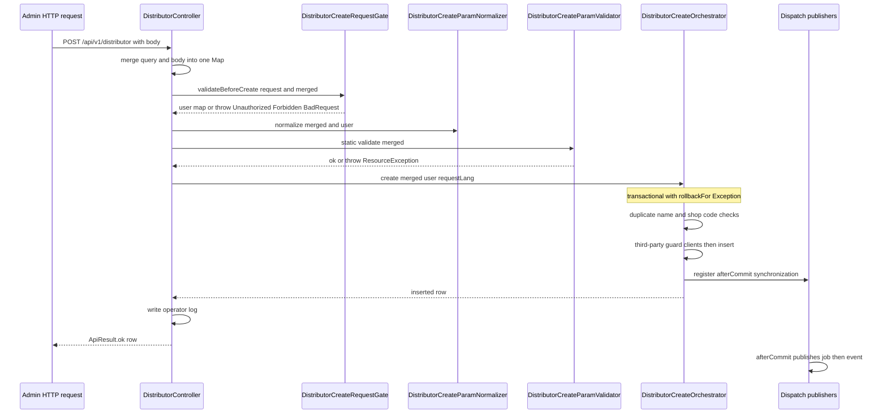

# Bundle Anatomy and Layering Conventions

ECShopX-Java is a multi-module Maven build in which **one business domain = one Bundle = one Maven module**. The root `pom.xml` lists every Bundle as a `<module>`, and each Bundle's POM declares its own peer dependencies. This page documents what a single Bundle looks like on the inside — which packages exist, what each one owns, and the rules a change must follow so that new code lands in the right place.

The worked example throughout is **`ecshopx-orders`** (the largest Bundle: orders, cart, logistics, and settlement — see its `package-info.java`, "订单、购物车、物流与结算域"), with every convention cross-checked against **`ecshopx-goods`** (商品域), **`ecshopx-members`** (会员与账户域), and **`ecshopx-kaquan`** (卡券域).

For the *cross-Bundle* half of the story (who implements whose Ports, and how the dispatch bus moves messages between Bundles), see [Cross-Bundle Communication](cross-bundle-communication.md). For the HTTP request path that reaches these controllers, see [Request Lifecycle](request-lifecycle.md). For MyBatis specifics, see [Persistence — MyBatis](../concepts/persistence-mybatis.md).

## The standard package layout

Every business Bundle roots its code at `cn.shopex.ecshopx.<domain>` and mirrors the same skeleton. The `.gitkeep` files that still sit inside `api/`, `mapper/`, `domain/`, and `service/` across Bundles are placeholders that keep the layout stable when a package is temporarily empty.

| Package | Owns | Worked example |
|---|---|---|
| `api/admin/v1` | Operator-console (admin) HTTP controllers, `@AdminAuth` | `orders/api/admin/v1/OrderController.java` |
| `api/front/v1` | Buyer-facing (H5 / Mini Program) HTTP controllers, `@FrontAuth`/`@FrontNoAuth` | `orders/api/front/v1/WxappPaymentController.java` |
| `api/open` | Unauthenticated/legacy callback endpoints | `payment/api/open/WxpayNotifyController.java`, `wechat/api/open/` |
| `service` | Business logic; often split into orchestrator + request-gate + param-validator | `orders/service/front/wxapp/WxappPaymentService.java` |
| `domain` | MyBatis-Plus entity classes (one per table) | `orders/domain/NormalOrders.java` |
| `mapper` | Mapper interfaces (`@Mapper`, extend `BaseMapper<T>`); XML lives in `resources/mapper/` | `orders/mapper/NormalOrdersMapper.java` |
| `integration` | Implementations of *other Bundles'* Ports | `orders/integration/JushuitanSettingReadPortImpl.java` |
| `dispatch` | Dispatch-bus job handlers (`DispatchHandler`) and event listeners (`DispatchListener`) | `orders/dispatch/FinishOrderJobHandler.java` |
| `cron` | XXL-JOB handlers, named `Schedule*Handler` | `orders/cron/ScheduleFinishOrdersHandler.java` |
| `port` | Port interfaces this Bundle owns and other Bundles implement | `orders/port/WxappCartAddPort.java` |
| `config` | Bundle-local Spring configuration and controller advice | `orders/config/OrdersAdminV1ExceptionAdvice.java` |
| `repository` | Optional query/write helpers layered on top of mappers | `orders/repository/CategoryTaxRateRepository.java` |
| `openapi` | Implementations of `Openapi*Port` interfaces consumed by the ecshopx-openapi gateway | `orders/openapi/OpenapiOrderListPortImpl.java` |
| `event` / `listener` | Spring application events and `@TransactionalEventListener` beans | `orders/event/PaySuccessSpringEvent.java`, `orders/listener/` |
| `support`, `dto`, `util`, `web` | Pure helpers shared inside the Bundle | `kaquan/util/`, `goods/web/DatapassBlockResolver.java` |

Not every Bundle carries every package — `kaquan` has no `repository/`, and `members` has no `cron/` — but when a package exists it always means the same thing. **When you add code, the package choice is decided by the role the code plays, not by convenience.**

## Controllers: `api/admin/v1`, `api/front/v1`, `api/open`

### The three-way API split

* **`api/admin/v1`** — the operator console. Controllers are annotated `@AdminAuth` (processed by `AdminAuthInterceptor`, see `common/annotation/AdminAuth.java`) plus usually `@ShopLog`. Their base `@RequestMapping` is `/api/v1` or `/api/v1/<domain>` (e.g. `orders` admin `OrderController` maps `/api/v1` with routes like `/orders` and `/order/{order_id}`; `goods` admin `ItemsController` maps `/api/v1/goods`; `kaquan` and `members` admin controllers map `/api/v1` with entity routes such as `/member`, `/members`).
* **`api/front/v1`** — the buyer channel (H5 and Mini Program). Controllers carry `@FrontAuth` or `@FrontNoAuth` on the class or on individual methods (`common/annotation/FrontAuth.java`). Their base path is always under `/api/v1/h5app`, with Mini Program endpoints further namespaced by `wxapp` (e.g. `WxappPaymentController` maps `/api/v1/h5app/wxapp`; `kaquan` front `DiscountCardController` maps `/api/v1/h5app`; `goods` front `ItemsController` maps `/api/v1/h5app/wxapp/goods`).
* **`api/open`** — unauthenticated, externally-driven endpoints that must not go through either interceptor: WeChat Pay asynchronous notifications (`payment/api/open/WxpayNotifyController` at `/wechatAuth/wxpay/notify`), WeChat Open Platform callbacks, and legacy PHP URL-compatibility routes such as `GET /wechatAuth/wxapp/qrcode.png`.

The public Open API is **not** served from business-Bundle `api/` packages at all. It lives in the dedicated `ecshopx-openapi` module under `openapi/thirdapi/v1` and `openapi/thirdapi/v2`, whose controllers map `/api/openapi/internal/v1|v2` with method-style route names like `/ecx.order.list`, plus a catch-all gateway controller at `/api/openapi`. Business Bundles contribute behaviour through `openapi/` adapters (see below).

### Bean names: `@RestController("<bundle><surface><version><entity>")`

Because the application is one Spring context that scans `cn.shopex.ecshopx.**`, short controller class names collide constantly — `ItemsController` exists in both `goods` admin and `goods` front, `OrderController` exists in `orders` admin and in `openapi`. **Every controller therefore passes an explicit bean name to `@RestController`.** The observed convention is:

```
<domain><Surface>V1<Entity>          // e.g. ordersFrontV1WxappPayment, goodsAdminV1Items, kaquanDiscountCardFrontV1
```

Concretely, from the four Bundles cross-checked:

| Controller | Bean name |
|---|---|
| `orders` admin `OrderController` | `ordersAdminV1Order` |
| `orders` front `WxappPaymentController` | `ordersFrontV1WxappPayment` |
| `orders` front `CartController` | `ordersFrontV1Cart` |
| `goods` admin `ItemsController` | `goodsAdminV1Items` |
| `goods` front `ItemsController` | `goodsFrontV1Items` |
| `members` front `MembersController` | `membersFrontV1Members` |
| `kaquan` admin `VipGradeController` | `kaquanVipGradeAdminV1` |
| `kaquan` front `DiscountCardController` | `kaquanDiscountCardFrontV1` |
| `openapi` v2 orders `OrderController` | `openapiV2Order` |

The same need is met for **mappers** not by manual names but by `FqcnMapperBeanNameGenerator`, which the bootstrap main class installs on `@MapperScan` so that two `UserDiscountMapper`-alike interfaces across Bundles get fully-qualified bean names instead of colliding on the short default (see `common/mybatis/FqcnMapperBeanNameGenerator.java` and `EcshopxApplication`).

**Where a new endpoint goes:** pick `api/admin/v1` for operator-console endpoints, `api/front/v1` for buyer endpoints, `api/open` for callback/legacy-URL endpoints, and give the controller an explicit `@RestController("...")` bean name that starts with the Bundle's domain prefix.

### Controller behaviour conventions

Controllers in this codebase are deliberately thin on HTTP concerns but thick on *parameter merging*: they merge query-string parameters and a flexible request body into a single `Map<String, Object>` using `FlexibleHttpServletParameterMap.toObjectMap(request)` plus `@FlexibleBody`, then hand the merged map plus the resolved auth claims to a service. `@DingoResponse` on the class (or method) selects the legacy-PHP-compatible error envelope (`data.message` / `data.status_code`) that `GlobalExceptionHandler` produces, with per-class choices of `ResourceStyle` and `BadRequestStyle`. `@Activated(routeAlias = "...")` marks endpoints that additionally need activation/menu/shop permission checks. The `@XxlJob` handlers in `cron/` (below) share the same handler-short-name convention.

Bundle-scoped `@RestControllerAdvice` classes are scoped by `basePackages` or `assignableTypes` to that Bundle's API surface — e.g. `orders/config/OrdersAdminV1ExceptionAdvice.java` applies only to `cn.shopex.ecshopx.orders.api.admin.v1` (and lives in `config/`), while `kaquan` keeps its `DiscountCardControllerExceptionAdvice` next to the affected controllers in `api/admin/v1/`, scoped by `assignableTypes`. Both placements occur; what matters is the tight scoping, not the exact directory.

## `service`: orchestrator + request-gate + param-validator

The `service` package is where the logic lives, and in mature Bundles it is subdivided per channel or per concern (`service/admin`, `service/front/wxapp`, `service/normal`, `service/setting`, …). Write-side entry points frequently follow a **three-part split**:

1. **Request gate** — a `@Service` class named `<Entity><Action>RequestGate` that runs *before* business logic: it re-reads the operator JWT from the request attribute, enforces menu-permission route aliases, asserts company activation, and narrows the allowed entity scope (e.g. which `distributor_id`s the operator may touch). Examples: `distribution/service/DistributorCreateRequestGate.java`, `DistributorUpdateRequestGate`, `CashWithdrawalListRequestGate`. Gates throw `UnauthorizedException` / `BadRequestException` / `ForbiddenException` and return either nothing or a normalized user map.
2. **Param validator / normalizer** — stateless, usually `final` classes with private constructors and static `validate(Map<String, Object>)` methods that check required fields, lengths, and formats. Examples: `distribution/service/DistributorCreateParamValidator.java`, `pointsmall/validation/PointsmallItemsCreateParamValidator`, `reservation/service/ReservationListParamValidator`. Some Bundles put these in a `validation/` subpackage instead of `service/`; either placement is accepted.
3. **Orchestrator** — the `@Service` that owns the transaction and the sequencing of side effects. The seed example is `distribution/service/DistributorCreateOrchestrator.java`: its `create(...)` method is `@Transactional(rollbackFor = Exception.class)`, performs the duplicate-name/duplicate-shop-code checks, calls third-party guard clients (`localDeliveryShopCreateClient`, `wdtErpShopQueryClient`, `jushuitanSettingReadService`), delegates the actual insert to `DistributorCreateService.performInsertAndEvents`, links pickup locations and the aftersales address, and finally registers a `TransactionSynchronization` whose `afterCommit` publishes the dispatch job and event in a fixed order.

The controller method in `DistributorController.createDistributor` shows the resulting call chain end-to-end: `RequestGate → ParamNormalizer → ParamValidator → Orchestrator`, followed by an operator-log write.



Write-path call chain for `POST /api/v1/distributor`, showing where each responsibility lives and that dispatch publication waits for the transaction commit.

Not every write path needs all three parts — simple list endpoints call a single service — but when they do, **the split is by responsibility**: gate = auth/permission, validator = shape, orchestrator = transaction + ordering. Read-side services are usually named for what they return (`WxappOrderDetailService`, `AdminOrderListService`, `StatementsService`), and pure helpers are suffixed `Support` (`WxappOrderDetailTradePrefixSupport`, `StatementTimeWindowCalculator` lives one package up in `statement/`).

**Where new service code goes:** under `service/`, in a channel subpackage when the behaviour is channel-specific (`service/admin`, `service/front/wxapp`, `service/normal`, …), as a `RequestGate` for pre-auth/permission gating, as a static `ParamValidator` for pure field validation, and as an `Orchestrator` when the flow spans several services and must own the transaction.

## `domain`, `mapper`, and `repository`

* **`domain`** holds one MyBatis-Plus entity per table, annotated with the extended metadata annotations from `common/mybatis/metadata` (`@MpTable`, `@MpId`, `@MpField`, `@MpIndex`). These are meta-annotated with the stock MyBatis-Plus `@TableName`/`@TableId`/`@TableField` and additionally carry column type, length, nullability, comments, and indexes migrated from the legacy Doctrine ORM (see the Javadoc: "Extended MyBatis-Plus table annotation with database metadata migrated from ecshopx-api Doctrine ORM"). The `bin/make-migration` helper diffs the live MySQL schema against these domains to generate Flyway SQL under `ecshopx-bootstrap/src/main/resources/db/migration`, so **adding a column means annotating the entity and generating a migration, not hand-writing SQL in the Bundle** — though the readme warns the generated SQL must still be manually reviewed for types, defaults, NULL allowance, comments, and indexes.
* **`mapper`** interfaces are annotated `@Mapper` and extend `BaseMapper<Entity>`. Anything beyond MyBatis-Plus wrapper queries is declared as a method on the interface and implemented in **`src/main/resources/mapper/<Mapper>.xml`** — for example `orders/mapper/NormalOrdersMapper.java` and `resources/mapper/NormalOrdersMapper.xml`, or `kaquan/mapper/UserDiscountMapper.java` with both `@Select` script methods and an XML counterpart. Short annotation-based `@Select` scripts on the interface itself are also accepted for simple aggregates (see `UserDiscountMapper.countReceivedGroupByCardId`).
* **`repository`** is an optional, thin `@Repository` layer that composes mapper calls into named operations — `orders/repository/CategoryTaxRateRepository.java` wraps `CategoryTaxRateMapper` with `findDuplicateForCreate`, `insertEntity`, `updateByIdPartialReturningRow`, and similar methods that own the MyBatis-Plus wrapper logic. Use it when several services need the same query shape; simple flows may call mappers directly (as `FinishOrderBatchService` does with `NormalOrdersMapper`).

The bootstrap scans mappers with `@MapperScan(basePackages = "cn.shopex.ecshopx.**.mapper", nameGenerator = FqcnMapperBeanNameGenerator.class, sqlSessionFactoryRef = "sqlSessionFactory", lazyInitialization = "true")`, and mapper XML is picked up globally via `mybatis-plus.mapper-locations=classpath*:mapper/**/*.xml` in `application.properties`. **A new mapper interface must therefore live in a `mapper` package and its XML under `src/main/resources/mapper/` — anything else is not scanned.**

## `port` vs `integration` — the two halves of cross-Bundle coupling

This is the most important structural rule in the codebase, and the reason circular dependencies are avoided:

* **`port`** contains interfaces that *this Bundle* owns and *other Bundles* implement. The consumer Bundle declares what it needs; the provider Bundle supplies the implementation. Example: `orders/port/WxappCartAddPort.java` is documented as "H5 小程序加购编排端口（由 goods 模块实现，避免 orders→goods 依赖）" — "implemented by the goods module, to avoid an orders→goods dependency". Its implementation is `goods/service/cart/wxapp/WxappCartAddPortImpl.java`, and it is injected directly by `orders/api/front/v1/CartController` and `orders/service/front/wxapp/WxappUpdateCartNumService`.
* **`integration`** contains implementations of Ports owned by *other* Bundles. `orders/integration/JushuitanSettingReadPortImpl.java` implements `common/port/order/JushuitanSettingReadPort` by delegating to the orders-local `OrdersErpSettingRedisReadService`; that same Port is consumed by `aftersales` and `system-link` without depending on `ecshopx-orders`.
* Most cross-Bundle Port *interfaces* live in **`ecshopx-common`** under `common/port/<domain>/` (e.g. `common/port/order/JushuitanSettingReadPort.java`) and are grouped by consumer domain rather than by provider. The `openapi/` package inside a business Bundle serves the same role for the public Open API: `orders/openapi/OpenapiOrderListPortImpl.java` implements `common/openapi/OpenapiOrderListPort` so that the `ecshopx-openapi` v1 controller can call it without depending on `ecshopx-orders` directly.

**Where a new Port goes:** if other Bundles need something this Bundle owns, declare the interface in this Bundle's `port/` package (or in `common/port/...` when it is a shared contract) and let the provider Bundle implement it in its own `integration/` or `service/` package. Never make Bundle A depend on Bundle B merely to call one method — extract a Port instead. The bootstrap wires any remaining adapters that would otherwise create cycles (see `bootstrap/.../bootstrap/order/CompanyPassportUidByCompanyIdPortAdapter.java`).

## `dispatch` and `cron`: the two async entry points

Business Bundles expose two kinds of background work, and they are **not interchangeable**:

* **`dispatch/`** contains beans for the cross-Bundle dispatch bus provided by `ecshopx-dispatch`. There are two shapes:
  * `*JobHandler implements DispatchHandler` — a named job. `orders/dispatch/FinishOrderJobHandler` implements `handle(Map<String,Object> payload)` and delegates to `FinishOrderJobService`. Job handlers are looked up by message name in the `DispatchRegistry`.
  * `*DispatchListener implements DispatchListener` — an event listener. `orders/dispatch/UpdateItemSalesDispatchListener` implements `onEvent(payload)` and is registered against specific event names such as `OrdersDispatchEventNames.EVENT_TRADE_FINISH`.
  * Publisher-side interfaces live in `ecshopx-common` (`common/dispatch/FinishOrderJobDispatchPublisher`, `OrdersTradeFinishDispatchPublisher`, `DistributionAddEventDispatchPublisher`, …) so a Bundle can *publish* without depending on the bus implementation or on the consumer. **The producer side never registers handlers with the registry directly.**
  * Registration is **not** done with annotations. The bootstrap module contains explicit `*RegistrationConfig` `@Configuration` classes (e.g. `bootstrap/.../config/RefundByOrderUpdateOrderStatusJobRegistrationConfig.java` calls `dispatchRegistry.registerJob(...)` in `@PostConstruct`, and `UpdateItemSalesDispatchListenerRegistrationConfig` calls `registerEventListener(...)` with a `@Order` value that controls bean-initialization order). A Bundle that owns a new job handler must therefore add a matching registration config in `ecshopx-bootstrap`.
  * Payload conventions: `payload == null` is normalized to `Map.of()` by the handler itself (`FinishOrderJobHandler`), and after-commit publication is done either via `TransactionSynchronizationManager` inside the orchestrator (as `DistributorCreateOrchestrator` does) or via a dedicated `*AfterCommitDispatchPublisher` wrapper (as `orders/dispatch/OrdersTradeFinishAfterCommitDispatchPublisher` does for `OrdersTradeFinishDispatchPublisher`).
* **`cron/`** contains XXL-JOB handlers named `Schedule*Handler`. Every handler is a `@Component` with a `@XxlJob("<short-name>")` method, a short-name constant (`HANDLER_SHORT` in orders, `HANDLER_SHORT_NAME` in kaquan), timing/log lines in the `[cron][<name>] done/failed, cost=...ms` shape, and — critically — a **failure path that publishes a `CronAlertEvent` and rethrows**, so that XXL-JOB marks the run as failed. `orders/cron/ScheduleFinishOrdersHandler` is the canonical example; `kaquan/cron/ScheduleCancelExpiredCardHandler` and the whole `orders/cron/Schedule*Handler` family (18 handlers) follow it exactly. Cron handlers delegate to a service (`NormalOrderCronService.scheduleFinishOrders()`, `UserDiscountService.scheduleCancelExCard()`); they contain no business logic of their own.
* **`listener/` + `event/`** is the third, lighter async mechanism: plain Spring `ApplicationEvent`s (`PaySuccessSpringEvent`, `NormalOrderCancelSpringEvent`) consumed by `@TransactionalEventListener(phase = AFTER_COMMIT)` beans such as `orders/listener/OrderProcessLogSpringEventListener`. Use this for intra-Bundle, after-commit work that does not need retry or cross-Bundle fan-out.

**Where new async code goes:** a bus job or event handler goes in `dispatch/` (plus a bootstrap registration config); a scheduled task goes in `cron/` as `Schedule<Thing>Handler`; a transactional after-commit side effect stays inside the Bundle in `listener/` with its event in `event/`.

## `config` and module-local configuration

`config/` holds Spring `@Configuration`/`@Component` beans that are local to the Bundle: scheduling enablement (`orders/config/OrdersSchedulingConfig` with `@EnableScheduling`), executor config, and the API-surface-scoped `@RestControllerAdvice` classes described above.

Module-local YAML lives at `src/main/resources/application-<module>.yml` (e.g. `application-orders.yml`, currently a placeholder documenting the optional profile import) and is wired in through `spring.config.import=optional:classpath:application-*.yml` in `ecshopx-bootstrap`'s `application.properties`. The `cron/testcfg/CronTestMockConfig` class (annotated `@Profile("test-cron")`) is the pattern for swapping side-effect beans (Redis writes, third-party calls, bus publishes) for No-op implementations during cron-diff testing — note that it lives in **`src/main`**, not `src/test`, because the profile is activated at runtime by the migration orchestrator.

## Bundle POMs and the dependency direction

The dependency rules are:

* **Every business Bundle depends on `ecshopx-common`.** Most also depend on **`ecshopx-dispatch`** (orders, members, aftersales, payment, reservation, companys, third-party, wsugc, chinaums-pay, popularize all declare it; goods and kaquan currently do not, and rely on `ecshopx-common`'s publisher interfaces only).
* **A Bundle declares only the curated set of peer Bundles it actually needs.** `ecshopx-orders/pom.xml` is the reference: beyond `ecshopx-common` and `ecshopx-dispatch` it lists `ecshopx-work-wechat`, `ecshopx-third-party`, `ecshopx-supplier`, `ecshopx-reservation`, `ecshopx-espier`, `ecshopx-members`, `ecshopx-companys`, `ecshopx-point`, `ecshopx-aftersales`, `ecshopx-payment`, `ecshopx-chinaums-pay`, `ecshopx-deposit`, `ecshopx-hfpay`, `ecshopx-popularize`, and `ecshopx-super-admin`, plus the technical dependencies it needs directly (`mybatis-plus-spring-boot3-starter`, `xxl-job-core` 2.5.0, `weixin-java-pay`, `spring-boot-starter-data-redis`, `spring-boot-starter-mail`).
* **Peer selection is deliberately asymmetric.** `ecshopx-goods` depends on `ecshopx-orders` (so goods can implement the cart Ports that orders owns), while `ecshopx-orders` does **not** depend on `ecshopx-goods` — the cart flow is inverted through `orders/port/WxappCartAddPort`. Similarly `ecshopx-kaquan` depends on `ecshopx-orders`, and `ecshopx-openapi` depends only on `ecshopx-common`, reaching Bundles through their `openapi/` Port adapters. Before adding a new peer dependency, check whether a Port inversion would keep the graph acyclic.
* **`ecshopx-bootstrap` depends on everything** and is the only Spring Boot executable (`spring-boot-maven-plugin` with `mainClass cn.shopex.ecshopx.EcshopxApplication`). It also carries the Flyway migrations, the global `application.properties`, the `DispatchBusConfig` that instantiates `DispatchRegistry`/`DispatchFacade`/`RedisDispatchDriver`, the multi-Redis configuration, and every `*RegistrationConfig` described above. **Business Bundles only expose capabilities; the bootstrap wires them together.**

## Conventions cross-checked across Bundles

| Convention | orders | goods | members | kaquan |
|---|---|---|---|---|
| `api/admin/v1` + `@AdminAuth` | yes | yes | yes | yes |
| `api/front/v1` + `@FrontAuth`/`@FrontNoAuth` under `/api/v1/h5app` | yes | yes | yes | yes |
| Named `@RestController("<prefix>...V1...")` | yes | yes | yes | yes |
| `domain` + `mapper` (+ XML in `resources/mapper`) | yes | yes | yes | yes |
| `integration` implementing foreign Ports | yes | yes | yes | yes |
| `dispatch` handlers/listeners | yes | yes | yes | yes |
| `cron` `Schedule*Handler` | yes | only testcfg mock | no | yes |
| `port` owned interfaces | yes | no | no (only a `service/export/port` subpackage) | no |
| `repository` layer | yes | yes | no | no || `openapi/` adapters for the public API | yes | yes | yes | yes |

## Focused tests that pin these conventions

Tests live in each Bundle's `src/test/java` and mirror the main package structure:

* `orders` cron-handler tests (`orders/cron/ScheduleFinishOrdersHandlerTest.java`) pin the alert-and-rethrow contract: `execute_ok_noAlert` asserts the INFO log contains the handler short name and return count and that no `CronAlertEvent` is published; `execute_failure_publishesAlertAndRethrows` captures the `CronAlertEvent` and asserts its `handlerShortName` equals `"finish-orders"` plus the ERROR log shape. Equivalent tests exist for all 18 `orders` cron handlers.
* Dispatch-handler tests (`orders/dispatch/FinishOrderJobHandlerTest.java`) pin the null-payload-to-empty-map normalization and the delegation to the service; consumer-runtime tests (`...DispatchConsumerRuntimeTest`) exercise the ack/retry/fail-recording path.
* WebMvc slice tests in other Bundles (e.g. `reservation/.../ReservationAdminV1ReservationControllerCreateFinishPublishWebMvcTest`) verify that a controller in `api/admin/v1` produces the annotated `@Activated`/dispatch behaviour.
* The naming conventions are enforced less by tests than by compilation and startup: a missing `@RestController` bean name collides only at runtime, and a mapper outside `**.mapper` simply is not scanned — both failures appear as Spring context startup errors, which is why the readme instructs contributors to "follow the repository's existing package structure and layering conventions (`controller` / `service` / `mapper` / `integration` / `port`)".

## Quick reference: where new code goes

| You are adding… | Put it in… | Also remember |
|---|---|---|
| Operator-console endpoint | `<bundle>/api/admin/v1/` | `@AdminAuth`, `@ShopLog`, `@DingoResponse`, explicit `@RestController` bean name, `/api/v1...` mapping |
| Buyer (H5/wxapp) endpoint | `<bundle>/api/front/v1/` | `@FrontAuth`/`@FrontNoAuth`, base `/api/v1/h5app[/wxapp]` |
| Unauthenticated callback / legacy URL | `<bundle>/api/open/` | No auth annotations; raw response body if needed |
| Business logic for one endpoint | `<bundle>/service/[channel]/` | One service per operation, named after what it does |
| Permission/activation gating | `<bundle>/service/<Entity><Action>RequestGate` | Throws before any business code runs |
| Field validation | `<bundle>/service/` or `validation/` as a static `ParamValidator` | Stateless, no Spring beans |
| Multi-step transactional flow | `<bundle>/service/<Entity><Action>Orchestrator` | Owns `@Transactional` and after-commit dispatch order |
| New table / columns | `<bundle>/domain/` entity + Flyway migration in `ecshopx-bootstrap` | Annotate with `@MpTable`/`@MpId`/`@MpField`, run `bin/make-migration` |
| Custom SQL | `<bundle>/mapper/<X>Mapper.java` + `<bundle>/src/main/resources/mapper/<X>Mapper.xml` | Mapper package name is mandatory for scanning |
| Query composition over mappers | `<bundle>/repository/` | `@Repository`, optional layer |
| Implement another Bundle's Port | `<bundle>/integration/` (or `openapi/` for the public API) | Never make the consumer depend on you |
| Own a Port others implement | `<bundle>/port/` (or `common/port/<domain>/`) | Document the intended implementer in the Javadoc |
| Dispatch-bus job | `<bundle>/dispatch/<X>JobHandler` + registration config in `ecshopx-bootstrap` | `implements DispatchHandler`; publisher interface in `ecshopx-common` |
| Dispatch event listener | `<bundle>/dispatch/<X>DispatchListener` + registration config | `implements DispatchListener`; register per event name |
| Scheduled task | `<bundle>/cron/Schedule<Thing>Handler` | `@XxlJob`, `CronAlertEvent` + rethrow on failure |
| Intra-Bundle after-commit hook | `<bundle>/event/` + `<bundle>/listener/` | `@TransactionalEventListener(AFTER_COMMIT)` |
| Bundle-scoped exception mapping | `<bundle>/config/` as `@RestControllerAdvice(basePackages=...)`, or beside the controllers scoped by `assignableTypes` | Scope it to your API package |
