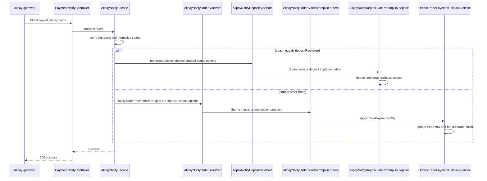
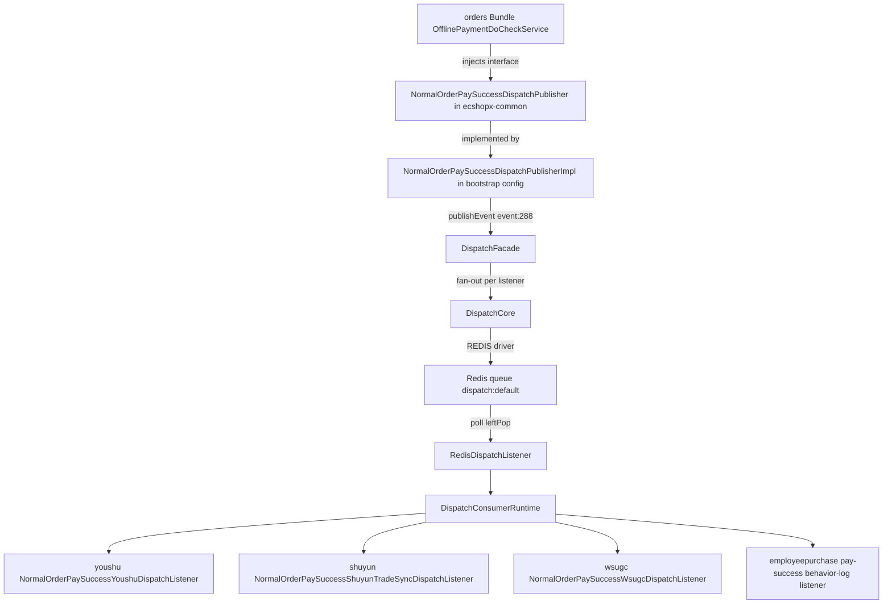

# Cross-Bundle Ports and Wiring in Bootstrap

ECShopX-Java is a multi-module Maven build in which one business domain = one Bundle = one Maven module, and the Maven dependency graph between Bundles is deliberately **acyclic** (see [Bundle Anatomy and Layering Conventions](bundle-layering.md)). But commerce domains are not islands: payment must tell orders "this trade is paid", orders must tell youshu/shuyun/marketing-center "this order was placed", and salesperson cart pages must reuse goods' cart orchestration. This page documents the mechanisms that make that possible without any Bundle depending on its consumer:

1. **Ports** — interfaces owned by the *consumer* (in `ecshopx-common` or the consumer Bundle's own `port/` package), implemented by the *provider* Bundle.
2. **Dispatch publisher interfaces** — `*DispatchPublisher` interfaces in `ecshopx-common/dispatch`, implemented by small `*DispatchPublisherImpl` classes in `ecshopx-bootstrap`'s `config` package, that publish messages onto the dispatch bus without the producer knowing who listens.
3. **The dispatch bus** — `ecshopx-dispatch`'s `DispatchFacade` / `DispatchCore` / Redis-backed queues, with consumers registered explicitly by bootstrap `*RegistrationConfig` classes.
4. **Spring application events** — intra-Bundle (or common-event) `ApplicationEvent`s consumed by `@TransactionalEventListener(AFTER_COMMIT)` beans, for side effects that never cross a Bundle boundary.
5. **Bootstrap adapters** — the small set of `@Component`/`@Service` classes that live directly in `ecshopx-bootstrap` and implement a contract by composing several Bundles' beans, when even a Port inversion cannot break the cycle.

The overarching rule: **the consumer owns the contract, the provider supplies the implementation, and `ecshopx-bootstrap` — which depends on everything — is where any remaining edge is wired.** A Bean may only be injected if its interface is visible at compile time on the consumer's classpath, which is why almost every seam below runs through `ecshopx-common`.

## Why the contracts live where they live

`ecshopx-common` is the only module every Bundle depends on (its POM declares no Shopex peer dependencies — only Spring Boot starters, MyBatis-Plus, and Lombok). That makes it the only place an interface can live if two arbitrary Bundles need to share it. The POM dependency asymmetries that force this arrangement:

* `ecshopx-goods` depends on `ecshopx-orders` (so goods implements the cart Ports orders owns), but orders does **not** depend on goods.
* `ecshopx-goods` also depends on `ecshopx-salesperson` (goods' cart orchestration reads the salesperson cart repository), so salesperson cannot depend back on goods — its cart-list page flows through a common Facade implemented in goods.
* `ecshopx-orders` depends on `ecshopx-payment`; payment depends only on common + chinaums-pay + point. When payment needs orders-side behaviour it inverts through Ports.
* `ecshopx-bootstrap` declares all ~50 Bundles and is the only Spring Boot executable.

Two contract homes exist by design:

* **`common/port/<consumer-domain>/`** (~115 interfaces across `order/`, `orders/`, `payment/`, `shuyun/`, `localdelivery/`, `goods/`, `aftersales/`, `members/`, … — 26 domain subpackages in all, plus a small sibling `common/order/port/` for later additions like `VipGradeMembercardTradePaidPort`) for shared seams, grouped by the domain that *consumes* them. Example: `common/port/order/JushuitanSettingReadPort` is implemented by `orders/integration/JushuitanSettingReadPortImpl` (delegating to the orders-local `OrdersErpSettingRedisReadService`) so `aftersales` and `system-link` can read Jushuitan ERP settings without depending on `ecshopx-orders`.
* **`<provider-adjacent-bundle>/port/`** for single-consumer contracts where the *provider* already sits downstream of the consumer. Example: `orders/port/WxappCartAddPort` is implemented by `goods/service/cart/wxapp/WxappCartAddPortImpl`; its Javadoc says "由 goods 模块实现，避免 orders→goods 依赖" (implemented by goods, to avoid an orders→goods dependency). Goods depends on orders, so goods can see the interface and orders injects it — no common-package detour needed.

## Mechanism 1: Ports and dependency inversion (sync, request-scoped)

The Port pattern is classic dependency inversion, tuned for "one method, one direction". The worked example the whole system leans on is the **Alipay notify flow**, which is the clearest case of *why* payment defines interfaces that orders and deposit implement.

`ecshopx-payment` owns the HTTP endpoint `POST /api/v1/alipay/notify` (`payment/api/admin/v1/PaymentNotifyController`) and the notify-verification logic (`AlipayNotifyFacade` — signature verification, config loading, status normalization). But applying the payment result — updating the `trade` row, triggering the pay-success cascade, or crediting a deposit recharge — is orders' and deposit's business. If payment called orders' services directly, `ecshopx-payment` would need a compile dependency on `ecshopx-orders` and `ecshopx-deposit` — and since orders already depends on payment (payment's config-validation and membercard SDK services are injected by `OrdersPaymentDoPaymentService`), that would be a Maven **cycle**. Instead payment declares two Ports in its own `integration/alipay/` package:

```java
// ecshopx-payment/.../integration/alipay/AlipayNotifyOrderSidePort.java
public interface AlipayNotifyOrderSidePort {
    long resolveDistributorIdForAlipayRedis(long companyId, String outTradeNo);
    void applyTradePaymentAfterAlipay(String outTradeNo, String status, Map<String, Object> options);
}

// ecshopx-payment/.../integration/alipay/AlipayNotifyDepositSidePort.java
public interface AlipayNotifyDepositSidePort {
    void rechargeCallback(String depositTradeId, String status, Map<String, Object> options);
}
```

The providers implement them in their own `integration`-style packages:

* `orders/service/alipay/AlipayNotifyOrderSidePortImpl` — `applyTradePaymentAfterAlipay` delegates to `OrdersTradePaymentCallbackService.applyTradePaymentNotify`, which updates the trade row and (on SUCCESS) fans out the trade-finish cascade; `resolveDistributorIdForAlipayRedis` reads the `trade` + `distribution_distributor_peek` tables to find the per-distributor payment-subject setting.
* `deposit/integration/alipay/AlipayNotifyDepositSidePortImpl` — `rechargeCallback` delegates to `AdapayDepositTradeRechargeCallbackService.rechargeCallback`.

At runtime, `AlipayNotifyFacade.handle` picks the side by passback parameter: `attach=depositRecharge` routes to the deposit Port, everything else to the order Port. Payment never names orders or deposit in its POM; Spring's single application context (bootstrap scans `cn.shopex.ecshopx`) resolves the implementations. The same inversion pattern recurs in every direction: `WxpayNotifyPaymentContextLoader` injects `AlipayNotifyOrderSidePort` just to resolve distributor settings for wxpay notifies, and kaquan's `VipGradeMembercardTradePaidPortImpl` implements the common `common/order/port/VipGradeMembercardTradePaidPort` hook that orders calls after a membercard trade is marked SUCCESS.



Alipay async notify crossing the payment → orders / payment → deposit boundary through Ports owned by payment; payment's POM contains neither `ecshopx-orders` nor `ecshopx-deposit`.

A second flavor of Port lives in the Facade family. `common/service/salesperson/SalespersonCartDataListFacade` is the cart-list orchestration entry for the salesperson (导购) channel; its Javadoc states the implementation lives in the goods domain so the controller can inject the interface and avoid a module cycle. `goods/service/cart/salesperson/SalespersonCartDataListService` implements it (composing the salesperson cart repository — which goods can see because salesperson is upstream of goods — plus goods-local SKU-load/format services), and `salesperson/api/front/v1/SalespersonCartController` injects the Facade. Same shape, different naming: `*Port` for narrow contracts, `*Facade` for an orchestration entry point.

### Optional Ports: `ObjectProvider` and NoOp defaults

Some Ports are genuinely optional — the implementing Bundle may or may not provide a bean, and the consumer must degrade gracefully:

* **`ObjectProvider<T>.getIfAvailable()`** — used when the Port has at most one natural implementation and absence is a supported state. `OrdersPaymentDoPaymentService` injects `ObjectProvider<OrdersMiniProgramHfpayPayPort>` and `ObjectProvider<VipGradeMembercardTradePaidPort>`; for hfpay pay-type requests it calls `getIfAvailable()` and throws "不支持支付服务，请联系商家" when null, while the membercard hook silently returns. `WxappOrderDetailPostProcessService` does the same with `ObjectProvider<OrderDetailEmployeePurchaseEnrichmentPort>` to enrich order details only when the employee-purchase module contributes a bean. This keeps the port contract in common while the wiring stays optional at runtime.
* **NoOp default + `@Primary` provider adapter** — used when absence must fail loudly or the Port must always resolve. `common/port/shuyun/ShuyunOfflineBenefitCouponGrantPortNoOp` is a `@Component` that throws "数云线下权益发券未接入卡券模块" (Shuyun offline benefit coupon grant not connected to the coupon module); when `ecshopx-kaquan` is on the classpath, its `@Primary ShuyunOfflineBenefitKaquanCouponGrantAdapter` (delegating to `UserDiscountReceiveCardService.receiveCard`) wins injection. Every `ShuyunOpenPlatform*Port` in that package follows the same pair-of-files pattern. `@Profile`-scoped NoOps do the same for the `test-cron` migration-diff profile (e.g. `NoopAftersalesRefundJobSideEffects` behind `@Profile("noop-aftersales-refund-job-side-effects")`, and the large `CronTestMockConfig` families that replace dispatch publishers and Redis-writing ports during stage-4 snapshot comparison).

## Mechanism 2: dispatch publisher interfaces (async, fire-and-forget)

Ports solve "consumer calls provider". The opposite problem — "producer announces something happened, and any number of downstream Bundles may care" — is solved by the dispatch bus (see [Dispatch Bus](../concepts/dispatch-bus.md) for the component's own anatomy), and the seam that keeps producers decoupled from it is the **publisher interface**.

`ecshopx-common` holds ~130 `*DispatchPublisher` interfaces — the bulk (~120) in `common/dispatch/` alongside the `*DispatchEventNames` / `*DispatchJobNames` constants, plus domain-specific ones in `common/kaquan/port/` and `common/promotions/port/`. A few Bundles that depend on `ecshopx-dispatch` also declare publisher interfaces locally (e.g. `members/dispatch/AdminMemberExportFileJobDispatchPublisher`, whose impl still lives in bootstrap). Each is one method wide:

```java
// ecshopx-common/.../dispatch/NormalOrderPaySuccessDispatchPublisher.java
public interface NormalOrderPaySuccessDispatchPublisher {
    void publish(Map<String, Object> payload);
}
```

A producer Bundle (say, orders publishing normal-order pay-success, or the offline-payment approval flow) injects only this interface. The implementation lives in `ecshopx-bootstrap/src/main/java/cn/shopex/ecshopx/config/`:

```java
// ecshopx-bootstrap/.../config/NormalOrderPaySuccessDispatchPublisherImpl.java
@Component
public class NormalOrderPaySuccessDispatchPublisherImpl implements NormalOrderPaySuccessDispatchPublisher {

    private static final DispatchOptions NORMAL_ORDER_PAY_SUCCESS_PARENT_PUBLISH_OPTIONS =
            new DispatchOptions(
                    DispatchMode.ASYNC,
                    DispatchDriverType.REDIS,
                    null,
                    null,
                    RetryPolicy.platformDefault());

    private final DispatchFacade dispatchFacade;

    @Override
    public void publish(Map<String, Object> payload) {
        dispatchFacade.publishEvent(
                OrdersDispatchEventNames.EVENT_NORMAL_ORDER_PAY_SUCCESS,
                payload,
                NORMAL_ORDER_PAY_SUCCESS_PARENT_PUBLISH_OPTIONS);
    }
}
```

Because bootstrap is the only module that depends on `ecshopx-dispatch` *and* on every business Bundle, it is the natural home for the mapping "common interface → bus event name". A minority of Bundles do declare `ecshopx-dispatch` at compile scope (orders, members, companys, reservation, popularize, wsugc) and may inject `DispatchFacade` directly — e.g. `orders/dispatch/OrdersTradeFinishAfterCommitDispatchPublisher` and `popularize/dispatch/*` wrap the facade directly — while a few more declare it test-scope only (payment, chinaums-pay, aftersales, third-party) for dispatch-flow tests. Bundles without the edge (goods, kaquan, salesperson, shuyun, youshu, …) get by with common's publisher interfaces and `DispatchListener`/`DispatchHandler` (both functional interfaces defined in `common/dispatch`) alone. `ecshopx-dispatch` itself contributes three publisher impls in its `integration/` package (`OrderProcessLogPublishPortImpl`, `HfpayDistributorWithdrawSuccessEventPublishPortImpl`, `HfpayRefundSuccessEventPublishPortImpl`) because it owns the bus types those ports need.

### Event and listener naming

Bus message names are versioned strings aligned with the legacy PHP event registry so migrations can be diffed:

* `EVENT_NORMAL_ORDER_PAY_SUCCESS = "event:288:OrdersBundle\\Events\\NormalOrderPaySuccessEvent"` — bus name equals the legacy CSV fullname event 288.
* `EVENT_TRADE_FINISH = "event:291:OrdersBundle\\Events\\TradeFinishEvent"`, plus a second plane `EVENT_TRADE_FINISH_CSV292 = "event:292:OrdersBundle\\Events\\TradeFinishEvent"` used when the *admin offline bank-transfer approval* (`do_check`) path enters the same fan-out — the two planes carry the same listeners but distinct bus message names.
* Listener names mirror legacy listener FQNs or method pairs: `listener:youshu.orders_normal_order_pay_success`, `listener:WsugcBundle\\Listeners\\Order`, `listener:HfPayBundle\\Listeners\\HfpayTradeRecordListener@paySuccess`.

The constants live in `common/dispatch/*DispatchEventNames.java` per domain (`OrdersDispatchEventNames`, `SystemLinkDispatchEventNames`, `HfpayDispatchEventNames`, …) and are the single source of truth for both publisher impls and bootstrap registration configs.

## Mechanism 3: the dispatch bus (registration, transport, delivery, failure)

The bus itself lives in `ecshopx-dispatch` and is intentionally small — a handful of records and classes, no annotation magic.

**Registration is explicit, not annotation-scanned.** Bootstrap's `config` package contains ~200 `*RegistrationConfig` `@Configuration` classes; each is 30–50 lines, takes a `DispatchRegistry` plus one handler/listener bean from a business Bundle, and calls `registerJob` / `registerEventListener` in `@PostConstruct`:

```java
// ecshopx-bootstrap/.../config/ShuyunOpenPlatformNormalOrderPaySuccessDispatchListenerRegistrationConfig.java
@Configuration
public class ShuyunOpenPlatformNormalOrderPaySuccessDispatchListenerRegistrationConfig {

    @PostConstruct
    public void register() {
        dispatchRegistry.registerEventListener(
                OrdersDispatchEventNames.EVENT_NORMAL_ORDER_PAY_SUCCESS,
                OrdersDispatchEventNames.LISTENER_SHUYUN_OPEN_PLATFORM_TRADE_SYNC_ON_NORMAL_ORDER_PAY_SUCCESS,
                ListenerDispatchOptions.async("default", null),
                listener);
    }
}
```

`InMemoryDispatchRegistry` enforces uniqueness at registration time — a duplicate job name or duplicate event-name/listener-name pair throws `IllegalStateException` at startup (fail-fast wiring, no silent override). Ordering matters where a listener must register after another; configs carry `@Order(n)` (e.g. `@Order(77)` on the trade-finish bridge, `@Order(81)` on the wxa-template listener) or an explicit `@DependsOn("youshuNormalOrderPaySuccessDispatchListenerRegistrationConfig")` (the wsugc pay-success listener). This is the pattern, not an exhaustive list: **a Bundle that owns a new bus job or event listener must add a matching registration config in `ecshopx-bootstrap` — the producer side never registers handlers itself.**

**Publish and fan-out.** `DispatchFacade.publishEvent(messageName, payload, options)` routes by mode:

* `DispatchMode.ASYNC` + fan-out planner present → `DispatchFanOutPlanner.plan` expands the single event into **one `DispatchMessage` per registered listener**, each stamped with that listener's queue (default `"default"`), the listener's retry policy, and the listener name. Each planned message goes through `DispatchCore.dispatch`.
* `DispatchMode.SYNC` with exactly one registered listener → the facade publishes a parent+child pair and executes the child through `SyncDispatchDriver`, which invokes the listener's `onEvent` in the calling thread. Sync events therefore give in-process, in-call-stack delivery (the trade-finish "bridge" listener below relies on this).
* `dispatchJob` (the job half) always builds one message and hands it to the core.

`DispatchCore` picks the driver: `SYNC` mode → `SyncDispatchDriver`; otherwise `AsyncDispatchDriver` by `DispatchDriverType` (`REDIS` is what `DispatchBusConfig` registers; `RABBITMQ` types exist in `ecshopx-dispatch/rabbit/` with a `RabbitDispatchListener` for AMQP delivery, but bootstrap's `DispatchBusConfig` wires only the Redis driver).

**Transport.** `RedisDispatchDriver` (configured in bootstrap's `DispatchBusConfig` with the dedicated `dispatchBusStringRedisTemplate` bean from `MultiRedisConfig`, ready-queue prefix `dispatch:`, delayed ZSET key `dispatch:delayed`):

* Non-delayed messages are `rightPush`ed onto `dispatch:<queue>` (queue names in use: `default`, `slow`, `sms`).
* Delayed messages (non-zero `Duration delay`) are added to the `dispatch:delayed` ZSET scored by ready-epoch-millis; `RedisDispatchDelayedPollScheduler` (`@Scheduled` every `dispatch.redis.delayed-mover.poll-delay-ms`, default 1000 ms, toggle `dispatch.redis.delayed-mover.enabled`) moves due entries back onto their ready queue via `RedisDelayedDispatchMover` (clearing the delay so the re-enqueued message is not re-delayed).
* Failed messages land on `dispatch:dead:<queue>`.

Delivery is **polling**, not push: `RedisDispatchListener.poll()` runs on a `@Scheduled(fixedDelay = dispatch.redis.poll-delay-ms, default 1000 ms)` tick, `leftPop`s one message from `dispatch:default`, then up to `dispatch.redis.slow.batch-size` (default 20) from `dispatch:slow` and `dispatch:sms` each, and feeds each to `DispatchConsumerRuntime.consume(message, 1)`.

**Delivery and failure semantics.** `DispatchConsumerRuntime.consume` looks up the target by message type — `registry.jobHandler(name).handle(payload)` for jobs, or the registered listener whose `listenerName` matches the message's (async fan-out messages carry their listener name; consuming the wrong listener is impossible) — then records an ack. On a `RuntimeException`:

* `DispatchRetryDecider.shouldRetry(message, currentAttempt)` is `currentAttempt < message.retryPolicy().maxAttempts()`; `RetryPolicy.platformDefault()` is **3 attempts / 3 s next delay**. If retryable, the runtime records a retry and rethrows (the driver's `retry` re-enqueues the message).
* If attempts are exhausted, `FailedJobRecorder.recordFailure` serializes the message (message name/type, listener name, queue, payload JSON, retry count, exception class/message, driver, delay, consumer id, occurred/failed timestamps) into a `FailedJobEntity` and inserts it via `FailedJobMapper` (MyBatis mapper with XML in `ecshopx-dispatch/src/main/resources/mapper/FailedJobMapper.xml`, table `failed_jobs`), the structured logger emits a `failed` line, and the driver's `fail` pushes the payload to the dead queue. Note bootstrap's `DispatchBusConfig` currently registers `failedJobMapper` as a stub returning `1` — the durable record is opt-in wiring, while the dead-queue push always happens.

**After-commit publication.** Publishing must often wait for the DB transaction. Two wrappers implement this: `orders/dispatch/OrdersTradeFinishAfterCommitDispatchPublisher` registers a `TransactionSynchronization` whose `afterCommit` publishes (publishing immediately if no synchronization is active), and `ecshopx-dispatch`'s own `OrderProcessLogPublishPortImpl` does the same with `DispatchOptions.oplQueuedAfterCommit()` (async + Redis). Bootstrap's `OrdersTradeFinishDispatchPublisherBeansConfig` exposes two beans of the same interface — `@Primary ordersTradeFinishDispatchPublisher` for the event:291 plane and the qualified `ordersTradeFinishDispatchPublisherOfflineCsv292` for the event:292 plane — so `OrdersTradePaymentCallbackService` and `OfflinePaymentDoCheckService` (which injects the qualifier) publish onto different planes from the same contract.

### A worked event: normal-order pay-success



One dispatch event crossing Bundle boundaries: the producer (orders) holds only a common interface, bootstrap implements it and publishes onto the bus, and the fan-out planner turns one event into per-listener messages consumed by listeners in four other Bundles — none of which orders' POM mentions.

The trade-finish cascade is the widest instance of this fan-out: `OrdersTradePaymentCallbackService.applyTradePaymentNotify` publishes the reloaded `trade` row through `JushuitanTradeFinishDispatchPublisher`, `OrdersTradeFinishDispatchPublisher`, and `WdtErpTradeFinishDispatchPublisher` in one go, and `EVENT_TRADE_FINISH` alone carries ~20 registered listeners (notify-push, wxa template, sms notify, fapiao, profit, consume-card, link-member, statistics, hfpay trade-record pay-success, marketing-center, dm-crm, ome, order-process-log, bargain-help-pay, printer, groups-activity, item-sales, offline-refund, work-wechat, and the bridge below), split between sync (`syncDefaults()`) and async (`async("slow"/"default", null)`) registrations. One of them — `OrdersTradeFinishNormalOrderPaySuccessBridgeDispatchListener` — is itself a *publisher*: registered as a **sync** listener on both trade-finish planes, it marks mall normal orders paid and then calls `NormalOrderPaySuccessDispatchPublisher.publish`, chaining the trade-finish event into the pay-success event inside the same synchronous call stack.

## Mechanism 4: Spring application events (intra-Bundle, after-commit)

For side effects that stay inside one Bundle, plain Spring events are lighter than the bus — no payload JSON, no Redis, no retry. `orders/event/OrderProcessLogSpringEvent` (with a factory `cancelBySystem(ServiceOrders)`) is published by order services and consumed by `orders/listener/OrderProcessLogSpringEventListener`:

```java
@TransactionalEventListener(phase = TransactionPhase.AFTER_COMMIT, fallbackExecution = true)
public void onOrderProcessLog(OrderProcessLogSpringEvent event) {
    orderProcessLogBusService.persistEntitiesMap(event.getEntities());
}
```

The `AFTER_COMMIT` phase is the invariant: log rows are persisted only if the surrounding transaction committed, so a rollback never leaves orphaned process-log entries. `fallbackExecution = true` keeps the listener working when no transaction is active. Other instances of the same pattern: `orders/listener/AdminNormalOrderFullCancelPostCommitListener` (three `@TransactionalEventListener(AFTER_COMMIT)` handlers on refund/cancel events), `promotions/service/event/SeckillActivityCommittedEventListener`, `supplier/listener/SupplierOrderPaidConfirmCommittedListener`, `members/listener/CompanyActivatedStaffTagListener`. Note the hybrid case: `AftersalesRefundDoRefundService` publishes **both** a `TradeRefundSpringEvent` (Spring, in-Bundle) *and* dispatch events (`TradeRefundStatisticsJobDispatchPublisher`, `TradeRefundFinishEventDispatchPublisher`) — Spring events for local coupling, the bus for cross-Bundle fan-out. The bus has its own parallel channel for the same data: `OrderProcessLogDispatchListener` (bus listener on `EVENT_ORDER_PROCESS_LOG`, registered in the `slow` queue) persists the same log shape for producers that go through the bus instead.

## Mechanism 5: adapters that live in bootstrap

When a Port would have to be implemented by composing beans from *several* Bundles — or when the natural implementer would create a cycle no matter where the interface sits — the implementation simply lives in `ecshopx-bootstrap`, which depends on everything. These cluster in `bootstrap/<domain>/` sub-packages and in `config/`:

* `bootstrap/distribution/DistributorInfoQueryHandlerImpl` implements distribution's own `DistributorInfoQueryHandler` interface (the `/api/v1` distributor-info endpoint handler) by composing services from **five Bundles**: distribution's resolve/local-delivery/aftersales-address/order-validity services, adapay's `AdapayDistributorMemberInfoService`, companys' `OperatorDealerDetailReadService`, merchant's `MerchantQueryService` (plus common's `LangueProperties`). Distribution's POM has no merchant/adapay dependency; bootstrap supplies the implementation. `DistributorListQueryHandlerImpl` (distribution + goods + kaquan + adapay) is the same shape.
* `bootstrap/wechat/WxappCommonSettingFacadeImpl` implements `common/wechat/WxappCommonSettingFacade` — the Javadoc on the interface is explicit: "实现类置于 ecshopx-bootstrap，以避免 ecshopx-wechat 与 ecshopx-companys/ecshopx-im 之间的 Maven 模块环依赖" (implementation placed in bootstrap to avoid a wechat ↔ companys/im module cycle). It aggregates meiqia/echat (im), nostores/whitelist/share/category-page settings (companys), point rules (point), currency, DM-CRM settings (third-party), and storage properties (espier).
* `bootstrap/order/CompanyPassportUidByCompanyIdPortAdapter` implements `common/port/companys/CompanyPassportUidByCompanyIdPort` with a one-liner over `CompanysMapper` — orders can consume the port without adding a companys edge it doesn't otherwise need.
* `config/TradeFinishPaymentSuccShopNameAdapter` implements `common/port/orders/TradeFinishPaymentSuccShopNamePort` by joining companys' `WxShopsMapper` with wechat's `WechatAuthQueryService` (wx-shop store name with authorizer-info fallback). The consumer is orders' `TradeFinishWxaTemplateWaitingDeliveryDispatchService`, which needs the shop name for the payment-success subscribe-template message but cannot reach wechat for this concern.
* `bootstrap/hfpay/HfpayPopularizeCashWithdrawalMerchantPaymentService` implements `popularize/port/PopularizeHfpayRebateMerchantWithdrawalPort` ("implemented in bootstrap to avoid module cycles") by orchestrating hfpay payment settings, orders' `MerchantPaymentTradeWriteService`, and an hfpay withdraw event publish — a three-Bundle composition neither popularize nor hfpay could host.

The test of "should this adapter live in bootstrap?" is: *can any single Bundle implement it without a new cycle?* If yes, put the Port in common (or the consumer's `port/`) and implement in that Bundle. If no — when the implementation needs beans from two Modules that don't see each other — bootstrap is the designated home.

## Decision table: which mechanism when

| Situation | Mechanism | Contract lives in | Implementation lives in | Notes |
|---|---|---|---|---|
| Consumer needs one provider's data/behaviour synchronously; provider is a different Bundle | **Port in common** | `ecshopx-common/port/<consumer-domain>/` | Provider Bundle's `integration/` (or `service/`) | E.g. `JushuitanSettingReadPort` ← orders impl, consumed by aftersales/system-link. Group by consumer domain. |
| Same, but only one consumer and the provider already sits downstream of it | **Bundle-owned port** | Consumer Bundle's `port/` | Provider Bundle's `integration/` or `service/` | E.g. `orders/port/WxappCartAddPort` ← `goods/.../WxappCartAddPortImpl`. Document the intended implementer in the Javadoc. |
| Multi-step orchestration entry point consumed across Bundles | **Facade** | `ecshopx-common/service/<domain>/` | Owning (provider-adjacent) Bundle | E.g. `SalespersonCartDataListFacade` ← goods impl, injected by salesperson controller. |
| Something happened; 0..N Bundles may react asynchronously; retry/queues wanted | **Dispatch event** | `*DispatchPublisher` + `*DispatchEventNames` in `ecshopx-common/dispatch` | Publisher impl in `ecshopx-bootstrap/config`; listener in each consumer Bundle's `dispatch/`; registration config in bootstrap | Producers never depend on consumers. Event names aligned with legacy PHP CSV ids (event:288, event:291/292). |
| Named background job (export, deferred work) | **Dispatch job** | `*JobDispatchPublisher` + `*DispatchJobNames` in common | Same wiring as events; `DispatchHandler` in the owning Bundle | Delayed jobs go through the `dispatch:delayed` ZSET + mover scheduler. |
| Must run inside the current call stack / same transaction boundary | **SYNC dispatch event** | Same as dispatch event | Listener registered with `ListenerDispatchOptions.syncDefaults()` | E.g. the trade-finish → pay-success bridge listener. |
| Intra-Bundle after-commit side effect; no retry, no cross-Bundle fan-out | **Spring event** | Bundle's `event/` package (or `ecshopx-common/event/` for cross-cutting payloads) | Bundle's `listener/`, `@TransactionalEventListener(AFTER_COMMIT)` | E.g. `OrderProcessLogSpringEvent`. Don't use the bus for this. |
| Provider may be absent at runtime | **Optional Port** | common port | Provider Bundle; consumer injects `ObjectProvider<T>` and `getIfAvailable()` | E.g. hfpay pay port, VIP membercard port, employee-purchase enrichment. |
| Provider absent should fail with a clear message | **NoOp default + `@Primary` adapter** | common port + `*NoOp` next to it | NoOp `@Component` in common; real `@Primary` adapter in provider Bundle | The `common/port/shuyun/ShuyunOpenPlatform*Port` family. |
| Implementation needs beans from several Bundles / any placement creates a cycle | **Bootstrap adapter** | Common port or consumer Bundle interface | `ecshopx-bootstrap` (`bootstrap/<domain>/` or `config/`) | E.g. `DistributorInfoQueryHandlerImpl`, `WxappCommonSettingFacadeImpl`, `TradeFinishPaymentSuccShopNameAdapter`. |
| Replacement of side-effect beans during migration diff testing | **`@Profile` NoOp** | Same contract | Bundle `cron/testcfg/CronTestMockConfig` or `@Profile` NoOp in `integration/` | `test-cron` profile swaps publishers/Redis ports for No-ops. |

Anti-patterns the layout forbids: adding a peer dependency merely to call one method (extract a Port instead); registering bus handlers from the producer side (registration configs belong in bootstrap); publishing cross-Bundle events as Spring `ApplicationEvent`s (they are invisible to other Bundles' tests and can't be queued or retried); and putting a Port interface in a *provider* Bundle while the consumer depends on the provider anyway (that's just a direct call with extra steps).

## Focused tests that pin the wiring

The bus has no integration test of its own; instead **~230 `*DispatchFlowTest` classes in `ecshopx-bootstrap/src/test`** assemble the pieces by hand — `InMemoryDispatchRegistry` + real or mocked listener + `DispatchCore` with a capturing driver + `DispatchFacade` + `DispatchFanOutPlanner` — and assert the full publish → fan-out → queue-message shape → `DispatchConsumerRuntime.consume` → listener-invocation chain. `JushuitanTradeAftersalesEventDispatchFlowTest` covers both the sync single-listener path and the async fan-out path including the per-listener queue/`listenerName` stamping; `NormalOrderPaySuccessYoushuEventAsyncBusDispatchFlowTest` verifies the youshu pay-success listener consumes the exact enqueued message; `TradeFinishFapiaoEventSyncDispatchFlowTest` pins sync delivery and payload gating. The same scaffolding recurs in per-Bundle consumer-runtime tests (e.g. `ecshopx-third-party`'s `*DispatchConsumerRuntimeTest`, `ecshopx-wsugc`'s pay-success runtime test, reservation's deferred-job test). Port seams are covered where the provider sits — e.g. `orders/service/workwechat/TradeFinishWxaTemplateWaitingDeliveryDispatchServiceTest` exercises the shop-name Port consumption, and the alipay ports are exercised through `AlipayNotifyFacade`-level tests in payment. Registration correctness itself is enforced at startup: a missing registration means the event simply has no listener; a duplicate name fails the Spring context.

## Quick reference: adding a cross-Bundle interaction

1. **Who needs whom?** If A synchronously needs B's data → Port (in `common/port/...` if the seam is shared, in A's `port/` if B is already downstream); B implements in `integration/`.
2. **If A announces and B/C/D react** → dispatch event: add the publisher interface + event-name constant in `ecshopx-common/dispatch`, a `*DispatchPublisherImpl` in bootstrap `config/`, a `*DispatchListener` in each consumer's `dispatch/`, and one `*RegistrationConfig` per listener in bootstrap `config/` (with `@Order`/`@DependsOn` if ordering matters).
3. **If the effect is after-commit and local** → `event/` + `@TransactionalEventListener(AFTER_COMMIT)` in `listener/`, same Bundle.
4. **If no single Bundle can host the implementation** → adapter class in `ecshopx-bootstrap` (`bootstrap/<domain>/`).
5. **Always**: keep the contract in a module the consumer already sees (almost always `ecshopx-common`), never make the provider depend on the consumer, and add a `*DispatchFlowTest` in bootstrap that assembles registry + facade + listener end to end. For the end-to-end payment → trade-finish → pay-success story see [Order Payment Flow](../workflows/order-payment-flow.md); for the checklist when introducing a new bus message see [Adding an Event or Job](../workflows/add-event-or-job.md).
