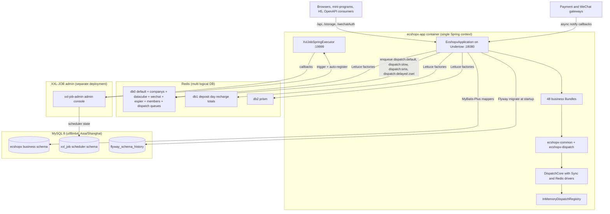

# System Overview and Runtime Topology

ECShopX-Java is the Java server-side implementation of the ECShopX commerce system, rewritten from the legacy PHP codebase with aligned business semantics and one-to-one mapped configuration keys. The whole repository is a single **multi-module Maven reactor**: the root `pom.xml` declares the parent project `cn.shopex:ecshopx` (version `${revision}` = `5.2.0`, CI-friendly) under `spring-boot-starter-parent:3.5.12`, and lists every module as a `<module>`. The reactor has 52 modules: exactly four infrastructure modules plus 48 business "Bundles":

* **`ecshopx-bom`** — a `pom`-packaging bill-of-materials module that imports `spring-boot-dependencies:3.5.12` and pins MyBatis-Plus / Lombok versions.
* **`ecshopx-common`** — shared cross-cutting code with **no** Shopex peer dependencies (only Spring Boot starters, MyBatis-Plus, Lombok): unified response body, exception hierarchy, pagination, audit base classes, annotations, and the ~150 `common/dispatch` interfaces (dispatch job/event names + publisher ports) that keep cross-Bundle wiring acyclic.
* **`ecshopx-dispatch`** — the in-process dispatch-bus core (`DispatchFacade`, drivers, registry, retry/failed-job recording), depending on common + Spring Data Redis + Spring AMQP.
* **`ecshopx-bootstrap`** — the only Spring Boot executable. Its POM declares all 48 business Bundles plus the runtime starters (Undertow, Data Redis, AMQP, Flyway, MySQL connector, `xxl-job-core:2.5.0`), and the `spring-boot-maven-plugin` is re-enabled here (`skip=false`, `mainClass=cn.shopex.ecshopx.EcshopxApplication`) while the parent POM disables it everywhere else.

One business domain = one Bundle = one Maven module. Bundles are plain libraries that expose capabilities; `ecshopx-bootstrap` wires everything together and runs as one Spring application. For how a single Bundle is structured internally, see [Bundle Layering](bundle-layering.md); for how Bundles communicate without Maven cycles, see [Cross-Bundle Communication](cross-bundle-communication.md).

## The single Spring Boot entry and the @MapperScan decision

```java
@SpringBootApplication(scanBasePackages = "cn.shopex.ecshopx")
@MapperScan(
        basePackages = "cn.shopex.ecshopx.**.mapper",
        nameGenerator = FqcnMapperBeanNameGenerator.class,
        sqlSessionFactoryRef = "sqlSessionFactory",
        lazyInitialization = "true")
public class EcshopxApplication {
    public static void main(String[] args) {
        SpringApplication.run(EcshopxApplication.class, args);
    }
}
```

The main class `cn.shopex.ecshopx.EcshopxApplication` (in `ecshopx-bootstrap/src/main/java/cn/shopex/ecshopx/EcshopxApplication.java`) is deliberately the **only** place `@MapperScan` appears, and the Javadoc on the class records why:

1. **Bean-name collisions.** With 48 Bundles each carrying `mapper/` packages, same-name `*Mapper` interfaces are inevitable. MyBatis' default bean name is the short interface name (e.g. `statisticsMapper`), so two `StatisticsMapper` interfaces in different Bundles would collide. `FqcnMapperBeanNameGenerator` (in `ecshopx-common`, `common/mybatis/FqcnMapperBeanNameGenerator.java`) replaces every `.` in the fully-qualified class name with `_` for any class whose name ends in `Mapper`, and falls back to Spring's default generator otherwise.
2. **Registration order vs. auto-configuration.** Placing `@MapperScan` on the main class makes `MapperScannerRegistrar` register the `MapperFactoryBean` definitions while the *primary configuration class* is being processed. That satisfies MyBatis-Plus's `@ConditionalOnMissingBean(MapperFactoryBean)` condition, so MyBatis-Plus's own auto mapper scanning backs off — the standard Spring Boot + MyBatis pattern, with no placeholder `MapperScannerConfigurer` needed.
3. **`lazyInitialization = "true"`** defers mapper bean instantiation until first use, which keeps the (very large) single application context's startup cost bounded.

The scan root is `cn.shopex.ecshopx` for components and `cn.shopex.ecshopx.**.mapper` for mappers, so any new Bundle rooted at its own `cn.shopex.ecshopx.<domain>` package is picked up automatically; new mappers should simply live under a `mapper` package. Mapper XML files are located through `mybatis-plus.mapper-locations=classpath*:mapper/**/*.xml`, which is why every Bundle's `resources/mapper/` XML files are found without per-Bundle configuration.

## Runtime topology



Runtime topology of ECShopX-Java: one Spring application inside the `ecshopx-app` container, backed by MySQL (business + `xxl_job` schemas, Flyway history), a single Redis instance partitioned into logical databases, and a separately deployed XXL-JOB admin console; external payment and WeChat gateways push asynchronous notifications into the `/wechatAuth` URL space.

### The HTTP surface: Undertow on 18080

`application.properties` pins `server.port=18080` and selects **Undertow** as the embedded server (the bootstrap POM excludes `spring-boot-starter-tomcat` and adds `spring-boot-starter-undertow`; `server.tomcat.*` is therefore ignored). Three Undertow behaviors exist specifically for PHP-era URL and upload compatibility:

* `server.undertow.options.server.allow-unescaped-characters-in-url=true` — allows raw UTF-8 and other unescaped bytes in the query string, matching `io.undertow.UndertowOptions.ALLOW_UNESCAPED_CHARACTERS_IN_URL` so legacy PHP URLs keep working.
* `server.undertow.max-http-post-size=64MB` — a total POST body cap kept above `spring.servlet.multipart.*` (50 MB file / 55 MB request) so large multipart bodies reach Spring validation.
* `UndertowMultipartMaxEntityCustomizer` — Undertow 2.3+ enforces its own multipart entity cap near 2 MB; this customizer raises `MULTIPART_MAX_ENTITY_SIZE` to 64 MB and also enables `ALLOW_ENCODED_SLASH` so encoded `%2F` reaches the servlet mapping layer.

Two related web-infrastructure decisions live in bootstrap config and `ecshopx-common`:

* `StrictHttpFirewallConfig` installs a `StorageAwareHttpFirewall` — Spring Security's `StrictHttpFirewall` (with encoded-slash, double-slash, and semicolon relaxations) for every path, except `/storage/**`, which is served by the lenient `DefaultHttpFirewall` so local-disk image URLs containing Chinese or mojibake filenames are not rejected by the printable-ASCII URI check (`StorageUnicodeHttpFirewallTest` proves both sides: `/storage/…微信图片….jpg` passes, `/api/v1/espier/微信` is still rejected).
* `FlexibleBodyWebMvcConfigurer` (in `ecshopx-common`) registers the `FlexibleBodyMethodArgumentResolver` that merges query-string parameters and a flexible JSON body into one `Map<String, Object>` for controllers, and keeps semicolon matrix content in the path (`UrlPathHelper.setRemoveSemicolonContent(false)`). `spring.mvc.servlet.pathmatch.use-trailing-slash-match=true` additionally matches collection URLs with or without a trailing slash — both PHP-compatibility measures.

The three externally meaningful URL spaces are:

| URL space | Served by | Purpose |
|---|---|---|
| `/api/…` | Business-Bundle controllers (`api/admin/v1`, `api/front/v1`), `/api/openapi/…` gateway from `ecshopx-openapi` | All business HTTP. Admin routes live under `/api/v1/…`, buyer (H5 / Mini Program) routes under `/api/v1/h5app/…`. |
| `/storage/**` | `StorageWebMvcConfigurer` in `ecshopx-espier` (active only when `ecshopx.storage.driver=local`) | Maps the local storage root (`ecshopx.storage.local.root`, default `storage/app/public`) to a static resource handler so uploaded files are directly downloadable. With `driver=oss/qiniu/aws/cosv5` files are served by the cloud bucket instead. |
| `/wechatAuth/…` | Unauthenticated callback controllers in `api/open` packages (`payment/api/open/WxpayNotifyController` at `/wechatAuth/wxpay/notify`, `wechat/api/open/WechatOpenPlatformMessageCallbackController` at `/wechatAuth/callback/{authorizerAppId}`, `wechat/api/open/WxappLegacyQrcodeController` at `/wechatAuth/wxapp/qrcode.png`) | WeChat Pay async notify, WeChat Open Platform message callbacks, and legacy PHP URL-compat routes. These deliberately bypass the admin/front auth interceptors. |

In Docker deployments an OpenResty/nginx front (port 80) routes `/api/`, `/storage/`, and `/wechatAuth/` to the Java process on `127.0.0.1:18080` inside the same container, keeping the URL spaces identical to the PHP deployment.

### MySQL persistence

A single MySQL database `ecshopx` (JDBC URL pinned to `utf8mb4` and `serverTimezone=Asia/Shanghai`) is accessed through **MyBatis-Plus 3.5.16** with `map-underscore-to-camel-case` enabled. All persistence is mapper-based: `@Mapper` interfaces extending `BaseMapper<T>` per Bundle, with XML in each Bundle's `resources/mapper/`, aggregated by `mybatis-plus.mapper-locations=classpath*:mapper/**/*.xml`.

Schema evolution is **Flyway**, enabled at startup (`spring.flyway.enabled=true`, `locations=classpath:db/migration`, `baseline-on-migrate=true`, `baseline-version=0`). The baseline behavior matters operationally: existing databases imported from `docker/ecshopx.sql` (the legacy business schema + demo data) are baselined at version 0 rather than replaying history. Migration files live only in `ecshopx-bootstrap/src/main/resources/db/migration` (currently `V00000000000001.sql` / `V00000000000002.sql`); `bin/make-migration` generates new files in `VyyyyMMddHHmmss__description.sql` format by diffing the live schema against MyBatis-Plus `@TableName`/`@TableId`/`@TableField` annotations (see the repository readme for the caveats — generated SQL must be reviewed for types, defaults, NULLability, and indexes; DROPs are only emitted with `--allow-drop`).

After Flyway completes, `MigrationSeedRunner` (an `ApplicationRunner` in bootstrap) aligns seed data with the PHP `EspierBundle\Listeners\UpdateMenuListener`: it imports logistics companies only when the `logistics` table is empty (failure logs but does not block startup), and — when `common.use-system-menu=true` — atomically deletes and re-imports all `company_id=0` system menus from six JSON seed files under `classpath:seed/menu/`, inside a programmatic `TransactionTemplate` transaction (a proxied `@Transactional` would be bypassed by the self-call, and half-filled menus must roll back together).

### Redis: one instance, many logical databases

The application deliberately bypasses Spring Boot's Redis auto-configuration and builds its own Lettuce `RedisConnectionFactory` beans in `MultiRedisConfig`. Each factory gets TCP keepalive, auto-reconnect, configurable command/connect timeouts (`ecshopx.redis.lettuce.*`), and `validateConnection` — the Javadoc notes this exists because Docker/idle `Connection reset` must be handled here rather than by Boot's auto-config. The named factories and their logical DB selectors:

| Bean | DB selector | Default | Used for |
|---|---|---|---|
| `springDataRedisConnectionFactory` / `sharedStringRedisTemplate` / `dispatchBusStringRedisTemplate` | `spring.data.redis.database` | 0 | Platform-default Redis access and the dispatch bus queues |
| `companysRedisConnectionFactory` / `companysRedisTemplate` (`@Primary` StringRedisTemplate) | `ecshopx.redis.companys.database` | 0 | Company/shop settings |
| `prismRedisConnectionFactory` / `prismRedisTemplate` | `ecshopx.redis.prism.database` | 2 | Prism gateway integration state |
| `datacubeRedisConnectionFactory` / `datacubeStringRedisTemplate` | `ecshopx.redis.datacube.database` | 0 | Datacube statistics |
| `depositRedisConnectionFactory` / `depositStringRedisTemplate` | `ecshopx.redis.deposit.database` | 1 | Deposit day recharge totals (e.g. `dayRechargeTotal{yyyy-MM-dd}`) |
| `membersRedisConnectionFactory` / `membersStringRedisTemplate` | `ecshopx.redis.members.database` | falls back to `spring.data.redis.database` | Member-scoped keys (sync throttling) |
| `espierRedisConnectionFactory` / `espierStringRedisTemplate` | `ecshopx.redis.espier.database` | falls back to `spring.data.redis.database` | Espier platform settings |
| `wechatRedisConnectionFactory` / `wechatStringRedisTemplate` | `ecshopx.redis.wechat.database` | falls back to `spring.data.redis.database` | WeChat access tokens / settings |

The deposit/members/espier/wechat factories additionally accept dedicated `ecshopx.redis.<name>.host|port|password` overrides, so a single logical Redis can be split per business area without running multiple servers. `MultiRedisConfigLettuceFactoryTest` pins the keepalive/validate/autoReconnect behavior.

### XXL-JOB: admin + executor

All scheduled work goes through **XXL-JOB 2.5.0**. The admin console (`xuxueli/xxl-job-admin:2.5.0`, its `xxl_job` schema initialized from `docker/tables_xxl_job.sql`) is deployed as a separate container/service and is *not* part of the Spring application. The application side is one bean: `XxlJobConfig` in bootstrap creates an `XxlJobSpringExecutor` configured from `xxl.job.*` properties — `admin.addresses` (repo default `http://127.0.0.1:9080/xxl-job-admin`; both Docker Compose stacks override it to `http://xxl-job-admin:8080/xxl-job-admin` on the container network, with host port 8080 published), `accessToken`, `executor.appname=ecshopx-executor`, `executor.port=19999`, log path `logs/xxl-job`, and 7-day log retention. The executor auto-registers with the admin and receives trigger callbacks on port 19999.

Business handlers are `@XxlJob("<short-name>")` methods in each Bundle's `cron/` package (e.g. `orders/cron/ScheduleFinishOrdersHandler` registered under handler name `finish-orders`). The uniform handler shape is: invoke the cron service, log cost, and on exception publish a `CronAlertEvent` (a Spring `ApplicationEvent` from `common/cron/event`) for alerting, then rethrow so XXL-JOB records the failure. There is no Quartz, no Spring `@Scheduled` cron for business jobs — only the small set of `@EnableScheduling` configs (orders, payment, selfservice, shuyun) that drive infrastructure polls such as the dispatch-queue pollers.

### The dispatch bus: Redis-backed queues

Cross-Bundle asynchronous work (the PHP system's Laravel-style jobs and events) is carried by the dispatch bus in `ecshopx-dispatch`, wired in bootstrap's `DispatchBusConfig`:

* **Publishing.** `DispatchFacade.dispatchJob(...)` / `publishEvent(...)` build a `DispatchMessage` (messageType JOB or EVENT, mode SYNC/ASYNC, driverType, messageName, payload, queue, delay, retryPolicy, occurredAt, traceId, listenerName) and hand it to `DispatchCore`. SYNC messages execute immediately through `SyncDispatchDriver` (in-process registry lookup); ASYNC messages are routed to the driver registered for their type. Message names intentionally preserve the legacy PHP class names — e.g. `OrdersDispatchJobNames.FINISH_ORDER_JOB = "job:128:OrdersBundle\\Jobs\\FinishOrderJob"` — so migration parity is auditable.
* **Registration.** `InMemoryDispatchRegistry` maps message name → job handler, and message name → ordered list of `(listenerName, options, DispatchListener)`. Duplicate job handlers or duplicate listener names throw at registration time. Bootstrap contains ~200 `*RegistrationConfig` classes whose `@PostConstruct` hooks register each Bundle's handlers/listeners — this is the explicit wiring that lets Bundles stay Maven-decoupled.
* **Drivers.** `DispatchDriverType` has three values — `SYNC`, `REDIS`, `RABBITMQ`. `DispatchCore.asyncReady` is built in `DispatchBusConfig` with only the Redis driver mapped; the RabbitMQ driver and listener classes exist in `ecshopx-dispatch` (with a `RabbitDispatchTopologyProvisioner` that declares a direct exchange, durable queues, and bindings per routing key, and `@RabbitListener(queues = "${dispatch.rabbit.queue:dispatch}")`) but are **not registered** in the default configuration, so Redis is the only active async transport.
* **Redis transport.** `RedisDispatchDriver` (bound to the `dispatchBusStringRedisTemplate`, i.e. the default Redis DB) encodes each message as JSON via `RedisDispatchMessageCodec` and `rightPush`es it onto `dispatch:<queue>`; blank queue names become `default`; a dead-letter list `dispatch:dead:<queue>` receives terminal failures. Messages with a delay land in the `dispatch:delayed` ZSET scored by ready-time, and `RedisDispatchDelayedPollScheduler` (`@Scheduled` every 1 s, disable via `dispatch.redis.delayed-mover.enabled=false`) moves due entries back onto their ready queue through `RedisDelayedDispatchMover`.
* **Consumption.** `RedisDispatchListener` polls (default every 1 s, `dispatch.redis.poll-delay-ms`) and pops one message from `dispatch:default`, then up to `dispatch.redis.slow.batch-size` (default 20) each from `dispatch:slow` and `dispatch:sms`, feeding each to `DispatchConsumerRuntime`. The **queue names are load-class signals**: export/statistics/finish-order jobs go to `slow` (e.g. `FinishOrderJobDispatchPublisherImpl` publishes `FINISH_ORDER_JOB` with `DispatchMode.ASYNC`, `DispatchDriverType.REDIS`, queue `slow`), SMS/notification work to `sms`, everything else to `default`.
* **Failure semantics.** `DispatchConsumerRuntime.consume` resolves the handler (jobs) or the matching listener by `listenerName` (events); on success it records an ack. On a `RuntimeException`, if `currentAttempt < retryPolicy.maxAttempts()` it records a retry and rethrows (the driver re-enqueues); otherwise it logs a structured line, records the failure through `FailedJobRecorder` into the `failed_jobs` table (via `FailedJobMapper`'s XML insert), and records the fail. `RetryPolicy.platformDefault()` is 3 attempts / 3 s next delay. Note `FailedJobMapper` has no MyBatis-Plus `BaseMapper` backing and the `failed_jobs` table comes from the legacy SQL dump, so bootstrap currently installs a stub `FailedJobMapper` bean returning 1 — persistence of failed jobs is a wiring point to be completed rather than production-grade today.

See [Dispatch Bus](../concepts/dispatch-bus.md) for the message-flow details.

### Multi-Redis and dispatch interplay

The dispatch bus uses the *shared default* Redis logical DB (`dispatchBusStringRedisTemplate` ← `springDataRedisConnectionFactory`), not a dedicated one — dispatch queue keys (`dispatch:*`) therefore share DB 0 with platform-default keys by design, while deposit (DB 1) and prism (DB 2) remain isolated. This matters when planning key expiry or FLUSHDB operations per logical database.

## The Bundle catalog

Every business Bundle declares its domain in a Chinese `package-info.java` at its package root. The complete catalog (grouped by domain family; Chinese domain text from each `package-info.java`):

**Core commerce**
| Bundle | Domain (from package-info.java) |
|---|---|
| `ecshopx-goods` | 商品域模块 |
| `ecshopx-orders` | 订单、购物车、物流与结算域 |
| `ecshopx-aftersales` | 售后域模块 |
| `ecshopx-members` | 会员与账户域 |
| `ecshopx-comments` | 评论域模块 |
| `ecshopx-deposit` | 储值域模块 |
| `ecshopx-supplier` | 供应商域 |
| `ecshopx-cross-border` | 跨境电商域模块 |

**Marketing and engagement**
| Bundle | Domain |
|---|---|
| `ecshopx-promotions` | 营销与促销活动域 |
| `ecshopx-kaquan` | 卡券域模块 |
| `ecshopx-point` | 积分域模块 |
| `ecshopx-pointsmall` | 积分商城域模块 |
| `ecshopx-distribution` | 分销与推广域 |
| `ecshopx-popularize` | 分销推广域模块 |
| `ecshopx-employee-purchase` | 员工内购域模块 |
| `ecshopx-community` | 社区与互动域 |
| `ecshopx-wsugc` | 用户生成内容域 |
| `ecshopx-form` | 表单与成绩单域模块 |
| `ecshopx-reservation` | 预约域模块 |
| `ecshopx-one-code` | 一物一码域模块 |
| `ecshopx-shopex-ai` | Shopex AI 域模块 |

**Stores, merchants and operations**
| Bundle | Domain |
|---|---|
| `ecshopx-merchant` | 商户入驻与设置域 |
| `ecshopx-companys` | 企业与多门店域 |
| `ecshopx-salesperson` | 业务员/导购域模块 |
| `ecshopx-selfservice` | 自助服务域模块 |
| `ecshopx-super-admin` | 平台级公告等能力域 |
| `ecshopx-shopmenu-border` | 店铺菜单域模块 |
| `ecshopx-im` | 即时通讯域模块 |

**Payments**
| Bundle | Domain |
|---|---|
| `ecshopx-payment` | 支付配置与通道域 |
| `ecshopx-adapay` | AdaPay 域模块 |
| `ecshopx-hfpay` | 汇付支付域模块 |
| `ecshopx-bspay` | 汇付斗拱支付域模块 |
| `ecshopx-chinaums-pay` | 银联商务支付域模块 |

**WeChat ecosystem**
| Bundle | Domain |
|---|---|
| `ecshopx-wechat` | 微信与小程序对接域 |
| `ecshopx-work-wechat` | 企业微信对接域 |

**Integrations and platform services**
| Bundle | Domain |
|---|---|
| `ecshopx-ali` | 阿里域模块 |
| `ecshopx-aliyunsms` | 阿里云短信域模块 |
| `ecshopx-shuyun` | 数云对接域（遗留 UAPI + 开放平台 open-api） |
| `ecshopx-system-link` | 系统联通域模块 |
| `ecshopx-youshu` | 有数分析配置域 |
| `ecshopx-kujiale` | 酷家乐域模块 |
| `ecshopx-tb-items` | 外部商品同步等业务域 |
| `ecshopx-third-party` | 第三方对接域模块 |
| `ecshopx-openapi` | OpenAPI 设置域模块 |
| `ecshopx-espier` | 平台通用能力（上传、地址、升级等）域 |
| `ecshopx-theme` | 装修、模板与页面配置域 |
| `ecshopx-tdkset` | TDK 设置域模块 |
| `ecshopx-data-cube` | 数据魔方与统计分析域 |

Adding a Bundle means: create the module rooted at `cn.shopex.ecshopx.<domain>` with a `package-info.java` stating the domain, add it to the parent `<modules>` and `dependencyManagement`, add the dependency to `ecshopx-bootstrap`, and (for async work) a bootstrap `*RegistrationConfig` plus the `*DispatchPublisher` interface in `ecshopx-common`.

## Where bootstrap breaks the rules — and why

`ecshopx-bootstrap` is where the cross-Bundle edges are wired precisely because it depends on everything. Its `config/` package contains, alongside `DispatchBusConfig`/`MultiRedisConfig`/`XxlJobConfig`:

* ~160 `*DispatchPublisherImpl` components that implement `ecshopx-common` publisher interfaces by calling `DispatchFacade` with the correct mode/driver/queue/delay/retry tuple (e.g. `FinishOrderJobDispatchPublisherImpl` → ASYNC/REDIS/`slow`; `AliTemplateMsgSendDispatchPublisherImpl` resolves a per-company send delay from Redis before publishing to `default`).
* ~200 `*RegistrationConfig` classes that call `dispatchRegistry.registerJob(...)` / `registerEventListener(...)` in `@PostConstruct`, wiring producers to consumers without either side naming the other.
* A handful of `bootstrap/<domain>/` adapters (`WxappCommonSettingFacadeImpl`, `HfpayPopularizeCashWithdrawalMerchantPaymentService`, `OmeDistributorShopStructPortImpl`, …) that implement one Bundle's Port by composing several other Bundles' beans — the last resort when even Port inversion cannot break a cycle.
* `AsyncExecutorConfig` (`@EnableAsync`) with ~15 named `ThreadPoolTaskExecutor` beans for per-concern `@Async` work (OME sync, jushuitan upload, exports, `dispatchBusInternalExecutor`).

## Deployment shapes

Three supported paths share the same runtime topology (see [Deployment](../operations/deployment.md) and [Platform Services](../domains/platform-services.md) for details):

* **Full development** — `./dev-setup.sh` / `bash install.sh --full` → `docker-compose.dev.yml`: `mysql` (8.0, imports `docker/tables_xxl_job.sql` then `docker/ecshopx.sql`), `redis` (7-alpine, password `redispassword`, AOF), `xxl-job-admin` (2.5.0, `xxl_job` DB in the same MySQL), and `ecshopx-app` (built from `docker/Dockerfile.app`, a Maven builder stage plus a Temurin-17/Node-20/OpenResty runtime base). The app container exposes 80 (nginx, host-routed admin/H5/PC), 18080 (Java direct), and 19999 (executor); business parameters are injected via `APP_ARGS` in Spring Boot CLI style, preserving case-sensitive properties like `xxl.job.accessToken`. `dev-setup.sh` additionally clones and builds the three sibling frontends (`ECShopX-Java_Admin`, `ECShopX-Java_Mobile`, `ECShopX-Java_Web`).
* **Lite offline** — `docker-lite/deploy.sh` / `bash install.sh --lite` → `docker-lite/docker-compose.yml`: same four services but the `ecshopx-app` image is prebuilt and the release archive bind-mounts `docker-lite/app/ecshopx-bootstrap.jar` as `app.jar`.
* **Self-hosted jar** — build and run the executable jar (`./mvnw -pl ecshopx-bootstrap -am package`, then `java -jar … --spring.profiles.active=local`), overriding datasource/Redis/XXL properties; Flyway migrates on startup against the existing schema. Local overrides come from environment variables, CLI-style arguments (`--spring.datasource.url=…`, `--spring.config.additional-location=file:./config/`, as the readme's Method B shows), or an external config location — **not** from a shipped sample: `ecshopx-bootstrap/src/main/resources/application-local.properties` is git-ignored (`.gitignore` line 7) and absent from fresh checkouts, so the readme's claim that the project "already includes" it is drift.

Ports to keep free: `18080` (app HTTP), `19999` (XXL executor), `9080` or `8080` (XXL admin), `3306` (MySQL), `6379` (Redis).

## Focused tests that pin this topology

* `EcshopxApplicationTests` (`@SpringBootTest` contextLoads) — the smoke test that the assembled context starts.
* `DispatchBusConfigTest` — boots a stripped `AnnotationConfigApplicationContext` with `DispatchBusConfig` plus a mocked `dispatchBusStringRedisTemplate` and asserts the core beans (`DispatchRegistry`, `SyncDispatchDriver`, `DispatchCore`, `DispatchFacade`, `DispatchStructuredLogger`, `DispatchConsumerRuntime`, `FailedJobMapper`) exist.
* `DispatchBusIntegrationTest` — end-to-end dispatch semantics: a sync job executes its handler; `RedisDispatchListener.poll()` decodes a `dispatch:default` payload and feeds it to the runtime; `RabbitDispatchListener.onMessage` does the same for the AMQP path.
* `RedisDispatchListenerTest` / `RedisDispatchDriverTest` / `RedisDelayedDispatchMoverTest` / `DispatchConsumerRuntimeTest` — queue polling, JSON round-trip through `RedisDispatchMessageCodec`, delayed-message relocation, and the retry-vs-failed-jobs decision (`DispatchConsumerRuntimeTest.failedListenerPastMaxAttemptsWritesFailedJobs` proves a listener past `maxAttempts` triggers the structured `failed` log and `FailedJobRecorder.recordFailure`).
* `MultiRedisConfigLettuceFactoryTest` — asserts each Lettuce factory has `validateConnection`, TCP keepalive, and autoReconnect.
* `StorageUnicodeHttpFirewallTest` — `/storage/**` with Chinese/mojibake filenames passes the firewall while non-storage Chinese paths are rejected.
* `MigrationSeedRunnerTest` — seed/menu re-import behavior after startup.
* The ~200 `*DispatchFlowTest` classes under `ecshopx-bootstrap/src/test` — per-message integration probes that publish through the real `DispatchFacade` and consume through `DispatchConsumerRuntime`, one per job/event (e.g. `FinishOrderJobDispatchFlowTest` verifies `FINISH_ORDER_JOB` lands on the `slow` queue and the consumer invokes `FinishOrderJobService`).
