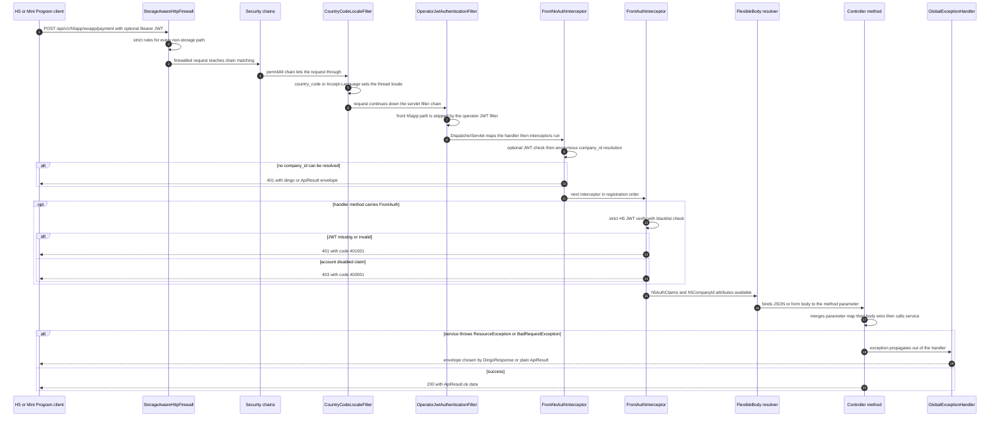

# HTTP Request Lifecycle, Auth, and Response Conventions

Every HTTP request enters one Spring application (`ecshopx-bootstrap` on Undertow, port 18080) and passes through a deliberately layered pipeline: servlet-container settings tuned for legacy PHP URL compatibility, a Spring Security firewall that carves out an exception for `/storage/**`, two thin security filter chains, a locale filter, the operator-JWT servlet filter, and only then the DispatcherServlet and the annotation-driven interceptor chain registered by `MiddlewareWebMvcConfigurer` (espier) plus its merchant/salesperson siblings. After the handler is chosen, `@FlexibleBody` binds JSON / form / multipart bodies, controllers merge query parameters with the body map, and both success (`ApiResult`) and failure (`@DingoResponse` legacy envelopes via `GlobalExceptionHandler`) responses follow conventions inherited from the PHP system.

This page documents each stage, the annotation-to-interceptor matrix, and the response/error conventions a **new endpoint must choose between**. For where controllers live per Bundle, see [Bundle Anatomy and Layering Conventions](bundle-layering.md); for the runtime topology, see [System Overview and Runtime Topology](overview.md).

## The pipeline at a glance



The request path for a front-end (H5 / Mini Program) endpoint: firewall → security chains → locale filter → operator-JWT filter (skipped for front paths) → interceptor chain → `FlexibleBody` binding → controller → `GlobalExceptionHandler` on error.

## Stage 1 — Undertow and the servlet-container edge

`ecshopx-bootstrap` runs on **Undertow** (the POM excludes `spring-boot-starter-tomcat` and adds `spring-boot-starter-undertow`, so `server.tomcat.*` is ignored). Five settings exist specifically so URLs and uploads that the legacy PHP system accepted keep working:

| Setting | Value | Why |
|---|---|---|
| `server.undertow.options.server.allow-unescaped-characters-in-url` | `true` | Allows raw UTF-8 and other unescaped bytes in the query string (maps to `io.undertow.UndertowOptions.ALLOW_UNESCAPED_CHARACTERS_IN_URL`); legacy PHP clients send unencoded Chinese query values. |
| `server.undertow.max-http-post-size` | `64MB` | Total POST body cap, deliberately above `spring.servlet.multipart.*` so large multipart bodies reach Spring and business validation instead of dying at the connector. |
| `spring.mvc.servlet.pathmatch.use-trailing-slash-match` | `true` | Collection URLs match with or without a trailing slash (`/api/v1/members` and `/api/v1/members/` hit the same handler), mirroring PHP route behavior. |
| `spring.servlet.multipart.max-file-size` / `max-request-size` | `50MB` / `55MB` | Spring-side multipart limits (batch imports like restricted-goods xlsx; Boot defaults of 1MB/10MB were too small). |
| `UndertowMultipartMaxEntityCustomizer` | `MULTIPART_MAX_ENTITY_SIZE = 64MB`, `ALLOW_ENCODED_SLASH = true` | Undertow 2.3+ enforces its *own* multipart entity cap near 2MB, independent of Spring's settings; the customizer raises it so Spring's limits govern. `ALLOW_ENCODED_SLASH` lets encoded `%2F` reach the servlet mapping layer. |

A sixth PHP-compatibility measure lives in `FlexibleBodyWebMvcConfigurer` (`ecshopx-common`): a `UrlPathHelper` with `setRemoveSemicolonContent(false)`, so semicolon content in the path survives handler mapping.

### The firewall: `StorageAwareHttpFirewall`

`StrictHttpFirewallConfig` (bootstrap) exposes the firewall as a bean and installs it on Spring Security's `WebSecurity` through a `WebSecurityCustomizer`. The implementation is a path-aware composite:

* Every path **except** `/storage/**` (and the exact `/storage`) goes through `StrictHttpFirewall`, relaxed to `setAllowUrlEncodedSlash(true)`, `setAllowUrlEncodedDoubleSlash(true)`, and `setAllowSemicolon(true)` — still rejecting non-printable-ASCII request URIs.
* `/storage/**` goes through the lenient `DefaultHttpFirewall` (with encoded slash allowed), because local-disk image URLs routinely contain Chinese or mojibake filenames that `StrictHttpFirewall`'s printable-ASCII URI check would reject. `/storage/**` is served as static resources by `StorageWebMvcConfigurer` in `ecshopx-espier` when `ecshopx.storage.driver=local` (maps `ecshopx.storage.local.root`, default `storage/app/public`, onto the `/storage/**` resource handler).

The firewall runs inside the Spring Security `FilterChainProxy` before any chain matching, so it applies to *all* requests — including `/storage/**` and `/wechatAuth/**`, which match no security chain at all. `StorageUnicodeHttpFirewallTest` pins both sides: `/storage/…微信图片….jpg` passes, `/api/v1/espier/微信` is still rejected.

### Security chains and the operator-JWT servlet filter

`EspierSecurityConfig` (`ecshopx-espier`) deliberately keeps Spring Security thin — its Javadoc states that authentication has moved to annotations + interceptors. Only two chains remain:

1. **`wxappMemberSessionSecurityFilterChain`** (`@Order(-2)`, matcher `/api/v1/wxapp/**`): CSRF disabled, `anyRequest().authenticated()`, with `WxappMemberSessionAuthenticationFilter` inserted before `UsernamePasswordAuthenticationFilter`. That filter reads the `x-wxapp-session` header, resolves the session through `WxappMemberAuthService`, stores the auth map under the `WxappMemberAuthAttributes.REQUEST_ATTR` request attribute, and sets a `UsernamePasswordAuthenticationToken` in the `SecurityContext`. Failures are written as a **Dingo-style envelope with HTTP 200** (`{"data":{"message":…,"status_code":400|401}}`).
2. **`defaultPermitAllSecurityFilterChain`** (`@Order(100)`, matcher `/api/**`): CSRF disabled, everything permitted. All real authorization happens later, in interceptors.

Because handler-level auth is annotation-driven, `OperatorJwtAuthenticationFilter` (`ecshopx-espier`, a plain `@Component OncePerRequestFilter` auto-registered as a servlet filter for all URLs) provides a **safety net for admin API paths that forgot an annotation**: it requires a valid operator Bearer JWT for every request that maps to a controller method and is not on its allowlist. Its `shouldNotFilter` skips:

* Paths with no handler mapping (unmapped paths fall through to the DispatcherServlet's normal 404/405 instead of a spurious 401 — the filter consults `RequestMappingHandlerMapping` directly).
* The anonymous admin endpoints (login, oauth/shuyun login, getLevel, token refresh, resetpassword, image/SMS codes, basic, credential, authorizeurl, logout) — the code comments note this list must stay in sync with `MiddlewareWebMvcConfigurer`'s `AdminAuthInterceptor` excludes.
* All callback/notify paths (`/api/v1/alipay/notify`, chinaums, doumen-intl, adapay, bspay, `/wechatAuth/**`, workwechat notify paths, saascert matrix callbacks).
* `/api/openapi/**` (sign-based auth) and the front surfaces `/api/v1/h5app/**` and `/api/v1/wxapp/**` (independent auth).

On success it mirrors `AdminAuthInterceptor`'s work — verify HS256, check `exp`, consult the operator JWT blacklist (Redis prism DB, key `operator_jwt_invalidate:<sha256(jwt)>`), enrich shop-app member tokens, run `CompanysActivationService.checkUserAuth`, attach operator id and selected distributor — and stores the claims map under the `OperatorJwtRequestAttributes.OPERATOR_JWT_USER_DATA` request attribute (`cn.shopex.ecshopx.espier.security.OperatorJwtAuthenticationFilter.OPERATOR_JWT_USER_DATA`), the same key controllers and downstream interceptors read. Errors are Dingo-style `{"data":{"message":…,"status_code":401}}` (401) or `ApiResult.fail(403, …)` (403).

### Locale resolution

`CommonWebLocaleAutoConfiguration` (`ecshopx-common`, servlet web apps only) registers `CountryCodeLocaleFilter` on `/*` at order `Ordered.LOWEST_PRECEDENCE - 50` — deliberately late so Undertow has already parsed the query string (the filter also touches `getParameterMap()` first and falls back to parsing `country_code` out of the raw query string). The filter:

1. Takes `country_code` (query parameter) if present, else the first tag of `Accept-Language`.
2. Normalizes it through `LangueProperties.resolveToSupportedTag` — the supported list comes from `langue.list` (`application.properties` pins six tags: `zh-CN, en-CN, ar-SA, zh-TW, ja-JP, ru-RU`; the code default is the first four) with `langue.default-lang=zh-CN`; unknown/blank tags fall back to the default. Startup fails if `langue.default-lang` is blank or not in `langue.list`.
3. Converts the tag to a `MessageSource` locale via `RequestMessageLocale.toMessageLocale` (note the deliberate `en-CN → en-US` mapping, because the English message bundle is `messages_en_US`), sets `LocaleContextHolder` for the request thread, and resets it after the chain.

Downstream code reads the tag back with `RequestLangTag.current(langueProperties)` or resolves per-company effective languages via `LanguageTagSupport` / `CompanyLanguageResolver` (company-enabled language clamping). `CountryCodeLocaleFilterTest` pins the param-wins, invalid-falls-back, and Accept-Language-fallback behaviors.

## Stage 2 — The interceptor chain

### Registration and order

Three `WebMvcConfigurer`s register the MVC interceptor chain; interceptors execute in registration order (explicit `.order(...)` values):

| Order | Interceptor | Registered by | Path pattern |
|---|---|---|---|
| 5 | `EspierAgreementRateLimitInterceptor` | `MiddlewareWebMvcConfigurer` (espier) | `/api/v1/espier/system/agreement` |
| 10 | `AdminAuthInterceptor` | `MiddlewareWebMvcConfigurer` | `/api/**` minus the admin anonymous excludes |
| 15 | `FrontNoAuthInterceptor` | `MiddlewareWebMvcConfigurer` | `/api/**` |
| 20 | `FrontAuthInterceptor` | `MiddlewareWebMvcConfigurer` | `/api/**` |
| 21 | `QywxSalespersonAuthInterceptor` | `SalespersonWebMvcConfigurer` (salesperson) | `/api/**` |
| 25 | `FrontMerchantAuthInterceptor` | `MerchantInterceptorWebMvcConfigurer` (merchant) | `/api/**` |
| 100 | `ActivatedInterceptor` | `MiddlewareWebMvcConfigurer` | `/api/**` |
| 200 | `DataPassInterceptor` | `MiddlewareWebMvcConfigurer` | `/api/**` |
| 300 | `ShopLogInterceptor` | `MiddlewareWebMvcConfigurer` | `/api/**` |

Every interceptor starts its `preHandle` with the same two guards: skip unless the handler is a `HandlerMethod`, and skip unless *its* annotation is present (method level first, then class level). An interceptor without its annotation is a no-op — the chain is effectively annotation-routed. `EspierAgreementRateLimitInterceptor` is the exception: it throttles by client IP (Redis `espier:agreement:throttle:<ip>`, 30 requests/minute) on the install-agreement endpoint and writes `{"message":"Too Many Attempts.","status_code":429}` with HTTP 429.

### The annotation matrix

| Annotation | Consumed by | Effect on the request | Attribute(s) it leaves behind |
|---|---|---|---|
| `@FrontAuth` | `FrontAuthInterceptor` (order 20) | **Strict** H5 member JWT required; verifies HS256 signature, issuer, time claims (with leeway), required claims (`iss, iat, exp, nbf, sub, jti`), a positive `company_id` claim, and the H5 JWT blacklist (Redis prism DB, `h5_jwt_invalidate:<sha256>`, grace period configurable). Rejects with HTTP 401 `{"data":{"message":"Unable to authenticate user.","code":401001,"status_code":401}}`; a truthy `disabled` claim rejects with HTTP 403 and code `403001`. Enriches claims via `H5JwtUserLoginInfoEnrichService` (rehydrates WeChat/member fields like PHP `EspierLocalUserProvider::getUserLoginInfo`). | `h5AuthClaims` (`H5FrontAuthAttributes.H5_AUTH_CLAIMS`), `h5CompanyId` |
| `@FrontNoAuth` | `FrontNoAuthInterceptor` (order 15) | **Optional** JWT / anonymous tenant resolution (see below). Also *suppresses* `@FrontAuth` when both would apply — a method-level `@FrontNoAuth` makes `FrontAuthInterceptor` skip the method even if the class carries `@FrontAuth`. | `h5CompanyId`, `h5AuthClaims` (JWT claims or anonymous claims) |
| `@AdminAuth` | `AdminAuthInterceptor` (order 10) | Operator (admin console) JWT required — Bearer token, `OperatorJwtCompactCodec` HS256 verify (own HMAC check with a jjwt fallback for legacy tokens), `exp` check, shop-app member token enrichment, `CompanysActivationService.checkUserAuth` (validates the encrypted session token inside the `id` claim unless `operator_type` is `shopadmin`/`user`). Rejects 401 Dingo-style (`data.message` + `data.status_code`, no `code` key); a `ResourceException` from `checkUserAuth` rejects 403 as `ApiResult.fail(403, msg)`. Attaches the selected distributor for `operator_type=distributor`. | `OPERATOR_JWT_USER_DATA` claims map |
| `@FrontMerchantAuth` | `FrontMerchantAuthInterceptor` (order 25, merchant Bundle) | Merchant-settlement (商户入驻) Mini Program JWT under **separate** properties `ecshopx.merchant.wxapp.jwt.*` (issuer `ecshopx`, secret from `JWT_SECRET`, 60-minute TTL). Verifies HS256, issuer, time claims with leeway, positive `company_id`/`account_id` claims, and that a `MerchantSettlementApply` row exists for `account_id` in the same company. Rejects with the same `401001` Dingo envelope as `@FrontAuth`. | `MerchantWxappAuthAttributes` record (`companyId`, `accountId`) |
| `@QywxSalespersonAuth` | `QywxSalespersonAuthInterceptor` (order 21, salesperson Bundle) | Work-WeChat salesperson Mini Program session auth: reads the `x-wxapp-session` header, loads `frontSession3rd:<session>` from the wechat Redis template via `WxappSalespersonSessionAuthService`, and re-validates the salesperson/shop/role rows. Rejects with Dingo-style envelopes carrying business codes `400001` (bad request), `401001` (unauthorized), `403001` (forbidden) at the matching HTTP status. | `QywxSalespersonAuthAttributes.REQUEST_ATTR` auth map |
| `@Activated(routeAlias = "…")` | `ActivatedInterceptor` (order 100) → `ActivatedMiddlewareService` | Menu permission + company activation + distributor scope. Checks the route alias against the operator's role menus (`ShopMenuService.collectApisFromMenus`, menu version by operator type: distributor 3, dealer 5, merchant 6, supplier 7, others 1); `admin` operators skip unless `common.check-superadmin-permission=true`; a fixed whitelist and delivery-staff paths bypass. Verifies the company exists and is not disabled, and computes the distributor scope. Failures throw `ResourceException` (→ 422 or Dingo envelope downstream). | `cn.shopex.ecshopx.activated.distributor_id` and `…distributorIds` (see `ActivatedRequestAttributes`) |
| `@DataPass(pathAlias = "…")` | `DataPassInterceptor` (order 200) → `ShopOperatorDatapassApplyService` | Sensitive-data access audit. `admin` operators, merchant-main accounts, and self-delivery staff are exempt; otherwise, if the operator lacks datapass authorization the interceptor sets the request attribute **`x-datapass-block` = 1** (controllers read it and mask data), and when authorized it inserts an `OperatorDataPassLog` row. Method-level only. Never blocks the request. | `x-datapass-block` (only when blocked) |
| `@ShopLog` | `ShopLogInterceptor` (order 300, `afterCompletion`) | Writes a merchant operation log row (`log_type=operator`, operator/company ids from the JWT claims, URI, first `X-Forwarded-For` IP or remote address) for **non-GET** requests after the handler completes. Failures are swallowed (debug log). | none |
| `@OperationLog(title, businessType, …)` | `OperationLogAspect` (AOP, `ecshopx-common`) | Timed operation logging to the SLF4J logger named `operation-log` (`[title] METHOD uri | method | Nms | OK/ERROR`). Not an interceptor, and currently unused by controllers in the tree — it is the reserved hook for future DB-backed operation logs. | none |
| `@AdminLog` | `AdminLogAspect` (AOP, espier) | After a successful 2xx `ResponseEntity` whose `ApiResult.data` contains a `token`, records a login audit log; also records the failed-login audit for `POST /api/v1/operator/getLevel`. | none |
| `@DingoResponse` | `GlobalExceptionHandler` + module advices | Not auth: selects the legacy PHP error envelope per endpoint (see [Response and error conventions](#response-and-error-conventions)). | none |
| `@OpenapiResponse` | `OpenapiResponseBodyAdvice` (openapi Bundle) | Wraps returns in the PHP OpenAPI envelope — see [OpenAPI Integration](../integrations/openapi.md). | none |

The typical admin controller stacks them: `@DingoResponse(...) @AdminAuth @ShopLog` on the class, `@Activated(routeAlias = "trade.setting.set")` on individual methods (see `orders/api/admin/v1/TradeSettingController`). Front controllers use `@FrontNoAuth` on the class and `@FrontAuth` on the subset of methods that require login (`WxappPaymentController` does exactly this).

### `FrontNoAuthInterceptor`: anonymous tenant resolution

`FrontNoAuthInterceptor` mirrors PHP `FrontNoAuthMiddleWare`: it must always produce a `company_id`, with or without a login. Its resolution order:

1. **Bearer JWT** — if an `Authorization: Bearer` token verifies (same HS256/issuer/time/required-claim/positive-`company_id` rules as `@FrontAuth`), the claims are enriched (`H5JwtUserLoginInfoEnrichService` plus a member-mobile backfill from the DB when the claim is missing) and stored as `h5AuthClaims`.
2. **Anonymous resolution**, otherwise. In order: the `appid` query parameter or `authorizer-appid` header (wx-prefixed appids look up `WechatAuthorizerLookupMapper`, others go through `AliMiniAppCompanyIdLookupPort`); then the fixed system company (`common.system-companys-id` when not SaaS, `common.system-main-companys-id` when SaaS); then the `company_id` query parameter; then the `Origin` header domain via `CompanyDomainLookupService`. If nothing resolves, it throws `UnauthorizedException("无权访问该API,非法访问！")`, and the response envelope depends on the handler's `@DingoResponse.unauthorized()` flag (Dingo nested-`data` 401 with code `401001`/`401002` vs. plain `ApiResult.fail(401, …)`). One carve-out: `MembersController.getNoAuthDecryptPhoneNumber` is allowed through with `company_id = 0`.
3. Anonymous requests get a synthetic anonymous claims map (`buildAnonymousAuthClaims`) stored in `h5AuthClaims`, so controllers can treat both paths uniformly.

## Stage 3 — `FlexibleBody` binding and the merged-params idiom

### `@FlexibleBody` and its resolver

`@FlexibleBody` is `ecshopx-common`'s replacement for `@RequestBody` that accepts **`application/json`, `multipart/form-data`, and `application/x-www-form-urlencoded`** on the same parameter — because the legacy PHP frontends post the same endpoint as JSON *or* as form data. `FlexibleBodyWebMvcConfigurer` (servlet web apps) prepends `FlexibleBodyMethodArgumentResolver` to the custom argument-resolver list. The resolver dispatches on the declared parameter type:

* **`JsonNode`** — JSON bodies are read from the input stream and parsed; form bodies are converted via `FlexibleHttpServletParameterMap.toObjectMap(request)` then `valueToTree`.
* **`Map`** — JSON bodies are deserialized to the declared generic type; form/multipart bodies become the `toObjectMap` map directly.
* **POJO** — JSON bodies are deserialized; form/multipart bodies are converted with `objectMapper.convertValue`, falling back to `ServletRequestDataBinder` binding if conversion fails.

`required` (default `true`) controls emptiness semantics: with `required = false`, an empty body or empty JSON object resolves to `null` (or an empty instance for POJOs). With `required = true` an empty body throws `BadRequestException("请求体不能为空")`. Validation is opt-in per parameter with **`@Valid`** (not `@Validated`): the resolver runs the jakarta `Validator` itself and converts violations into a `MethodArgumentNotValidException`, which `GlobalExceptionHandler` renders as 422 with `field: message` pairs.

`FlexibleHttpServletParameterMap.toObjectMap(request)` is the PHP-style parameter expander that both the resolver and controllers rely on. It converts the servlet parameter map (query string + form fields + multipart text parts) into a `Map<String, Object>`:

* `name[]=a&name[]=b` and repeated `name` keys become a `List` under `name`;
* indexed keys `name[0]=a&name[1]=b` fold into an ordered `List` under `name`;
* nested keys `rates[0][item_id]=…` become nested maps/lists under `rates`, and all-numeric-key maps are converted to index-ordered lists at any depth;
* scalar parameters stay `String`.

It then **merges the `Activated` middleware attributes**: `distributor_id` and `distributorIds` from `ActivatedRequestAttributes` are injected when the parameters do not already carry them — which is how admin list endpoints transparently become distributor-scoped.

### The controller idiom: merge parameters, then body wins

The dominant front-controller pattern (and the one new endpoints should copy) is `WxappPaymentController.payment`:

```java
@PostMapping(
    value = "/payment", name = "发起支付",
    consumes = {
        MediaType.APPLICATION_JSON_VALUE,
        MediaType.MULTIPART_FORM_DATA_VALUE,
        MediaType.APPLICATION_FORM_URLENCODED_VALUE
    },
    produces = MediaType.APPLICATION_JSON_VALUE)
public ResponseEntity<ApiResult<Map<String, Object>>> payment(
        HttpServletRequest request, @FlexibleBody(required = false) Map<String, Object> body) {
    Map<String, Object> merged = new LinkedHashMap<>(FlexibleHttpServletParameterMap.toObjectMap(request));
    if (body != null) {
        merged.putAll(body);
    }
    LinkedHashMap<String, Object> auth = resolveH5Auth(request, merged);
    Map<String, Object> payResult = wxappPaymentService.payment(request, merged, auth);
    ...
    return ResponseEntity.ok(ApiResult.ok(payResult));
}
```

The idiom reproduces PHP/Laravel's `$request->merge()` semantics: **query/form parameters form the base map, and the parsed body overrides on key conflicts** (`putAll`). Because `toObjectMap` reads the servlet parameter map (query + form) while `@FlexibleBody` supplies the JSON body, a JSON POST still sees its query string; a form POST sees its fields once. GET handlers use the same base map without a body (`doPayment` above). The salesperson Bundle has a small local variant (`ShopSalespersonFrontRequestMerge`) with the same "parameters first, body wins" rule.

`resolveH5Auth` in the same controller shows the second half of the idiom: identity comes from request attributes, not parameters — it prefers the wxapp session attribute, then `h5AuthClaims`, backfills `company_id` from `h5CompanyId`, then from the merged params, and only throws `UnauthorizedException` when no source produced a positive company id.

## Response and error conventions

### `ApiResult` — the standard envelope

`ApiResult<T>` (`ecshopx-common`) is the success envelope everywhere: `ApiResult.ok(data)` → `{"code":200,"msg":"success","data":…}` and `ApiResult.fail(422,"xxx")` → `{"code":422,"msg":"xxx"}` (`data` is omitted via `@JsonInclude(NON_NULL)`). Controllers return `ResponseEntity<ApiResult<…>>` (or `ApiResult<…>` directly).

### `@DingoResponse` — the legacy PHP error envelope

The PHP system (Dingo API + Laravel HttpException) returned errors as a **nested `data` object** rather than a flat body. `@DingoResponse`, placed on a controller class or method, declares which endpoints still speak that dialect so `GlobalExceptionHandler` can match it — new endpoints do **not** need to edit any routing table in the handler; they just add the annotation with the right attributes:

```java
@DingoResponse(
    resource = DingoResponse.ResourceStyle.DINGO,   // ResourceException style
    badRequest = DingoResponse.BadRequestStyle.DINGO_400,  // BadRequestException style
    unauthorized = true,                            // UnauthorizedException → legacy 401 shapes
    unauthorizedHttpOk = false,                     // true → HTTP 200, error in data.status_code
    notFound = false)                               // NoResourceFoundException → legacy 404
```

Three envelope families are produced:

* **`dingoStyleError(message, statusCode[, businessCode])`** — **HTTP 200** with body `{"data":{"message":…,"code":<businessCode>,"status_code":…}}` (the `code` key appears only when a business code is present). Matches PHP Dingo's default of reporting errors in the body with an OK status.
* **`dingoStyleErrorHttp(message, statusCode)`** — HTTP status *equals* `status_code` (PHP `HttpException` behavior). Used for `ConflictException` (409), `TooManyRequestsException` (429), and `ForbiddenException` (403) when the annotation is present.
* **Fixed 401/404 shapes** — `UnauthorizedException` under `unauthorized = true` maps to: message `"该账号已被禁用."` → `code 401002`; the H5 blacklist message `"The token has been blacklisted"` → 401 without a business code; anything else → `"Unable to authenticate user."` with `code 401001`. With `unauthorizedHttpOk = true` the response is HTTP 200 with `data.status_code = 403` (the login endpoint sets this). `notFound = true` maps `NoResourceFoundException` to `dingoStyleError("404 Not Found", 404)`.

### How `GlobalExceptionHandler` picks an envelope

`GlobalExceptionHandler` is a `@RestControllerAdvice` at `Ordered.LOWEST_PRECEDENCE`. For each exception it first resolves the handler's `@DingoResponse` from `HandlerMapping.BEST_MATCHING_HANDLER_ATTRIBUTE` (method annotation first, then class annotation) and only then decides:

| Exception | Without `@DingoResponse` (or attribute off) | With `@DingoResponse` |
|---|---|---|
| `ResourceException` | 422 `ApiResult.fail(422, msg)` | `resource()` style: `DINGO` → `dingoStyleError(msg, embeddedStatusCode ?? 422, embeddedBusinessCode)`; `DINGO_FIXED` → `dingoStyleError(msg, 422)`; `PLAIN` → plain 422 ApiResult |
| `BadRequestException` | 400 `ApiResult.fail(400, msg)` | `badRequest()` style: `DINGO_400` → `dingoStyleError(msg, embedded ?? 400)`; `DINGO_422` → `embedded ?? 422`; `DINGO_FIXED` → fixed 422; `NONE` → plain 400 ApiResult |
| `UnauthorizedException` | 401 `ApiResult.fail(401, msg)` | if `unauthorized()`: the fixed 401 shapes above (honoring `unauthorizedHttpOk`) |
| `ForbiddenException` | 403 `ApiResult.fail(403, msg)` | `dingoStyleError(msg, 403)` (HTTP 200) |
| `ConflictException` | 409 ApiResult | `dingoStyleErrorHttp(msg, 409)` (HTTP 409) |
| `TooManyRequestsException` | 429 ApiResult | `dingoStyleErrorHttp(msg, 429)` (HTTP 429) |
| `NoResourceFoundException` | 404 `ApiResult.fail(404, "资源不存在")` | if `notFound()`: `dingoStyleError("404 Not Found", 404)` |
| `MethodArgumentNotValidException` | 422 ApiResult with `field: message; …` joined (covers `@FlexibleBody @Valid` failures) | never Dingo |
| `MissingServletRequestParameterException` / `MethodArgumentTypeMismatchException` / `HttpMessageNotReadableException` | 400 ApiResult with a Chinese message (`缺少参数: …`, `参数类型错误: …`, `请求体格式错误`) | never Dingo |
| `HttpRequestMethodNotSupportedException` | 405 ApiResult | never Dingo |
| any other `Exception` | 500 `ApiResult.fail(500, "服务器内部错误")`, logged at error | never Dingo |

Business and validation metadata travels **inside the exceptions**, not the annotation: `ResourceException` and `BadRequestException` can carry `embeddedStatusCode`, `embeddedBusinessCode`, and `fieldErrors` (a `Map<String, List<String>>` of field → error-code list, e.g. `validation.required`). `GlobalExceptionHandler` does not expand `fieldErrors`; that is done by module-level advices.

### Module advices in front of `GlobalExceptionHandler`

Several Bundles register `@RestControllerAdvice(basePackages = "…")` beans at `HIGHEST_PRECEDENCE` that run *before* `GlobalExceptionHandler` and return `null` to defer: `OrdersFrontV1BadRequestFieldErrorsAdvice` and `SalespersonFrontV1BadRequestFieldErrorsAdvice` add the `data.errors` map (field-error codes) to `BadRequestException` responses under the Dingo envelope; `pointsmall`'s front `ItemsController` declares its own `@ExceptionHandler`s for the same purpose. When adding an endpoint that needs the `errors` validation shape, follow that pattern rather than changing `GlobalExceptionHandler`.

### Envelopes written before the handler runs

Auth failures never reach `GlobalExceptionHandler` — the interceptors/filters write JSON directly (see the matrix above for the exact shapes): `FrontAuthInterceptor` (401 `401001` / 403 `403001` Dingo), `FrontNoAuthInterceptor` (Dingo when `unauthorized = true`, else `ApiResult.fail(401, …)`), `AdminAuthInterceptor` and `OperatorJwtAuthenticationFilter` (Dingo 401 without a `code` key, `ApiResult.fail(403, …)`), `FrontMerchantAuthInterceptor` (Dingo `401001`), `QywxSalespersonAuthInterceptor` (Dingo `400001`/`401001`/`403001`), `WxappMemberSessionAuthenticationFilter` (Dingo shape but **HTTP 200**), and `EspierAgreementRateLimitInterceptor` (HTTP 429).

### Choosing a style for a new endpoint

* **New internal/admin endpoints with no PHP twin:** plain `ApiResult` — omit `@DingoResponse` entirely.
* **Migrated endpoints whose PHP frontend parses `data.message` / `data.status_code`:** `@DingoResponse(resource = DINGO, badRequest = DINGO_400 or DINGO_422, unauthorized = true)`, matching what the legacy route returned. Look at the sibling controllers in the same Bundle (e.g. `TradeSettingController` for admin, `WxappPaymentController` for front) and copy their attribute values.
* **OpenAPI `/api/openapi/**` endpoints:** `@OpenapiResponse`, never `@DingoResponse` — see [OpenAPI Integration](../integrations/openapi.md).

## Configuration reference

| Property | Default | Used by |
|---|---|---|
| `server.undertow.options.server.allow-unescaped-characters-in-url` | `true` | Undertow URL parsing |
| `server.undertow.max-http-post-size` | `64MB` | Undertow POST cap |
| `spring.mvc.servlet.pathmatch.use-trailing-slash-match` | `true` | MVC path matching |
| `spring.servlet.multipart.max-file-size` / `max-request-size` | `50MB` / `55MB` | Spring multipart |
| `JWT_SECRET` (→ `ecshopx.h5.jwt.secret-base64`, `ecshopx.merchant.wxapp.jwt.secret-base64`, operator JWT key) | must be set (Base64 of a 32-byte key) | All three JWT verifiers; startup fails if blank |
| `JWT_TTL` / `JWT_REFRESH_TTL` | 120 / 20160 minutes | H5 JWT TTL / refresh window |
| `ecshopx.h5.jwt.blacklist-grace-period-seconds` | 0 | H5 blacklist grace |
| `ecshopx.merchant.wxapp.jwt.ttl-minutes` | 60 | Merchant JWT TTL |
| `common.system-is-saas` / `common.system-companys-id` / `common.system-main-companys-id` | `false` / `1` / empty | `FrontNoAuthInterceptor` fixed-company resolution |
| `common.check-superadmin-permission` | `false` | `ActivatedMiddlewareService` permission check for admins |
| `langue.list` / `langue.default-lang` | six tags / `zh-CN` | Locale resolution |
| `ecshopx.storage.driver` / `ecshopx.storage.local.root` | `local` / `storage/app/public` | `/storage/**` static handler and the firewall carve-out |

See [Operations — Configuration](../operations/configuration.md) for the operations-level view and [Members Domain](../domains/members.md) for the H5 login/JWT issuance side.

## Focused tests that pin this pipeline

* `StorageUnicodeHttpFirewallTest` (bootstrap) — `/storage/**` with Chinese/mojibake filenames passes the firewall; non-storage Chinese paths are rejected by `StrictHttpFirewall`.
* `CountryCodeLocaleFilterTest` (common) — `country_code` wins, invalid tags fall back to `langue.default-lang`, `Accept-Language` is the fallback; `LocaleContextHolder` is reset after the chain.
* `LanguePropertiesTest` (common) — supported-tag resolution and the startup validation of `default-lang` against `list`.
* Web-slice tests under `ecshopx-bootstrap/src/test` and Bundle test trees build standalone `MockMvc` with `setCustomArgumentResolvers(new FlexibleBodyMethodArgumentResolver(objectMapper, null))` and inject the operator JWT map via `requestAttr(OperatorJwtRequestAttributes.OPERATOR_JWT_USER_DATA, …)` — the pattern for testing a controller without booting the interceptor chain: `ShopexBindControllerWebSliceTest`, `ShopsSetWxShopsSettingWebSliceTest`, `OperatorsGetCredentialsWebSliceTest`, `AftersalesReviewEndpointMappingTest`, and `LoginControllerWxappNewLoginWebTest` (espier, asserting the merged-params hand-off to `FrontWxappNewLoginService`).
* `ReservationFrontV1ReservationControllerCreateReservationFinishPublishWebMvcTest` (reservation) — the `/api/v1/wxapp/**` session-secured surface.
