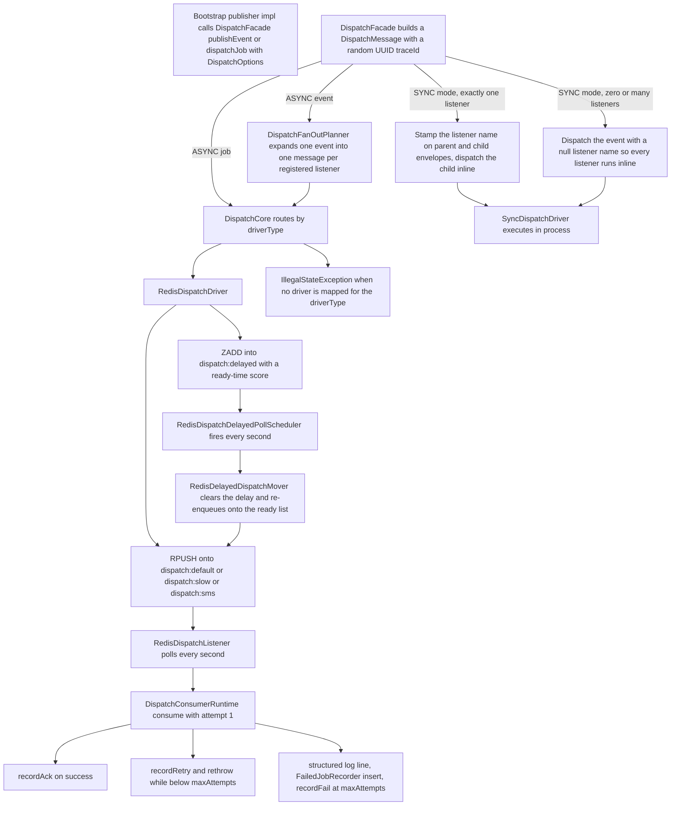

# Dispatch Bus (ecshopx-dispatch)

The dispatch bus is ECShopX-Java's replacement for the PHP system's Laravel-style jobs and events. It is a small, deliberately explicit library module (`ecshopx-dispatch`, depending only on `ecshopx-common`, `spring-boot-starter-data-redis` and `spring-boot-starter-amqp`) that carries two kinds of messages between Bundles:

* **Jobs** — named units of work with exactly one handler (`DispatchMessageType.JOB`).
* **Events** — named occurrences with zero or more listeners (`DispatchMessageType.EVENT`).

Everything else on this page — the facade, the routing core, the fan-out planner, the in-memory registry, the Redis driver and listener, the delayed-message mover, the consumer runtime, and the failed-job recorder — lives in that one module, with the actual wiring concentrated in `ecshopx-bootstrap`'s `DispatchBusConfig`. See [Cross-Bundle Communication](../architecture/cross-bundle-communication.md) for *why* this design keeps Bundles Maven-decoupled, and [Bundle Layering](../architecture/bundle-layering.md) for where `dispatch/` packages sit inside each Bundle.



The publish → fan-out → enqueue → poll → consume → ack/retry/fail path. SYNC messages never leave the process; ASYNC messages are serialized as JSON into Redis and come back through the scheduled poller.

## The message envelope and its options

`DispatchMessage` is a record carrying the full routing envelope: `messageType`, `dispatchMode`, `driverType`, `messageName`, `payload` (a plain `Map<String, Object>`), `queue`, `delay`, `retryPolicy`, `occurredAt`, `traceId`, and `listenerName`. A `traceId` (random UUID) is stamped at publish time and doubles as the `consumerId` written to `failed_jobs`.

`DispatchOptions` is the publisher-facing tuple:

| Factory | Mode | Driver | Queue | Delay | Retry |
| --- | --- | --- | --- | --- | --- |
| `DispatchOptions.jobDefaults()` | `ASYNC` | `null` | `null` | `null` | `RetryPolicy.platformDefault()` |
| `DispatchOptions.eventDefaults()` | `SYNC` | `null` | `null` | `null` | `RetryPolicy.platformDefault()` |
| `DispatchOptions.oplQueuedAfterCommit()` | `ASYNC` | `REDIS` | `null` | `null` | `RetryPolicy.platformDefault()` |

`RetryPolicy.platformDefault()` is 3 attempts with a 3-second `nextDelay`. Real publishers almost never use the factories; they construct the tuple explicitly, e.g. `FinishOrderJobDispatchPublisherImpl` publishes `FINISH_ORDER_JOB` as `ASYNC` / `REDIS` / queue `slow`, and `GenerateOutfitJobDispatchPublisherImpl` narrows the policy to `new RetryPolicy(2, Duration.ofSeconds(3))`.

**Trap — ASYNC without a driver override.** `DispatchFacade.buildMessage` computes `driverType` as `SYNC` when the mode is `SYNC`, otherwise `options.driverOverride()`. If you publish `ASYNC` with a null `driverOverride` (which is what `jobDefaults()` gives you), the message carries a `null` driver type, and `DispatchCore` throws `IllegalStateException("missing async driver: null")` because the wired driver map only contains `REDIS`. Every production `*DispatchPublisherImpl` passes `DispatchDriverType.REDIS` explicitly; `jobDefaults()` is effectively a test-only preset.

## Publishing: `DispatchFacade`

`DispatchFacade` has two entrypoints, `dispatchJob(name, payload, options)` and `publishEvent(name, payload, options)`. Both build a message and hand it to `DispatchCore`, and both append every message they produce to an internal `publishedMessages` list (see [Operational notes and known gaps](#operational-notes-and-known-gaps)).

### Sync versus async routing

`DispatchCore.dispatch(message)` is a three-line router:

* `SYNC` mode → `SyncDispatchDriver.execute(message)` runs **inline, in the caller's thread and transaction**. For a job it calls `registry.jobHandler(name).handle(payload)`; for an event it walks `registry.eventListeners(name)` and calls every listener whose `listenerName` matches the message's (all of them when the message's listener name is `null`).
* `ASYNC` mode → look up the `AsyncDispatchDriver` registered for `message.driverType()` and `enqueue(message)`. No driver for that type → `IllegalStateException`.

`DispatchCore.asyncReady(registry, syncDriver, Map.of(DispatchDriverType.REDIS, redisDispatchDriver))` is how bootstrap builds it, so **Redis is the only async transport wired in the default configuration**.

### Fan-out: one event becomes one message per listener

When `publishEvent` is called with `ASYNC` mode and a fan-out planner is present (it always is in the wired facade), the planner expands the event into one `DispatchMessage` per registered listener before anything is enqueued. Each planned message:

* is forced to `DispatchMode.ASYNC` and keeps the parent's `driverType`, `messageName`, `payload`, `occurredAt` and `traceId`;
* gets its `listenerName` stamped, which is what the consumer later uses to pick exactly one listener;
* takes its **queue from the listener's `ListenerDispatchOptions`** (`"default"` when the listener registered none) — the *publisher's* queue is ignored on this path;
* takes its **delay from the parent message if the publisher set one, otherwise the listener's registered delay**;
* takes its **retry policy from the listener's `ListenerDispatchOptions`**, not from the publisher's options.

That last trio is the rule people get wrong most often: on the async event path, queue and retry policy belong to the *listener registration*, while delay prefers the *publisher*. `DispatchFanOutPlannerTest` pins all three behaviours.

### The SYNC single-listener special case

`publishEvent` with `SYNC` mode and exactly **one** registered listener takes a separate branch: it builds the template message, stamps the sole listener's name onto a *parent* envelope and a *child* envelope, records **both** in `publishedMessages`, and dispatches only the child. Because the mode is `SYNC`, the child routes to `SyncDispatchDriver`, which filters by listener name and runs that one listener inline.

With **zero or many** listeners, `publishEvent` dispatches a single message with a `null` listener name, and `SyncDispatchDriver` runs *every* registered listener inline, in registration order. Either way SYNC means "in-process, in-transaction, right now"; the special case exists so the recorded envelope names the target listener and mirrors the shape of the async fan-out (a planned parent plus an executed child). `NormalOrderCancelDispatchFlowTest` asserts exactly this: one publish produces two recorded messages, both carrying `listener:orders.normal_order_cancel_auto_pass`, and the listener body runs once during the call.

## The registry: who handles what

`InMemoryDispatchRegistry` holds two maps: message name → `DispatchHandler` for jobs, and message name → ordered `List<RegisteredListener>` for events. Two invariants are enforced **at registration time**, which is to say at application startup:

* registering a second job handler for the same message name throws `IllegalStateException("duplicate job handler: ...")`;
* registering a second listener with the same `listenerName` for the same event throws `IllegalStateException("duplicate event listener: ...")`.

`jobHandler(name)` returns `null` for an unknown name, so consuming an unregistered job fails with an `NPE` inside the runtime and goes down the retry/failed-job path; consuming an event whose `listenerName` does not match a registration fails with `orElseThrow()` (`NoSuchElementException`).

Registration is **not** annotation-driven. `ecshopx-bootstrap/src/main/java/cn/shopex/ecshopx/config/` contains on the order of two hundred `*RegistrationConfig` `@Configuration` classes whose `@PostConstruct` hooks call `dispatchRegistry.registerJob(...)` / `registerEventListener(...)`, often with a Spring `@Order` value to control bean-initialisation order. `FinishOrderJobRegistrationConfig` is the canonical job example; `YoushuNormalOrderPaySuccessDispatchListenerRegistrationConfig` the canonical listener example (it registers the youshu listener against `EVENT_NORMAL_ORDER_PAY_SUCCESS` with `ListenerDispatchOptions.async("default", null)`). A Bundle that owns a new handler must therefore add a matching registration config in bootstrap — see [Workflow: Adding a Dispatch Event, Job, or Cron Handler](../workflows/add-event-or-job.md).

The handler-side functional interfaces, `DispatchHandler` (`void handle(Map<String, Object> payload)`) and `DispatchListener` (`void onEvent(Map<String, Object> payload)`), live in `ecshopx-common`'s `common/dispatch` package, so a Bundle can implement a handler depending only on `ecshopx-common`. Publisher interfaces (`FinishOrderJobDispatchPublisher`, `NormalOrderPaySuccessDispatchPublisher`, …) live in the same package for the same reason; their implementations live in bootstrap.

## The Redis transport

`RedisDispatchDriver` implements `AsyncDispatchDriver` against the `dispatchBusStringRedisTemplate` qualifier, which `MultiRedisConfig` binds to the shared/default Redis logical database (`springDataRedisConnectionFactory`, i.e. `spring.data.redis.database`, default 0). See [Redis: Logical Database Isolation and Templates](redis-databases.md) for the full template-to-DB map.

Messages are encoded by `RedisDispatchMessageCodec` as JSON via an `ObjectMapper` with `JavaTimeModule`.

### Ready lists and queue semantics

`enqueue` computes `queue = blank ? "default" : queue` and:

* if a delayed ZSET key is configured **and** the message carries a non-null, non-zero `delay`, it `ZADD`s the encoded message into `dispatch:delayed` with score `now + delay` (epoch millis) and returns;
* otherwise it `RPUSH`es onto `dispatch:<queue>`.

`RedisDispatchListener.poll()` (a `@Scheduled` method, default every `dispatch.redis.poll-delay-ms` = 1000 ms fixed delay) `LPOP`s:

* **one** message from `dispatch:default`,
* then up to `dispatch.redis.slow.batch-size` (default **20**) from `dispatch:slow`, stopping at the first empty pop,
* then up to the same batch size from `dispatch:sms`.

The queue name is a **load-class signal**, chosen by whoever constructs the `DispatchOptions` (for jobs) or the `ListenerDispatchOptions` (for fanned-out events):

| Queue | Drained per poll | Intended load | Examples |
| --- | --- | --- | --- |
| `default` | 1 message | Interactive, low-latency work | supplier order split, youshu sync listeners, `ReservationExpireCancelDispatchPublisherImpl` |
| `slow` | up to 20 | Heavy batch work | file exports, statistics, `FinishOrderJobDispatchPublisherImpl`, `OrderProcessLogDispatchListenerRegistrationConfig` (listener-level `async("slow", null)`) |
| `sms` | up to 20 | Notification traffic | `MerchantResetPasswordNoticeDispatchPublisherImpl`, aliyunsms jobs, `TradeFinishSmsNotifyDispatchListenerRegistrationConfig` |

Note that `dispatch.redis.slow.batch-size` governs **both** the `slow` and the `sms` drain loops — there is one knob, not two. Splitting SMS onto its own list keeps a notification burst from starving the slow lane and vice versa, but the throughput ceiling is shared through that single property.

### The delayed ZSET: `dispatch:delayed`

Delayed messages do not sit on a list. They sit in the `dispatch:delayed` ZSET (configurable via `dispatch.redis.delayed-zset-key`) scored by their ready time. `RedisDispatchDelayedPollScheduler` — a `@Component` gated by `dispatch.redis.delayed-mover.enabled` (default `true`) — runs `RedisDelayedDispatchMover.moveReadyMessages(Instant.now())` every `dispatch.redis.delayed-mover.poll-delay-ms` (default 1000 ms). The mover:

1. `rangeByScore(delayedQueueKey, 0, now.toEpochMilli())` — everything whose ready time has passed;
2. decodes each payload and rebuilds the message with `delay = null` (so the re-enqueue lands on the ready list rather than back in the ZSET);
3. enqueues the cleared message through the ready driver;
4. removes the payload from the ZSET.

A payload that fails to decode throws `IllegalStateException` out of the mover, which the `@Scheduled` wrapper logs and swallows (`RedisDelayedDispatchMoverTest` pins this). Because enqueue-then-remove is not a transaction, a crash in between can duplicate a message — the mover is at-least-once in the worst case, not exactly-once. `ReservationExpireCancelDispatchPublisherImpl` is a good worked example of the intended use: it computes `to_shop_time + 7200s − now` and publishes `RESERVATION_EXPIRE_CANCEL_DELAYED` on `default` with that `Duration` as the delay.

### Driver ack / retry / fail

`RedisDispatchDriver` also implements the driver-level lifecycle hooks: `ack` only records state (nothing is requeued, since the message was already popped), `retry` records state and re-enqueues (which re-enters the delay check — a message still carrying a non-zero delay goes back into the ZSET), and `fail` records state and `RPUSH`es onto `dispatch:dead:<queue>` (the dead prefix is `readyQueuePrefix + "dead:"`, i.e. `dispatch:dead:default` in the wired prefix). **These hooks are not invoked by the scheduled listener loop** — see the consumption section below; today they are exercised by unit tests and available for explicit use.

## Consumption: `DispatchConsumerRuntime`

`RedisDispatchListener.poll()` decodes each popped payload and calls `runtime.consume(message, 1)` — always attempt 1. `DispatchConsumerRuntime.consume` resolves the target:

* **JOB** → `registry.jobHandler(messageName).handle(payload)`;
* **EVENT** → `registry.eventListeners(messageName)` filtered by `listenerName` equality, `findFirst().orElseThrow()` — which is why an async event **must** carry the listener name stamped by the fan-out planner.

On success it records an ack. On a `RuntimeException`:

* if `DispatchRetryDecider.shouldRetry(message, currentAttempt)` — i.e. `currentAttempt < retryPolicy.maxAttempts()` — it records a retry and **rethrows**;
* otherwise it builds a structured log line via `DispatchStructuredLogger.format("failed", ...)`, calls `FailedJobRecorder.recordFailure(message, currentAttempt, message.traceId(), e)`, records the fail, and returns without rethrowing.

Three consequences worth internalising:

1. **Attempt counting never advances.** The listener always calls `consume(msg, 1)`, and nothing increments the attempt between retries. With `platformDefault()` (3 attempts) a failing message stays "retryable" forever from the decider's point of view.
2. **The popped message is not re-enqueued.** The rethrow propagates out of `poll()`, where the `@Scheduled` infrastructure logs and swallows it. `AsyncDispatchDriver.retry()` — the operation that would re-push the message — is not called on this path. Redis-transport consumption is therefore effectively **at-most-once**: a failure loses the message from the ready list, and only the terminal branch leaves a durable trace (in `failed_jobs`).
3. **`RetryPolicy.nextDelay` is carried, not applied.** Nothing schedules a delayed retry from it; it rides along in the envelope (and is asserted by `GenerateOutfitJobDispatchFlowTest`) as metadata.

The `DispatchStructuredLogger.format` call is also currently a formatting helper whose return value is discarded — the runtime does not emit the line to any logger, and the format string duplicates `traceId` as `consumerId`. Treat it as a seam for future logging rather than an operational log source.

## Failed-job persistence

`FailedJobRecorder.recordFailure` maps a `DispatchMessage` plus throwable onto a `FailedJobEntity` (messageName, messageType, listenerName, queueName, payloadJson — JSON-serialised with a `toString` fallback — retryCount, exceptionClass, exceptionMessage, driverType, delay, consumerId, occurredAt, failedAt) and calls `FailedJobMapper.insert(entity)`.

The persistence layer behind that mapper is **not production-grade today**:

* `FailedJobMapper` is a plain `@Mapper` interface with a single `insert` and **no XML mapping** anywhere in the repository.
* `DispatchBusConfig` therefore installs a stub bean — `return entity -> 1;` — so the insert is a no-op that always reports one row.
* The `failed_jobs` table exists only in the legacy dump `docker/ecshopx.sql` (Laravel-style columns `id, connection, queue, payload, exception, failed_at`), which does **not** match the entity's richer field set, and neither Flyway migration (`V00000000000001.sql`, `V00000000000002.sql`) creates it.

In other words, terminal dispatch failures are detected, classified and recorded in memory, but the `failed_jobs` row is a wiring point to be completed. Anyone relying on `failed_jobs` for incident response should verify the mapper and table are actually wired in their deployment.

## The RabbitMQ alternative (present, not wired)

`ecshopx-dispatch` ships a complete AMQP implementation: `RabbitDispatchDriver` (publishes to a configurable exchange with the queue as routing key, `retry` republishes, `fail` publishes to `<exchange>.dead`), `RabbitDispatchMessageConverter` (JSON bytes), `RabbitDispatchListener` (`@RabbitListener(queues = "${dispatch.rabbit.queue:dispatch}")` feeding `runtime.consume(converter.fromBytes(payload), 1)`), and `RabbitDispatchTopologyProvisioner` (declares a durable direct exchange, a durable queue per routing key, and the binding).

None of it is active. `DispatchBusConfig` builds `DispatchCore` with only `DispatchDriverType.REDIS` mapped; it registers the `RabbitDispatchMessageConverter` bean but no `RabbitTemplate`, no driver bean, and no topology provisioning; and `application.properties` contains no `spring.rabbitmq.*` settings. A message published with `DispatchDriverType.RABBITMQ` therefore fails with `missing async driver: RABBITMQ`. The module keeps `spring-boot-starter-amqp` on the classpath so the swap is a wiring change, not a code change.

## How bootstrap assembles the bus

`DispatchBusConfig` in `ecshopx-bootstrap` declares the full graph as plain `@Bean` methods: `dispatchRegistry` (`InMemoryDispatchRegistry`), `syncDispatchDriver`, `redisDispatchDriver` (prefix `dispatch:`, delayed ZSET key from `dispatch.redis.delayed-zset-key`, default `dispatch:delayed`), `redisDelayedDispatchMover`, `dispatchCore` (`asyncReady` with the Redis driver only), `dispatchFacade` (core plus a `DispatchFanOutPlanner` over the registry), `dispatchStructuredLogger`, `dispatchRetryDecider`, the stub `failedJobMapper`, an `ObjectMapper` with `JavaTimeModule`, `failedJobRecorder`, `dispatchConsumerStateRecorder` (`InMemoryDispatchConsumerStateRecorder`), `dispatchConsumerRuntime`, `redisDispatchMessageCodec`, and `rabbitDispatchMessageConverter`.

Two assembly facts that bite people:

* **Scheduling is not enabled by the bus.** `RedisDispatchListener` and `RedisDispatchDelayedPollScheduler` use `@Scheduled`, but neither `ecshopx-dispatch` nor `ecshopx-bootstrap` declares `@EnableScheduling`. It is supplied by bundle configs — `OrdersSchedulingConfig`, `DoumenIntlPaymentSchedulingConfig`, `SelfserviceSchedulingConfig`, `ShuyunOpenPlatformConfiguration`. Remove those bundles and the queues silently stop draining.
* **The bus Redis template is the shared DB.** `dispatchBusStringRedisTemplate` resolves to `springDataRedisConnectionFactory`, so dispatch keys live in the same logical database as the platform default Redis (`spring.data.redis.database`, 0 by default) — not in the deposit (1) or prism (2) DBs. Sizing and key-expiry policy for that DB should account for the dispatch lists and the `dispatch:delayed` ZSET.

## Message naming scheme

All message-name constants live in `ecshopx-common/src/main/java/cn/shopex/ecshopx/common/dispatch/` as `final` classes with private constructors, one family per Bundle: `OrdersDispatchEventNames` / `OrdersDispatchJobNames`, `GoodsDispatchEventNames` / `GoodsBundleDispatchJobNames`, `DistributionDispatchEventNames` / `SalespersonDispatchJobNames`, and so on. Three prefixes:

* **`event:`** — `event:<csvId>:<PhpBundle>\\Events\\<EventClass>` for names aligned with the legacy PHP CSV inventory (e.g. `event:288:OrdersBundle\\Events\\NormalOrderPaySuccessEvent`, `event:271:GoodsBundle\\Events\\ItemAddEvent`), or the shorter `event:<bundle>:<snake_case>` form for planes that never existed in PHP (e.g. `event:orders:normal_order_add`).
* **`job:`** — `job:<csvId>:<PhpBundle>\\Jobs\\<JobClass>` (e.g. `job:128:OrdersBundle\\Jobs\\FinishOrderJob`).
* **`listener:`** — either the legacy PHP listener FQN, optionally with `@method` (e.g. `listener:HfPayBundle\\Listeners\\HfpayTradeRecordListener@paySuccess`, `listener:WsugcBundle\\Listeners\\Order`), or a dotted descriptive name for Java-first listeners (e.g. `listener:youshu.orders_normal_order_add`, `listener:thirdparty.item_add_push_marketing_center`).

Two naming devices matter when reading the constants:

* **Distinct bus planes for one PHP event.** `EVENT_TRADE_FINISH` (`event:291:...TradeFinishEvent`) and `EVENT_TRADE_FINISH_CSV292` (`event:292:...`) are the same PHP event class exposed under two CSV ids so different entry surfaces (gateway pay-success versus admin offline bank-transfer approval) get distinct bus message names while sharing the same listener fan-out. `DistributionDispatchEventNames` does the same with `event:281`/`event:289` and `event:282`/`event:290`.
* **Alias constants folding several CSV ids onto one bus name.** `SalespersonDispatchJobNames` defines `SALESPERSON_ITEMS_SHELVES_JOB_CSV_JOB139_ALIAS` (and 140/141/142/144/145/146…) all pointing at `SALESPERSON_ITEMS_SHELVES_JOB` — several PHP trigger rows collapse onto one Java handler registration.

Keeping the CSV id in the string makes PHP→Java migration parity auditable at a glance; never invent a new format for a migrated message.

## When AFTER_COMMIT publishing matters

Publishing an event whose payload was just written inside a transaction is only safe **after** that transaction commits — otherwise an async consumer can read a Redis message describing a database row that a rollback then removes. The pattern used throughout bootstrap:

```java
if (TransactionSynchronizationManager.isSynchronizationActive()) {
    TransactionSynchronizationManager.registerSynchronization(new TransactionSynchronization() {
        @Override
        public void afterCommit() {
            dispatchFacade.publishEvent(EVENT_ITEM_ADD, payload, options);
        }
    });
} else {
    dispatchFacade.publishEvent(EVENT_ITEM_ADD, payload, options);
}
```

`ItemAddEventDispatchPublisherImpl.schedulePublishAfterCommit` is the reference implementation (publishing `GoodsDispatchEventNames.EVENT_ITEM_ADD` as `ASYNC` / `REDIS` / null queue / null delay / platform default retry, payload `item_id` + `company_id`). `ItemAddEventDispatchPublisherImplAfterCommitTest` proves the semantics: inside a `TransactionTemplate`, `schedulePublishAfterCommit` produces **zero** facade interactions, and exactly one `publishEvent` with the exact options tuple fires after commit; with no active transaction it publishes immediately.

The same shape appears inside `ecshopx-dispatch` itself: `OrderProcessLogPublishPortImpl` (the implementation of the `OrderProcessLogPublishPort` cross-Bundle port) defers `EVENT_ORDER_PROCESS_LOG` to `afterCommit` using `DispatchOptions.oplQueuedAfterCommit()` — the preset whose Javadoc calls out that it is used "after DB commit when publishing via the OPL port". SYNC-mode events are already inside the transaction by construction, so the wrapper matters specifically on the ASYNC path.

## Operational notes and known gaps

* **`DispatchFacade.publishedMessages` is unbounded.** Every `dispatchJob`/`publishEvent` call appends the built message(s) to a plain `ArrayList` that is never cleared; `publishedMessages()` and `lastPublishedMessage()` exist for test introspection. In a long-running process this list grows without limit — worth knowing when reasoning about heap on a high-traffic deployment.
* **At-most-once consumption on the Redis path.** As described under [Consumption](#consumption-dispatchconsumerruntime), a popped message that fails is not re-enqueued by anything, and the attempt counter never advances past 1. Handlers must therefore be idempotent and self-healing; the `failed_jobs` record (once actually persisted) is the recovery signal, not the queue.
* **The delayed mover is not atomic.** Enqueue-then-ZREM without a transaction means a crash between the two can deliver a delayed message twice.
* **`dispatch:dead:*` is written only by explicit `fail()` calls**, which the listener loop never makes. Today the dead lists stay empty in normal operation.
* **`failed_jobs` persistence is stubbed** — see the dedicated section above.
* **`DispatchEnvelope`** (`message`, `attempt`, `consumerId`) exists in the module but nothing in the wired path constructs it; attempt tracking lives in the `consume(message, currentAttempt)` parameter instead.

## Focused tests

| Test | What it pins |
| --- | --- |
| `DispatchBusConfigTest` | Boots `DispatchBusConfig` with a mocked `dispatchBusStringRedisTemplate` and asserts the core beans exist |
| `DispatchBusIntegrationTest` | Sync job executes inline; `RedisDispatchListener.poll()` decodes a `dispatch:default` payload and feeds the runtime; the Rabbit listener does the same for AMQP |
| `DispatchBusScenarioTest` | SYNC execution ordering across a job and two event listeners; fan-out enqueues one message per listener onto per-listener queues |
| `DispatchCoreAsyncRoutingTest` | An ASYNC message routes to the driver selected by `driverType` and only that driver |
| `DispatchFacadeAsyncEventTest`, `DispatchFacadeEventTest`, `DispatchFacadeDefaultsTest` | Envelope metadata, fan-out listener/queue/delay tuples, and the option factories |
| `DispatchFanOutPlannerTest` | Listener-level queue and delay; parent delay takes precedence when present |
| `NormalOrderCancelDispatchFlowTest` | The SYNC single-listener special case: two recorded envelopes, one inline execution |
| `DispatchConsumerRuntimeTest`, `DispatchConsumerRuntimeStateTest` | Past max attempts → failed-job record; success → ack; retryable failure → retry record plus rethrow |
| `FailedJobRecorderTest`, `FailedJobRecorderFieldsTest` | `FailedJobEntity` field population including driver, delay and consumer identity |
| `RedisDispatchDriverTest` | Blank queue → `default`; delay → ZSET with `now + delay` score; ack does not requeue; retry requeues; fail → dead queue |
| `RedisDispatchListenerTest` | Poll decodes and delivers from `dispatch:default` and from `dispatch:sms` |
| `RedisDelayedDispatchMoverTest` | Due payloads move to the ready list with delay cleared and are removed from the ZSET; empty is a no-op; undecodable payload throws |
| `RabbitDispatchDriverTest`, `RabbitDispatchListenerTest`, `RabbitDispatchTopologyProvisionerTest` | The inactive AMQP path's enqueue / retry / dead-exchange / listener / topology behaviour |
| `ItemAddEventDispatchPublisherImplAfterCommitTest` | No publish inside the transaction, exactly one publish with the exact options after commit, immediate publish without a transaction |
| `FinishOrderJobDispatchFlowTest`, `NormalOrderAddEventAsyncFanOutSupplierAndYoushuDispatchFlowTest` | Worked end-to-end examples: a job published to `slow` and consumed into its service; an event fanned out to two listeners and consumed into both |

Beyond these, the ~200 `*DispatchFlowTest` / `*PublishProbeTest` classes under `ecshopx-bootstrap/src/test/java/cn/shopex/ecshopx/dispatch/` each pin one publisher's exact `DispatchOptions` tuple and one handler's consumption behaviour — when you change a queue, delay or retry policy, those are the tests that will tell you.

## Related pages

* [Cross-Bundle Communication](../architecture/cross-bundle-communication.md) — why publisher interfaces live in `ecshopx-common` and implementations in bootstrap
* [Bundle Layering](../architecture/bundle-layering.md) — where `dispatch/` handler and listener classes sit inside each Bundle
* [Redis: Logical Database Isolation and Templates](redis-databases.md) — which logical DB the `dispatchBusStringRedisTemplate` lands in
* [Scheduled Jobs: XXL-JOB Executor and Cron Handlers](scheduling-xxljob.md) — how cron handlers relate to dispatch jobs (a cron handler often publishes one)
* [Workflow: Adding a Dispatch Event, Job, or Cron Handler](../workflows/add-event-or-job.md) — the step-by-step recipe
* [Workflow: Checkout, Payment, Notify, and Trade-Finish Fan-out](../workflows/order-payment-flow.md) — the trade-finish event as the largest real fan-out
