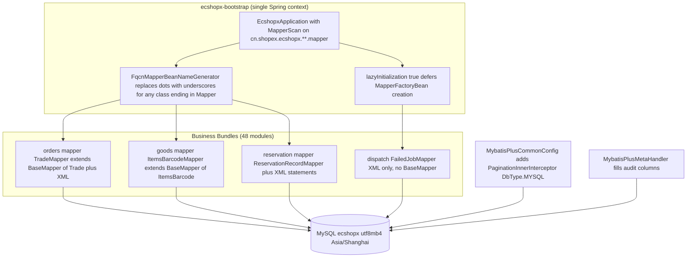

# Persistence: MySQL, MyBatis-Plus, Mappers, and Tenancy

All business data in ECShopX-Java lives in **one MySQL database** (`ecshopx`) reached through **MyBatis-Plus 3.5.16** (`mybatis-plus-spring-boot3-starter`, version pinned in the root `pom.xml` / `ecshopx-bom`). There is no JPA, no separate reporting store, and no second SQL dialect: every Bundle in the reactor talks to the same schema through mapper interfaces, and Redis (see [Redis: Logical Database Isolation](redis-databases.md)) only holds caches, counters, and queue state — MySQL is the system of record. For where `domain/`, `mapper/`, and `repository/` packages sit inside a Bundle, see [Bundle Layering](../architecture/bundle-layering.md).

## The connection and its two pinned values

`spring.datasource.url=jdbc:mysql://127.0.0.1:3306/ecshopx?useUnicode=true&characterEncoding=utf-8&useSSL=false&allowPublicKeyRetrieval=true&serverTimezone=Asia/Shanghai` (from `ecshopx-bootstrap/src/main/resources/application.properties`) pins two things that every developer must keep in mind:

* **Charset.** The client encoding is utf-8, the Docker stacks start MySQL with `--character-set-server=utf8mb4 --collation-server=utf8mb4_unicode_ci`, and the readme's manual-init command creates the database as `DEFAULT CHARSET=utf8mb4 COLLATE=utf8mb4_unicode_ci`. `bin/make-migration` normalizes `utf8` to `utf8mb4` when connecting, and every `CREATE TABLE` it emits ends with `ENGINE = InnoDB DEFAULT CHARACTER SET utf8mb4 COLLATE 'utf8mb4_unicode_ci'`. Chinese comments, product names, and error strings are stored as-is, so a non-utf8mb4 deployment is broken by design.
* **Timezone.** `serverTimezone=Asia/Shanghai` is the one timezone used for JDBC timestamp conversion, and both Docker stacks set `TZ: Asia/Shanghai`. Many audit columns hold **Unix epoch seconds as `int`/`bigint`** rather than `datetime`, and services compute "now" with `(int) (System.currentTimeMillis() / 1000L)` — those are timezone-neutral, but the `datetime`/`LocalDateTime` columns and the daily sequence keys (`MMdd` suffixes) depend on the JVM/container default matching `Asia/Shanghai`.

The driver is `com.mysql:mysql-connector-j` (runtime scope, declared only in `ecshopx-bootstrap`). Business Bundles that need MyBatis-Plus declare `mybatis-plus-spring-boot3-starter` + `mybatis-plus-jsqlparser` themselves; `ecshopx-common` also declares them because it hosts the shared configuration.

## Mapper scanning: one `@MapperScan`, FQCN bean names, lazy init

`EcshopxApplication` is the **only** place `@MapperScan` appears:

```java
@SpringBootApplication(scanBasePackages = "cn.shopex.ecshopx")
@MapperScan(
        basePackages = "cn.shopex.ecshopx.**.mapper",
        nameGenerator = FqcnMapperBeanNameGenerator.class,
        sqlSessionFactoryRef = "sqlSessionFactory",
        lazyInitialization = "true")
public class EcshopxApplication { ... }
```

Three decisions are recorded in the class Javadoc, and each one is load-bearing:

1. **`FqcnMapperBeanNameGenerator` prevents bean-name collisions.** MyBatis' default bean name is the decapitalized short interface name (`statisticsMapper`, `settingMapper`, `cartMapper`), and with 48+ Bundles these names **do** repeat — `StatisticsMapper` exists in both `ecshopx-companys` and `ecshopx-data-cube`, `SettingMapper` in both `ecshopx-companys` and `ecshopx-wsugc`, and `CartMapper` in both `ecshopx-orders` and `ecshopx-employee-purchase`. The generator (`ecshopx-common/.../common/mybatis/FqcnMapperBeanNameGenerator.java`) returns `className.replace('.', '_')` for any bean definition whose class name ends in `Mapper`, and delegates to Spring's `AnnotationBeanNameGenerator` otherwise.
2. **`@MapperScan` on the main class beats MyBatis-Plus' own auto-scan.** Because `MapperScannerRegistrar` runs while the primary configuration class is being processed, the `MapperFactoryBean` definitions exist before MyBatis-Plus evaluates `@ConditionalOnMissingBean(MapperFactoryBean)`, so its auto mapper scanning backs off — the standard Spring Boot + MyBatis pattern, with no placeholder `MapperScannerConfigurer` bean.
3. **`lazyInitialization = "true"`** defers each `MapperFactoryBean` until first injection/use, keeping the start-up cost of a single context holding several hundred mapper definitions bounded.

### Hard rule: new mappers must live under `cn.shopex.ecshopx.**.mapper`

The scan pattern only matches packages whose last-but-one segment is literally `mapper` (e.g. `cn.shopex.ecshopx.orders.mapper`, `cn.shopex.ecshopx.goods.mapper`). A mapper interface placed anywhere else — `dao`, `repository`, `persistence`, or directly in the Bundle root — is **not scanned**, is not a bean, and the failure surfaces as a Spring context startup error (`NoSuchBeanDefinitionException` on the constructor that injects it). Nothing but compilation and startup enforces this, which is why the readme and the bundle conventions repeat it.

Conversely, because the pattern covers the whole `cn.shopex.ecshopx` namespace, a **new Bundle needs no wiring at all**: create `cn.shopex.ecshopx.<domain>.mapper.*Mapper`, annotate it `@Mapper`, and bootstrap picks it up.

### What a mapper looks like

Three shapes coexist, all annotated `@Mapper` and living in a `mapper` package:

* **`extends BaseMapper<Entity>`** — the default. This is how nearly all mappers are declared (e.g. `TradeMapper extends BaseMapper<Trade>`, `StatisticsMapper extends BaseMapper<Statistics>`); all CRUD (`selectById`, `insert`, `update`, `delete`, `selectPage`, `selectCount`, …) comes from MyBatis-Plus and needs no SQL.
* **`BaseMapper` + custom methods** — declare the method on the interface, implement it in `src/main/resources/mapper/<Mapper>.xml` with the same namespace and statement id. `ReservationRecordMapper` declares `countConflictingReservations`, `countRightsQuotaUsage`, `selectOccupiedResourceLevelIds`, `selectForLimitDaysWindow`, `countForLimitNumsSameDay`; the matching XML lives at `ecshopx-reservation/src/main/resources/mapper/ReservationRecordMapper.xml`. XML mapper files are found through the global property `mybatis-plus.mapper-locations=classpath*:mapper/**/*.xml` — the `classpath*:` prefix is what makes every Bundle's `resources/mapper/` directory visible from the single fat jar, without any per-Bundle registration.
* **`BaseMapper` + annotation SQL, or annotation-only mappers** — small `@Select` scripts directly on the interface (`CartMapper.selectCartCountSummary` in `ecshopx-employee-purchase` uses a text block with a `WHERE company_id = #{companyId} AND user_id = #{userId} …` clause). Annotation-only mappers that do not extend `BaseMapper` also exist: `WxappVipGradeOrderDetailLiteMapper` (a read-only projection with `@Select`) and `AdminOrderListSourcesLookupMapper` (a `<script>` `@Select` returning a record) — both still live in a `mapper` package, so the scan finds them.

There is exactly one deliberate exception to the "must live under `**.mapper`" rule: `ecshopx-dispatch`'s `FailedJobMapper` sits in the bundle's root package (`cn.shopex.ecshopx.dispatch.FailedJobMapper`), outside the scan pattern. It is wired by hand — bootstrap's `DispatchBusConfig` declares `@Bean public FailedJobMapper failedJobMapper() { return entity -> 1; }`, a **stub** that discards the insert, while the real XML insert for the `failed_jobs` table sits in `ecshopx-dispatch/src/main/resources/mapper/FailedJobMapper.xml`. Failed-job persistence is therefore a wiring point to be completed, not production-grade today; a new mapper should not copy this exception.



Mapper discovery and the shared MyBatis-Plus configuration that rides on it: one `@MapperScan` with a unique-name generator and lazy initialization feeds every Bundle's mapper, whose SQL reaches the single MySQL database; XML-only and annotation-only mappers join through the same namespace rules.

## Shared MyBatis-Plus configuration

Two beans in `ecshopx-common/.../common/config/` customize the starter:

* **`MybatisPlusCommonConfig.mybatisPlusInterceptor()`** installs exactly one inner interceptor: `new PaginationInnerInterceptor(DbType.MYSQL)`. This is what makes `mapper.selectPage(new Page<>(page, pageSize), wrapper)` emit a MySQL `LIMIT` (and, when `page.setOptimizeCountSql(true)` or the default count behavior applies, a `COUNT(*)`). List services across the codebase rely on it (e.g. `ReservationListQueryService`, `DiscountCardEasyListService`, `MonitorsListService`). There is no `TenantLineInnerInterceptor`, no optimistic-lock interceptor, and no block-attack interceptor — tenancy is enforced by hand-written wrappers, not by the SQL rewriter.
* **`MybatisPlusCommonConfig.mpMetadataAnnotationHandlerCustomizer()`** is a `MybatisPlusPropertiesCustomizer` that sets `globalConfig.setAnnotationHandler(new MpMetadataAnnotationHandler())`. This is the bridge that lets the extended annotations (`@MpTable`, `@MpField`, `@MpId`) work as if they were the stock `@TableName`/`@TableField`/`@TableId`.
* **`MybatisPlusMetaHandler`** is the `MetaObjectHandler` that auto-fills audit columns. It supports **two naming conventions at once**: `createTime` / `updateTime` as **`Integer` Unix-epoch seconds** and `createdAt` / `updatedAt` as **`LocalDateTime`**. `insertFill` fills all four (with `strictInsertFill`, so an entity that only declares some of them is fine); `updateFill` refreshes only `updateTime` (epoch seconds) and `updatedAt` (`LocalDateTime.now()`). Filling only triggers on fields annotated `@TableField(fill = FieldFill.INSERT)` / `FieldFill.INSERT_UPDATE`. Not every entity opts in — `Trade` has no fill annotations and services set timestamps manually (`int now = (int) (System.currentTimeMillis() / 1000L)`); `BaseEntity` in `ecshopx-common` (`common/core/domain/BaseEntity.java`) is the opt-in base class carrying `create_time`/`update_time` with `FieldFill`, but at the time of writing no domain entity extends it yet — most Bundles declare their own `created`/`updated` `int` columns and set them explicitly (see `ItemsRepository.insert`).

All three properties are shipped defaults in `ecshopx-bootstrap/src/main/resources/application.properties` — the single tracked file every deployment profile loads. There is no tracked `application-local.properties` to lean on: that file is listed in `.gitignore` (line 7), so it is absent from fresh checkouts and exists only where a developer has created it (the readme's statement that the project "already includes" it as a local development sample is drift). Per-environment datasource/Flyway/logging values therefore arrive from **outside the file** — as environment variables, Spring Boot CLI arguments (`--spring.datasource.url=…`), or the `APP_ARGS` block both Docker compose stacks template (`docker-compose.dev.yml` and `docker-lite/docker-compose.yml` both override `spring.datasource.*` and force `spring.flyway.enabled=true` this way, since Docker runs do not activate the `local` profile).

| Property | Value | Meaning |
|---|---|---|
| `mybatis-plus.mapper-locations` | `classpath*:mapper/**/*.xml` | Aggregates every Bundle's `resources/mapper/` XML into the single `SqlSessionFactory`. |
| `mybatis-plus.configuration.map-underscore-to-camel-case` | `true` | `trade_state` ↔ `tradeState`, `company_id` ↔ `companyId`. Because domain classes never repeat `@TableField` names by hand where the snake-case mapping already works, this must stay enabled. |
| `mybatis-plus.configuration.log-impl` | `org.apache.ibatis.logging.stdout.StdOutImpl` | **Every SQL statement is echoed to stdout in the shipped defaults.** That is loud by design for development, but it is the production-facing default too: an operator must override this key (e.g. to `NoLoggingImpl`) via `APP_ARGS` / env vars when deploying, because nothing in the repo disables it. |

### Datasource and Flyway defaults

The same file carries the connection and migration wiring that backs the mappers:

| Property | Shipped value | Meaning |
|---|---|---|
| `spring.datasource.url` | `jdbc:mysql://127.0.0.1:3306/ecshopx?…serverTimezone=Asia/Shanghai` | Loopback dev default; the Docker stacks repoint it to `jdbc:mysql://mysql:3306/ecshopx?…`. |
| `spring.datasource.username` / `.password` | `ecshopx` / `ecshopx` | Dev credentials, matching the compose stacks' `MYSQL_USER`/`MYSQL_PASSWORD`. |
| `spring.datasource.driver-class-name` | `com.mysql.cj.jdbc.Driver` | |
| `spring.flyway.enabled` | `true` | Migrations run **at application startup**; the compose stacks re-assert `--spring.flyway.enabled=true` in `APP_ARGS`. |
| `spring.flyway.locations` | `classpath:db/migration` | Classpath-wide: every Bundle ships a `db/migration` directory (all `.gitkeep`-only placeholders), but only `ecshopx-bootstrap/src/main/resources/db/migration` holds real SQL (`V00000000000001.sql`, `V00000000000002.sql`) — so schema evolution is centralized in bootstrap in practice. |
| `spring.flyway.baseline-on-migrate` / `.baseline-version` | `true` / `0` | Existing databases imported from `docker/ecshopx.sql` are baselined at version 0 instead of re-running historical SQL. |
| `spring.flyway.encoding` | `UTF-8` | The migration files contain Chinese comments. |

## Domain entities: the schema source of truth

Each table has one entity in the owning Bundle's `domain/` package, annotated with the **extended metadata annotations** from `common/mybatis/metadata/`:

* `@MpTable(value, comment, indexes, uniqueIndexes)` — meta-annotated with stock `@TableName`, plus Doctrine-ORM-era metadata (the Javadoc says "Extended MyBatis-Plus table annotation with database metadata migrated from ecshopx-api Doctrine ORM").
* `@MpId(value, type, columnType, length, …)` — meta-annotated `@TableId`. `Trade` uses `@MpId(value = "trade_id", type = IdType.INPUT, columnType = "string", length = 64)` — the trade id is a caller-supplied string, not an auto-increment. `ItemsBarcode` uses `@MpId(value = "id", type = IdType.AUTO, columnType = "bigint")`.
* `@MpField(value, columnType, length, nullable, precision, scale, defaultValue, comment, unique, fill, …)` — meta-annotated `@TableField`, carrying column type, length, nullability, default, and comment.

`MpMetadataAnnotationHandler` implements MyBatis-Plus' `AnnotationHandler` interface so that when MyBatis-Plus asks `isAnnotationPresent(TableName.class)` / `getAnnotation(TableField.class)` / `getAnnotation(TableId.class)`, the answer is derived from the corresponding `@Mp*` annotation via a dynamic `Proxy` that synthesizes a `TableName`/`TableField`/`TableId` instance with the right attribute values (plus annotation defaults). This is why a MyBatis-Plus runtime understands entities that never mention `@TableName` directly, and it is also why `bin/make-migration` can read the same annotations as schema metadata.

`Trade` (in `ecshopx-orders/src/main/java/cn/shopex/ecshopx/orders/domain/Trade.java`) is the canonical example of the density of this metadata: the `@MpTable` declares seven indexes (`ix_company_id`, `ix_distributor_id`, `ix_order_id`, `idx_supplier_id`, `ix_user_id`, `ix_list` on `(company_id, order_id)`, `idx_merchant_id`), and every one of the ~40 fields carries its column type, length, nullability, default, and Chinese comment. Note the `Trade.companyId` / `distributorId` / `shopId` / `dealerId` columns are declared `columnType = "string"` — the legacy PHP schema stored tenant ids as strings in the `trade` table, which is why the Youshu-facing XML in `TradeMapper.xml` has to `CAST(company_id AS SIGNED)` before comparing, while newer tables (`items_barcode`, `trade`'s `merchant_id`) use `bigint`.

### Entities drive `bin/make-migration`, not the other way round

Schema evolution is **domain-first**: you annotate/extend the entity, then run `bin/make-migration <description>`, which connects to the MySQL database from `spring.datasource.*` (or `--db-url`), reads the live `information_schema` as the "from" schema, parses every `ecshopx-*/src/main/java/**/domain/**/*.java` file (a pure-Python regex parser, not a Java classpath scan) into a "to" schema, and emits a Flyway `VyyyyMMddHHmmss__<description>.sql` under `ecshopx-bootstrap/src/main/resources/db/migration` with the DDL needed to move from one to the other. Full details, flags, and the safety invariants are on [Workflow: Schema Changes with bin/make-migration and Flyway](../workflows/schema-migration.md); the persistence-relevant points are:

* The parser reads `@MpTable`/`@MpId`/`@MpField`/`@MpIndex` **and** falls back to stock `@TableName`/`@TableId`/`@TableField` (inferring nullability/default from the Java field initializer in that case, and SQL type from the Java type).
* Ordinary and unique indexes are only generated from `@MpIndex` entries (`indexes` / `uniqueIndexes`), because stock MyBatis-Plus annotations have no index metadata — which is exactly why the `@Mp*` annotations exist.
* Duplicate domain mappings for the same table are resolved by "richer wins" (`table_mapping_score` = column count, then index count, then primary-key count, then shorter source path) with a warning.
* Generated SQL must be reviewed: the script's own help text says "MyBatis-Plus annotations are less expressive than Doctrine ORM metadata, so generated SQL is best-effort", and `DROP` statements are never emitted without `--allow-drop`.

## Tenancy: `company_id` is the tenant key, and it is your job to filter

The system is multi-tenant by `company_id` (the "company" / 企业), with `distributor_id` (店铺, the shop) as a second scoping dimension and `shop_id` as a related physical-store id. **There is no `TenantLineInnerInterceptor` and no automatic tenant filter.** Every query and update is scoped explicitly by the service/repository layer, which is why the pattern below appears thousands of times across the codebase.

### The idiom

```java
// Read, scoped to one company (ItemsRepository, ecshopx-goods)
LambdaQueryWrapper<Items> w = new LambdaQueryWrapper<>();
w.eq(Items::getItemId, itemId).eq(Items::getCompanyId, companyId).last("LIMIT 1");
return mapper.selectOne(w);

// Delete, scoped to one company (ItemsBarcodeRepository.deleteByItemIds)
LambdaQueryWrapper<ItemsBarcode> w = new LambdaQueryWrapper<>();
w.eq(ItemsBarcode::getCompanyId, companyId).in(ItemsBarcode::getItemId, itemIds);
mapper.delete(w);

// Update, scoped to one company (ItemsRepository.updateByItemIds)
LambdaUpdateWrapper<Items> u = new LambdaUpdateWrapper<>();
u.eq(Items::getCompanyId, companyId).in(Items::getItemId, itemIds)
        .set(Items::getDefaultItemId, defaultItemId).set(Items::getGoodsId, goodsId)
        .set(Items::getUpdated, now);
mapper.update(null, u);
```

The rules that fall out of the code:

* **A primary-key lookup is not automatically tenant-safe.** `mapper.selectById(id)` is used where the id is globally unique *and* the caller has already established the tenant (payment callbacks look up `trade` by `trade_id`, a globally unique string). When the id is only unique per company, the repository adds the `eq(companyId)` predicate anyway: `getByItemIdAndCompany(itemId, companyId)`, `findByItemBnAndCompany(itemBn, companyId)`, `existsByItemIdAndCompany`, `deleteByItemIdsAndCompanyId`, `updateAuditFieldsByCompanyAndGoodsId(companyId, clause, …)`. The deliberate exception is documented in-source: `ItemsRepository.findByItemId` is labeled "仅按主键 item_id 查询一行，不按公司过滤" ("query one row by primary key only, without company filter") — the rare intentional unscoped read.
* **`@MpIndex(name = "ix_company_id", columns = {"company_id"})` on nearly every `@MpTable`** is the physical half of the contract: the tenant predicate must be indexable or every list query degrades to a table scan across all tenants. Composite indexes frequently lead with it (`ix_list` on `(company_id, order_id)` in `Trade`, `idx_key` unique on `(company_id, distributor_id, barcode)` in `ItemsBarcode`).
* **XML and annotation SQL repeat the predicate by hand.** `ReservationRecordMapper.xml` prefixes every statement with `WHERE company_id = #{companyId}` (plus `shop_id = #{shopId}` where shop-scoped); `TradeMapper.xml`'s Youshu statements use `CAST(company_id AS SIGNED) = #{companyId}` because the legacy column is a string; `ItemsCategoryMapper.xml`'s `selectSingleLevelList` builds `AND p.company_id = #{companyId} AND p.distributor_id = #{distributorId}` inside a `<where>` block. Because there is no interceptor, a hand-written statement that forgets the predicate is a **cross-tenant data leak**, and the only defense is review plus the tests described below.
* **Where does `companyId` come from?** It is resolved per request by the auth interceptors (H5/wxapp JWT claims, anonymous appid/domain resolution — see [Request Lifecycle](../architecture/request-lifecycle.md)) and handed to services as an explicit `long companyId` parameter or carried in a small per-operation context object (e.g. `ItemsCreateContext(companyId, operatorType, itemType, gift, supplierMode)`). Controllers read it from request attributes (`H5FrontAuthAttributes.H5_COMPANY_ID`) and throw `UnauthorizedException("无权访问该API,非法访问！")` when it cannot be resolved to a positive value. It never arrives through a thread-local that the persistence layer could read on its own.

### Shop scoping: `distributor_id` with `0` = platform

Many tables add `distributor_id` on top of `company_id`, and the convention is that **`distributor_id = 0` means the platform-level pool**. `ItemsBarcode` documents it in the column comment itself: `@MpField(value = "distributor_id", columnType = "bigint", length = 20, comment = "店铺id，0=平台", defaultValue = "0")`. The uniqueness rule is shop-scoped: `uniqueIndexes = {@MpIndex(name = "idx_key", columns = {"company_id", "distributor_id", "barcode"})}` — the same barcode may exist in different shops, but not twice in one shop.

`ItemsBarcodeRepository.saveBarcode(companyId, distributorId, itemId, defaultItemId, barcodeCsv)` is the worked example of the whole discipline, and `ItemsBarcodeRepositoryShopScopedTest` pins it:

* It first **deletes** the item's existing barcode rows with a company-scoped wrapper (`eq(companyId).in(itemId, …)`), then re-inserts — an overwrite-write, not a diff.
* For each code it counts rows matching `eq(companyId).eq(distributorId).eq(barcode).ne(itemId, other-item)` and throws `ResourceException("条形码已经存在")` when another SKU in the same shop already owns the code.
* The test's three cases are precisely the tenant matrix: `saveBarcode_sameShopDuplicate_throws` (duplicate in the same shop is rejected and `insert` is never called), `saveBarcode_differentShopSameCode_inserts` (the same code in a *different* shop inserts fine, with the captured row asserting `companyId`/`distributorId`/`itemId`/`barcode`), and `saveBarcode_platformPool_usesDistributorZero` (a `distributorId` of `0` flows through as the platform pool).

## Idempotency guards: refuse updates that already happened

Payment callbacks can be retried by the gateway, and two callbacks for the same trade must not both apply. The persistence-layer answer is a **guard on the current row state before the update** — a read-back, a state check, and a narrow `LambdaUpdateWrapper` that only touches the intended columns.

`OrdersTradePaymentCallbackService.applyTradePaymentNotify(outTradeNo, status, options)` (in `ecshopx-orders/.../service/payment/`) is the canonical implementation:

1. Persist the raw notify payload first (`inital_response` = serialized options) with `updateById`, so even a rejected retry leaves an audit trail.
2. Re-read the row (`tradeMapper.selectById(outTradeNo)`) and **refuse to continue unless `tradeState` is exactly `"NOTPAY"`** — otherwise throw `ResourceException("更新已处理，不需要更新")` ("already processed, no update needed").
3. Build a `LambdaUpdateWrapper` keyed on `eq(Trade::getTradeId, outTradeNo)` that sets only `tradeState`, `payType`, `payChannel`, `bankType`, `couponFee`, `couponInfo`, conditionally `transactionId`, and — on `SUCCESS` — `timeExpire` and the daily `tradeNo` sequence (allocated from Redis, `h_trade_no_<companyId>_<distributorId>_<MMdd>` / `c_trade_no_…`, 24 h TTL).
4. Check the affected-row count: `if (updated <= 0) throw new ResourceException("交易单状态更新失败")` — a silent zero-row update is an error, not a no-op.
5. Only after a successful `SUCCESS` transition fan out the trade-finish events (Jushuitan, orders, WdtErp publishers) and the membercard VIP fulfillment port.

The same guard shape is repeated wherever an external system can re-deliver the same event: `BsPayOrdersTradePaymentCallbackService.handlePaymentNotify` (same `"NOTPAY"` check, same `"更新已处理，不需要更新"` message), `AdapayOrdersTradePaymentCallbackService`, `AdapayDepositTradeRechargeCallbackService.rechargeCallback` (deposits check `tradeStatus != SUCCESS` inside a `@Transactional(rollbackFor = Exception.class)` method, then update with `n <= 0` → `ResourceException`), `OfflinePaymentDoCheckService`, `OrdersPaymentDoPaymentService`, and `SupplierOfflineTradeWriteService`. The invariant to preserve when touching any of them: **state-machine transitions are conditional updates gated on the previous state, and a zero-affected-rows result is treated as failure.**

## Transactions and cross-store writes

Spring's `@Transactional(rollbackFor = Exception.class)` is used for multi-write flows (deposit recharge is the clearest example: trade-row update + `UserDeposit` balance mutation in one transaction, with the SMS dispatch deliberately registered as `TransactionSynchronizationManager` `afterCommit` so it only fires if the commit succeeds). Two things to keep in mind when adding persistence code:

* Redis writes are **not** transactional. The deposit flow writes the new balance into the `userDepositTotal_<companyId>` hash *after* the SQL work, and the trade-sequence Redis keys in the payment callback are best-effort counters — treat them as caches/counters, not as part of the database transaction.
* Self-invocation bypasses the proxy; where a method needs to start a transaction from inside the same bean, the codebase uses a programmatic `TransactionTemplate` instead (see `MigrationSeedRunner`'s menu re-import).

## Extension points and change checklist

| You are adding… | Do this |
|---|---|
| A new table | Create `<bundle>/domain/<Entity>.java` with `@MpTable` + `@MpId`/`@MpField` (include `company_id`, and `distributor_id` when shop-scoped, plus the `ix_company_id` index), then generate and review a Flyway migration — see [Schema Migration](../workflows/schema-migration.md). |
| A new column | Annotate the entity field with `@MpField(value, columnType, length, nullable, defaultValue, comment)` and generate the migration; do **not** hand-write SQL into the Bundle. |
| Custom SQL | `<bundle>/mapper/<X>Mapper.java` (must be under `cn.shopex.ecshopx.<domain>.mapper`) + `<bundle>/src/main/resources/mapper/<X>Mapper.xml`. Repeat the `company_id` predicate in the SQL yourself. |
| A read-only projection | An annotation-only `@Mapper` interface with `@Select` returning `Map<String, Object>` or a record — still in the `mapper` package. |
| A query several services share | A thin `@Repository` class that owns the `LambdaQueryWrapper` logic (e.g. `ItemsBarcodeRepository`, `ItemsRepository`). |
| Audit columns | Either `int` `created`/`updated` set manually, or `@MpField(fill = FieldFill.INSERT/INSERT_UPDATE)` on `create_time`/`update_time`/`created_at`/`updated_at` so `MybatisPlusMetaHandler` fills them. |
| Pagination | `mapper.selectPage(new Page<>(page, size), wrapper)` — guaranteed MySQL `LIMIT` by `PaginationInnerInterceptor(DbType.MYSQL)`; pass `false` as the third `Page` constructor argument when you will run your own `selectCount`. |

Focused tests that pin these behaviors: `ItemsBarcodeRepositoryShopScopedTest` (shop-scoped uniqueness and the `distributorId = 0` platform pool), and the payment-callback probe tests (`OrdersTradePaymentCallbackServiceNormalOrderPaySuccessPublishProbeTest`, `...CanceledRefundOrderProcessLogPublishProbeTest`, `...MembercardVipFulfillTest`, `...WdtPublishOrderTest`), which mock `TradeMapper` and drive `applyTradePaymentNotify` end-to-end; note their `@BeforeAll initMybatisPlusTableMetadata()` — `TableInfoHelper.initTableInfo(new MapperBuilderAssistant(new MybatisConfiguration(), ""), Trade.class)` — which is the standard trick for making MyBatis-Plus lambda wrappers (which resolve column names from cached table metadata) work in plain Mockito tests without a database.

## See also

* [Bundle Layering](../architecture/bundle-layering.md) — where `domain/`, `mapper/`, `repository/`, and the mapper XML live inside each Bundle.
* [Workflow: Schema Changes with bin/make-migration and Flyway](../workflows/schema-migration.md) — every `make-migration` flag and the review invariants.
* [Redis: Logical Database Isolation](redis-databases.md) — the non-SQL half of persistence (caches, counters, dispatch queues).
* [System Overview](../architecture/overview.md) — how the single MySQL database and Flyway fit the runtime topology.
