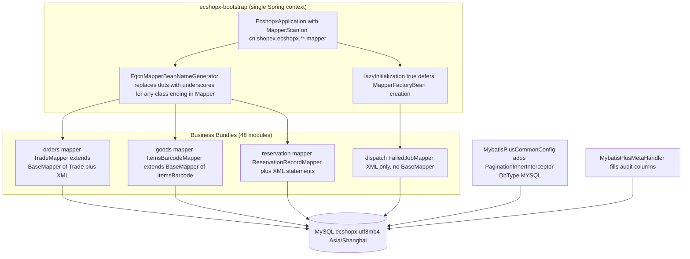

# Persistence: MySQL, MyBatis-Plus, Mappers, and Tenancy

All business data in ECShopX-Java lives in **one MySQL database** (`ecshopx`) reached through **MyBatis-Plus 3.5.16** (`mybatis-plus-spring-boot3-starter`, version pinned via the `mybatis-plus.version` property in the root `pom.xml` `<properties>` block — lines 21-29, which also carry the reactor `revision` of `5.5.3` plus the shared pins `lombok 1.18.36`, `jjwt 0.12.6`, `zxing 3.5.3`, `wxjava 4.7.6-20250628.205748`, and `alipay-sdk 4.39.134.ALL` — and re-declared in `ecshopx-bom`, which imports the starter and the jsqlparser companion at the same version). There is no JPA, no separate reporting store, and no second SQL dialect: every Bundle in the reactor talks to the same schema through mapper interfaces, and Redis (see [Redis: Logical Database Isolation](redis-databases.md)) only holds caches, counters, and queue state — MySQL is the system of record. For where `domain/`, `mapper/`, and `repository/` packages sit inside a Bundle, see [Bundle Layering](../architecture/bundle-layering.md).

## The connection and its two pinned values

`spring.datasource.url=jdbc:mysql://127.0.0.1:3306/ecshopx?useUnicode=true&characterEncoding=utf-8&useSSL=false&allowPublicKeyRetrieval=true&serverTimezone=Asia/Shanghai` (from `ecshopx-bootstrap/src/main/resources/application.properties`) pins two things that every developer must keep in mind:

* **Charset.** The client encoding is utf-8, the Docker stacks start MySQL with `--character-set-server=utf8mb4 --collation-server=utf8mb4_unicode_ci`, and the readme's manual-init command creates the database as `DEFAULT CHARSET=utf8mb4 COLLATE=utf8mb4_unicode_ci`. `bin/make-migration` normalizes `utf8` to `utf8mb4` when connecting, and every `CREATE TABLE` it emits ends with `ENGINE = InnoDB DEFAULT CHARACTER SET utf8mb4 COLLATE 'utf8mb4_unicode_ci'`. Chinese comments, product names, and error strings are stored as-is, so a non-utf8mb4 deployment is broken by design.
* **Timezone.** `serverTimezone=Asia/Shanghai` is the one timezone used for JDBC timestamp conversion, and both Docker stacks set `TZ: Asia/Shanghai`. Many audit columns hold **Unix epoch seconds as `int`/`bigint`** rather than `datetime`, and services compute "now" with `(int) (System.currentTimeMillis() / 1000L)` — those are timezone-neutral, but the `datetime`/`LocalDateTime` columns and the daily sequence keys (`MMdd` suffixes) depend on the JVM/container default matching `Asia/Shanghai`.

The driver is `com.mysql:mysql-connector-j` (runtime scope, declared only in `ecshopx-bootstrap`). Business Bundles that need MyBatis-Plus declare `mybatis-plus-spring-boot3-starter` + `mybatis-plus-jsqlparser` themselves; `ecshopx-common` also declares them because it hosts the shared configuration.

## Mapper scanning: one `@MapperScan`, FQCN bean names, lazy init

`EcshopxApplication` is the **only** place `@MapperScan` appears:

```java
@SpringBootApplication(scanBasePackages = "cn.shopex.ecshopx")
@MapperScan(
        basePackages = "cn.shopex.ecshopx.**.mapper",
        nameGenerator = FqcnMapperBeanNameGenerator.class,
        sqlSessionFactoryRef = "sqlSessionFactory",
        lazyInitialization = "true")
public class EcshopxApplication { ... }
```

Three decisions are recorded in the class Javadoc, and each one is load-bearing:

1. **`FqcnMapperBeanNameGenerator` prevents bean-name collisions.** MyBatis' default bean name is the decapitalized short interface name (`statisticsMapper`, `settingMapper`, `cartMapper`), and with 48+ Bundles these names **do** repeat — `StatisticsMapper` exists in both `ecshopx-companys` and `ecshopx-data-cube`, `SettingMapper` in both `ecshopx-companys` and `ecshopx-wsugc`, and `CartMapper` in both `ecshopx-orders` and `ecshopx-employee-purchase`. The generator (`ecshopx-common/.../common/mybatis/FqcnMapperBeanNameGenerator.java`) returns `className.replace('.', '_')` for any bean definition whose class name ends in `Mapper`, and delegates to Spring's `AnnotationBeanNameGenerator` otherwise.
2. **`@MapperScan` on the main class beats MyBatis-Plus' own auto-scan.** Because `MapperScannerRegistrar` runs while the primary configuration class is being processed, the `MapperFactoryBean` definitions exist before MyBatis-Plus evaluates `@ConditionalOnMissingBean(MapperFactoryBean)`, so its auto mapper scanning backs off — the standard Spring Boot + MyBatis pattern, with no placeholder `MapperScannerConfigurer` bean.
3. **`lazyInitialization = "true"`** defers each `MapperFactoryBean` until first injection/use, keeping the start-up cost of a single context holding several hundred mapper definitions bounded.

### Hard rule: new mappers must live under `cn.shopex.ecshopx.**.mapper`

The scan pattern only matches packages whose last-but-one segment is literally `mapper` (e.g. `cn.shopex.ecshopx.orders.mapper`, `cn.shopex.ecshopx.goods.mapper`). A mapper interface placed anywhere else — `dao`, `repository`, `persistence`, or directly in the Bundle root — is **not scanned**, is not a bean, and the failure surfaces as a Spring context startup error (`NoSuchBeanDefinitionException` on the constructor that injects it). Nothing but compilation and startup enforces this, which is why the readme and the bundle conventions repeat it.

Conversely, because the pattern covers the whole `cn.shopex.ecshopx` namespace, a **new Bundle needs no wiring at all**: create `cn.shopex.ecshopx.<domain>.mapper.*Mapper`, annotate it `@Mapper`, and bootstrap picks it up.

### What a mapper looks like

Three shapes coexist, all annotated `@Mapper` and living in a `mapper` package:

* **`extends BaseMapper<Entity>`** — the default. This is how nearly all mappers are declared (e.g. `TradeMapper extends BaseMapper<Trade>`, `StatisticsMapper extends BaseMapper<Statistics>`); all CRUD (`selectById`, `insert`, `update`, `delete`, `selectPage`, `selectCount`, …) comes from MyBatis-Plus and needs no SQL.
* **`BaseMapper` + custom methods** — declare the method on the interface, implement it in `src/main/resources/mapper/<Mapper>.xml` with the same namespace and statement id. `ReservationRecordMapper` declares `countConflictingReservations`, `countRightsQuotaUsage`, `selectOccupiedResourceLevelIds`, `selectForLimitDaysWindow`, `countForLimitNumsSameDay`; the matching XML lives at `ecshopx-reservation/src/main/resources/mapper/ReservationRecordMapper.xml`. XML mapper files are found through the global property `mybatis-plus.mapper-locations=classpath*:mapper/**/*.xml` — the `classpath*:` prefix is what makes every Bundle's `resources/mapper/` directory visible from the single fat jar, without any per-Bundle registration.
* **`BaseMapper` + annotation SQL, or annotation-only mappers** — small `@Select` scripts directly on the interface (`CartMapper.selectCartCountSummary` in `ecshopx-employee-purchase` uses a text block with a `WHERE company_id = #{companyId} AND user_id = #{userId} …` clause). Annotation-only mappers that do not extend `BaseMapper` also exist: `WxappVipGradeOrderDetailLiteMapper` (a read-only projection with `@Select`) and `AdminOrderListSourcesLookupMapper` (a `<script>` `@Select` returning a record) — both still live in a `mapper` package, so the scan finds them.

There is exactly one deliberate exception to the "must live under `**.mapper`" rule: `ecshopx-dispatch`'s `FailedJobMapper` sits in the bundle's root package (`cn.shopex.ecshopx.dispatch.FailedJobMapper`), outside the scan pattern. It is wired by hand — bootstrap's `DispatchBusConfig` declares `@Bean public FailedJobMapper failedJobMapper() { return entity -> 1; }`, a **stub** that discards the insert, while the real XML insert for the `failed_jobs` table sits in `ecshopx-dispatch/src/main/resources/mapper/FailedJobMapper.xml`. Failed-job persistence is therefore a wiring point to be completed, not production-grade today; a new mapper should not copy this exception.



Mapper discovery and the shared MyBatis-Plus configuration that rides on it: one `@MapperScan` with a unique-name generator and lazy initialization feeds every Bundle's mapper, whose SQL reaches the single MySQL database; XML-only and annotation-only mappers join through the same namespace rules.

## Shared MyBatis-Plus configuration

Two beans in `ecshopx-common/.../common/config/` customize the starter:

* **`MybatisPlusCommonConfig.mybatisPlusInterceptor()`** installs exactly one inner interceptor: `new PaginationInnerInterceptor(DbType.MYSQL)`. This is what makes `mapper.selectPage(new Page<>(page, pageSize), wrapper)` emit a MySQL `LIMIT` (and, when `page.setOptimizeCountSql(true)` or the default count behavior applies, a `COUNT(*)`). List services across the codebase rely on it (e.g. `ReservationListQueryService`, `DiscountCardEasyListService`, `MonitorsListService`). There is no `TenantLineInnerInterceptor`, no optimistic-lock interceptor, and no block-attack interceptor — tenancy is enforced by hand-written wrappers, not by the SQL rewriter.
* **`MybatisPlusCommonConfig.mpMetadataAnnotationHandlerCustomizer()`** is a `MybatisPlusPropertiesCustomizer` that sets `globalConfig.setAnnotationHandler(new MpMetadataAnnotationHandler())`. This is the bridge that lets the extended annotations (`@MpTable`, `@MpField`, `@MpId`) work as if they were the stock `@TableName`/`@TableField`/`@TableId`.
* **`MybatisPlusMetaHandler`** is the `MetaObjectHandler` that auto-fills audit columns. It supports **two naming conventions at once**: `createTime` / `updateTime` as **`Integer` Unix-epoch seconds** and `createdAt` / `updatedAt` as **`LocalDateTime`**. `insertFill` fills all four (with `strictInsertFill`, so an entity that only declares some of them is fine); `updateFill` refreshes only `updateTime` (epoch seconds) and `updatedAt` (`LocalDateTime.now()`). Filling only triggers on fields annotated `@TableField(fill = FieldFill.INSERT)` / `FieldFill.INSERT_UPDATE`. Not every entity opts in — `Trade` has no fill annotations and services set timestamps manually (`int now = (int) (System.currentTimeMillis() / 1000L)`); `BaseEntity` in `ecshopx-common` (`common/core/domain/BaseEntity.java`) is the opt-in base class carrying `create_time`/`update_time` with `FieldFill`, but at the time of writing no domain entity extends it yet — most Bundles declare their own `created`/`updated` `int` columns and set them explicitly (see `ItemsRepository.insert`).

All three properties are shipped defaults in `ecshopx-bootstrap/src/main/resources/application.properties` — the single tracked file every deployment profile loads. There is no tracked `application-local.properties` to lean on: that file is listed in `.gitignore` (line 7), so it is absent from fresh checkouts and exists only where a developer has created it (the readme's statement that the project "already includes" it as a local development sample is drift). Per-environment datasource/Flyway/logging values therefore arrive from **outside the file** — as environment variables, Spring Boot CLI arguments (`--spring.datasource.url=…`), or the `APP_ARGS` block both Docker compose stacks template (`docker-compose.dev.yml` and `docker-lite/docker-compose.yml` both override `spring.datasource.*` and force `spring.flyway.enabled=true` this way, since Docker runs do not activate the `local` profile).

| Property | Value | Meaning |
|---|---|---|
| `mybatis-plus.mapper-locations` | `classpath*:mapper/**/*.xml` | Aggregates every Bundle's `resources/mapper/` XML into the single `SqlSessionFactory`. |
| `mybatis-plus.configuration.map-underscore-to-camel-case` | `true` | `trade_state` ↔ `tradeState`, `company_id` ↔ `companyId`. Because domain classes never repeat `@TableField` names by hand where the snake-case mapping already works, this must stay enabled. |
| `mybatis-plus.configuration.log-impl` | `org.apache.ibatis.logging.stdout.StdOutImpl` | **Every SQL statement is echoed to stdout in the shipped defaults.** That is loud by design for development, but it is the production-facing default too: an operator must override this key (e.g. to `NoLoggingImpl`) via `APP_ARGS` / env vars when deploying, because nothing in the repo disables it. |

### Datasource and Flyway defaults

The same file carries the connection and migration wiring that backs the mappers:

| Property | Shipped value | Meaning |
|---|---|---|
| `spring.datasource.url` | `jdbc:mysql://127.0.0.1:3306/ecshopx?…serverTimezone=Asia/Shanghai` | Loopback dev default; the Docker stacks repoint it to `jdbc:mysql://mysql:3306/ecshopx?…`. |
| `spring.datasource.username` / `.password` | `ecshopx` / `ecshopx` | Dev credentials, matching the compose stacks' `MYSQL_USER`/`MYSQL_PASSWORD`. |
| `spring.datasource.driver-class-name` | `com.mysql.cj.jdbc.Driver` | |
| `spring.flyway.enabled` | `true` | Migrations run **at application startup**; the compose stacks re-assert `--spring.flyway.enabled=true` in `APP_ARGS`. |
| `spring.flyway.locations` | `classpath:db/migration` | Classpath-wide: every Bundle ships a `db/migration` directory (all `.gitkeep`-only placeholders), but only `ecshopx-bootstrap/src/main/resources/db/migration` holds real SQL (`V00000000000001.sql` … `V00000000000007.sql` at the time of writing) — so schema evolution is centralized in bootstrap in practice. |
| `spring.flyway.baseline-on-migrate` / `.baseline-version` | `true` / `0` | Existing databases imported from `docker/ecshopx.sql` are baselined at version 0 instead of re-running historical SQL. |
| `spring.flyway.encoding` | `UTF-8` | The migration files contain Chinese comments. |

The newest migration, `V00000000000007.sql` (release `5.5.0`), extends the merchant onboarding tables: it adds `contact_name`, `main_category_selection`, `license_registered_address`, and `license_legal_representative` to `merchant`, adds `user_id` plus the same contact columns to `merchant_settlement_apply`, and enforces a unique key `uk_company_user` on `(company_id, user_id)` in `merchant_settlement_apply` — the tenant key is part of the uniqueness constraint even in DDL.

## Domain entities: the schema source of truth

Each table has one entity in the owning Bundle's `domain/` package, annotated with the **extended metadata annotations** from `common/mybatis/metadata/`:

* `@MpTable(value, comment, indexes, uniqueIndexes)` — meta-annotated with stock `@TableName`, plus Doctrine-ORM-era metadata (the Javadoc says "Extended MyBatis-Plus table annotation with database metadata migrated from ecshopx-api Doctrine ORM").
* `@MpId(value, type, columnType, length, …)` — meta-annotated `@TableId`. `Trade` uses `@MpId(value = "trade_id", type = IdType.INPUT, columnType = "string", length = 64)` — the trade id is a caller-supplied string, not an auto-increment. `ItemsBarcode` uses `@MpId(value = "id", type = IdType.AUTO, columnType = "bigint")`.
* `@MpField(value, columnType, length, nullable, precision, scale, defaultValue, comment, unique, fill, …)` — meta-annotated `@TableField`, carrying column type, length, nullability, default, and comment.

`MpMetadataAnnotationHandler` implements MyBatis-Plus' `AnnotationHandler` interface so that when MyBatis-Plus asks `isAnnotationPresent(TableName.class)` / `getAnnotation(TableField.class)` / `getAnnotation(TableId.class)`, the answer is derived from the corresponding `@Mp*` annotation via a dynamic `Proxy` that synthesizes a `TableName`/`TableField`/`TableId` instance with the right attribute values (plus annotation defaults). This is why a MyBatis-Plus runtime understands entities that never mention `@TableName` directly, and it is also why `bin/make-migration` can read the same annotations as schema metadata.

`Trade` (in `ecshopx-orders/src/main/java/cn/shopex/ecshopx/orders/domain/Trade.java`) is the canonical example of the density of this metadata: the `@MpTable` declares seven indexes (`ix_company_id`, `ix_distributor_id`, `ix_order_id`, `idx_supplier_id`, `ix_user_id`, `ix_list` on `(company_id, order_id)`, `idx_merchant_id`), and every one of the ~40 fields carries its column type, length, nullability, default, and Chinese comment. Note the `Trade.companyId` / `distributorId` / `shopId` / `dealerId` columns are declared `columnType = "string"` — the legacy PHP schema stored tenant ids as strings in the `trade` table, which is why the Youshu-facing XML in `TradeMapper.xml` has to `CAST(company_id AS SIGNED)` before comparing, while newer tables (`items_barcode`, `trade`'s `merchant_id`) use `bigint`.

### Entities drive `bin/make-migration`, not the other way round

Schema evolution is **domain-first**: you annotate/extend the entity, then run `bin/make-migration <description>`, which connects to the MySQL database from `spring.datasource.*` (or `--db-url`), reads the live `information_schema` as the "from" schema, parses every `ecshopx-*/src/main/java/**/domain/**/*.java` file (a pure-Python regex parser, not a Java classpath scan) into a "to" schema, and emits a Flyway `VyyyyMMddHHmmss__<description>.sql` under `ecshopx-bootstrap/src/main/resources/db/migration` with the DDL needed to move from one to the other. Full details, flags, and the safety invariants are on [Workflow: Schema Changes with bin/make-migration and Flyway](../workflows/schema-migration.md); the persistence-relevant points are:

* The parser reads `@MpTable`/`@MpId`/`@MpField`/`@MpIndex` **and** falls back to stock `@TableName`/`@TableId`/`@TableField` (inferring nullability/default from the Java field initializer in that case, and SQL type from the Java type).
* Ordinary and unique indexes are only generated from `@MpIndex` entries (`indexes` / `uniqueIndexes`), because stock MyBatis-Plus annotations have no index metadata — which is exactly why the `@Mp*` annotations exist.
* Duplicate domain mappings for the same table are resolved by "richer wins" (`table_mapping_score` = column count, then index count, then primary-key count, then shorter source path) with a warning.
* Generated SQL must be reviewed: the script's own help text says "MyBatis-Plus annotations are less expressive than Doctrine ORM metadata, so generated SQL is best-effort", and `DROP` statements are never emitted without `--allow-drop`.

## Tenancy: `company_id` is the tenant key, and it is your job to filter

The system is multi-tenant by `company_id` (the "company" / 企业), with `distributor_id` (店铺, the shop) as a second scoping dimension and `shop_id` as a related physical-store id. **There is no `TenantLineInnerInterceptor` and no automatic tenant filter.** Every query and update is scoped explicitly by the service/repository layer, which is why the pattern below appears thousands of times across the codebase.

### The idiom

```java
// Read, scoped to one company (ItemsRepository, ecshopx-goods)
LambdaQueryWrapper<Items> w = new LambdaQueryWrapper<>();
w.eq(Items::getItemId, itemId).eq(Items::getCompanyId, companyId).last("LIMIT 1");
return mapper.selectOne(w);

// Delete, scoped to one company (ItemsBarcodeRepository.deleteByItemIds)
LambdaQueryWrapper<ItemsBarcode> w = new LambdaQueryWrapper<>();
w.eq(ItemsBarcode::getCompanyId, companyId).in(ItemsBarcode::getItemId, itemIds);
mapper.delete(w);

// Update, scoped to one company (ItemsRepository.updateByItemIds)
LambdaUpdateWrapper<Items> u = new LambdaUpdateWrapper<>();
u.eq(Items::getCompanyId, companyId).in(Items::getItemId, itemIds)
        .set(Items::getDefaultItemId, defaultItemId).set(Items::getGoodsId, goodsId)
        .set(Items::getUpdated, now);
mapper.update(null, u);
```

The rules that fall out of the code:

* **A primary-key lookup is not automatically tenant-safe.** `mapper.selectById(id)` is used where the id is globally unique *and* the caller has already established the tenant (payment callbacks look up `trade` by `trade_id`, a globally unique string). When the id is only unique per company, the repository adds the `eq(companyId)` predicate anyway: `getByItemIdAndCompany(itemId, companyId)`, `findByItemBnAndCompany(itemBn, companyId)`, `existsByItemIdAndCompany`, `deleteByItemIdsAndCompanyId`, `updateAuditFieldsByCompanyAndGoodsId(companyId, clause, …)`. The deliberate exception is documented in-source: `ItemsRepository.findByItemId` is labeled "仅按主键 item_id 查询一行，不按公司过滤" ("query one row by primary key only, without company filter") — the rare intentional unscoped read.
* **`@MpIndex(name = "ix_company_id", columns = {"company_id"})` on nearly every `@MpTable`** is the physical half of the contract: the tenant predicate must be indexable or every list query degrades to a table scan across all tenants. Composite indexes frequently lead with it (`ix_list` on `(company_id, order_id)` in `Trade`, `idx_key` unique on `(company_id, distributor_id, barcode)` in `ItemsBarcode`).
* **XML and annotation SQL repeat the predicate by hand.** `ReservationRecordMapper.xml` prefixes every statement with `WHERE company_id = #{companyId}` (plus `shop_id = #{shopId}` where shop-scoped); `TradeMapper.xml`'s Youshu statements use `CAST(company_id AS SIGNED) = #{companyId}` because the legacy column is a string; `ItemsCategoryMapper.xml`'s `selectSingleLevelList` builds `AND p.company_id = #{companyId} AND p.distributor_id = #{distributorId}` inside a `<where>` block. Because there is no interceptor, a hand-written statement that forgets the predicate is a **cross-tenant data leak**, and the only defense is review plus the tests described below.
* **Where does `companyId` come from?** It is resolved per request by the auth interceptors (H5/wxapp JWT claims, anonymous appid/domain resolution — see [Request Lifecycle](../architecture/request-lifecycle.md)) and handed to services as an explicit `long companyId` parameter or carried in a small per-operation context object (e.g. `ItemsCreateContext(companyId, operatorType, itemType, gift, supplierMode)`). Controllers read it from request attributes (`H5FrontAuthAttributes.H5_COMPANY_ID`) and throw `UnauthorizedException("无权访问该API,非法访问！")` when it cannot be resolved to a positive value. It never arrives through a thread-local that the persistence layer could read on its own.

### Shop scoping: `distributor_id` with `0` = platform

Many tables add `distributor_id` on top of `company_id`, and the convention is that **`distributor_id = 0` means the platform-level pool**. `ItemsBarcode` documents it in the column comment itself: `@MpField(value = "distributor_id", columnType = "bigint", length = 20, comment = "店铺id，0=平台", defaultValue = "0")`. The uniqueness rule is shop-scoped: `uniqueIndexes = {@MpIndex(name = "idx_key", columns = {"company_id", "distributor_id", "barcode"})}` — the same barcode may exist in different shops, but not twice in one shop.

`ItemsBarcodeRepository.saveBarcode(companyId, distributorId, itemId, defaultItemId, barcodeCsv)` is the worked example of the whole discipline, and `ItemsBarcodeRepositoryShopScopedTest` pins it:

* It first **deletes** the item's existing barcode rows with a company-scoped wrapper (`eq(companyId).in(itemId, …)`), then re-inserts — an overwrite-write, not a diff.
* For each code it counts rows matching `eq(companyId).eq(distributorId).eq(barcode).ne(itemId, other-item)` and throws `ResourceException("条形码已经存在")` when another SKU in the same shop already owns the code.
* The test's three cases are precisely the tenant matrix: `saveBarcode_sameShopDuplicate_throws` (duplicate in the same shop is rejected and `insert` is never called), `saveBarcode_differentShopSameCode_inserts` (the same code in a *different* shop inserts fine, with the captured row asserting `companyId`/`distributorId`/`itemId`/`barcode`), and `saveBarcode_platformPool_usesDistributorZero` (a `distributorId` of `0` flows through as the platform pool).

### Beyond the wrapper: service-level scope guards

Not every tenancy decision can be expressed as a `WHERE` clause, so a second layer of **explicit service-level guards** checks the caller's JWT scope against the target rows *before* the SQL is built. The current guard set:

* **`AftersalesDistributorScopeGuard.assertAftersalesDistributorAllowed(aftersalesDistributorId, jwtMap)`** — ensures aftersales write paths stay within the operator's JWT shop scope. Admins (`operator_type == "admin"`) bypass it; a non-admin operator with an empty allow-list is also let through (no scope data to enforce), but once the JWT carries a `distributor_id` scalar or a `distributor_ids` list (entries may be numbers, strings, or maps with `distributor_id`/`shop_id` keys), the target distributor must be in that set or a `ForbiddenException("店铺权限不足")` is thrown. Both `AftersalesReviewService.review` and `AftersalesRefundConfirmService` call it after loading the company-scoped `Aftersales` row and before mutating state.
* **`AdapayTradeDistributorNameScopeGuard.assertAllowed(jwtMap)`** (ECX-10906, aligning with PHP `PaymentTenantScopeGuard::assertDistributorNameFilterAllowed`) — blocks the shop-side (`operator_type == "distributor"`) from widening a trade list/export by passing a `distributor_name` filter that would override the JWT's own-shop restriction. Both `AdapayTradeListQueryService` and `AdapayTradeExportDataService` invoke it at exactly the point where a non-empty `distributor_name` request parameter would otherwise be resolved into extra `distributor_id` filter values; the guard throws `ForbiddenException("无权筛选其他店铺")` for distributor operators and is a no-op for admins/dealers.
* **`BspayTradeDistributorNameScopeGuard.assertAllowed(jwtMap)`** (ECX-10939) — the same invariant for the bspay channel: a distributor-scoped operator may not pass a `distributor_name` parameter to widen trade list or export queries beyond their own shop. `BspayTradeListQueryService` and `BspayTradeExportDataService` call it at the identical junction — right after the JWT-derived distributor/merchant/supplier filter is applied and before a non-empty `distributor_name` request parameter is resolved into additional `distributor_id` values; a distributor operator gets `ForbiddenException("无权筛选其他店铺")`, while admin, merchant, supplier, and missing/blank `operator_type` are no-ops.
* **`TrackViewNumService.addViewNum` monitor/source registration check** (ECX-10920) — the data-cube tracking endpoint is effectively unauthenticated, so before writing any Redis bloom/hash counters it first proves both the `monitorId` and the `sourceId` are positive numbers **and** already exist as rows belonging to the same `companyId` (`monitorsMapper.selectCount(... eq(monitorId).eq(companyId)) > 0`, same for `sourcesMapper`); unregistered or cross-tenant ids are silently dropped. This stops an unauthenticated caller from enumerating ids to create unbounded Redis keys.
* **wsugc post/comment company-match requirements** — the UGC admin services re-apply the PHP `WsugcTenantScopeGuard::assertPostIdsBelongToCompany` rule in Java: `PostCreateService` (edit path, ECX-10907), `PostEditService` (ECX-10919), `PostDeleteService.runUpdate` (ECX-10909), `PostVerifyService.verify` (ECX-10921), and `PostSetBadgesService` (ECX-10925, which additionally checks every badge row) each load the target `Post` rows by id, require the result count to match the requested distinct id count, and throw `ResourceException("无权访问该笔记")` if any row's `company_id` differs from the operator JWT's `company_id` — so an id that does not belong to the tenant is indistinguishable from a missing one. On the comment side, `CommentVerifyService.verify` rejects a non-positive `company_id` outright and scopes the update itself with `.in("comment_id", …).eq("company_id", companyId)`, while `CommentDeleteService.deleteComments` selects only rows matching both the id set and `companyId` and deletes just those — silent scoping rather than an exception.

### Hardened import/export surfaces: CSV formula injection and Excel row caps

The cross-tenant wave also hardened the two directions of the file bridge between the browser and the database:

* **CSV formula neutralization (ECX-10937).** `ExportCsvFileService.writeCsvField` prefixes any cell whose first character is `=`, `+`, `-`, or `@` with a leading apostrophe, so a spreadsheet application opens the value as text instead of evaluating it as a formula. The in-source comment notes the `-` case covers amounts exported with a leading minus sign. The apostrophe is prepended *before* the usual quoting rules run, so a value like `=a,b` is quoted as `"'=a,b"` while `-12.50` stays unquoted as `'-12.50`. Because `ExportCsvFileService` is the shared writer used by every CSV export service (adapay, aftersales, bspay, chinaums, employee-purchase, goods, popularize, and the espier POS export handler), the neutralization applies uniformly across all queue-driven CSV downloads.
* **Excel row caps and zip-bomb guard (ECX-10949).** `EspierUploadExcelSheetReader.readFirstSheet` stops reading after a caller-supplied maximum of *data* rows (the header row is not counted) and throws `SheetRowLimitException` ("数据行超过上限" + max) when the file exceeds it. While reading it also tightens Apache POI's `ZipSecureFile.setMaxEntrySize` to `MAX_DECOMPRESSED_ENTRY_BYTES = 50 MB` and restores the previous value in a `finally` block, so a crafted `.xlsx` cannot exhaust memory through a hugely inflated zip entry. It reads zip-format files through the streaming `XSSFReader`/`XSSFSheetXMLHandler` SAX pipeline and falls back to `WorkbookFactory` for non-zip input; both paths enforce the same cap. The two callers are `EspierUploadFileAsyncRunner` (`MAX_IMPORT_DATA_ROWS = 5000`, generic async imports) and `EspierGoodsMarketingStyleSyncSupport` (`maxItemNums = 500`, marketing-style sync, which converts the limit into `BadRequestException("每次最多上传500个商品...请减少后再提交")`). `EspierUploadExcelSheetReaderLimitTest` pins the behavior: 5001 rows against a 5000 cap throws and the entry-size limit is restored, and exactly 2 rows against a cap of 2 parses fully.

## Multi-language writes: the lang-strip pattern (ECX-11083)

Localized columns follow a split-write rule: the **main business table keeps a placeholder** and the real translated text lands in a per-locale `common_lang_mod`-style row. `DataRoleCreateService.create` (in `ecshopx-companys/.../service/roles/`) is the worked example for creating a data role:

1. **Assemble the main-table params.** The service builds a `LinkedHashMap` with `role_name`, `role_source`, `permission`, `company_id`, and `operator_name`, adding `distributor_id` when the JWT `operator_type` is `distributor` (defaulting to `0`).
2. **Strip the localized keys when the request language is non-default.** `LANG_STRIP_KEYS = List.of("role_name")`; when `langueProperties.isDefaultLang(requestLang)` is false the params map passed to the entity is `stripLangFields(params)` — a copy with `role_name` removed — so the main row carries **no translated name**.
3. **Backfill an empty-string placeholder.** `ensureInsertableRoleName(entity, requestLang)` runs only for non-default languages: if the entity's `roleName` is null or blank it is set to `""`, because the `companys_roles.role_name` column is `NOT NULL` and the insert would otherwise fail. The in-source comment states the rule directly: "非默认语种不写主表 role_name，但 INSERT 列 NOT NULL，须占位空串；译文走 common_lang_mod" — the main table keeps an insertable placeholder while the translation goes to the lang table.
4. **Insert the main row, then write the lang row.** After `rolesMapper.insert(entity)` (which must affect exactly one row or throw `ResourceException("角色保存失败")`), the service rebuilds the localized source from the original (unstripped) params merged over the persisted entity, extracts the non-empty `role_name` into a lang bag, and calls `commonLangModWriteService.saveLang((int) companyId, langBag, "companys_roles", entity.getRoleId().intValue(), "companys_roles", requestLang)` — the table and module are both the constant `companys_roles`. `CommonLangModWriteService.saveLang` resolves the per-locale table (`outside_item_multi_lang_mod_lang_<suffix>`) and inserts one row per field keyed by `(company_id, table_name, module_name, data_id, field)`.

For a default-language request (`zh-CN`) nothing is stripped: the main row stores the real `role_name` and the lang-bag write is skipped. `DataRoleCreateServiceTest` pins both branches: `createNonDefaultLangUsesEmptyMainRoleName` captures the inserted `Roles` for a `en-CN` request and asserts `getRoleName()` is `""` while `saveLang` receives `Map.of("role_name", "test1111")` with table/module `companys_roles` and the new role id; `createDefaultLangWritesRoleNameToMainTable` asserts a `zh-CN` request persists `默认角色` into the main row. The same `CommonLangModWriteService` collaborator is reused by the article/category create and update services, so the strip-then-placeholder rule is the standard way new localized writes are expected to behave.

## Idempotency guards: refuse updates that already happened

Payment callbacks can be retried by the gateway, and two callbacks for the same trade must not both apply. The persistence-layer answer is a **guard on the current row state before the update** — a read-back, a state check, and a narrow `LambdaUpdateWrapper` that only touches the intended columns.

`OrdersTradePaymentCallbackService.applyTradePaymentNotify(outTradeNo, status, options)` (in `ecshopx-orders/.../service/payment/`) is the canonical implementation:

1. Persist the raw notify payload first (`inital_response` = serialized options) with `updateById`, so even a rejected retry leaves an audit trail.
2. Re-read the row (`tradeMapper.selectById(outTradeNo)`) and **refuse to continue unless `tradeState` is exactly `"NOTPAY"`** — otherwise throw `ResourceException("更新已处理，不需要更新")` ("already processed, no update needed").
3. Build a `LambdaUpdateWrapper` keyed on `eq(Trade::getTradeId, outTradeNo)` that sets only `tradeState`, `payType`, `payChannel`, `bankType`, `couponFee`, `couponInfo`, conditionally `transactionId`, and — on `SUCCESS` — `timeExpire` and the daily `tradeNo` sequence (allocated from Redis, `h_trade_no_<companyId>_<distributorId>_<MMdd>` / `c_trade_no_…`, 24 h TTL).
4. Check the affected-row count: `if (updated <= 0) throw new ResourceException("交易单状态更新失败")` — a silent zero-row update is an error, not a no-op.
5. Only after a successful `SUCCESS` transition fan out the trade-finish events (Jushuitan, orders, WdtErp publishers) and the membercard VIP fulfillment port.

The same guard shape is repeated wherever an external system can re-deliver the same event: `BsPayOrdersTradePaymentCallbackService.handlePaymentNotify` (same `"NOTPAY"` check, same `"更新已处理，不需要更新"` message), `AdapayOrdersTradePaymentCallbackService`, `OfflinePaymentDoCheckService`, `OrdersPaymentDoPaymentService`, and `SupplierOfflineTradeWriteService`.

`AdapayDepositTradeRechargeCallbackService.rechargeCallback` (deposits) uses the strongest variant: an **atomic claim via a guarded `LambdaUpdateWrapper`**. Inside a `@Transactional(rollbackFor = Exception.class)` method it first re-reads the row and throws `"更新已处理，不需要更新"` if `tradeStatus` is already `SUCCESS`, then issues a single `UPDATE deposit_trade … WHERE deposit_trade_id = ? AND trade_status != 'SUCCESS'` (`uw.eq(DepositTrade::getDepositTradeId, …).ne(DepositTrade::getTradeStatus, "SUCCESS").set(…)`), and only proceeds to the balance mutation, Redis counters, and SMS after-commit publication when the update count is positive; `n <= 0` throws the same `"更新已处理，不需要更新"` `ResourceException`. The in-source comment (ECX-10915) says this conditional-update atomic preemption deliberately replaces the PHP `FOR UPDATE` + lock-then-check idiom, so a concurrent second callback that loses the race fails on the zero-row update instead of double-crediting. `AdapayDepositTradeRechargeCallbackServiceIdempotencyTest` pins this: the emitted wrapper's SQL segment contains `trade_status`, a zero-row update rejects without any Redis/publisher side effects, and a successful update applies the deposit effects.

The invariant to preserve when touching any of these: **state-machine transitions are conditional updates gated on the previous state, and a zero-affected-rows result is treated as failure.**

## Transactions and cross-store writes

Spring's `@Transactional(rollbackFor = Exception.class)` is used for multi-write flows. The deposit recharge callback is the clearest example: the guarded `DepositTrade` state transition and the `UserDeposit` balance mutation run in one transaction, Redis counters (`shopDepositTotal`, `dayRechargeTotal<yyyy-MM-dd>`, and the `userDepositTotal_<companyId>` hash refreshed by `UserDepositBalanceMutationService`) are written as non-transactional side effects after the SQL work, and the SMS dispatch is deliberately registered with `TransactionSynchronizationManager` `afterCommit` so it only publishes if the commit succeeds (falling back to direct publication when no synchronization is active). Two things to keep in mind when adding persistence code:

* Redis writes are **not** transactional. The trade-sequence Redis keys in the payment callback are best-effort counters, and the deposit counters/hash above are updated only after the guarded update has already claimed the row — treat them as caches/counters, not as part of the database transaction.
* Self-invocation bypasses the proxy; where a method needs to start a transaction from inside the same bean, the codebase uses a programmatic `TransactionTemplate` instead (see `MigrationSeedRunner`'s menu re-import and `AftersalesReviewService.review`, which wraps `runReviewTx` in `transactionTemplate.execute(…)`).

## Extension points and change checklist

| You are adding… | Do this |
|---|---|
| A new table | Create `<bundle>/domain/<Entity>.java` with `@MpTable` + `@MpId`/`@MpField` (include `company_id`, and `distributor_id` when shop-scoped, plus the `ix_company_id` index), then generate and review a Flyway migration — see [Schema Migration](../workflows/schema-migration.md). |
| A new column | Annotate the entity field with `@MpField(value, columnType, length, nullable, defaultValue, comment)` and generate the migration; do **not** hand-write SQL into the Bundle. |
| Custom SQL | `<bundle>/mapper/<X>Mapper.java` (must be under `cn.shopex.ecshopx.<domain>.mapper`) + `<bundle>/src/main/resources/mapper/<X>Mapper.xml`. Repeat the `company_id` predicate in the SQL yourself. |
| A read-only projection | An annotation-only `@Mapper` interface with `@Select` returning `Map<String, Object>` or a record — still in the `mapper` package. |
| A query several services share | A thin `@Repository` class that owns the `LambdaQueryWrapper` logic (e.g. `ItemsBarcodeRepository`, `ItemsRepository`). |
| Audit columns | Either `int` `created`/`updated` set manually, or `@MpField(fill = FieldFill.INSERT/INSERT_UPDATE)` on `create_time`/`update_time`/`created_at`/`updated_at` so `MybatisPlusMetaHandler` fills them. |
| Pagination | `mapper.selectPage(new Page<>(page, size), wrapper)` — guaranteed MySQL `LIMIT` by `PaginationInnerInterceptor(DbType.MYSQL)`; pass `false` as the third `Page` constructor argument when you will run your own `selectCount`. |
| A CSV export of user-controlled text | Route through `ExportCsvFileService` (or replicate its `=`/`+`/`-`/`@` apostrophe-prefix rule) so spreadsheet formula injection is neutralized. |
| An Excel upload entrypoint | Read via `EspierUploadExcelSheetReader.readFirstSheet(bytes, maxDataRows)` with a domain-appropriate cap; the header row is free, and the decompressed-entry size limit is tightened and restored for you. |

Focused tests that pin these behaviors: `DataRoleCreateServiceTest` (the lang-strip write: non-default language leaves an empty-string `role_name` placeholder in the main row and sends the real name to `common_lang_mod`, default language writes the name directly); `ItemsBarcodeRepositoryShopScopedTest` (shop-scoped uniqueness and the `distributorId = 0` platform pool); `AdapayDepositTradeRechargeCallbackServiceIdempotencyTest` (the guarded wrapper carries the `trade_status` precondition, a losing concurrent update rejects with no Redis/publisher side effects, and a winning update applies the deposit effects); the scope-guard unit tests `AftersalesDistributorScopeGuardTest` and `AdapayTradeDistributorNameScopeGuardTest`; the wsugc company-scope tests (`PostCreateServiceCompanyScopeTest`, `PostEditServiceCompanyScopeTest`, `PostDeleteServiceCompanyScopeTest`, `PostVerifyServiceCompanyScopeTest`, `PostSetBadgesServiceCompanyScopeTest`); the import/export hardening tests `EspierUploadExcelSheetReaderLimitTest` (row cap throws and entry-size limit is restored), `EspierGoodsMarketingStyleSyncSupportRowLimitTest` (the 500-row rejection text), and `ExportCsvFileServiceTest` (formula-cell apostrophe prefixing and quoting interaction); and the payment-callback probe tests (`OrdersTradePaymentCallbackServiceNormalOrderPaySuccessPublishProbeTest`, `...CanceledRefundOrderProcessLogPublishProbeTest`, `...MembercardVipFulfillTest`, `...WdtPublishOrderTest`), which mock `TradeMapper` and drive `applyTradePaymentNotify` end-to-end. Note their shared `@BeforeAll initMybatisPlusTableMetadata()` — `TableInfoHelper.initTableInfo(new MapperBuilderAssistant(new MybatisConfiguration(), ""), Trade.class)` — which is the standard trick for making MyBatis-Plus lambda wrappers (which resolve column names from cached table metadata) work in plain Mockito tests without a database.

## See also

* [Bundle Layering](../architecture/bundle-layering.md) — where `domain/`, `mapper/`, `repository/`, and the mapper XML live inside each Bundle.
* [Workflow: Schema Changes with bin/make-migration and Flyway](../workflows/schema-migration.md) — every `make-migration` flag and the review invariants.
* [Redis: Logical Database Isolation](redis-databases.md) — the non-SQL half of persistence (caches, counters, dispatch queues).
* [System Overview](../architecture/overview.md) — how the single MySQL database and Flyway fit the runtime topology.
