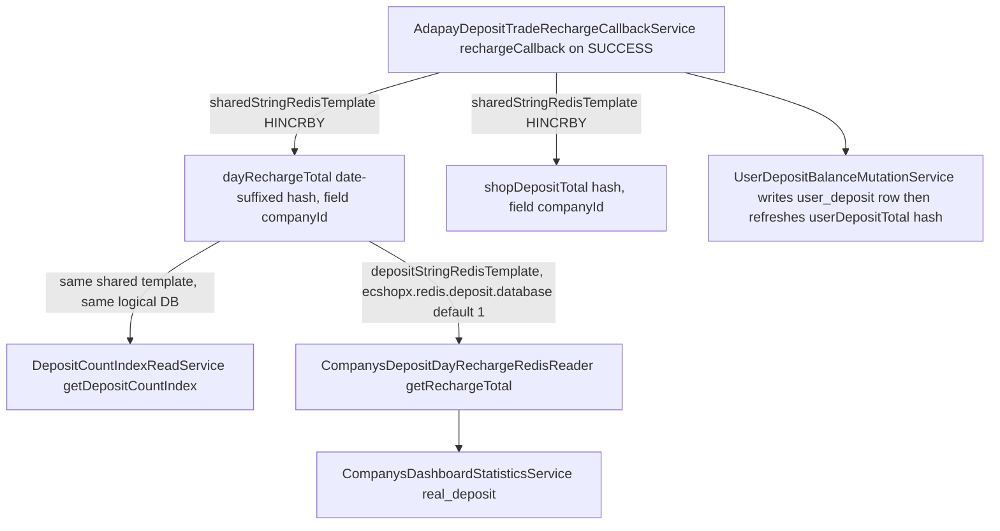

# Redis: Logical Database Isolation and Templates

Redis in ECShopX-Java is **one instance, many logical databases**. Both Docker stacks run a single `redis:7-alpine` container, and the application carves it into logical DBs (`SELECT n`) by building its **own** `LettuceConnectionFactory` beans in `ecshopx-bootstrap`'s `MultiRedisConfig` instead of letting Spring Boot's Redis auto-configuration provide one. The class Javadoc states the reason plainly: custom factories mean Docker/idle `Connection reset` must be handled *here* — TCP keepalive plus `validateConnection` before use — rather than by Boot defaults.

There is no Spring Cache abstraction (`@EnableCaching`/`RedisCacheManager` appear nowhere), no Redisson, and no spring-session. Every Redis touch in the codebase is an explicit `StringRedisTemplate` call inside a service class, selected by `@Qualifier`. MySQL remains the system of record for business data (see [Persistence: MySQL, MyBatis-Plus](persistence-mybatis.md)); Redis holds settings, counters, throttles, locks, deferred-order snapshots, and the dispatch-bus queues.



The deposit recharge day-counter flow: writers and the deposit-bundle reader use the shared/default DB, while the operator dashboard reads through the deposit template — so the two DB indexes must be aligned per environment (see [Counters and the deposit DB split](#counters-and-the-deposit-db-split)).

## The wiring: `MultiRedisConfig`

All factories come from one private helper, `standaloneFactory(host, port, password, database)`:

* `RedisStandaloneConfiguration` — **standalone mode only**; no cluster or sentinel wiring exists. Password is set only when non-blank.
* `SocketOptions` with `keepAlive(true)` and `connectTimeout` (default 10 s).
* `ClientOptions` with `autoReconnect(true)`.
* `LettuceClientConfiguration` with `commandTimeout` (default 5 s).
* `factory.setValidateConnection(true)` — every borrowed connection is ping-validated.

The three knobs live under `ecshopx.redis.lettuce.*` (`command-timeout`, `connect-timeout`, `validate-connection`), defaults `5s` / `10s` / `true`. `MultiRedisConfigLettuceFactoryTest` pins the behaviour: it reflects the timeouts into a fresh config, builds a factory, and asserts `getValidateConnection()`, `isAutoReconnect()` and `isKeepAlive()`.

Because user-defined `@Bean` methods are registered before auto-configuration conditions are evaluated, the presence of these factories and templates makes Boot's `RedisAutoConfiguration` back off entirely — the app's Redis layer is fully hand-wired, and host/port/password/database are read with `@Value` from `spring.data.redis.*` (plus the `ecshopx.redis.*` selectors below) rather than through `RedisProperties`.

## The template-to-database map

| Qualifier bean | Connection factory | DB selector | Default | Representative consumers |
|---|---|---|---|---|
| `companysRedisTemplate` (**`@Primary`**) | `companysRedisConnectionFactory` | `ecshopx.redis.companys.database` | 0 | Company/shop settings, payment-channel settings, `LanguageSettingRedisService`, ERP/Jushuitan settings, ID generators — the default for *unqualified* `StringRedisTemplate` injection |
| `redisTemplate` (`RedisTemplate<Object, Object>`) | `companysRedisConnectionFactory` | same as above | 0 | Declared but has no injection sites; all business code uses `StringRedisTemplate` |
| `sharedStringRedisTemplate` | `springDataRedisConnectionFactory` | `spring.data.redis.database` | 0 | Deposit counters, trade-no sequences, wxapp session keys, H5 carts, UGC, shopadmin deferred-order snapshots (`shopadmin:deferred:*`) |
| `dispatchBusStringRedisTemplate` | `springDataRedisConnectionFactory` | `spring.data.redis.database` | 0 | Dispatch-bus queues (`dispatch:*`) |
| `prismRedisTemplate` | `prismRedisConnectionFactory` | `ecshopx.redis.prism.database` | 2 | H5/operator JWT blacklists, Prism gateway OAuth tokens, activation black-token cache, SaaS-cert bind/licensing state |
| `datacubeStringRedisTemplate` | `datacubeRedisConnectionFactory` | `ecshopx.redis.datacube.database` | 0 | `datecube_tracklog:*` PV/UV/register hashes |
| `depositStringRedisTemplate` | `depositRedisConnectionFactory` | `ecshopx.redis.deposit.database` (accepts dedicated `ecshopx.redis.deposit.host|port|password`) | 1 | Dashboard `real_deposit` reader — the only injected consumer |
| `membersStringRedisTemplate` | `membersRedisConnectionFactory` | `ecshopx.redis.members.database` (falls back to `spring.data.redis.database`; accepts dedicated host/port/password) | 0 | Member SMS vcode, fans-sync throttle, member-card allocation |
| `espierStringRedisTemplate` | `espierRedisConnectionFactory` | `ecshopx.redis.espier.database` (fallback + overrides as above) | 0 | `subdistrict` hash, `address` tree cache |
| `wechatStringRedisTemplate` | `wechatRedisConnectionFactory` | `ecshopx.redis.wechat.database` (fallback + overrides as above) | 0 | WeChat menu tree, `timescardcode:` rights codes |

Host/port/password for `companys` / `springData` / `prism` / `datacube` come **only** from `spring.data.redis.*`; the `deposit` / `members` / `espier` / `wechat` factories additionally accept `ecshopx.redis.<name>.host|port|password` overrides that default back to `spring.data.redis.*`, so one logical area can be pointed at a separate server without code changes.

Two facts about this table deserve emphasis:

1. **`companysRedisTemplate` is `@Primary`** — a constructor parameter typed `StringRedisTemplate` *without* `@Qualifier` resolves to it, i.e. the companys DB. Real examples: `AftersalesRefundSlowQueuePortImpl` (`ecshopx:queue:slow`), `StatementSettlementCursorRedisAdapter`, `CommunityActivityCancelOrderQueuePoller`, `SalespersonTaskWorkWechatNoticeService`, `OpenPlatformDispatchDedupeService`, `EmployeePurchaseActivityItemsCategoryRedisService`. If you meant the shared/default DB, you must say `@Qualifier("sharedStringRedisTemplate")` explicitly. `MerchantWxappLoginSmsVcodeAdapterConfig` documents exactly this discipline in its Javadoc: merchant wxapp login SMS codes must use `sharedStringRedisTemplate` (members-parity DB), *not* the `@Primary` companys template.
2. **`sharedStringRedisTemplate` and `dispatchBusStringRedisTemplate` are two beans over one factory.** They land in the same logical DB; the separate qualifier exists so dispatch-bus code cannot accidentally be handed a settings template. Queue semantics (`dispatch:default`, `dispatch:slow`, `dispatch:sms`, `dispatch:delayed`, dead lists) are documented on the [Dispatch Bus](dispatch-bus.md) page and are not repeated here.

The shipped defaults live in `ecshopx-bootstrap/src/main/resources/application.properties`, the tracked base file the bootstrap application loads in every environment:

```properties
spring.data.redis.host=127.0.0.1
spring.data.redis.port=6379
spring.data.redis.password=redispassword
spring.data.redis.database=0
# Custom MultiRedisConfig Lettuce factories (not Boot auto-config): avoid idle Docker Connection reset
ecshopx.redis.lettuce.command-timeout=5s
ecshopx.redis.lettuce.connect-timeout=10s
ecshopx.redis.lettuce.validate-connection=true
ecshopx.redis.companys.database=0
ecshopx.redis.prism.database=2
# Datacube Redis logical database index; override per environment when using a non-default DB
ecshopx.redis.datacube.database=0
# Deposit Redis logical database; day recharge totals e.g. dayRechargeTotal{yyyy-MM-dd}
ecshopx.redis.deposit.database=1
# Wechat-named Redis logical DB (align deployment with the wechat connection index when not using default)
# ecshopx.redis.wechat.database=
```

(`ecshopx.redis.members.database` and `ecshopx.redis.espier.database` are not listed in the file; their `@Value` patterns fall back to `spring.data.redis.database`.) There is **no tracked `application-local.properties` to lean on**: that path is listed in `.gitignore` (line 7), so it is absent from fresh checkouts and exists only where a developer created it — when such a file exists and the `local` profile is activated, its selectors apply, but nothing in the repo guarantees it (the readme's statement that the project "already includes" it is drift). The indexes are therefore per-environment **overrides**: Docker and self-hosted runs pass them through the `APP_ARGS` CLI-argument block (both compose stacks already override `spring.data.redis.host|port|password` this way and set no database selector, so the tracked defaults — shared 0, deposit 1, prism 2 — are what Docker actually runs with; adding `--ecshopx.redis.deposit.database=0` to the same block is the fix for the deposit split below), and IDE/local runs use environment variables (`ECSHOPX_REDIS_DEPOSIT_DATABASE`, `SPRING_DATA_REDIS_DATABASE`) or `--key=value` program arguments on top of the tracked defaults. See [Configuration](../operations/configuration.md) for the full override mechanics.

## Redis as the settings store

A large family of `*RedisReadService` / `*SettingRedisService` / `*SettingRedisWriter` classes treat the companys DB as a **PHP-parity settings store**: JSON blobs under keys shaped `prefix + sha1(companyId)` (occasionally a plain `{companyId}` suffix), read with defaults-merge semantics so a missing or corrupt value degrades to defaults instead of failing the request.

| Setting | Key | Shape | Read behaviour |
|---|---|---|---|
| Distribution config | `distribution:config:<sha1(companyId)>` | JSON value | `DistributionConfigRedisReadService.getMergedDistributionConfig` deep-merges Redis over a default `distributor` structure; parse errors keep defaults. `getPopularizeSellerPercent` feeds goods profit defaults (`ItemsProfitSaveService`) |
| Order validity | `order_validity_setting` | Hash, field `companyId`, JSON value | `OrderValiditySettingRedisReadService.readPlatformSetting` merges `OrderValiditySettingDefaults.DEFAULTS` over the parsed hash entry; the distribution Bundle carries a parallel `OrderValidityPlatformSettingReadService` with the same key and its own defaults |
| Shop WeChat display | `wxShopsSetting:<sha1(companyId)>` | JSON value, top-level language keys | `WxShopsSettingRedisReadService.load` returns an empty map on miss/parse failure; `H5CompanySettingService` slices it by request language |
| Language setting | `languageSetting:<companyId>` | JSON value with `version` | `LanguageSettingRedisService` implements `CompanyLanguageResolver`; saves check `version` for optimistic conflict (`VERSION_CONFLICT`); Redis read *exceptions* (not just misses) fall back to the default `zh-CN`-only setting |
| Payment-channel settings | `wxPaymentSetting:<sha1(companyId)>` (+ `alipay…`, `bspay…`, `hfPaymentSetting:…`, `adaPaySetting:…`, `chinaumsPaymentSetting:…`, `icbc…`, `paypal…`, `offline_paySetting:…:<lang>`, `doumenIntlPaymentSetting:…`) — see `PaymentSettingRedisKeys` | JSON value | Writers like `WxpayPaymentSettingWriter` do read-modify-write to preserve uploaded PEM certs; readers such as `DepositWxpayRechargeUnifyService.loadAndValidateWxpayConfig` fail the payment with "不支持支付服务" when required credentials are missing |
| ERP / logistics / integration settings | `JushuitanSetting:<sha1>`, `WdtErpSetting:<sha1>`, `SFBSPConfigSetting:*`, `kdniaoKuaidiSetting:` / `kuaidi100KuaidiSetting:` / `kuaidiTypeOpenConfig:` | JSON value | `OrdersErpSettingRedisReadService` returns `is_open=false` on miss or parse failure |

Two operational consequences follow:

* **These settings have no MySQL write path in the Java code.** No mapper persists them (the legacy dump's `companys_setting`-style tables are not mapped by any Bundle); the write paths are the Redis writers above, so Redis *is* the system of record for them. That is survivable only because both compose stacks run `redis-server --appendonly yes --tcp-keepalive 60` with a persistent `redis-data` volume and a `redis-cli PING` healthcheck. Treat `FLUSHDB`/`FLUSHALL` on the companys DB as data loss for tenant configuration, not cache invalidation.
* **Failure is silent.** Every reader above swallows parse errors and returns defaults, so a corrupted JSON blob manifests as "the merchant's settings mysteriously reverted", not as an error log. `LanguageSettingRedisService` is the exception that logs a warning on Redis read failure.

Prism-DB state follows the same shape but for gateway credentials rather than tenant settings: `H5JwtBlacklistService` / `OperatorJwtBlacklistService` keep `h5_jwt_invalidate:<sha256(jwt)>` / `operator_jwt_invalidate:<sha256(jwt)>` keys, `CompanysActivationService` keeps a 7-day `black_token_<operatorId>_<operatorType>` cache, and `ShopexPrismSmsSignClient` stores `prism:<sha1(uid_companyId_AccessToken|RefreshToken|ForeverToken)>` session/forever tokens for the ShopEx Prism SMS gateway.

## Counters and the deposit DB split

Day-scoped counters are the other main Redis payload. The deposit recharge path is the canonical example and the one place the logical-DB split can bite:

* **Writers.** `AdapayDepositTradeRechargeCallbackService.addDepositToRedis` (called inside the `@Transactional rechargeCallback`) increments `shopDepositTotal` and `dayRechargeTotal<yyyy-MM-dd>` hashes (field `companyId`) through the **`sharedStringRedisTemplate`**, then `UserDepositBalanceMutationService` writes the `user_deposit` MySQL row and refreshes the `userDepositTotal_<companyId>` hash (readers fall back to MySQL on a hash miss — here MySQL *is* the record and Redis the cache). `DepositTradeConsumeService` does the mirror-image decrements and increments `dayConsumeTotal<date>`. Note the Redis increments are not transaction-aware: they stay applied even if the surrounding MySQL transaction later rolls back; only the SMS dispatch is deferred to `afterCommit`.
* **Same-DB reader.** `DepositCountIndexReadService.getDepositCountIndex` (behind the admin `RechargeController`) reads `shopDepositTotal` / `dayRechargeTotal<date>` / `dayConsumeTotal<date>` through the same **shared** template, using `Asia/Shanghai` for the date.
* **Cross-DB reader.** `CompanysDepositDayRechargeRedisReader.getRechargeTotal` reads `dayRechargeTotal<yyyy-MM-dd>` through the **`depositStringRedisTemplate`** (`ecshopx.redis.deposit.database`, default 1) to produce the operator dashboard's `real_deposit` (`CompanysDashboardStatisticsService`).

With the shipped defaults (`spring.data.redis.database=0`, `ecshopx.redis.deposit.database=1` in `application.properties`) the dashboard reads a *different logical database* than the writers write, so `real_deposit` stays 0 (the reader returns `0L` on a hash miss) unless the deployment aligns the two selectors — e.g. by setting `--ecshopx.redis.deposit.database=0` (or moving the writers' DB) in the environment's override channel. The properties comment (`# Deposit Redis logical database; day recharge totals e.g. dayRechargeTotal{yyyy-MM-dd}`) is the only in-repo hint of this coupling.

Other counter/ID-generator families, for orientation:

| Purpose | Keys | Template |
|---|---|---|
| Daily trade number on payment SUCCESS | `h_trade_no_<companyId>_<distributorId>_<MMdd>` hash + `c_trade_no_…` counter, both 24 h TTL (`OrdersTradePaymentCallbackService.nextTodayTradeSequence`) | shared |
| Deposit trade id `CZ…` | `deposit_trade_id<yyyyMMdd>` hash keyed by 90-second slot, 24 h TTL (`DepositTradeIdGenerator`) | shared |
| HfPay order/apply ids | `hfpay_order_id`, `hfpay_apply_id` counters with end-of-day TTL (`HfPayOrderApplyIdGenerator`) | companys |
| Order numeric id | `<yyyyMMdd>` hash keyed by 90-second slot (`NormalOrderNumericIdService`) | companys |
| Dashboard order-pay stats | `OrderPayStatistics:<type>:<companyId>:<yyyyMMdd>` hashes + `…_orderPayUser` sets (`OrderPayStatisticsRedisReader`) | companys |
| Datacube PV/UV | `datecube_tracklog:…` hashes plus a Lua-script bloom filter (`UvBloomFilterService`, key `uv_bloom_filter:<monitorId>:<sourceId>`) on the shared DB for dedup, counts on the datacube DB (`TrackViewNumService`) | mixed |
| Fans-sync throttle | `syncUsersCount<yyyyMMdd>:<sha1(companyId)>` list, ≤3/day and ≥10 min apart, `EXPIREAT` end of day (`WechatFansSyncService`) | members |
| Shopadmin deferred-order snapshot + lock | `shopadmin:deferred:<companyId>:<orderId>` JSON snapshot, `shopadmin:deferred:lock:<orderId>` lock (`ShopadminDeferredOrderCache` — see below) | shared |
| Lock / dedupe | `lock:discount:item:<companyId>:<itemId>` (`setIfAbsent` with 6 s TTL, 3×500 ms retry, `UserDiscountExchangeItemRedisLockService`); shuyun order-sync dedupe keys via `OpenPlatformDispatchDedupeService.tryAcquire` | companys (unqualified `@Primary` in both) |

One service drops below the template abstraction: `WechatMenuService` uses a raw `RedisCallback` to `SET` the wechat menu tree and verifies an inconclusive result by reading back identical bytes.

### Shopadmin deferred orders: snapshot plus lock on the shared DB

`ShopadminDeferredOrderCache` (orders bundle, `service/normal/shopadmin/`) is a new member of the `sharedStringRedisTemplate` family — the operator-side ("店务") deferred-order flow, where `POST /api/v1/order/create` with `order_type=normal_shopadmin` returns a `NOTPAY` order id **without persisting any MySQL row**: `ShopadminNormalOrderCreateOrchestrator.create` only runs pricing/enrichment (`preparePricingSnapshot`) and then stores the whole create state in Redis for later materialization; payment of such an order id is routed back into the deferred flow by `NormalOrderAdminPaymentService` (no `order_associations` row → check the cache → `payDeferredOrder`).

* **Snapshot.** Key `shopadmin:deferred:<companyId>:<orderId>` holds a JSON-serialized `ShopadminDeferredOrderSnapshot` (orderId, companyId, status, payType, totalFee, tradeId, createdAt, expireAt, plus the raw `params`/`orderData` maps) via `opsForValue().set(key, json, Duration.ofSeconds(ttl))`. The initial `saveWaitPay` writes status `WAIT_PAY` with TTL = `auto_cancel_time − now` (15-minute fallback when absent or in the past), so the snapshot dies with the order's auto-cancel deadline. On later failures the service rewrites the snapshot with the 24-hour `COMPENSATION_TTL_SECONDS` (86400) — for `PAID_WAIT_ORDER` (order creation crashed after payment) and for the refund outcomes `REFUNDED` / `REFUND_FAILED`. Redis read failures surface as `ResourceException` ("订单缓存不可用"), while a corrupt JSON blob reads as a miss (`null`).
* **Lock.** `withLock(orderId, action)` guards the pay/materialize/refund transitions with `setIfAbsent("shopadmin:deferred:lock:<orderId>", uuidToken, 120 s)`; a `null`/`false` result throws "订单处理中，请稍后查询" (a Redis failure while acquiring throws "订单处理繁忙，请稍后查询"), and the unlock is best-effort and token-checked — it deletes the key only if the stored value still equals this caller's token, swallowing any error on the way out.

The state machine around the snapshot (`WAIT_PAY` → paid → `ORDERED`+delete, `PAID_WAIT_ORDER`, refund retry via `supplementAfterPaymentQuery`) belongs to the [Orders domain](../domains/orders.md); here it matters only as the pattern: a durable-in-Redis snapshot standing in for a MySQL row until payment succeeds, keyed by company and order, with a token-checked TTL lock as the concurrency guard. `ShopadminNormalOrderCreateOrchestratorNormalOrderAddDispatchPublishProbeTest` and `NormalOrderAdminCreateUserOrderServiceNormalOrderAddDispatchPublishProbeTest` pin the create-side contract with a mocked `ShopadminDeferredOrderCache` (verifying `saveWaitPay` with state, order id, company, pay type and fee; the create path injects no dispatch publisher at all, which the tests' "no dispatch on create" display names record).

## Adding a new logical DB

**Properties alone do nothing.** `ecshopx.redis.<name>.database` is only read by the `@Value` annotations inside `MultiRedisConfig`; there is no generic registry. A new logical DB requires editing `MultiRedisConfig`:

1. Add a `@Bean` `RedisConnectionFactory` method whose `@Value` selectors follow the existing pattern (dedicated `ecshopx.redis.<name>.host|port|password` with `spring.data.redis.*` fallbacks if the area may live on another server).
2. Add a `@Bean` `StringRedisTemplate` wired to that factory via `@Qualifier`.
3. Inject the template in consumers with `@Qualifier("<name>StringRedisTemplate")` — never rely on the `@Primary` default for a new area.

Conversely, repointing an *existing* area is a pure properties change: because every selector is read per environment, an override such as `--ecshopx.redis.deposit.database=0` (or any of the `ecshopx.redis.*.database` keys) re-routes an area to another logical DB — or collapses several areas onto one — with no code edits, which is precisely the lever needed for the deposit split above.

## Tests worth knowing

* `MultiRedisConfigLettuceFactoryTest` (bootstrap) — the only test of the wiring itself: asserts `validateConnection`, `autoReconnect` and socket `keepAlive` on a factory built by `standaloneFactory`.
* `DispatchBusConfigTest` / `RedisDispatchDriverTest` / `RedisDispatchListenerTest` / `RedisDelayedDispatchMoverTest` (bootstrap + dispatch) — boot the dispatch graph with a **mocked** `dispatchBusStringRedisTemplate` bean and pin queue/delay/dead-list semantics.
* `DepositTradeConsumeServiceTest`, `AdapayDepositTradeRechargeCallbackServiceSmsDispatchTest`, `OrdersTradePaymentCallbackService*Test`, `LanguageSettingRedisServiceTest`, `ShopexAdminBindServiceTest`, `ShopadminNormalOrderCreateOrchestratorNormalOrderAddDispatchPublishProbeTest`, `NormalOrderAdminCreateUserOrderServiceNormalOrderAddDispatchPublishProbeTest` — all mock `StringRedisTemplate`/`HashOperations`/`ShopadminDeferredOrderCache` and verify the counter increments, hash writes, defaults-merge, or deferred-snapshot-save behaviour described above; none run against a real Redis.

## Related pages

* [Dispatch Bus](dispatch-bus.md) — queue names, delayed ZSET, retry/failure semantics on `dispatchBusStringRedisTemplate`.
* [Persistence: MySQL, MyBatis-Plus](persistence-mybatis.md) — the MySQL side of the split, and where Redis-backed caches complement mappers.
* [Orders Domain](../domains/orders.md) — the state machine that consumes the `shopadmin:deferred:` snapshot and lock.
* [Architecture Overview](../architecture/overview.md) — where this layering sits in the runtime stack.
* [Configuration](../operations/configuration.md) — the full property catalogue and environment overrides.
