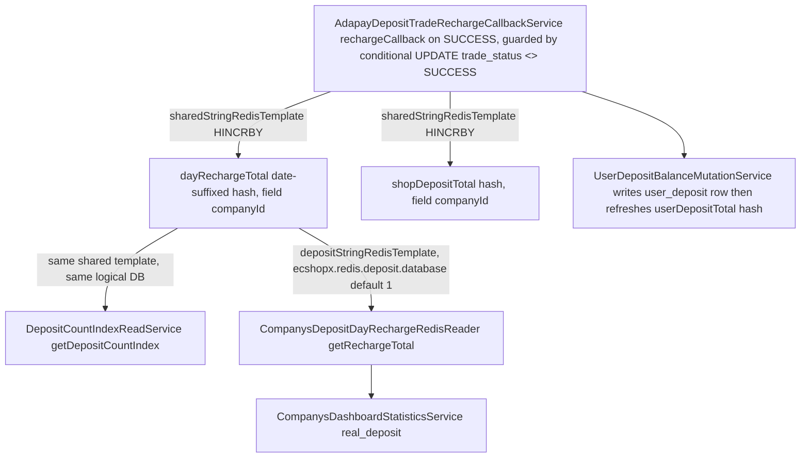

# Redis Database Layout

Redis in ECShopX-Java is **one instance, many logical databases**. Both Docker stacks run a single `redis:7-alpine` container, and the application carves it into logical DBs (`SELECT n`) by building its **own** `LettuceConnectionFactory` beans in `ecshopx-bootstrap`'s `MultiRedisConfig` instead of letting Spring Boot's Redis auto-configuration provide one. The class Javadoc states the reason plainly: custom factories mean Docker/idle `Connection reset` must be handled *here* — TCP keepalive plus `validateConnection` before use — rather than by Boot defaults.

There is no Spring Cache abstraction (`@EnableCaching`/`RedisCacheManager` appear nowhere), no Redisson, and no spring-session. Every Redis touch in the codebase is an explicit `StringRedisTemplate` call inside a service class, selected by `@Qualifier`. MySQL remains the system of record for business data (see [Persistence: MySQL, MyBatis-Plus](persistence-mybatis.md)); Redis holds sessions, fast-buy cart state, captcha/SMS verification codes, pickup QR-code mappings, goods-arrival subscription UI state, tenant settings, counters, throttles, locks, deferred-order snapshots, and the dispatch-bus queues.



The deposit recharge day-counter flow: writers and the deposit-bundle reader use the shared/default DB, while the operator dashboard reads through the deposit template — so the two DB indexes must be aligned per environment (see [Counters and the deposit DB split](#counters-and-the-deposit-db-split)).

## The wiring: `MultiRedisConfig`

All factories come from one private helper, `standaloneFactory(host, port, password, database)`:

* `RedisStandaloneConfiguration` — **standalone mode only**; no cluster or sentinel wiring exists. Password is set only when non-blank.
* `SocketOptions` with `keepAlive(true)` and `connectTimeout` (default 10 s).
* `ClientOptions` with `autoReconnect(true)`.
* `LettuceClientConfiguration` with `commandTimeout` (default 5 s).
* `factory.setValidateConnection(true)` — every borrowed connection is ping-validated.

The three knobs live under `ecshopx.redis.lettuce.*` (`command-timeout`, `connect-timeout`, `validate-connection`), defaults `5s` / `10s` / `true`. `MultiRedisConfigLettuceFactoryTest` pins the behaviour: it reflects the timeouts into a fresh config, builds a factory, and asserts `getValidateConnection()`, `isAutoReconnect()` and `isKeepAlive()`.

Because user-defined `@Bean` methods are registered before auto-configuration conditions are evaluated, the presence of these factories and templates makes Boot's `RedisAutoConfiguration` back off entirely — the app's Redis layer is fully hand-wired, and host/port/password/database are read with `@Value` from `spring.data.redis.*` (plus the `ecshopx.redis.*` selectors below) rather than through `RedisProperties`.

## The template-to-database map

| Qualifier bean | Connection factory | DB selector | Default | Representative consumers |
|---|---|---|---|---|
| `companysRedisTemplate` (**`@Primary`**) | `companysRedisConnectionFactory` | `ecshopx.redis.companys.database` | 0 | Company/shop settings, payment-channel settings, `LanguageSettingRedisService`, ERP/Jushuitan settings, shop protocol hashes (`hash:companyProtocol*:<sha1(companyId)>`, with DB repopulation — see below), operator captcha/SMS codes (`admin-<type>:<token>`, `operator-sms:verify:*`, `admin-forget:*`), admin pickup codes (`admin-pickupcode:*`), operator fast-buy cart (`shop_fastbuy:*`), ID generators — the default for *unqualified* `StringRedisTemplate` injection |
| `redisTemplate` (`RedisTemplate<Object, Object>`) | `companysRedisConnectionFactory` | same as above | 0 | Declared but has no injection sites; all business code uses `StringRedisTemplate` |
| `sharedStringRedisTemplate` | `springDataRedisConnectionFactory` | `spring.data.redis.database` | 0 | Wxapp sessions (`session3rd:*`), member fast-buy cart (`fastbuy:*`) and plus-buy cart keys, pickup QR-code mapping (`orderziticode:*`), goods-arrival subscribe hashes (`arrivalNoticeSub:*`), deposit counters, trade-no sequences, UGC, shopadmin deferred-order snapshots (`shopadmin:deferred:*`), employee-purchase email vcodes/throttles (`employee-purchase-email*:*`), passphrase rate limiting (`ep_behavior_rl:*`) and verified flags (`ep_passphrase_verified:*`), participation quota (`ep:pquota:*`), employee fast-buy (`employee_purchase_fastbuy:*`) and invite tickets (`employee_purchase_invite:*`) |
| `dispatchBusStringRedisTemplate` | `springDataRedisConnectionFactory` | `spring.data.redis.database` | 0 | Dispatch-bus queues (`dispatch:*`) |
| `prismRedisTemplate` | `prismRedisConnectionFactory` | `ecshopx.redis.prism.database` | 2 | H5/operator JWT blacklists, Prism gateway OAuth tokens, activation black-token cache, SaaS-cert bind/licensing state |
| `datacubeStringRedisTemplate` | `datacubeRedisConnectionFactory` | `ecshopx.redis.datacube.database` | 0 | `datecube_tracklog:*` PV/UV/register hashes |
| `depositStringRedisTemplate` | `depositRedisConnectionFactory` | `ecshopx.redis.deposit.database` (accepts dedicated `ecshopx.redis.deposit.host|port|password`) | 1 | Dashboard `real_deposit` reader — the only injected consumer |
| `membersStringRedisTemplate` | `membersRedisConnectionFactory` | `ecshopx.redis.members.database` (falls back to `spring.data.redis.database`; accepts dedicated host/port/password) | 0 | Member SMS vcode (`member-<type>:company<cid>:<mobile>`) + send throttle (`yzmsend:*`), fans-sync throttle, member-card allocation |
| `espierStringRedisTemplate` | `espierRedisConnectionFactory` | `ecshopx.redis.espier.database` (fallback + overrides as above) | 0 | `subdistrict` hash, `address` tree cache |
| `wechatStringRedisTemplate` | `wechatRedisConnectionFactory` | `ecshopx.redis.wechat.database` (fallback + overrides as above) | 0 | WeChat menu tree, `timescardcode:` rights codes |

Host/port/password for `companys` / `springData` / `prism` / `datacube` come **only** from `spring.data.redis.*`; the `deposit` / `members` / `espier` / `wechat` factories additionally accept `ecshopx.redis.<name>.host|port|password` overrides that default back to `spring.data.redis.*`, so one logical area can be pointed at a separate server without code changes.

Two facts about this table deserve emphasis:

1. **`companysRedisTemplate` is `@Primary`** — a constructor parameter typed `StringRedisTemplate` *without* `@Qualifier` resolves to it, i.e. the companys DB. Real examples: `AftersalesRefundSlowQueuePortImpl` (`ecshopx:queue:slow`), `StatementSettlementCursorRedisAdapter`, `CommunityActivityCancelOrderQueuePoller`, `SalespersonTaskWorkWechatNoticeService`, `OpenPlatformDispatchDedupeService`, `EmployeePurchaseActivityItemsCategoryRedisService`. If you meant the shared/default DB, you must say `@Qualifier("sharedStringRedisTemplate")` explicitly. `MerchantWxappLoginSmsVcodeAdapterConfig` documents exactly this discipline in its Javadoc: merchant wxapp login SMS codes must use `sharedStringRedisTemplate` (members-parity DB), *not* the `@Primary` companys template.
2. **`sharedStringRedisTemplate` and `dispatchBusStringRedisTemplate` are two beans over one factory.** They land in the same logical DB; the separate qualifier exists so dispatch-bus code cannot accidentally be handed a settings template. Queue semantics (`dispatch:default`, `dispatch:slow`, `dispatch:sms`, `dispatch:delayed`, dead lists) are documented on the [Dispatch Bus](dispatch-bus.md) page and are not repeated here.

The shipped defaults live in `ecshopx-bootstrap/src/main/resources/application.properties`, the tracked base file the bootstrap application loads in every environment:

```properties
spring.data.redis.host=127.0.0.1
spring.data.redis.port=6379
spring.data.redis.password=redispassword
spring.data.redis.database=0
# Custom MultiRedisConfig Lettuce factories (not Boot auto-config): avoid idle Docker Connection reset
ecshopx.redis.lettuce.command-timeout=5s
ecshopx.redis.lettuce.connect-timeout=10s
ecshopx.redis.lettuce.validate-connection=true
ecshopx.redis.companys.database=0
ecshopx.redis.prism.database=2
# Datacube Redis logical database index; override per environment when using a non-default DB
ecshopx.redis.datacube.database=0
# Deposit Redis logical database; day recharge totals e.g. dayRechargeTotal{yyyy-MM-dd}
ecshopx.redis.deposit.database=1
# Wechat-named Redis logical DB (align deployment with the wechat connection index when not using default)
# ecshopx.redis.wechat.database=
```

(`ecshopx.redis.members.database` and `ecshopx.redis.espier.database` are not listed in the file; their `@Value` patterns fall back to `spring.data.redis.database`.) There is **no tracked `application-local.properties` to lean on**: that path is listed in `.gitignore` (line 7), so it is absent from fresh checkouts and exists only where a developer created it — when such a file exists and the `local` profile is activated, its selectors apply, but nothing in the repo guarantees it (the readme's statement that the project "already includes" it is drift). The indexes are therefore per-environment **overrides**: Docker and self-hosted runs pass them through the `APP_ARGS` CLI-argument block (both compose stacks already override `spring.data.redis.host|port|password` this way and set no database selector, so the tracked defaults — shared 0, deposit 1, prism 2 — are what Docker actually runs with; adding `--ecshopx.redis.deposit.database=0` to the same block is the fix for the deposit split below), and IDE/local runs use environment variables (`ECSHOPX_REDIS_DEPOSIT_DATABASE`, `SPRING_DATA_REDIS_DATABASE`) or `--key=value` program arguments on top of the tracked defaults. See [Configuration](../operations/configuration.md) for the full override mechanics.

## Front-end session and verification state

Short-lived interactive state — the kind the legacy PHP stack kept in specific Redis DBs — is spread across three logical DBs, and none of it is reconstructible from MySQL:

* **Wxapp sessions (shared DB).** `WxappMemberAuthService.resolveSession` reads `session3rd:<token>` (JSON with `open_id`/`union_id`/`session_key`) through `sharedStringRedisTemplate`; a miss *or* corrupt JSON throws `UnauthorizedException`, so flushing the shared DB logs every mini-program user out.
* **Member SMS codes (members DB).** `MemberSmsVerificationCodeDeliveryService` writes `member-<type>:company<companyId>:<mobile>` (TTL 300 s) through `membersStringRedisTemplate` and rate-limits sends with a `yzmsend:<companyId>:<yyyyMMdd>:<type>:<mobile>` counter (TTL 24 h, cap `common.sms-send-limit`, default 5). The merchant-wxapp-login variant intentionally bypasses the members template and uses the shared DB instead (see `MerchantWxappLoginSmsVcodeAdapterConfig` above) to stay in the same logical DB as the legacy members store.
* **Operator captcha and SMS codes (companys DB).** `OperatorsImageVcodeService` issues 4-character image captchas under `admin-<type>:<token>` (TTL 300 s, case-insensitive one-shot verify that deletes the key). `OperatorSmsVerifyService` stores `operator-sms:verify:<type>:<mobile>` (TTL 180 s) and forget-password codes under `admin-forget:<mobile>` (TTL 300 s). All are written and consumed through `companysRedisTemplate` — the `@Primary` default, which matters because these services qualify explicitly anyway.
* **Employee-purchase email codes and send throttles (shared DB).** `EmployeePurchaseEmailVcodeRedisService` — explicitly `@Qualifier("sharedStringRedisTemplate")`, unlike the operator codes above — owns the email-verification state for the employee-purchase "员工身份校验" flow. `storeVcodeWithTtl` writes the 6-digit code to `employee-purchase-email:<email>` (the caller, `EmployeeEmailVcodeSendService`, passes a 1800 s TTL), and `EmployeeCheckService.doEmailBranch` verifies it through `verifyAndConsume`, which compares and deletes on a match (one-shot semantics, "验证码错误" on mismatch). Around that, the send path enforces three throttles that all live on the same shared template: a per-email cooldown `employee-purchase-email-cd:<companyId>:<email>` (TTL 60 s, checked with `hasKey` *before* the daily counters are incremented), a per-email daily counter `employee-purchase-email-day:<companyId>:<yyyyMMdd>:<email>` (Asia/Shanghai date; incremented on every send attempt and rejected past 5), and a per-IP daily counter `employee-purchase-email-ip:<companyId>:<yyyyMMdd>:<ip>` (rejected past 200, only when a non-blank client IP is present). Both daily keys get their 24-hour `EXPIRE` set only when `INCR` returns 1, so the window resets at the key's expiry rather than sliding; the email address used in the cooldown/day keys is lower-cased first, but the vcode key itself uses the trimmed, original-case address.

## Carts and fast-buy state

Ordinary cart rows live in MySQL (`CartMapper`); Redis holds the *fast-buy* variants and promotion scratch state:

* **Member fast-buy cart (shared DB).** `WxappH5CartAddService.setFastBuyCart` writes the single-item fast-buy snapshot to `fastbuy:<sha1(companyId + userId)>` as JSON with a 600 s TTL, forcing `cart_id = 0` and `is_checked = true`. Plus-buy ("加价购") cart selections use `PlusBuyCartRedisKeys`-derived keys on the same shared template (`WxappH5CartPlusBuyResetService` deletes them on reset; `WxappH5DistributorCartPromotionService` reads checked state).
* **Operator (shopadmin) fast-buy cart (companys DB).** `OperatorShopFastBuyRedisService` stores the cashier's pending fast-buy item at `shop_fastbuy:<sha1(companyId:operatorId:distributorId)>` as JSON (TTL 600 s) through `companysRedisTemplate`. Every `set` forces `cart_id: 0` into the payload, and `get` degrades a missing *or* corrupt blob to an empty map. The consumer, `OperatorCartFastBuyFacadeImpl`, accumulates `num` only when the stored item matches the new one; `clear` simply rewrites an empty map under the same 600 s TTL rather than deleting the key.

## Pickup codes: two keys, two DBs, one flow

The self-pickup ("自提") verification flow deliberately spans **two logical databases**:

* **QR-code → order mapping (shared DB).** `OrderZitiQrCodeRedisService` writes `orderziticode:<code>` → `orderId` with the caller's TTL (1800 s from both wxapp services) through `sharedStringRedisTemplate`. This is the key scanned by admin write-off (`AdminOrderQrWriteoffService`) and community-chief write-off (`CommunityChiefQrWriteoffService`) via `resolveOrderIdOrThrow`, which throws "核销码已过期" on a miss; `resolveOrderIdNullable` treats a non-numeric blob as a miss too. After successful verification the mapping is deleted so the same code cannot be redeemed twice.
* **Phone-scoped pickup SMS code (companys DB).** `WxappOrderZitiQrCodeService.applyPickupCodeMirror` (when the `pickupcode_status` setting is on) and `WxappOrderPickupCodeService` write `admin-pickupcode:<orderId>|<phone>` → the 12-digit code (TTL 1800 s) through `companysRedisTemplate`. `OrderPickupSmsRedisVerifyService.verifyAndConsumePickupCode` — called by both `AdminOrderWriteoffService` and the third-party `OpenapiThirdApiV2OrderWriteoffService` — reads that key (accepting a loose numeric comparison, so leading zeros don't fail), then deletes it and cross-DB deletes the `orderziticode:` mapping via the injected `OrderZitiQrCodeRedisService`. A submitted code that matches no `admin-pickupcode` entry is also accepted when it *is* an `orderziticode:` code mapping to the same order.

So the verify path reads the companys DB first and falls back to the shared DB — if an operator repoints only one of the two selectors, pickup verification silently degrades to the surviving half.

## Goods-arrival subscriptions: Redis mirrors MySQL

`WxappGoodsArrivalNoticeSubscribeService` keeps two stores in lockstep: the durable `subscribe_notice` MySQL rows (`sub_status` `NO` → `SUCCESS`, via `SubscribeNoticeMapper`) and a Redis hash that answers the mini-program's "已订阅" UI flag without hitting MySQL. Keys come from `GoodsArrivalNoticeSubscribeRedisKeys.hashKey`: `arrivalNoticeSub:<companyId>:<itemId>[:<distributorId>]` for source `wechat`, and `arrivalNoticeSub:<source>:<companyId>:<itemId>[:<distributorId>]` otherwise. Hash fields are `userId`, values a JSON blob `{open_id, wxa_appid}`. Subscribing toggles *both* stores (existing row → delete row and hash field; new → insert row and put hash field), and `GoodsArrivalSubscribeMatchService.markSuccess` deletes the hash fields for matched rows after the arrival notification is sent, so the detail page stops showing "已订阅到货通知". All Redis access goes through `sharedStringRedisTemplate`.

## Rate limiting on the shared DB: passphrase behavior reports

The employee-purchase passphrase surface exposes an **unauthenticated** behavior-report endpoint (scan / passphrase-verify events), so `PassphraseBehaviorReportService.report` calls `PassphraseBehaviorRateLimitService.assertAllowed` (ECX-10917, "未认证行为上报限流（防刷库）") *before* loading the activity or writing any behavior-log row. The limiter is a fixed-window INCR counter on the shared DB, explicitly qualified `@Qualifier("sharedStringRedisTemplate")`:

* **Key shape.** `ep_behavior_rl:<companyId>:<activityId>:<enterpriseId>:<subject>`, where `<subject>` picks the strongest identity available: `u<userId>` when a positive user id is present, else `v<visitorKey>` when the visitor key has text, else `ip<clientIp>` (falling back to the literal `ipunknown` bucket when even the IP is blank).
* **Window and limit.** The first increment of a window (`INCR` returns 1) sets `EXPIRE 60` seconds; any report whose count exceeds `LIMIT_MAX = 10` inside the window throws `TooManyRequestsException("操作过于频繁，请稍后再试")`, which `GlobalExceptionHandler` maps to HTTP 429. The constants are package-private `static final` fields — tuning them is a code change, not a property override.
* **Fail-open on Redis errors.** Because the counter is read from the `Long` returned by `increment` and a `null` result (or a swallowed connection failure at the template layer) simply skips both the expiry-set and the limit check, a Redis outage throttles nothing — it turns the limiter off while behavior-log writes continue to hit MySQL.

The wider employee-purchase family follows the same shared-DB pattern and is worth knowing for key-planning purposes: `PassphraseVerifiedRedisService` keeps "口令已验证" flags at `ep_passphrase_verified:<companyId>:<activityId>:<enterpriseId>:<userId>` with an activity-end-derived TTL clamped to `[1 h, 90 d]`, `PassphraseParticipateQuotaRedisService` keeps remaining participation quota at `ep:pquota:<companyId>:<activityId>:<enterpriseId>` consumed atomically by a Lua GET/DECR script, `EmployeePurchaseFastBuyRedisService` mirrors the member fast-buy cart at `employee_purchase_fastbuy:<sha1(companyId+enterpriseId+activityId+userId)>` (600 s, `cart_id` forced to 0), and `EmployeePurchaseInviteRedisService` tracks share-invite tickets in the `employee_purchase_invite:<companyId>` hash (locking a code moves its field to `<code>_` rather than deleting the hash).

## Redis as the settings store

A large family of `*RedisReadService` / `*SettingRedisService` / `*SettingRedisWriter` classes treat the companys DB as a **PHP-parity settings store**: JSON blobs under keys shaped `prefix + sha1(companyId)` (occasionally a plain `{companyId}` suffix), read with defaults-merge semantics so a missing or corrupt value degrades to defaults instead of failing the request.

| Setting | Key | Shape | Read behaviour |
|---|---|---|---|
| Distribution config | `distribution:config:<sha1(companyId)>` | JSON value | `DistributionConfigRedisReadService.getMergedDistributionConfig` deep-merges Redis over a default `distributor` structure; parse errors keep defaults. `getPopularizeSellerPercent` feeds goods profit defaults (`ItemsProfitSaveService`) |
| Order validity | `order_validity_setting` | Hash, field `companyId`, JSON value | `OrderValiditySettingRedisReadService.readPlatformSetting` merges `OrderValiditySettingDefaults.DEFAULTS` over the parsed hash entry; the distribution Bundle carries a parallel `OrderValidityPlatformSettingReadService` with the same key and its own defaults |
| Shop WeChat display | `wxShopsSetting:<sha1(companyId)>` | JSON value, top-level language keys | `WxShopsSettingRedisReadService.load` returns an empty map on miss/parse failure; `H5CompanySettingService` slices it by request language |
| Language setting | `languageSetting:<companyId>` | JSON value with `version` | `LanguageSettingRedisService` implements `CompanyLanguageResolver`; saves check `version` for optimistic conflict (`VERSION_CONFLICT`); Redis read *exceptions* (not just misses) fall back to the default `zh-CN`-only setting |
| Payment-channel settings | `wxPaymentSetting:<sha1(companyId)>` (+ `alipay…`, `bspay…`, `hfPaymentSetting:…`, `adaPaySetting:…`, `chinaumsPaymentSetting:…`, `icbc…`, `paypal…`, `offline_paySetting:…:<lang>`, `doumenIntlPaymentSetting:…`) — see `PaymentSettingRedisKeys` | JSON value | Writers like `WxpayPaymentSettingWriter` do read-modify-write to preserve uploaded PEM certs; readers such as `DepositWxpayRechargeUnifyService.loadAndValidateWxpayConfig` fail the payment with "不支持支付服务" when required credentials are missing |
| ERP / logistics / integration settings | `JushuitanSetting:<sha1>`, `WdtErpSetting:<sha1>`, `SFBSPConfigSetting:*`, `kdniaoKuaidiSetting:` / `kuaidi100KuaidiSetting:` / `kuaidiTypeOpenConfig:` | JSON value | `OrdersErpSettingRedisReadService` returns `is_open=false` on miss or parse failure |

The distribution-config row above is also the write side of a cross-bundle read: `DistributionConfigSetService.setConfig` validates the request, `opsForValue().set`s the JSON under `distribution:config:<sha1(companyId)>`, then calls `DistributionPopularizeProfitApplyPort.applyPopularizeSellerScaleForDefaultItems` to push the new scale onto default-profit items. On the goods side, `ItemsProfitSaveService` never touches Redis directly — in `applyDefaultProfitBranch` (the `profit_type = 0` path) it first tries the item's *category-level* `items_category_profit.profit_conf` **MySQL row**; only when that yields no usable `popularize_profit` does it call `distributionConfigRedisReadService.getPopularizeSellerPercent(companyId)` and write the resulting scale (`percent ÷ 100`, 4-decimal HALF_UP) into the items table via `updateProfitByItemId`. So the goods bundle consumes the Redis settings store read-only, through the distribution bundle's reader, as a fallback behind a MySQL lookup.

Two operational consequences follow:

* **These settings have no MySQL write path in the Java code.** No mapper persists them (the legacy dump's `companys_setting`-style tables are not mapped by any Bundle); the write paths are the Redis writers above, so Redis *is* the system of record for them. That is survivable only because both compose stacks (`docker-compose.dev.yml` and `docker-lite/docker-compose.yml`) run `redis-server --requirepass redispassword --appendonly yes --tcp-keepalive 60` with a persistent `redis-data` volume mounted at `/data` and a `redis-cli -a … PING` healthcheck. Treat `FLUSHDB`/`FLUSHALL` on the companys DB as data loss for tenant configuration, not cache invalidation.
* **Failure is silent.** Every reader above swallows parse errors and returns defaults, so a corrupted JSON blob manifests as "the merchant's settings mysteriously reverted", not as an error log. `LanguageSettingRedisService` is the exception that logs a warning on Redis read failure.

Prism-DB state follows the same shape but for gateway credentials rather than tenant settings: `H5JwtBlacklistService` / `OperatorJwtBlacklistService` keep `h5_jwt_invalidate:<sha256(jwt)>` / `operator_jwt_invalidate:<sha256(jwt)>` keys, `CompanysActivationService` keeps a 7-day `black_token_<operatorId>_<operatorType>` cache, and `ShopexPrismSmsSignClient` stores `prism:<sha1(uid_companyId_AccessToken|RefreshToken|ForeverToken)>` session/forever tokens for the ShopEx Prism SMS gateway.

## Shop protocols: Redis hash with DB repopulation fallback (ECX-11114)

The member-facing legal protocols (registration agreement, privacy policy, account-cancellation agreement, salesman agreements) are served from the **companys DB** but, unlike the settings family above, are backed by a MySQL table — so this store is a *rebuildable* cache, not the system of record. `ShopProtocolSetService` (companys bundle, `service/protocol/`, explicitly `@Qualifier("companysRedisTemplate")`) owns both sides:

* **Key shape — one hash per (company, country_code).** `resolveProtocolHashKey` normalizes the optional `country_code` (absent, `""` or `"0"` collapse to `zh-CN`), lowercases it and strips dashes, then builds `hash:companyProtocol:<sha1(companyId)>` for `zh-CN` and `hash:companyProtocol_<lang>:<sha1(companyId)>` for any other language. Hash *fields* are protocol types (`privacy`, `member_register`, `member_logout`, `salesman_service`, …) plus a parallel `<type>_draft` field per type holding the draft payload (or the literal `"[]"` when the last save published instead of drafting). Values are JSON blobs with `type`, `title`, `content`, `update_date`, `take_effect_date`, `update_time` and a `digest` (MD5 of content).
* **Writes are dual-store.** `set` (behind the admin `PUT /api/v1/shops/protocol`) writes every non-draft save to the Redis hash *and* appends a row to the `companys_protocol_update_log` MySQL table via `ProtocolUpdateLogMapper.insert` (skipped only when the latest logged row already has the same digest). Draft saves and the `member_logout_config` pseudo-type touch Redis only.
* **Reads are Redis-hash-first with DB repopulation.** `get(companyId, type, countryCode)` — called by both the admin `GET /api/v1/shops/protocol` and the unauthenticated H5 `GET /api/v1/h5app/wxapp/shops/protocol` — answers from the hash when it can, and otherwise *rebuilds the hash from MySQL before answering* (ECX-11114):
  * **Single-type read.** `opsForHash().get(hashKey, type)`; a miss *or* a blank/whitespace value (`isBlankRedisValue`) triggers `repopulateSingleTypeFromDbIfPresent`, which selects the latest `companys_protocol_update_log` row for `(companyId, type)` (`ORDER BY created DESC LIMIT 1`) and, when one exists, rewrites the field with the rebuilt JSON (`opsForHash().put`) and returns it. `_draft` fields and `member_logout_config` never fall back — they answer blank.
  * **All-types read.** When `type` is blank, `opsForHash().entries(hashKey)` is used; only a *completely empty* hash (not individual blank fields) triggers `repopulateAllTypesFromDbIfPresent`, which loads all of the company's log rows, keeps the latest non-draft row per type, and rewrites each field before answering.
  * If the DB has no rows either, nothing is written back — the read simply answers empty (the request still degrades to the default titles via `applyDefaultProtocolTitle`, and drafts attach as empty lists via `attachDraftSubstructure`).

The operational consequence of ECX-11114 is the inverse of the settings family: **flushing the companys DB does not permanently lose published protocol content** — the next read for each (company, country, type) repopulates the hash from `companys_protocol_update_log` — but it *does* destroy any unpublished drafts (the `<type>_draft` fields exist only in Redis) and turns the flush into a burst of one extra `SELECT` per requested type/company until the hashes are warm again. `ShopProtocolSetServiceGetFallbackTest` pins the contract: empty hash + DB row → repopulated and rewritten to Redis; populated hash → zero mapper calls and zero writes; empty hash + empty DB → no write-back; single-type blank field → per-type `selectOne` fallback and rewrite.

## Counters and the deposit DB split

Day-scoped counters are the other main Redis payload. The deposit recharge path is the canonical example and the one place the logical-DB split can bite:

* **Writers.** `AdapayDepositTradeRechargeCallbackService.addDepositToRedis` (called inside the `@Transactional rechargeCallback`) increments `shopDepositTotal` and `dayRechargeTotal<yyyy-MM-dd>` hashes (field `companyId`) through the **`sharedStringRedisTemplate`**, then `UserDepositBalanceMutationService` writes the `user_deposit` MySQL row and refreshes the `userDepositTotal_<companyId>` hash (readers fall back to MySQL on a hash miss — here MySQL *is* the record and Redis the cache). Crucially, `addDepositToRedis` only runs **after the guarded status update wins**: `rechargeCallback` claims the trade row with a conditional `UPDATE ... WHERE trade_status != 'SUCCESS'` (the ECX-10915 guard, `LambdaUpdateWrapper.ne(DepositTrade::getTradeStatus, "SUCCESS")`), throws "更新已处理，不需要更新" when the update count is 0, and re-reads the row before any Redis write — so a duplicate or concurrent callback can never double-increment the counters. `DepositTradeConsumeService` does the mirror-image decrements and increments `dayConsumeTotal<date>`. Note the Redis increments are not transaction-aware: they stay applied even if the surrounding MySQL transaction later rolls back; only the SMS dispatch is deferred to `afterCommit`.
* **Same-DB reader.** `DepositCountIndexReadService.getDepositCountIndex` (behind the admin `RechargeController`) reads `shopDepositTotal` / `dayRechargeTotal<date>` / `dayConsumeTotal<date>` through the same **shared** template, using `Asia/Shanghai` for the date.
* **Cross-DB reader.** `CompanysDepositDayRechargeRedisReader.getRechargeTotal` reads `dayRechargeTotal<yyyy-MM-dd>` through the **`depositStringRedisTemplate`** (`ecshopx.redis.deposit.database`, default 1) to produce the operator dashboard's `real_deposit` (`CompanysDashboardStatisticsService`).

With the shipped defaults (`spring.data.redis.database=0`, `ecshopx.redis.deposit.database=1` in `application.properties`) the dashboard reads a *different logical database* than the writers write, so `real_deposit` stays 0 (the reader returns `0L` on a hash miss) unless the deployment aligns the two selectors — e.g. by setting `--ecshopx.redis.deposit.database=0` (or moving the writers' DB) in the environment's override channel. The properties comment (`# Deposit Redis logical database; day recharge totals e.g. dayRechargeTotal{yyyy-MM-dd}`) is the only in-repo hint of this coupling.

Other counter/ID-generator families, for orientation:

| Purpose | Keys | Template |
|---|---|---|
| Daily trade number on payment SUCCESS | `h_trade_no_<companyId>_<distributorId>_<MMdd>` hash + `c_trade_no_…` counter, both 24 h TTL (`OrdersTradePaymentCallbackService.nextTodayTradeSequence`) | shared |
| Deposit trade id `CZ…` | `deposit_trade_id<yyyyMMdd>` hash keyed by 90-second slot, 24 h TTL (`DepositTradeIdGenerator`) | shared |
| HfPay order/apply ids | `hfpay_order_id`, `hfpay_apply_id` counters with end-of-day TTL (`HfPayOrderApplyIdGenerator`) | companys |
| Order numeric id | `<yyyyMMdd>` hash keyed by 90-second slot (`NormalOrderNumericIdService`) | companys |
| Dashboard order-pay stats | `OrderPayStatistics:<type>:<companyId>:<yyyyMMdd>` hashes + `…_orderPayUser` sets (`OrderPayStatisticsRedisReader`) | companys |
| Datacube PV/UV | `datecube_tracklog:…` hashes plus a Lua-script bloom filter (`UvBloomFilterService`, key `uv_bloom_filter:<monitorId>:<sourceId>`) on the shared DB for dedup, counts on the datacube DB (`TrackViewNumService` — guarded, see below) | mixed |
| Fans-sync throttle | `syncUsersCount<yyyyMMdd>:<sha1(companyId)>` list, ≤3/day and ≥10 min apart, `EXPIREAT` end of day (`WechatFansSyncService`) | members |
| Shopadmin deferred-order snapshot + lock | `shopadmin:deferred:<companyId>:<orderId>` JSON snapshot, `shopadmin:deferred:lock:<orderId>` lock (`ShopadminDeferredOrderCache` — see below) | shared |
| Lock / dedupe | `lock:discount:item:<companyId>:<itemId>` (`setIfAbsent` with 6 s TTL, 3×500 ms retry, `UserDiscountExchangeItemRedisLockService`); shuyun order-sync dedupe keys via `OpenPlatformDispatchDedupeService.tryAcquire` | companys (unqualified `@Primary` in both) |

One service drops below the template abstraction: `WechatMenuService` uses a raw `RedisCallback` to `SET` the wechat menu tree and verifies an inconclusive result by reading back identical bytes.

### Datacube track counters: guarded by a MySQL existence check

The datacube track surface is `TrackController` — a `@FrontNoAuth` endpoint at `POST /api/v1/h5app/wxapp/track/viewnum`, so `monitor_id` / `source_id` come from unauthenticated callers. Since ECX-10920, `TrackViewNumService.addViewNum` **silently drops any call whose monitor/source ids are not registered rows for that company** *before touching Redis*: non-positive `companyId`, blank or non-numeric ids return early, and both `monitorsMapper.selectCount(monitor_id = ? AND company_id = ?)` and `sourcesMapper.selectCount(source_id = ? AND company_id = ?)` must be > 0. This is an anti-enumeration guard — without it an attacker could mint unbounded `datecube_tracklog:*` hashes and `uv_bloom_filter:*` keys by spraying random ids. Only then does it split its Redis work in two:

* **Counts (datacube DB).** `datacubeStringRedisTemplate.opsForHash().increment` bumps three hashes — `datecube_tracklog:viewnum:<cid>|<monitorId>:page_view:<sourceId>`, `…:unique_visitor:<sourceId>`, and `…:member_visitor:<sourceId>` (note the spelling `datecube_`) — all fielded by `yyyyMMdd`. PV increments unconditionally; UV and member-visitor only when the bloom filter judges the `open_id` new, and member-visitor additionally requires `memberAccountService.getWechatSimpleUser` to resolve the open id to a member.
* **UV dedup (shared DB).** `UvBloomFilterService.checkAndAdd` runs a Lua GETBIT/SETBIT script against `uv_bloom_filter:<monitorId>:<sourceId>` on `sharedStringRedisTemplate` — so the dedup bitmap and the counted hashes deliberately live in different logical DBs and can be repointed independently.

`TrackViewNumServiceMonitorScopeTest` pins the guard: unregistered monitor or source, or a non-numeric monitor id, must produce **zero** Redis and bloom-filter interactions; a registered pair counts PV+UV exactly once.

### Shopadmin deferred orders: snapshot plus lock on the shared DB

`ShopadminDeferredOrderCache` (orders bundle, `service/normal/shopadmin/`) is a new member of the `sharedStringRedisTemplate` family — the operator-side ("店务") deferred-order flow, where `POST /api/v1/order/create` with `order_type=normal_shopadmin` returns a `NOTPAY` order id **without persisting any MySQL row**: `ShopadminNormalOrderCreateOrchestrator.create` only runs pricing/enrichment (`preparePricingSnapshot`) and then stores the whole create state in Redis for later materialization; payment of such an order id is routed back into the deferred flow by `NormalOrderAdminPaymentService` (no `order_associations` row → check the cache → `payDeferredOrder`).

* **Snapshot.** Key `shopadmin:deferred:<companyId>:<orderId>` holds a JSON-serialized `ShopadminDeferredOrderSnapshot` (orderId, companyId, status, payType, totalFee, tradeId, createdAt, expireAt, plus the raw `params`/`orderData` maps) via `opsForValue().set(key, json, Duration.ofSeconds(ttl))`. The initial `saveWaitPay` writes status `WAIT_PAY` with TTL = `auto_cancel_time − now` (15-minute fallback when absent or in the past), so the snapshot dies with the order's auto-cancel deadline. On later failures the service rewrites the snapshot with the 24-hour `COMPENSATION_TTL_SECONDS` (86400) — for `PAID_WAIT_ORDER` (order creation crashed after payment) and for the refund outcomes `REFUNDED` / `REFUND_FAILED`. Redis read failures surface as `ResourceException` ("订单缓存不可用"), while a corrupt JSON blob reads as a miss (`null`).
* **Lock.** `withLock(orderId, action)` guards the pay/materialize/refund transitions with `setIfAbsent("shopadmin:deferred:lock:<orderId>", uuidToken, 120 s)`; a `null`/`false` result throws "订单处理中，请稍后查询" (a Redis failure while acquiring throws "订单处理繁忙，请稍后查询"), and the unlock is best-effort and token-checked — it deletes the key only if the stored value still equals this caller's token, swallowing any error on the way out.

The state machine around the snapshot (`WAIT_PAY` → paid → `ORDERED`+delete, `PAID_WAIT_ORDER`, refund retry via `supplementAfterPaymentQuery`) belongs to the [Orders domain](../domains/orders.md); here it matters only as the pattern: a durable-in-Redis snapshot standing in for a MySQL row until payment succeeds, keyed by company and order, with a token-checked TTL lock as the concurrency guard. `ShopadminNormalOrderCreateOrchestratorNormalOrderAddDispatchPublishProbeTest` and `NormalOrderAdminCreateUserOrderServiceNormalOrderAddDispatchPublishProbeTest` pin the create-side contract with a mocked `ShopadminDeferredOrderCache` (verifying `saveWaitPay` with state, order id, company, pay type and fee; the create path injects no dispatch publisher at all, which the tests' "no dispatch on create" display names record).

## Adding a new logical DB

**Properties alone do nothing.** `ecshopx.redis.<name>.database` is only read by the `@Value` annotations inside `MultiRedisConfig`; there is no generic registry. A new logical DB requires editing `MultiRedisConfig`:

1. Add a `@Bean` `RedisConnectionFactory` method whose `@Value` selectors follow the existing pattern (dedicated `ecshopx.redis.<name>.host|port|password` with `spring.data.redis.*` fallbacks if the area may live on another server).
2. Add a `@Bean` `StringRedisTemplate` wired to that factory via `@Qualifier`.
3. Inject the template in consumers with `@Qualifier("<name>StringRedisTemplate")` — never rely on the `@Primary` default for a new area.

Conversely, repointing an *existing* area is a pure properties change: because every selector is read per environment, an override such as `--ecshopx.redis.deposit.database=0` (or any of the `ecshopx.redis.*.database` keys) re-routes an area to another logical DB — or collapses several areas onto one — with no code edits, which is precisely the lever needed for the deposit split above.

## Tests worth knowing

* `MultiRedisConfigLettuceFactoryTest` (bootstrap) — the only test of the wiring itself: asserts `validateConnection`, `autoReconnect` and socket `keepAlive` on a factory built by `standaloneFactory`.
* `DispatchBusConfigTest` / `RedisDispatchDriverTest` / `RedisDispatchListenerTest` / `RedisDelayedDispatchMoverTest` (bootstrap + dispatch) — boot the dispatch graph with a **mocked** `dispatchBusStringRedisTemplate` bean and pin queue/delay/dead-list semantics.
* `DepositTradeConsumeServiceTest`, `AdapayDepositTradeRechargeCallbackServiceSmsDispatchTest`, `OrdersTradePaymentCallbackService*Test`, `LanguageSettingRedisServiceTest`, `ShopexAdminBindServiceTest`, `OrderPickupSmsRedisVerifyServiceTest`, `WxappOrderZitiQrCodeServiceTest`, `WxappOrderPickupCodeServiceTest`, `OperatorShopFastBuyRedisServiceTest`, `TrackViewNumServiceMonitorScopeTest`, `ShopadminNormalOrderCreateOrchestratorNormalOrderAddDispatchPublishProbeTest`, `NormalOrderAdminCreateUserOrderServiceNormalOrderAddDispatchPublishProbeTest`, `EmployeePurchaseEmailVcodeRedisServiceRateLimitTest` (pins the 60 s cooldown TTL and the 24-hour expiry set only on the first daily increment), `EmployeeEmailVcodeSendServiceRateLimitTest`, `PassphraseBehaviorRateLimitServiceTest` (pins the 10-per-60 s window, the 429 exception past the limit, and the subject fallback order), `ShopProtocolSetServiceGetFallbackTest` (pins the ECX-11114 DB-repopulation contract for the protocol hash: repopulate-and-rewrite on an empty hash, no DB access on a hit, no write-back when MySQL is also empty, and the single-type `selectOne` fallback) — all mock `StringRedisTemplate`/`HashOperations`/mappers/`ShopadminDeferredOrderCache` and verify the counter increments, hash writes, defaults-merge, pickup-code consume-and-delete, track-guard early return, rate-limit windows, or deferred-snapshot-save behaviour described above; none run against a real Redis.

## Related pages

* [Dispatch Bus](dispatch-bus.md) — queue names, delayed ZSET, retry/failure semantics on `dispatchBusStringRedisTemplate`.
* [Persistence: MySQL, MyBatis-Plus](persistence-mybatis.md) — the MySQL side of the split, and where Redis-backed caches complement mappers.
* [Members Domain](../domains/members.md) — wxapp session resolution, member SMS codes, and the goods-arrival subscribe flow.
* [Orders Domain](../domains/orders.md) — the state machine that consumes the `shopadmin:deferred:` snapshot and lock, and the pickup write-off flow.
* [Architecture Overview](../architecture/overview.md) — where this layering sits in the runtime stack.
* [Configuration](../operations/configuration.md) — the full property catalogue and environment overrides.
