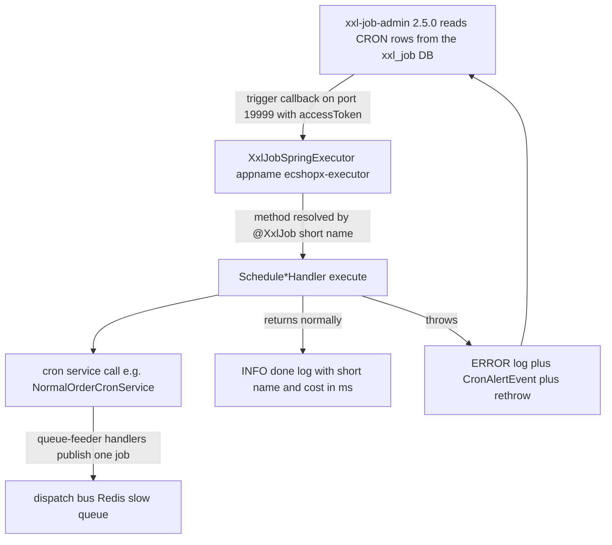

# Scheduled Jobs: XXL-JOB Executor and Cron Handlers

All time-driven work in ECShopX-Java — auto-cancelling unpaid orders, auto-finishing shipped orders, settling commissions and refunds, polling payment channels, running SMS batches, uploading analytics — is triggered by **XXL-JOB 2.5.0**. The scheduling brain (cron expressions, the trigger loop, the run log, the alarm machinery) lives in a **separately deployed admin console** that is *not* part of the Spring application. The application side is deliberately tiny: one `@Configuration` class in `ecshopx-bootstrap` creates a single `XxlJobSpringExecutor` bean that registers itself under the appname `ecshopx-executor` and receives trigger callbacks on port **19999**.

Each business Bundle exposes its schedulable work as a `cron/Schedule*Handler` class: a `@Component` whose `@XxlJob("<short-name>")` method (e.g. `finish-orders`, `chinaums-division-download-sftp`) delegates to a service, logs the elapsed cost, and on exception publishes a `CronAlertEvent` before rethrowing — the rethrow is what makes the admin mark the run as failed. There is no Quartz and no Spring `@Scheduled` cron for business jobs anywhere in the repository.



The trigger path from the XXL-JOB admin to a Bundle cron handler, showing the two success shapes (doing the work directly versus publishing a dispatch-bus job) and the single uniform failure path.

## The executor: one bean in bootstrap

`XxlJobConfig` (`ecshopx-bootstrap/src/main/java/cn/shopex/ecshopx/config/XxlJobConfig.java`) is the entire application-side integration. Its Javadoc calls it the "phase 0" executor for the scheduled-task migration. It reads eight `xxl.job.*` properties via `@Value` and exposes one `XxlJobSpringExecutor` bean:

| Property | Repo default | `@Value` default | Meaning |
|---|---|---|---|
| `xxl.job.admin.addresses` | `http://127.0.0.1:9080/xxl-job-admin` | none — mandatory | Admin REST base URL the executor registers against |
| `xxl.job.accessToken` | `ecshopx-cron-dev` | empty | Shared token; must equal the admin's token |
| `xxl.job.executor.appname` | `ecshopx-executor` | none — mandatory | Registry key; must match the `xxl_job_group.app_name` |
| `xxl.job.executor.address` | (empty) | empty | Explicit callback address; auto-derived when blank |
| `xxl.job.executor.ip` | (empty) | empty | Auto-detected when blank |
| `xxl.job.executor.port` | `19999` | none — mandatory | Port the executor listens on for triggers |
| `xxl.job.executor.logpath` | `logs/xxl-job` | empty | Executor-side rolling log directory |
| `xxl.job.executor.logretentiondays` | `7` | `7` | Executor log retention |

The executor **auto-registers** with the admin (the seeded `xxl_job_group` row uses `address_type=0`, auto-registration), so no address list is maintained by hand. Port `19999` is published by both Docker Compose stacks and must be kept free on the host.

## The admin: separate deployment, seeded database

The admin runs as its own container (`xuxueli/xxl-job-admin:2.5.0`) against a dedicated `xxl_job` MySQL schema. `docker/tables_xxl_job.sql` provisions that schema end to end:

* the eight XXL-JOB tables — `xxl_job_info` (job definitions: schedule type/conf, route and block strategies, misfire strategy, handler name, trigger status), `xxl_job_log` (per-run trigger/handle codes and alarm status), `xxl_job_log_report`, `xxl_job_logglue`, `xxl_job_registry` (executor auto-registration), `xxl_job_group`, `xxl_job_user`, `xxl_job_lock`;
* seed data: the executor group `ecshopx-executor` (auto-registration), the console user `admin` / `123456` (MD5 `e10adc3949ba59abbe56e057f20f883e`, role 1 = administrator — these are the credentials the readme documents for the console), and **69 job definitions** for job group 1.

Every seeded job is a `BEAN`-mode job (executor handler = a Spring bean method, no GLUE code) with `schedule_type=CRON`, `executor_route_strategy=FIRST`, `executor_block_strategy=SERIAL_EXECUTION`, `misfire_strategy=DO_NOTHING` and `trigger_status=1` (running). Frequencies range from every minute (`cancel-orders`, `0 * * * * ? *`) through every 5–10 minutes (`enable-theme-template`, `schedule-refund`, `wechat-query-merchant-payment`) to fixed daily slots (`finish-orders` at 03:00, `chinaums-division-transfer-sftp` at 18:00).

**The binding rule that matters:** the `@XxlJob` short name in code must equal the `executor_handler` value of an `xxl_job_info` row, or the handler will simply never fire — there is no code-side job registration. The seed covers the migrated handler set, but it is not a guaranteed mirror of the code: `ecshopx-promotions`' `recover-turntable-processing` handler exists in code with no seeded job row, so it must be created in the admin console before it runs. Equally, the seed SQL only executes on first database initialisation (MySQL `docker-entrypoint-initdb.d`, mounted as `00-tables_xxl_job.sql` *before* the business `10-ecshopx.sql` in both compose stacks); re-importing requires recreating the volume, and new jobs added after initialisation are registered through the console, not through code.

## The handler template

All 72 `@XxlJob` handler methods across 18 Bundles follow one shape. `orders/cron/ScheduleFinishOrdersHandler` is the canonical example:

```java
@Slf4j
@Component
@RequiredArgsConstructor
public class ScheduleFinishOrdersHandler {

	private static final String HANDLER_SHORT = "finish-orders";

	private final NormalOrderCronService normalOrderCronService;
	private final ApplicationEventPublisher eventPublisher;

	@XxlJob(HANDLER_SHORT)
	public void execute() {
		long start = System.currentTimeMillis();
		try {
			int scheduleFinishOrdersReturn = normalOrderCronService.scheduleFinishOrders();
			log.info(
					"[cron][{}] done, scheduleFinishOrdersReturn={}, cost={}ms",
					HANDLER_SHORT,
					scheduleFinishOrdersReturn,
					System.currentTimeMillis() - start);
		} catch (Exception e) {
			log.error(
					"[cron][{}] failed, cost={}ms",
					HANDLER_SHORT,
					System.currentTimeMillis() - start,
					e);
			eventPublisher.publishEvent(new CronAlertEvent(HANDLER_SHORT, e));
			throw e;
		}
	}
}
```

The template's fixed elements:

1. **A short-name constant** (`HANDLER_SHORT`, `HANDLER_SHORT_NAME`, `SHORT`, `H`, or an inline literal in a few bundles) that is used for the `@XxlJob` value, the log tags *and* the `CronAlertEvent` payload — one string, three uses, so the admin job, the log line and the alert always agree.
2. **Parameterless `execute()`** — handlers take no run parameters; the seeded `executor_param` values are empty. The only input is the fact that it is time to run.
3. **Cost logging** — `System.currentTimeMillis()` at entry, an INFO `done` line with the short name, a result count and the cost on success, an ERROR `failed` line with the cost and the exception on failure.
4. **`CronAlertEvent` publication then rethrow** — the exception is never swallowed. The rethrow propagates out of the executor callback so XXL-JOB records a failed run (`xxl_job_log.handle_code`, `alarm_status`) and applies its own alarm/retry policy (`executor_fail_retry_count` is 0 in the seed).
5. **No business logic and no XXL-JOB API surface** — handlers never use `XxlJobHelper` or implement `IJobHandler`; they do not report success/failure codes, shard, or read parameters. Success/failure is communicated purely by exception propagation, and all real work lives in a service (`NormalOrderCronService`, `WechatPayService`, `TaskService`, `PagesTemplateServices`, …).

Log line formats vary slightly per bundle (`cost={}ms` vs `costMs={}`), and some handlers log richer counters (`dispatched=`, `processed=`, `recovered=`); the short-name + cost + done/failed skeleton is constant.

## Handler families

Grep `@XxlJob` across the Bundles and the handlers cluster into recurring families (grouped here, not exhaustively enumerated — see each Bundle's `cron/` package for the full list):

| Family | Bundles | Representative short names |
|---|---|---|
| Order lifecycle: cancel / finish / consumption | orders | `cancel-orders`, `cancel-offlinepay-orders`, `cancel-group-orders`, `cancel-service-group-orders`, `cancel-seckill-orders`, `cancel-pointsmall-orders`, `finish-orders`, `consumption-orders` |
| Order money: profit sharing, statements, rights | orders | `settle-order-profit`, `share-order-profit`, `generate-statements`, `update-rights-status` |
| Invoicing | orders | `create-invoice`, `query-invoice`, `query-invoice-red` |
| ChinaUMS division SFTP file exchange | orders | `chinaums-division-transfer-sftp`, `chinaums-division-resubmit-sftp`, `chinaums-division-download-sftp` |
| After-sales and refunds | aftersales | `refuse-aftersales`, `close-order-item-aftersales`, `done-aftersales`, `schedule-refund` |
| Group buying and promotions lifecycle | promotions | `fail-group`, `done-group`, `done-nostore-group`, `trigger-promotion-activity`, `invalid-promotion-activity`, `expire-specific-crowd-discount`, `expire-crowd-month`, `clear-turntable-times-over`, `recover-turntable-processing` |
| Statistics and data cubes | data-cube, companys, hfpay | `daily-statistics`, `goods-daily-statistics`, `merchant-daily-statistic`, `distributor-daily-statistic`, `record-statistics`, `record-commission-statistics`, `hfpay-company-daily-statistics`, `delete-operator-logs` |
| Payment channel status and money movement | payment, adapay, hfpay | `wechat-query-merchant-payment`, `adapay-confirm-retry`, `bspay-confirm-retry`, `adapay-get-submit-license-audit`, `adapy-draw-cash-queue`, `hypay-check-cash`, `hypay-distributor-withdraw` |
| SMS (Aliyun) | aliyunsms | `aliyunsms-query-sign-audit-status`, `aliyunsms-query-template-audit-status`, `aliyunsms-query-sms-send-detail`, `aliyunsms-update-task`, `aliyunsms-run-task` |
| Points, coupons, engagement, theming | point, popularize, kaquan, community, selfservice, theme | `send-member-point`, `settle-brokerage`, `cancel-expired-card`, `finish-community-activity`, `send-wx-remind-msg`, `enable-theme-template` |
| File hygiene | espier | `delete-error-file`, `delete-history-file` |
| ERP / external system sync | system-link | `sync-wdt-logistics`, `sync-wdt-inventory` |
| Analytics upload | youshu | `youshu-order-sum`, `youshu-add-wxapp-visit-page`, `youshu-add-wxapp-visit-distribution` |

## Failure handling: `CronAlertEvent`

`CronAlertEvent` (`ecshopx-common/.../common/cron/event/CronAlertEvent.java`) is a plain Spring `ApplicationEvent` carrying exactly two fields: `handlerShortName` and `cause` (the short name is also passed as the event's source). Because it extends `ApplicationEvent` and is published through the injected `ApplicationEventPublisher`, delivery is synchronous and in-process — it is *not* a dispatch-bus event and never leaves the JVM.

Two operational consequences:

* **The rethrow, not the event, is the failure record.** XXL-JOB only learns about the failure because the exception escapes `execute()`. If a handler swallowed the exception after publishing the event, the admin would show a successful run.
* **No listener exists in the repository today.** There is no `@EventListener` or `ApplicationListener<CronAlertEvent>` anywhere in the codebase — the event is an alerting seam (a hook for a future alerting integration: email, IM webhook, metrics), not active alerting. The durable failure signals an operator actually has are the handler's ERROR log line, XXL-JOB's own `xxl_job_log` rows / alarm email machinery (`alarm_email` is empty in the seed), and the dispatch bus's `failed_jobs` path for handlers that fan out to jobs.

## Cron handlers and the dispatch bus

A cron handler is the *time-driven entry point*; the [dispatch bus](dispatch-bus.md) is the *queue-driven execution engine*. Most heavy batch work is deliberately split across the two, and handlers come in two shapes:

**Queue-feeders.** The handler's service method does nothing but publish one dispatch job per tick and return a fixed `1` ("dispatch initiated"), so the actual batch runs on a Redis queue with its own retry policy:

* `finish-orders` → `NormalOrderCronService.scheduleFinishOrders()` publishes `FINISH_ORDER_JOB` (`job:128:OrdersBundle\Jobs\FinishOrderJob`) via `FinishOrderJobDispatchPublisherImpl` as `ASYNC` / `REDIS` / queue `slow` — the job is consumed by `orders/dispatch/FinishOrderJobHandler` registered in bootstrap.
* `consumption-orders` → `scheduleConsumptionOrders()` publishes `CONSUMPTION_ORDER_JOB` (`job:129:...ConsumptionOrderJob`) on `slow` with payload `orderType=normal, pageSize=100` (member-level accumulation for upgrades). Under the OEM flag `ecshopx.request-field.oem-shuyun=true` it logs and returns `0` without publishing.
* `send-member-point` → the handler's only collaborator is `SendMemberPointJobDispatchPublisher.enqueueSendMemberPointJob()`, which dispatches `SEND_MEMBER_POINT_JOB` on `slow`.
* `schedule-refund` → `AftersalesRefundService.scheduleRefund()` selects `AUDIT_SUCCESS` refunds and publishes **one job per refund** with staggered delays (0 s for the first refund of an order, `60*n+1` s for repeats) to spread the refund spike — the only cron handler that uses dispatch *delays* rather than immediate enqueue.

**Direct workers.** The handler's service does the batch inline, synchronously, inside the trigger call. `cancel-orders` → `NormalOrderCronService.scheduleCancelOrders()` is the reference: it counts expired `NOTPAY` orders (`auto_cancel_time` within 60 s, excluding `offline_pay` and `point`), then pages through them 20 at a time (`PAGE_SIZE = 20`), batch-updating the main and association orders to `CANCEL` and, per order, running the restore fan-out — invoice cancellation, supplier-order cancellation, marketing join-count decrement (Redis), points and upoints return, order process logs via the `OrderProcessLogPublishPort`, a marketing dispatch event published after-commit when a transaction is active, employee-purchase restore, per-item inventory and purchase-limit restores, limited-time-sale quota restores, and coupon/directed-promotion restore — returning the cancelled count that ends up in the handler's INFO log. `cancel-offlinepay-orders` is the same shape specialised for offline-transfer orders (it also sets `offline_payment.check_status = 9`, guarded per order so one failure does not abort the batch).

The split is a load-shaping decision: one cron tick should be cheap and bounded (queue-feeders) or fully self-contained idempotent batch work (direct workers), never a long unbounded transaction.

### The `test-cron` profile

The queue-feeder publishers in bootstrap are annotated `@Profile("!test-cron")` (e.g. `FinishOrderJobDispatchPublisherImpl`, `ConsumptionOrderJobDispatchPublisherImpl`), and each Bundle that owns cron side effects ships a `cron/testcfg/CronTestMockConfig` — annotated `@Profile("test-cron")` and living in **`src/main`**, because the profile is activated at runtime by the PHP→Java migration diff orchestrator, not by unit tests. Under that profile the config installs `@Bean @Primary` No-op replacements for the dispatch publishers (finish/consumption/invoice/statement/export jobs) and for side-effect ports (ChinaUMS SFTP, HfPay settings, member-consumption Redis, turntable counters), so cron runs during schema-diff comparison do not write Redis, call third parties or enqueue real bus jobs.

## Configuration and operations

**Case-sensitive properties, CLI-style injection.** `xxl.job.*` keys are mixed-case and therefore cannot be expressed as ordinary (upper-cased) environment variables. Docker deployments inject them in Spring Boot CLI style — `--xxl.job.admin.addresses=...` — through the `APP_ARGS` environment variable, which `docker/app-entrypoint.sh` appends verbatim to the java command (`java $JAVA_OPTS -jar "$JAR" $APP_ARGS`). The readme's deployment section calls this out explicitly: business parameters are injected "in Spring Boot CLI style through `APP_ARGS`, preserving the semantics of case-sensitive properties such as `xxl.job.accessToken`". The same style is used for a bare `docker run` (`--xxl.job.admin.addresses=... --xxl.job.accessToken=ecshopx-cron-dev`).

**Where the admin URL differs per environment.** The repo default in `application.properties` is `http://127.0.0.1:9080/xxl-job-admin` (self-hosted runs). Both compose stacks override it via `APP_ARGS` to `http://xxl-job-admin:8080/xxl-job-admin` on the shared bridge network, with the admin's host port published as `8080` (overridable via `XXL_HOST_PORT`; `dev-setup.sh --xxl-port` and `docker-lite/deploy.sh --xxl-port` expose the same knob). The English readme's one-click section still lists the console at `http://localhost:9080/xxl-job-admin` — trust the compose files for the containerised stacks. The admin's own `PARAMS` set its context path, its `xxl_job` datasource and `--xxl.job.accessToken=ecshopx-cron-dev`, which **must match** the executor's token or triggers are rejected.

**Startup ordering and health.** In both compose stacks the `ecshopx-app` service declares `depends_on: xxl-job-admin: condition: service_healthy` (a TCP check on 8080 with a 90 s start period), so the app container does not start before the admin is reachable; the executor then handles (re)registration itself. Executor logs land under `logs/xxl-job` (7-day retention) inside the app container, alongside the app logs on the `ecshopx-logs` volume.

**Console credentials.** The seeded `xxl_job_user` is `admin` / `123456` (the readme documents the same pair). Change it on any non-local deployment, together with the dev-default `ecshopx-cron-dev` access token.

**What is *not* scheduled here.** Spring `@Scheduled` exists only for infrastructure polls, enabled by four `@EnableScheduling` configs — `OrdersSchedulingConfig`, `DoumenIntlPaymentSchedulingConfig` (payment), `SelfserviceSchedulingConfig`, `ShuyunOpenPlatformConfiguration` — which drive the dispatch-queue pollers (`RedisDispatchListener`, `RedisDispatchDelayedPollScheduler`), a community-activity cancel queue poller, and token-refresh watermarks (`DoumenIntlTokenRefreshScheduler`, `@Scheduled(cron = "0 * * * * ?")`). Remove those bundles and the dispatch queues silently stop draining, but no XXL-JOB handler is affected, and vice versa.

## Extension point: adding a cron handler

1. Ensure the Bundle's POM has `com.xuxueli:xxl-job-core` `2.5.0` on the compile classpath. Most cron-owning bundles declare it directly (orders, payment, aftersales, adapay, aliyunsms, community, companys, data-cube, espier, hfpay, kaquan, point, popularize, selfservice, system-link, theme, plus bootstrap); `promotions` and `youshu` currently get it transitively through peer dependencies.
2. Create `<bundle>/src/main/java/.../<bundle>/cron/Schedule<Thing>Handler.java` following the template above, delegating to a service method. Pick a unique kebab-case short name.
3. Register the job in the XXL-JOB admin console: executor group `ecshopx-executor`, `BEAN` mode, JobHandler = the short name, a CRON expression, and the usual `FIRST` / `SERIAL_EXECUTION` / `DO_NOTHING` settings. There is no code-side registration and the seed SQL will not be re-applied to an existing database.
4. If the work should run on the bus, depend on (or add) the `ecshopx-common` publisher interface, implement it in bootstrap with the exact `DispatchOptions` tuple, and add the matching `*RegistrationConfig` — see [Workflow: Adding a Dispatch Event, Job, or Cron Handler](../workflows/add-event-or-job.md) and [Dispatch Bus](dispatch-bus.md).
5. Add the per-handler Mockito test pinning the alert-and-rethrow contract.
6. If the run has side effects that the `test-cron` diff harness must not perform, add a `@Bean @Primary` No-op to the Bundle's `cron/testcfg/CronTestMockConfig`.

## Focused tests

Each handler ships with a mirror test class (e.g. `orders/cron/ScheduleFinishOrdersHandlerTest`, `payment/cron/ScheduleQueryMerchantPaymentHandlerTest`) that pins the template contract with Mockito plus a Logback `ListAppender`:

* **success** — the service method is called exactly once, **no** `CronAlertEvent` is published, and an INFO log containing the handler short name, the returned count and the cost is emitted;
* **failure** — the service throws, `execute()` rethrows, exactly **one** `CronAlertEvent` is captured with `handlerShortName` equal to the short name, and an ERROR log containing the short name and `failed` is emitted.

Publisher-impl tests in bootstrap (e.g. `ConsumptionOrderJobDispatchPublisherImplTest`) pin the exact dispatch tuple of the queue-feeder path — message name `CONSUMPTION_ORDER_JOB`, `ASYNC` / `REDIS` / queue `slow` / null delay / platform default retry — and the null-payload guard. These are the tests that break when someone changes a queue, a short name or swallows an exception.

## Related pages

* [Dispatch Bus](dispatch-bus.md) — the queue side of the cron→job handoff, including the `slow` queue and retry semantics
* [Bundle Layering](../architecture/bundle-layering.md) — where `cron/` sits inside a Bundle and how it differs from `dispatch/` and `listener/`
* [Architecture Overview](../architecture/overview.md) — runtime topology including the XXL-JOB admin and executor
* [Deployment](../operations/deployment.md) — compose stacks, ports and secrets injection
* [Workflow: Adding a Dispatch Event, Job, or Cron Handler](../workflows/add-event-or-job.md) — the step-by-step recipe
