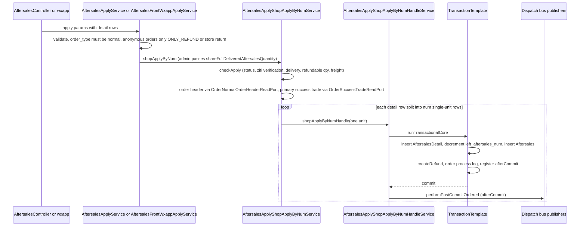
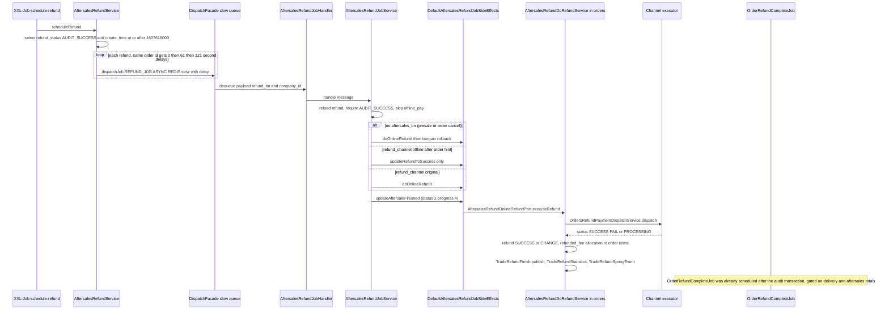
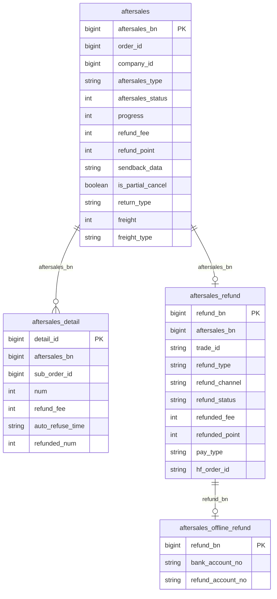

# Aftersales Domain (ecshopx-aftersales)

`ecshopx-aftersales` is the after-sales Bundle: refunds (`ONLY_REFUND`), return-for-refund (`REFUND_GOODS`) and exchanges (`EXCHANGING_GOODS`) for `normal` orders. It owns three tables — `aftersales` (header, `aftersales_bn` PK), `aftersales_detail` (per order-line rows, `detail_id` auto-increment) and `aftersales_refund` (money/point movement, `refund_bn` PK) — plus `aftersales_offline_refund` for bank-transfer records. Every business rule mirrors the legacy PHP semantics, including the dual status model (`aftersales_status` coarse state + `progress` fine-grained step) and fen-denominated integer amounts.

The Bundle follows the standard layering ([Bundle Layering](../architecture/bundle-layering.md)): thin controllers in `api/admin/v1` and `api/front/v1`, orchestration in `service/`, dispatch-job handlers in `dispatch/`, XXL-Job entries in `cron/`, cross-bundle ports in `port/` + `integration/`, and integration payload builders in `jushuitan/` and `wdterp/`. Controllers never touch the dispatch bus; all async work is published from inside service transactions or `afterCommit` synchronizations — the pattern documented in [Cross-Bundle Communication](../architecture/cross-bundle-communication.md) and [Dispatch Bus](../concepts/dispatch-bus.md).

## State model: two status columns drive everything

`Aftersales` carries both `aftersales_status` and `progress` (entity comments in `domain/Aftersales.java` document the enumerations):

| `aftersales_status` | meaning |
| --- | --- |
| 0 | 待处理 pending review (created by apply) |
| 1 | 处理中 accepted / under refund audit |
| 2 | 已处理 finished |
| 3 | 已驳回 rejected |
| 4 | 已撤销 withdrawn/closed |

| `progress` | meaning | who sets it |
| --- | --- | --- |
| 0 | waiting for merchant | apply |
| 1 | merchant accepted, awaiting consumer sendback | review approve (return-goods) |
| 2 | sendback in transit, awaiting merchant receipt | sendback, or review approve with `return_type=offline` |
| 8 | merchant confirmed receipt, awaiting refund audit | **external only** — Jushuitan inbound; no Java write path exists |
| 3 | rejected | review/refundCheck/auto-refuse |
| 4 | finished | refundCheck approve, RefundJob finish, offline refund |
| 7 | withdrawn | close |
| 9 | refund processing | review approve ONLY_REFUND, auto-approve |

The entity comment also lists 5 (退款驳回 refund rejected) and 6 (退款完成 refund complete), but no Java code path reads or writes them — the reject/finish flows use 3/4.

`AftersalesDetail` mirrors both columns per line and adds its own string-typed `auto_refuse_time` (set as a string by review) and `refunded_num`. `AftersalesRefund` has a string status column: `READY` (created, awaiting audit) → `AUDIT_SUCCESS` (audit approved, awaiting execution) → `SUCCESS`/`PROCESSING` (refunded) / `REFUSE` / `CANCEL` / `REFUNDCLOSE` / `CHANGE` (channel exception), plus `refund_type` 0=aftersales, 1=order-cancel, 2=refuse-receipt.

### One honest caveat: progress 8

`AftersalesRefundConfirmService.confirmRefund` reads `progress != 8` to refuse approving a Jushuitan-linked `REFUND_GOODS` with "卖家暂未收货" (seller has not received the goods). Grepping the whole repository for any write of progress 8 finds **nothing** — no Java producer sets it. The value exists for externally-completed receiving (the Jushuitan `aftersale` inbound surface) and is documented in the entity comment, so treat "8" as a contract for inbound integrations, not an internally reachable state.

## Entrypoints

### Admin REST (`/api/v1`, `AftersalesController`, `@AdminAuth`)

| route | service | purpose |
| --- | --- | --- |
| `GET /aftersales` | `AftersalesAdminListService` | paginated list, `pageSize` capped at 50, ~20 filters |
| `GET /aftersales/logExport` | `AftersalesAdminLogExportService` | async export |
| `GET /aftersales/{aftersales_bn}` | `AftersalesAdminDetailService` | detail |
| `POST /aftersales/review` | `AftersalesReviewService` | approve/reject (batch-capable) |
| `POST /aftersales/refundCheck` | `AftersalesRefundConfirmService` | refund audit after goods received |
| `GET /aftersales/financial/export` | `AftersalesFinancialExportService` | financial report |
| `GET /aftersales/remind/detail`, `POST /aftersales/remind` | `AftersalesRemindService` | reminder copy |
| `PUT /aftersales/remark` | `AftersalesService.updateRemark` | merchant remark (≤150 chars) |
| `POST /aftersales/apply` | `AftersalesApplyService` | admin-created aftersales |
| `POST /aftersales/sendback` | `AftersalesSendbackService` | admin records return logistics (3-field whitelist) |

`RefundController` (same bundle) serves `GET /refund`, `GET /refund/detail/{refund_bn}`, `GET /refund/logExport`, `GET /refund/offline/bank` and `POST /refund/offline` (bank-transfer recording via `AftersalesOfflineRefundSaveService`).

### Front wxapp (`/api/v1/h5app`)

`POST /wxapp/aftersales` (apply), `GET /wxapp/aftersales` (list), `GET /wxapp/aftersales/info` (detail), `POST /wxapp/aftersales/sendback` (member sendback, single or batch via `aftersales_data` array), `POST /wxapp/aftersales/close` (member close), and `GET /wxapp/aftersales/remind/detail`. `POST /wxapp/aftersales/modify` is a stub that returns an empty 200 — kept for PHP URL compatibility.

### OpenAPI

`ecshopx-openapi`'s `/api/openapi/internal/v2` exposes `ecx.aftersales.get`, `ecx.aftersales.incr.get`, `ecx.aftersales.detail.get`, `ecx.refund.get`, `ecx.refund.incr.get`, `ecx.refund.detail.get`; each delegates to `port` impls in this bundle's `openapi/` package (`OpenapiAftersalesListPortImpl` etc.), so read-only integration queries reuse the same mappers.

### XXL-Job (`cron/`)

Four handlers, all of which publish `CronAlertEvent` on failure: `schedule-refund`, `refuse-aftersales`, `close-order-item-aftersales`, `done-aftersales` (see [Scheduling (XXL-Job)](../concepts/scheduling-xxljob.md)).

## The apply pipeline

Caption: the apply pipeline — validation, port-based header/trade resolution, per-unit split, one transaction per unit, then ordered post-commit dispatch publishing.

The apply flow splits each requested line into one-unit aftersales (PHP parity: each unit is its own `aftersales` row with a `refund` created inside the same per-unit transaction).

1. **Admin/wxapp validation.** `AftersalesApplyService.apply` (admin) requires `order_type == "normal"`, rejects anonymous orders requesting `REFUND_GOODS` without store return, and treats `goods_returned=true` as `return_type=offline`; the requested `refund_fee`/`refund_point` strings must be present but are **compatibility-only** inputs. `AftersalesFrontWxappApplyService.apply` (wxapp) additionally gates `return_type=offline` behind the platform `offline_aftersales` setting (unless the shop's product model is `platform`).
2. **`AftersalesApplyShopApplyByNumService`** — two `shopApplyByNum` overloads (with and without the `shareFullDeliveredAftersalesQuantity` flag) both delegate to `AftersalesApplyCheckApplyService.checkApply`, then `doShopApplyByNum` resolves the order header through `OrderNormalOrderHeaderReadPort` (missing → `系统无此订单，无法申请售后`) and the primary success trade through `OrderSuccessTradeReadPort` (missing → `无有效支付交易单，无法申请售后`) — the orders-side trade impl prefers non-`point` trades when several `SUCCESS` trades exist. Each detail row is then looped into one-unit rows (stripping per-row `total_fee`/`total_point`, `num=1`) passed to `AftersalesApplyShopApplyByNumHandleService.shopApplyByNumHandle`, pinned by `AftersalesApplyShopApplyByNumServiceSplitTest`.
3. **`AftersalesApplyCheckApplyService.checkApply`** enforces: order status not `NOTPAY`/`CANCEL`; `DONE` orders past `order_auto_close_aftersales_time` are rejected; `ziti` (self-pickup) orders must be verified (`delivery_status=DONE`); `REFUND_GOODS`/`EXCHANGING_GOODS` lines must have `delivery_item_num > 0`; and per-line requested quantity ≤ remaining quota — `ONLY_REFUND` from the front counts `lineNum − cancelled − delivered − applied-ONLY_REFUND`, return/exchange counts `delivered − applied-return/exchange`, while the admin path (`shareFullDeliveredAftersalesQuantity` + order fully delivered) shares the full delivered quota. Freight (only for `REFUND_GOODS`/`EXCHANGING_GOODS`) requires the apply to cover the **final** full-line return ("部分退不支持退运费") and caps the cash/point freight at paid minus already-refunded. **Top-level `refund_fee`/`refund_point` are ignored by checkApply** (pinned by `AftersalesApplyCheckApplyServiceTopLevelRefundTest`) — per-unit refund amounts are recomputed in the handle layer.
4. **`AftersalesApplyShopApplyByNumHandleService.shopApplyByNumHandle`** runs one `TransactionTemplate` per unit: inserts the `AftersalesDetail` row, the `Aftersales` header (status 0/progress 0, `aftersales_bn` = `yyyyMMdd` + 7-digit random), recomputes the unit refund amount with `floorDivMulBd` (per-unit = `total ÷ lineNum` at scale 2 `RoundingMode.DOWN` × num, then `FLOOR` to int; a requested per-row `total_fee`/`total_point` may override it, and a final-unit apply absorbs the remainder as `line total − already applied`), decrements `orders_normal_orders.left_aftersales_num` via a raw `JdbcTemplate` UPDATE, folds freight by `freight_type`, calls `AftersalesRefundService.createRefund` (refundBn = `"2"` + `yyyyMMdd` + 10-digit random, status `READY`, channel `offline`/`original` derived from the trade's pay_type, currency fields carried from the trade), writes an order process log, and registers the post-commit hook.
5. **Post-commit (`performPostCommitOrdered`, `afterCommit`)**: Redis counters `OrderPayStatistics:normal:{companyId}:{ymd}` (company, per-distributor, per-merchant); then either `TradeAftersalesDispatchPublisher` + `ThirdPartyTradeAftersalesSaasErpDispatchPublisher` (for `REFUND_GOODS`/`EXCHANGING_GOODS`) or `TradeRefundDispatchPublisher` + `SaasErpRefundSpringEvent` + `InvoiceRedJobDispatchPublisher`; then the wait-deal notice job (`job:17`), the Jushuitan bus payload (`JushuitanTradeAftersalesBusPayloadBuilder` — a ~25-key full snapshot of the row), the WDT bus payload (`WdtErpTradeAfterSaleBusPayloadBuilder` — only 4 keys: `company_id`, `distributor_id`, `aftersales_bn`, `order_id`), and finally `AftersalesApplyAsyncPort.dispatchPostCommitSideEffects` which schedules `OrderRefundComplete` (`job:19`) when the type is `ONLY_REFUND` or store return.

When synchronization is not active (tests), `performPostCommitOrdered` runs inline right after the template returns — the same ordering guarantees hold.

## Review, refund-check, sendback, close

### Review (`AftersalesReviewService.aftersalesReview`, `POST /aftersales/review`)

Batch-capable (comma-separated `aftersales_bn`). The row must be in `aftersales_status = 0`. Inside one `TransactionTemplate`:

* **Reject** — refund → `REFUSE`; aftersales → status 3 / progress 3 with `refuse_reason`; restores quantity (`addLeftAftersalesNum`, or `partialCancelRestore` for partial-cancel aftersales); publishes WDT + `TradeAftersales` bus events; registers `afterCommit` Jushuitan publish + `JushuitanTradeAftersalesSyncSpringEvent`.
* **Approve `ONLY_REFUND`** — validates requested fee/point/freight ≤ caps; refund → `AUDIT_SUCCESS` + channel (`offline` when the trade paid `offline_pay`, else `original`); aftersales → status 1 / progress 9; brokerage rollback per detail line; `partialCancelRestore` when flagged; `afterCommit`: `OrderRefundComplete` (`job:19`), Jushuitan + WDT publish, `InvoiceRed` (`job:20`).
* **Approve return-goods** — aftersales → status 1 / progress 1 (progress 2 when `return_type=offline`); stamps `auto_refuse_time` on every detail row as `now + auto_refuse_time_days` (platform setting, stored as a **string**); schedules `AftersalesSuccessSendMsg` (`job:21`, wxa subscribe message "请填写回寄物流"); optionally resolves and stores the return address (`aftersales_address` JSON) from `aftersales_address_id`.

<!-- openwiki: broken internal link [#wxa-member-notify-aftersalesrefund-scene] heading anchor "wxa-member-notify-aftersalesrefund-scene" does not exist in /openwiki/domains/aftersales.md. Fix the href or restore the target, then delete this comment. -->
The SaaS-ERP arm runs inside the transaction: approve publishes `ThirdPartyTradeAftersalesSaasErpDispatchPublisher` (with `aftersales_action=update`), reject publishes `ThirdPartyTradeAftersalesCancelSaasErpDispatchPublisher` (`aftersales_action=cancel`) — the controller Javadoc explicitly pins this responsibility split. After the transaction returns, both paths call `AftersalesRefuseWxaNotifyService.sendByStatus` with the new status (see [WXA member notify](#wxa-member-notify-aftersalesrefund-scene)).

### RefundCheck (`AftersalesRefundConfirmService.refundCheck`, `POST /aftersales/refundCheck`)

Batch-capable. The service normalizes the reject note (`refunds_memo` or `refund_memo`) and fills missing `refund_fee`/`refund_point` from the DB row before auditing. `confirmRefund` requires `aftersales_status = 1` (status 2/3 → "已处理"), refund exists and is not already `SUCCESS`, requested fee/point ≤ caps. For `REFUND_GOODS` approve when Jushuitan is open: progress must be 8, else "卖家暂未收货，请先到聚水潭进行处理". Transaction: approve → refund `AUDIT_SUCCESS` + channel + optional fee/point/freight overrides, aftersales status 2 / progress 4, brokerage rollback; reject → refund `REFUSE`, status 3 / progress 3, `addLeftAftersalesNum`. Same in-tx SaaS-ERP update/cancel arms, same `afterCommit` (approve: `OrderRefundComplete` + Jushuitan + Jushuitan sync Spring event + WDT + `InvoiceRed`; reject: Jushuitan + sync event only). `RefundCheckOrderRefundCompletePostCommitProbeTest` — a Mockito fixture with a hand-rolled `PlatformTransactionManager` that fires `afterCommit` — pins the approve path (exactly one `OrderRefundComplete` + one Jushuitan publish + WDT bus + `InvoiceRed`, in that order, and never the cancel-SaaS-ERP publish) and the reject path (never `OrderRefundComplete`/`InvoiceRed`/WDT; one Jushuitan publish + one Jushuitan sync event + the cancel-SaaS-ERP publish). It also pins the order-process-log payloads: reject logs `operator_type "user"` (operator_id from `user_id` param, 0 when absent), approve logs `operator_type "admin"` with operator_id preferring the aftersales row's `user_id` over the request's `operator_id`. Inside the transaction both paths also call `AftersalesRefuseWxaNotifyService.sendByStatus` with the freshly updated status.

### Sendback (admin `POST /aftersales/sendback`, wxapp `POST /wxapp/aftersales/sendback`)

Both surfaces reject `ONLY_REFUND` ("不需要回寄货品") and require `progress == 1` ("您已提交回寄信息，请勿重复提交"). Transaction sets progress 2 on header + details and stores `sendback_data` JSON (`corp_code`, `logi_no`, receiver address/mobile). `afterCommit` publishes **`TradeAftersalesLogi` first** (the full reloaded admin/member aggregate), then Jushuitan bus payload + `JushuitanTradeAftersalesSyncSpringEvent` + `WdtErpTradeAfterSaleSyncSpringEvent` + WDT bus payload, then the wait-confirm notice (`job:24`). The wxapp variant scopes every query by `user_id` and supports batches.

### Close (consumer `POST /wxapp/aftersales/close` and the `done-aftersales` cron share one transaction body)

`AftersalesService.executeCloseAftersalesTransaction` guards: status 4 (already withdrawn), 3 (rejected — use close only for pending), and 1/2/5 (accepted — contact merchant) cannot close. Transaction sets status 4 / progress 7 on header + details, refund → `CANCEL`, restores `left_aftersales_num`, writes a process log. `afterCommit`: `TradeAftersalesCancelSpringEvent` (Spring), `tradeAftersalesCancelDispatchPublisher` (bus, injected with the `@Qualifier("tradeAftersalesCancelAsyncFanOut")` async bean), `ThirdPartyTradeAftersalesCancelSaasErpDispatchPublisher`, Jushuitan + sync event, and the cancel-notice job (`job:26`).

## WXA member notify (aftersalesRefuse scene)

<!-- openwiki: broken internal link [../workflows/member-notify-fanout.md] file "../workflows/member-notify-fanout.md" does not exist. Fix the href or restore the target, then delete this comment. -->
`AftersalesRefuseWxaNotifyService.sendByStatus(status, aftersalesLike)` maps the aftersales status/type pair to a scene key — status 1 + `REFUND_GOODS` → `WAIT_BUYER_RETURN_GOODS` (fixed remark `商家已同意售后申请，请进行退货回寄处理`), status 1 + `ONLY_REFUND` and status 2 → `REFUND_SUCCESS` (remark `商家已同意退款`), status 3 + `REFUND_GOODS` → `SELLER_REFUSE_BUYER` (remark = `refuse_reason`), status 3 + `ONLY_REFUND` → `REFUND_CLOSED` (remark = refuse reason) — and other statuses are skipped. It resolves the mini-program recipient (appid/openid) via `OrderTradeMiniProgramRecipientLookupPort`, formats the fen refund amount (`refund_amount`, falling back to `refund_fee`) into a two-decimal yuan string, and sends payload `{scenes_name: "aftersalesRefuse", appid, openid, data: {order_id, refund_fee, remarks}}` through the common `AftersalesRefuseWxaSubscribeSendPort` (impl in ecshopx-promotions, which delegates to the WXA subscribe-message send service) with `forceFire=true`; every failure is swallowed at debug level so notify problems never break the review/refund-check transaction. The auto-refuse cron goes through `AftersalesAutoRefuseWxaTemplatePortImpl` (impl of the common `AftersalesAutoRefuseWxaTemplatePort`), which fills `refuse_reason` with `未收到商品自动驳回` when missing and calls `sendSellerRefuseBuyer` → `sendByStatus(3, …)`, i.e. always `SELLER_REFUSE_BUYER`. Pinned by `AftersalesRefuseWxaNotifyServiceTest` (fee formatting `1500 → "15.00"`, skip for unknown status). The send mechanics and recipient resolution are shared with the other member-notify fan-outs described in [Member Notify Fan-out](../workflows/member-notify-fanout.md).

## Partial cancel with auto-approve

`AdminNormalOrderPartialCancelService` (in ecshopx-orders, `@Transactional`) computes undelivered quantities per supplier and calls `AftersalesShopPartialCancelCreateService.createForShopPartialCancel` — a `REQUIRES_NEW` transaction in this bundle that creates a single `ONLY_REFUND` aftersales flagged `is_partial_cancel=true` (floor-based fee/point split, refund status `READY`), bumps the same Redis counters, and registers `afterCommit` `TradeRefund` + WDT publishes. Back in orders, the caller accumulates `cancel_item_num`, may flip the order to `WAIT_BUYER_CONFIRM`, and — when the platform `auto_aftersales` setting is on — calls `autoApproveOnlyRefund` in this bundle: another transaction that sets refund `AUDIT_SUCCESS`, aftersales status 1 / progress 9, and registers `afterCommit` `OrderRefundComplete` + `InvoiceRed` + Jushuitan.

## The refund pipeline: from audit to money

Caption: the refund pipeline — the audit decision schedules `OrderRefundComplete` post-commit, while the money movement itself runs through the slow dispatch queue with per-order de-spiking delays.

1. **`schedule-refund` cron → `AftersalesRefundService.scheduleRefund`** selects `refund_status = 'AUDIT_SUCCESS'` rows with `create_time ≥ 1607616000` (a hard epoch floor excluding legacy data) and dispatches each through `AftersalesRefundJobDispatchPublisher` as `job:15:AftersalesBundle\Jobs\RefundJob`, ASYNC/REDIS/queue `slow`, with 0s delay for the first refund of an order and `60×n+1` seconds for repeats within the same run (deliberate de-spiking).
2. **`AftersalesRefundJobHandler` → `AftersalesRefundJobService.handle`** reloads by `refund_bn + company_id` and requires `AUDIT_SUCCESS`. `offline_pay` rows are skipped entirely. Rows without `aftersales_bn` (pre-sale/order-cancel refunds) run `doOnlineRefund` plus a bargain-activity rollback when the trade source is `bargain`. Otherwise `applyOfflineChannelHintFromOrder` patches the in-memory channel to `offline` when the order's `pay_type` is `offline` — in that case only `updateRefundToSuccess` runs (no channel call); `original` runs `doOnlineRefund`. Finally `updateAftersaleFinished` sets aftersales + details to status 2 / progress 4.
3. **`doRefund` (ecshopx-orders, via the common `AftersalesRefundOnlineRefundPort`)** folds freight by `freight_type` into fee or point, requires a `SUCCESS` trade, short-circuits `prepaid_point` and zero-fee refunds to instant success, throws for `localpay` ("0元订单不支持退款"), generates an `hf_order_id` for hfpay when missing, and dispatches to `OrdersRefundPaymentDispatchService`. `FAIL` outcomes (or exceptions) are persisted to refund-error logs (resurfaced via `GET /api/v1/trade/refunderrorlogs/list` and `PUT /api/v1/trade/refunderrorlogs/resubmit/{id}`). Mixed-payment point add-back (`pointMemberAddPointService`) runs for non-point pay types with refund points. The refund row becomes `SUCCESS` (+ `refunded_fee`/`refunded_point`/`refund_success_time`) on SUCCESS/PROCESSING channel responses, else `CHANGE`. On success the refunded fee is allocated proportionally (HALF_UP ratio, last detail row absorbs the remainder; pre-sale refunds without an aftersalesBn mark every order line's `refunded_fee` in full). Every path publishes `TradeRefundFinish`; success additionally publishes `TradeRefundStatistics` (`job:66`) and `TradeRefundSpringEvent`.
4. **`OrderRefundComplete` (`job:19`, slow queue)** was scheduled at audit time; `AftersalesOrderRefundCompleteJobHandler` → `AftersalesOrderRefundCompleteJobService` → orders' `NormalOrderRefundCompleteJobBusinessService`, which only acts when the order is `WAIT_BUYER_CONFIRM`/`DONE` and *all* lines are delivered/cancelled/applied: it auto-confirms receipt (`applyConfirmReceiptInTransaction` + after-commit hooks, setting `order_status=DONE` with a `latest_aftersale_time`-derived auto-close time) and restores coupons from `discount_info` — unless DM-CRM point integration is open.

### Channel executors: `@Order`-sorted Spring beans

`OrdersRefundPaymentDispatchService.dispatch` special-cases `point` (member point add-back), `deposit` (stored-value refund), and `pos`/`offline_pay`/`prepaid_point` (instant SUCCESS) before consulting `AftersalesRefundPayChannelExecutor` beans (interface in ecshopx-common, `supports(payTypeLower)` + `execute(ctx)`):

| executor | `@Order` | channels |
| --- | --- | --- |
| `HfpayAftersalesRefundPayExecutor` | 45 | hfpay |
| `StandardOnlinePayAftersalesRefundExecutor` | 50 | `wxpay*`, `alipay*`, `bspay` (斗拱) |
| `ChinaumsAftersalesRefundPayExecutor` | 52 | chinaums |
| `AdapayAftersalesRefundPayExecutor` | 55 | adapay |
| `DoumenIntlAftersalesRefundExecutor` | 55 | doumen international |

Each payment module registers its own bean; the first `supports` hit wins, and no match throws "未知的支付方式". Adapay additionally gets a dedicated order-process-log publish inside `doRefund` when the channel result does not set `order_process_log_via_payment_reverse`.

## Offline refund

`POST /api/v1/refund/offline` (`AftersalesOfflineRefundSaveService.saveOfflineRefund`, `@Transactional`) records bank fields (`bank_account_name/no/name`, `refund_account_name/bank/no`) into `aftersales_offline_refund`. Mixed payments (`pay_type != point` with refund points > 0) are routed through `executeRefund` so points settle online; otherwise the refund goes straight to `SUCCESS` with a `TradeRefundStatistics` publish. Either way the aftersales header and details finish at status 2 / progress 4.

## Schedules: auto-refuse, auto-close, done

* **`refuse-aftersales`** — `scheduleAutoRefuse` scans `aftersales_detail` where progress 1, type `REFUND_GOODS`, and `CAST(auto_refuse_time AS UNSIGNED)` in `(0, now+60)`; each detail gets its **own** transaction (failure skips only that row): header + detail → status 3 / progress 3 with reason "未收到商品自动驳回", refund → `REFUSE`, `addLeftAftersalesNum`, the WXA auto-refuse template (via `AftersalesAutoRefuseWxaTemplatePort`), process log.
* **`close-order-item-aftersales`** — `scheduleAutoCloseOrderItemAftersales` closes per-item aftersales windows via the orders port and triggers delayed profit-sharing confirmation for `adapay` (directly) and `bspay` (deduplicated per order) payments.
* **`done-aftersales`** — `scheduleAutoDoneAftersales` finds status-3 aftersales older than 3 days (`SCHEDULE_DONE_CLOSE_DAYS`) per company and runs the shared close transaction per row (the handler Javadoc notes that in production most rows fail the status guard — the batch is effectively a janitor for already-rejected rows).

## Events published and who listens

All publishers are interfaces in `ecshopx-common/dispatch`, implemented in `ecshopx-bootstrap` (see [Dispatch Bus](../concepts/dispatch-bus.md) for the routing core). Each event has one async fan-out impl (`DispatchOptions(ASYNC, REDIS, …)`); where a second sync impl exists it uses `DispatchOptions.eventDefaults()` (SYNC mode, inline). The bean landscape differs per event, which is why the services' `@Qualifier` annotations matter:

* `TradeRefundDispatchPublisher` — two impls: the `@Primary` `TradeRefundDispatchPublisherImpl` is **SYNC**, and the async fan-out is only reachable via `@Qualifier("tradeRefundAsyncFanOut")`. `AftersalesApplyShopApplyByNumHandleService` and `AftersalesShopPartialCancelCreateService` use the qualifier; dropping it would silently switch refund-event delivery to inline sync.
* `TradeAftersalesDispatchPublisher` — the async fan-out is itself `@Primary` (the sync variant is qualified `"tradeAftersalesSync"`), so the service's qualifier is belt-and-braces.
* `TradeAftersalesCancelDispatchPublisher` and `TradeAftersalesLogiDispatchPublisher` — only the async impls exist.

| event | name | publishers (aftersales) | listeners |
| --- | --- | --- | --- |
| `EVENT_TRADE_AFTERSALES` | `event:systemlink:trade_aftersales` | apply post-commit, review (reject in-tx) | OME send, marketing-center push |
| `EVENT_TRADE_AFTERSALES_CANCEL` | `event:systemlink:trade_aftersales_cancel` | close afterCommit | OME cancel, marketing-center cancel push |
| `EVENT_TRADE_AFTERSALES_LOGI` | `event:systemlink:trade_aftersales_logi` | sendback afterCommit (first) | OME logi send, SaaS-ERP logi send |
| `EVENT_TRADE_REFUND` | `event:systemlink:trade_refund` | apply post-commit (non-return types), partial cancel afterCommit | OME refund, marketing-center, SaaS-ERP refund |
| `EVENT_JUSHUITAN_TRADE_AFTERSALES` | `event:systemlink:jushuitan_trade_aftersales` | nearly every state change | Jushuitan `aftersale_add` call (gated on ERP enabled, shop mapping, `orders_rel_jushuitan` link row) |
| `EVENT_WDT_ERP_TRADE_AFTERSALE` | `event:systemlink:wdt_erp_trade_aftersale` | apply, review approve, refundCheck approve, sendback, partial cancel | WDT ERP sync (default queue) |
| `EVENT_TRADE_AFTERSALES_SAAS_ERP` | `event:thirdparty:trade_aftersales_saas_erp` | review/refundCheck approve (in-tx) | SaaS-ERP aftersales update (@Order 83 config) |
| `EVENT_TRADE_AFTERSALES_CANCEL_SAAS_ERP` | `event:thirdparty:trade_aftersales_cancel_saas_erp` | review/refundCheck reject (in-tx), close afterCommit | SaaS-ERP aftersales cancel (@Order 84 config) |
| `EVENT_TRADE_REFUND_FINISH` | `event:thirdparty:trade_refund_finish` | `doRefund` (orders, on behalf of aftersales) | marketing-center, DM-CRM, Shuyun refund.sync/trade.sync — all **syncDefaults()** (inline) |

The Jushuitan listener chain is worth tracing: `SystemLinkJushuitanTradeAftersalesDispatchListener` → `JushuitanTradeAftersalesNotificationProcessor.handle`, which checks the company's Jushuitan setting, resolves the JST shop id (distributor-scoped), requires an `orders_rel_jushuitan` link row with an `o_id`, assembles the biz payload through the orders-side `JushuitanAftersaleAddPayloadAssemblePort`, and calls `aftersale_add` on `JushuitanOpenApiClient` — swallowing exceptions at debug level so an ERP outage never breaks the aftersales transaction.

Alongside the bus events, some flows also publish intra-process Spring events (`TradeAftersalesCancelSpringEvent`, `JushuitanTradeAftersalesSyncSpringEvent`, `WdtErpTradeAfterSaleSyncSpringEvent`, `SaasErpRefundSpringEvent`, `TradeRefundSpringEvent`) — a legacy-compatibility belt-and-braces layer consumed by orders-side sync listeners.

### Jobs this bundle owns (name → handler)

| job name | queue | purpose |
| --- | --- | --- |
| `job:15:AftersalesBundle\Jobs\RefundJob` | slow (+delay) | execute approved refunds |
| `job:19:AftersalesBundle\Jobs\OrderRefundCompleteJob` | slow | orders-side completion (auto confirm-receipt + coupon restore) |
| `job:21:AftersalesBundle\Jobs\AftersalesSuccessSendMsg` | slow | wxa subscribe message on return-goods approval |
| `job:17/24/26:WorkWechatBundle\Jobs\sendAfterSale*NoticeJob` | (work-wechat bundle) | wait-deal / wait-confirm / cancel notices |

Handlers live in `dispatch/` (`AftersalesRefundJobHandler`, `AftersalesOrderRefundCompleteJobHandler`, `AftersalesSuccessSendMsgJobHandler`); registration happens in bootstrap `*RegistrationConfig` classes (`@PostConstruct` on `DispatchRegistry`). Related orders-side jobs the domain participates in: `job:20:OrdersBundle\Jobs\InvoiceRedJob` (invoice queue), `job:66:OrdersBundle\Jobs\TradeRefundStatistics`, `job:116:OrdersBundle\Jobs\RefundByOrderUpdateOrderStatus` (published by promotions group-team failure; orders-side cancel).

## Data model

Caption: the four aftersales tables. `orders_normal_orders.left_aftersales_num` (orders bundle, updated via `JdbcTemplate`/`NormalOrderLeftAftersalesWritePort`) is the quota that apply decrements and reject/close restore.

## Invariants and failure semantics

* **Money is fen (int).** All fee fields are integer fen; splits use `RoundingMode.DOWN` at scale 2 then `FLOOR` to int (never round up a refund), and the final-unit apply absorbs the rounding remainder so a full line always refunds exactly the line total.
* **Idempotency via status guards.** Review requires status 0; refundCheck requires status 1 and refuses a `SUCCESS` refund; sendback requires progress 1; close refuses statuses 4/3/1/2/5. Every update counts affected rows and throws `ResourceException` on zero, rolling back the transaction.
* **Post-commit only after real commit.** All bus publishes are inside `TransactionSynchronization.afterCommit` (or run immediately when no synchronization is active), so listeners always reload persisted state. Publisher ordering matters and is asserted by the probe tests: e.g. sendback publishes `TradeAftersalesLogi` before Jushuitan/WDT; apply publishes Redis counters → type-specific pair → wait-deal notice → Jushuitan → WDT → OrderRefundComplete; refundCheck approve publishes SaaS-ERP in-tx then OrderRefundComplete → Jushuitan → Jushuitan sync event → WDT → InvoiceRed after commit.
* **Quantity conservation.** `left_aftersales_num` decrements on apply and is restored on reject/refundCheck-reject/close/auto-refuse (partial-cancel uses `partialCancelRestore` instead).
* **ERP and notify failures never break the transaction.** The Jushuitan processor and the WXA notify service swallow exceptions; SaaS-ERP publishes are fire-and-forget bus messages.
* **Refund errors are recoverable.** Channel `FAIL` writes a refund-error log row for the `/trade/refunderrorlogs` admin surface, and `resubmit` re-enters `doRefund(resubmit=true)`.

## Extension points

* **New payment channel** — implement `AftersalesRefundPayChannelExecutor` as a Spring bean in your payment module with a `@Order` below 50 (or matching your precedence); no changes in orders or aftersales.
* **New ERP/listener for an existing event** — register via a bootstrap `*RegistrationConfig` calling `dispatchRegistry.registerEventListener`; aftersales services need no change.
* **New outbound integration on state change** — add a publisher interface in `ecshopx-common/dispatch`, an impl in `ecshopx-bootstrap`, and call it from the relevant service's post-commit block; mirror the pattern of `AftersalesShopPartialCancelCreateService.registerWdtErpTradeAfterSalePublishPostCommit`.

## Focused tests

* `AftersalesApplyShopApplyByNumServiceSplitTest` — the split: `num=3` produces 3 handle calls, each with a single one-unit detail row and per-row `total_fee`/`total_point` stripped.
* `AftersalesApplyCheckApplyServiceFreightTest` — freight guards: `ONLY_REFUND` never enters freight validation; point freight validated against `freight_fee` (not `freight_point`) and rejected when it exceeds the remaining paid point freight; localized messages.
* `AftersalesApplyCheckApplyServiceQuantityTest` — PHP-parity quantity rules: front `ONLY_REFUND` counts unshipped quantity (`num − cancelled − delivered − applied-ONLY_REFUND`), return/exchange counts delivered minus applied return/exchange (capped at line num), the admin flag lets fully-delivered `ONLY_REFUND` share the delivered quota, ziti-unverified and unpaid orders are rejected.
* `AftersalesApplyCheckApplyServiceTopLevelRefundTest` — top-level `refund_fee`/`refund_point` above the line amounts still pass; the handle layer recomputes per unit.
* `RefundCheckOrderRefundCompletePostCommitProbeTest` — refundCheck approve schedules `OrderRefundComplete` exactly once after commit with the full post-commit publish order (SaaS-ERP update in-tx → OrderRefundComplete → Jushuitan → sync event → WDT → InvoiceRed); reject never schedules it and publishes Jushuitan + cancel-SaaS-ERP only; also pins the reject/approve order-process-log payloads (operator types and ids, `refund_memo`/`refunds_memo` normalization).
* `AftersalesRefuseWxaNotifyServiceTest` — scene mapping and fee formatting for the `aftersalesRefuse` WXA subscribe message.
* `AftersalesRefundServiceScheduleRefundTest` — schedule query shape (`AUDIT_SUCCESS` + epoch floor) and same-order delay ramp.
* `AftersalesRefundJobServiceTest` + `DefaultAftersalesRefundJobSideEffects*Test` — job branch decisions (offline skip, no-aftersalesBn path, channel hint, finish writes).
* `AftersalesShopPartialCancelAutoApproveOnlyRefundPostCommitJobsProbeTest`, `...CreateServiceTradeRefundDispatchProbeTest`, `...WdtErpAfterSalePublishProbeTest` — partial-cancel post-commit fan-out.
* `AftersalesServiceCloseAftersales*ProbeTest`, `...ScheduleAutoRefuseTest`, `...ScheduleDoneAftersalesTest` — close/auto-refuse/done semantics.
* Cron handler tests under `cron/` use the `test-cron` profile with `CronTestMockConfig` (Noop dispatch publishers and ports — including a Noop `AftersalesAutoRefuseWxaTemplatePort` overriding the real WXA sender), keeping XXL-Job entrypoints testable without Redis.

## Related pages

* [Dispatch Bus](../concepts/dispatch-bus.md) — the transport underneath every publisher here.
* [Cross-Bundle Communication](../architecture/cross-bundle-communication.md) — why publishers are interfaces in common with impls in bootstrap.
* [Bundle Layering](../architecture/bundle-layering.md) — the `service`/`dispatch`/`cron`/`port`/`integration` split this bundle follows.
* [Scheduling (XXL-Job)](../concepts/scheduling-xxljob.md) — cron entrypoints and alerting.
* [Orders Domain](orders.md) — the other half of every refund: `doRefund`, order status updates, `NormalOrderRefundCompleteJobBusinessService`, `left_aftersales_num`.
* [Payments Domain](payments.md) — the channel executors (`AftersalesRefundPayChannelExecutor` beans) live in the payment modules.
* [Third-Party Integrations](../integrations/third-party.md) — Jushuitan, WDT ERP and SaaS-ERP consumer surfaces fed by the events above.
<!-- openwiki: broken internal link [../workflows/member-notify-fanout.md] file "../workflows/member-notify-fanout.md" does not exist. Fix the href or restore the target, then delete this comment. -->
* [Member Notify Fan-out](../workflows/member-notify-fanout.md) — the WXA subscribe-message send mechanics shared by the aftersales notify services.
