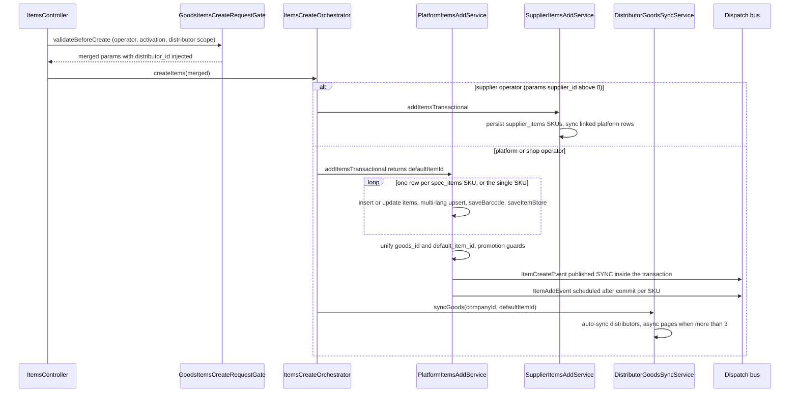
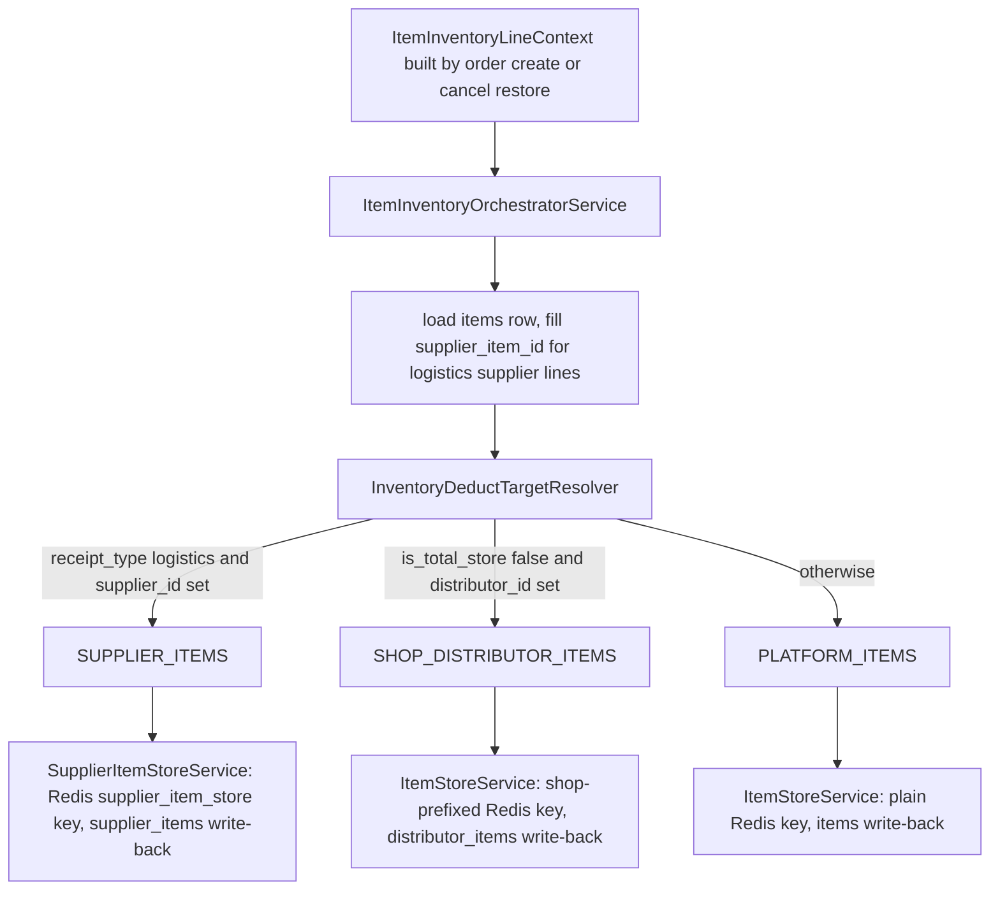
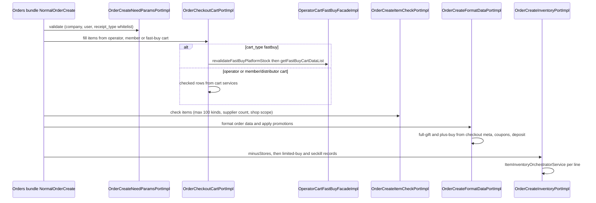
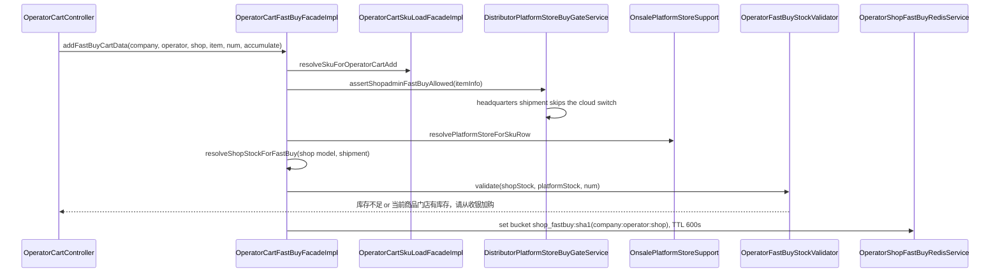
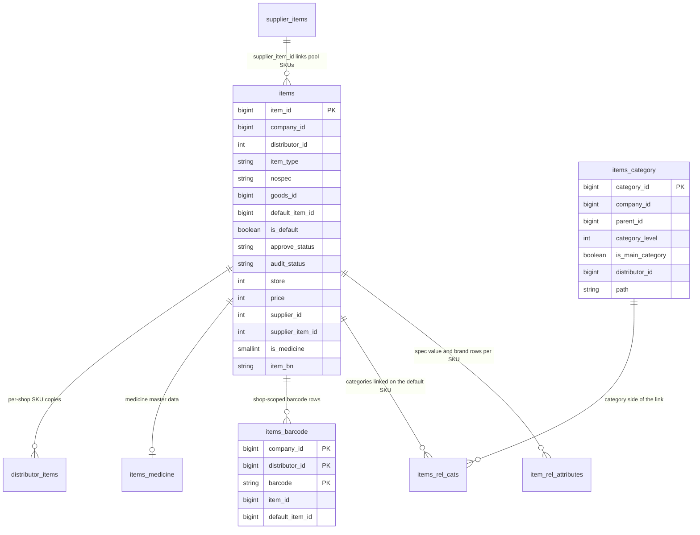

# Goods Domain (ecshopx-goods)

`ecshopx-goods` is the product Bundle (`商品域模块`, see `package-info.java`): everything that turns a merchant's catalog into sellable SKUs and everything order creation needs from that catalog. It owns the `items` table (SKU grain) plus its satellites — `items_category`, `items_rel_cats`, `item_rel_attributes`, `items_barcode`, `items_medicine`, multi-language shard tables — and the shop-scoped `distributor_items` copies maintained together with the distribution bundle. On top of the data it provides: admin/front item CRUD, platform-vs-supplier goods flows, batch status/store edits, barcodes, keywords, tags, recommendations, the inventory pools, the goods-side half of order create (`OrderCreateFormatDataPortImpl`, `OrderCreateInventoryPortImpl`, checkout cart ports, full-gift), the wxapp item-list orchestration chain (`WxappGoodsItemsListQueryOrchestrator`), and the operator-cart facade family the **companys** bundle drives over HTTP (`OperatorCartFastBuyFacade`, `OperatorCartSkuLoadFacade`, `OperatorCartDataListFacade`, `OperatorCartScanBarcodeFacade` — all implemented here in `service/operatorcart/`).

The Bundle follows the standard layering ([Bundle Layering](../architecture/bundle-layering.md)): controllers in `api/admin/v1` and `api/front/v1`, orchestration in `service/`, dispatch job handlers in `dispatch/`, openapi port impls in `openapi/`, order/promotion-facing ports in `integration/`, and entities in `domain/`. Its POM depends on 20 other bundles — notably `ecshopx-orders` (cart tables), `ecshopx-promotions`, `ecshopx-distribution`, `ecshopx-supplier`, `ecshopx-deposit`, `ecshopx-pointsmall` — which is why order-create logic can live here while staying decoupled through common ports ([Cross-Bundle Communication](../architecture/cross-bundle-communication.md)).

## State model: one SKU row, two status axes, three ownership scopes

`Items` (`domain/Items.java`) is one row **per SKU**:

| column | meaning |
| --- | --- |
| `item_id` | auto-increment PK |
| `nospec` | `"true"` single-spec (one SKU per goods), `"false"` multi-spec (SKU matrix) |
| `goods_id` / `default_item_id` / `is_default` | group sibling SKUs of one goods; `default_item_id` points at the representative SKU (lowest price by default), `is_default` marks it |
| `distributor_id` | `0` = mall/platform-owned, `>0` = shop-owned goods |
| `supplier_id` / `supplier_item_id` / `is_market` | link to supplier master data (`supplier_items`) and its sellable flag |
| `approve_status` | `onsale` (front sellable), `offline_sale` (hidden), `instock` (not sellable), `only_show` (display only) |
| `audit_status` | `submitting` / `approved` / `processing` / `rejected`, with `audit_reason` / `audit_date` |
| `store` / `price` / `cost_price` | store is a plain int; **prices are integer fen** |
| `is_medicine` / `is_prescription` | pharma gating flags (medicine master data lives in `items_medicine`) |

A unique index enforces `(company_id, distributor_id, item_bn)`; a composite index `(company_id, default_item_id, approve_status, item_type, item_category)` backs the default-SKU list queries. Every table access is company-scoped — the multi-tenant rule across the whole reactor.

## Entrypoints

### Admin REST (`/api/v1/goods`, `@AdminAuth @ShopLog`)

18 controllers in `api/admin/v1`; the central one is `ItemsController` (~1,600 lines):

| route | service | purpose |
| --- | --- | --- |
| `POST /items` | `ItemsCreateOrchestrator` | add goods (route alias `goods.items.create`) |
| `PUT /items/{item_id}` | `ItemsUpdateOrchestrator` | update goods (`goods.items.update`) |
| `DELETE /items/{item_id}` | `ItemsDeleteOrchestrator` | delete goods (`goods.items.delete`), `distributor_id` query param selects the shop scope |
| `PUT /audit/items` | `ItemsAuditUpdateService` | write `audit_status`/`audit_reason` by `goods_id` clause (`goods.items.audit`) |
| `PUT /itemstatusupdate` | `GoodsItemsBatchApproveStatusService` | batch onsale/instock (`goods.status.upate`) |
| `PUT /itemstoreupdate` | `ItemsBatchUpdateStoreOrchestrator` | batch store write (supplier rows when `operate_source=supplier`) |
| `PUT /itemsupdate` | `ItemsPriceStoreStatusWriteService` | price/store/shelf combined edit |
| `GET /items`, `GET /items/onsale`, `GET /sku` | `GoodsItemsListFacadeService` | admin/SKU lists |
| `GET /items/{item_id}` | `GoodsItemsDetailFacadeService` | admin detail |
| `POST /setItemsCategory` | `ItemsRelCatsWriteService` | replace item↔category rows |
| `POST /setItemsTemplate`, `POST /setItemsSort`, `POST /rebateconf`, `POST /warning_store`, `POST /set_commission_ratio`, `PUT /itemsisgiftupdate`, `POST /items/params` | per-field write services | freight template, sort, rebate config, warning store, commission, gift flag, params |
| `POST/GET/DELETE /keywords…` | `GoodsKeywords*Service` | shop hot keywords |
| `POST /medicineItems/sync` | `ItemsMedicineService` | medicine data sync |
| `GET /goodsbycoupon/{coupon_id}` | `GoodsItemsByCouponService` | items usable by a coupon |

Sibling controllers: `ItemsCategoryController` (`/category` CRUD + flat `/createcategory` + saleable-filter switch), `ItemsTagsController`, `ItemsAttributesController`, `ItemsGroupController`, `ItemsCommissionController`, `ItemsProfitController` / `ItemsCategoryProfitController`, `MemberPriceController`, `ServiceLabelsController`, `EpidemicItemsController`, `ExportItemsController` (async export files), `GoodsRecommendRuleAdminController` + `GoodsRecommendDisplaySettingController`, and the three ERP surfaces `JushuitanController` (`POST /upload/items`, `POST /query/inventory`), `WdtErpController` (`POST /upload/wdterp/items`) and `SyncFromOmeController` (`POST /sync/items|itemCategory|itemSpec|brand`).

### Front wxapp (`/api/v1/h5app/wxapp/goods`, `@FrontNoAuth` + Dingo response)

`ItemsController` (front) serves `GET /items`, `/items/filter`, `/shopitems` (small-shop list), `/itemintro/{item_id}` (HTML description, charset-gated), `/memberprice/{item_id}`, `/keywords`, `/items/{item_id}/fav`, `/checkshare/items`, `/share/items/{item_id}`, `/items/batch`, `/items/{item_id}` (detail), `/newitems`, `/items_price_store/{item_id}`, and `POST /scancodeAddcart` (barcode → cart). `CategoryController` serves `/category*` reads, `ItemsGroupController` `GET /get_group_items`, `GoodsRecommendFrontController` `POST /recommendations/match`, and `SalespersonItemsController` the salesperson item list/detail under `/api/v1/h5app/wxapp/goods/salesperson/*`.

### OpenAPI

`openapi/` holds ~30 port impls behind `ecshopx-openapi`'s `/api/openapi/internal/v2` surface (`ecx.items.entity.*`, item price/store sync, brand/category CRUD, product goods/SKU lists v1+v2, distributor item download/update). They delegate to `openapi/thirdapi/v2` services inside this bundle, so external integrations reuse the same mappers.

### Dispatch jobs

All job handlers live in `dispatch/`; registration happens in bootstrap configs (see [Dispatch Bus](../concepts/dispatch-bus.md)):

| job name | handler | purpose |
| --- | --- | --- |
| `job:62:DistributionBundle\Jobs\AddDistributorItems` | `AddDistributorItemsJobHandler` | fan a goods' SKUs into `distributor_items` (self-chaining pages of 100) |
| `job:72:GoodsBundle\Jobs\MedicineItemsSubmitAudit` | `MedicineItemsSubmitAuditJobHandler` | push medicine items to kuaizhen580, write audit result back |
| `job:74:GoodsBundle\Jobs\ItemBatchEditStatusEventJob` | `ItemBatchEditStatusEventJobHandler` (bootstrap) | decoupled republish of the batch-status event |
| `job:75-78:SystemLinkBundle\Jobs\Get*FromOme` | `GetItemsFromOmeJobHandler` etc. | OME paged inbound sync (items / category / spec / brand) |
| `job:79:…UploadItemsToWdtErpJob` | `UploadItemsToWdtErpJobHandler` | WDT ERP item upload pages |
| `job:82:…UploadItemsToJushuitanJob` | `UploadItemsToJushuitanJobHandler` | Jushuitan item upload pages |
| `job:84:…InventoryQueryFromJushuitanJob` | `InventoryQueryFromJushuitanJobHandler` | Jushuitan inventory query batches |
| export file jobs | `*ExportFileJobTypeHandler` | async CSV/XLSX exports (items, codes, tags, distributor items, epidemic registers, point-mall items) |

There is no `cron/` production code in this bundle (only `cron/testcfg/CronTestMockConfig` for the `test-cron` profile) — scheduling is owned by system-link/bootstrap.

## The create pipeline

Caption: the item create flow — permission gating, supplier-vs-platform routing, per-SKU persistence with side effects, and the two item lifecycle events.

1. **Gate.** `POST /api/v1/goods/items` merges query/form/JSON params, copies `operator_type` from the operator JWT, forces `supplier_id=0` — unless the operator is a supplier, in which case `supplier_id=operator_id` and `audit_status` defaults to `submitting` (other operators get `approved`). `GoodsItemsCreateRequestGate.validateBeforeCreate` then enforces: logged-in operator with non-empty `operator_type`; super-admin route permission per route alias (skipped for `salesperson_workwechat` source); company activation (`ForbiddenException 未激活` when missing/zero, skipped for salesperson source); and distributor operators must carry distributor bindings and may only manage a distributor they own (else `您没有权限管理此店铺`), with their selected `distributor_id` injected into the merged params.
2. **Routing.** `ItemsCreateOrchestrator.createItems` sends `supplier_id>0` to `SupplierItemsAddService` and everything else to `PlatformItemsAddService`, then (platform path only) calls `DistributorGoodsSyncService.syncGoods`.
3. **Platform persistence.** `PlatformItemsAddService.addItemsTransactional` (`@Transactional`) picks an `ItemTypeHandler` (`normal` vs default `services`), enriches medicine params, and — for multi-spec (`nospec=false`) — loops `spec_items` persisting one SKU per row through `persistOneSku`; single-spec persists one. `default_item_id` falls out as the lowest-price SKU (first on-sale SKU, else the first), and `goods_id` defaults to `default_item_id`. After the loop: gift items run `ItemCreatePromotionGuardService.checkNotFinishedActivityValid`, prices run `checkItemPrice`, then `updateByItemIds` + `clearDefaultFlagExcept` + `setDefaultItem` stamp the whole sibling group, and `applyRelData` writes category rows (`ItemsRelCatsWriteService`), brand and params on the default SKU.
4. **Per-SKU side effects.** `persistOneSku` inserts/updates the `items` row, writes multi-language rows, saves the shop-scoped barcode, seeds the Redis store (`itemStoreService.saveItemStore(itemId, store, 0)`), writes `item_spec` attribute rows with spec images, and honors `point_access=items` point-mall upserts. `NormalItemTypeHandler.preRelItemParams` validates store (`0-999999999`), converts `cost_price`/`rebate` money to fen, and generates `item_bn` when missing.
5. **Events.** `ItemCreateEvent` is published **inside the transaction in SYNC mode** (the promotions listener runs inline before commit); `ItemAddEvent` is scheduled `afterCommit` per SKU (or immediately when no transaction synchronization is active) and published ASYNC on the Redis bus.
6. **Distributor fan-out.** `syncGoods` selects distributors with `auto_sync_goods=true` (excluding `is_valid=delete`) and either runs all pages synchronously (≤3 distributors) or enqueues `job:62 AddDistributorItems` — `DistributorItemsPagedAddRunner.consumeOneQueuedPage` inserts/updates `distributor_items` rows per 100-SKU page and re-enqueues the next page until done, also firing Shuyun product sync per touched goods.

## Update, audit, delete, batch status

* **Update** — `PUT /items/{item_id}` reuses the gate (`validateBeforeUpdate`) and `GoodsItemsCreateParamValidator.validateForUpdate` (name/pics/sort required; `normal` items require freight template + brand; supplier goods require `audit_status`), then `ItemsUpdateOrchestrator.updateItems` branches: supplier operator → `SupplierItemsAddService` with audit reset to `submitting` (unless already `processing`); platform operator editing a supplier good (`supplier_id>0` in body) → supplier add when `audit_status=approved`, then `SupplierItemsReviewGoodsService.reviewGoods`; plain platform good → platform add + `syncGoods`. The branch exclusivity is pinned by `ItemsUpdateOrchestratorDistributorSyncTest` (supplier paths never call `syncGoods`).
* **Audit** — `PUT /audit/items` → `ItemsAuditUpdateService.auditItems` writes `audit_status`/`audit_reason` by a `goods_id` clause that accepts null/single/list semantics.
* **Delete** — `ItemsDeleteOrchestrator.delete` routes by `operator_type`. `PlatformItemsDeleteService.deleteCore` verifies the row and the queried `distributor_id` match, expands multi-spec to all sibling SKUs (by `default_item_id`), deletes per SKU the `items` row + Redis `item_store` key + attribute rows, then rel-cats (default SKU), services rel-type, `distributor_items`, member prices and barcodes, and publishes `ItemDeleteEvent` **after commit** (payload: `item_id`, `company_id`, `del_ids`, full `item_info` snapshot).
* **Supplier-linked sync.** When a supplier edits its master data, `SupplierItemsAddService.syncPlatformIfNeeded` propagates a PHP-whitelist field patch (`store`, `pics`, `approve_status`, `item_name`, optional `cost_price`/`start_num`, audit reset on `submitting|processing`) to every linked `items` row and refreshes each Redis store — pinned by `SupplierItemsAddServiceSyncPlatformIfNeededTest`.
* **Supplier review** — `SupplierItemsReviewGoodsService` implements the common `SupplierItemsReviewGoodsExecutor` / `SupplierItemsSyncToPoolExecutor` / `SupplierItemsSyncToShopExecutor` interfaces the **supplier bundle** drives: `reviewGoods(approved)` automatically syncs the goods into the platform pool; `syncToShop` is restricted to `platform` product-model companies and dual-writes shop-scoped barcode rows (`SupplierItemsReviewGoodsServiceShopBarcodeDualWriteTest`).
* **Batch status** — `PUT /itemstatusupdate` expands a truthy `query` filter into distinct `goods_id`s, then `GoodsItemsBatchApproveStatusService.updateItemsStatus`: `onsale` rejects supplier-controlled goods (`供应商商品不可售`) and prescription drugs unless the pharma-industry setting is on and their audit is not pending (`instock` skips those checks — deliberate); each goods gets `updateApproveStatusByCompanyAndGoodsId` plus an enqueue of the batch-status event through `job:74` (slow queue). The `job:74` handler republishes `EVENT_ITEM_BATCH_EDIT_STATUS`, whose listeners are the third-party marketing-center push **and** the goods-bundle's own `ItemsApproveStatusSyncDispatchListener`, which cascades the status to `distributor_items`.

## Inventory: three pools, one resolver

Caption: deduct-target resolution — the PHP `ItemStoreService::minusItemStore` pool rules, kept bit-for-bit in Java.

1. **Resolver.** `InventoryDeductTargetResolver.resolve` maps the line context to a pool: logistics receipt with `supplier_id>0` → `SUPPLIER_ITEMS`; `is_total_store=false` with `distributor_id>0` → `SHOP_DISTRIBUTOR_ITEMS`; otherwise `PLATFORM_ITEMS`. The Javadoc explicitly pins alignment with the PHP implementation.
2. **Orchestrator.** `ItemInventoryOrchestratorService.minusItemStore` loads the `items` row to fill a missing `supplier_item_id` (only for logistics supplier lines), routes to `SupplierItemStoreService` or `ItemStoreService`, and treats a negative `num` as a restore (`restoreItemStore`). Every pool returns `false` when stock is insufficient.
3. **Redis mechanics.** `ItemStoreService.minusItemStore` decrements `item_store:{distributorId}_{itemId}` (shop pool, writes back `distributor_items`) or `item_store:{itemId}` (platform pool, writes back `items`) with `INCRBY -num`; if the result goes negative it re-increments to roll back and returns `false` — the oversell guard. `saveItemStore` seeds the key and publishes `EVENT_ITEM_STORE_UPDATE` synchronously; `saveItemStoreForWdtErp` publishes the bus event **before** writing Redis to preserve WDT ordering. `SupplierItemStoreService` mirrors this on `supplier_item_store:{supplierItemId}` with `supplier_items` write-back, and `resolveSupplierItemStore` returns `0` for rows that are not marketable (`is_market != 1`). The pool routing is pinned by `ItemInventoryOrchestratorServiceTest` (total-store → plain key/`items`; shop pool → prefixed key/`distributor_items`; platform → plain key).
4. **Order create.** `OrderCreateInventoryPortImpl.minusStores` skips `normal_employee_purchase` orders entirely, computes each line's platform/total flag as `uses_platform_item_stock || is_total_store` (the order-level `uses_platform_item_stock` comes from format; a line only counts as shop stock when `is_total_store` is exactly `false`), routes point-mall orders to `PointsmallPartialCancelItemStorePort` instead of the orchestrator, throws `商品库存不足` when a deduct fails, and afterwards records limited-buy purchases (`LimitPersonBuyService.createLimitPerson`, mirroring PHP `AbstractNormalOrder`) and limited-time-sale/seckill purchases (`SeckillUserBuysStoreService`) — pinned by `OrderCreateInventoryPortImplLimitedBuyTest`. Order cancels restore through `OrderCancelItemStoreRestorePortImpl`, and trade finish bumps `items.sales` per line via `TradeFinishItemSalesIncrementPortImpl`.

### Available-store clamping

`ItemAvailableStoreResolver.resolveAvailable` computes what a buyer may actually purchase per delivery mode: logistics + supplier → supplier store (falling back to `logistics_store` without a `supplier_item_id`); non-logistics → local store (`store` when `is_total_store=false`, otherwise `store - logistics_store`, floored at 0); cart display without a chosen receipt type takes the max of both paths. `CheckoutCartLogisticsSupplierStoreClampService` applies these rules **in memory at checkout only** (quantities are clamped for pricing, never written back to the cart).

### Platform-store resolution (cloud-warehouse buys)

`OnsalePlatformStoreSupport` (the PHP `ItemsService::appendPlatformStoreForOnsaleSkuList` parity, kept as a static helper) answers a different question: *how much of this SKU lives in the platform/cloud bucket a shop sells on behalf of headquarters?* `resolvePlatformStoreForSkuRow` follows a strict precedence:

1. `logistics_store` present → that value (supplier-shared/logistics-warehouse stock),
2. else headquarters shipment (`is_total_store` truthy, per `DistributorPlatformStoreBuySupport.isSkuHeadquartersShipment`) → `store`,
3. else a `distributor_store` key present → `0` (independent shop stock, nothing platform-borne),
4. else `store` (platform rows without distributor semantics).

`appendPlatformStoreForOnsaleSkuList` writes this as `platform_store` on each onsale SKU row — `GoodsItemsListFacadeService.listOnsaleItems` exposes it only when the request resolves a single shop (`onsaleDistributorId > 0`) **and** that shop's `is_platform_store_buy` switch is on (`DistributorPlatformStoreBuyGateService.isEnabled`), and echoes `is_platform_store_buy` in the response so the cashier client can show the fast-buy entry. The operator-cart fast-buy path (below) reuses the same row-level resolution to gate the cloud bucket.

The same `is_total_store` semantics cross the bundle boundary in the other direction through `DistributorItemTotalStorePortImpl` (goods' impl of common `DistributorItemTotalStorePort`): it answers which of a set of shops currently draw a given SKU from headquarters stock, which the **members** bundle's goods-arrival subscribe matching (`GoodsArrivalSubscribeMatchService`) uses to decide whether a headquarters `EVENT_ITEM_STORE_UPDATE` should also notify per-shop subscribers.

## Goods-side services of order create

The bundle implements the common order-create ports the orders bundle calls:

Caption: the checkout-time port chain — goods owns five of the normal-order-create steps, including the shopadmin fast-buy revalidation detour.

* **`OrderCreateNeedParamsPortImpl`** — requires `company_id`/`user_id`, and `receipt_type` must be empty or one of `logistics`/`ziti`/`dada`/`merchant`; `normal_groups` orders additionally require `bargain_id`.
* **`OrderCheckoutCartPortImpl`** — `fillItemsFromOperatorCart` branches on `cart_type`: a `fastbuy` request first passes `DistributorPlatformStoreBuyGateService.assertShopadminPlatformStoreBuyAllowed` (the shop must exist with the `is_platform_store_buy` cloud switch on, else `该店铺未开启云仓可购买`) and `OperatorCartFastBuyFacade.revalidateFastBuyPlatformStock`, then reads the fast-buy bucket; any other cart type goes through `OperatorCartDataListFacade.getCartDataList` with `isSubmit=true`. Both paths take checked rows from the first `valid_cart` block (`购物车为空` when none) and attach `_checkout_cart_meta`; `fillItemsFromMemberDistributorCart` does the same for member/distributor carts (test: `OrderCheckoutCartPortImplTest` pins that checkout-recommend lines merge at the bottom and stay separate from the same item's main line).
* **`OrderCreateItemCheckPortImpl`** — cart-line orders: max 100 distinct SKUs (`单次购买商品种类不能超过100种`), all requested items must resolve in the SKU query (`购买商品无效` / `部分商品无效`), at most 10 distinct suppliers (`单次订单供应商数量不能超过10个`), cart line nums must match the SKU list, and `promotion=normal` orders on a shop may only contain shop-scoped SKUs (via `distributor_items` existence or the SKU's own `distributor_id`); point-mall orders validate through `PointsmallCartSkuLoadService`; single-`item_id` orders check sellability (`approve_status` must be on-sale-like, else `商品{0}已下架`).
* **`OrderCreateFormatDataPortImpl`** — rebuilds `orderData` from scratch (`shop_id=0` matching PHP `OrderService::_formatOrderData`), resolves the order slug through `OrderTypeSlugMapper`, and stamps `uses_platform_item_stock=1` **only** for shopadmin fastbuy orders (order_class `shopadmin` + `cart_type=fastbuy`, PHP `_formatOrderData` parity — every other order gets `0`, which is what makes `OrderCreateInventoryPortImpl` deduct such lines from the platform/total bucket); shopadmin orders also passthrough the seven `receiver_*` address fields and fastbuy forces `is_logistics=true`. Online wxapp normal/groups/employee-purchase orders merge live SKU data (`WxappGoodsItemsListQueryOrchestrator.querySkuItemsList`) — the cart-driven wxapp-online branch additionally skips `promotion`/`operator_id` overrides and the logistics `receipt_type` echo — amounts are prorated in fen with `RoundingMode.DOWN`, and then the layers run: checkout cart promotion merge → **full-gift** → plus-buy (skipped for `fastbuy`) → optimal coupon (for non-online-wxapp-normal inside `format`; for online orders after freight via `applyCheckoutCouponAfterFreight`) → directed crowd discount → gift fee allocation. `assertDepositBalance` rejects `pay_type=deposit` orders when `UserDepositBalanceReadService.getUserDepositTotal` is below `total_fee` (`OrderCreateFormatDataPortImplDepositBalanceTest` pins that `format` itself never throws for balance).

### Full-gift at checkout

`OrderCheckoutFullGiftService.applyGiftActivitiesFromCheckoutMeta` merges gift lines **immediately after their linked main item** (same ordering as the cart), honors per-activity join limits by reading the Redis hash `MarketingUserJoinNum:{companyId}:{marketingId}`, and accumulates per-SKU reservations (main items + already-granted gifts) across activities so the same SKU cannot be oversold by two overlapping activities. `GiftActivityStoreAdjustService` clamps `gift_num` only when the platform `check_gift_store` setting is on, using the same `ItemAvailableStoreResolver` rules as normal items, and surfaces `gift_unavailable_tip` (`赠品暂时无货`) for dropped gifts. Pinned by `OrderCheckoutFullGiftServiceItemOrderTest` and `OrderCheckoutFullGiftServiceGiftStoreTipTest`.

## Operator cart: facades the companys bundle calls

The **companys** bundle owns the operator (shopadmin) cart surface — `POST /api/v1/operator/cartfastbuyadd`, `/cartdataadd`, `/cartdataupdate`, `GET /cartdatalist`, `DELETE /cartdatadel`, `POST /scancodeAddcart` (`OperatorCartController`, `@AdminAuth`) — but every item-facing decision is delegated through facade interfaces declared in `ecshopx-common/operatorcart` and implemented here, so companys never touches `items` tables directly:

| facade (common interface) | goods implementation | purpose |
| --- | --- | --- |
| `OperatorCartSkuLoadFacade` | `OperatorCartSkuLoadFacadeImpl` | load SKU snapshots (`OperatorCartSkuRowDto`), shop-SKU replace, member prices, tag ids, coupon scopes, single-SKU add resolution |
| `OperatorCartDataListFacade` | `OperatorCartDataListFacadeImpl` | operator cart list/checkout data (invalid-cart rows are unchecked in place) |
| `OperatorCartFastBuyFacade` | `OperatorCartFastBuyFacadeImpl` | shopadmin cloud fast-buy bucket: add / list / revalidate / clear |
| `OperatorCartScanBarcodeFacade` | `OperatorCartScanBarcodeFacadeImpl` | shop-scoped barcode → item_id for scan-add |

`OperatorCartSkuRowDto` is the shared snapshot currency: item ids, fen prices, `store`, the delivery-dimension flags `isTotalStore`/`logisticsStore`/`distributorStore` (each nullable with documented "unknown" semantics), `specialType` (mirrors `items.special_type`, defaults `normal`), and the marketing fields (tags, brand, medicine flags, crossborder tax) the coupon/promotion layers need.

`OperatorCartSkuLoadFacadeImpl.resolveSkuForOperatorCartAdd` is the single add-time resolver shared by the fast-buy bucket and the regular operator-cart add (`OperatorCartAddDataService` in companys): platform branch (`distributor_id=0` or `platform` product model) forces `is_total_store=true`; a shop branch reads `distributor_items` — `is_total_store=false` swaps in the shop's store/price and records `distributor_store`, `is_can_sale=false` zeroes the store; rows the shop neither owns (`items.distributor_id` equals the shop) nor has a relation for are refused with `无效商品`; supplier goods always get their `logistics_store` and a combined effective store via `ItemLogisticsStoreEnricher`.

### Fast-buy facade (店务立即购买，云仓分桶)

Caption: the shopadmin fast-buy add flow — gate, bucket split, and the two stock gates before the Redis write.

`OperatorCartFastBuyFacadeImpl` implements the four operations of the facade over the per-(company, operator, distributor) Redis bucket:

* **add** (`addFastBuyCartData`) validates params (`管理员信息有误`/`企业信息有误`/`店铺信息有误`/`购物车商品有误`/`购买数量有误`), resolves the SKU, runs `assertShopadminFastBuyAllowed` (headquarters-shipment SKUs pass unconditionally; store-shipment SKUs need the shop's `is_platform_store_buy` switch on, else `该店铺未开启云仓可购买`), then splits the two buckets: `platformStock` from `OnsalePlatformStoreSupport.resolvePlatformStoreForSkuRow` and `shopStock` from `resolveShopStockForFastBuy` — `0` when `distributor_id<=0`, the company runs the `platform` product model, or the SKU is headquarters-shipped; otherwise the row store. `OperatorFastBuyStockValidator.validate` then refuses shop-stock purchases (`当前商品门店有库存，请从收银加购` — the cashier must sell local stock from the cashier flow) and insufficient cloud stock (`库存不足`). The bucket holds a single `{company_id, operator_id, distributor_id, item_id, num, is_checked: true, special_type, cart_id: 0}` row; `accumulate=true` adds to the existing num when the item matches, otherwise it replaces.
* **list** (`getFastBuyCartDataList`) reads the bucket (empty → `购物车为空` when `isSubmit`, otherwise `{invalid_cart:[], valid_cart:[]}`), re-resolves the SKU, on submit re-runs the stock validation, lifts the display store to `max(store, platformStock)`, then routes the synthetic cart row (with `shop_type=shop_offline`, `shop_id=distributorId`, `activity_type=normal`) through the same `OperatorCartHandleValidCartService` + `SalespersonDistributorCartFormatAndTotalService` chain as the regular operator cart so pricing/promotion output is identical.
* **revalidate** (`revalidateFastBuyPlatformStock`) re-runs gate + both stock gates against the persisted bucket — `OrderCheckoutCartPortImpl.fillItemsFromOperatorCart` calls it immediately before submit so a stale bucket (expired or unknown item) fails fast with `立即购买已失效，请重新加购` rather than mid-checkout.
* **clear** (`clearFastBuyCart`) overwrites the bucket with an empty map — the orders bundle's `OrderCreatePostCommitPortImpl` calls it after a successful `normal_shopadmin` fastbuy order (regular operator carts are emptied item-by-item instead).

The bucket itself is `OperatorShopFastBuyRedisService` (companys bundle): key `shop_fastbuy:{sha1(companyId:operatorId:distributorId)}` on the `companysRedisTemplate`, JSON row, 600-second TTL, `clear` writes an empty map. Note the member-side (non-operator) fastbuy bucket is a different, older key — `fastbuy:{sha1(companyId+userId)}` on the shared template, read directly by `OrderCheckoutCartPortImpl.fillItemsFromGroupsFastBuyCart`.

### The cloud-buy purchase record

<!-- openwiki: broken internal link [../workflows/operator-fast-buy-flow.md] file "../workflows/operator-fast-buy-flow.md" does not exist. Fix the href or restore the target, then delete this comment. -->
The end-to-end shopadmin fast-buy flow (add → checkout → order create → bucket clear, including where each gate fires) is traced in [Operator Fast-Buy Flow](../workflows/operator-fast-buy-flow.md); this page owns the goods-side pieces above plus the `uses_platform_item_stock` flag that carries the platform-bucket deduction decision through `OrderCreateFormatDataPortImpl` into `OrderCreateInventoryPortImpl`.

## Categories

`ItemsCategorySaveService.saveItemsCategory` is the tree persistence entry (`package-info.java` points here): it validates the tree (name required, ≤ 50 UTF-8 bytes), applies `customize_page_id` defaults, saves levels 1–3 recursively with comma-joined `path`, and resolves each node's `distributor_id` via `ItemsCategoryDistributorIdResolver` — main categories always `0`; under the `platform` product model the JWT distributor id wins; the product model comes from `companys.menu_type` (1..5 → `all`/`b2c`/`platform`/`standard`/`in_purchase`) with `${common.product-model:platform}` as default. An `afterCommit` synchronization publishes `EVENT_ITEM_CATEGORY_ADD` and dispatches Shuyun open-platform category sync for level-2/3 categories (`ItemsCategorySaveServiceApiConvergenceDispatchTest`).

Front display decisions live in `ItemsCategoryFrontDisplayResolver` (ECX-9537): platform mall pages (`distributor_id=0`) always read management categories and skip the sale→management fallback; `standard`-model shops share the platform sale categories (distributor `0`); customize pages bind level-1 management categories only under `platform`.

## Multi-language writes

`ItemsMultiLangWriteService` mirrors PHP `MultiLangService` for module `items`: `item_name`/`brief`/`intro` are upserted into per-language shard tables `item_multi_lang_mod_lang_*` (via `ItemLangShardJdbc`). Create writes all three fields (empty string when absent); update writes only fields present in params. The language tag resolves from merged request params, then query/Accept-Language through `RequestCountryCode`, defaulting to `LangueProperties.defaultLang`. Front list/detail services apply the shard rows back onto response rows.

## Wxapp item list orchestration

`GET /api/v1/h5app/wxapp/goods/items` (`WxappGoodsItemsListServiceImpl`) and `/shopitems` share one orchestration layer, `WxappGoodsItemsListQueryOrchestrator`, with four entrypoints — `querySkuItemsList` (full SKU pull, no paging), `querySalespersonSkuItemsList` (same plus `goodsSort` ordering), `queryItemListData` (default-goods pages, page size clamped to 50) and `queryShopItemListData` (no clamp). Every entrypoint follows the same pipeline:

1. **Param build** (`WxappGoodsItemsListParamBuilder`) whitelists request params and pre-resolves the two "expanded" filters: a `keywords` search merges name/brief, item_bn/barcode and tag matches into `__keyword_default_item_ids` (writing an **empty** list on no hit — otherwise the orchestrator would fall back to the full catalog), and `category_id`/`category` expand the category tree into `category_resolved_item_ids` (empty tree → `[-1]`, forcing no match).
2. **Merchant/salesperson gates** — distributors linked to disabled merchants are stripped from the `distributor_id` filter; the salesperson gate may patch params or short-circuit to an empty response (`nosalestore`).
3. **Repo param assembly** (`buildRepositoryParams`) — `audit_status` defaults `approved`, `approve_status` passes through, price bounds convert yuan→cents, and the item-id family composes `item_id` ⊕ `category_resolved_item_ids` ⊕ `__keyword_default_item_ids` ⊕ `tag_id` into one `KEY_ITEM_ID_OR_DEFAULT_IDS` set, intersecting when several are present and collapsing to `[-1]` whenever an intersection empties (a category or keyword with no hits must yield an empty list, not the whole catalog — pinned by `WxappGoodsItemsListQueryOrchestratorCategoryTest` and `…KeywordTest`).
4. **Distributor scoping** — `standard` model with `is_can_sale` and a single shop joins through the store shelf (`dist_rel_virt_` virtual join on `distributor_items`/`goods_can_sale`, regardless of whether the SKU itself has independent stock); any other combination falls back to a direct `items.distributor_id` filter.

`effectiveBusinessParamsForWxappItemList` replays steps 2 (minus the paging internals) so the response's `newFilter` echo reflects exactly the conditions the query used. After the orchestrator returns, the service layer applies member prices, promotion enrichment, promoter pricing, distributor sku-replace (`SalespersonCartDistributorSkuReplaceService`, same field rules as the rel-list core) and the wxapp display-store composition.

`OrderCreateFormatDataPortImpl` reuses `querySkuItemsList` (with just `item_id` ids) to merge live SKU data onto wxapp-online order lines at checkout — the same enrichment a buyer saw in the cart.

## Shop-scoped rel listing

`DistributorItemsRelListCoreService` is the shared pagination core behind the shopadmin goods list (`DistributorItemsListOrchestratorImpl`, driven from distribution's admin controller), the Jushuitan/WdtErp upload page queries, the distributor CSV export, and the openapi SPU page (`queryOpenapiSpuPage`, minus filter echo and medicine enrichment). `applyDistributorItemsScopeFilter` is its shop scoping: `standard` model + `distributor_id>0` lists only goods related to that shop through the `dist_rel_virt_` virtual join (with the request's `is_can_sale` mapped to `d_items.goods_can_sale`, PHP `getDistributorRelItemList` parity); any other product model filters by `items.distributor_id` directly. Row post-processing is product-model dependent — `standard` runs `applyDistributorSkuReplace` (shop store/price replace, `distributor_store`, `logistics_store` preservation of headquarters stock for onsale rows, `is_total_store`/`is_can_sale` flags) and sums SPU stock across SKUs unless `is_sku=true`; non-standard runs the platform pipeline (admin-list type labels, medicine data) without the shop overlay. `toFilterSnapshot` translates internal repo keys back to the `__getItemFilter` API shape for the response echo.

## ERP integrations

* **OME (inbound).** `SyncFromOmeController` triggers paged inbound sync (`OmeItemsFromOmePagedSyncRunner` for goods, plus category/spec/brand runners). Each page calls `ShopexErpOpenApiClient` (`goods.getList`, fixed page size 10 per the OME contract) gated on the company's `is_openapi_open` Redis setting, persists the page, then either re-enqueues itself with `page+1` through `GetItemsFromOmeJobDispatchPublisher` (`job:75`) or — on the last page of the window — advances the Redis last-modify cursor in `OmeLastTimeRedisAccessor`. The self-chaining shape is shared by all four runners (jobs 75–78).
* **Jushuitan.** `POST /goods/upload/items` → `JushuitanUploadItemsOrchestratorService`: requires the shop's `jst_shop_id` binding when a `distributor_id` is given, filters `normal` + `audit_status=approved` + default SKUs, either a single `item_id` or everything with `updated >=` the last-upload Redis cursor, and enqueues pages (`job:82`) handled by `JushuitanUploadItemsBatchHandler`. `POST /goods/query/inventory` → `JushuitanQueryInventoryOrchestratorService` enqueues batches of 100 item ids (`job:84`); `JushuitanInventoryPersistService` maps `sku_id` back to `item_bn`, computes `store = qty + virtual_qty + purchase_qty + return_qty + in_qty − order_lock − local_frozen` (frozen = unpaid orders past their cancel deadline), writes `items.store` and re-seeds Redis through `saveItemStore` — which is why a JST inventory push fans out `EVENT_ITEM_STORE_UPDATE` (`JushuitanInventoryPersistItemStoreDispatchPublishProbeTest`).
* **WdtErp (outbound).** `POST /goods/upload/wdterp/items` mirrors the Jushuitan shape (`wdt_shop_no` binding check, `job:79`, `WdtErpUploadItemsBatchHandler`), and the WDT-specific store path publishes the bus event before the Redis write (see `saveItemStoreForWdtSync` above).

## Events published and who listens

Publisher interfaces live in `ecshopx-goods/dispatch` (some in `ecshopx-common`), implementations and listener registrations in `ecshopx-bootstrap/config` — the standard split ([Cross-Bundle Communication](../architecture/cross-bundle-communication.md)). Names come from `GoodsDispatchEventNames`:

| event | name | published from | listeners |
| --- | --- | --- | --- |
| `ItemCreateEvent` | `event:257:GoodsBundle\Events\ItemCreateEvent` | `PlatformItemsAddService` **in-tx, SYNC** | `promotions.CreateItemSuccessPromotions` (sync, inline) |
| `ItemAddEvent` | `event:271:…\ItemAddEvent` | per-SKU `afterCommit`, ASYNC Redis | third-party marketing-center push, youshu item add |
| `ItemDeleteEvent` | `event:247:…\ItemDeleteEvent` | delete `afterCommit`, ASYNC Redis | marketing-center push (sync listener), youshu `items_item_delete` (async) |
| `ItemStoreUpdateEvent` | `event:258:…\ItemStoreUpdateEvent` | `ItemStoreService.saveItemStore` / `saveItemStoreForWdtErp` (SYNC) | ali template message (`goods.listeners.SendTemplateMsgListener`), members goods-arrival notices, Shuyun open-platform product sync |
| item category add | `event:goods:item_category_add` | category save `afterCommit`, ASYNC Redis | youshu `item_category` |
| `ItemTagEditEvent` | `event:259:…\ItemTagEditEvent` | `ItemsTagsRelService` (SYNC) | `promotions.ItemTagEditSuccessPromotions` |
| `ItemBatchEditStatusEvent` | `event:248:…\ItemBatchEditStatusEvent` | `job:74` handler republish (ASYNC Redis) | marketing-center push, goods `items_approve_status_sync` → `distributor_items` |

Note the deliberate asymmetry: `ItemCreateEvent` must run inside the transaction (promotions index the new goods before anything else sees it), while `ItemAddEvent`/`ItemDeleteEvent` only fire after a real commit so listeners always reload persisted state.

## Data model

Caption: the goods tables — SKU grain in `items`, goods grain via `goods_id`/`default_item_id`, shop scoping on `distributor_id`, barcodes keyed `(company_id, distributor_id, barcode)`.

Barcodes deserve their own note: `ItemsBarcodeRepository.saveBarcode` deletes the item's rows, normalizes comma (incl. full-width `，`) separated codes, and inserts one row per code — rejecting any code already used by **another SKU in the same shop** (`条形码已经存在`) while different shops may share a code. `WxappScanCodeAddCartService` resolves scanned barcodes through this shop scope before adding to the cart (`WxappScanCodeAddCartServiceDistributorBarcodeTest`).

## Recommendations

`POST /api/v1/h5app/wxapp/goods/recommendations/match` → `GoodsRecommendMatchService`: scene-gated rule matching keyed by `goods_id`, salability filtering (default-SKU store, max SKU store per SPU), member-price application and i18n. Per ECX-10357, already-carted / current-page main items are **no longer excluded** from results — only unsellable items drop out. At checkout, `GoodsRecommendCheckoutMergeService` appends recommend lines after the main items and marks them `item_is_recommend` so `OrderCreateFormatDataPortImpl` prices them from their own spec instead of the cart row.

## Invariants and failure semantics

* **Oversell guard is Redis-first.** Every deduct is an `INCRBY -num` with a compensating rollback when the result would go negative; the DB write-back of the new store happens only on success. Order create turns a `false` into `商品库存不足`. Operator fast-buy adds an earlier, UI-level guard on top: shop stock present → `当前商品门店有库存，请从收银加购`; cloud stock short → `库存不足`.
* **Company + shop scoping everywhere.** Items, barcodes, categories and cart/promotion scope queries are all `(company_id, distributor_id…)`-bounded; the create gate refuses operators touching a distributor they do not own; the operator-cart SKU resolver refuses cross-shop items with `无效商品`.
* **The fast-buy bucket is a single line per (company, operator, distributor).** A new item replaces the previous one unless `accumulate=true` and the item matches; the bucket TTL is 600 seconds, and checkout revalidates gate + stock before reading it.
* **Money is fen.** All write paths convert yuan input to integer fen (`moneyToFen` in `NormalItemTypeHandler`, `moneyFen` in supplier add) before persistence.
* **Post-commit only after real commit.** `ItemAddEvent`, `ItemDeleteEvent` and the category-add event are registered as `TransactionSynchronization.afterCommit` (or run immediately when no synchronization is active, e.g. in tests). `ItemCreateEvent` is the intentional in-transaction exception.
* **SKU-group integrity.** Create/update unify `goods_id` + `default_item_id` + `is_default` across siblings; delete cascades across all sibling SKUs and their satellites in one transaction; the unique `(company_id, distributor_id, item_bn)` index is the backstop.
* **Barcode uniqueness is per shop**, enforced by application-level check (delete-then-insert), pinned by `ItemsBarcodeRepositoryShopScopedTest`.
* **Pharma gating.** Prescription drugs cannot go on sale without the pharma-industry setting and a passed medicine audit; medicine submits go through `job:72` to kuaizhen580 with audit results written back to `items_medicine`.
* **ERP failures never break the write path** — JST/WDT/OME jobs are async bus messages; the JST inventory persist is idempotent per item (store recompute from a full snapshot).

## Extension points

* **New item type behavior** — implement `ItemTypeHandler` (`preRelItemParams`/`createRelItem`) and both `PlatformItemsAddService` and `SupplierItemsAddService` pick it up by `item_type`.
* **New integration reacting to item lifecycle** — register a listener in a bootstrap `*RegistrationConfig` against one of the `GoodsDispatchEventNames` events; goods services need no change.
* **New inventory pool** — extend `InventoryDeductTargetResolver` (and the `InventoryDeductTarget` enum in common); the orchestrator and order-create port adapt automatically.
* **New order-create concern on the goods side** — the common ports (`OrderCreateFormatDataPort`, `OrderCreateInventoryPort`, `OrderCreateItemCheckPort`, `OrderCheckoutCartPort`, `OrderCreateNeedParamsPort`) are single-implementation interfaces; compose inside the existing impls.
* **New operator-cart concern** — the `ecshopx-common` operatorcart facades (`OperatorCartSkuLoadFacade`, `OperatorCartDataListFacade`, `OperatorCartFastBuyFacade`, `OperatorCartScanBarcodeFacade`) are goods-implemented single-implementation interfaces that companys/kaquan depend on; adding item-facing behavior to the shopadmin cart goes into these impls (or a new common facade), never into companys.
* **New OpenAPI item surface** — add a port impl in `openapi/` and expose it from `ecshopx-openapi`; mappers are reused.

## Focused tests

`src/test` pins the behaviors this page describes (use them as invariants when refactoring):

* `ItemsBarcodeRepositoryShopScopedTest` — same-shop duplicate barcode throws, different shop inserts, platform pool uses distributor `0`.
* `ItemInventoryOrchestratorServiceTest` / `InventoryDeductTargetResolverTest` — deduct pool routing (total-store → `items`, shop pool → `distributor_items`, platform → plain key; supplier logistics → supplier pool).
* `OrderCreateInventoryPortImplLimitedBuyTest` — limited-buy and seckill purchase recording after `minusStores`.
* `OrderCreateFormatDataPortImplDepositBalanceTest` / `…ShopIdAlignPhpTest` — deposit gating, `shop_id=0` PHP parity.
* `OperatorCartFastBuyShopStockTest` — fast-buy shop-stock split (platform model → 0, headquarters shipment → 0, store shipment → item store).
* `OperatorCartSkuLoadFacadeImplCouponScopeTest` — coupon scope tag merge (SPU tags onto SKU).
* `OperatorCartScanBarcodeFacadeImplTest` — shop-scoped barcode resolution for scan-add.
* `WxappGoodsItemsListQueryOrchestratorCategoryTest` / `…KeywordTest` — empty category/keyword hits force `[-1]` no-match; standard `is_can_sale` uses the store-shelf virtual join, non-standard keeps the direct distributor filter.
* `WxappGoodsItemsListParamBuilderCategoryTest` — empty category tree resolves to `[-1]` before the orchestrator sees it.
* `OrderCheckoutFullGiftServiceItemOrderTest` / `OrderCheckoutFullGiftServiceGiftStoreTipTest` / `GiftActivityStoreAdjustServiceTest` — gift placement, join limits, store clamping and tips.
* `CheckoutCartLogisticsSupplierStoreClampServiceTest` / `ItemAvailableStoreResolverTest` — checkout clamp rules.
* `WxappH5DistributorCartPromotionServiceScopeBoundTest` — distributor cart promotion scope (tag-scope vs specified-SKU fallback).
* `WxappScanCodeAddCartServiceDistributorBarcodeTest` — shop-scoped barcode resolution.
* `PlatformItemsAddServiceItemCreatePublishUpdateParamsWireTest` — `ItemCreateEvent` published exactly once, `ItemAddEvent` scheduled per SKU.
* `PlatformItemsDeleteServiceItemDeleteEventPublishProbeTest`, `ItemsUpdateOrchestratorDistributorSyncTest`, `SupplierItemsAddServiceSyncPlatformIfNeededTest`, `SupplierItemsReviewGoodsService*Test` — delete/update/supplier flows and event wiring.
* `DistributorGoodsSyncServiceAddDistributorItemsDispatchTest` — auto-sync fan-out and job enqueue.
* `ItemsCategorySaveServiceApiConvergenceDispatchTest`, `ItemsCategoryFrontDisplayResolverTest` — category save dispatch + front display rules.
* `ItemsMultiLangWriteServiceTest`, `ItemsApproveStatusSyncServiceTest`, `ItemsMedicineServiceUpdateItemMedicineDataDispatchTest` — multi-lang, status cascade, medicine dispatch.
* `JushuitanInventoryPersistItemStoreDispatchPublishProbeTest`, `Ome*InitialDispatchTest` — ERP sync wiring.
* `GoodsRecommend*Test` (match, scene, salability, checkout merge) and `OrderCheckoutCartPortImplTest` — recommendation and checkout-merge behavior.

## Related pages

* [Persistence (MyBatis)](../concepts/persistence-mybatis.md) — the `@MpField`/`@MpTable` metadata behind the `items` schema.
* [Dispatch Bus](../concepts/dispatch-bus.md) — the transport under every event and job here.
* [Redis Databases](../concepts/redis-databases.md) — the `companysRedisTemplate` vs `sharedStringRedisTemplate` split used by `item_store` keys and cart.
* [Orders Domain](orders.md) — the other half of order create: the port callers, order status, cancel/restore flows.
* [Stores and Merchants](stores-and-merchants.md) — distributors, product models and the `distributor_items` contract.
<!-- openwiki: broken internal link [../workflows/operator-fast-buy-flow.md] file "../workflows/operator-fast-buy-flow.md" does not exist. Fix the href or restore the target, then delete this comment. -->
* [Operator Fast-Buy Flow](../workflows/operator-fast-buy-flow.md) — the end-to-end shopadmin fast-buy trace across the facades documented here.
* [Third-Party Integrations](../integrations/third-party.md) — OME, Jushuitan, WdtErp, youshu, marketing-center and Shuyun consumer surfaces.
