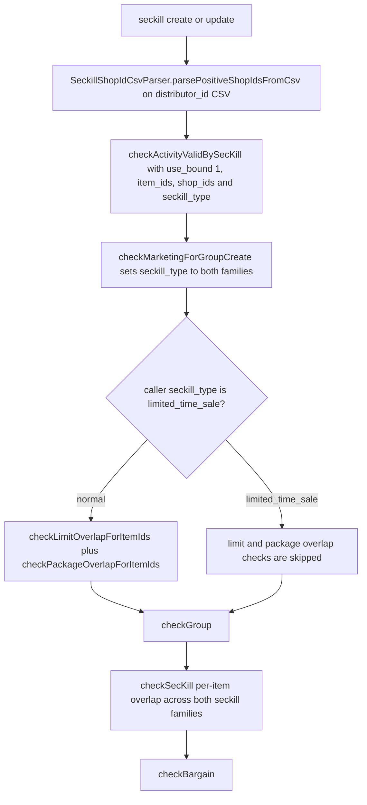
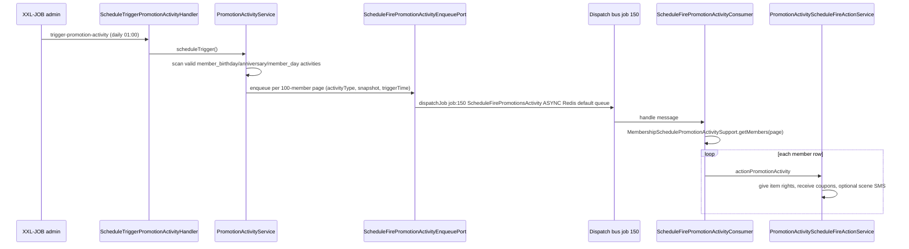
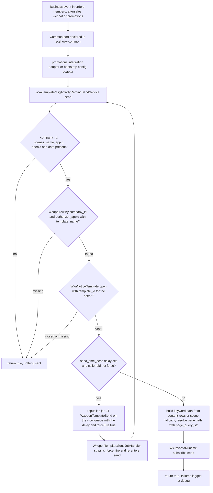
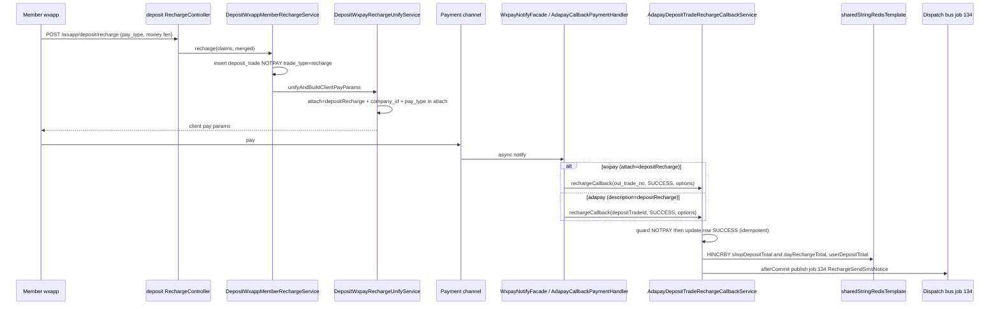
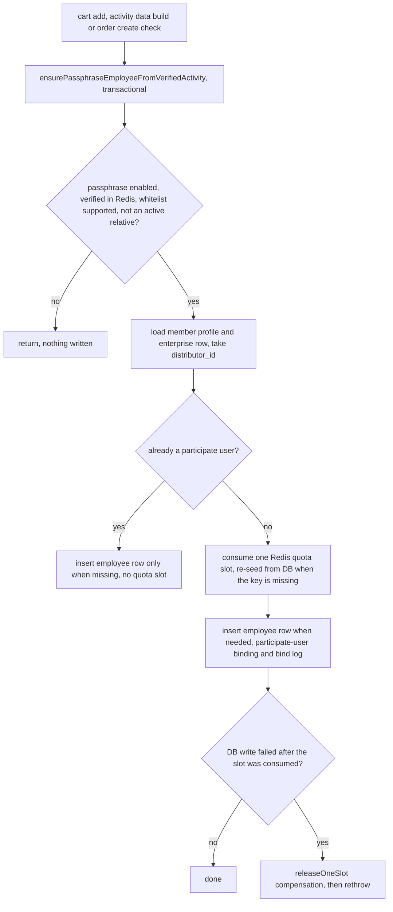

# Marketing and Loyalty Domains

Six bundles own everything that makes a member spend, return and stay: **`ecshopx-promotions`** (营销与促销活动域) runs marketing activities, seckill, group-buying, turntable, bargain, member sign-in, SMS template sends and — as a service to the whole reactor — the central WeChat mini-program subscribe-message sender and the merchant lifecycle SMS notice jobs; **`ecshopx-kaquan`** (卡券域) owns coupons / discount cards / exchange cards / VIP membercard grades; **`ecshopx-point`** (积分域) keeps the member point ledger; **`ecshopx-pointsmall`** (积分商城域) is the point-mall item catalog; **`ecshopx-deposit`** (储值域) keeps the stored-value ledger; **`ecshopx-employee-purchase`** (员工内购域) runs internal-purchase activities with per-item limits and passphrases. Each bundle follows the standard split ([Bundle Layering](../architecture/bundle-layering.md)): `api/admin/v1` + `api/front/v1` controllers, `service/` orchestration, `dispatch/` job handlers and event listeners, `cron/` XXL-JOB handlers, `integration/` port impls for other bundles, `domain/` + `mapper/` persistence. Dispatch publishers are interfaces in `ecshopx-common` (e.g. `KaquanDispatchEventNames`, `PromotionsDispatchJobNames`, `PointBundleDispatchJobNames`, `DepositDispatchJobNames`) with the `DispatchFacade`-backed implementations in `ecshopx-bootstrap/config` — the standard cross-bundle wiring ([Cross-Bundle Communication](../architecture/cross-bundle-communication.md), [Dispatch Bus](../concepts/dispatch-bus.md)).

The bundles meet the order domain at two places documented on the order-payment-flow page: **pay success / doPayment** (points deducted or deposit consumed at `OrdersPaymentDoPaymentService`) and **trade finish** (the `event:291/292:OrdersBundle\Events\TradeFinishEvent` fan-out, where kaquan consumes used coupons and orders register order-bonus points on a later cron).

## ecshopx-promotions — marketing activities, seckill, group-buying, turntable, bargain

### What it owns

The `marketing_activity` table (`MarketingActivity`, 满减满折 full-reduction / full-discount rules with `discount_config` JSON, `marketing_type`, `use_bound` scope, `begin_time`/`end_time`, `status`) plus its item/gift/category satellites; the automated member-marketing `promotion_activity` table (`PromotionActivity`) for the five schedule types — `member_birthday`, `member_anniversary`, `member_day`, `member_upgrade`, `member_vip_upgrade`; seckill activities (`SeckillActivityCreateService`, guarded by `MarketingActivityCrossPromotionGuardService`); group-buying (`PromotionGroupsActivityCreateService`, `PromotionGroupsTeamService`); turntable lucky-draw (`TurntableScheduleService`, `TurntableDrawRecoverService`); bargain (`UserBargainCreateBargainLogService`); specific-crowd discounts; package promotions; member sign-in; SMS templates (`SmsController`, `AliTemplateController`, `WxaTemplateController`). It also owns the **WXA notice-template catalog** — `promotions_notice_template` (`WxaNoticeTemplate`: `template_name`, `scenes_name`, `template_id`, `content`, `is_open`, `send_time_desc`) seeded from the 13 scene definitions in `WxaTemplateSceneDefinitions` — and therefore the central WXA subscribe sender described below, which every other bundle's member-notify port funnels into.

### Admin/front REST

21 admin controllers — central is `MarketingActivityController` (`POST /marketing/create`, `DELETE /marketing/delete`, `PUT /marketing/update`, `GET /marketing/getlist|getinfo|getItemList`), plus `ActivityPromotionsController` (the automated member-marketing activities), `GivePromotionsController` (manual coupon give), `SeckillActivityController`, `PromotionGroupsActivityController`, `TurntableController`, `BargainPromotionsController`, `LimitPromotionsController`, `PackagePromotionsController`, `SpecificCrowdDiscountController`, `MemberSignInController` / `CheckInController`, `RegisterPromotionsController` (registration gift), `ExtraPointActivityController` / `ExtraPointActivityPutController`, `PointupvaluationActivityController`, `RecommendLikeController`, `RegisterController`, `SmsController`, `AliTemplateController` (`/api/v1/ali/notice`) and `WxaTemplateController` (`/api/v1/wxa/notice/templates` — lists and opens the WXA notice scenes). 15 front controllers under `/api/v1/h5app/wxapp/...` serve the member-facing activity, seckill, group, turntable, bargain, sign-in and template-message surfaces.

### The create/update pipeline and its post-commit fan-out

`MarketingActivityCreatePersistenceService.createInTransaction` is the reference flow for every marketing-activity write: inside one `@Transactional`, it inserts the row, writes multi-language shards, inserts `use_bound=2` category rows, writes item/gift rels, publishes `job:143:…SavePromotionItemTag` through `SavePromotionItemTagJobDispatchPublisher`, then registers a `TransactionSynchronization.afterCommit` that (a) publishes the salesperson item-shelves dispatch job (`SalespersonItemsShelvesJobDispatchPublisher`) and (b) fires the Spring `MarketingActivityCommittedEvent`. `MarketingActivityCommittedEventListener` consumes it with `@Async @EventListener` and re-dispatches the shelves/tag jobs through `MarketingActivityPostCommitJobsService` (the event carries the `dispatchSalespersonItemsShelves` flag; group-done and seckill-end call the same service with activity types `group` / `seckill` / `limited_time_sale`). The physical delete branch of `MarketingActivityDeleteService` (only `status=waiting` activities may be hard-deleted) mirrors the same after-commit shelves+event pair.

### Seckill create/update and the cross-promotion conflict guard

`SeckillActivityController` (`@AdminAuth @ShopLog @Activated` on the routes, base `/api/v1/promotions/seckillactivity`) merges query + JSON body, forces `company_id` / `source_id` / `source_type` from the operator JWT and normalizes `distributor_id` (list → CSV, then query param → activated-route attribute → JWT distributor id) before calling `SeckillActivityCreateService.createSeckillActivity` / `updateSeckillActivity`, both `@Transactional`. `validateSeckillItemsForAdminWrite` first enforces per-row `item_id` / `item_title` / `activity_price` / `activity_store`, ordered distinct positive item ids, no gift SKUs (`MarketingActivityCatalogAccess.anyGiftItem` — the goods-bundle port that keeps promotions free of a Maven dependency on goods), positive price and `limit_num`, and — only for `seckill_type=normal` — a positive `activity_store`. Then the conflict guard runs, the flow every seckill write shares:

Caption: the seckill conflict guard — the type split only gates the purchase-limit and package overlap checks; the marketing, group, seckill and bargain checks always run.

* **Shop scope parsing** — `SeckillShopIdCsvParser.parsePositiveShopIdsFromCsv` splits the `distributor_id` CSV, trims each segment and silently drops blank, unparsable and non-positive values; the survivors become the guard's `shop_ids`.
* **Guard params** — `company_id`, `start_time`, `end_time`, `use_bound=1`, `shop_ids`, `source_id`, `item_ids`, `seckill_type`; the **update path additionally passes `exclude_seckill_id`** so the row being edited is excluded from the seckill-overlap query.
* **`limited_time_sale` skips the limit and package checks** — `checkActivityValidBySecKill` computes `limited = "limited_time_sale".equals(seckill_type)` and runs `checkLimitOverlapForItemIds` (`相同时间内不能重复商品限购活动:<item name>`) and `checkPackageOverlapForItemIds` (`相同时间内已经存在组合商品促销`) only for non-limited types, so a limited-time sale may share items with purchase-limit and package promotions.
* **Same-shop overlap is allowed, item overlap is not** — the guard's only shop-level seckill rejection is `checkSecKill`'s `use_bound=0` (whole-store) branch (an existing activity whose `source_id` equals the new one, or whose `distributor_id` CSV contains it), and the seckill write path never enters it because it always guards with `use_bound=1`. A second `limited_time_sale` activity on the same shop in an overlapping window therefore succeeds, while per-item overlap still rejects across **both** seckill families: `checkMarketingForGroupCreate` rewrites the params' `seckill_type` to the list `["normal","limited_time_sale"]` (which is also what `checkSecKill`'s list-typed filter reads — the caller's single type string only feeds the `limited` decision), existing item ids are resolved from non-disabled `seckill_rel_goods` rows, and an intersection throws `相同时间内已经存在限时秒杀：<names>` / `相同时间内已经存在限时特惠：<names>` (type names 限时秒杀 for `normal`, 限时特惠 for `limited_time_sale`). `checkMarketingForGroupCreate`, `checkGroup` (`相同时间内已经存在团购活动`), `checkSecKill` and `checkBargain` (`相同时间内已经存在助力砍价活动`) all run for both types. The relaxation is scoped to seckill-vs-seckill: the marketing-overlap check still rejects a seckill whose items are already bound to an overlapping `promotions_marketing_activity` (types `full_discount` / `full_minus` / `full_gift` / `self_select` / `plus_price_buy` / `member_preference`) when `source_id` matches or the shop-id sets intersect — that shop mutex survives for both seckill families. `SeckillActivityCreateServiceLimitedTimeSaleShopOverlapTest` pins the create and update variants: with an overlapping same-shop `limited_time_sale` activity present, neither write rejects, and the guard is still invoked so the per-item guard stays wired.
* **Update-only status gate** — a `normal` seckill may only be edited while its computed lifecycle status is `waiting` (`waiting` → `in_the_notice` → `in_sale` → `it_has_ended`, derived from release/start/end times and `disabled`); `limited_time_sale` updates are never status-gated.

After the guard passes, persistence writes the `seckill_activity` row (`distributor_id` stored wrapped as `,id,id,`), multi-language shards and a wholesale `seckill_rel_goods` replacement. The per-item Redis activity store `seckillActivityItemStore:<companyId>:<seckillId>` (hash field `store_<itemId>`) is written **only for `normal`** — a limited-time sale keeps no activity-store counter — and expires at `activity_end_time + 1 day`. `job:143:…SavePromotionItemTag` is published in-transaction (slow queue, ASYNC/REDIS) with the seckill type, item ids and activity prices, and the after-commit pair publishes `SalespersonItemsShelvesJobDispatchPublisher.publish(companyId, seckillId, "seckill" | "limited_time_sale")` plus the Spring `SeckillActivityCommittedEvent` (its after-commit listener is currently a logging placeholder). `PUT /updatestatus` disables the activity and rel rows, deletes the matching `promotions_items_tag` rows and publishes `SeckillActivityEndCommittedEvent`, whose `@TransactionalEventListener(AFTER_COMMIT)` handler calls `MarketingActivityPostCommitJobsService.enqueueSeckillEndSalespersonItemsShelves`.

`MarketingActivityCrossPromotionGuardService` is the single conflict authority for the whole activity family, not just seckill: `checkActivityValidByMarketing` (marketing create/update), `checkActivityValidByGroup`, `checkActivityValidByBargain`, `checkActivityValidByLimit`, `checkActivityValidByPackage`, the `member_preference` pair (`在相同时段内，同一个商品只能参加一个活动`) and the seckill item-search pair. Every check shares the window convention `overlapStart = max(start_time, now)` — windows that have already ended never conflict — and the `use_bound` axis (0 whole store, 1 items, 2 categories, 3 tags, 4 brands) selects which overlap test applies; the marketing-overlap check additionally mutexes on `source_id` equality or shop-id intersection and throws `相同时间内不能重复<promotion_tag>活动:<marketing_name>`, skipping the row being edited via `marketing_id`. Each entry point also scopes which seckill families it conflicts with: group and bargain writes set `seckill_type=["normal","limited_time_sale"]`, marketing writes the same except `member_preference` (normal only), while **limit and package writes set `seckill_type=["normal"]`** — purchase-limit and package promotions never collide with limited-time sales in either direction. The admin item search `GET /api/v1/promotions/seckillactivity/search/items` (`SeckillActivitySearchItemsService`) runs the same guard per candidate item with the same CSV-parsed shop ids, catches the `ResourceException` and splits rows into `validItems` / `invalidItems`, passing `exclude_seckill_id` — or `marketing_id` when a `marketing_type` filter is present — so items already bound to the edited activity stay selectable.

### The schedule-fire job chain

Caption: the daily member-marketing chain — the cron handler only enqueues paged `job:150` messages; the heavy per-member work runs on the dispatch bus.

`PromotionActivityService.scheduleTrigger` iterates the three *schedule* types only (it explicitly `continue`s `member_upgrade` / `member_vip_upgrade` — those are event-driven, see below), pages valid activities 50 at a time, and for each activity that passes `MembershipSchedulePromotionActivitySupport.isTrigger` counts members and enqueues one `ScheduleFirePromotionActivityMessage` per 100-member page through `ScheduleFirePromotionActivityEnqueuePort` (impl `ScheduleFirePromotionActivityDispatchPublisherImpl`, ASYNC/REDIS/default queue, job name `job:150:PromotionsBundle\Jobs\ScheduleFirePromotionsActivity`). `ScheduleFirePromotionsActivityJobHandler` (registered by `ScheduleFirePromotionActivityJobRegistrationConfig`) rebuilds the message and delegates to `ScheduleFirePromotionActivityConsumer.handle`, which pages the members again and calls `PromotionActivityScheduleFireActionService.actionPromotionActivity` per row — giving item rights through `AdminManualRightsAddByItemPort` (goods bundle), coupons through kaquan's `UserDiscountReceiveCardService`, and optional scene SMS, each failure swallowed at debug level. `job:151:…ScheduleGivePromotionsActivity` is the admin-initiated sibling: `ScheduleGivePromotionsActivityJobHandler` → `PromotionActivityGiveAsyncService.executeScheduleGive` for explicit per-user coupon gives.

The two *upgrade* types arrive from member-grade transitions instead of the scan:

* **`member_vip_upgrade`** — `VipGradeSalePaidCompletionService.completeSaleOrderAfterTradePaid` (kaquan, called from `VipGradeMembercardTradePaidPortImpl` when a membercard trade succeeds) transitions the `vip_grade_order` NOTPAY→DONE, applies the member grade relation, records the day's `MemberCard:<companyId>:<vipType>:<dateYmd>` Redis set (companys DB), then publishes `FirePromotionsActivityDispatchPublisher.publish(companyId, memberInfo, "member_vip_upgrade")`.
* **`member_upgrade`** — the orders side (`MemberConsumptionOnNormalOrderFinishService.updateMemberConsumptionIfNotPointPay`) accumulates a member's total consumption after order finish, walks the membercard grade thresholds from the top, promotes `members.grade_id`, and after commit publishes `publishMemberUpgradeAfterOrderConsumption`, which the bootstrap impl dispatches as `job:187:…FirePromotionsActivity` (same handler as `job:5`, distinct bus message name). Skipped when pay type is `point`, when the OEM-Shuyun flag is set, or when DM CRM integration is open.

Both land in `FirePromotionsActivityJobHandler` → `PromotionActivityFireService.fire(companyId, memberInfo, activityType)` → `actionPromotionActivity` per matching activity. Failures inside the handler are logged and swallowed (the job message is not retried).

### Cron handlers (all follow the alert-and-rethrow template)

| `@XxlJob` name | handler | purpose | seeded job row |
| --- | --- | --- | --- |
| `trigger-promotion-activity` | `ScheduleTriggerPromotionActivityHandler` | enqueue `job:150` pages (above) | yes (id 29, daily 01:00) |
| `invalid-promotion-activity` | `ScheduleInvalidPromotionActivityHandler` | bulk-expire ended `promotion_activity` rows (`activityInvalid`) | yes (id 28) |
| `done-group` | `ScheduleDoneGroupHandler` | auto-complete groups with all members paid (`scheduleAutoDoneGroup`) | yes (id 8) |
| `done-nostore-group` | `ScheduleDoneNoStoreGroupHandler` | complete groups whose activity store hit zero (`scheduleNoStoreAutoDoneGroup`) | yes (id 9) |
| `fail-group` | `ScheduleFailGroupHandler` | dissolve paid-but-unfinished groups | yes (id 7) |
| `expire-specific-crowd-discount` | `ScheduleExpireSpecificCrowdDiscountHandler` | expire specific-crowd discounts | yes (id 13, every 5 min) |
| `expire-crowd-month` | `ScheduleExpiredPromotionMonthHandler` | roll natural-month cycle windows for crowd discounts | yes (id 52, monthly) |
| `clear-turntable-times-over` | `ScheduleClearTurntableTimesOverHandler` | delete turntable draw-count Redis keys at activity end | yes (id 51) |
| `recover-turntable-processing` | `ScheduleRecoverTurntableProcessingHandler` | recover turntable draws stuck in processing for 60 s (`TurntableDrawRecoverService.recoverStuck`) | **no seed row — create in the XXL-JOB console or it never fires** |

Every handler logs cost, publishes `CronAlertEvent` on failure and rethrows ([Scheduling](../concepts/scheduling-xxljob.md)). The group/seckill auto-cancel crons themselves (`cancel-group-orders`, `cancel-service-group-orders`, `cancel-seckill-orders`) live in the orders bundle.

### Dispatch listeners (member lifecycle)

`EVENT_CREATE_MEMBER_SUCCESS` (`event:members:create_member_success`) fans out to three promotions listeners registered in bootstrap (`PromotionsCreateMemberSuccessDispatchListenerRegistrationConfig` etc.): `CreateMemberSuccessPromotionsDispatchListener` (gated on `if_register_promotion` → `CreateMemberSuccessRegisterPromotionExecutionService.executionMarketingAfterMemberCreate`), `CreateMemberSuccessRegisterPointDispatchListener` (listener name `listener:members.register_point` → point bundle registration gift) and `CreateMemberSuccessSendMembercardDispatchListener` (kaquan membercard). `CreateItemSuccessPromotionsDispatchListener` and `ItemTagEditSuccessPromotionsDispatchListener` react to goods item-create/tag-edit events to maintain promotion indexes; `BargainHelpPayTradeFinishDispatchListener` reacts to trade finish to finish a bargain. All use `ListenerDispatchOptions.asyncDefaults()` (default queue).

### WXA subscribe messaging — the central sender owned by promotions

`WxaTemplateMsgActivityRemindSendService` (promotions `service/`) is the **single** WeChat mini-program subscribe-message sender for the reactor. No other bundle talks to the WeChat subscribe API: each declares a port in `ecshopx-common/port/<domain>`, promotions (or bootstrap) implements it, and every implementation funnels into this one service. The full pipeline of `send(Map<String, Object> wxopenTemplatePayload, boolean forceFire)`:

Caption: the central WXA subscribe pipeline — every skip is a silent success, and the delay branch round-trips through dispatch job 11 so the delayed attempt always fires.

* **Payload contract** — required keys `company_id`, `scenes_name`, `appid` (the authorizer appid), `openid` and a non-empty `data` map; a missing or empty field is a silent skip.
* **Weapp resolution** — the `wechat_weapp` row (`Weapp`, keyed by `authorizer_appid`) is looked up by `(company_id, authorizer_appid)` and must carry a `template_name` (e.g. `yykweishop`, `appleweishop`, `yykmendian`); the template name ties that mini-program to a template family and is what joins the notice template.
* **Template gating** — the `promotions_notice_template` row (`WxaNoticeTemplate`) by `(company_id, scenes_name, template_name)` must exist with `is_open=true` **and** a non-blank `template_id`; otherwise the send is skipped. The 13 scenes registered in `WxaTemplateSceneDefinitions` are `memberCreateSucc`, `paymentSucc`, `reservationRemind` / `reservationSucc`, `payOrdersRemind`, `orderDeliverySucc`, `aftersalesRefuse` / `aftersalesSuccess`, `userGetCardSucc`, `registrationResultNotice`, `registrationActivityNotice`, `goodsArrivalNotice` and `member_signin_reminder`, each carrying its keyword rows, allowed template names and `send_time_desc` default. The admin `WxaTemplateController` (`GET / PUT /api/v1/wxa/notice/templates`) materializes a closed row per scene on first list (reading any cached `template_id` from the Redis template library) and `openWxaTemplate` flips `is_open` plus the `send_time` config — that is the operations surface for every scene below.
* **Delay unless forced** — `send_time_desc` holds `{"value": <minutes>}`; when it is positive and the caller did not set `forceFire`, the payload is re-published through `WxopenTemplateSendDispatchPublisher` as `job:11:PromotionsBundle\Jobs\WxopenTemplateSend` (ASYNC/REDIS, **slow** queue, delay carried in the `DispatchOptions`; the bootstrap impl wraps `is_force_fire=true` so the delayed attempt always fires). `WxopenTemplateSendJobHandler` strips the `is_force_fire` wrapper and re-invokes `send`. `AftersalesSuccessSendMsgJobService` (aftersales, scene `aftersalesSuccess`, the 退货回寄提醒) and `TradeFinishWxaTemplateWaitingDeliveryDispatchService` (orders, `paymentSucc`) are the canonical non-forced callers — that is why the aftersales progress notice waits the configured minutes before reaching the member.
* **Scene-specific guard** — only `payOrdersRemind` has one: `checkSendAllowed` requires a non-blank `data.order_id`.
* **Content rows** — the template's `content` JSON array is used when it parses and contains modern `keyword` rows; otherwise the scene definition's `valueAsMaps` fallback (unknown scene → empty → skip). Per row the value comes from the row's preset (with `{column}` placeholder substitution against the payload data) or straight from `dataValues[column]`, and `thing*` keyword values are truncated to 20 code points (17 + `...`).
* **Page path** — `registrationActivityNotice` → `marketing/pages/member/activity-detail`, `aftersalesSuccess` → `order/pages/aftersales/detail`, `member_signin_reminder` → `subpages/member/sign-in/index`, anything else → `pages/index`; a non-blank `page_query_str` from the payload is appended after `?` (e.g. `record_id=99` for registration reminders, `id=<itemId>` for goods-arrival).
* **Terminal send** — `WxJavaMaRuntime.ma(authorizerAppid)` resolves the access token (direct-secret mini-programs from `wechat_auth`, open-platform authorizers via `WechatOpenPlatformAuthorizerTokenService`) and posts `{touser, template_id, page, data}` to `WxMaApiUrlConstants.Subscribe.SUBSCRIBE_MSG_SEND_URL`; a non-zero `errcode` is logged at debug and ignored.
* **Tolerant by contract** — the whole method catches `RuntimeException`, logs at debug and returns `true` (mirroring the legacy PHP notifier): a broken template, missing Weapp row, serialize error or WeChat outage never fails the business flow that triggered the notice.

<!-- openwiki: broken internal link [../workflows/member-notify-fanout.md] file "../workflows/member-notify-fanout.md" does not exist. Fix the href or restore the target, then delete this comment. -->
**Who funnels in.** Promotions `integration/` implements other bundles' common ports: `OrderDeliverySuccessWxaSubscribeSendAdapter` (orders `orderDeliverySucc`, forced — built by `OrderDeliverySuccessNotifyWechatService`, which resolves the recipient via `OrderTradeMiniProgramRecipientLookupPort` and falls back to the order title for the item name, and which is swapped for `OrderDeliverySuccessNotifyNoOp` when `ecshopx.orders.delivery-success-notify.enabled=false`) and `TradeFinishPaymentSuccWxaSubscribeSendAdapter` (orders `paymentSucc`, delayed); `GoodsArrivalWxaSubscribeSendAdapter` (members `goodsArrivalNotice`, forced, built by `ItemStoreGoodsArrivalWxaTemplateOrchestrator` with `page_query_str id=<itemId>`); `AftersalesRefuseWxaSubscribeSendAdapter` (forced) and `AftersalesSuccessWxaSubscribeSendAdapter` (delayed). Four further adapters live in bootstrap `config/` because the implementation needs beans from several bundles: `MemberCreateSuccessWxaNoticePortAdapter` (`memberCreateSucc`, delayed), `ReservationFinishSuccWxaTemplatePortImpl` (delayed), `SendPayOrdersRemindWxaTemplatePortImpl` (`payOrdersRemind`, forced) and `WxaCardUsedTemplateSendPortImpl` — the `@Primary` impl of wechat's `WxaCardUsedTemplateSendPort` for scenes `userGetCardSucc` / `registrationResultNotice` (forced; `cardUsedSucc` is deliberately not in the scene definitions, and `WxaCardUsedTemplateSendNoOp` wins when `ecshopx.wechat.wxa-card-template-send.enabled=false`). Inside promotions, `MemberSignInReminderPushService` calls the sender directly for the daily sign-in reminder (scene `member_signin_reminder`, forced, armed through the delayed `job:member-signin-reminder-send` dispatch job and `MemberSigninReminderSendJobHandler`, which *rethrows* so the platform retry policy applies), and selfservice's `SendRegistrationWxRemindJobHandler` publishes `job:11` rows directly for `registrationActivityNotice` reminders (one per passed registration record, `page_query_str record_id=<id>`). The complete fan-out — every producer, port, toggle and the delayed path — is traced on the [Member and Merchant Notification Fan-out](../workflows/member-notify-fanout.md) page.

### Merchant lifecycle notice jobs — a cross-bundle placement

Four dispatch job handlers that send **merchant** lifecycle SMS live in promotions `dispatch/`, not in the merchant bundle — the merchant domain publishes the events, promotions owns the senders (the same "declaring bundle ≠ handling bundle" split as deposit's `job:134` recharge SMS, handled by promotions' `RechargeSendSmsNoticeJobHandler`). The job-name constants in `MerchantDispatchJobNames` still carry the PHP-era `MerchantBundle\Jobs\…` class names:

| job | handler | SMS scene | variables | published by |
| --- | --- | --- | --- | --- |
| `job:1:MerchantBundle\Jobs\MerchantAuditSuccessNotice` | `MerchantAuditSuccessNoticeJobHandler` | `merchant_audit_success_notice` | — | `MerchantSettlementApplyAuditService.auditSucc`, after inserting the merchant row and provisioning the main operator without a password |
| `job:2:MerchantBundle\Jobs\MerchantAuditFailNotice` | `MerchantAuditFailNoticeJobHandler` | `merchant_audit_fail_notice` | — | `MerchantSettlementApplyAuditService.auditFail` |
| `job:3:MerchantBundle\Jobs\MerchantEnterSuccessNotice` | `MerchantEnterSuccessNoticeJobHandler` | `merchant_enter_success_notice` | `password`, `phone` | `MerchantCreateService.createMerchant` when `settled_succ_sendsms=1`, after `createMainMerchantOperator` generates the password |
| `job:4:MerchantBundle\Jobs\MerchantResetPasswordNotice` | `MerchantResetPasswordNoticeJobHandler` | `merchant_reset_password_notice` | `password` | `MerchantOperatorController` after `MerchantOperatorPasswordResetPort.resetForMerchantConsole` |

The bootstrap publisher impls (`MerchantAuditSuccessNoticeDispatchPublisherImpl` and siblings) publish ASYNC/REDIS on the **`sms`** queue with payload `company_id` + `mobile` (plus `password` for jobs 3/4), and the matching `Merchant*NoticeJobRegistrationConfig` classes register the promotions handlers on the dispatch registry. Each handler reads `company_id` and `mobile`, and delegates to `CompanySceneSmsSendPort.sendSceneTemplatedSms` — the port declared in companys whose `@Primary` implementation is `AliyunCompanySceneSmsSendAdapter` (ecshopx-aliyunsms): it resolves the company's Aliyun access key, the `scene` row by `scene_title`, an active `scene_item`, the approved template and sign, filters the template variables, invokes Aliyun `SendSms` and records the send in `record`. Every configuration gap throws a `ResourceException` (短信通道未启用 / 短信场景未配置:\<scene\> / 短信模板未审核通过或未配置 …), and the promotions handlers catch it, log at `warn` with a **masked mobile** (`****` plus the last four digits) and never rethrow — the dispatch bus acks, so a failed merchant SMS is lost rather than retried (at-most-once, in contrast to the sign-in reminder handler above).

## ecshopx-kaquan — coupons, cards, membercards

### What it owns

`discount_cards` (the coupon/card master, `DiscountCards`) with `rel_items` / `rel_member_tags` / `wechat_rel_card` satellites and multi-language shards; `user_discount` (the member-held instances, `UserDiscount`) with status lifecycle; VIP membercard grades (`vip_grade`, `vip_grade_order`, `vip_grade_rel_user`, `vip_grade_sale`); card packages. Card types include standard cash/discount coupons (`card_type=normal`), new-gift cards (`card_type=new_gift`, `kq_status=10` initial), exchange cards (兑换券) that lock item stock, and membercards.

### Admin/front REST

`DiscountCardController` (admin, `@AdminAuth @ShopLog @Activated`, `/api/v1`): `POST /discountcard` (add — routes `new_gift` to `DiscountNewGiftCardCreateService`, everything else through `DiscountCardDoParamsService` to `DiscountStandardCardCreateService`), `DELETE /discountcard` (`DiscountCardDeleteFacadeService`), `PATCH /discountcard` (update), `GET /discountcard/get|list|listdata`, `/effectiveDiscountcard/list`, `POST /discountcard/updatestore|couponGrantSetting|consume` (exchange-card verification), `POST /discountcard/uploadToWechat`. Siblings: `UserDiscountController` (member-held lists, give), `MemberCardController`, `VipGradeController` (grades CRUD), `PackageController`, `DiscountCardDetailController`. Front: `DiscountCardController` / `UserDiscountController` / `VipGradeController` under `/api/v1/h5app/wxapp/...` serve receive/list/available-coupon surfaces.

### Coupon lifecycle events — youshu fan-out and DM card-template sync

The seed instruction's headline flow. `KaquanDispatchEventNames` defines five bus names: `event:283:KaquanBundle\Events\CouponAddEvent` (standard add), `event:284` (new-gift add, same PHP class, distinct message name), `event:285` (standard edit), `event:286` (new-gift edit), `event:287:…\CouponDeleteEvent`; the shared listener name is `listener:YoushuBundle\Listeners\Coupon`.

Publishers (all after-commit, payload `card_id` + `company_id`):

| event | published by | after-commit hook |
| --- | --- | --- |
| 283 / 284 add | `DiscountStandardCardCreateService.createKaquan` / `DiscountNewGiftCardCreateService.createKaquan` | `TransactionSynchronization.afterCommit` → `CouponAddEventDispatchPublisher.publish` |
| 285 / 286 edit | `DiscountStandardCardUpdateService.updateKaquan` / `DiscountNewGiftCardUpdateService` | same pattern → `CouponEditEventDispatchPublisher.publish` |
| 287 delete | `DiscountCardDeleteFacadeService.deleteDiscountCard` | after deleting `discount_cards` + `rel_items` in a `TransactionTemplate`, after-commit removes any `wechat_rel_card` mapping (calling the WeChat open-platform card delete) and publishes `CouponDeleteEventDispatchPublisher.publish` |

The bootstrap impls (`CouponAddEventDispatchPublisherImpl` etc.) publish ASYNC/REDIS with platform-default retry. Listener wiring lives in three bootstrap `@Configuration` classes: `YoushuCouponAddDispatchListenerRegistrationConfig` (`@Order(77)`), `YoushuCouponEditDispatchListenerRegistrationConfig` (`@Order(78)`) and `YoushuCouponDeleteDispatchListenerRegistrationConfig` (`@Order(79)`), each registering the shared youshu listener (`YoushuCouponAddDispatchListener` / edit / delete) on **both** the standard and new-gift message names with `ListenerDispatchOptions.async("default", null)`. The youshu listeners parse `card_id`/`company_id` and call `YoushuCouponAddSrDataSyncService.syncAfterCouponAdd` (edit/delete have the mirror services) — these SrData sync bodies are deliberately reserved (guard clause only) until the youshu integration contract is wired, so today the fan-out is transport-complete but business-inert.

The second leg is **inbound DM card-template sync**. `DmMessageNotifyWebhookService` (ecshopx-third-party, webhook entry) whitelists topics `sync_card_template_create|modify|delete`, normalizes split `topic=card` + `event=cardTemplateModify` envelopes, resolves `authorizer_appid` from body or `Authorizer-Appid` header, and forwards to `DmCardTemplateMessageNotifyKaquanPort` — implemented by kaquan's `DmCardTemplateMessageNotifyKaquanAdapter`, which extracts the inner `content`/`postdata` payload, applies standard-card defaults (`card_type=normal`, `coupon_type=cash`, title `dm-template` …), and dispatches: create → `DiscountStandardCardCreateService.createKaquan` (which therefore publishes the add event after commit), modify → `DiscountStandardCardUpdateService.updateKaquan` (no existing card = logged no-op), delete → `DiscountCardDeleteFacadeService.deleteDiscountCard(postdata, companyId, appid, checkUserReceived=false)` — the DM path deliberately skips the "already received by members" guard so template deletions propagate even after issuance. `CouponAddDmTemplateAsyncBusDispatchFlowTest` and the adapter probe tests pin this DM-create→283→youshu chain end to end.

`DiscountCardDeleteFacadeService.deleteDiscountCard` itself has two callers: the admin REST route (via `checkUserReceived=true`, refusing with `删除优惠券失败,已有会员领取` when any `user_discount` row exists) and the DM adapter (`false`).

### Trade-finish coupon consumption

`TradeFinishConsumeCardDispatchListener` (kaquan, registered in bootstrap `TradeFinishConsumeCardDispatchListenerRegistrationConfig` `@Order(85)` under listener name `listener:kaquan.trade_finish_consume_card_pay_bill`) listens to **both** trade-finish planes — `event:291:OrdersBundle\Events\TradeFinishEvent` (pay-channel notify) and `event:292` (admin offline bank-transfer approval) — with `asyncDefaults()`. The listener short-circuits when `pay_type` is missing, `point` or `deposit` (case-insensitive) — those pay types never consume coupons at trade finish; the same guard is repeated inside `TradeFinishConsumeCardBusService.onTradeFinishTradeRow`, which then parses `discount_info` coupon codes from the trade payload and calls `UserDiscountConsumCardService.consumeCouponForTradeFinishPayBill` per code: reload the `user_discount` row by `(company_id, code, user_id)`, load the card detail and shop scope, `assertUserCardConsumable`, increment salesperson coupon statistics, update the card to used (`userConsumeCardUpdate`), write the consume log and send the template message — each code's failure is caught and logged (one bad code does not abort the rest). See the order-payment-flow page for the full trade-finish fan-out.

### VIP membercard purchase and expiry

`VipGradeOrderBuyCreateService.createDataForBuy` writes a `vip_grade_order` row (`order_status=NOTPAY`, `source_type=sale`) plus an `order_associations` row (`order_type=memberCard`) — the trade then flows through the normal payment rails (`VipGradeMembercardWxpayPaymentService` / `VipGradeMembercardAdapayPaymentService` / alipay-mini), and on trade success `OrdersPaymentDoPaymentService` invokes `VipGradeMembercardTradePaidPort` → `VipGradeSalePaidCompletionService` (above). Delayed/batch activation goes through `VipGradeBatchActiveDelayService`. Cron `cancel-expired-card` (`ScheduleCancelExpiredCardHandler`, seeded job id 12) releases expired exchange-card-locked item stock: `UserDiscountService.scheduleCancelExCard` pages up to 5×200 locked (`status=10`) cards, and per card in a `REQUIRES_NEW` transaction restores the item store through `ExcardInventoryPort.minusItemStore(-1)` (return value deliberately unchecked, PHP-parity) and resets the card to `status=1` with cleared rel ids.

## ecshopx-point — the member point ledger

### What it owns

`point_member` (one row per member+company, integer point balance) and `point_member_log` (append-only journal). `PointMemberJournalTypeDescriptions` is the canonical 18-type journal map: 1 注册赠送 (register gift), 2 邀请注册赠送, 3 充值赠送, 4 储值兑换 (deposit exchange), 5 积分换购 (point exchange purchase), 6 消费购物（支出）, 7 消费购物（获取）(order bonus), 8 会员等级返佣, 9 取消订单返还 (order-cancel return), 10 退款返还 (aftersales refund return), 11 大转盘 (turntable), 12 商家手动修改 (manual adjustment), 13 开放接口 (openapi), 14 分销佣金（积分）, 15 商家导入修改, 16 活动报名送积分, 17 会员签到日常积分, 18 会员签到活动奖励.

### PointMemberAddPointService — the single ledger entry

Every point movement goes through `PointMemberAddPointService`'s typed public methods (`addPointForManualAdjustment`, `addPointForMemberImport`, `addPointForOpenapi`, `addPointForPopularizeSettle`, `addPointForSelfserviceRegistration`, `addPointForMemberSignInDaily` / `...ActivityTier`, `addPointForMemberRegisterGift`, `addPointForTurntableWin` / `...DrawCost`, `addPointForNormalOrderBonus`, `addPointForOrderCancelReturn`, `addPointForAftersalesRefund`, `addPointForDepositExchange*`), each `@Transactional` and each writing one journal row with the matching type. Three external integrations are consulted in order of precedence:

1. **DM CRM** (`DmCrmSettingReadPort.isPointIntegrationOpen`) — when open, point changes are pushed to DM (e.g. `DmCrmManualPointChangePort.changePoint` with change type `1140` and `integralFlow` idempotency key) *instead of* the local ledger, unless…
2. **Shuyun OPEN platform** (`ShuyunOpenPlatformPointPort.isOpenPlatformPointEnabled`) — when enabled it wins over DM (`shouldUseDmPointIntegration` is DM-open **and not** OPEN-enabled), and point.change is called *first* (对齐 PHP「先网关后本地」); on deductions a successful gateway call skips the local balance gate.
3. Otherwise the local ledger: `pointMemberMapper.addPointDelta`, then a `PointMemberLog` insert, then optional `maybePushShuyunPoint` (the OEM flag `ecshopx.request-field.oem-shuyun` gates the Shuyun member-point sync).

Callers live across the reactor: orders (`OrdersPaymentDoPaymentService` deducts with `addPointForManualAdjustment(…, plus=false, "订单N支付扣减积分")` for point pay — except `normal_pointsmall` trades whose points were already deducted at order create), promotions (sign-in, turntable win/cost, registration activity), aftersales refund returns, deposit exchange (`WxappDepositToPointService`), pointsmall order-cancel returns (below), distribution commission settle, and the openapi surface.

### The send-member-point cron

`ScheduleSendMemberPointHandler` (`send-member-point`, seeded job id 21, daily 00:00) does not run the batch itself — it enqueues `job:90:PointBundle\Jobs\SendMemberPointJob` on the **slow** queue (empty payload, ASYNC/REDIS; impl `SendMemberPointJobDispatchPublisherImpl`, registration `SendMemberPointJobRegistrationConfig`). `SendMemberPointJobHandler` then runs `PointMemberService.scheduleSendMemberPoint` synchronously: page 100 pending orders at a time (`countSendPointPendingOrders` / `listSendPointPendingOrders`), load each company's point rule once, skip orders with an open aftersales (they still get `point=0` with mark `存在售后状态的订单，无法获取积分` so they are marked done), compute the bonus either by per-item point access (`access=items`) or order-ratio (`include_freight` decides whether freight joins the base), clamp against the **monthly** `gain_limit` using the month's income sum (`incomeSumForOrderBonusMonth`), call `addPointForNormalOrderBonus` (failures swallowed, order not marked), and finally `markOrderSendPointDone` (`send_point=1`) for the successes. The `gain_time` rule (default 7 days after `end_time`) delays eligibility so finished orders earn points only after the aftersales window.

## ecshopx-pointsmall — point-mall items

A catalog bundle, not an order bundle: `pointsmall_items` (`PointsmallItems`) carries the point-exchange price `point`, the payment mode `pay_class` (`point` pure-point, `online` online pay, `mix` both — default `point`), `default_item_id`/`is_default` SKU grouping, `store` mirrored into Redis as `pointsmall_item_store:<itemId>` (`PointsmallItemStoreRedisWriteService`, companys DB), validity date types, and tax/crossborder/pharma flags mirroring the goods schema. Admin controllers (`ItemsController`, `ExportItemsController`, `SettingController`) manage items, batch status/store, sort, templates and exports; front controllers serve the mall lists/detail/settings; `PointsmallItemsJushuitanPageQueryService` and `PointsmallNormalGoodsStoreEspierImportRowSink` bridge inventory sync and imports.

The **order lifecycle** for point-mall orders (`order_class=pointsmall`, `trade_source_type=normal_pointsmall`) is implemented in the orders bundle: create deducts the point cost at order time; `cancel-pointsmall-orders` (seeded job id 11, every minute) runs `PointsmallNormalOrderService.scheduleCancelOrders` — pages 20 unpaid (`NOTPAY`) pointsmall orders past `auto_cancel_time`, flips order + association rows to `CANCEL`, returns the deducted points via `addPointForOrderCancelReturn`, publishes order-process-log events, and restores item store through `PointsmallPartialCancelItemStorePort.minusItemStore`. Checkout does **not** apply cash-order point deduction to pointsmall orders (`NormalOrderPointDeductFormatter.applyIfNeeded` returns early), only a member-point-coverage check.

## ecshopx-deposit — stored value

### State model

`deposit_trade` (`DepositTrade`) is the ledger: `deposit_trade_id` (from `DepositTradeIdGenerator`), `trade_type` ∈ {`recharge`, `consume`, `refund`}, `trade_status` ∈ {`NOTPAY`, `SUCCESS`, …}, integer-fen `money` / `cur_pay_fee` with currency-exchange columns (`cur_fee_rate`, `cur_fee_symbol`, `cur_fee_type`) for multi-currency companies, `mobile` **encrypted** through `SensitiveFieldEncryptor`, `pay_type`, `bank_type`, `transaction_id`. Balances live in Redis (shared DB) with MySQL `user_deposit` as the fallback record: `userDepositTotal_<companyId>` hash (field `userId`) via `UserDepositBalanceReadService` (hash miss → MySQL row) and `UserDepositBalanceMutationService`; company-level `shopDepositTotal` hash and day counters `dayRechargeTotal<yyyy-MM-dd>` / `dayConsumeTotal<yyyy-MM-dd>`.

### Recharge flow

Caption: deposit recharge — front creates the NOTPAY trade, the channel callback marks SUCCESS and applies Redis balances in-transaction, the SMS notice is deferred to after-commit.

`DepositWxappMemberRechargeService.recharge` (front `POST /api/v1/h5app/wxapp/deposit/recharge`, `@FrontAuth` + Dingo) resolves the money in fen, optional matching `recharge_rule`, applies currency exchange when the company rate is non-zero, encrypts the mobile, inserts the `NOTPAY` recharge row, and — for wxpay-family channels — delegates to `DepositWxpayRechargeUnifyService.unifyAndBuildClientPayParams`, which calls the WeChat `pay/unifiedorder` endpoint (servicer mode supported) with the passback `attach` chain `company_id=…&pay_type=…&attach=depositRecharge`; non-wxpay channels return the trade info for the H5/alipay flows.

Callbacks converge on `AdapayDepositTradeRechargeCallbackService.rechargeCallback(depositTradeId, status, options)` (despite the name — the shared success processor):

* **wxpay**: `WxpayNotifyFacade` verifies the signature, checks `attach=depositRecharge` in the decoded return data, and routes to `AlipayNotifyDepositSidePort` (impl in the deposit bundle) → the shared callback service. Business-already-handled exceptions are swallowed so the channel gets `SUCCESS`.
* **adapay**: `AdapayCallbackPaymentHandler.succeeded` normalizes status, and routes `description=depositRecharge` payments to the deposit callback (everything else to the orders trade callback).
* **alipay**: the alipay notify/H5-sync facades carry the same deposit-side port.

The callback is `@Transactional`: it refuses missing rows, ignores non-SUCCESS, throws `更新已处理，不需要更新` when already SUCCESS (the idempotency guard), updates status + `bank_type` + `transaction_id` + `pay_type` + `time_expire`, then `addDepositToRedis` increments `shopDepositTotal`, `userDepositTotal` and the day-recharge counter, and — only when a mobile is present — schedules `RechargeSendSmsNoticeJobDispatchPublisher.publishRechargeSendSmsNotice` via `afterCommit` (or immediately when no transaction synchronization is active). `job:134:DepositBundle\Jobs\RechargeSendSmsNotice` is handled by promotions' `RechargeSendSmsNoticeJobHandler`, which reads the company balance from `shopDepositTotal` and sends the `deposit_recharge` templated SMS; failures are logged, not retried.

### Consume and refund

`DepositTradeConsumeService.consume` is called from `OrdersPaymentDoPaymentService` when `pay_type=deposit`: it inserts a `trade_type=consume, trade_status=SUCCESS` row (mobile encrypted, `cur_pay_fee` defaulting to the money fen), re-reads the balance and throws `余额不足，支付失败` when insufficient, then applies the negative delta to `userDepositTotal`, decrements `shopDepositTotal` and increments `dayConsumeTotal<date>` — note the Redis counters are mutated inside the method but are *not* transaction-aware, so a later MySQL rollback leaves them shifted (a deliberate PHP-parity trade-off; only the SMS publish in the recharge path is after-commit). Refunds flow through the orders bundle's `OrdersDepositOrderRefundService.refundOrderDeposit` (deposit-paid order refunds): a `trade_type=refund, trade_status=SUCCESS` row plus `addUserDepositTotal` — no day counters are touched on refund. `WxappDepositToPointService` converts deposit to points (journal type 4/3 pair). Admin `RechargeController` provides the recharge-rule and agreement management.

## ecshopx-employee-purchase — internal purchase

Activities (`activities`, `activity_items`, `activity_goods`, `activity_enterprises`, `employees`, `enterprises`, `relatives`, `orders_rel_activity`, `member_activity_items_aggregate`) with three purchase modes (`PurchaseModeSupport`: normal, prepaid point 预充点, and share-store) and two participation channels — enterprise-bound employees and the **passphrase** system. Key services:

* **Per-item limits** — `EmployeePurchaseItemLimitValidator.assertWithPreloadedData` is the single static validator (PHP parity): merges duplicate cart lines by first appearance, then per item rejects when per-person quantity or per-person fee limits (historical aggregates included) are exceeded (`商品购买数量已达限额` / `商品购买金额已达限额`), and rejects items not in the activity (`商品未参加内购活动`). Aggregates are maintained by `MemberActivityItemsAggregateService` / `MemberActivityAggregateService` under `EmployeePurchaseAggregateRedisLockService` setnx locks (deduct and restore share the same lock key per member, so concurrent order and cancel cannot interleave the running totals).
* **Order integration ports** (all in `integration/`, consumed by the orders bundle): `OrderCheckoutEmployeePurchaseCartPortImpl` / `OrderCreateEmployeePurchaseFormatPortImpl` / `OrderCreateEmployeePurchaseExtendPortImpl` (checkout and create), `EmployeePurchaseOrderCancelRestorePortImpl` (cancel/refund restore), `EmployeePurchasePrepaidAftersalesRestorePortImpl` (aftersales prepaid restore), `OrderDetailEmployeePurchaseEnrichmentPortImpl`, `WxappMemberEmployeePurchaseFlagsPortImpl`.
* **Cancel/refund restore is idempotent per transaction and per order.** `restoreInternal` guards with a `TransactionSynchronizationManager` resource so a `pass_refund` flow that runs cancel-restore and then refund-restore restores stock/limits/prepaid points only once; prepaid-point orders additionally persist `restored_prepaid_fee` for cross-request idempotency.
* **Events** — `NormalOrderPaySuccessEmployeePurchaseBehaviorLogDispatchListener` (registered in bootstrap on `event:288:…NormalOrderPaySuccessEvent`, listener `listener:employeepurchase.normal_order_pay_success_behavior_log`) records passphrase behavior logs on paid orders. Export fan-outs (`EmployeePurchaseActivityItemsExportDispatchPublisher` and siblings) run as file-type job handlers. The daily statistics crons (`employee-purchase-daily-statistic`, `employee-purchase-goods-daily-statistic`) live in the data-cube bundle.

### Passphrase participation — whitelist gate, Redis quota and compensating rollback

`EmployeePassphraseService.ensurePassphraseEmployeeFromVerifiedActivity` is `@Transactional(rollbackFor = Exception.class)` and is invoked from three places: cart add (`EmployeePurchaseCartAddService`), activity data build (`EmployeePurchaseActivityDataService.buildActivityData`, which soft-fails the `ResourceException` into an `extraTips` field and zeroes the fee triple so the member sees the refusal without the whole payload failing — and so the fee math never runs on an un-admitted member) and the order-create check (`EmployeePurchasePassphraseOrderService.checkBeforeOrder`, only for `order_type=normal_employee_purchase` and only after the activity status gate `cancel`/`pending`/`over`).

Caption: passphrase auto-enrollment — the Redis participation quota is consumed before the DB writes and returned if they fail; already-bound members never touch the counter.

The gates, in order:

1. **Applicability** — `isApplicable` requires the activity's `is_passphrase_enabled` and a verified marker in Redis (`PassphraseVerifiedRedisService`, key `ep_passphrase_verified:<companyId>:<activityId>:<enterpriseId>:<userId>`, TTL clamped to activity end + 1 day within 1 h–90 d).
2. **Whitelist support** — `ActivityPassphraseService.supportsPassphraseBypassWhitelist` (PHP `ActivitiesService::supportsPassphraseBypassWhitelist` parity): all ids ≥ 1, passphrase enabled, the enterprise must appear in the activity's `enterprise_id` CSV, and the `activity_passphrase_enterprise` row must carry a non-blank `passphrase_code`. Failing any leg is a silent no-op — nothing is written, no quota is touched.
3. **Active relative skip** — an enabled `relatives` row for (company, enterprise, activity, user) short-circuits before any member/enterprise lookup: relatives keep their own channel and never consume passphrase quota.
4. **Member profile** — `PointMemberDmPointMemberInfoReadPort.getMemberInfo(userId, companyId)` must return a map with a non-zero `user_id`, otherwise `会员信息不存在` (the employee row's name is `用户-<last four of mobile or user id>`, `mobile` from the member map, `member_mobile` falling back to email then the user id, email written when present).
5. **Enterprise resolution** — the `enterprises` row for (company, enterprise) must exist (missing = silent no-op); its `distributor_id` (0 when null) is stamped onto the auto-created employee, so passphrase employees inherit the enterprise's source shop.
6. **Quota** — when the member is **not** already an `activity_enterprise_participate_user` row, `consumeQuotaOrThrow` loads the enterprise config (missing = `口令企业配置不存在`), then tries the Redis slot (`ep:pquota:<companyId>:<activityId>:<enterpriseId>`, a GET-then-DECR Lua script returning SUCCESS / QUOTA_EMPTY / NOT_CONFIGURED); `NOT_CONFIGURED` re-seeds the counter from the DB `participate_quota` and retries once, `QUOTA_EMPTY` throws `该企业在本活动下的参与名额已满`. An already-participating member never touches the counter.
7. **Writes and compensation** — an existing *active* employee only gets the participate-user `insertIgnore` plus the `recordBind` behavior log (channel `passphrase`); a member who is not yet an employee gets the `employees` insert (`disabled=false`, `operator_id=0`) followed by `disableRelativesForUser`, then the binding. If either write throws **after** a slot was consumed, `releaseOneSlot` (Redis INCR) returns the quota before the exception propagates — the compensating rollback that keeps the Redis counter honest against a rolled-back transaction.

`assertQuotaAvailableForOrder` re-checks at order time: participate-users pass outright, everyone else must see `readRemainingQuota > 0` (a missing or unparsable key throws `口令企业配置不存在`), and the order leg additionally enforces the per-capita passphrase fee (`assertPassphraseLimitFee` → `超过个人口令通道额度`).

The order-side quota consumption is deliberately **after commit** and idempotent per order: `EmployeePurchasePassphraseOrderService.persistRelAndScheduleQuotaConsume` writes the `orders_rel_activity` row in-transaction with `participate_quota_order_consumed=false`, and only on `afterCommit` consumes the slot, `insertIgnore`s the participate-user row and flips the flag. Cancel/refund restore (`EmployeePurchaseOrderRestoreItemStoreService.restoreItemStoreAndAggregate`) calls `releaseQuotaOnCancel`, which releases the slot exactly once and clears the flag — the counterpart to the once-per-transaction restore guard. So the ensure path (cart add / activity view / order check) and the order-commit path both race for the same slot, but the `isParticipateUser` guard makes exactly one of them win.

## Cross-bundle summary

| boundary | contract | direction |
| --- | --- | --- |
| orders → point | `OrdersPaymentDoPaymentService` deducts point pay via `PointMemberAddPointService` (skips `normal_pointsmall` double-deduct) | order pay |
| orders → deposit | `OrdersPaymentDoPaymentService` consumes balance via `DepositTradeConsumeService` (pay_type=deposit); `OrdersDepositOrderRefundService` refunds | order pay / refund |
| trade finish → kaquan | `event:291/292` → `TradeFinishConsumeCardDispatchListener` consumes used coupons (never for point/deposit pay) | trade finish |
| trade finish → point | orders mark `send_point` pending; `job:90` (cron `send-member-point`) grants order-bonus points later | post-trade |
| members → promotions/point/kaquan | `event:members:create_member_success` fans out to register-promotion, register-point and membercard listeners | member create |
| kaquan → promotions | membercard sale-paid completion publishes `FirePromotionsActivity(member_vip_upgrade)`; consumption upgrade (orders) publishes `job:187` `member_upgrade` | grade transitions |
| promotions → kaquan/goods | `actionPromotionActivity` receives coupons (`UserDiscountReceiveCardService`) and grants item rights (`AdminManualRightsAddByItemPort`) | schedule fire |
| deposit → promotions SMS | recharge success → `job:134` → `RechargeSendSmsNoticeJobHandler` templated SMS | recharge |
| orders/members/aftersales → promotions WXA | delivery-success, goods-arrival, aftersales refuse/success, payment-succ and member-create notice ports funnel into `WxaTemplateMsgActivityRemindSendService` (promotions or bootstrap adapters) | member notify |
| merchant → promotions SMS | audit success/fail, enter success, reset password → `job:1`–`job:4` on the sms queue → promotions `Merchant*NoticeJobHandler` → `CompanySceneSmsSendPort` | merchant lifecycle |
| DM ↔ kaquan | card-template webhook topics create/modify/delete standard cards; add/edit/delete propagate out to youshu listeners | card sync |
| orders → employee-purchase | checkout/create/restore ports; `event:288` pay-success behavior log | order lifecycle |

## Invariants and failure semantics

* **Coupon events are strictly after-commit.** All five bus names (283–287) are published from `TransactionSynchronization.afterCommit`, so listeners never see uncommitted cards. The DM webhook create path reuses `createKaquan` and therefore inherits the same guarantee (pinned by `DmCardTemplateMessageNotifyKaquanAdapterCouponAddDispatchProbeTest`).
* **Trade-finish coupon consumption never runs for point or deposit pay** — the guard exists both in the listener and the bus service (pinned by `TradeFinishConsumeCardEventSyncDispatchFlowTest`).
* **Deposit recharge is idempotent per trade row** — the `SUCCESS`-already check throws before any Redis mutation; the callback answers the channel `SUCCESS` even for already-handled trades.
* **Deposit Redis counters are not transactional** — consume/recharge increments apply even if the MySQL transaction rolls back; only the recharge SMS is after-commit deferred.
* **Point monthly gain limit and aftersales gating** — the send-member-point batch clamps to `gain_limit` per member-month and routes aftersales-open orders to zero-point-but-done; individual `addPoint` failures never abort the batch.
* **Upgrade-type promotions are event-driven, never scanned** — `scheduleTrigger` skips `member_upgrade`/`member_vip_upgrade` explicitly; they arrive only via `job:5`/`job:187` publishers.
* **Cross-promotion windows are overlap-based and clipped to now** — every guard check compares `overlapStart = max(start_time, now)` against the existing row's end time, so an already-ended activity never blocks a new one; the seckill, group, bargain, limit and package guards reject on item/category/tag/brand intersection (per `use_bound`) while the marketing guard additionally rejects on shop-id intersection or `source_id` equality.
* **`limited_time_sale` relaxes only the limit and package overlap checks** — a limited-time sale may coexist on the same shop and with purchase-limit/package promotions on the same items, but the per-item overlap checks against marketing, group, seckill (both families) and bargain still run; only `use_bound=0` whole-store seckill writes would ever be shop-mutex'd, and the seckill write path always guards with `use_bound=1`.
* **A `normal` seckill may only be edited while `waiting`** — `updateSeckillActivity` computes the lifecycle status from release/start/end and `disabled` and refuses non-waiting normal seckills; limited-time-sale updates are never status-gated.
* **The central WXA sender is tolerant by contract** — every validation skip, closed template and downstream WeChat failure is caught, logged at debug and reported as success, so a notification problem can never fail the order, aftersales or member flow that triggered it; the only scene-specific content gate is `payOrdersRemind`'s `order_id`.
* **WXA delay is a round-trip, not a timer** — a non-forced send with a configured `send_time_desc` re-publishes `job:11` with `forceFire=true` and a dispatch delay, so the delayed attempt always reaches the terminal send.
* **Merchant notice SMS is at-most-once** — the four promotions handlers log-and-swallow every `CompanySceneSmsSendPort` failure with a masked mobile, so the dispatch bus acks; a gateway or scene-config failure loses that SMS instead of retrying it (the sign-in reminder handler is the deliberate exception, rethrowing for the platform retry policy).
* **Passphrase quota is never double-charged and never leaks on rollback** — an existing participate-user skips the Redis counter entirely, a `NOT_CONFIGURED` key is re-seeded from the DB `participate_quota` before the retry, a DB failure after consumption releases the slot (`releaseOneSlot`), and the order-commit path consumes only after commit with a per-order `participate_quota_order_consumed` flag that cancel/refund restore clears exactly once.
* **Employee-purchase restore is once-per-transaction-per-order** — the `pass_refund` double-restore hazard is closed by the transaction resource guard and the prepaid `restored_prepaid_fee` watermark.
* **Per-member coupon consumption failures are isolated** — one bad coupon code logs and continues to the next.
* **recover-turntable-processing has no seeded xxl_job_info row** — the handler exists but will not fire until the job is created in the XXL-JOB console.

## Focused tests

* `PromotionActivityServiceScheduleTriggerTest` / `PromotionActivityServiceTest` — schedule-type filtering (only 3 `selectCount` calls), zero-count skip, `isTrigger=false` no-enqueue, page math.
* `ScheduleFirePromotionsActivityJobDispatchFlowTest` (bootstrap) — job:150 publish/consume end-to-end; `ScheduleGivePromotionsActivityJobDispatchFlowTest` — job:151.
* `MarketingActivityCreatePersistenceServiceSavePromotionItemTagDispatchInTransactionTest`, `MarketingActivityPostCommitJobsServiceShelvesDispatchTest` — create-time tag job + after-commit shelves/event fan-out.
* `SeckillActivityCreateServiceLimitedTimeSaleShopOverlapTest` — create + update variants: with an overlapping same-shop `limited_time_sale` activity already present, neither write is rejected by the shop mutex, and `checkActivityValidBySecKill` is still invoked so the per-item overlap guard remains verified.
* `SeckillActivityCreateServiceSavePromotionItemTagDispatchInTransactionTest`, `SeckillActivityCreateServiceShelvesDispatchAfterCommitTest`, `SeckillActivityCreateServiceUpdateShelvesDispatchAfterCommitTest` — seckill in-transaction tag job plus after-commit shelves dispatch and committed event for both activity families.
* `WxaTemplateMsgActivityRemindSendServiceAftersalesDelayDispatchTest` (promotions) — a non-forced `aftersalesSuccess` send with `send_time_desc {"value":5}` re-publishes the payload through `WxopenTemplateSendDispatchPublisher` with `forceFire=true` and a five-minute delay instead of sending.
* `WxopenTemplateSendJobDispatchFlowTest` (bootstrap) — `job:11` publish on the slow queue, consumer invocation of `WxaTemplateMsgActivityRemindSendService.send` with the unwrapped `is_force_fire`, and the delayed variant (delay carried on the message, consumer still forces).
* `MerchantAuditFailNoticeJobDispatchFlowTest`, `MerchantAuditSuccessNoticeJobDispatchFlowTest`, `MerchantEnterSuccessNoticeJobDispatchFlowTest`, `MerchantResetPasswordNoticeJobDispatchFlowTest` (bootstrap) — `job:1`–`job:4` on the `sms` queue, payload shape (`company_id`/`mobile`/`password`), scene-templated SMS invocation with the right variables, and the log-without-rethrow failure mode so the consume acks.
* `WxaCardUsedTemplateSendPortImplTest` (bootstrap), `OrderDeliverySuccessNotifyWechatServiceTest` (orders), `AftersalesRefuseWxaNotifyServiceTest` (aftersales), `ItemStoreGoodsArrivalWxaTemplateOrchestratorTest` (members) — the producer side of each notice port that funnels into the central sender.
* `CouponAddEventAsyncBusDispatchFlowTest`, `CouponAddDmTemplateAsyncBusDispatchFlowTest`, `CouponEditEvent285AsyncBusDispatchFlowTest`, `CouponEditEvent286AsyncBusDispatchFlowTest`, `CouponDeleteEvent287AsyncBusDispatchFlowTest` (bootstrap) — one Redis-enqueued listener task per event, consumed into the youshu sync services; `CouponAdd/Edit/DeleteYoushuDispatchListenerDispatchConsumerRuntimeTest` (youshu) pin the listener side.
* `DmCardTemplateMessageNotifyKaquanAdapterCouponAddDispatchProbeTest` / `...CouponEditFromModifyTopicProbeTest` / `...CouponDeleteFromDeleteTopicProbeTest` (kaquan) — webhook topic routing, DM-delete bypasses the received-guard, after-commit publish once; `DmMessageNotifyWebhookServiceCardTemplateModifyTopicTest` / `...DeleteTopicTest` (third-party) — topic normalization and port delegation.
* `TradeFinishConsumeCardEventSyncDispatchFlowTest` (bootstrap) — point/deposit pay-type skip, wxpay+discount_info invoke; `TradeFinishConsumeCardBusServiceTest` (kaquan) — payload parsing and per-code consumption.
* `ScheduleCancelExpiredCardHandlerTest` / `UserDiscountServiceTest` — expired exchange-card release semantics (unchecked store restore, status reset).
* `VipGradeMembercardSalePaidFlowTest` — membercard NOTPAY→DONE + member relation + `member_vip_upgrade` dispatch; `VipGradeOrderReceiveServiceAdminDelayNoFireJobTest` and siblings pin when the fire job must *not* be published.
* `PointMemberServiceTest` — the send-member-point batch invariants (early return, paging, aftersales zero-point, refund deduction, item vs order ratio, monthly limit, failure isolation, batch mark).
* `ScheduleSendMemberPointHandlerTest` — cron enqueues job:90 on the slow queue.
* `DepositTradeConsumeServiceTest` (bootstrap) — consume row shape, `cur_pay_fee` default, balance delta sign, `余额不足` propagation.
* `AlipayNotifyFacadeDepositSmsDispatchTest` (payment) — deposit callback → after-commit SMS job dispatch.
* `PointsmallNormalOrderServiceTest`, `PointsmallNormalOrderServiceScheduleCancelOplDispatchPublishProbeTest`, `ScheduleCancelNormalPointsmallOrdersHandlerTest` (orders) — pointsmall auto-cancel pages, point return, store restore, process-log dispatch.
* `EmployeePurchaseItemLimitValidator` tests (inside `EmployeePurchaseCartItemLimitService` test set) — quantity/fee limit rejection and merge semantics; `EmployeePurchaseOrderCancelRestorePortImpl` tests — once-per-tx restore and prepaid watermark.
* `EmployeePassphraseServiceTest` — the auto-enrollment gates: employee `distributor_id` taken from the enterprise row, missing enterprise and unsupported whitelist are silent no-ops, active relatives are skipped, a missing member throws `会员信息不存在`, relatives are disabled after insert, an existing employee still consumes quota and records the bind without inserting, an already-participating member touches neither the counter nor the bind log; `ActivityPassphraseServiceSupportsTest` — the whitelist predicate itself (enterprise in the activity CSV, non-blank code); `PassphraseParticipateQuotaRedisServiceTest` — the Lua consume semantics and `releaseOneSlot` INCR; `EmployeePurchaseActivityDataServiceSoftFailTest` — quota-full soft-fails into `extraTips` with zeroed fees.
* `ScheduleRecoverTurntableProcessingHandlerTest`, `ScheduleClearTurntableTimesOverHandler` tests — turntable recovery and Redis-key cleanup behavior (code-side, independent of the missing console job).

## Related pages

* [Dispatch Bus](../concepts/dispatch-bus.md) — the transport under every coupon event, schedule-fire job, WXA template send and recharge/merchant SMS notice here; the at-most-once consumption model these handlers assume.
* [Scheduling (XXL-Job)](../concepts/scheduling-xxljob.md) — cron entrypoints, the alert-and-rethrow template and the `recover-turntable-processing` seeding gap.
* [Redis Databases](../concepts/redis-databases.md) — why deposit counters and the passphrase participation quota use `sharedStringRedisTemplate` while pointsmall item store uses the companys DB.
* [Cross-Bundle Communication](../architecture/cross-bundle-communication.md) — why the coupon/point/deposit/WXA-notice publishers are common interfaces with bootstrap impls, and why merchant notice handlers live in promotions.
* [Orders Domain](orders.md) — the other half of every flow above: `OrdersPaymentDoPaymentService`, trade finish, auto-cancel crons, pointsmall order lifecycle, delivery-success notify.
* [Members Domain](members.md) — member create success, grades and consumption totals feeding the upgrade events, goods-arrival subscription notices.
* [Stores and Merchants](stores-and-merchants.md) — distributor scoping of coupon issue and activity goods, and the merchant audit/enter/reset-password lifecycle that publishes the notice jobs handled here.
<!-- openwiki: broken internal link [../workflows/member-notify-fanout.md] file "../workflows/member-notify-fanout.md" does not exist. Fix the href or restore the target, then delete this comment. -->
* [Workflow: Member and Merchant Notification Fan-out](../workflows/member-notify-fanout.md) — every producer, common port, adapter and enable/NoOp toggle behind the central WXA subscribe sender, plus the merchant SMS leg.
* [Workflow: Checkout, Payment, Notify, and Trade-Finish Fan-out](../workflows/order-payment-flow.md) — the order pay-success and trade-finish planes that register points, consume cards and deduct deposit.
