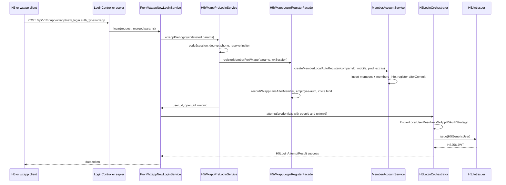
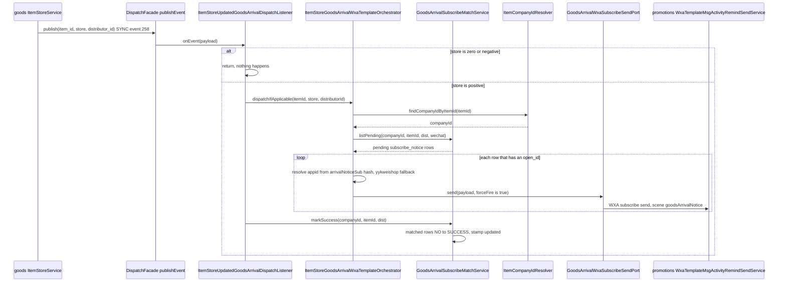

# Members Domain (ecshopx-members)

**`ecshopx-members`** (会员与账户域, see `ecshopx-members/src/main/java/cn/shopex/ecshopx/members/package-info.java`) is the member/account Bundle: member records and their wechat/alipay/social associations, the H5 (wxapp/H5/PC) login orchestration that mints member JWTs, the JWT verification that every member-facing endpoint relies on, the member-create / member-update fan-out that drives CRM sync, register promotions, register points, datacube counters and membercard gifts, and the goods-arrival subscription surface (缺货订阅) whose wechat notices fire from the goods bundle's item-store event.

Module layout follows the standard split ([Bundle Layering](../architecture/bundle-layering.md)): `api/front/v1` + `api/admin/v1` controllers, `service/{account,h5,front,admin,reg,sms,trustlogin,wxapp,...}` orchestration, `dispatch/` job publishers/handlers/listeners, `listener/` cross-bundle event listeners, `integration/` port impls for other bundles, `domain/` + `mapper/` persistence. `ecshopx-members` declares `ecshopx-common`, `ecshopx-dispatch`, `ecshopx-third-party`, `ecshopx-companys`, `ecshopx-work-wechat` and `ecshopx-wechat` (`ecshopx-members/pom.xml`) plus `nimbus-jose-jwt` for JWT.

## The espier/members split for login endpoints

One architectural fact that surprises everyone first: **the H5 login *routes* live in `ecshopx-espier`, the login *services* live in `ecshopx-members`**. `ecshopx-espier` depends on `ecshopx-members` (not the other way), so espier's `LoginController` (`ecshopx-espier/.../api/front/v1/LoginController.java`) is a thin `@FrontNoAuth` `@RestController("/api/v1/h5app")` whose single endpoint `POST /api/v1/h5app/wxapp/new_login` (name `C端新登录`) merges query/body params via `H5LoginRequestAssembler` and hands off to `FrontWxappNewLoginService`. The controller deliberately publishes no dispatch messages itself: whenever the path creates a new member record, follow-on work is coordinated from the member account layer after the surrounding transaction commits (the controller's own Javadoc says exactly this).

The mirror-image route `POST /api/v1/h5app/wxapp/login` (`C端登录`) plus `GET /api/v1/h5app/wxapp/token/refresh` (`C端刷新token`) live in members' own `MembersController` (`ecshopx-members/.../api/front/v1/MembersController.java`), also `@FrontNoAuth`, calling the same `H5LoginOrchestrator` / `H5MemberTokenRefreshService`. Both controllers are `@DingoResponse(resource = DINGO, badRequest = DINGO_400, unauthorized = true)` because the legacy H5 frontend parses `data.message` / `data.status_code` ([Request Lifecycle](../architecture/request-lifecycle.md)).

`H5LoginRequestAssembler` is the PHP-parity merge step: query parameters first, JSON body over them, plus the `Origin` header as `origin`.

## Login orchestration: FrontWxappNewLoginService → H5LoginOrchestrator → H5AuthStrategy

`FrontWxappNewLoginService.login` normalizes the request per `auth_type`, runs the *pre-login* (which can create the member), then delegates to the members-side orchestrator:

* reads `company_id` from the `H5_COMPANY_ID` request attribute (set by `FrontNoAuthInterceptor`, below) and throws `UnauthorizedException` when it is not positive;
* `auth_type=local` → a fresh credential map (`username`, `vcode`, `check_type` defaulting to `password`, `password`, `auto_register`, `silent`, `company_id`); `pre_login_data` echoes `{mobile: username}`;
* `auth_type=wxapp` → copyWhitelisted params (`appid`, `code`, `iv`, `encryptedData`, `inviter_id`, `salesperson_id`, `work_userid`, `channel`, `shuyunappid`, ...), inject `wxa_appid` / `authorizer_appid` / `api_from` from existing JWT claims when present, then `H5WxappPreLoginService.wxappPreLogin(params)`;
* `auth_type=aliapp` → the analogous `H5AliappPreLoginService.aliappPreLogin`;
* `auth_type=wx_offiaccount` / `social_oauth` → pass-through credentials with `company_id` + `origin` forced;
* anything else → `ResourceException("缺少参数，登录失败！")`.

Then `H5LoginOrchestrator.attempt(credentials)` runs:

1. `EspierLocalUserResolver.retrieve(credentials)` — resolves `company_id` from the Origin domain when missing, picks a strategy from `auth_type`, and on success appends accepted protocol logs (`MembersProtocolLogOnLoginService`) and runs `CompanysUserAuthChecker.checkUserAuth` (tenant gate).
2. If a user resolved, `H5JwtIssuer.issue(user)` mints the JWT; a `JOSEException` is wrapped as `IllegalStateException`.
3. `H5LoginAttemptResult(success, jwtToken, credentialsRejected)` is returned; the caller distinguishes a hard failure from a soft ("please register") rejection.

**The strategy registry is the extension point.** `H5AuthStrategy` is a two-method interface (`type()` / `resolve(credentials)`), and `EspierLocalUserResolver` builds an `EnumMap<H5AuthType, H5AuthStrategy>` from all Spring beans. Adding a login channel = new enum constant + new `@Component` strategy; no resolver edit. Current strategies in `service/h5/auth/`:

| `H5AuthType` | Strategy | What it does |
|---|---|---|
| `LOCAL` (default when `auth_type` blank) | `LocalH5AuthStrategy` | mobile-or-email + password / SMS vcode / email OTP, optional `auto_register` → `createMemberLocalAutoRegister`; email login requires `email_verified_at` |
| `WXAPP` | `WxAppH5AuthStrategy` | mini-program `code2session` (or pre-supplied `openid`), `getWechatSimpleUser`/`getWechatUserInfo`, OEM-Shuyun silent-register bridge, `need_transfer` guard in transfer mode |
| `OAUTH` | `OauthH5AuthStrategy` | PC web OAuth: `member:oauth:login:<token>` Redis payload must match the wechat user's `unionid` |
| `WX_OFFIACCOUNT` | `WxOffiaccountH5AuthStrategy` | official-account `oauth2SnsAccessToken` + `snsUserinfo`, creates the fan row via `createOffiaccountFans` |
| `PC_WXQRCODE` | `PcWxQrcodeH5AuthStrategy` | PC QR-scan: same official-account calls, but with caller-supplied `appid`/`secret` |
| `ALIAPP` | `AliAppH5AuthStrategy` | Alipay mini-program: `alipay_user_id` (given or exchanged from `code`) → `members_associations` row with `user_type=ali` |
| `SOCIAL_OAUTH` | `SocialOAuthH5AuthStrategy` → `H5SocialOAuthLoginService` | overseas trust login, see below |
| `UNKNOWN` | `DefaultH5AuthStrategy` | always returns `Optional.empty()` (soft failure) |

Each strategy returns `H5GenericUser`, a thin map wrapper whose `getJwtSubject()` is the `id` attribute and whose `getJwtCustomClaims()` is the whole attribute map. Login paths therefore build the **`id` claim as an `_espier_`-joined composite**: `"<userId>_espier_<open_id>_espier_<unionid>"` for wechat (`WxAppH5AuthStrategy.buildUserAttrs`, `OauthH5AuthStrategy`, `WxOffiaccountH5AuthStrategy`) or `"<userId>_espier_alipay_espier_<alipayUserId>"` for Alipay. `MemberAccountService.getTokenData` instead builds `"<user_id>_espier_companyid_espier_<company_id>"` for the local/bind paths. The `_espier_` shape is not decoration — `H5JwtUserLoginInfoEnrichService` parses it back on every authenticated request (below).

### wxapp pre-login: where the member is actually created

`H5WxappPreLoginService.wxappPreLogin` is the new-login workhorse. After validating `appid`/`code`/`iv`/`encryptedData` and asserting the appid is recognized, it: `miniProgramCode2Session` → decrypt the phone number (`purePhoneNumber`) → in transfer mode repair a stale unionid → resolve inviter params from `uid`/`puid`/existing wechat row → then the branching that decides whether a member is created:

* no member by mobile → `H5WxappLoginRegisterFacade.registerMemberForWxapp`;
* member exists but no `wechat` association with a matching unionid → also `registerMemberForWxapp` (which will take the "existing member, bind only" branch);
* OEM-Shuyun + member with a *different* unionid → `ResourceException("该手机号已注册为会员，请更换手机号！")`.

Afterwards it binds a salesperson if `salesperson_id` was supplied, records the wxapp fan row, and re-syncs the Shuyun open platform (failures do not block login, matching PHP `maybeSync…AfterPreLogin`).

`H5WxappLoginRegisterFacade.registerMemberForWxapp` is `@Transactional` and holds the registration policy: whitelist check (`assertWhitelist` against `members_whitelist` with the fixed-encrypted mobile), employee-auth (`employee_auth` payload → optional `H5WxappRegisterEmployeeAuthenticator` bean, `enterprise_id` required) **or** invite code (`invite_code` → optional `H5WxappRegisterInviteBinder` bean, Redis lock acquired first and quietly unlocked on failure), the two OEM-Shuyun short-circuits, then `memberAccountService.createMemberLocalAutoRegister(companyId, mobile, randomPassword, registrationExtras)` plus `recordWxappFansAfterMember` (writes `wechat_users`, and `members_associations` only when `memberUserId > 0`) and `ShuyunOpenPlatformWxappMemberSyncPort.syncWxappOnlineIfEnabled`. `registerMemberForAliapp` mirrors this for Alipay, routing to `registerShuyunMember` under OEM-Shuyun and otherwise `createMemberLocalAutoRegister` + `ensureAliMemberAssociation`.

Both invite-binder and employee-authenticator are `ObjectProvider`-injected optional extensions — the facade does not fail startup when the implementing bundles are absent, but it does throw `ResourceException` if a request asks for a feature whose bean is missing.

Caption: the new-login path — pre-login creates the member inside a transaction, then the orchestrator re-resolves the user by openid/unionid and issues the JWT.

## JWT: issuing, verification, refresh and blacklist

All H5 member tokens are **HS256 (Nimbus) JWTs**, configured by `ecshopx.h5.jwt.*` (`H5JwtProperties`, bound by `MembersH5Configuration`):

| Property | Default (in `ecshopx-bootstrap/src/main/resources/application.properties`) | Meaning |
|---|---|---|
| `ecshopx.h5.jwt.secret-base64` | `${JWT_SECRET}` (must be Base64 of a 32-byte key) | shared signing key |
| `ecshopx.h5.jwt.ttl-minutes` | `${JWT_TTL:120}` | access-token lifetime |
| `ecshopx.h5.jwt.refresh-ttl-minutes` | `${JWT_REFRESH_TTL:20160}` (14 days) | window from `iat` in which refresh is accepted |
| `ecshopx.h5.jwt.issuer` | `ecshopx` | required `iss` claim value |
| `ecshopx.h5.jwt.leeway-seconds` | 0 | clock skew allowance for `exp`/`nbf`/`iat` |
| `ecshopx.h5.jwt.blacklist-grace-period-seconds` | `${JWT_BLACKLIST_GRACE_PERIOD:0}` | seconds the blacklisted token still works after invalidation |
| `ecshopx.h5.jwt.required-claims` | `iss,iat,exp,nbf,sub,jti` | startup-validated: must contain all six |

`H5JwtProperties.resolveSecretBytes` does a strict Base64 decode and zero-pads keys shorter than 32 bytes so Nimbus `MACSigner` accepts them. `@PostConstruct` validation refuses a `required-claims` list missing any of `iss,iat,exp,nbf,sub,jti` and a negative grace period, so the app fails fast on bad configuration. `JWT_SECRET` is injected by the docker compose files as both an env var and an `--JWT_SECRET=` app arg; it is *not* stored in the repository.

**Issuing** (`H5JwtIssuer.issue`): sets `iss`, `sub` (the `_espier_` composite `id`), a random UUID `jti`, `iat`/`nbf` = now, `exp` = now + ttl, then copies every non-null attribute as a custom claim **except the reserved names** `iss,sub,aud,exp,nbf,iat,jti`. An unconfigured secret throws `IllegalStateException("ecshopx.h5.jwt.secret-base64 must be configured")`.

**Verification** (`H5BearerJwtClaimsService.verifyAndExtractClaims`) is the single gate for `@FrontAuth` endpoints. It rejects, in order: a missing/non-`Bearer` `Authorization` header, a blacklisted compact token, an empty secret, a non-HS256 alg, a bad `MACVerifier` signature, a wrong `iss`, a time-claim failure (with leeway), a missing required claim, and a non-positive/non-integer `company_id` claim. On success it copies the claim map and hands it to `H5JwtUserLoginInfoEnrichService.enrichClaims`, then returns it. All parse/verify failures are `Optional.empty()` — never an exception — so the interceptor decides the HTTP shape.

**`FrontAuthInterceptor`** (espier, `ecshopx-espier/.../web/interceptor/FrontAuthInterceptor.java`) applies to handlers annotated `@FrontAuth` (method or bean) that are not `@FrontNoAuth`. On an empty claims result it writes a Dingo 401 body (`{"data":{"message":"Unable to authenticate user.","code":401001,...}}`); if the enriched claims carry `disabled` (truthy `true`/`"1"`/`"true"`) it writes a Dingo 403 with code `403001` (`该账号已被禁用.`). Otherwise it sets two request attributes consumed everywhere downstream: `H5FrontAuthAttributes.H5_AUTH_CLAIMS` (the whole claim map) and `H5_COMPANY_ID` (the positive-int `company_id`).

**`FrontNoAuthInterceptor`** (espier) is the partner for `@FrontNoAuth` handlers. It first tries the same Bearer-JWT path (and on success enriches claims the same way, plus back-fills a missing `mobile` from the member row via `memberAccountService.resolveMemberMobileForH5Context`); when there is no usable token it builds **anonymous** claims with `H5JwtUserLoginInfoEnrichService.buildAnonymousAuthClaims(companyId, appid, openId, unionid)` — `user_id=0`, `api_from=h5app`, `wxapp_appid` resolved from a `wx…` appid (and `woa_appid` from the tenant's service account), or `alipay_appid` for anything else. The anonymous `company_id` is resolved in PHP `FrontNoAuthMiddleWare` priority: appid lookup (wechat or Alipay port) → fixed non-SaaS / main-tenant id (`common.system-companys-id` / `common.system-main-companys-id`) → `company_id` query → Origin-domain lookup → `UnauthorizedException`. The single carve-out is `MembersController.getNoAuthDecryptPhoneNumber`, which proceeds with `H5_COMPANY_ID=0`.

**Claim rehydration** is what makes the stateless JWT usable: `H5JwtUserLoginInfoEnrichService.enrichClaims` re-reads member and wechat state on every request, mirroring PHP `EspierLocalUserProvider::getUserLoginInfo`. Given the `sub` (or `id`) `_espier_` composite it splits `<userId>`, `<openIdPart>`, `<unionidPart>`; `openIdPart=alipay` resolves the `ali` association, anything else resolves `getWechatUserInfo(unionid, open_id)` and from the wxa appid the company and the woa appid; `openIdPart=companyid` means the second segment *is* the company id. When a member row is found it overwrites/fills `user_id`, `company_id`, `disabled`, `open_id`, `unionid`, `nickname`, `headimgurl`, `grade_id`, `mobile`, `username`, `user_card_code`, `offline_card_code`, `operator_type=user`, `inviter_id`, `source_id`, `monitor_id`, `latest_source_id`, `latest_monitor_id`, `alipay_appid` and `alipay_user_id`. The point is freshness: disable a member and the very next request is rejected, even though the JWT itself is still inside its TTL.

**Refresh** (`GET /api/v1/h5app/wxapp/token/refresh` → `H5MemberTokenRefreshService.tokenRefresh` → `H5JwtIssuer.refreshAccessToken`): the compact token is parsed and verified (same alg/iss/required-registered-claims checks; only registered claims are checked here because a refresh must tolerate a stale custom-claim set), `iat` must be within `refresh-ttl-minutes`, and then the old token is **blacklisted** with `H5JwtBlacklistPort.addToBlacklist(compactJwt, exp)` before a new token is minted from the surviving custom claims (`id` back-filled from `sub` when missing). Blacklisted refresh returns `UnauthorizedException(H5JwtBlacklistPort.TOKEN_BLACKLISTED_MESSAGE)`, which `GlobalExceptionHandler` maps to a bare 401 without a business code.

**The blacklist lives in Redis DB 2 (prism)**: `H5JwtBlacklistService` (espier, implementing the `ecshopx-common` `H5JwtBlacklistPort` used by both the members issuer and verifier) stores `h5_jwt_invalidate:<sha256(compactJwt)>` → `validUntilSec = now + blacklistGracePeriodSeconds`, TTL'd to the token's `exp` (minimum 1s, and at least long enough to cover the grace period). `isBlacklisted` returns true once `now >= validUntilSec` — i.e. the grace period is the window in which a just-invalidated token is still deliberately accepted (PHP `JWT_BLACKLIST_GRACE_PERIOD` parity). See [Redis Databases](../concepts/redis-databases.md) for the DB layout.

## The CreateMemberSuccess after-commit fan-out (canonical example)

`event:members:create_member_success` is the reference AFTER_COMMIT dispatch in this codebase ([Dispatch Bus](../concepts/dispatch-bus.md), [Cross-Bundle Communication](../architecture/cross-bundle-communication.md)). The publisher is the one-method interface `MembersCreateMemberSuccessDispatchPublisher` in `ecshopx-common`, implemented in bootstrap by `MembersCreateMemberSuccessDispatchPublisherImpl` as `DispatchMode.ASYNC`, `DispatchDriverType.REDIS`, default queue, `RetryPolicy.platformDefault()` — so members never depends on the bus directly.

`MemberAccountService` publishes it from a `TransactionSynchronization.afterCommit` in every registration path, and **each path throws `BadRequestException` up front when `TransactionSynchronizationManager.isSynchronizationActive()` is false** — an explicit invariant that the event can never be published for rows that rolled back:

| Registration path | Also in the same `afterCommit` |
|---|---|
| `createMemberForWxappBind` (wxapp bind) | `sharedStringRedisTemplate` daily active set `Member:<companyId>:<yyyyMMdd>` |
| `createMemberLocalAutoRegister` (pre-login, local auto-register) | daily active set; and when `work_userid` + `channel=1`: `BindSalsepersonJobDispatchPublisher.enqueueBindSalseperson` — or `enqueueBindSalsepersonAfterDmMemberCreate` when `DmCrmSettingReadPort.isPointIntegrationOpen(companyId)` |
| `registerShuyunMember` (OEM-Shuyun / Alipay) | daily active set |
| `creatMemberForH5Post` (front registration, social OAuth) via `registerAfterCommitH5CreateMemberSideEffects` | optional daily active set (skipped for re-activated upload members); `work_userid` + `channel=1` bind-salesperson |
| `AdminMemberCreateMemberService.createMember` / `createMemberWithEmail` (admin console) | nothing (the port-driven side effects run in-transaction instead) |

The payload keys are stable across all paths — `company_id`, `user_id`, `mobile`, `openid`, `wxa_appid`, `inviter_id`, `distributor_id`, `source_id`, `monitor_id`, `salesperson_id`, `if_register_promotion` — because downstream listeners read exactly these. `if_register_promotion` is false when the tenant's `member_logout_config.new_rights` is off *and* a `members_delete_record` row exists for that mobile (i.e. the member had deregistered, so they do not get new-member rights again).

Bootstrap registers **eight listeners** on the event (each in its own `*DispatchListenerRegistrationConfig`, wired in `@PostConstruct` with `DispatchRegistry.registerEventListener`):

| Listener name | Bundle / listener | Queue | Gate |
|---|---|---|---|
| `listener:youshu.member_create_success` | youshu `CreateMemberSuccessYoushuDispatchListener` → `YoushuMemberCreateSuccessSyncService.syncMemberAfterCreate` | default | needs `company_id` + `user_id` |
| `listener:shuyun.open_platform.member_register_on_create_member_success` | shuyun `CreateMemberSuccessShuyunMemberRegisterDispatchListener` → `MemberRegisterDispatchService.dispatchCreateMemberSuccess` (falls back to the `members` row for distributor/mobile) | default | — |
| `listener:thirdparty.shopex_crm.sync_add_member` | third-party `CreateMemberSuccessShopexCrmSyncDispatchListener` → `CreateMemberSuccessShopexCrmSyncExecutionService` | default | no-op unless `crm.crm-sync` is configured |
| `listener:promotions.create_member_success` | promotions `CreateMemberSuccessPromotionsDispatchListener` → `executionMarketingAfterMemberCreate` | default | `if_register_promotion` must be `true`; needs `company_id`, `distributor_id`, `user_id`, `mobile` |
| `listener:members.register_point` | promotions `CreateMemberSuccessRegisterPointDispatchListener` → register-gift points via `PointMemberAddPointService` | default | Redis register-point config `is_open` and positive `point` |
| `listener:datacube.register_num_stats` | datacube `CreateMemberSuccessRegisterNumStatsDispatchListener` → `datecube_tracklog` Redis hashes + source tags | slow | failures swallowed at debug |
| `listener:members.create_member_success_notice` | members' own `CreateMemberSuccessNoticeDispatchListener` → `CreateMemberSuccessNoticeExecutionService` (wxapp template message "welcome / 邀请人 …") | slow | requires `openid` and `wxa_appid` |
| `listener:promotions.create_member_success_send_membercard` | promotions `CreateMemberSuccessSendMembercardDispatchListener` → `RegisterPromotionsMembercardPromotionService` (membercard register promotion, coupons via kaquan's `VipGradeOrderReceiveMembercardPromotionService`) | default | `if_register_promotion` must be `true` |

The marketing-side view of the same fan-out is in [Marketing Domain](marketing.md).

### In-transaction side effects of the H5 post path

`creatMemberForH5Post` (front `POST /wxapp/member` registration / `WxappMemberCreatMemberFacade`) differs from the auto-register paths: for a **new** member it also calls `AdminMemberCreatePromoterSideEffectPort.createForNewMember` (popularize promoter), `AdminMemberCreateDistributorUserSideEffectPort.createData` (distribution user), inserts `members_rel_shop` for a positive `distributor_id`, and inserts a `work_wechat_rel` bind for a positive `salesperson_id`. It then creates the platform association according to `api_from`/`auth_type` (`wechat` → `createMemberWechatAssociation`, `ali`/`aliapp` → `ensureAliMemberAssociation`, `social_oauth` → `createMemberPlatformAssociation` with the payload's `user_type`). An "upload member" (a row created by admin import, flagged `is_upload_member` in `members_info.other_params`) is treated as new and its flag is cleaned up afterwards, so the imported member gets the full new-member pipeline on first self-registration.

## Member update, mobile change, and the update event

`PUT /api/v1/h5app/wxapp/member` → `WxappMemberUpdateMemberService.updateMember` (`@FrontAuth`): strips masked placeholder fields (`****-**-*` birthdays, `******` addresses), validates custom fields through `FrontMemberInfoUpdateValidationPort`, optionally calls the Shuyun open platform `member.modify` **before** the local write (A-MOD-01), then `MemberAccountService.memberInfoUpdate`, then registers an after-commit `MembersUpdateMemberSuccessDispatchPublisher.publish` with a fresh `members_info` snapshot. `event:members:update_member_success` currently has one listener in bootstrap (`listener:thirdparty.shopex_crm.sync_update_member`, also gated on `crm.crm-sync`). After the local write it patches the wechat profile (`nickname`/`headimgurl`) when the claims carry `unionid` + `open_id`, runs the OEM-Shuyun profile modify when the open platform is *not* enabled, and calls DM CRM `updateMemberInfoByMobile` when DM point integration is open.

`PUT /api/v1/h5app/wxapp/member/mobile` → `WxappMemberMobileChangeService.updateMemberMobile`: enforces a **30-day cooldown per member** via the Redis key `updateMemberMobileCD:<userId>:<sha1(companyId)>` (`members.update-mobile.ttl-seconds`, default 2592000) on the members Redis template, validates the CN mobile pattern, verifies the SMS code against `member-update:company<companyId>:<newMobile>`, refuses a duplicate mobile within the tenant, updates `members.mobile` (fixed-encrypted), `region_mobile` and `mobile_country_code`, writes a `member_operate_log` row (`operate_type=mobile`, operater `用户在云店自行修改`) with the old/new JSON, then sets the cooldown key.

### Mobile storage transform

`members.mobile` is written through `LegacyFixedMobileEncrypt.fixedEncryptMobile` — a deterministic AES (default `AES-128-CBC`, fixed IV) transform matching the legacy PHP app-key payload layout, so mobile lookups can be equality queries. It is configured by `LegacyFixedMobileEncryptConfigurer` from `ecshopx.compat-crypto.app-key` + `ecshopx.compat-crypto.cipher` + `common.encrypt-sensitive-data`; when `common.encrypt-sensitive-data=false` the transform is the identity (plaintext `members.mobile`), which is the repository default. The plaintext is kept alongside in `members.region_mobile`, which is why change/registration paths write both.

## Member-side SMS codes

`GET /api/v1/h5app/wxapp/member/sms/code` (`@FrontNoAuth`) → `WxappMemberSmsCodeSendService.getSmsCode`. Accepted `type` values are `sign`, `forgot_password`, `login`, `update`, `merchant_login` (default `sign`). The type changes the semantics: `sign` refuses an already-registered mobile (unless it is an upload member), `forgot_password` refuses an *unregistered* mobile (and, when authenticated, sends to the account's stored mobile), `update` skips the image captcha and requires the caller's own mobile shape, and `sign` also refuses when the caller's wechat association is already bound to a phone. Every non-`update` type must first pass the image captcha (`verifyAndConsumeMemberImageVcode`, from `GET /wxapp/member/image/code`).

`MemberSmsVerificationCodeDeliveryService.deliver` (members Redis template) enforces `common.sms-send-limit` (default 5) sends per `(company, day, type, mobile)` via the `yzmsend:<companyId>:<yyyyMMdd>:<type>:<mobile>` counter, generates a 6-digit code, stores it for 300 seconds under `member-<type>:company<companyId>:<mobile>`, logs the code (legacy parity), and sends through `CompanySmsSendPort.sendVerificationCodeForScene(..., "verification_code")` — a failure raises `ResourceException("短信发送失败")`. Login-time verification is `MemberRegSettingService.checkSmsVcode`, used by `LocalH5AuthStrategy` for `check_type=mobile`.

## Wechat fans and tag sync

Members owns the `wechat_users` / `wechat_fans` / `wechat_tags` / `wechat_fans_bind_wechat_tag` tables and three dispatch listeners of its own (all registered in bootstrap):

* `event:members:sync_wechat_fans` (slow queue) → `SyncWechatFansDispatchListener` → `SyncWechatFansPageNotificationProcessor.handle`: for each `open_ids` page of ≤100, batch-fetch user info and persist via `WechatFansSyncPersistService.saveUser`. The producer is `WechatFansSyncService.syncWechatFans`, which throttles to **3 syncs/day and one per 10 minutes** per company via the `syncUsersCount<yyyyMMdd>:<sha1(companyId)>` Redis list (members Redis DB, `EXPIREAT` end of day) and pages the official-account `user/get` API 10,000 openids at a time, publishing one event per page.
* `event:members:sync_wechat_tags` (default queue) → `SyncWechatTagsDispatchListener` → `WechatFansTagsSyncService.syncWechatTags`: diff the remote official-account tag list against local `wechat_tags`, upsert the remote set and delete locals that no longer exist, inside a `TransactionTemplate`.
* `event:wechat:subscribe` (default queue, event name from `WechatDispatchEventNames`) → `WechatSubscribeDispatchListener`: `subscribe` batch-fetches the one user and persists the fan (only when WeChat returns a `unionid`); `unsubscribe` clears the fan's bound tags.

`MemberAccountService.createWxappFans` is the shared upsert behind login-time fan recording: insert-or-update the `wechat_users` row keyed by `(company_id, authorizer_appid, open_id, unionid)`, then — when a `bind_member_user_id` was supplied and no `wechat` association exists yet — insert the `members_associations` row, and return `{wechatuser, memberInfo, is_new}` (is_new = "no association", which is what the official-account login strategy uses to decide whether the fan still needs to register). `updateWechatUnionId` migrates a stale unionid across both `wechat_users` and `members_associations` and clears `need_transfer` (the transfer-mode repair path).

## Goods-arrival subscription (缺货订阅, subscribe notices)

Members owns the member side of "notify me when this is back in stock": the `members_subscribe_notice` table (`SubscribeNotice` domain, `SubscribeNoticeMapper`), the wxapp subscribe/unsubscribe endpoints over it, and the wechat leg of the goods-arrival notify fan-out that the goods bundle's item-store event triggers. The Alipay leg (`source=alipay`) is owned by ecshopx-ali; see [Third-Party Integrations](../integrations/third-party.md).

### The `subscribe_notice` row and its lifecycle

`SubscribeNotice` (订阅通知) is one row per `(company_id, user_id, rel_id=item_id, source, distributor_id, sub_type='goods', sub_status='NO')` — `sub_id` auto-increment PK, `open_id` (the wechat openid or alipay `alipay_user_id` used as the notify recipient), `source` (`wechat` default / `alipay`), `distributor_id` (店铺id, `0` = headquarters/platform scope), `remarks` (item name snapshot at subscribe time), `created`/`updated` epoch seconds. `sub_status` is the lifecycle column: `NO` (未通知, not notified) → `SUCCESS` (已通知, notified); `ERROR` (通知失败, notify failed) exists in the schema comment but **no Java write path sets it** — `err_reason` is likewise never written. Rows are deleted, not archived, when a member unsubscribes.

Two endpoints drive it from `MembersController` (`@FrontAuth` is the class default; the status check overrides it with `@FrontNoAuth` because it must answer for anonymous visitors):

* `POST /api/v1/h5app/wxapp/member/subscribe/item/{item_id}` (缺货订阅) → `WxappGoodsArrivalNoticeSubscribeService.itemsSubscribe`. It is a **toggle**: a matching row (same user/company/item/source/distributor, `sub_type=goods`, `sub_status=NO`) that already exists is *deleted*; otherwise the item must exist (`MembersSubscribeNoticeItemNamePort.itemExists`, else `ResourceException("商品不存在")`) and a new row is inserted with `remarks` = the resolved multi-language item name. The response echoes the resulting state — the row's `{user_id, item_id, item_name}` after a subscribe, an empty list after an unsubscribe. The same toggle is applied to the Redis bookkeeping hash: the `arrivalNoticeSub` key exists with the user as field → delete the field; absent → write JSON `{"open_id": …, "wxa_appid": …}` (the appid recorded at subscribe time is what the notify leg reads back later). The two toggles are evaluated independently, so state loss on one side desynchronizes the pair: after a Redis flush (row kept, hash field gone) the *next* toggle deletes the table row while re-arming the hash. The open id and `source` come from the caller's enriched claims — `open_id`/`wxapp_appid` for wechat, `alipay_user_id` for alipay.
* `GET /api/v1/h5app/wxapp/member/item/is_subscribe/{item_id}` (是否订阅商品) → `isSubscribe`: reads the *Redis* key (not the table) and returns `{user_id, item_id, item_name}` (empty list when the field is absent or the caller is anonymous). Only the Redis field reflects "currently subscribed" — the table row survives a Redis flush as history until the next toggle deletes it, which is what causes the desync described above.

The admin console reads the same table read-only: `GET /api/v1/members/subscribe/list` (订阅列表, `MembersSubscribeController`, `@AdminAuth` + `@Activated(routeAlias = "member.subscribe.list")`) → `MembersSubscribeNoticeListService`, which filters by `sub_type` (default `goods`), `sub_status`, `rel_id` and created-time range, joins the member username per row (falling back to 匿名 for rows without a member) and re-resolves the item name for `goods` rows — the page at which operators see the `NO`/`SUCCESS` split and the never-written `err_reason` column.

The Redis key shape is the shared contract between subscribe and notify — `WxappGoodsArrivalNoticeSubscribeService` writes it on the **shared** template (`sharedStringRedisTemplate`, Redis DB 0, [Redis Databases](../concepts/redis-databases.md)):

* wechat source: `arrivalNoticeSub:<companyId>:<itemId>` or `arrivalNoticeSub:<companyId>:<itemId>:<distributorId>` when the shop scope is positive;
* alipay source: `arrivalNoticeSub:<source>:<companyId>:<itemId>[:<distributorId>]` (the source segment is prepended, keeping alipay rows out of the wechat key namespace).

The Redis hash is written by the subscribe toggle and read back only by the wechat notify leg — the alipay leg never reads it (it sends straight to the ali template job with `to_user_id` = the alipay user id) — and no expiry is set: a subscribe stays "armed" until it is unsubscribed or a restock event consumes it.

### The notify leg: `event:258` → wechat `goodsArrivalNotice`

Caption: the goods-arrival wechat notify — goods publishes `event:258` in SYNC mode, the members listener runs inline, sends one subscribe message per pending wechat subscriber, then marks the matched rows notified.

The chain, end to end:

1. **Publisher (goods).** `ItemStoreService.saveItemStore(itemId, store, distributorId)` and `saveItemStoreForWdtSync` (which publishes *before* the Redis write to preserve WDT ordering) call the common `ItemStoreUpdatedEventBusPublisher`, implemented in bootstrap by `ItemStoreUpdatedEventBusPublisherImpl` as `DispatchFacade.publishEvent` of `GoodsDispatchEventNames.EVENT_ITEM_STORE_UPDATE` = `event:258:GoodsBundle\Events\ItemStoreUpdateEvent` with payload `{item_id, store, distributor_id}` and `DispatchOptions.eventDefaults()` — i.e. **SYNC**, so every listener runs inline in the publisher's thread and transaction ([Dispatch Bus](../concepts/dispatch-bus.md)). Producers include item create/edit (`PlatformItemsAddService`, `SupplierItemsAddService`), the admin batch store edit, the distributor-items shop store edit (`DistributorItemsUpdateOrchestratorImpl` — the source of shop-scoped events with `distributor_id>0`), openapi item-store sync, and the Jushuitan/WdtErp inventory pulls; see the goods page's inventory section ("Inventory: three pools, one resolver") and its [events table](goods.md#events-published-and-who-listens) for the full publisher list.
2. **Listener registration.** Bootstrap's `ItemStoreUpdatedEventDispatchListenerRegistrationConfig` (`@Order(75)`) registers `listener:members.listeners.ItemStoreUpdatedGoodsArrival` → `ItemStoreUpdatedGoodsArrivalDispatchListener` with `ListenerDispatchOptions.syncDefaults()`, alongside the sibling `listener:goods.listeners.SendTemplateMsgListener` (ali leg, registered first so it runs first) in the same `@PostConstruct`; a third `event:258` listener, `listener:shuyun_open_platform.product_sync_on_item_store_update`, is registered separately in `ShuyunOpenPlatformItemStoreProductSyncDispatchListenerRegistrationConfig`. Because the publish is SYNC with multiple listeners, they all run inline inside the publish call — the members listener after the ali leg (pinned by `ItemStoreUpdatedAliTemplateBusDispatchFlowTest`'s `InOrder` assertion).
3. **The gate.** `ItemStoreUpdatedGoodsArrivalDispatchListener.onEvent` parses `item_id`/`store`/`distributor_id` (Number-or-String lenient parsing) and returns immediately when `store <= 0` — out-of-stock transitions never notify. Otherwise it runs the two legs in order: the wechat send (`ItemStoreGoodsArrivalWxaTemplateOrchestrator.dispatchIfApplicable`), then its *own* company resolution via `ItemCompanyIdResolver` (goods' impl reads the `items` row; empty → skip marking) and `GoodsArrivalSubscribeMatchService.markSuccess(companyId, itemId, dist)` with `dist = normalizeDistributorId(distributorId)` (clamped to `[0, Integer.MAX_VALUE]`, so a negative or oversized long becomes a valid int). The resolver is queried twice per event (once inside the orchestrator, once here) — deliberate redundancy that decouples the two legs: the send leg can resolve the company and fail quietly while the marking leg still resolves it independently. The listener itself catches nothing — it is the orchestrator's own try/catch that makes the send leg failure-tolerant (below); a throwing `markSuccess` would still fail the publisher's transaction, matching the SYNC-event contract.
4. **Send (wechat leg).** `ItemStoreGoodsArrivalWxaTemplateOrchestrator.dispatchIfApplicable` (PHP `SendTemplateMsgListener` wechat-branch parity for `goodsArrivalNotice`) wraps everything in a `try/catch(RuntimeException)` that logs at debug and returns — a notify problem must never break the stock write. It re-checks `store > 0` and `itemId > 0`, resolves the company, matches pending rows with `listPending(companyId, itemId, dist, "wechat")`, and returns silently when there are none. Otherwise it builds the shared data fields — `item_name` = the multi-language item name truncated to 20 code points (`MembersSubscribeNoticeItemNamePort.resolveItemName(companyId, itemId, "zh-CN")`), `notice` = the fixed text **亲！您想要的商品已经到货，可以购买啦！** — and loops the pending rows, skipping any without an `open_id`. Per row:
   * the appid is resolved by *the row's own* shop scope, `arrivalNoticeSub:<companyId>:<itemId>[:<rowDistributorId>]` — hash field `userId`, value parsed as JSON with a `wxa_appid` key (i.e. the appid the member was on when subscribing); when the hash misses or the user id is null, the fallback is the wechat `wechat_weapp` authorizer appid for template name `yykweishop` (`WeappAuthorizerAppidRepository.findAuthorizerAppid(companyId, "yykweishop")`); an empty appid skips the row;
   * the send payload is `{scenes_name: "goodsArrivalNotice", company_id, appid, openid: row.open_id.trim(), data: {item_name, notice}, page_query_str: "id=" + itemId}`, passed through the common `GoodsArrivalWxaSubscribeSendPort` with **`forceFire=true`** (arrival notices are never delayed by the template's `send_time_desc` config);
<!-- openwiki: broken internal link [../workflows/member-notify-fanout.md] file "../workflows/member-notify-fanout.md" does not exist. Fix the href or restore the target, then delete this comment. -->
   * the port is implemented in promotions by `GoodsArrivalWxaSubscribeSendAdapter` → `WxaTemplateMsgActivityRemindSendService.send` — the central WXA subscribe sender shared by every member-notify producer, which looks up the `promotions_notice_template` row by `(company_id, scenes_name, template_name)` with the template name from the `wechat_weapp` row, gates on `is_open` + `template_id`, and posts the subscribe message through `WxJavaMaRuntime` (goodsArrivalNotice resolves the default page `pages/index` + the query string). The full send mechanics (and the sibling orders/aftersales/wechat producers) are on [Member and Merchant Notification Fan-out](../workflows/member-notify-fanout.md); the scene definition is `WxaTemplateSceneDefinitions.GOODS_ARRIVAL_NOTICE` (template id `5019`, 商品到货通知, keywords `item_name`/`notice`).
5. **Marking.** `GoodsArrivalSubscribeMatchService.markSuccess` re-runs the same matching (**any source** — it is the only writer of `SUCCESS` on this path; the ali leg sends but never marks) and updates the matched `sub_id`s with `sub_status: NO → SUCCESS` plus `updated = now`. Note the two-phase shape: the wechat **send** is driven by `listPending(..., "wechat")` while the **marking** is source-agnostic and happens even when the wechat send skipped (no pending wechat rows, no appid, or the orchestrator caught a runtime error) — so an alipay subscriber's row is marked by this listener after the ali leg's own send, and a wechat row can be marked even when its individual send was skipped (missing appid, missing open_id). The deliberate consequence is that both legs must share the matching semantics, or a row can be marked without a send.

### Matching semantics: shop stock vs headquarters stock

`GoodsArrivalSubscribeMatchService` is the single matcher both legs share (`listPending` for send, `markSuccess` for marking), and its shop-scope rule is the interesting part:

* **Shop stock event (`eventDistributorId > 0`)** — only rows with exactly that `distributor_id` match (plus the always-applied base predicate `company_id`, `rel_id=itemId`, `sub_type='goods'`, `sub_status='NO'`; `listPending` additionally filters `source`). The total-store port is not consulted.
* **Headquarters stock event (`eventDistributorId == 0`)** — a plain `distributor_id=0` row matches trivially, and a *shop-scoped* row (`distributor_id>0`) matches **only when that shop currently draws the SKU from headquarters stock**: `DistributorItemTotalStorePort.filterDistributorIdsUsingTotalStore(companyId, itemId, candidateShopIds)` (goods' `DistributorItemTotalStorePortImpl` over `distributor_items.is_total_store`) decides which shop rows ride along. A shop that keeps local stock is not notified by a platform restock — its own shop-scoped event will come when its `distributor_items.store` is written.

`normalizeDistributorId` and `hasOpenId` are the two static helpers the other classes borrow; `hasOpenId` guards the per-row send (a row without a usable `open_id` is skipped but still marked).

### Failure, retry and idempotency notes

* The wechat send leg is **best-effort by design**: `dispatchIfApplicable` swallows any `RuntimeException` at debug level, and the promotions sender itself is tolerant (missing `Weapp` row, closed template, or a downstream WeChat error all return without throwing). There is no retry and no `ERROR`/`err_reason` write — a failed send still marks the row `SUCCESS`, so the subscriber does not get a second chance until they re-subscribe. This mirrors the legacy PHP notifier's behavior.
* There is no dedupe on the notify path beyond the `NO → SUCCESS` transition itself: the second `event:258` for the same item finds no `NO` rows and does nothing, because the Redis `arrivalNoticeSub` hash is only *read* here (the subscribe toggle and unsubscribe own its writes). The hash is therefore subscribe-state bookkeeping (which appid, which user), not a send-dedupe lock.
* The marking update is guarded `sub_status = 'NO'` inside the `UPDATE` itself (`eq(SubscribeNotice::getSubStatus, "NO")`), so concurrent events for the same item cannot double-mark.

Pinned by `GoodsArrivalSubscribeMatchServiceTest` (shop event = exact `distributor_id` match with the total-store port never consulted; headquarters event = `distributor_id=0` row plus only the `is_total_store=true` shop rows) and `ItemStoreGoodsArrivalWxaTemplateOrchestratorTest` (`store<=0` skips everything; the send payload carries `scenes_name=goodsArrivalNotice`, the resolved `appid`, `openid` and `page_query_str id=<itemId>` with `forceFire=true`; a headquarters event reads the appid from the **row's** `arrivalNoticeSub:<companyId>:<itemId>:<rowDistributorId>` key). The end-to-end bus behavior — publish `event:258` runs both listeners inline, then the ali leg enqueues its delayed-able template job — is pinned by bootstrap's `ItemStoreUpdatedAliTemplateBusDispatchFlowTest`.

## Trust login (Apple / Google / Facebook / Line)

Overseas social login is its own small sub-domain in `service/trustlogin/`:

* `SocialTrustLoginTypes.SOCIAL_TYPES = [apple, google, facebook, line]` (PHP `SocialTrustLoginService::SOCIAL_TYPES` parity); `isSocialProvider` does a case-insensitive membership test.
* `GET /api/v1/h5app/wxapp/trustlogin/params` (`TrustLoginController`, `@FrontNoAuth`) → `TrustLoginParamsService.getTrustLoginParams(companyId, trustlogin_tag, version_tag, h5Host, redirectUrl)`, where the controller derives `h5Host` from the `Origin` header. `company_id` is resolved from the request attribute → claims → query, else `UnauthorizedException`.
* `GET /api/v1/h5app/wxapp/trustlogin/list` → `AdminTrustLoginListService.getTrustLoginListForFront(companyId, versionTag)` — the enabled-channel list the H5 page renders. The default template (weixin for `standard`; weixin + apple/google/facebook/line for `touch`) is `TrustLoginDefaultProperties` / the importable `ecshopx-members/src/main/resources/application-members.yml` (`spring.config.import=optional:classpath:application-members.yml` is already wired in bootstrap's `application.properties`), every row `status: "false"` until configured.
* `H5SocialOAuthLoginService.loginOrRegister` (`auth_type=social_oauth`): validates the tag is social and the channel row is enabled, resolves the h5 host (else `缺少 H5 域名配置`), exchanges `code` for a `SocialOAuthUser` through `SocialTrustLoginService.resolveUserFromCode`, then either maps an existing `members_associations` row (`user_type` from the provider, `unionid` = the provider user id) to the member, or **allocates a synthetic mobile** (`MemberSyntheticMobileService.allocateUnique`: `10` + 9 random digits, unique per company, ≤80 attempts) and creates the member through `creatMemberForH5Post` with `auth_type=social_oauth` — which is why the social path joins the CreateMemberSuccess fan-out too.
* **Apple needs a server-side callback** because Apple posts the authorization code as a form: `TrustLoginAppleCallbackController` (`/api/v1/h5app/wxapp/trustlogin/apple/callback`, GET *and* POST, deliberately **without** `@FrontNoAuth`, matching PHP `routes/frontapi/member.php`) resolves the h5 host from the `h5_host` query param or the remembered `state`, then 302-redirects to the H5 landing URL with the normalized `code` (or the `error`/`error_description` pair). `SocialTrustLoginService` carries the state↔h5Host bookkeeping (`encodeAppleOAuthState` / `rememberAppleOAuthH5Host` / `recallAppleOAuthH5Host`), the redirect/callback URI builders (against `common.api-base-url` / `H5_BASE_URL`) and `normalizeApplePrivateKey` for Apple's client-secret signing.

## Other members-owned surfaces (brief)

* `service/email/` — member email registration + verification (`MemberEmailVerificationService` powers `check_type=email_otp` local login, requiring `email_verified_at`).
* `service/reg/` — registration settings (`MemberRegSettingService` for SMS vcode check, `AdminMemberRegisterSettingService` for image vcode).
* `service/account/`, `service/admin/`, `service/export/`, `service/importrow/` — admin console member CRUD, batch operations, export jobs (`AdminMemberExportFileJob*`), import.
* Tag services (`MemberTags*`, `TagsCategory*`, `MemberTagLibrary*`, `segment/`) — member tags/groups/segments, including `MemberRelTagsBatchCreateService` used by the datacube source-tag listener.
* `MedicationPersonnel*` services + controller — pharmacy-industry medication personnel records.
* `WxappMemberDeleteMemberService` (`DELETE /wxapp/member`, 会员注销) — writes `members_delete_record`, which is what makes the *next* registration of that mobile lose `if_register_promotion`.
* `CompanyActivatedStaffTagListener` — a Spring `@TransactionalEventListener(AFTER_COMMIT, fallbackExecution = true)` on `CompanyActivatedEvent` that seeds the default `员工` staff tag per tenant; one of the few members listeners that is a Spring event rather than a dispatch listener.
* `ItemStoreUpdatedGoodsArrivalDispatchListener` — the other entry in `listener/` besides the staff-tag listener: a dispatch listener (registered in bootstrap on `event:258`) rather than a Spring event listener; see the [Goods-arrival subscription](#goods-arrival-subscription-缺货订阅-subscribe-notices) section above for the full flow.
* OpenAPI member creation runs as a dispatch job: `OpenapiCreateMemberJobHandler` → `OpenapiThirdApiV2MemberCreateService`, `MemberRegisterJobHandler` (OEM-Shuyun silent registration), `BatchActionMembersJobHandler`, `PushMemberTagRelationJobHandler`, `UpdateAddressLatAndLngJobHandler`, `SendMemberEmailActivationJobHandler`.

## Configuration reference

| Property | Default | Used by |
|---|---|---|
| `ecshopx.h5.jwt.secret-base64` | `${JWT_SECRET}` (required) | `H5JwtIssuer`, `H5BearerJwtClaimsService`, `FrontAuthInterceptor`, `FrontNoAuthInterceptor` |
| `ecshopx.h5.jwt.ttl-minutes` / `refresh-ttl-minutes` | `${JWT_TTL:120}` / `${JWT_REFRESH_TTL:20160}` | token lifetime / refresh window |
| `ecshopx.h5.jwt.blacklist-grace-period-seconds` | `${JWT_BLACKLIST_GRACE_PERIOD:0}` | `H5JwtBlacklistService` (Redis DB 2) |
| `ecshopx.h5.jwt.issuer` / `leeway-seconds` / `required-claims` | `ecshopx` / `0` / six registered claims | issuer + time-skew + required-claim policy (startup-validated) |
| `ecshopx.h5.local.system-is-saas` / `system-companys-id` / `system-main-companys-id` | `${common.system-is-saas:false}` / `${common.system-companys-id:1}` / empty | `LocalH5AuthStrategy` company resolution (non-SaaS/main-tenant pinning) |
| `ecshopx.h5.local.oem-shuyun` / `transfer-mode` | `false` / `false` | OEM-Shuyun silent register & unionid transfer paths |
| `ecshopx.h5.wx.mini-program-secret-by-appid.<appid>` | — | `WxOpenPlatformClient` direct mini-program credentials |
| `common.encrypt-sensitive-data` + `ecshopx.compat-crypto.app-key` / `cipher` | `false` / empty / `AES-128-CBC` | `LegacyFixedMobileEncrypt` mobile storage transform |
| `common.sms-send-limit` | 5 | SMS vcode daily cap |
| `members.update-mobile.ttl-seconds` | 2592000 (30 days) | mobile-change cooldown |
| `crm.crm-sync` | empty | Shopex CRM create/update-member listeners |
| `ecshopx.trustlogin.default.standard|touch` | builtin template (see `application-members.yml`) | trust-login channel list |

## Focused tests that pin this domain

* **`MemberAccountService*DispatchTest` family** (`ecshopx-members/src/test/.../service/account/`) pins exactly which listeners fire per registration path, using `MemberAccountServiceDispatchIntegrationTestConfiguration` (mocked mappers + mocked publishers + a real `PlatformTransactionManager`): `MemberAccountServiceCreateMemberForWxappBindNoBindSalespersonDispatchTest` (no `BindSalseperson` without salesperson identifiers; payload keys/values of the wxapp-bind path), `MemberAccountServiceCreateMemberLocalAutoRegisterDispatchTest` (`work_userid`+`channel=1` → `enqueueBindSalseperson`, DM-open → `enqueueBindSalsepersonAfterDmMemberCreate`, other channels/blank work_userid → neither), `MemberAccountServiceRegisterShuyunMemberDispatchTest`, `MemberAccountServiceCreatMemberForH5PostDispatchTest`, and the `*ShopexCrmDispatchFlowTest` siblings that run the real bootstrap publisher impl against a captured dispatch driver.
* `AdminMemberCreateMemberServiceCreateMemberDispatchTest` / `AdminMemberCreateMemberShopexCrmDispatchFlowTest` — the admin path's after-commit publication.
* `H5NewLoginPathsCreateMemberSuccessDispatchProbeTest` (in `service/h5/prelogin`) — end-to-end from the three real login entries (`H5WxappLoginRegisterFacade.registerMemberForWxapp`, `registerMemberForAliapp`, `LocalH5AuthStrategy.resolve` with `auto_register`) to the published payload, plus the rollback case (`status.setRollbackOnly()` → **no** publish), which is the invariant the `afterCommit` registration enforces.
* `CreateMemberSuccessEventDispatchFlowTest` / `CreateMemberSuccessShopexCrmSyncDispatchFlowTest` / `SyncWechatFansEventDispatchFlowTest` (bootstrap) — the registry/fan-out/consume side: N registered listeners ⇒ N enqueued `DispatchMessage`s in registration order, each consumed by `DispatchConsumerRuntime`.
* `LoginControllerWxappNewLoginWebTest` (espier) — the controller slice: merged params are handed to `FrontWxappNewLoginService` unchanged.
* `WxappMemberUpdateMemberShopexCrmDispatchFlowTest`, `WxappMemberBindTxServiceNewMemberBranchTest`, `AdminMemberMembersInfoUpdateShopexCrmDispatchFlowTest`, `WechatSubscribeDispatchListenerUnsubscribeBranchTest` — the update event, the bind transaction's new-member branch, and the wechat unsubscribe branch.
* **Goods-arrival subscribe family** (`ecshopx-members/src/test/.../service/`) — `GoodsArrivalSubscribeMatchServiceTest` pins the shop-vs-headquarters matching rule (shop event = exact `distributor_id`, headquarters event = `distributor_id=0` rows plus only `is_total_store=true` shops) and `ItemStoreGoodsArrivalWxaTemplateOrchestratorTest` pins the send leg (skip on `store<=0`, payload `{scenes_name: goodsArrivalNotice, appid, openid, data, page_query_str id=<itemId>}` with `forceFire=true`, per-row `arrivalNoticeSub:<companyId>:<itemId>:<rowDistributorId>` appid lookup). The bus-level flow — `event:258` running both listeners inline then the ali template job — is pinned by bootstrap's `ItemStoreUpdatedAliTemplateBusDispatchFlowTest`.

## Change guidance

* **New login channel:** add an `H5AuthType` constant + an `H5AuthStrategy` `@Component`; register it in the `FrontWxappNewLoginService` switch only if it needs a pre-login step. Do not touch `H5LoginOrchestrator` or the JWT layer.
* **New claim:** put it in the strategy's `H5GenericUser` attributes (anything but the reserved JWT names), and expect it to be *overwritten* on subsequent requests by `H5JwtUserLoginInfoEnrichService` — that service, not the token, is the source of truth for member state. If a claim must survive refresh, it already does (refresh copies non-registered claims).
* **New post-registration side effect:** add a bootstrap `@Configuration` that registers a `DispatchListener` on `EVENT_CREATE_MEMBER_SUCCESS`; never publish inside the controller. Keep the payload contract (`company_id`, `user_id`, `mobile`, `openid`, `wxa_appid`, `inviter_id`, `distributor_id`, `source_id`, `monitor_id`, `salesperson_id`, `if_register_promotion`) additive.
* **New member-facing endpoint:** annotate `@FrontAuth` (claims injected via `H5_AUTH_CLAIMS` / `H5_COMPANY_ID`) or `@FrontNoAuth` (anonymous claims with `user_id=0`). For a `@FrontNoAuth` handler that must work without any resolvable company, follow the explicit `getNoAuthDecryptPhoneNumber` carve-out in `FrontNoAuthInterceptor` rather than loosening the interceptor.
* **Mobile columns:** always write through `LegacyFixedMobileEncrypt.fixedEncryptMobile` and read through `findMemberByCompanyAndMobile`/`resolvePlainMobileForMember`; a raw `members.mobile` equality query breaks the moment `common.encrypt-sensitive-data` is switched on.
* **Goods-arrival notify changes:** keep `listPending` and `markSuccess` in sync — they must apply the same shop/headquarters matching, or rows get marked without a send. A new `sub_type` (a new kind of subscribe notice) needs a new matching predicate *and* a new orchestrator/scene; the current code only ever queries `sub_type='goods'`. Do not move the send out of the `try/catch` in `ItemStoreGoodsArrivalWxaTemplateOrchestrator.dispatchIfApplicable` — a notify failure must not roll back the caller's stock write, because the publisher is a SYNC dispatch event running inside the goods transaction.
