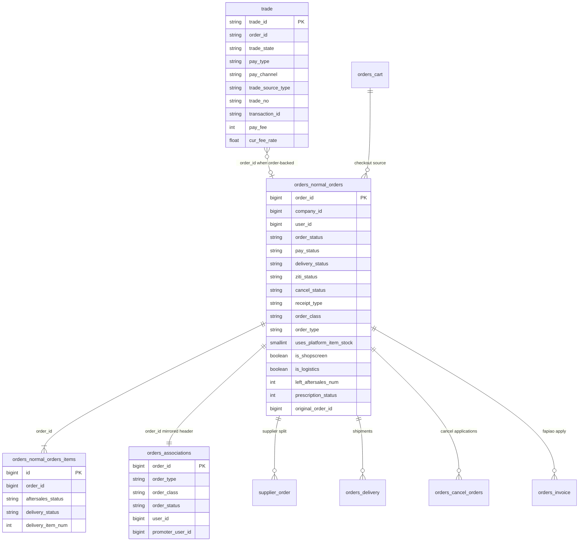
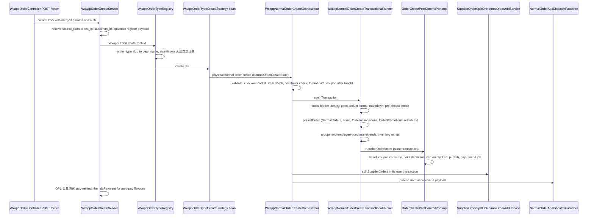
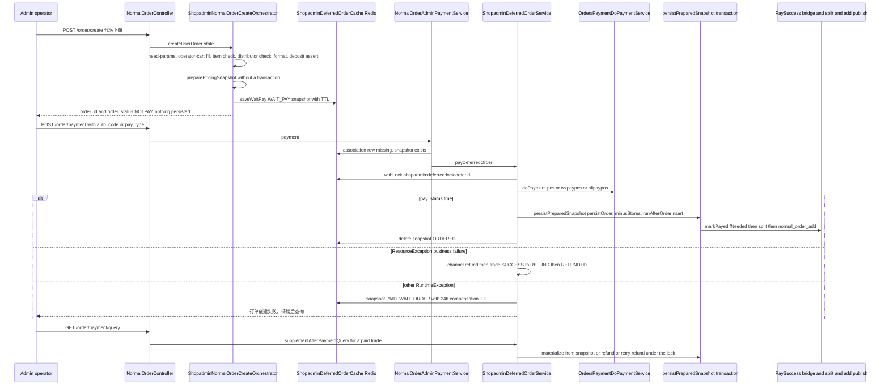
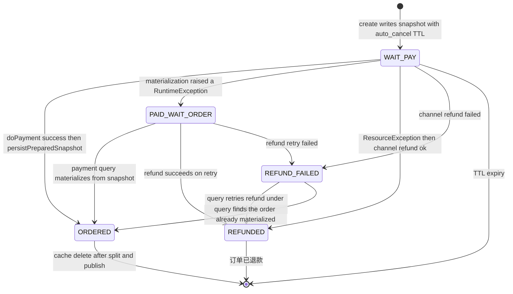
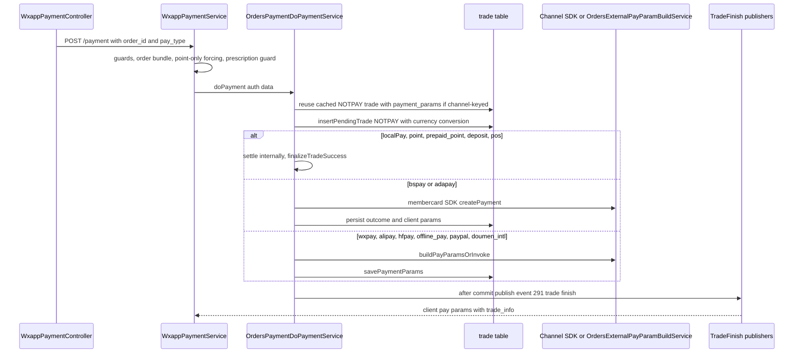

# Orders Domain (ecshopx-orders)

`ecshopx-orders` is the largest Bundle: the order, cart, logistics, and settlement domain (its `package-info.java` reads 订单、购物车、物流与结算域). It owns the physical-order lifecycle end to end — creation (17 wxapp order-type strategies plus the admin 代客下单 deferred pipeline), payment-facing trade handling, pay-success fan-out, delivery / self-pickup / local-delivery, auto-cancel and auto-finish, supplier order splitting, distributor/supplier settlement statements, invoicing (fapiao), order process logging, and the `orders_cart` table. Every business rule mirrors the legacy PHP ECShopX semantics, and all money is fen-denominated integers.

The Bundle follows the standard layering ([Bundle Layering](../architecture/bundle-layering.md) — which uses this Bundle as its worked example): controllers in `api/admin/v1` and `api/front/v1`, orchestration in `service/` (subpackages `front/wxapp`, `normal/shopadmin`, `normal/create`, `payment`, `tradefinish`, `finish`, `consumption`, `statement`, `invoice`, `localdelivery`, `dada`, `kdniao`, `fapiao/hangxin`, …), dispatch handlers/listeners in `dispatch/`, XXL-Job entries in `cron/`, owned port interfaces in `port/`, other bundles' ports implemented in `integration/` and `openapi/`. Its Maven dependencies draw the boundary: common, dispatch, work-wechat, third-party, supplier, reservation, espier, members, companys, point, aftersales, payment, chinaums-pay, deposit, hfpay, popularize, super-admin (`ecshopx-orders/pom.xml`) — notably **not** goods, which is why both cart add/list logic and large parts of the create pipeline live behind ports (below).

## The two-level payment model: Trade vs NormalOrders

Payments are two separate state machines joined by `trade.order_id`:

* **`Trade`** (`trade` table, string PK `trade_id`, `domain/Trade.java`) is the payment ticket. `trade_state` vocabulary: `NOTPAY` (created, awaiting channel), `SUCCESS` (paid), `REFUND`, `CLOSED`, `REVOKED`, `PAYERROR`. Alongside it live `pay_type` (the chosen channel: `wxpay*`, `alipay*`, `hfpay`, `bspay`, `adapay`, `offline_pay`, `paypal`, `doumen_intl`, `point`, `prepaid_point`, `deposit`, `pos`, `localPay` for zero-fee), `pay_channel` (adapay sub-channel), `trade_source_type` (membercard / normal / servers / normal_community / deposit / order_pay …), `trade_no` (a `MMdd-seq` daily sequence assigned only on SUCCESS), `transaction_id`, and the `cur_*` currency columns (`cur_fee_rate`/`cur_fee_type`/`cur_fee_symbol`/`cur_pay_fee`) storing the exchange-rate conversion of a multi-currency order.
* **`NormalOrders`** (`orders_normal_orders`, bigint `order_id` PK) is the business order. `order_status`: `NOTPAY` → (`PART_PAYMENT`) → `PAYED` / `WAIT_GROUPS_SUCCESS` (groups) → `WAIT_BUYER_CONFIRM` → `DONE`, or `CANCEL`. Independent columns track each aspect: `pay_status` (NOTPAY/PAYED/ADVANCE_PAY/TAIL_PAY), `delivery_status` (PENDING/PARTAIL/DONE), `ziti_status` (self-pickup), `self_delivery_status` (merchant self-delivery), `cancel_status` (NO_APPLY_CANCEL/WAIT_PROCESS/REFUND_PROCESS/SUCCESS/FAILS), `receipt_type` (logistics/ziti/dada/merchant), `invoice_status` (PENDING/PARTAIL/DONE). `order_class` records the business variant (`normal`, `groups`, `seckill`, `bargain`, `community`, `shopguide`, `pointsmall`, `excard`, `employee_purchase`, `shopadmin`) while `order_type` distinguishes physical (`normal`) from service orders.
* **`OrderAssociations`** (`orders_associations`) mirrors the order header across all order types — `order_id`, `order_type`, `order_class`, `order_status`, receiver/discount fields — so cross-type listing and the payment guard can work without knowing which detail table owns the row. Most state changes update `orders_normal_orders` **and** `orders_associations` together. **The admin 代客下单 pipeline deliberately delays this row**: at create time neither `orders_normal_orders` nor `orders_associations` exists, and the "does this order exist" test is exactly what later routes the payment into the deferred path (below).

The mapping between the API `order_type` slug and the two DB columns is the contract `OrderTypeSlugMapper` (`ecshopx-common/order/OrderTypeSlugMapper.java`): the slug (`normal_seckill`, `normal_shopadmin`, …) routes to a strategy, while `orders.order_type` only takes the coarse class (`normal` / `service` / `bargain`) and `orders.order_class` the fine variant (`seckill`, `shopadmin`, …). Seckill auto-cancel relies on `order_type='normal' AND order_class='seckill'` — never write the slug into `order_type`.

The invariant that ties the two together: **only `NOTPAY` trades may transition**. `OrdersTradePaymentCallbackService.applyTradePaymentNotify` (the notify entry called by the Alipay/Chinaums/DoumenIntl port impls in this bundle — see [Payments Domain](payments.md) for the notify surfaces) persists the raw callback into `trade.inital_response`, then re-reads the trade and throws "更新已处理，不需要更新" unless the fresh row is still `trade_state = NOTPAY` — the guard that makes repeated channel notifies idempotent. On `SUCCESS` it stamps `time_expire`, assigns `trade_no` from a Redis daily sequence (`h_trade_no_{company}_{distributor}_{MMdd}` hash keyed by order id, `c_trade_no_*` counter, 86400s TTL), fulfils the membercard VIP port for `trade_source_type=membercard`, and publishes the Jushuitan + trade-finish + WdtErp fan-out. The sibling internal path `OrdersPaymentDoPaymentService.finalizeTradeSuccess` (point/prepaid_point/deposit/pos/localPay) does the same NOTPAY guard as a genuine CAS — the UPDATE carries `WHERE trade_state = 'NOTPAY'` — and an already-`SUCCESS` trade re-publishes the trade-finish event idempotently instead of failing.

`NormalOrdersItems` (`orders_normal_orders_items`) carries per-line state that aftersales depends on: `aftersales_status` (WAIT_SELLER_AGREE/WAIT_BUYER_RETURN_GOODS/WAIT_SELLER_CONFIRM_GOODS/SELLER_REFUSE_BUYER/SELLER_SEND_GOODS/REFUND_SUCCESS/REFUND_CLOSED/CLOSED), `delivery_status`, `delivery_item_num`, `auto_close_aftersales_time`, and `left_aftersales_num` on the header is the aftersales quota apply decrements (see [Aftersales Domain](aftersales.md)).

Caption: the two-level payment model — `trade` (payment ticket, many per order but at most one SUCCESS) joined to the order tables via `order_id`, with `orders_associations` as the cross-type header mirror and `supplier_order` rows created by the post-create split.

## Entrypoints

### Admin REST (`/api/v1`, `@AdminAuth`)

`OrderController` is the operator workbench: `GET /orders` (list), `GET /order/{order_id}` (detail), `GET /order/process/{orderId}` (OPL history), `POST /order/{order_id}/cancel`, `POST /delivery`, `PUT` update-delivery (merchant and courier variants), `POST /confirmReceipt`, `POST /writeoff/{order_id}` + `/qr_writeoff` (self-pickup verification), `POST /order/markdown` + `/order/markdown/confirm` (price change), `POST /businessreceipt/{orderId}` and `/confirm/goods/{orderId}` (dada local delivery), invoice endpoints, order-validity settings, drug-order processing. Around it: `NormalOrderController` (the shopadmin 代客下单 checkout / create / payment / payment-query surface — below), `StatementsController` (summarized/detail/export/confirm), `InvoiceController`/`FapiaoController`/`InvoiceSellerController`, `OfflinePaymentController` (offline voucher audit), `RightsController`/`RightsLogsController`, `TradeController`/`TradeRateController`, `ShippingTemplateController`, `CompanyRel{Logistics,Dada,Shansong,Delivery}Controller` (logistics credentials), `StatementPeriodSettingController`, `DeliveryController`, `KuaidiController`, `RefundErrorLogsController` (`/trade/refunderrorlogs/*`).

### Front wxapp (`/api/v1/h5app/wxapp`)

`WxappOrderController`: `POST /order` (create-and-pay), `POST /order_new` (create, H5-auth flavour), `GET /orders`, `GET /order/{order_id}` and `/order_new/{order_id}`, `POST /order/cancel`, `POST /order/confirmReceipt`, `POST /order/delivery` (merchant self-delivery), `POST /order/updateDelivery/{delivery_id}`, `POST /order/cancel/deliverystaff`, `POST /order/deliverypackag/confirm`, `POST /order/bind/{order_id}`, `GET /ziticode`, `GET /pickupcode/{order_id}`, `GET /trackerpull` (logistics tracking), offline voucher upload/update, `POST /getFreightFee`, `GET /groupOrders`. `WxappPaymentController` (in the same package): `POST /payment` (initiate payment for an existing order), `GET /payment/config`. `CartController` is the member cart surface — see [The cart is owned here but implemented in goods and promotions](#the-cart-is-owned-here-but-implemented-in-goods-and-promotions).

### OpenAPI

`openapi/` implements the `Openapi*Port` interfaces the `ecshopx-openapi` gateway exposes at `/api/openapi/internal/v2`: order list (v1/v2)/incr/sold-list/detail, order cancel / confirm-cancel / deliver / writeoff, trade list, shipping templates, member order v2, member point order v2. Read ports reuse the same mappers as the admin surface.

### XXL-Job (`cron/`, all publish `CronAlertEvent` on failure)

| handler | service | batch shape |
| --- | --- | --- |
| `cancel-orders` | `NormalOrderCronService.scheduleCancelOrders` | direct worker, 20/page |
| `cancel-offlinepay-orders` | `NormalOrderCronService.scheduleOfflinePayCancelOrders` | direct worker (offline_pay rows) |
| `cancel-group-orders` | `GroupsOrderService.scheduleCancelOrders` | direct worker (order_class=groups) |
| `cancel-service-group-orders` | `GroupsServiceOrderService.scheduleCancelOrders` | service groups |
| `cancel-seckill-orders` | `SeckillNormalOrderService.scheduleCancelOrders` | direct worker (seckill) |
| `cancel-pointsmall-orders` | `PointsmallNormalOrderService.scheduleCancelOrders` | direct worker (pointsmall) |
| `finish-orders` | `NormalOrderCronService.scheduleFinishOrders` | publishes slow-queue job |
| `consumption-orders` | `NormalOrderCronService.scheduleConsumptionOrders` | publishes slow-queue job (skipped under OEM-shuyun flag) |
| `generate-statements` | `StatementsService.scheduleGenerateStatements` | pages merchants, publishes job per window |
| `create-invoice`, `query-invoice`, `query-invoice-red` | `OrderInvoiceService` | enqueue per pending invoice |
| `settle-order-profit`, `share-order-profit`, `update-rights-status`, `chinaums-division-{transfer,resubmit,download}-sftp` | profit/rights/division services | |

See [Scheduling (XXL-Job)](../concepts/scheduling-xxljob.md) for the executor wiring and seeded crons.

## Order creation: registry → orchestrator → transactional runner → split → fan-out

Caption: the wxapp create pipeline — the type registry picks a strategy bean, the physical-order strategy runs the shared orchestrator, one transaction persists everything including post-commit side effects, then supplier split and dispatch fan-out run after.

1. **`WxappOrderCreateService.createOrder`** normalizes params (`WxappOrderParamMergeSupport`), resolves `source_from`/`client_ip`/`salesman_id`, validates the epidemic-register payload, then delegates to `WxappOrderTypeRegistry.create`. `POST /order_new` (`createNewOrder`) is the H5 variant that additionally checks the distributor whitelist and supports promoter-as-salesman rewrites.
2. **`WxappOrderTypeRegistry`** maps the `order_type` slug to one of 17 strategy beans (`WxappOrderTypeCreateStrategy`): `normal`, `normal_groups`, `normal_seckill`, `bargain`, `normal_bargain`, `normal_pointsmall`, `normal_excard`, `normal_community`, `normal_shopguide`, `normal_shopadmin`, `normal_employee_purchase`, `normal_drug`, `service`, `service_groups`, `service_seckill`, `membercard`, `supplier_order`. Unknown slug → "无此类型订单！". All physical classes funnel into `WxappPhysicalNormalOrderCreateSupport` → the shared `WxappNormalOrderCreateOrchestrator`, with receiver validation (zip/name/mobile regexes) before the cart for normal/pointsmall and service-order required params for `service`.
3. **`WxappNormalOrderCreateOrchestrator.create`** runs the staged pipeline: `OrderCreateNeedParamsPort.validate` → recommend-merge → checkout-cart fill (per type: employee-purchase cart, groups fast-buy, member/distributor cart, pointsmall cart, operator cart) → store-adjust block check → item check → distributor check → `OrderCreateFormatDataPort.format` (+ deposit balance assert, coupon-after-freight, currency default, employee-purchase prepaid quota) → groups post-format hook → `WxappNormalOrderCreateTransactionalRunner.runInTransaction`. `getOrderTempInfo` runs the same stages without persisting (order confirmation preview).
4. **The transactional runner** is `@Transactional`: cross-border identity (CN ID card regex), point-deduct formatting, markdown (改价), pre-persist enrichment, `OrderCreatePersistencePortImpl.persistOrder`, groups/employee-purchase extend hooks, inventory minus, then **`OrderCreatePostCommitPortImpl.runAfterOrderInsert` inside the same transaction** — it saves the ziti relation (skipped for shopadmin and community classes), consumes the coupon, persists directed-crowd discount totals, deducts points (pointsmall orders deduct `order.point` at create; normal orders deduct `point_use` when pay_type ≠ point — the two branches are mutually exclusive to avoid double-deduction), empties the cart per order type, publishes the "订单创建" OPL and the pay-remind job. The cart-empty branch (`emptyCartIfSupported`) keys off `params.order_type` + `params.cart_type`: `normal_employee_purchase` → the employee-purchase empty-cart port; `normal_shopadmin` + `cart_type=fastbuy` → `OperatorCartFastBuyFacade.clearFastBuyCart` (the operator cloud fast-buy bucket); `normal_shopadmin` otherwise → per-item `OperatorCartDeleteDataService.delCartData` over `operator_cart`; community/excard orders skip; a member `cart_type=fastbuy` clears the Redis `fastbuy:{sha1(companyId+userId)}` key (writing `[]` with a 600 s TTL); and the default path deletes `orders_cart` rows matching company+user+shop(`distributor_id`) for the ordered item ids.
5. **`persistOrder`** reuses a preassigned `order_id` from `orderData` when one is present and only falls back to `NormalOrderNumericIdService.generate(userId)` otherwise — the shopadmin orchestrator pre-assigns the id before the snapshot is cached (below), so the create-and-materialize paths write the same key. `generate(userId)` is a Redis hash increment on the `yyyyMMdd` date key (companys Redis template, 1-day TTL) where the id is days-since-`2012-01-01` + (minute-of-day ÷ 90, 3 digits, capped 999) + the 5-digit zero-padded hash value (incremented by a random 1–9 per call) + `userId mod 10000` (4 digits). When `order_type` or `order_class` arrives blank (callers that bypass `OrderCreateFormatDataPort`), both are derived via `OrderTypeSlugMapper.resolve` on `order_type_slug`, with the slug defaulting to `normal_shopadmin`. `shop_id` is taken verbatim from `orderData` (the PHP `_formatOrderData` parity — 0 when `isCheckShopValid=false`), never rewritten to `distributor_id`; currency fields (`fee_type`/`fee_rate`/`fee_symbol`) come from `CompanyDefaultCurrencyService` when the order data lacks them and are stamped onto the order, every item line, and the association row; `NormalOrdersRelSupplier` rows are inserted from the `supplier_freight_fee` map. The shopadmin `receiver_*` address keys the format port passed through are copied onto the order row (`applyReceiverFieldsFromOrderData`, `receiver_name` truncated to 50 code points), and `uses_platform_item_stock` is normalized to the persisted `0`/`1` flag. The new row starts `order_status=NOTPAY`, `pay_status=NOTPAY`, `delivery_status=PENDING`, `cancel_status=NO_APPLY_CANCEL`, `ziti_status=NOTZITI`, `self_delivery_status=NOTMERCHANT`.
6. **Supplier split** (`SupplierOrderSplitOnNormalOrderAddService.split`, its own transaction) collects supplier ids from items and `NormalOrdersRelSupplier`, then inserts one `supplier_order` row per supplier sharing the parent `order_id` — payment, cancel, and settlement all consult these children (adapay/bspay payment loads them as `sub_orders` for split payment).
7. **`NormalOrderAddDispatchPublisher`** fans the new order out (`event:orders:normal_order_add`) to youshu and marketing-center listeners (registered in bootstrap configs); the wxapp service then continues to `doPayment` for the auto-pay flavours (`point` when the client explicitly chose it and total is 0; `offline_pay` salesman orders).

## Admin 代客下单: the deferred create-and-pay pipeline

The shop-admin POS flow (`NormalOrderController`, `@AdminAuth`, route aliases `order.checkout` / `order.create` / `order.payment` / `order.payment.query`) is a **create-and-pay** surface for staff creating an order on behalf of a walk-in customer (代客下单). Its defining property: **creating the order does not persist it**. The order exists only as a Redis snapshot until the money actually lands, so an abandoned checkout leaves no `orders_normal_orders` row, no inventory deduction, and no `normal_order_add` fan-out to clean up.

* `POST /checkout` (购物车结算) → `NormalOrderAdminCheckoutService.checkout`: the same staged pipeline as create (`NormalOrderAdminCreateUserOrderParamBuilder.build` → `assertKnownOrderType` (only `normal_shopadmin`) → need-params → operator-cart fill → item check → distributor check → format → cross-border identity → point-deduct format → markdown), ending in `ShopadminNormalOrderTempInfoEnrichmentService.apply` — the order-confirmation preview (it pre-assigns an `order_id` and `auto_cancel_time` too, but nothing is persisted).
* `POST /order/create` (代客下单) → `NormalOrderAdminCreateUserOrderService.createUserOrder` → `ShopadminNormalOrderCreateOrchestrator.create`: the same staged pipeline plus `assertDepositBalance`, but instead of the transactional runner it calls only `ShopadminNormalOrderCreateTransactionalRunner.preparePricingSnapshot` — the **non-transactional** pricing half (cross-border identity, point-deduct formatting, markdown, pre-persist enrichment). It then pre-assigns the `order_id` (`NormalOrderNumericIdService.generate(userId)`, defaulting `pay_type` to `pos` when neither orderData nor params carry one) and writes a `ShopadminDeferredOrderSnapshot` (status `WAIT_PAY`, `expireAt = now + ttl`, TTL = `auto_cancel_time − now` delta, falling back to 15 × 60 s) into Redis under `shopadmin:deferred:{companyId}:{orderId}` (shared Redis, JSON-serialized `params` + `orderData`). **No DB persist and no `normal_order_add` publish** — pinned by `ShopadminNormalOrderCreateOrchestratorNormalOrderAddDispatchPublishProbeTest` and `NormalOrderAdminCreateUserOrderServiceNormalOrderAddDispatchPublishProbeTest`, which verify only `preparePricingSnapshot` + `saveWaitPay` are invoked and the response carries the preassigned `order_id` with `order_status=NOTPAY`.
* `POST /order/payment` (下单支付) → `NormalOrderAdminPaymentService.payment`: requires `pay_type` or `auth_code` ("支付方式必填"); an `auth_code` is classified by regex — `^1[0-5][0-9]{16}$` → `wxpaypos` (WeChat micropay), `^(25|26|27|28|29|30)[0-9]{14,22}$` → `alipaypos` (Alipay face-to-face barcode) — otherwise `pay_type` defaults to `wxpayh5`. It looks the order up in `orders_associations`; **when that row is missing but the deferred cache has the snapshot, it delegates to `ShopadminDeferredOrderService.payDeferredOrder`** — the fallback that makes the two-phase create transparent to the caller. With an association row present it runs the ordinary admin pay path (supplier_order rejection, NOTPAY/PART_PAYMENT guard, effective-type check, order bundle build, point-forcing for zero-cash, pay-type persist, prescription/deposit/alipaymini guards) and calls `doPayment`.
* `GET /order/payment/query` (支付结果查询) → `NormalOrderAdminPaymentQueryService.queryPayment` (trade_id required, "支付单号不存在" when blank/0): resolves the trade state through `OrdersPaymentTradeQueryService.resolve` (a SUCCESS trade answers directly; otherwise the channel is queried — wxpay `pay/orderquery`, Alipay openapi, doumen — and a confirmed SUCCESS is finalized through `finalizeTradeSuccessAfterChannelQuery`), then, for a paid trade, calls `ShopadminDeferredOrderService.supplementAfterPaymentQuery` — the recovery leg (below).

Caption: the admin deferred create-and-pay pipeline — create only caches a WAIT_PAY snapshot, payment materializes the order, marks it paid, splits suppliers and publishes normal_order_add, and every failure path either refunds the customer or parks the snapshot for query-time recovery.

### Snapshot lifecycle

Caption: `ShopadminDeferredOrderSnapshot` statuses with the 24h `COMPENSATION_TTL_SECONDS` window for every non-ORDERED terminal or recovery state.

`ShopadminDeferredOrderService.payDeferredOrder` resolves the pay type first: `auth_code` regex classification (same patterns), else the request `pay_type`, else the snapshot's — and only `DEFERRED_PAY_TYPES` (`pos`, `wxpaypos`, `alipaypos`) are accepted ("暂不支持该支付方式"). A `REFUNDED` snapshot answers "订单已退款". Execution runs under the `shopadmin:deferred:lock:{orderId}` Redis lock (`setIfAbsent` with a UUID token, 120 s TTL, token-checked unlock; contention → "订单处理中，请稍后查询", Redis outage → "订单缓存不可用"/"订单处理繁忙，请稍后查询"). Inside the lock, in order:

1. **Already materialized** (`orders_normal_orders` has the id) → `recoverExistingOrder`: if the order is still `NOTPAY` apply `markPayedIfNeeded`, then re-run the supplier split; return a paid response.
2. **Already-paid trade exists** (`trade_state` SUCCESS/REFUND for the order) → REFUND answers "订单已退款", SUCCESS materializes from the snapshot (`materializeFromSnapshotAfterPaid`) and returns the paid result.
3. **Otherwise `doPayment`** with the payment data rebuilt from the snapshot (`trade_source_type=normal`, `pay_fee = snapshot.totalFee`, `auth_code` forwarded). `pos` finalizes synchronously; `wxpaypos`/`alipaypos` invoke the WeChat micropay / Alipay barcode channel in `OrdersExternalPayParamBuildService` and return `pay_status` when the channel confirms (Alipay `10003` USERPAYING stays pending). A non-true `pay_status` returns the channel result unchanged — the snapshot stays `WAIT_PAY`.
4. **On `pay_status=true`** → `persistAndFinishAfterPay` under the lock: `ShopadminNormalOrderCreateTransactionalRunner.persistPreparedSnapshot` (one `@Transactional`: `persistOrder` → `minusStores` → `runAfterOrderInsert`), then `OrdersTradeFinishNormalOrderPaySuccessApplyService.markPayedIfNeeded` (snake_case trade row — the same NOTPAY→PAYED/DONE/WAIT_GROUPS_SUCCESS CAS the bridge listener uses; a counter ziti order jumps straight to `DONE` through the ziti auto-complete, while a `uses_platform_item_stock` fast-buy order stays `PAYED` awaiting delivery), then `splitAndPublishOnce` (supplier split + the **single** `normal_order_add` publish for shopadmin orders), then the cache entry is deleted (`ORDERED` is therefore observable only as absence). Split and publish are exactly-once because they run only on this path and under the lock.
5. **Failure semantics after a successful charge.** `ResourceException` (business rejection — invalid snapshot data, shop/distributor state) → `refundAfterBusinessFailure`: channel refund via `WxpaySecapiAftersalesRefundRunner` (wxpay*, requires merchant API cert) or `AlipayTradeAftersalesRefundRunner` (alipay*, SUCCESS or PROCESSING counts as ok), `pos` is treated as refunded (cash, nothing to reverse); on success the trade is flipped `SUCCESS→REFUND` by CAS (`WHERE trade_state='SUCCESS'`) and the snapshot becomes `REFUNDED`; on failure it becomes `REFUND_FAILED` (both with the 24 h `COMPENSATION_TTL_SECONDS` so operators can still see and retry them). Any other `RuntimeException` → `markPaidWaitOrder` (`PAID_WAIT_ORDER`, 24 h TTL) and the caller sees "订单创建失败，请稍后查询" — the money is held, not refunded.
6. **Recovery** — `GET /order/payment/query` on a `SUCCESS` trade calls `supplementAfterPaymentQuery`: if the order exists, `recoverExistingOrder` (markPayedIfNeeded when still NOTPAY, then re-split — the idempotent landing for a payment that succeeded after a crash); if the snapshot is gone entirely, `refundWithoutSnapshot` refunds the orphaned charge and CAS-flips the trade; a `REFUND_FAILED` snapshot retries `retryRefundLocked` under the lock (or recovers an already-materialized order first); any other snapshot materializes from the cached state.

<!-- openwiki: broken internal link [../workflows/operator-fast-buy-flow.md] file "../workflows/operator-fast-buy-flow.md" does not exist. Fix the href or restore the target, then delete this comment. -->
The param builder fixes the shopadmin semantics: `promotion=normal`, `order_source=shop_offline`, `is_online_order=false`, `receipt_type=ziti` — **unless `cart_type=fastbuy`, which flips it to `logistics`** (the cloud-warehouse 立即购买 variant ships from the platform bucket rather than being picked up at the counter) — `order_type=normal_shopadmin`, `source_from=dianwu`, `pay_type` defaulting to `pos`, markdown pre-validated by `ShopadminNormalOrderMarkdownValidator` ("改价参数格式错误", "确认整单还是按件改价", "整单改价金额必填", "按件改价商品ID必填", "按件改价商品总价和折扣必须设置一个"), and a `user_id` resolved to a member row via `MemberLookupByUserIdOnlyService.requireMemberRowForFirstHop` (mobile/appids copied into params); the seven `receiver_*` address keys present in the request are copied into params for the fastbuy shipping variant. The operator cart itself lives in **companys** (`OperatorCartController` — `POST /cartfastbuyadd` 店务立即购买（云仓分桶）, `/cartdataadd`, `/cartdataupdate`, `/scancodeAddcart`, `GET /cartdatalist`, delete — over `operator_cart` plus the `OperatorShopFastBuyRedisService` bucket), read through the goods-implemented `OperatorCartDataListFacade` / `OperatorCartFastBuyFacade` and filled into the create state by the goods-implemented `OrderCheckoutCartPort.fillItemsFromOperatorCart` — which branches on `cart_type=fastbuy` **before** the ordinary operator-cart read: the platform-store gate `DistributorPlatformStoreBuyGateService.assertShopadminPlatformStoreBuyAllowed` (立即购买需指定有效店铺 / 无效店铺 / 该店铺未开启云仓可购买), then `revalidateFastBuyPlatformStock` (立即购买已失效，请重新加购 for a stale bucket), then `getFastBuyCartDataList`; every other cart type goes through `OperatorCartDataListFacade.getCartDataList`. Both paths take checked rows from the first `valid_cart` block ("购物车为空" when none) and attach `_checkout_cart_meta`; at materialization `runAfterOrderInsert` empties them as described above. The whole end-to-end fast-buy flow (add gates, bucket split, checkout, order create, clear) is traced on [Operator Fast-Buy Flow](../workflows/operator-fast-buy-flow.md).

## Payment: `WxappPaymentService` → `OrdersPaymentDoPaymentService`

`POST /payment` (`WxappPaymentService.payment`) is the pay-an-existing-order surface. Guards: order must exist in `orders_associations`; `supplier_order` type is rejected ("暂不支持该订单类型的支付"); `order_status` must be `NOTPAY` or `PART_PAYMENT` ("当前订单不需要支付"); the effective order type must be payment-bundle supported; an order whose cash total is 0 with points > 0 is forced to `pay_type=point`; prescription orders must have an approved prescription (`OrderPrescriptionPaymentGuardService`); deposit requires a logged-in member card, alipaymini requires the alipay user id. `GET /payment/config` (`doPayment`, wxpay/hfpay/deposit only) is the QR-scan surface: with an `order_id` it pays an existing NOTPAY/PART_PAYMENT order, without one it builds a store-consumption trade (`trade_source_type=order_pay`) from distributor/shop + amount.

`OrdersPaymentDoPaymentService.doPayment` is the shared core both call (and the one the deferred path charges through):

* **Config gate** — per pay_type: wxpay/alipay validation services, hfpay port, bspay Redis setting (`bspaySetting:{sha1(companyId)}` in companys Redis), adapay Redis setting (`adaPaySetting:` in shared Redis), everything else passes.
* **Cache reuse** — for adapay/bspay, if a NOTPAY trade for the same company+order+pay_type+pay_fee+(pay_channel) already carries `payment_params`, the stored client payload is decoded and returned instead of creating a new channel order.
* **Trade insert** — `insertPendingTrade` reuses an open NOTPAY trade or inserts one with `trade_state=NOTPAY`, encrypted mobile, dealer/merchant ids resolved from the distributor, and currency conversion for wxpay/alipay/hfpay: when a fee rate is supplied (or the company's default currency rate), `pay_fee`/`total_fee` are stored converted and the original amounts go to `cur_pay_fee` etc.
* **Channel branches** — zero-fee orders (non-prescription) finalize immediately as `localPay`; `point` deducts member points *unless* `trade_source_type=normal_pointsmall` (pointsmall already deducted at create — pinned against double-deduction); `prepaid_point` (employee-purchase prepaid quota, deducted at create) and `pos` and `deposit` (via `DepositTradeConsumeService.consume`) finalize synchronously; `bspay`/`adapay` call the membercard SDK services and persist `bspay_req_date`/`inital_request`/`transaction_id` plus the client params; `wxpay*`/`alipay*`/`hfpay`/`offline_pay`/`paypal`/`doumen_intl` delegate to `OrdersExternalPayParamBuildService` (which invokes the channel SDK or returns a pending state — `wxpaypos` micropay and `alipaypos` barcode return `pay_status=true` synchronously when the channel confirms). Any other pay_type throws "无此类型支付".
* **`finalizeTradeSuccess`** — the CAS NOTPAY→SUCCESS update (also `finalizeTradeSuccessAfterChannelQuery` when a channel-order query confirms success), assigning `trade_no`, then `maybeFulfillVipGradeMembercardSale` (membercard trades) and `publishTradeFinishEvent` (the `OrdersTradeFinishDispatchPublisher` bean, which is `OrdersTradeFinishAfterCommitDispatchPublisher` registered `@Primary` in bootstrap for `event:291:OrdersBundle\Events\TradeFinishEvent` — it publishes after commit when a transaction is active). Already-`SUCCESS` trades re-publish idempotently.

Caption: the payment core — order/payment guards, trade reuse-or-insert, per-channel branching, and the after-commit trade-finish publish that unlocks the pay-success bridge.

## Trade-finish fan-out and the pay-success bridge

Every trade that reaches SUCCESS publishes the trade-finish event (`event:291:OrdersBundle\Events\TradeFinishEvent`, plus the `event:292` twin for admin offline-bank approval). One of its listeners — registered in bootstrap (`OrdersTradeFinishNormalOrderPaySuccessBridgeDispatchListenerRegistrationConfig`, `@Order(77)`, sync) — is the orders-side bridge that converts a paid trade into a paid order:

`OrdersTradeFinishNormalOrderPaySuccessBridgeDispatchListener.onEvent` → `OrdersTradeFinishNormalOrderPaySuccessApplyService.markPayedIfNeeded` (one transaction):

* Only for `trade_state=SUCCESS` payloads whose `trade_source_type` is in `NORMAL_TRADE_SOURCE_TYPES` (`normal`, `normal_normal`, `normal_groups`, `normal_seckill`, `normal_community`, `bargain`, `normal_shopguide`, `normal_pointsmall`, `normal_employee_purchase`).
* Target status: `WAIT_GROUPS_SUCCESS` for `normal_groups`; `PAYED` otherwise — **except shopadmin-class orders, which jump to `DONE` only when the order is NOT `uses_platform_item_stock`** (the PHP parity: 店务收银自提支付后 DONE；云仓立即购买（uses_platform_item_stock）保持 PAYED 待发货 — a cloud-warehouse fast-buy order has goods to ship, so it lands in `PAYED` awaiting delivery, and only the counter self-pickup variant completes immediately). The update is guarded by `order_status = 'NOTPAY'` on the main row — zero affected rows means someone else already paid/cancelled, and the method returns empty so no pay-success event fires.
* Mirrors the same status onto `orders_associations` and (for `PAYED`/`DONE` targets) promotes `supplier_order` children from `NOTPAY`/`PART_PAYMENT`, setting their `pay_status=PAYED`.
* **Ziti auto-complete for shopadmin and shopscreen orders** (`maybeAutoCompleteShopadminOrShopscreenZiti`, comment 店务代客 / 大屏自提单支付成功后自动完成自提与收货): fires when the order class is `shopadmin` **or** `is_shopscreen` is true, `pay_status=PAYED` and `receipt_type=ziti`. It computes `order_auto_close_aftersales_time = now + latest_aftersale_time days` from `OrderValiditySettingRedisReadService.readPlatformSetting(companyId)` (`service/setting/`, companys Redis hash with defaults), then `markNonLogisticsItemsDelivered` sets every non-logistics line (`is_logistics` false or null) to `delivery_status=DONE`, `delivery_item_num=num`, `auto_close_aftersales_time`. The header update then stamps `ziti_status=DONE`; when the whole order is not `is_logistics`, the order jumps straight to `DONE` with `delivery_status=DONE`, `delivery_time`, `end_time`, `order_auto_close_aftersales_time` and `left_aftersales_num` summed from the item nums; when it is a logistics order and any non-logistics line was delivered, the header only flips `delivery_status=PARTAIL` (the mixed case — platform-shipped lines still await courier delivery).
* On success it builds the pay-success payload (order, user, pay_type, trade ids, fees) and the bridge publishes `NormalOrderPaySuccessDispatchPublisher` → `event:288:OrdersBundle\Events\NormalOrderPaySuccessEvent` (ASYNC/REDIS), which youshu, wsugc, shuyun-open-platform and employee-purchase listeners consume.

The same `markPayedIfNeeded` is invoked **directly** (not via the bus) by the deferred pipeline after `persistPreparedSnapshot`, which is why a shopadmin order can reach `DONE` without a dispatch round-trip — the trade-finish event the charge published found no order row yet, so the bridge returned empty at that moment.

The rest of the trade-finish fan-out lives in `dispatch/TradeFinish*DispatchListener` beans in this bundle: `OrdersTradeFinishPaymentSuccessOrderProcessLogDispatchListener` (writes the "订单支付" OPL for SUCCESS trades), work-wechat and wxa-template notifications, `TradeFinishCountBrokerageDispatchListener`, `TradeFinishProfitDispatchListener`, `TradeFinishCustomDeclareOrderDispatchListener` (customs), `TradeFinishFapiaoDispatchListener`, `TradeFinishLinkMemberDispatchListener`, notify-push and SMS listeners, `UpdateItemSalesDispatchListener` (item sales counts). Jushuitan and WdtErp trade-finish upload/ack assembly live in `integration/` (`JushuitanTradeFinishOrderUploadAssemblePortImpl`, `WdtErpTradeFinishPushSelfAssemblePortImpl`).

## Order Process Log (OPL)

The order process log (`orders_process_log`) is written exclusively through `OrderProcessLogPublishPort` (interface in ecshopx-common, implemented in **ecshopx-dispatch**): `publish` registers an after-commit synchronization that emits `event:orders:order_process_log` via `DispatchOptions.oplQueuedAfterCommit()` (publishes inline when no transaction is active). The `OrderProcessLogDispatchListener` in this bundle consumes it and `OrderProcessLogBusService.persistEntitiesMap` inserts the row (operator_type/operator_id, remarks/detail, params JSON, is_show). A secondary Spring-event path exists for service/excard orders: `OrderProcessLogSpringEvent` + `OrderProcessLogSpringEventListener` (`@TransactionalEventListener(AFTER_COMMIT, fallbackExecution = true)`) calling the same bus service. Roughly 60 `*OrderProcessLogEventAsyncConsumeTest` / `*OrderProcessLogDispatchPublishProbeTest` classes under `src/test/.../orders/integration` pin the publish and async-consume envelope for every state change — the `WxappOrderController` Javadoc documents the re-verification commands (e.g. `mvn -pl ecshopx-orders -Dtest=AdminOrderDeliveryOrderProcessLogDispatchPublishProbeTest,AdminApiV1OrderDeliveryOrderProcessLogEventAsyncConsumeTest test`). See [Dispatch Bus](../concepts/dispatch-bus.md) for the transport.

## Cancellation

Buyer-side `POST /order/cancel` (`WxappOrderCancelService`) validates the association row: the caller must be the buyer or the community group chief (matched via `CommunityOrderRelActivity.chief_id`); only `order_type=normal`; groups orders in `WAIT_GROUPS_SUCCESS` cannot be cancelled. It then routes by delivery state: `PENDING` → `AdminNormalOrderFullCancelService.execute` (whole-order cancel), anything else → `AdminNormalOrderPartialCancelService` (per-line aftersales creation, see [Aftersales Domain](aftersales.md)).

`AdminNormalOrderFullCancelService` (`@Transactional`) is the shared whole-order cancel for admin, buyer, and chief:

* Guards: `cancel_status` must be `NO_APPLY_CANCEL` or `FAILS`; for non-dada receipts the order must be `NOTPAY`/`REVIEW_PASS`/`PAYED` and `delivery_status=PENDING` (with explicit platform-self-sub-cancel and shop-remaining-full-cancel escape hatches for partially shipped orders); approved drug orders cannot cancel; dada orders require a `NormalOrdersRelDada` row in a cancellable status.
* `NOTPAY` branch: insert an `orders_cancel_orders` row, close the order, restore points and upoints, schedule the third-party trade-update dispatch.
* `PAYED` branch: insert/update the cancel row, create refunds (aftersales-refund rows through `AftersalesRefundService`), apply `cancel_status=WAIT_PROCESS`, call dada formal cancel when applicable.
* For paid cancels it publishes the Jushuitan and WdtErp trade-cancel dispatch events plus the `WdtErpTradeCancelSpringEvent` inside the transaction, cancels the invoice, writes the OPL; then registers after-commit `TradeRefund` (`@Qualifier("tradeRefundAsyncFanOut")`) **before** `NormalOrderCancel` (`event:orders:normal_order_cancel`) so the refund dispatch lands first — the source comment pins this ordering.

The auto-cancel cron family (`NormalOrderCronService.scheduleCancelOrders` and siblings) pages 20-at-a-time over `NOTPAY` orders whose string `auto_cancel_time` is due (CAST-computed against `now+60s`), scoped by `order_class` and excluding `offline_pay`/`point` pay types (offline_pay has its own handler that also flips `offline_payment.check_status=9` per order, wrapped in try/catch so one failure skips only that order). Beyond flipping `order_status`/associations to `CANCEL`, each order runs the restore fan-out: invoice cancellation, supplier-order cancellation, marketing join-count decrement (Redis), point/upoint return, the "订单取消" OPL, the marketing normal-order-cancel dispatch (after-commit when a transaction is active), employee-purchase restore, per-item store and purchase-limit restores, limited-time-sale quota restores, and coupon/directed-promotion restore. The seckill variant restores the seckill ticket counts per item; the groups variant restores group activity stock; the pointsmall variant restores points.

Because the deferred snapshot is keyed by the preassigned `order_id` and nothing is persisted, the WAIT_PAY window self-cleans: the cache TTL is exactly the auto-cancel window, so an unpaid 代客下单 order expires out of Redis rather than needing the cancel cron at all.

## Confirm receipt and auto-finish

`WxappNormalOrderConfirmReceiptService.confirmReceipt` (wxapp `POST /order/confirmReceipt`; the admin surface uses `AdminNormalOrderConfirmReceiptService` with the same two services): only `order_type=normal`; the caller must own the order; `order_status` must be `WAIT_BUYER_CONFIRM`; delivery must be `DONE`/`PARTAIL`; `cancel_status` must be `FAILS`/`NO_APPLY_CANCEL`; and no item line may sit in `aftersales_status` `WAIT_SELLER_AGREE`/`WAIT_BUYER_RETURN_GOODS`/`WAIT_SELLER_CONFIRM_GOODS` ("售后中的订单不能确认收货!"). Then `NormalOrderConfirmReceiptTransactionService.applyConfirmReceiptInTransaction` flips the order, associations and supplier orders to `DONE` (guarded by `order_status='WAIT_BUYER_CONFIRM'`), stamps `order_auto_close_aftersales_time = now + latest_aftersale_time days` on the header and every line, and `NormalOrderConfirmReceiptAfterCommitService.run` performs the post-transaction side effects: supplier receipt sync, the "订单完成" OPL, chinaums division relation write, bonus-point grant, brokerage settlement, and profit-plan close time.

The `finish-orders` cron does not process inline — `scheduleFinishOrders` publishes the `FinishOrderJob` (slow queue) each tick and the `FinishOrderJobHandler` → `FinishOrderJobService` → `FinishOrderBatchService.runEquivalentToFinishOrderJobHandle` executes the equivalent batch: pages `WAIT_BUYER_CONFIRM` orders past `auto_finish_time`, applies the same per-order semantics (transaction service + after-commit effects), skipping lines in the aftersales-blocking statuses. `consumption-orders` similarly publishes `ConsumptionOrderJob` (member consumption aggregation for grade upgrades; skipped entirely when `ecshopx.request-field.oem-shuyun=true`).

## Settlement statements

`generate-statements` → `StatementsService.scheduleGenerateStatements` pages distributors (1000/page, only companies whose product model is `platform`) and suppliers, resolves each merchant's settlement period (per-distributor/per-supplier `statement_period_setting` with company defaults), computes the next window end from the Redis cursor (`StatementSettlementCursorRedisPort.getDistributorLastEnd`/`getSupplierLastEnd`, falling back to the row's `created` or an inferred last-end), and when the window is fully in the past dispatches one `GenerateStatementsJob` per merchant with `{company_id, distributor_id|supplier_id, period, last_end_time, merchant_type}`.

`GenerateStatementsJobHandler` → `StatementGenerateJobInliner.runJob`: one transaction per window, looping windows forward while `endTime < now`. Inside a window it inserts the `statements` header (`merchant_type` distributor/supplier, `statement_no` generated from the merchant id + random), pages settled-eligible orders 500 at a time into `statement_details` (distributor fee = total − refund − intra-city freight − cost, with dada receipts counted as intra-city freight and others as main freight), marks the consumed trades `is_settled=true`, accumulates the header totals, and advances the Redis cursor to the window end. Any failure aborts only that merchant's window (logged at debug) and returns false so the loop stops — the cursor stays put and the next cron tick retries. `statement_status` runs `ready` → `confirmed` → `done` through the admin `StatementsController` confirm/settle surface. Alongside: `settle-order-profit` / `share-order-profit` crons feed the profit-sharing tables (`OrderProfit`, `OrderProfitSharing`, `OrderItemsProfit`).

## Invoicing (fapiao)

`OrderInvoiceService` schedules three crons over `orders_invoice`: `create-invoice` selects `invoice_status=pending AND invoice_method=online` rows and dispatches per-company with the apply-node setting deciding the time constraint (order end time vs aftersales close time); `query-invoice` re-queries `inProgress` rows stale by 180 seconds; `query-invoice-red` re-queries `waste`-status red-flush invoices missing `invoice_file_url_red`. The job handlers call `HangxinFapiaoService` (the Hangxin e-invoice gateway, DES-key transport via `HangxinRequestClient`/`HangxinTransportCrypto`) to create/query/red-flush. Red-flushing is also triggered by aftersales refunds through `OrderInvoiceRedFromAftersalesPortImpl` (the port aftersales calls), and order cancellation cancels pending invoices via `OrderInvoiceCancelOnOrderCancelService`.

## Logistics and local delivery

<!-- openwiki: broken internal link [../workflows/member-notify-fanout.md] file "../workflows/member-notify-fanout.md" does not exist. Fix the href or restore the target, then delete this comment. -->
* **Courier delivery** — admin `POST /delivery` and `PUT /order/updateDelivery` funnel into `AdminNormalOrderDeliveryCoreService` (the shared core for every delivery-writing surface): it inserts `orders_delivery` (+items), stamps `delivery_corp`/`delivery_code`, flips `delivery_status` (PENDING→PARTAIL→DONE → `order_status=WAIT_BUYER_CONFIRM` on both header and association), publishes the "订单发货" OPL, the `event:orders:wx_order_shipping` and `event:orders:normal_order_delivery` fan-outs (youshu, marketing-center, DM-CRM, shuyun — the dispatch publishes registered after-commit, the third-party trade update too), and then fires the **delivery-success notify hook**: `sendDeliveryNotices` calls `OrderDeliverySuccessNotifyPort.sendDeliverySuccessNotice` once per shipment, or once per item with `item_name` for a `sep` (按包裹分开发货) delivery. The port has two impls selected by `ecshopx.orders.delivery-success-notify.enabled`: `orderDeliverySuccessNotifyWechat` (default on, `matchIfMissing=true`) builds the `orderDeliverySucc` subscribe-message payload — recipient (wxa_appid + openId) from `OrderTradeMiniProgramRecipientLookupPort`, `item_name` falling back to the order title, the courier display name — and sends it through `OrderDeliverySuccessWxaSubscribeSendPort` (implemented in promotions, `OrderDeliverySuccessWxaSubscribeSendAdapter` → the template-message sender), swallowing any failure at debug; `orderDeliverySuccessNotifyNoOp` (`havingValue="false"`) sends nothing. This mirrors the PHP `AbstractNormalOrder::sendDeliverySucc` contract and is the orders-side entry into the member-notify fan-out — see [Member Notify Fan-out](../workflows/member-notify-fanout.md) for where the template send lands; the payload envelope is pinned by `OrderDeliverySuccessNotifyWechatServiceTest`. `GET /trackerpull` pulls tracking from the kdniao (快递鸟) integration (`service/kdniao`); `CompanyRelLogisticsController` manages courier credentials and mappings.
* **Self-pickup (ziti)** — `ziti_code`/`pickupcode` endpoints and the `NormalOrderZitiWriteoffService` write-off flow (admin `/writeoff/{order_id}`, `/qr_writeoff`, openapi writeoff port) verify and complete the pickup; `NormalOrdersRelZiti` stores pickup location/date; the ziti QR mapping lives in Redis. The shopadmin 代客下单 flow is `receipt_type=ziti` end to end and completes itself on payment (no writeoff step).
* **Local delivery (same-city)** — `receipt_type=dada` orders get a `NormalOrdersRelDada` row; `LocalDeliveryBusinessReceiptService.businessReceipt` (admin `/businessreceipt/{orderId}`, 达达商家接单) branches on the `common.local-delivery-dirver` property (`dada` default, `shansong` the alternative — only these two are supported), calls the respective port (`DadaLocalDeliveryReceiptPort` / `ShansongLocalDeliveryReceiptPort`), updates the rel row's `dada_status=1`, and publishes the "商家接单" OPL shared by both drivers. Full cancel refuses when the rider has picked up (non-cancellable `dada_status`).
* **Merchant self-delivery** — `self_delivery_status` (CONFIRMING→RECEIVEORDER→PACKAGED→DELIVERING→DONE) advanced by the wxapp `/order/delivery` and `/order/updateDelivery` endpoints reusing the admin services; OPL is emitted from the service branches, never the controller (the controller Javadoc pins this).

## The cart is owned here but implemented in goods and promotions

The `orders_cart` table (`Cart` entity, `CartMapper`) and `CartController` (`@FrontAuth`, `/api/v1/h5app/wxapp`) live in this bundle, but the read-heavy endpoints delegate through ports declared in `orders/port/` and implemented in other bundles — the documented pattern that keeps the Maven graph free of an orders→goods/promotions edge:

| endpoint | delegate | implemented in |
| --- | --- | --- |
| `POST /cart` 加购 | `WxappCartAddPort.addCart` (params merged with the wxapp/H5 auth claim map by `WxappCartParamMergeSupport.applyAuthAndCartDefaults`, then the add + a list refresh) | **ecshopx-goods** `WxappCartAddPortImpl` |
| `GET /cart` 购物车列表 | `WxappCartListPort.getCartList(companyId, userId, shopId, shopType)` | **ecshopx-goods** `WxappCartListPortImpl` |
| `GET /cart/list` 分销商购物车 | `WxappCartListPort.getDistributorCartList` | **ecshopx-goods** |
| `GET /cartcount` 购物车数量 | `WxappCartListPort.getCartItemCount(companyId, authUserId, shopId, cartType, shopType, iscrossborder, isShopScreen, promoterUserId, buyUserId)` | **ecshopx-goods** |
| `POST /cart/check/plusitem` 加价购 | `WxappCheckPlusItemPort.checkPlusItem` (records the chosen plus-buy SKU in the `PlusBuyCartRedisKeys` bucket, zeroed when the gift-item lookup misses) | **ecshopx-promotions** `WxappCheckPlusItemPortImpl` |

Local cart mutations stay in this bundle over `orders_cart`: `DELETE /cartdel` + `DELETE /cartdelbat` (`WxappDeleteCartDataService`), `PUT /cartupdate/checkstatus` 选中状态 (`WxappUpdateCartCheckStatusService` — cart ids accept single, array and comma-string forms, else `购物车参数错误`; `is_checked` is parsed loosely), `PUT /cartupdate/num` 商品数量 (`WxappUpdateCartNumService`), `PUT /cartupdate/batchnum` 批量数量 (`WxappBatchUpdateCartNumService`) and `PUT /cartupdate/promotion` 促销 (`WxappUpdateCartItemPromotionService`, which itself crosses to promotions for `WxappCartGoodsPromotionApplyRulesPort.assertUserCanApplyGoodsPromotion` and stamps `activity_type=goods_promotion`).

Controller-level guards worth knowing: every authed endpoint resolves the claim map from the wxapp request attribute, falling back to the H5 claims, else throws `UnauthorizedException("未登录")`; `GET /cart/list` is the one `@FrontNoAuth` surface (company id from claims, then the H5 company attribute, else `UnauthorizedException("未授权")`, and a falsy `user_id` short-circuits to an empty list — except `cart_type=offline`, which lists for walk-in buyers); `POST /cart` strips a blank `shop_type` so the goods add port is the one that rejects it, and `WxappCartParamMergeSupport` applies the buy-on-behalf rule there (`promoter_user_id == session user_id` and non-zero → `user_id` becomes `buy_user_id`); `GET /cartcount` throws `BadRequestException("参数非法")` when `shop_type` is blank and defaults `cart_type=cart`; `PUT /cartupdate/batchnum` throws `BadRequestException("参数非法")` when `cart` is missing, not a list, or an entry is not a map (an empty list returns `[]` without calling the service); `/cartupdate/checkstatus` applies the simpler buy-on-behalf rule (`buy_user_id` non-zero replaces the auth user, unconditionally); `/cartupdate/promotion` validates `cart_id`/`activity_id` strictly (`购物车参数错误` / `商品促销id错误`), the service accepts only `shop_type=distributor` (default when blank, else `ResourceException("无此购车类型")`) and re-checks via the promotions port before stamping `activity_type=goods_promotion`; the shop filter accepts `shop_id` or `distributor_id` and treats `undefined`/blank/`0` as unset. See [Goods Domain](goods.md).

The same pattern carries the whole create pipeline: `OrderCreateNeedParamsPort`, `OrderCheckoutCartPort` (operator/member/distributor/pointsmall/groups carts — the operator branch with its fastbuy gate is described above), `OrderCreateItemCheckPort`, `OrderCreateFormatDataPort` (stamps `uses_platform_item_stock=1` only for shopadmin fastbuy and passes through the shopadmin `receiver_*` keys; `assertDepositBalance`, `applyCheckoutCouponAfterFreight`), `OrderCreateInventoryPort` (store minus — a `uses_platform_item_stock` order forces `is_total_store` on every line, which is what makes the platform bucket the deduction target) are declared in `ecshopx-common/order/normal` and implemented in **ecshopx-goods** (`goods/service/order/normal/*`, `goods/service/operatorcart/OrderCheckoutCartPortImpl`); `OrderCreateDistributorCheckPort` is implemented in **ecshopx-distribution** (店铺不存在或已失效 / 该门店不支持自提). Both the wxapp orchestrator and the shopadmin orchestrator inject exactly the same port beans, which is what makes the 代客下单 pipeline a true reuse of the wxapp semantics; `OrderTypeSlugMapper` in ecshopx-common is the shared slug → order_type/order_class contract between both create chains, cron scoping and list filters.

## Events published and who listens

Event and listener name constants live in `ecshopx-common/dispatch/OrdersDispatchEventNames` (see [Dispatch Bus](../concepts/dispatch-bus.md) for the naming grammar); listeners are registered in bootstrap `*RegistrationConfig` classes.

| event | name | publishers | listeners |
| --- | --- | --- | --- |
| `EVENT_TRADE_FINISH` | `event:291:OrdersBundle\Events\TradeFinishEvent` (+`event:292` twin for offline bank approval) | `OrdersTradeFinishAfterCommitDispatchPublisher` (`@Primary` bean in bootstrap), notify path | pay-success bridge (sync, `@Order(77)`), OPL 订单支付, work-wechat, wxa template, brokerage, profit, custom declare, fapiao, link member, notify push, SMS, item sales, Jushuitan trade-finish upload, WdtErp push, hfpay listener |
| `EVENT_NORMAL_ORDER_PAY_SUCCESS` | `event:288:OrdersBundle\Events\NormalOrderPaySuccessEvent` | bridge listener (only when the order actually flipped) | youshu, wsugc, shuyun open-platform, employee-purchase, marketing center |
| `EVENT_NORMAL_ORDER_ADD` | `event:orders:normal_order_add` | wxapp orchestrator after supplier split; shopadmin deferred pipeline **at materialization** (payment), not at create | youshu, marketing-center push |
| `EVENT_NORMAL_ORDER_CANCEL` | `event:orders:normal_order_cancel` | full cancel + every auto-cancel batch (after commit) | youshu, marketing center, orders auto-pass refund listener |
| `EVENT_NORMAL_ORDER_DELIVERY` / `EVENT_WX_ORDER_SHIPPING` | `event:orders:normal_order_delivery` / `event:orders:wx_order_shipping` | delivery services | youshu, marketing center, DM-CRM, shuyun |
| `EVENT_NORMAL_ORDER_CONFIRM_RECEIPT` | `event:orders:normal_order_confirm_receipt` | confirm-receipt services | youshu, marketing center, Shopex CRM |
| `EVENT_ORDER_PROCESS_LOG` | `event:orders:order_process_log` | every OPL publish port call | `OrderProcessLogDispatchListener` → `orders_process_log` insert |

## Jobs this bundle owns

| job name | queue | purpose |
| --- | --- | --- |
| `job:128:OrdersBundle\Jobs\FinishOrderJob` | slow | auto-confirm-receipt batch |
| `job:129:OrdersBundle\Jobs\ConsumptionOrderJob` | slow | member consumption aggregation |
| `job:118:OrdersBundle\Jobs\GenerateStatementsJob` | slow | one settlement window per merchant |
| `job:124:OrdersBundle\Jobs\InvoiceCreateJob` / `job:126:...InvoiceQueryJob` / `job:125:...InvoiceRedQueryJob` | invoice queue | fapiao lifecycle |
| `job:115:OrdersBundle\Jobs\SendPayOrdersRemindJob` | slow | unpaid-order reminder (scheduled at create) |
| `job:20:OrdersBundle\Jobs\InvoiceRedJob` | invoice | red-flush on refund |
| `job:66:OrdersBundle\Jobs\TradeRefundStatistics` | slow | refund statistics (published by `doRefund`) |

Handlers live in `dispatch/`; registration in bootstrap `*RegistrationConfig` classes.

## Invariants and failure semantics

* **Money is fen (int).** All fee fields are integer fen; currency-converted trades keep the original amount in `cur_pay_fee` and the converted one in `pay_fee`.
* **Idempotency via NOTPAY guards.** The notify path (`applyTradePaymentNotify`) re-reads and throws on any trade that is not `NOTPAY`; the internal finalize path is CAS-guarded (`WHERE trade_state = 'NOTPAY'`) and re-publishes idempotently on an already-SUCCESS trade — repeated callbacks either see "更新已处理" or affect zero rows. The pay-success bridge's `order_status='NOTPAY'` guard likewise prevents double pay-success events; auto-cancel and confirm-receipt batches guard their status transitions the same way; the deferred refund path CAS-guards `SUCCESS→REFUND`.
* **Trade reuse.** `doPayment` never stacks pending trades for the same payment intent: an open NOTPAY trade (channel-keyed for adapay/bspay/offline_pay/paypal) is reused, and a cached `payment_params` payload short-circuits channel re-invocation.
* **Post-commit dispatch.** Trade-finish, normal-order-cancel, and OPL publishes are registered as `afterCommit` synchronizations and run inline when no transaction is active — listeners always observe committed state.
* **Point deduction happens exactly once.** Pointsmall orders deduct at create; `normal_pointsmall` trades do not deduct again at payment; zero-cash mixed orders are forced to `pay_type=point` rather than `localPay`.
* **No charge without an order, no order without a charge.** The deferred pipeline only persists after `doPayment` reports `pay_status=true`; when persistence fails the charge is either refunded (business failure) or parked in `PAID_WAIT_ORDER`/`REFUND_FAILED` with a 24 h compensation window for query-driven recovery; supplier split and `normal_order_add` publish run exactly once, under the per-order Redis lock, only on the materialization path.
* **Bounded batches.** Every cron batch pages (20/page for cancels and finish, 500 for statement details, 1000 for merchant scans) and isolates per-order/per-merchant failures so one bad row never aborts a run.
* **ERP failures never break the transaction** — Jushuitan/WdtErp publishes are fire-and-forget bus messages with sync Spring-event mirrors.

## Extension points

* **New wxapp order type** — add a `WxappOrderTypeCreateStrategy` bean and a slug→bean-name case in `WxappOrderTypeRegistry.resolveBeanName`, plus a slug→(order_type, order_class) case in `OrderTypeSlugMapper`; reuse `WxappPhysicalNormalOrderCreateSupport` for anything that persists a `NormalOrders` row.
* **New payment channel** — add a branch in `OrdersPaymentDoPaymentService` (or extend `OrdersExternalPayParamBuildService`); channel refund executors register separately as `AftersalesRefundPayChannelExecutor` beans (see [Payments Domain](payments.md)). The deferred pipeline only accepts pay types added to `DEFERRED_PAY_TYPES` and extended in `executeChannelRefund`.
* **New trade-finish / pay-success listener** — implement a `DispatchListener` bean and register it in a bootstrap `*RegistrationConfig` against `EVENT_TRADE_FINISH` or `EVENT_NORMAL_ORDER_PAY_SUCCESS`; no orders change needed.
* **New outbound integration on order state change** — publisher interface in `ecshopx-common/dispatch`, impl in `ecshopx-bootstrap`, called from the service's post-commit block; mirror `JushuitanTradeFinishOrderUploadAssemblePortImpl` for payload assembly that stays in this bundle.
* **New local-delivery driver** — currently only `dada`/`shansong` are accepted by `LocalDeliveryBusinessReceiptService` (config `common.local-delivery-dirver`); adding one means a new receipt port plus widening that check.
* **New create-pipeline stage** — implement the port in the owning bundle (goods/distribution) and add the call in both `WxappNormalOrderCreateOrchestrator` and `ShopadminNormalOrderCreateOrchestrator`; the two pipelines are meant to stay stage-for-stage identical except for the persist step.

## Focused tests

* `ShopadminNormalOrderCreateOrchestratorNormalOrderAddDispatchPublishProbeTest` / `NormalOrderAdminCreateUserOrderServiceNormalOrderAddDispatchPublishProbeTest` — pin the deferred create: only `preparePricingSnapshot` + `saveWaitPay`, no persistence and no `normal_order_add` on create.
* `OrderCreatePersistencePortImplShopIdAlignPhpTest` — PHP parity of `persistOrder`: preassigned `order_id` reuse without calling `generate`, `shop_id` from orderData (never `distributor_id`) on order/item/association rows, freight point fields, company-default currency fallback, item spec desc.
* `OrderCreatePostCommitPortImplNormalOrderCreateUserOrderOrderProcessLogDispatchPublishProbeTest` + `OrderCreatePostCommitPortImplSendPayRemindTest` — the 订单创建 OPL envelope (operator_id from orderData user_id, full params map, excard remarks variant) and the pay-remind payload for the shopadmin create path.
* `OrdersTradeFinishNormalOrderPaySuccessApplyServiceTest` — NOTPAY→PAYED transition, supplier sync, empty-Optional on non-normal source types.
* `OrderDeliverySuccessNotifyWechatServiceTest` — the `orderDeliverySucc` payload envelope: recipient lookup short-circuit, order-title fallback for `item_name`, per-item `sep` payload preferring `item_name`/`logi_name`.
* `WxappUpdateCartCheckStatusServiceTest` — the local check-status mutation: one UPDATE with `cart_id IN`, the single-id overload delegating to the batch, empty list skipping the write.
* `NormalOrderCronServiceTest` + `NormalOrderCronServiceScheduleCancel*OrderProcessLogDispatchPublishProbeTest` — cancel-query shape, restore fan-out, OPL publish envelope for both cancel families.
* `GroupsOrderService*`, `SeckillNormalOrderService*`, `PointsmallNormalOrderService*` (each with a `ScheduleCancelOplDispatchPublishProbeTest`) — per-class cancel semantics.
* `NormalOrderCheckoutPointDeduct*`, `NormalOrderPointDeductFormatterPayTypePointTest`, `NormalOrderCreatePrePersistEnrichmentServiceAutoCancelTimeTest` — pricing stages shared by both create pipelines.
* `StatementsServiceTest`, statement tests under `statement/` — window computation, cursor handling, platform-product-model filter.
* `OrderInvoiceServiceTest` — apply-node branching, stale inProgress threshold, red-flush query.
* The ~60 `integration/*OrderProcessLogEventAsyncConsumeTest` classes — async consume envelope for every OPL-emitting flow (create, cancel, delivery, writeoff, refund, offline payment, notify).
* Cron handler tests under `cron/testcfg` use the `test-cron` profile with `CronTestMockConfig` (no-op publishers/ports) so XXL-Job entrypoints stay testable without Redis.

## Related pages

* [Bundle Layering](../architecture/bundle-layering.md) — uses this Bundle as the worked example for the api/service/dispatch/cron/port/integration split.
* [Cross-Bundle Communication](../architecture/cross-bundle-communication.md) — why cart add/list/check-plus-item and the create-pipeline stages are ports implemented by goods/promotions/distribution.
* [Dispatch Bus](../concepts/dispatch-bus.md) — the transport under every publisher/listener above, including the OPL queue.
* [Scheduling (XXL-Job)](../concepts/scheduling-xxljob.md) — the executor wiring and seeded cron entries for all handlers listed here.
* [Persistence (MyBatis)](../concepts/persistence-mybatis.md) — the `@MpTable` metadata style of `Trade` and friends, and the string-typed tenant ids in `trade`.
* [Redis Databases](../concepts/redis-databases.md) — which logical database (shared vs companys) backs the deferred snapshot cache, the order-id generator, the fast-buy buckets, and the `shopadmin:deferred:` keys.
* [Aftersales Domain](aftersales.md) — the refund execution half (`doRefund`, `NormalOrderRefundCompleteJobBusinessService`, `left_aftersales_num`).
* [Payments Domain](payments.md) — payment-channel notify entry points and refund channel executors.
* [Goods Domain](goods.md) — implements the wxapp cart add/list ports and the order-create pipeline ports this bundle owns.
<!-- openwiki: broken internal link [../workflows/operator-fast-buy-flow.md] file "../workflows/operator-fast-buy-flow.md" does not exist. Fix the href or restore the target, then delete this comment. -->
* [Operator Fast-Buy Flow](../workflows/operator-fast-buy-flow.md) — the end-to-end 云仓立即购买 trace: bucket add, checkout gates, create, pay, cart clear.
* [Order Payment Flow](../workflows/order-payment-flow.md) — the member-side pay-an-existing-order path over the same `doPayment` core.
<!-- openwiki: broken internal link [../workflows/member-notify-fanout.md] file "../workflows/member-notify-fanout.md" does not exist. Fix the href or restore the target, then delete this comment. -->
* [Member Notify Fan-out](../workflows/member-notify-fanout.md) — where the delivery-success `orderDeliverySucc` subscribe send lands.
