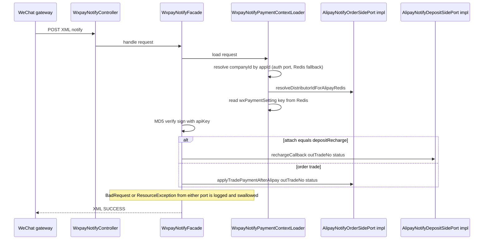
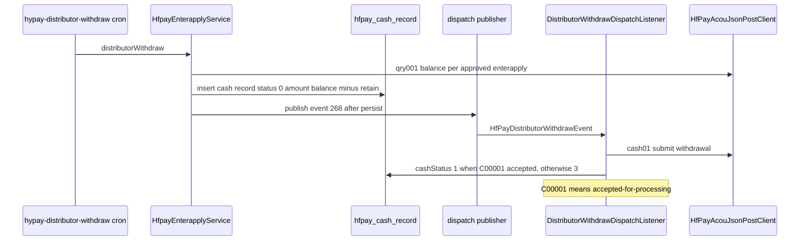

# Payments and Channels

Five bundles make up the payment stack. **`ecshopx-payment`** (支付配置与通道域, `payment/package-info.java`) is the hub: it owns the admin payment-setting API, the Redis-stored channel configuration, the wechat/alipay/chinaums/doumen-intl **notify facades**, and the membercard SDK pay services. The four **channel bundles** implement the gateways: **`ecshopx-hfpay`** (汇付支付域, Huifu chinapnr ACOU), **`ecshopx-adapay`** (AdaPay 域模块, Huifu Adapay), **`ecshopx-bspay`** (汇付斗拱支付域, Huifu BSPay/斗拱), and **`ecshopx-chinaums-pay`** (银联商务支付域, China UnionPay Merchant Services). None of them owns the trade: the `Trade` row and its `NOTPAY`-guard live in **ecshopx-orders** (see [Orders Domain](orders.md)); deposit recharge state lives in **ecshopx-deposit**. The payment bundles reach both through **port interfaces they define themselves and orders/deposit implement** — the same inversion pattern as the cart ports ([Cross-Bundle Communication](../architecture/cross-bundle-communication.md)). Money is fen everywhere; only the HfPay ACOU payloads convert to yuan strings at the wire boundary.

## The notify surfaces

Every channel's asynchronous payment notification lands on a controller that **bypasses operator JWT auth**: `OperatorJwtAuthenticationFilter` (espier) hard-exempts `POST /api/v1/alipay/notify`, `/api/v1/chinaums/notify`, `/api/v1/doumen-intl/notify`, `/api/v1/adapay/callback`, `/api/v1/bspay/callback/**`, and every path under the legacy `/wechatAuth/` prefix (espier `OperatorJwtAuthenticationFilter.java` lines 153–203). That last prefix is deliberate: the wechat endpoint is `POST /wechatAuth/wxpay/notify` (`WxpayNotifyController`, `@RequestMapping("/wechatAuth/wxpay")`), keeping the PHP-era path space stable so merchant consoles don't need reconfiguration. Each channel's settings carry its own absolute notify URL — `ecshopx.payment.wechat.notify-url`, `ecshopx.payment.alipay.notify-url` (`OrdersExternalPayParamBuildService` line 89) — passed to the gateway when the trade is created, so the deploy's public base URL is a deployment concern, not a code one.

| channel | endpoint | controller | signature check |
| --- | --- | --- | --- |
| wxpay | `POST /wechatAuth/wxpay/notify` (XML) | `payment/api/open/WxpayNotifyController` | MD5 over sorted params + API key (`WxpayAsyncNotifyVerificationService.signParams`) |
| alipay | `POST /api/v1/alipay/notify` | `payment/api/admin/v1/PaymentNotifyController` | RSA via `AlipayAsyncNotifyVerificationService` against per-distributor cert config |
| chinaums | `POST /api/v1/chinaums/notify` | `payment/api/admin/v1/ChinaumsNotifyController` | SHA-256 over sorted params + `ecshopx.ums.notify-md5-key` (`ChinaumsAsyncNotifyVerificationService`) |
| doumen-intl | `POST /api/v1/doumen-intl/notify` (JSON) | `payment/api/admin/v1/DoumenIntlNotifyController` | `md5(rawBody + X-SecretKey)` vs `X-Signature` header (`DoumenIntlSignature.verifyNotify`) |
| adapay | `POST /api/v1/adapay/callback` (JSON) | `adapay/api/admin/v1/CallBackController` | `AdapaySignatureVerifier` over the `sign`/`data` envelope |
| bspay | `POST /api/v1/bspay/callback/{eventType}` (JSON) | `bspay/api/admin/v1/CallBackController` | RSA-SHA256 (`BsPayCallbackSignatureVerifier.verifyRsaSha256`) |
| paypal | `GET /api/v1/paypal/success` | `payment/api/admin/v1/PaypalNotifyController` | none — a stub returning an empty 200 |

Verification is a precondition, not an after-effect: the wxpay, chinaums, doumen-intl, adapay, and bspay facades all verify before any state write, and a failed check fails the ack so the gateway retries. Every facade also has to answer the question "which company is this for?" before it can even find the key to verify with — see the context-resolution section below.

## The wxpay notify flow: routing through borrowed ports

`WxpayNotifyFacade.handle` is the reference implementation of the notify pattern:

The facade resolves the trade's company and distributor before verifying: `WxpayNotifyPaymentContextLoader` first tries `WxpayNotifyCompanyIdPort.resolveCompanyIdByAuthorizerAppId` (wechat authorization), falling back to the Redis appId→companyId maps `wechatPayment:companyId:{appId}` (or `wechatAppPayment:` when `trade_type=APP`, then `wechatServicerPayment:`); then it asks `AlipayNotifyOrderSidePort.resolveDistributorIdForAlipayRedis` — despite the name, wxpay reuses this orders-side port to look up the trade's distributor and gate on `payment_subject=1` (`AlipayNotifyOrderSidePortImpl` lines 47–77) — and finally reads the setting at `(distributorId?) + wxPaymentSetting: + sha1(companyId)`.

Routing is one field: the `attach` payload's `depositRecharge` marker sends the callback to `AlipayNotifyDepositSidePort.rechargeCallback` (deposit's impl delegates to `AdapayDepositTradeRechargeCallbackService`); anything else goes to `AlipayNotifyOrderSidePort.applyTradePaymentAfterAlipay`, which is a thin wrapper over orders' `OrdersTradePaymentCallbackService.applyTradePaymentNotify`. **Idempotency is preserved by acking anyway**: the facade catches `BadRequestException`/`ResourceException` from the port call (the "更新已处理，不需要更新" already-processed exception among them), logs at debug, and still returns XML `SUCCESS` — a replayed notify never tells the gateway to keep retrying. Only an unexpected exception (signature failure, missing config) produces the `FAIL` body.

## The port inversion: who owns what

The payment bundle defines the port interfaces; the state owner implements them. This keeps `ecshopx-payment` free of Maven dependencies on orders/deposit while every notify funnel ends in the same place:

* **`AlipayNotifyOrderSidePort`** (`payment/integration/alipay/`) — `resolveDistributorIdForAlipayRedis` + `applyTradePaymentAfterAlipay`; implemented by orders' `AlipayNotifyOrderSidePortImpl`. Despite the alipay name it is the shared entry used by both the alipay and wxpay facades.
* **`AlipayNotifyDepositSidePort`** — `rechargeCallback`; implemented by deposit's `AlipayNotifyDepositSidePortImpl`, delegating to `AdapayDepositTradeRechargeCallbackService`.
* **`ChinaumsNotifyOrderSidePort`** — `applyTradePaymentAfterChinaums`; implemented by orders' `ChinaumsNotifyOrderSidePortImpl`. `ChinaumsNotifyFacade` maps `TRADE_SUCCESS`→`SUCCESS`, and **acks `TRADE_REFUND` without processing** (refund state arrives through the refund executors instead).
* **`DoumenIntlNotifyOrderSidePort`** — `findTrade` (a `TradeBrief` without state mutation) + `applyTradePayment`; implemented by orders' `DoumenIntlNotifyOrderSidePortImpl`. `DoumenIntlNotifyFacade` uses `findTrade` to resolve the company **before** signature verification (the secret lives in the company's doumen setting), swallows `ResourceException` on apply (`applyQuietly` — same already-handled semantics as wxpay), and acks `00000000` for pending statuses and unhandled statuses alike.
* **`WxpayNotifyCompanyIdPort`** — appId→companyId resolution; implemented by orders' `WxpayNotifyCompanyIdPortImpl` as a peek over the `wechat_authorization` company mapping.

Bspay and adapay bypass these ports — their callback orchestrators call their own orders-side services directly, because those callbacks fire from the channel bundles (which already depend on orders):

* `BsPayCallbackOrchestratorService` whitelists `pay.wx_lite`/`pay.wx_pub`/`pay.wx_qr`/`pay.alipay_wap`/`pay.alipay_qr` → **PAYMENT** → `BsPayOrdersTradePaymentCallbackService.handlePaymentNotify` (keys the trade by `req_seq_id`, same NOTPAY guard, same Redis `h_trade_no_*`/`c_trade_no_*` `MMdd-seq` assignment); `withdraw.bspay` → **WITHDRAW** → `WithdrawApplyService.handleWithdrawNotify` (`trans_status` S→4, F→5, P→3, skip-if-SUCCESS replay guard).
* `AdapayCallbackOrchestratorService` routes by callback `type` through `AdapayCallbackEventTypeRegistry`: PAYMENT → `AdapayCallbackPaymentHandler` (routes `description=depositRecharge` to deposit, everything else to `AdapayOrdersTradePaymentCallbackService.applyPaymentSucceeded`, which stamps `adapay_div_status=DIVED` when `description=membercard`), CORP_MEMBER / CORP_MEMBER_UPDATE, PAYMENT_REVERSE; `payment.close.*` types are acked unprocessed.

**Caveat worth knowing:** both `AdapayOrdersTradePaymentCallbackService` and `BsPayOrdersTradePaymentCallbackService` end their SUCCESS branch with `noopFinishEventsForThisIteration()` — a deliberately empty private method. The trade row flips to `SUCCESS` and gets its `trade_no`, but the trade-finish fan-out (pay-success bridge, OPL, Jushuitan upload …) that the wxpay/alipay/chinaums/doumen path publishes via `OrdersTradePaymentCallbackService` is **not** fired from these two callback paths in this iteration. Anything built on `event:291` for adapay/bspay trades must not assume the notify is the trigger.

## Channel settings: the admin API and the Redis layout

`PaymentController` (`/api/v1/trade/payment`) is the admin surface: `POST /setting` (route alias `trade.payment.setting.set`), `GET /setting`, `GET /open-status`, `GET /list`, `GET /hfpayversionstatus`, `GET /rsakey` (RSA keypair generation). `PaymentSettingSaveService.setPaymentSetting` fans out to per-channel writers (wxpay, alipay, paypal, hfpay, adapay, offline_pay, chinaumspay, bspay, icbcpay, doumen_intl) after one cross-cutting check; `point_pay` is diverted entirely to `PointMemberRuleSaveService.savePointPayFirstOnly`.

All channel credentials live in Redis, never in the orders tables. The key grammar (`PaymentSettingRedisKeys`, on the **companys** Redis unless noted):

* `(distributorId?) + wxPaymentSetting: + sha1(companyId)` — same shape for `alipayPaymentSetting:`, `paypalPaymentSetting:`; the distributor prefix exists so a distributor with `payment_subject=1` can carry its own credentials.
* `doumenIntlPaymentSetting: + sha1(companyId)` — platform-level, no distributor bucket.
* `hfPaymentSetting:`, `bspaySetting:`, `icbcPaymentSetting:`, `paymentTypeOpenConfig:`, `chinaumsPaymentSetting:{sha1}_{subKey}`, `offline_paySetting:{sha1}:{lang}` (lang defaults `zh-CN`).
* `adaPaySetting: + sha1(companyId)` — on the **shared** Redis, not companys (the one deliberate exception, kept from PHP).
* appId→companyId reverse maps: `wechatPayment:companyId:{appId}`, `wechatAppPayment:`, `wechatServicerPayment:`, `hfPayment:companyId:{merCustId}`.
* doumen tokens: `doumen_intl:token:{accessCode}` (JSON with logical expiry, no Redis TTL) and the scheduler watermark `doumen_intl:token_refresh:last_scheduled_run`.

**Doumen mutual exclusion** (`DoumenIntlMutualExclusionService`): doumen-intl is an either/or cashier — enabling it closes every other channel (`closeAllOtherPaymentMethods` rewrites `is_open` across all nine setting keys), and with doumen open, opening any other channel throws `请先关闭斗门国际收银台` ("close the doumen international cashier first"); `point_pay` is exempt both ways. `ecshopx.payment.hfpay-is-open` (default false, accepts `1/true/yes/on`) is a separate instance-level flag exposed by `/hfpayversionstatus` (`HfpayVersionStatusService`) to pick the hfpay console generation. Channel enablement is therefore config-gated in two layers — the per-company Redis settings and the instance env flags — see [Redis Databases](../concepts/redis-databases.md) for the companys-vs-shared split and [Configuration](../operations/configuration.md) for the env knobs (`ecshopx.payment.doumen-intl.*`, `ecshopx.ums.*`, `ecshopx.bspay.*`, `ecshopx.hfpay.*`, `adapay.*`).

## Doumen-intl: token lifecycle and status mapping

`DoumenIntlProperties` (`ecshopx.payment.doumen-intl.*`) carries `base-url`, `notify-url`, a reserved `sandbox`, and `tokenRefreshIntervalMinutes` (default 115 — inside the token's validity window). `DoumenIntlTokenRefreshScheduler` is a Spring `@Scheduled(cron = "0 * * * * ?")` job, not XXL-Job: every minute it checks the watermark and, when the interval has elapsed, refreshes tokens for **every company with a doumen setting** (a SCAN over setting keys, `runner.run(null)`), keeping gateway access tokens warm without per-login refresh. `DoumenIntlStatusMapper` normalizes gateway statuses (`SUCCEED`/`FAILED`/`PENDING`/`RETRY_PENDING`) and the masked setting reader keeps secrets out of admin responses.

## Refunds: the aftersales executor chain

Refunds invert the notify direction: aftersales asks the payment stack to push money back. `OrdersRefundPaymentDispatchService.dispatch` (called from aftersales `doRefund`) special-cases `point` (points return), `deposit` (deposit-order refund), `pos`/`offline_pay`/`prepaid_point` (immediate SUCCESS — no gateway), then builds an `AftersalesRefundPaymentContext` (refund fee, trade id, hf order id and date hints, resubmit flag …) and loops over `List<AftersalesRefundPayChannelExecutor>` beans, ordered by Spring `@Order`, returning the first `supports(payType)` match — `未知的支付方式` if none.

| @Order | bean | channel (payType) | gateway call |
| --- | --- | --- | --- |
| 45 | `HfpayAftersalesRefundPayExecutor` (hfpay) | `hfpay` | ACOU `reb001` (refund); expects `resp_code=C00002`, publishes `EVENT_HFPAY_REFUND_SUCCESS` on success |
| 50 | `StandardOnlinePayAftersalesRefundExecutor` (payment) | `wxpay*`, `alipay*`, `bspay` | delegates to one of three runners |
| 52 | `ChinaumsAftersalesRefundPayExecutor` (chinaums-pay) | `chinaums` | UMS open-platform `POST {base}/refund` with `OPEN-BODY-SIG` authorization; on resubmit appends a random 2-digit suffix to `refundOrderId` |
| 55 | `AdapayAftersalesRefundPayExecutor` (adapay) | `adapay` | `Refund.create` on a succeeded `AdapayPaymemtConfirm` row (randomized `refund_order_no` suffix); without a succeeded confirm row it falls back to `AdapayPaymentReverseApplicationService.reverseAndPublishOrderProcessLog` |
| 55 | `DoumenIntlAftersalesRefundExecutor` (payment) | `doumen_intl` | doumen gateway refund by `order_id` |

The three runners behind `@Order(50)`:

* **`WxpaySecapiAftersalesRefundRunner`** — the v2 certificate-based `https://api.mch.weixin.qq.com/secapi/pay/refund` with two-way TLS from the merchant `cert`/`cert_key` PEM material in the setting; supports the servicer (服务商) variant via `sub_appid`/`sub_mch_id`.
* **`AlipayTradeAftersalesRefundRunner`** — `alipay.trade.refund` through the SDK; a `10000` response with `fund_change=N` is returned as `PROCESSING`, not `SUCCESS` (alipay signals "already refunded, no fund movement" that way).
* **`BsPayAftersalesOnlineRefundRunner`** — `V3TradePaymentScanpayRefundRequest` with a deliberately randomized `req_seq_id` (`refundBn + "_" + random + timestamp`) so a retried refund never collides with the first attempt's idempotency key at the gateway.

The `resubmit` flag threading through the context is what makes refund retries safe across channels that do not have idempotent refund ids — chinaums appends a random suffix, bspay/adapay randomize their order ids, and the hfpay executor requires the original `hfOrderId` plus both order dates (`org_order_date`/`order_date` hints computed by `resolveHfpayRefundDateHints` from the `NormalOrders` row) to address the original ACOU transaction.

## Payment confirmation after aftersales close (adapay/bspay)

When every item of an order finishes aftersales, the money can finally be confirmed/divided at the gateway. `AftersalesService.scheduleAutoCloseOrderItemAftersales` (driven by the aftersales cron) closes due item lines and, per pay type, calls the confirmation ports: `adapay` → `AdapayScheduleAutoPaymentConfirmationPort` **per item** (impl → `AdapayAutoCloseAftersalesPaymentConfirmationService.scheduleAutoPaymentConfirmation`, which returns early unless **all** items are `CLOSED`, then inserts a `pending` `AdapayPaymemtConfirm` row and calls the gateway); `bspay` → `BspayScheduleAutoPaymentConfirmationPort` collected into a per-order dedupe map before calling. Both flows outsource their retry to XXL-Job: `adapay-confirm-retry` and `bspay-confirm-retry` (handlers in `payment/cron/`) scan `pending` confirm rows older than 600 seconds and re-drive the gateway call. The port interfaces live in `ecshopx-common/port/payment` (`AdaPayPaymentConfirmRetryPort`, `BspayPaymentConfirmRetryPort`, plus the schedule ports) so `ecshopx-payment`'s cron handlers and the channel bundles never create a module cycle — payment's `AdaPaymentService`/`BsPayService` are one-line delegates onto those common ports, whose impls live in the channel bundles.

## Merchant withdrawals

`MerchantPaymentTrade` (orders, `orders_merchant_trade` table; string `merchant_trade_id` PK) is the withdrawal ticket — `payment_action` selects the rail (`WECHAT` or `HFPAY`), `rel_scene_name` the business scene (`rebate_cash_withdrawal`, `community_chief_cash_withdrawal`, `popularize_rebate_cash_withdrawal`), `status` the state (`NOT_PAY`/`PROCESS`/`PAYING`/`SUCCESS`/`FAIL`). `MerchantPaymentTradeQueryService` (orders) implements the common cron/read ports — `listWechatProcess` pages `payment_action=WECHAT, status=PROCESS` — plus per-scene count/list readers. `MerchantPaymentTradeWriteService` mints ids.

### WeChat batch-transfer polling

The `wechat-query-merchant-payment` XXL-Job (payment/cron) runs `WechatPayService.scheduleQueryMerchantPayment`: take up to 100 `WECHAT`+`PROCESS` rows, call the wechat v3 batch query `GET /v3/transfer/batches/batch-id/{batchId}?need_query_detail=false` (`WechatBatchTransferQueryHttp`, authorized via `WechatPayV3AuthHeader`), and on a terminal batch status write the trade (`FINISHED`+`success_num>0` → `SUCCESS`, else `FAIL`; `CLOSED` → `FAIL`) and fan the scene update back to the scene table (community-chief, distribution rebate, popularize rebate ports).

### HfPay distributor auto-T1 withdraw

The `hypay-distributor-withdraw` XXL-Job scans approved enter-applies (`status=3`, apply types 1/2/3), skips companies whose `HfpayWithdrawSet.withdraw_method=2` (manual mode), and for each with a cash bank card and positive `qry001` balance (minus the configured retain amount) inserts an `HfpayCashRecord` (T1, status 0) and publishes `event:268:HfPayBundle\Events\HfpayDistributorWithdrawEvent` (`HfpayDispatchEventNames.EVENT_HFPAY_DISTRIBUTOR_WITHDRAW`) **after the row persists** — the publisher interface lives in common, the impl in bootstrap's `HfpayDistributorWithdrawEventDispatchPublisherImpl`. The listener (`HfpayDistributorWithdrawDispatchExecutionService`, sync bus) re-loads the row and submits `cash01` with `mer_priv=cash01_distributor`; `C00001` (accepted) sets `cash_status=1`, anything else 3. A manual variant — `HfpayCashRecordWithdrawService.withdraw` (10:00–23:59:59 window, `ecshopx.hfpay.business-zone-id` timezone) — creates the same record and publishes the same event.

The `hypay-check-cash` XXL-Job (`HfpayCashRecordService.scheduleCheckStatus`) then drives status 1 rows older than 2 days to a terminal state: per-row Redis lock `hfpay:{id}` (SETNX + 10s expiry, stale-lock deletion), `qry008` transaction query, `trans_stat=S` → status 2 and a `EVENT_HFPAY_DISTRIBUTOR_WITHDRAW_SUCCESS` publish (`event:296`, ledger `HfpayTradeRecordService.withdraw`), error codes → status 3, `C00001`/`C00002` (still processing) → leave alone.

### Popularize rebate withdrawal (hfpay rail)

`HfpayPopularizeCashWithdrawalMerchantPaymentService` (bootstrap, implements popularize's `PopularizeHfpayRebateMerchantWithdrawalPort`) is the user-initiated path: validate real-name enter-apply + cash bank card, ensure (idempotently) an `HfpayMerchantPayment` row, move funds **within Huifu** via `pay026` (platform merchant → user custody account, `div_type=0`), then insert the `MerchantPaymentTrade` (payment_action `HFPAY`, hf_cash_type `T1`, status `NOT_PAY`, payment_desc 佣金提现) and publish `event:270` (`EVENT_HFPAY_POPULARIZE_WITHDRAW`). The orders-side listener `PopularizeWithdrawDispatchListener` → `HfpayPopularizeWithdrawDispatchExecutionService` (in `orders/hfpay/dispatch`) loads the trade, submits `cash01` with `mer_priv=cash01_popularize`, and sets `PAYING` (`C00001`) or `FAIL`.

### HfPay ledger and profit sharing

`HfpayTradeRecordService` keeps the hfpay ledger in sync with dispatch events: `paySuccess` on trade-finish (`event:291`/`292` planes, via `HfpayTradeRecordTradeFinishPaySuccessDispatchListener`), `profit` on `event:295`, `refundSuccess` on `event:294`, `withdraw` on `event:296`. Profit sharing itself: `event:267` (`HfpayProfitSharingEvent`) drives the split, and `HfpayProfitSplitConfirmService.pay006` performs the delayed profit-split confirmation against the original transaction. All hfpay dispatch event/listener name constants live in `ecshopx-common/dispatch/HfpayDispatchEventNames`; registration is in bootstrap `Hfpay*RegistrationConfig` classes (`@Order(76)`–`(99)` band).

### `HfPayAcouJsonPostClient`: one signing envelope for every call

Every ACOU/hfpay gateway call — `corp01`/`solo01` (enter-apply), `bind01`/`user01`/`unbd01` (bank cards), `qry001` (balance), `qry008` (transaction status), `cash01` (withdraw), `pay026` (funds movement), `pay012`, `pay006` (profit-split confirm), `reb001` (refund) — goes through `postSigned`: JSON-serialize the payload, sign it as an attached **CFCA PKCS7** (base64) with the merchant pfx (`chinapnrPayment/{merCustId}/cfca.pfx`, synced from storage by `HfPayPaymentSettingService.ensureCertificateFilesSynced`), and post `mer_cust_id`/`version`/`check_value` as a form. The CA/OCA31 certificates sit beside the pfx for response verification. This is the only channel whose signing material is a file on local storage rather than a Redis-stored key.

### Adapay and bspay withdrawals

Adapay's `adapy-draw-cash-queue` XXL-Job (the name's typo is in source, keep it in job configs) runs `AdapayDrawCashService.scheduleDrawCashQueue`; bspay's `WithdrawApplyService` applies (`WithdrawController`, `WithdrawJobHandler` on the dispatch bus) and receives terminal status through the `withdraw.bspay` callback. The `adapay-get-submit-license-audit` cron drives `OpenAccountService.scheduleGetSubmitLicenseStatus` — which, for any `audit_status=I` row, currently throws `暂不支持开户流程` ("open-account flow not yet supported"): the adapay open-account flow is a stub in this iteration, as are the same-named throws in `AdapayLicenseSubmitService`, `AdapayMerchantEntryCreateService`, `AdapayMerchantResidentCreateService`, and `AdapayUploadLicenseFacadeService`.

## Chinaums division (分账) and SFTP file exchange

`ecshopx-chinaums-pay` covers two things: the payment callback handled by payment's `ChinaumsNotifyFacade` (above), and the **division** subsystem — the `ChinaumspayDivision*` tables, the admin `DivisionController` (`/api/v1/division/*`), and the export/dispatch handlers (`ChinaumsDivisionListExportFileJob*`). Division settlement is file-based over SFTP (`ecshopx.ums.sftp.host/port/user/password`): `ChinaumsDivisionSftpRemoteDownloadService` pulls the result file `final_{base}.ret`, `ChinaumsDivisionSftpRetSignVerifyService` fetches the matching `.chk` and verifies it as **RSA-SHA256 over the .ret file's MD5 hex** with the `rsa_public_path` certificate, and `ChinaumsDivisionSftpRemoteUploadService` uploads the data file plus a `.chk` containing the same scheme signed with the merchant pfx (`rsa_private_path` + `password`). Local artifacts land under `ecshopx.storage.local.root` via `ChinaumsDivisionLocalStorageWriterService`; the SFTP services are `@Profile("!test-cron")` with noop test doubles under the `test-cron` profile.

## Jobs this stack owns (XXL-Job)

| handler | bundle | purpose |
| --- | --- | --- |
| `wechat-query-merchant-payment` | payment | poll wechat v3 batch transfers, terminalize `MerchantPaymentTrade` |
| `adapay-confirm-retry` / `bspay-confirm-retry` | payment | retry pending payment-confirm rows >600s old |
| `hypay-distributor-withdraw` | hfpay | auto full-amount T1 cash-out for approved enter-applies |
| `hypay-check-cash` | hfpay | qry008 status polling for processing withdrawals |
| `hfpay-company-daily-statistics` / `hfpay-distributor-daily-statistics` | hfpay | daily statistics aggregation |
| `adapy-draw-cash-queue` | adapay | adapay draw-cash queue dispatch |
| `adapay-get-submit-license-audit` | adapay | (stubbed) open-account license audit polling |

Every handler follows the same envelope: run the service method, log cost, and on exception publish `CronAlertEvent(handlerName, e)` and rethrow — see [Scheduling (XXL-Job)](../concepts/scheduling-xxljob.md). `DoumenIntlTokenRefreshScheduler` is the one exception (plain Spring `@Scheduled`, every minute), because token warmth is a JVM-local concern.

## Invariants and failure semantics

* **Verify before write.** All six live notify facades check the signature before touching the trade; a failed check fails the ack so the gateway retries.
* **Ack on business replay.** wxpay and doumen-intl swallow the already-processed exception and ack SUCCESS; chinaums/doumen return plain SUCCESS/`00000000`; bspay withdraw skips on SUCCESS status. The gateway should never retry a trade that is merely already handled — only a genuinely broken one.
* **NOTPAY is the CAS.** Every orders-side callback (`applyTradePaymentNotify`, adapay, bspay) re-reads the trade and refuses to move a non-NOTPAY row; `trade_no` is assigned from the Redis daily sequence exactly once.
* **Withdrawals persist before dispatch.** The hfpay T1 flow inserts the cash record first and publishes event 268 after — the listener re-reads the row by id, so a lost event loses a submission but never corrupts a record. The same order holds for the popularize path (trade insert, then event 270).
* **Terminal write, then scene write.** The wechat polling cron updates `MerchantPaymentTrade` before fanning out to the scene table; a scene-write failure cannot resurrect a PROCESS trade.
* **Retry-safe refund ids.** `resubmit` and randomized suffixes (chinaums, bspay, adapay) prevent gateway-side idempotency collisions on manual refund retries.
* **Mutual exclusion is enforced at save time.** Doumen's either/or rule throws before any writer runs, and the enable-doumen path closes the other nine keys in the same request.
* **Fen at rest, yuan on the HfPay wire.** Every amount crosses the ACOU client as a 2-decimal yuan string (`movePointLeft(2)`), and parsing back uses `RoundingMode.HALF_UP` or `UNNECESSARY` — never float.

## Known stubs and honest caveats

* `GET /api/v1/paypal/success` returns an empty 200 — paypal success is a redirect stub, not a verified notify.
* `OpenAccountService.scheduleGetSubmitLicenseStatus` throws `暂不支持开户流程` for any in-audit row; the whole adapay open-account chain is stubbed.
* `noopFinishEventsForThisIteration()` in the adapay and bspay orders-side callback services means their trade-finish fan-out does not fire from the notify path in this iteration.
* The `adapy-draw-cash-queue` handler name misspells "adapay" — it is in source (`HANDLER_SHORT_NAME`) and must be matched by the XXL-Job config as-is.
* `HfpayCashRecordService.scheduleCheckStatus` is not per-row try/catch: one bad row aborts the whole run (by design, per its javadoc "非 per-row try：遇异常向上抛出") — the `CronAlertEvent` plus rethrow is the alert path.

## Extension points

* **New pay channel** — add a notify controller (or reuse the `/api/v1/{channel}/notify` convention and extend the espier JWT exemption), an orders-side port impl for `applyTradePayment*`, a setting writer + `PaymentSettingRedisKeys` entry, and an `AftersalesRefundPayChannelExecutor` bean with a `@Order` slot that doesn't collide (45–55 in use).
* **New withdrawal rail** — write `MerchantPaymentTrade` rows with a distinct `payment_action` and, if polling-based, a cron handler plus a terminal-status writer port in `ecshopx-common/cron`.
* **New hfpay gateway verb** — add a method to `HfPayAcouJsonPostClient` (one `postSigned` line); business orchestration belongs in a service, the dispatch event/listener names in `HfpayDispatchEventNames` with a bootstrap registration config.
* **New callback type on bspay/adapay** — extend `BsPayCallbackOrchestratorService.EVENT_WHITELIST` or `AdapayCallbackEventTypeRegistry` plus a handler component; the orchestrators already isolate unknown types.
* **New refund channel runner** — the `StandardOnlinePayAftersalesRefundExecutor` pattern: a `@Component` runner called from a supports-matching executor, with an OPL publish probe test.

## Focused tests

* `DoumenIntlMutualExclusionServiceTest`, `DoumenIntlPaymentSettingWriterTest`, `DoumenIntlSignatureTest`, `DoumenIntlTokenRedisStoreTest`, `DoumenIntlPaymentServiceTest` — doumen config lifecycle, signature math, token storage.
* `StandardOnlinePayAftersalesRefundExecutor{Wechat,Alipay,Bspay}OrderProcessLogDispatchPublishProbeTest` — the OPL publish envelope per runner.
* `WechatPayServiceTest` + `ScheduleQueryMerchantPaymentHandlerTest` — batch-transfer status mapping (FINISHED/CLOSED, success_num), scene fan-out.
* `ScheduleRetryAdaPayPaymentConfirmHandlerTest`, `ScheduleRetryBsPayConfirmHandlerTest`, `AdaPaymentServiceTest`, `BsPayServiceTest` — retry cron envelope and port delegation.
* `AlipayNotifyFacadeDepositSmsDispatchTest`, `FrontPaymentSettingReadServiceDepositListTest` — deposit routing and front-end setting shape.
* hfpay: `HfpayCashRecordServiceTest` (qry008 polling, Redis lock, status transitions), `HfpayCashRecordWithdrawServiceDistributorWithdrawPublishProbeTest` (event-268 publish envelope), `HfpayAftersalesRefundPayExecutorHfpayRefundSuccessDispatchPublishProbeTest`, `HfpayCompanyDayStatisticsServiceTest`/`HfpayDistributorStatisticsDayServiceTest`, plus the dispatch listener tests under `hfpay/dispatch`.
* bootstrap: `HfpayDistributorWithdrawEventSyncBusDispatchFlowTest`, `HfpayPopularizeWithdrawEventSyncBusDispatchFlowTest`, `HfpayProfitSharingEventSyncBusDispatchFlowTest`, `WithdrawJobDispatchFlowTest` — end-to-end registry + publisher + listener assembly (the pattern every cross-bundle event should copy).
* adapay: `AdapayAutoCloseAftersalesPaymentConfirmationServiceTest`, `AdaPayPaymentConfirmRetryPortAdapterTest`, `OpenAccountServiceTest`; bspay: `BspayAutoCloseAftersalesPaymentConfirmationServiceTest`, `BspayPaymentConfirmRetryPortAdapterTest`.

## Related pages

* [Orders Domain](orders.md) — the `Trade` state machine on the other side of every port here, `trade_no` sequencing, and the pay-success fan-out.
* [Aftersales Domain](aftersales.md) — `doRefund`, the refund lifecycle that drives every executor bean above.
* [Cross-Bundle Communication](../architecture/cross-bundle-communication.md) — the port-inversion pattern this stack uses against orders/deposit.
* [Dispatch Bus](../concepts/dispatch-bus.md) — the transport under every hfpay event listed here.
* [Scheduling (XXL-Job)](../concepts/scheduling-xxljob.md) — executor wiring for the handlers above.
* [Redis Databases](../concepts/redis-databases.md) — the companys vs shared split the setting keys straddle.
* [Configuration](../operations/configuration.md) — the env knobs every channel in this page reads.
