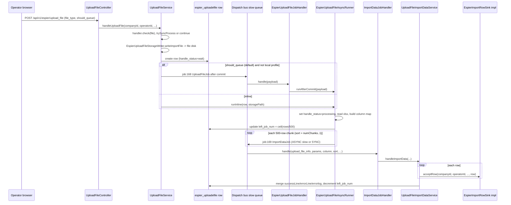

# Platform Services and Supporting Bundles

This page covers the shared and peripheral Bundles. Most of them follow the standard [Bundle layering](../architecture/bundle-layering.md) (`api/admin/v1`, `api/front/v1`, `service/`, `dispatch/`, `cron/`, `domain/`, `mapper/`), and several are *served by* others rather than owning HTTP surface of their own. **`ecshopx-espier`** is the one that deserves deep treatment: it owns the platform's file-storage abstraction, the Excel import pipeline that fans out to the [dispatch bus](../concepts/dispatch-bus.md), the address/subdistrict reference data, the upgrade/patch workflow, and — most importantly for anyone touching an admin or H5 endpoint — the Spring MVC interceptor stack that performs operator JWT auth, activation/permission checks, sensitive-data audit and operation logging.

## ecshopx-espier — platform capabilities (平台通用能力域)

`cn.shopex.ecshopx.espier` is declared in its `package-info.java` as the "platform common capabilities (upload, address, upgrade etc.) domain". It is a dependency of nearly everything: `ecshopx-data-cube`'s POM, the `super-admin`/`shopmenu-border`/`comments`/`tdkset`/`one-code` controllers all import `cn.shopex.ecshopx.espier.security.OperatorJwtAuthenticationFilter` to read the operator JWT attribute that Espier's interceptor sets.

### Package map

| Package | Contents |
|---|---|
| `storage/` | `StorageDriver`, `StorageFactory`, `StorageProperties`, the five driver impls, `FileStorageService` (facade), `StorageWebMvcConfigurer` (`/storage/**` handler for local driver) |
| `service/upload/` | the Excel import handler SPI + registry + header catalog + storage writer + enqueue/dispatch ports |
| `service/` | `UploadFileService`, `EspierUploadFileAsyncRunner`, `UploadFileImportDataService`, export CSV/XLSX/ZIP services, `UploadeFileRepository` |
| `service/address/`, `service/subdistrict/` | address tree + region label resolution, subdistrict reference data |
| `service/upgrade/` | `UpgradeAgreementQueryService`, `UpgradeExecuteService`, `UpgradeRollbackService` |
| `service/front/`, `service/offline/`, `service/printer/`, `service/config/` | wxapp upload/new-login, offline bank accounts, printers, request-field config |
| `web/interceptor/`, `web/`, `web/advice/` | the MVC middleware chain, `ShopLoginAuditFilter`, multipart size advice |
| `security/` | operator JWT issue/verify/blacklist, H5 blacklist, Kujiale-like filter, wxapp member session filter |
| `api/admin/v1/`, `api/front/v1/` | address, auth, config fields, export data/log, offline bank, printer, subdistrict, upgrade, upload file/images controllers |
| `dispatch/`, `cron/` | `EspierUploadFileJobHandler`, `ImportDataJobHandler`; `delete-error-file`, `delete-history-file` |
| `openapi/` | image upload-token / list / save / delete port impls consumed by the openapi bundle |

### File storage: one interface, five drivers, one factory

`StorageDriver` is the unified entry for object storage and local disk. It exposes `put`/`get`/`delete`/`exists`, `url(path)` for public-read access and `privateDownloadUrl(path, expires)` for time-limited private access, plus `driverName()`.

`StorageFactory` is a Spring `@Component` that creates and caches drivers per *(driver, fileType)* pair:

```java
public StorageDriver disk(String fileType) {
    String driver = props.getDriver();
    String cacheKey = driver + ":" + fileType;
    return cache.computeIfAbsent(cacheKey, k -> createDriver(driver, fileType));
}
```

* The driver selector is `props.getDriver()`, i.e. **`ecshopx.storage.driver`** — one of `local`, `oss`, `qiniu`, `aws`, `cosv5`. Anything else throws `BadRequestException("请选择正确的存储系统！")`.
* `fileType` is one of three "disks": `file`, `image`, `videos`. For `oss`/`qiniu`/`cosv5` each disk selects a *separate* endpoint/bucket/domain block inside that vendor's config (`oss.file`, `oss.image`, `oss.video` etc.); `local` and `aws` use a single bucket across all disks.
* Drivers are cached in a `ConcurrentHashMap` keyed `driver:fileType`, so a given disk is built once per JVM from the startup-time config; there is no runtime re-read and no refresh. Changing storage config requires a restart.
* The naming is deliberately PHP-compatible: `StorageProperties` documents the same keys as the legacy `DISK_DRIVER` / `OSS_PROJECT_NAME` / `OSS_*` / `QINIU_*` / `AWS_*` / `COS_*` environment variables, and `bootstrap`'s `application.properties` ships the whole tree (`ecshopx.storage.driver=local`, `ecshopx.storage.local.root=storage/app/public`, `ecshopx.storage.local.url=http://localhost:18080/storage`, plus the empty oss/qiniu/aws/cos blocks).
* The `projectName` prefix (`ecshopx.storage.project-name`, default `demo-ecshopx`) isolates tenants that share one bucket: every upload key starts with `{projectName}/{fileType}/{companyId}/{yyyy/MM/dd}[/{group}]/{md5(yyyyMMddHHmmss)}{filename}` (see `FileStorageService.buildUploadKey`).

For the local driver specifically, `StorageWebMvcConfigurer` is `@ConditionalOnProperty(name = "ecshopx.storage.driver", havingValue = "local", matchIfMissing = true)` and maps the configured root directory onto `/storage/**` as static resources, so uploaded files are directly fetchable over HTTP — that is why the overview page lists `/storage` as one of the three URL spaces the app serves. `LocalStorageDriver` creates its root directory at construction, resolves keys under it, and returns `urlPrefix + "/" + path`; `privateDownloadUrl` for local is just the public URL (there is no signing on local disk). `LocalStoragePublicUrl` is the reverse helper: it prefers the configured `ecshopx.storage.local.url` base and falls back to a request-derived absolute `/storage/...` URL when the configured URL is blank.

### `FileStorageService`: tokens, direct writes, validation rules

`FileStorageService` is the facade other bundles use. Two families of operations:

**Credential issuance (`getUploadToken(fileType, companyId, group, filename)`)** — returns `{driver, token}` where the token shape is driver-specific: for `local` just `{domain, key}`; for `oss` an OSS Web-Post policy (`OssStorageDriver.fillOssWebPostToken`); for `aws` a 3600-second presigned PUT URL; for `qiniu` the Qiniu upload-token fields; for `cosv5` the COS upload credential. The controller layer (`api/admin/v1/UploadImagesController`, `api/front/v1/UploadFileController#image_upload_token`) hands this to the front end so the browser posts the file straight to the object store.

**Server-side writes** — `upload(...)`, `uploadeImage(...)`, `uploadImportLocalRelativePath(...)` all write bytes through the selected driver and return a `{driver, token{domain,key}}` envelope. They differ in validation semantics, and the differences are deliberate PHP parity:

* `assertUploadMultipart` (used by `upload`) hard-rejects the `file` disk with a `ResourceException("请上传正确格式或标准大小文件")`, then requires a well-formed `Content-Type`, an `image/*` primary type with ≤ 2 MB for the `image` disk, and a `video/*` primary type with ≤ 50 MB for the `videos` disk, throwing `BadRequestException` otherwise.
* `assertEspierUploadeImageMultipart` (used by `uploadeImage` and `uploadImportLocalRelativePath`) allows `image/jpeg|jpg|png|gif` ≤ 2 MB and `video/mp4` ≤ 50 MB, rejects `fileType=file` outright, and throws `ResourceException` or `BadRequestException` depending on the caller's `EspierUploadeImageViolationKind`.
* The object-key derivation also differs: `uploadeImage` builds the key from the client filename plus (at most once) the `Content-Type` subtype; `upload` appends the parsed file extension for non-local drivers but *always* appends the literal `.png` under the `local` driver regardless of the actual bytes.
* `assertCosNonBlankFilenameHasExtensionIfNeeded` enforces that under the `cosv5` driver a supplied filename must contain a non-empty extension — a COS-specific rule applied on both the token and direct paths.
* `uploadImportLocalRelativePath` is local-only (it throws unless `driverName == "local"`) and returns the bare relative key, used by import flows that need to store the path in a DB row rather than a token envelope.

### Excel import: the chunked dispatch pipeline

Espier owns the generic "upload an Excel, import rows into some domain bundle" machinery. `POST /api/v1/espier/upload_file` (`UploadFileController`, `@AdminAuth @ShopLog @Activated(routeAlias = "espier.upload")`) is the single entry point; the target domain is selected by the `file_type` request parameter. The supporting capabilities come from two extension points:

* **`EspierUploadFileHandler`** (in espier) — `supportedFileType()`, `check(MultipartFile)`, optional `trySyncProcess(...)` for fully synchronous imports, and `handleAfterInsertInRequestThread(...)` as the post-persist hook. `EspierUploadFileHandlerRegistry` collects all handler beans and fails startup on a duplicate `file_type`.
* **`EspierImportRowSink`** (in `ecshopx-common`, `common/espier/upload/EspierImportRowSink.java`) — the row-level hook implemented in the *domain* bundles: `DistributorInfoEspierImportRowSink` (distribution), `EmployeePurchase*EspierImportRowSink` (employee-purchase), `LimitSaleItemEspierImportRowSink` (promotions), `AdapayTradedataEspierImportRowSink` (adapay), `SelformRegistrationRecordEspierImportRowSink` (selfservice), `PointsmallNormalGoodsStoreEspierImportRowSink` (pointsmall), `UploadTbItemsEspierImportRowSink` (goods, `upload_tb_items`), etc. `EspierImportRowSinkMapConfiguration` builds the `espierImportRowSinkByType` map, again failing on duplicates. `EspierUploadHandlerBeans` declares the ~25 `member_info`, `member_update`, `member_consume`, `supplier_goods`, `normal_goods`, `normal_orders`, `distributor_info`, `upload_tb_items`, `employee_purchase_*`, … handlers as delegating table handlers that each bind one header catalog entry (`EspierUploadHeaderCatalog`) to one sink. `upload_tb_items` additionally enforces `xlsx` only.

The end-to-end flow (two dispatch-bus jobs, both on the `slow` Redis queue, names in `EspierDispatchJobNames`):



Caption: the two-job Excel import chain — `UploadFileJob` (`job:168`) re-reads and splits the stored workbook, `ImportDataJob` (`job:169`) processes the chunks and merges the per-chunk counters back into one `espier_uploadefile` row.

Key invariants and failure semantics:

* `handleUploadFile` is `@Transactional(rollbackFor = Exception.class)`; when `shouldQueue` is true the enqueue goes through `EspierUploadFileJobDispatchPublisherImpl` (bootstrap), which registers a `TransactionSynchronization.afterCommit` so a rolled-back transaction never publishes the job. The controller forces `shouldQueue=false` under the `local` Spring profile, which makes local runs go inline.
* `EspierUploadFileStorageWriter` always writes imports to the **`file`** disk with a deterministic relative path `{file_type}/{companyId}/{uploadEpochSeconds}/{md5(fileName)}{ext}` — the same rule is exposed as `buildRelativePathForImport(...)` so the deletion cron can rebuild the path from row metadata alone.
* `EspierUploadFileAsyncRunner` is idempotent-by-status: it re-reads the row and bails out unless `handle_status == "wait"`, then moves it to `processing` before parsing. Empty table, unreadable storage, and header/parse failures each persist a `finish` row with a `handle_message` errorlog, delete the stored file, and still invoke the handler's `handleAfterInsertInRequestThread`.
* Chunking is fixed at 500 rows per job. Chunks are dispatched with `sort = numChunks - k`, i.e. **descending** — the first chunk gets the highest sort. `UploadFileImportDataService.mergeFinishState` spins (with a 10 000-iteration cap) until the row's `left_job_num` equals its own `sort`; the chunk with `sort == left_job_num` then decrements `left_job_num` (and flips the row to `finish` when it reaches 0), so chunks merge strictly in descending sort order — the last-dispatched chunk (sort 1) merges first and the first-dispatched chunk (sort = numChunks) merges last and finishes the row. The optimistic-concurrency guard is the `where id = ? and left_job_num = ?` predicate on the update (a `ResourceException` from a lost race is retried up to `left` times).
* Each row is processed in its own `REQUIRES_NEW` transaction (`UploadFileImportDataService`'s `rowTransactionTemplate`), so one bad row increments `errorLine` and appends an aligned error row rather than aborting the chunk.
* `EspierUploadFileQueuedPayloadTest`, `UploadFileServiceHandleUploadFileShouldQueueBranchTest` and `EspierUploadFileAsyncRunnerChunkDispatchTest` pin these behaviours; the chunk-dispatch test asserts a 501-row workbook produces two chunks (500 + 1), `left_job_num = 2`, descending sorts `[2, 1]`, and that every dispatched row carries `__excel_row__`.

The related export half (`ExportCsvDataService`, `ExportCsvFileService`, `ExportXlsxFileService`, `ExportZipFileService`, `ExportLog*` services, admin `ExportDataController`/`ExportLogController`) reads a filter blob from the `export_key:<key>` Redis entry on the **shared** template and fans out through the ~20 `EXPORT_FILE_JOB_*` variants in `EspierDispatchJobNames` — those belong to the domain bundles that own each export type.

Two XXL-JOB handlers keep the file store clean (both follow the [alert-and-rethrow cron template](../concepts/scheduling-xxljob.md)): `delete-error-file` → `UploadFileService.scheduleDeleteErrorFile` pages 100 rows at a time over `espier_uploadefile` rows older than 15 days whose `handle_message.errorLine` is non-zero, rebuilds each relative path with `buildRelativePathForImport` and deletes the stored workbook; and `delete-history-file` → `ExportLogService.scheduleDeleteHistoryFile`, which removes the `export/zip/<fileName>` object and the `export_log` row for finished exports older than 3 hours.

### The middleware / interceptor layer

`MiddlewareWebMvcConfigurer` (a `WebMvcConfigurer` in `espier.web.interceptor`) registers the whole HTTP middleware chain on `/api/**`. Because every Bundle's controllers are in the same Spring context, this single config file is the auth/permission/audit layer for the entire application:

| order | interceptor | trigger annotation | what it does |
|---|---|---|---|
| 5 | `EspierAgreementRateLimitInterceptor` | path-scoped `/api/v1/espier/system/agreement` | IP-keyed Redis counter (`espier:agreement:throttle:<ip>`, `companysRedisTemplate`), 1-minute window, 429 over 30 hits |
| 10 | `AdminAuthInterceptor` | `@AdminAuth` (method or class) | verifies the operator Bearer JWT with `OperatorJwtCompactCodec` against the `JWT_SECRET`-derived HMAC key, checks `exp`, enriches shop-app member tokens, runs `CompanysActivationService.checkUserAuth` (403 on failure), attaches the selected distributor for `operator_type=distributor`, and stores the claims under `OperatorJwtAuthenticationFilter.OPERATOR_JWT_USER_DATA` — the attribute every controller reads. Excludes the operator login/oauth/sms-code/captcha/credential/third-saascert endpoints |
| 15 | `FrontNoAuthInterceptor` | `@FrontNoAuth` | H5 optional auth: verifies an H5 Bearer JWT if present, otherwise resolves an anonymous `company_id` from the request (domain/appid lookup, Ali mini-app port, SaaS main-company config) and builds anonymous claims |
| 20 | `FrontAuthInterceptor` | `@FrontAuth` (unless method has `@FrontNoAuth`) | strict H5 auth: verifies the H5 JWT, rejects disabled accounts with 403, stores claims + `company_id` in the `H5FrontAuthAttributes` request attributes |
| 100 | `ActivatedInterceptor` | `@Activated(routeAlias = ...)` | delegates to `CompanysActivationService`/`ActivatedMiddlewareService` for menu-permission (`routeAlias`), company activation and shop permission checks |
| 200 | `DataPassInterceptor` | `@DataPass(pathAlias = ...)` | sensitive-data pass audit: sets the `x-datapass-block` request attribute when the account is not exempt and lacks datapass authorization, records access when authorized |
| 300 | `ShopLogInterceptor` | `@ShopLog` | `afterCompletion` write of an operator log row for every non-GET request, with company/operator/merchant ids, resolved mapping name, URI, `X-Forwarded-For`-aware IP |

`ShopLoginAuditFilter` (`espier.web.ShopLoginAuditFilter`, a `OncePerRequestFilter`) complements the chain for exactly one path — `POST /api/v1/operator/login`: it wraps the response, and on a 200 whose body contains `data.token`, writes an `operator_name=login` operator-log entry with the request URI, remote IP and the serialized response. `EspierMultipartMaxUploadSizeExceptionAdvice` rounds out the web layer by translating multipart size-limit exceptions.

The practical rule for a new admin endpoint is therefore: annotate the controller `@AdminAuth @ShopLog` (class level) and each route `@Activated(routeAlias = "<unique alias>")`, register that alias in the seeded shop menu data, and read the operator context from `request.getAttribute(OperatorJwtAuthenticationFilter.OPERATOR_JWT_USER_DATA)`. H5 endpoints instead use `@FrontNoAuth`/`@FrontAuth` plus the `H5FrontAuthAttributes` keys.

### Address trees, subdistricts, upgrade

* **Address tree** — `EspierAddressTreeApplicationService` (`GET /api/v1/espier/address`, admin) builds the province → city → district tree. It reads the JSON blob cached under the `address` key on the **espier** Redis template (`espierStringRedisTemplate`, selector `ecshopx.redis.espier.database`, see [Redis databases](../concepts/redis-databases.md)); on a miss or a parse failure it deletes the key, rebuilds the tree from the `address` table via three `AddressMapper` queries, re-caches the serialized list and returns it. The `normalizeAddressTree` step coerces ids to `Long` and expands the special `省直辖县级行政区划` ("province-administered county") nodes into one node per grandchild, matching the PHP shape. `EspierRegionLabelResolveService` resolves labels for region paths.
* **Subdistricts** — `SubdistrictApplicationService` (34 KB) and `SubdistrictFrontApplicationService` own the street/subdistrict reference data behind `SubdistrictController` (admin) and the front `SubdistrictController`.
* **Upgrade** — `UpgradeController` (`/api/v1/espier/system`) exposes `detect_version`, `upgrade` and `rollback`. `UpgradeAgreementQueryService` talks to the Shopex user center (`espier.shopex-usercenter.base-uri` + `agreement-path`/`docs-path`/`patch-path`/`download-path`, signed with `espier.shopex-usercenter.secret`) and compares the remote package version against `espier.platform-version` using Maven `ComparableVersion`. `UpgradeExecuteService.upgrade(companyId)` requires a writable `espier.upgrade.storage-root`, downloads the signed patch through the dedicated `espierShopexUsercenterUpgradeDownloadRestTemplate`, unpacks the `tar.gz` under a `ecshopx2_free_patch` mark directory and applies it; `UpgradeRollbackService` reverses it. The agreement endpoint is the one that the order-5 rate-limit interceptor protects.

## ecshopx-super-admin — platform notices and shared reference tables

Package-info: "platform-level announcements and similar capability domain" (平台级公告等能力域). Its own HTTP surface is tiny — one controller, `ShopNoticeController` (`GET /api/v1/notice/list`, `@AdminAuth @ShopLog`, `@Activated(routeAlias = "super.notice.list")`), backed by `ShopNoticeListService` over the `shop_notice` table.

The bundle's real weight is the *shared reference tables* other bundles read:

* **`ShopMenuService`** — the shop-menu model (`shop_menu`, `shop_menu_rel_type`). It maps product-model names to `menu_type` ids (`all=1`, `b2c=2`, `platform=3`, `standard=4`, `in_purchase=5`) and back, exposes `collectApisFromMenus` / `collectApisForStatisticsApp` (merging the space-separated `shop_menu.apis` field into a deduplicated route-alias list, capped at 1000 rows when unrestricted), and implements the PHP-parity `assertAliasNameNotConflict` / `checkParentMenuType` validations. It reads `common.system-is-saas` and `common.product-model`. Its consumers are the permission machinery (`ActivatedMiddlewareService`, `PermissionShopMenuTreeService`, `CompanysDashboardStatisticsService`) and the per-bundle `*ShopRoutePermissionService` classes — the data-cube one is `DatacubeShopRoutePermissionService` (below).
* **`Logistics` / `LogisticsMapper`** — the logistics company list read by `orders`' `AdminDeliveryTrackerPullService`.
* **`WxappTemplate` / `WxappTemplateMapper`** — the wxapp template metadata read by `wechat`'s `WxaGetTemplateWeappListService`, `WxappTemplateUpdateService` and friends.
* **`Accounts`** — platform accounts reference.

## ecshopx-shopmenu-border — the platform-border shop-menu CRUD

Package-info: "shop menu domain module" (店铺菜单域模块). It is the write-side companion to super-admin's read-side: `ShopMenuController` (`/api/v1`, `@AdminAuth @ShopLog`) serves `GET/POST/PUT/DELETE /shopmenu`, `GET /shopmenu/down` (export) and `POST /shopmenu/upload` (import). All mutations go through the border services (`ShopMenuCreateService`, `ShopMenuUpdateService`, `ShopMenuDeleteService`, `ShopMenuQueryService`, `ShopMenuExportService`, `ShopMenuUploadService`), which write super-admin's `ShopMenu`/`ShopMenuRelType` entities directly — the bundle exists to keep the super-admin bundle read-only while still reusing its domain and mappers.

`ShopMenuCreateService.createFromBorderRequest` shows the shape: the border company id is fixed at **0** (platform-owned rows), menu types are resolved through `ShopMenuService.menuTypeNamesToIds`, alias conflicts and parent-menu/type compatibility are validated via `ShopMenuService`, and the insert + rel-type rows + outside-language name upsert (`ShopMenuOutsideLangWriteService`) happen in one `TransactionTemplate`. When an import marks a menu hidden (`is_show=false`), the service appends an audit line to `shopmenu.is-show-audit-log-path` (default `logs/shopmenu_is_show_hidden.log`, from `ShopmenuAuditLogProperties`).

## ecshopx-theme — page decoration and templates

Package-info: "decoration, templates and page configuration domain" (装修、模板与页面配置域). The largest of the supporting bundles; nine admin controllers and seven front controllers over five sub-areas:

* **wxapp page templates** — `PagesTemplateController` (`/api/v1/pagestemplate`: `lists`, `add`, `edit`, `detail`, `widget/items`, `copy`, `del/{id}`, `modifyStatus`, `sync`) with the `PagesTemplate*Service` family (add/copy/edit/delete/list/detail/decorator content/modify-status/set/save/sync). The decorator services (`PagesTemplateDecoratorContentService`, `...FilterService`, `...HandlerService`, `...MemberTagsFilterService`, `PagesTemplateWidgetItemsService`) resolve the widget JSON into concrete goods/items payloads for the front end.
* **PC templates** — `PcTemplateController` (`/api/v1/pctemplate`) with content/header-footer save and read services, plus `PcLoginPageSetting*` and `ThemePcTemplateContentLangReadService` for multi-language PC content.
* **Template sets / tab bar** — `PagesTemplateSetController` + `PagesTemplateSetSaveService`, `PagesTemplateSetOutsideTabBar{Read,Write}Service`.
* **Web menus** — `WebMenuController` (`/api/v1/web-menus`) and `WebMenuItemController` (`/api/v1/web-menus/{menuId}/items`), the PC site's own navigation (distinct from super-admin's operator menus), plus `WebMenuFrontController` on the front side.
* **Ads and sidebars** — `PagesAdPlaceController` (`/api/v1/adplace/{popup,carousel}` with create/update/delete plus a submit/audit/withdraw workflow), `PagesSideBarController`, `OpenScreenAdController`, `MemberCenterShareController`; the front mirrors them under `/api/v1/h5app/wxapp/{ad,sidebar,...}` and `WebMenuFrontController` under `/api/v1/h5app`.

Two asynchronous pieces:

* **`enable-theme-template`** (`ScheduleEnableTemplateHandler`, XXL-JOB, alert-and-rethrow) — the timed template publish. `PagesTemplateServices.scheduleEnableTemplate` selects up to 1000 `pages_template` rows with `timer_status = 1` (newest first) whose `timer_time` has passed, then per row in its own transaction demotes every sibling with the same company/region/distributor/page (`status = 2`) and promotes the scheduled row itself to `status = 1`, `timer_status = 2`, stamping `template_status_modify_time`.
* **Dispatch handlers** — `PagesTemplateSyncJobHandler` fans a template edit out to distributors (all, or an explicit id list, reading the distributor set from `distribution`'s `PagesTemplateSyncDistributorQueryService` and applying it via `PagesTemplateStoreSyncApplyService`, always for the fixed wxapp page `distributor_index`), and `CreateDistributorJobHandler` seeds default templates for a newly created distributor through `distribution`'s `PagesTemplateNewDistributorFacade`. `NewDistributorPagesTemplatePortImpl` is theme's port impl for the reverse direction.

## ecshopx-data-cube — statistics and monitoring

Package-info: "data cube and statistical analysis domain" (数据魔方与统计分析域). It depends on many bundles (companys, orders, aftersales, goods, members, merchant, distribution, employee-purchase, super-admin, espier, wechat) precisely because it aggregates *their* data.

### Two data paths

**1. MySQL daily aggregates, driven by XXL-JOB handlers that only enqueue.** Six handlers, all following the alert-and-rethrow template:

| `@XxlJob` name | service | what it seeds |
|---|---|---|
| `daily-statistics` | `CompanyDataService.scheduleInitStatistic` | one `company_data` row per company for yesterday (zeroed if absent), then per-company async statistics |
| `goods-daily-statistics` | `GoodsDataService.scheduleInitStatistic` | pages the yesterday trade window 100 rows at a time and enqueues a batch job per page |
| `merchant-daily-statistic` | `MerchantDataService` | merchant-dimension rows |
| `distributor-daily-statistic` | `DistributorDataService` | distributor-dimension rows |
| `employee-purchase-daily-statistic` | `CompanyDataService.scheduleInitEmployeePurchaseStatistic` | same company init but scoped per active employee-purchase activity (`order_class=employee_purchase`, `act_id=<activity>`) |
| `employee-purchase-goods-daily-statistics` | `GoodsDataService.scheduleInitEmployeePurchaseStatistic` | goods statistics scoped to those activities |

The company-dimension chain is representative: `CompanyDataService.scheduleInitStatistic` walks every company, inserts a zeroed `company_data` row for the target date if none exists, and calls `CompanyDataStatisticAsyncExecutor.runStatisticsAsync`. That executor defaults to **enqueueing** `job:163:DataCubeBundle\Jobs\StatisticJob` (a `StatisticJobEnqueuePort` implemented in bootstrap's `StatisticJobDispatchPublisherImpl` as ASYNC/REDIS/queue `slow`) and only runs `runStatistics` inline when `datacube.cron.daily-statistics.sync-inline=true` (used to reconcile with the `test-cron` diff runs). `StatisticJobHandler` consumes the job and calls `CompanyDataService.runStatistics`, which recomputes `member_count`, `aftersales_count`, `refunded_count`, `amount_payed_count`, `order_count`, `order_payed_count`, `gmv_count` from the members/orders/aftersales statistics mappers inside the day window (`count_date.atStartOfDay`…`atTime(23:59:59)` at `Asia/Shanghai`) and updates the row. The siblings are `job:160` DistributorDataJob, `job:161` GoodsStatisticJob, `job:162` MerchantStatisticJob, all named in `DatacubeDispatchJobNames` and registered by the bootstrap `*JobRegistrationConfig` classes. The date is always taken from the injected `companyDataStatisticsClock` bean (`DataCubeTimeConfig`, `Clock.system(Asia/Shanghai)`), so tests can pin it.

**2. Redis PV/UV/register counters on the datacube logical DB.** `TrackController` (`POST /api/v1/h5app/wxapp/track/viewnum`, `@FrontNoAuth`) is the front-end beacon; `TrackViewNumService.addViewNum` increments three day-scoped hashes per *(companyId, monitorId, sourceId)* on the **`datacubeStringRedisTemplate`** (`ecshopx.redis.datacube.database`, default 0):

* `datecube_tracklog:viewnum:<companyId>|<monitorId>:page_view:<sourceId>` — always incremented (PV);
* `...:unique_visitor:<sourceId>` — incremented only when the open id is new;
* `...:member_visitor:<sourceId>` — incremented only when that open id resolves to a member via `MemberAccountService.getWechatSimpleUser`.

Uniqueness is decided by `UvBloomFilterService`, a Lua-script bloom filter (`uv_bloom_filter:<monitorId>:<sourceId>`, GETBIT/SETBIT loop, 100 000 expected items at 1 % FPR) that runs on the **shared** template — so the dedup bitset lives on the shared/default DB while the counts live on the datacube DB. `MonitorsStatsService.buildStats` (behind the admin `SourcesMonitorsController`) reads the counts back with a single `HMGET` per key over the requested day range and joins them with paid-order aggregates from `NormalOrdersMapper`, and `CreateMemberSuccessRegisterNumStatsExecutionService` (wired from bootstrap's `DatacubeRegisterNumStatsCreateMemberSuccessDispatchListenerRegistrationConfig`) increments the `registernum`/`entriesnum` hashes when a member registers, optionally attaching source tags through `MemberRelTagsBatchCreateService`. See [Redis databases](../concepts/redis-databases.md) for the logical-DB map.

### The rest of the bundle

Admin controllers under `/api/v1/datacube` (`CompanyDataController`, `DistributorDataController`, `GoodsDataController`, `DeliveryStaffDataController`, `SourcesController`, `SourcesMonitorsController`, `MiniProgramController` under `/api/v1/datacube/miniprogram`) read the aggregates. `DatacubeShopRoutePermissionService` is the bundle's permission gate: a long list of `ROUTE_ALIAS_*` constants (`source.*`, `monitors.*`, `datacube.*`, `miniprogram.pages`) checked against `OperatorRoleMenuAliasService` + `ShopMenuService` when `common.check-superadmin-permission=true`; when it is false (the default) the source APIs deliberately skip the alias gate to match the PHP route registration, which only had `api.auth` + `activated` + `shoplog`. `DeliveryStaffDataExportFileJob*` in `dispatch/` plus `FrontDeliveryStaffDataService`, `SelfDeliveryStaffDistributorIdsResolver` and `FrontDeliveryStaffController` (`/api/v1/h5app`) cover the delivery-staff self-service statistics and its export job.

## ecshopx-tdkset — TDK (title/description/keyword) settings

Package-info: "TDK settings domain module" (TDK 设置域模块). Two admin controllers under `/api/v1` with the `@AdminAuth @ShopLog @DingoResponse(DINGO_422)` shape: `TdkGlobalSetController` (`GET/POST /pcdecoration/tdkglobalset`) for the site-wide defaults and `TdkGivenSetController` (`GET/POST /pcdecoration/tdkgivenset/{type}`) for per-page-type overrides. `TdkGivenSetMenuPermissionService` does the menu-alias permission check and `TdkGivenSaveService` the persistence. Theme's front `PagesTemplateController` exposes the read side as `GET /api/v1/h5app/wxapp/pagestemplate/gettdk`.

## ecshopx-comments — shop (goods/order) comments

Package-info: "comments domain module" (评论域模块). Admin `CommentsController` (`/api/v1`, `@AdminAuth @ShopLog`, `@DingoResponse(DINGO_400)`) offers `POST /comment` (create), a patch update and the list; the front `CommentsController` under `/api/v1/h5app` serves the member-facing comment surfaces. `CommentsCreateRequestGate`/`CommentsMenuPermissionService` implement the `comment.create`/`comment.update` route-alias gates, and the `ShopComment{Create,Update,List}Service` trio plus `ShopComments`/`ShopCommentsMapper` persist to the `shop_comments` table. This is the *product/order* comment domain — the community/UGC comment domain is wsugc (below).

## ecshopx-wsugc — user generated content

Package-info: "user generated content domain" (用户生成内容域). The community module: notes (posts), topics, tags, badges, comments on posts, likes, favourites, followers, messages and per-company settings. Domain entities cover the whole graph (`Post`, `PostGoods`, `PostBadge`, `PostTopic`, `PostLike`, `PostFavorite`, `PostReviewLog`, `Topic`, `Tag`, `Badge`, `Comment`, `CommentLike`, `Image`, `ImageTag`, `Follower`, `Message`, `Setting`).

Admin controllers live under `/api/v1/ugc/{post,topic,tag,badge,comment,setting/point}` (post/topic/tag moderation and verify services, badge CRUD, comment admin list/delete, point settings). Front controllers under `/api/v1/h5app` expose the member surface, e.g. `PostController`'s `POST /wxapp/ugc/post/{create,delete,share,like,favorite}` and the no-login `GET /wxapp/ugc/post/{detail,list}` — plus `CommentController`, `TopicController`, `TagController`, `FollowerController`, `MessageController` and `SettingController`.

Notable behaviour: like/favourite/follower counts and comment counters are kept in Redis through `UgcPostLikeRedisService`, `UgcPostFavoriteRedisService`, `UgcCommentLikeRedisService`, `UgcCommentRedisCounterService`, `UgcFollowerRedisService` — all on the **shared** template. User-submitted text and media are screened through `UgcWxContentTextCheckService` / `UgcWxContentMediaCheckService` (WeChat content-safety, with Redis-cached results) before a post or comment becomes visible. `NormalOrderPaySuccessWsugcDispatchListener` is the bundle's dispatch-bus hook for the order-pay-success event; today `WsugcNormalOrderPaySuccessApplyService.applyAfterNormalOrderPaySuccess` is an intentional no-op placeholder that keeps a single coherent entry point for the future integration. `UgcPostPointService` connects post activity to the point bundle.

## ecshopx-im — customer-service chat configuration

Package-info: "instant messaging domain module" (即时通讯域模块). Four controllers and two services, all of them configuration rather than messaging infrastructure: admin `ImController` (`/api/v1`, `GET/POST /im/meiqia` for the company-level Meiqia config and `GET/PUT /im/meiqia/distributor/{distributor_id}` for per-store overrides) and admin `EChatController`; front `ImController` and `EChatController` under `/api/v1/h5app` (`GET /wxapp/im/meiqia`, `GET /wxapp/im/meiqia/distributor/{distributor_id}`, `GET /wxapp/im/echat`) hand the same configs to the clients. `MeiqiaConfigService` stores JSON blobs under `im:meiqia:<companyId>` and `im:meiqia:distributor:<companyId>:<distributorId>` on the shared Redis template — the store-level blob only takes effect when the company-level `is_distributor_open` flag is true, and per-channel URL defaults are patched back in on read. `EChatConfigService` does the same under `im:echat:<companyId>` with `is_open` + `echat_url` and mandatory-field validation on save. Both degrade to defaults when the blob is missing or unparsable.

## ecshopx-form — forms and transcripts (成绩单)

Package-info: "forms and transcripts domain module" (表单与成绩单域模块). Two admin controllers under `/api/v1`: `TranscriptsController` (`POST /transcript`, `GET/PATCH/DELETE /transcript/{transcript_id}`) over `Transcripts` + `TranscriptProperties` (the form schema as key/value rows), and `UserTranscriptsController` (`POST/GET /usertranscript`) over the submitted `UserTranscripts`. `FormRoutePermissionService` is the route-alias gate; `Transcript{Create,Get,Update,Delete}Service` and `UserTranscript{Create,List}Service` are the workers. This is the survey/form backend that `selfform_registration_record` imports feed through the espier row sink in `ecshopx-selfservice`.

## ecshopx-one-code — one item, one code (一物一码)

Package-info: "one item one code domain module" (一物一码域模块). Two admin controllers under `/api/v1`: `BatchsController` (`POST/GET /onecode/batchs`, `GET/DELETE/PUT /onecode/batchs/{batch_id}`, and `GET /onecode/wxaOneCodeStream` for the WeChat mini-program code stream) and `ThingsController` (`POST/GET/GET{id}/DELETE/PUT /onecode/things`). `Things`/`Batchs` are the two entities; `OneCodeBatchsWxaQrcodeService` generates the wxa QR codes, `OneCodeShopRoutePermissionService`/`OneCodeShopOperatorContextGate` are the permission/context gates, and `RequestParamToMapResolver` is a small argument resolver shared by both controllers.

## ecshopx-tb-items — Taobao item import sink (no HTTP surface)

Package-info: "external goods sync and similar business domain; when there is no standalone v1 HTTP interface stub it may only host service implementations" (外部商品同步等业务域；当前无独立 v1 HTTP 接口桩时可仅承载服务实现). This is the clearest example of a bundle that owns *no* controllers: the module contains only its `package-info.java`. The actual Taobao item import behaviour lives in the `upload_tb_items` upload type — the header catalog and handler are registered by espier (`EspierUploadHandlerBeans`, with the xlsx-only check) and the row work happens in `goods`'s `UploadTbItemsEspierImportRowSink` → `UploadTbItemsImportRowService`. Treat the module as a reserved namespace for external-item sync, not as a deployable capability.

## ecshopx-kujiale — designer works (酷家乐)

Package-info: "Kujiale domain module" (酷家乐域模块). Admin `KuController` (`/api/v1`): `POST /kujiale/designer-works/bind-item`, `DELETE /kujiale/designer-works/unbind-item`, `GET /kujiale/designer-works/items`, `GET /kujiale/designer-works/list`. Front `KuController` (`/api/v1/h5app`) serves the H5 designer-work lists/detail/like. The entity set (`KujialeDesignerWorks` plus level/pic/like/rel-tags/rel-cities/goods/goods-rel/item-rel) is the designer showcase; `KujialeDesignerWorksBindItemService`/`UnbindItemService` maintain the works↔goods relation. Two integrations matter: `KujialeDesignerWorksByItemIdPortImpl` implements the `KujialeDesignerWorksByItemIdPort` declared in `ecshopx-goods` (so goods detail can decorate itself with linked design works), and `KujialeH5CitiesClient` fetches `https://qhstatic-cos.kujiale.com/openapi/cities.json` — with an optional insecure-TLS `RestTemplate` factory behind `ecshopx.kujiale.cities-json.insecure-tls` and a 10 s connect/read timeout. Espier's `H5KujialeLikeJwtAuthenticationFilter` exists specifically for the anonymous like endpoint.

## ecshopx-shopex-ai — outfit generation

Package-info: "Shopex AI domain module" (Shopex AI 域模块). The smallest functional bundle: `OutfitAnyoneController` (`/api/v1/outfit`, `@AdminAuth`) offers `POST /generate` (穿搭生成) and a stub `GET /status/{task_id}` that always returns an empty 200; `MemberOutfitController` manages the outfit models (`MemberOutfit`, `MemberOutfitLog`). The flow is queue-or-direct behind `shopexai.outfit.use-queue` (default `true`): `OutfitAnyoneGenerateOrchestratorService.generateOutfitQueued` writes a `MemberOutfitLog` row (its UUID `request_id` becomes the cache key), validates the model image, writes a *pending* status value into `OutfitGenerationResultCacheService` (a plain `StringRedisTemplate` SETEX, 3600-second TTL) and enqueues `GenerateOutfitJobDispatchPublisher.enqueueGenerateOutfit(...)` — bootstrap's impl dispatches `GENERATE_OUTFIT_JOB` on the `slow` Redis queue with a 2-retry/3 s policy; the dispatch consumer `GenerateOutfitJobHandler` calls `OutfitAnyoneGenerationService.generateOutfit(personImageUrl, topGarmentUrl, bottomGarmentUrl)` and stores either the generated result (plus `job_completed`/`completed_at`) or an `error: true` marker back into the same cache key. Note the controller currently hardcodes `companyId=1`, `operatorId=1`, `distributorId=0` — the integration is still single-tenant scaffolding.

## Cross-cutting notes for all of these bundles

* **Auth pattern.** Every admin controller in this set is `@AdminAuth @ShopLog` with per-route `@Activated(routeAlias = ...)`, and every H5 controller is `@FrontNoAuth` or `@FrontAuth` — all enforced by the espier middleware stack. Bundles that need an extra gate beyond `@Activated` add their own `*ShopRoutePermissionService` (data-cube, one-code, tdkset, comments, form) that consults `OperatorRoleMenuAliasService` + super-admin's `ShopMenuService`.
* **Cross-bundle wiring stays acyclic.** The port interfaces live in `ecshopx-common` (`EspierDispatchJobNames`, `DatacubeDispatchJobNames`, `EspierImportRowSink`) or in the consuming bundle (`KujialeDesignerWorksByItemIdPort` in goods), with the `DispatchFacade`-backed or mapper-backed impls in the owning bundle or in `ecshopx-bootstrap/config` — see [Cross-bundle communication](../architecture/cross-bundle-communication.md).
* **Redis template discipline.** Datacube counters use `datacubeStringRedisTemplate`, the bloom filter and all UGC/IM blobs use `sharedStringRedisTemplate`, the agreement throttle uses `companysRedisTemplate`, the address tree cache uses `espierStringRedisTemplate`, and the front upload-image day quota uses `membersStringRedisTemplate` (`FrontWxappEspierUploadImageService`, key `uploadImageNum:<companyId>:<userId>`, cap `USER_UPLOAD_IMAGE_NUM`, default 10) — the qualifier matters because `companysRedisTemplate` is `@Primary`.
* **Cron handlers** in espier, theme and data-cube all follow the shared alert-and-rethrow template; the queue-feeding split (handler enqueues, bus does the work) is the norm for the statistics family, as detailed on the [XXL-JOB](../concepts/scheduling-xxljob.md) page.
