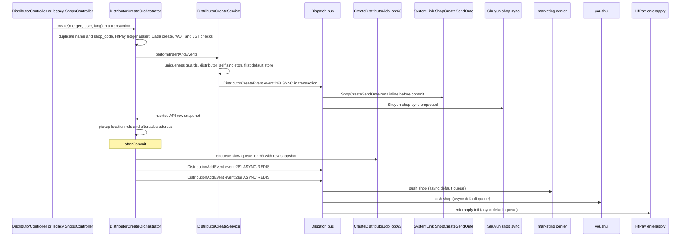
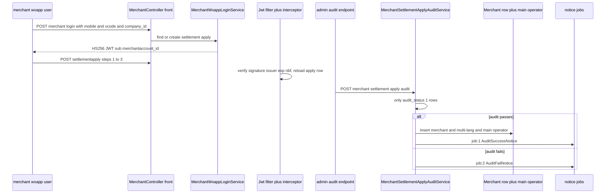
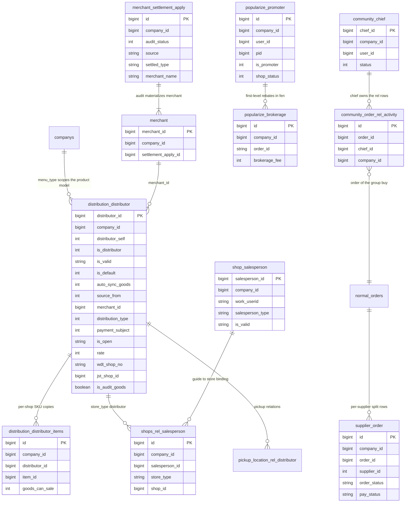

# Stores, Distributors, Merchants, and Salespersons

This page groups the store-side and B2B2C Bundles of the ecshopx reactor. Each Bundle's `package-info.java` states its domain in Chinese, and those statements are the authoritative scope definitions: `ecshopx-companys` is `企业与多门店域` (companies and multi-store), `ecshopx-distribution` is `分销与推广域` (distribution and promotion), `ecshopx-popularize` is `分销推广域模块` (distribution-promotion module), `ecshopx-merchant` is `商户入驻与设置域` (merchant onboarding and settings), `ecshopx-salesperson` is `业务员/导购域模块` (salesperson / shopping-guide), `ecshopx-supplier` is `供应商域` (suppliers), `ecshopx-community` is `社区与互动域` (community and interaction), `ecshopx-reservation` is `预约域模块` (reservations), and `ecshopx-selfservice` is `自助服务域模块` (self-service).

**Terminology first, because it is the most common source of confusion.** A **distributor** (`分销商` in the code, but in practice 门店, a *physical store*) is one row in `distribution_distributor` — the pickup point / delivery-capable shop that a member selects at checkout. It is *not* a reseller in the western sense. Two Bundles split the "distribution" namespace: `ecshopx-distribution` owns the **store** (门店) concepts — distributor CRUD, geofences, whitelists, delivery capability, payment subject, aftersales addresses — while `ecshopx-popularize` owns the **promoter** (推广员/分销员) concepts — the member-turned-referrer with QR codes and brokerage rows. Product-model scoping (which shop types exist for a company) comes from `companys.menu_type` in `ecshopx-companys`.

The store-side half of the goods contract also lives here conceptually: `distribution_distributor_items` is the per-shop copy of the catalog, but **the sync that populates it is executed by the goods bundle** — `DistributorGoodsSyncService.syncGoods` and `job:62 AddDistributorItems` — see [Goods Domain](goods.md) for that flow.

## The Distributor state model

`Distributor` (`distribution_distributor`, ~60 columns) is the center of gravity. The load-bearing columns:

| column | meaning |
| --- | --- |
| `distributor_self` | `1` marks the HQ self-pickup store (总部自提); **singleton per company** — creating a second one throws `总部自提店铺已存在` |
| `is_distributor` | main-shop flag, defaults true; distinguishes the "main store" from auxiliaries |
| `is_valid` | string soft-delete axis: `"true"` live, `"delete"` soft-deleted (never a physical delete) |
| `is_default` | the company's default store for member-less contexts; first non-wxapp-sourced store becomes default automatically |
| `auto_sync_goods` | goods fan-out flag: shops with `true` receive every new/edited SKU copy via `syncGoods` |
| `source_from` | `1` admin, `2` wxapp self-registered, `3` openapi — source-2 stores never become `is_default` |
| `merchant_id` | owning merchant (商户) for multi-merchant malls |
| `distribution_type` | `0` 自营 (self-operated), `1` 加盟 (franchise) |
| `payment_subject` | `0` platform collects, `1` shop collects (HfPay ledger split) — see below |
| `is_open` + `rate` | HfPay split-payment switch and platform rate (basis points) |
| `wdt_shop_no` / `wdt_shop_id` | WDT ERP shop binding (uniqueness-enforced per company) |
| `jst_shop_id` | Jushuitan shop binding (uniqueness-enforced per company) |
| `is_dada` / `dada_shop_create` / `shansong_shop_create` / `shansong_store_id` | local-delivery couriers bound to the store |
| `offline_aftersales*` | offline aftersales policy: self-handled, other-shops (same merchant only), or other |
| `is_audit_goods` | when flipped `true` → `false`, every shop-scoped item is auto-approved (see update flow) |

Uniqueness guards per company (all application-level, checked in `DistributorCreateService.performInsertAndEvents`): `name`, `shop_code`, `mobile`, `wdt_shop_no`, `jst_shop_id`, and the `distributor_self` singleton.

## Entrypoints

### Admin REST (`/api/v1`, `@AdminAuth`-style operator JWT)

`DistributorController` (~1,600 lines) is the hub; controller order is consistently gate → normalizer → validator → orchestrator, plus an operator-log write:

| route | purpose |
| --- | --- |
| `POST /distributor` | create store (route alias `distributor.create`) |
| `PUT /distributor/{id}` | update store (`distributor.update`) |
| `PUT /distributor/{id}/payment-subject` | set payment subject (`distributor.payment.subject.set`) — sealed `PaymentSubjectParse` reproduces legacy error semantics (below) |
| `GET /distributors`, `/distributors/info`, `/distributor/easylist`, `/distributor/count/{id}` | lists, detail, simplified list, per-store statistics |
| `GET /distributor/wxacode`, `GET /distributor/getShop` | shop wxapp QR code, valid-store list |
| `GET/POST/DELETE /distributor/items`, `GET /distributor/items/export`, `PUT /distributors/item` | the shop↔SKU binding surface (`distribution_distributor_items`): list, add, delete (cascades `goods_can_sale`), export, per-shop price/store override |
| `POST /distributor/default` | re-point the default store |
| `GET /distributors/aftersales` | stores selectable as aftersales targets (same-merchant constraint) |
| `GET/POST /distribution/getdistance` / `setdistance`, `/distributor/list/background` | distance config, store-list background images |

Sibling admin controllers: `DistributorAftersalesAddressController`, `DistributorCategoryController`, `DistributorGeofenceController` (Amap polygon, ≥3 vertices), `DistributorTagsController`, `DistributorWhiteListController`, `DistributorSalespersonRoleController`, `PickupLocationController`, `CashWithdrawalController` (withdrawal 1–800元 limits), `SelfDeliveryController`, `BasicConfigController`, `DistributionConfigController`.

The **legacy PHP route `POST …/v1/shops`** (referenced by the orchestrator Javadoc as `DistributorShopController#createShops`, no longer a Java controller of its own) is converged onto the same `DistributorCreateOrchestrator` — the `entry03_shopsCreateRoute_*` test in `DistributorCreateOrchestratorDistributionAddDispatchPublishProbeTest` asserts that the legacy route name shares this orchestrator's `afterCommit` publish path with `POST /api/v1/distributor`.

A **third create entrypoint** bypasses the orchestrator entirely: `OpenapiThirdApiV2DistributorCreateService.executeOpenapiCreate` (openapi thirdapi v2) inserts the row directly in a `TransactionTemplate` with `source_from=3`, `is_valid="false"`, `review_status=true`, and encrypted contact/mobile — then its `afterCommit` enqueues `job:63`, the dual `DistributionAdd` publish, *and* `DistributorCreateEvent` (event:263). So all three entrypoints end with the same fan-out shape even though only two share the orchestrator.

### Front wxapp (`/api/v1/h5app/wxapp/distributor/*`)

A read-mostly surface for the member-facing store picker: `list`, `alllist`, `get_all_distributor`, `self` (HQ self-pickup store), `default`, `count`, `is_valid`, `getDistributorInfo`, `aftersaleaddress`, `aftersaleslocation` (nearby return points), `whitelistByMember`, `checkUserInWhite`, `deliverytype`, `pickuplocation`, `salesperson/qrcode` (the store guide's QR code), `category/list`, `getAreaByAddress`/`getAreaByJwd` (Amap reverse geocoding), `config/inRule` (+ `POST config/inRule/check`, the `DistributionStoreEntryRuleRedisService` gate), and the shop-screen `advertisements`/`slider`; plus `CashWithdrawalController` for shop-side withdrawal.

### Merchant wxapp (`/api/v1/h5app/wxapp/merchant`)

`MerchantController` (front): `POST /login`, `GET /basesetting` (`@FrontNoAuth`), `GET /settlementapply/step`, `POST /settlementapply/{step}` (progress resolver: none → 1, `settled_type` → 2, `merchant_name` → 3, `license_url` → 4/awaiting audit; only steps 1–3 persist — the save switch rejects anything else with `入驻信息填写步骤错误`), `GET /settlementapply/detail`, `GET /settlementapply/auditstatus`, `GET /type/list`, `POST /password/reset` — all under `@DingoResponse`, with `@FrontMerchantAuth` guarding everything except `login`/`basesetting`.

### Salesperson WeCom wxapp

`QywxSalespersonAuthInterceptor` (a `HandlerInterceptor` honoring the `@QywxSalespersonAuth` annotation) guards the guide-facing endpoints; auth is header-session based, not JWT (below).

### Dispatch jobs

| job name | handler | purpose |
| --- | --- | --- |
| `job:63:ThemeBundle\Jobs\CreateDistributorJob` | `CreateDistributorJobHandler` (ecshopx-theme) → `PagesTemplateNewDistributorFacade` | bind default storefront page templates for the new store (slow queue) |
| `job:1..4:MerchantBundle\Jobs\*Notice` | merchant notice handlers | audit success/fail, enter success, password reset |
| `job:45:SalespersonBundle\Jobs\SalespersonTask` | `SalespersonTaskJobHandler` | task complete → marketing-center push (slow queue) |
| `job:46:SalespersonBundle\Jobs\SalespersonRelationshipContinuity` | continuity handler | member↔guide relationship bookkeeping |
| `job:138:SalespersonBundle\Jobs\SalespersonItemsShelvesJob` | shelves handler | guide-visible shelf recomputation; `job:139`–`149` are aliases of the same bus message name |
| `job:62:DistributionBundle\Jobs\AddDistributorItems` | goods bundle | the store-side catalog fan-out (see [Goods Domain](goods.md)) |

## The create flow and its after-commit fan-out

Caption: the store create pipeline — one SYNC in-transaction event for OME/Shuyun, then after commit the theme template job runs first and the dual CSV DistributionAdd publishes fan out to marketing center, youshu, and HfPay.

1. **Pre-persistence validations** (`DistributorCreateOrchestrator.create`, `@Transactional`): duplicate name (`店铺名称已存在`) and `shop_code`; `HfpayLedgerConfigReadService.assertOpenAndRateAllowedIfNeeded` when split payment is requested; `LocalDeliveryShopCreateClient.applyCreateShopIfDada` registers the store with Dada; WDT (`assertShopExistsIfWdtNo`) and Jushuitan (`assertEnabledIfJstIdPositive`) bindings are checked against the ERP.
2. **Insert + in-tx event** (`DistributorCreateService.performInsertAndEvents`): mobile format (or the WeCom synthetic `d-d-d` mobile), the six uniqueness guards, `distributor_self` singleton, and `needDefault = sourceFrom != 2 && !existsDefaultDistributor(companyId)` — the first non-wxapp store becomes the default. The row is inserted, multi-language shards are written, and `DistributorCreateEvent` (`event:263:DistributionBundle\Events\DistributorCreateEvent`) is published **inside the transaction in SYNC mode** (`DispatchOptions.eventDefaults()` is `DispatchMode.SYNC`) so the OME listener runs inline before commit. Its registered listeners: `listener:SystemLinkBundle\Listeners\ShopCreateSendOme` (SYNC) and `listener:shuyun.open_platform.shop_sync_on_distributor_create` (async default queue).
3. **Side tables.** Pickup-location relations from `pickup_location`, and the offline aftersales address — whose product-model slug comes from `companys.menu_type` via `CompanyMenuTypeProductModel.toSlug` (null-safe default `platform`).
4. **afterCommit ordering.** `TransactionSynchronizationManager.registerSynchronization` enqueues `job:63` (theme templates, **slow queue**, ASYNC REDIS) *before* calling `distributionAddEventDispatchPublisher.publish(rowSnapshot)`. The publisher (`DistributionAddEventDispatchPublisherImpl` in bootstrap) publishes the **same payload twice** — `event:281` and `event:289` — both ASYNC REDIS. This is the deliberate CSV-plane split: `event:281` carries the third-party marketing-center push + youshu listeners, `event:289` carries the HfPay `HfEnterapplyInit` listener. The ordering (job before events) and the dual publish are pinned by `DistributorCreateOrchestratorDistributionAddDispatchPublishProbeTest` and `DistributionAddEventDispatchPublisherImplDualPublishFacadeProbeTest`.

## The update flow

`DistributorUpdateOrchestrator.update` mirrors the create shape: optional HfPay ledger assert when `is_open` goes true, datapass-blocked column refill (`mobile`/`contact` re-read from the DB row), name/shop_code duplicate check, Dada update, WDT/JST checks, and the same-merchant constraint on `offline_aftersales_distributor_id` (`售后门店只能选择同一商户下的其他门店`).

`DistributorUpdateService.performUpdateAndEvents` then: re-defaults (`is_default=1` forced when no default exists), validates mobile, and — notably — when `is_audit_goods` flips from `true` to a falsy value it bulk-approves every shop-scoped item via `ItemsAuditByDistributorJdbcRepository.updateAuditStatusApprovedByDistributorId` (disabling item audit must not leave previously-submitted items stuck). Only whitelisted `COLUMN_KEYS` (≈55 column names) are applied; everything else in the merged params is ignored.

afterCommit publishes **DistributionEdit first, DistributorUpdate second**:

* `event:282` + `event:290` (`DistributionEditEvent`, dual CSV publish, ASYNC REDIS) → listeners: third-party marketing-center push + youshu (282), HfPay `HfEnterapplyInit@edit` (290).
* `event:264` (`DistributorUpdateEvent`) → published **SYNC** (`DispatchOptions.eventDefaults()`) → listeners: `listener:SystemLinkBundle\Listeners\ShopUpdateSendOme` (SYNC) and `listener:shuyun.open_platform.shop_sync_on_distributor_update` (async).

Pinned by `DistributorUpdateOrchestratorDistributionEditDispatchPublishProbeTest`, `DistributionEditEventDispatchPublisherImplDualPublishFacadeProbeTest`, and `DistributorUpdateEventSyncBusDispatchFlowTest`.

### Payment subject: legacy error semantics preserved

`PUT /distributor/{id}/payment-subject` parses `payment_subject` through a **sealed interface** `PaymentSubjectParse` with three outcomes: `Valid(0|1)`, `Invalid` (returns Dingo-style `payment_subject参数错误，只能为0（平台）或1（店铺）` with status 422), and `SqlBug` — the case where a legacy PHP/MySQL write would have failed with `SQLSTATE[HY000]: General error: 1366 Incorrect integer value: '' for column 'payment_subject'`, which the Java port deliberately reproduces (HTTP 200 with Dingo `message`/`status_code` 500 in the body, matching the old client contract).

The service behind it, `DistributorPaymentSubjectService.setPaymentSubject`, refuses to switch while the store has unfinished refunds (`有未完成的退款单，不允许切换收款主体`), and switching **to** shop-subject (`1`) requires at least one open payment channel (WeChat Pay or Alipay) *and* complete per-shop channel configuration for each open channel; switching to platform (`0`) instead validates the platform (distributor 0) channel config. The `PaymentSubjectDistributorIdPortImpl` in this bundle exposes the current subject to the payment and orders bundles through a common port.

## Merchants: apply → audit → account

Caption: the merchant settlement lifecycle — wxapp self-service apply under a dedicated JWT plane, then a single admin audit that materializes the merchant and its main operator.

* **Apply.** `merchant_settlement_apply` rows carry `audit_status` `1` (pending) / `2` (passed) / `3` (refused) and `source` admin/h5. Login with mobile + SMS vcode + `company_id` finds or creates the apply row and issues an HS256 JWT (`MerchantWxappJwtIssuer`, subject `merchantaccount_{id}`, claims `account_id`/`company_id`/`mobile`, `operator_type=user`, iss/nbf/exp from `MerchantWxappJwtProperties`).
* **The JWT plane.** Two parallel guards authenticate `@FrontMerchantAuth` endpoints: the servlet-level `MerchantWxappJwtAuthenticationFilter` (covers `POST settlementapply/**`, `POST password/reset`, and four specific GETs: step/detail/auditstatus/type-list) and the MVC `FrontMerchantAuthInterceptor` (annotation-driven, same verification logic). Both verify the HS256 signature, issuer, and exp/nbf claims (with `leewaySeconds`) and then **reload the `merchant_settlement_apply` row** so a deleted apply invalidates an unexpired token; a *refused* apply stays authenticated on purpose — step 3 re-submission resets `audit_status` from refused back to pending. This is a *separate* auth plane from both the operator JWT (admin) and the member session (wxapp), which is why merchant onboarding can happen before any operator exists.
* **Audit.** Only `audit_status=1` rows are auditable. Success materializes the `merchant` row (mirroring apply fields + `settlement_apply_id`), its multi-language shards, and the **main operator** — provisioned through `CompanysMerchantMainOperatorProvisioner` in `ecshopx-companys` (operator_type `merchant`, `is_merchant_main`, encrypted mobile, bcrypt 6-digit password or none) — then enqueues `job:1 AuditSuccessNotice`. Failure enqueues `job:2`. Jobs 3/4 cover enter-success and password-reset notices.

## Salespersons: WeCom session auth and task lifecycle

`shop_salesperson` rows (types `admin`, `verification_clerk` 核销员, `shopping_guide` 导购) bind a WeCom `work_userid` to stores through `shops_rel_salesperson` (`store_type=distributor`); `DistributorSalesmanRole` assigns per-store roles.

Auth flow (`QywxSalespersonAuthInterceptor` → `WxappSalespersonSessionAuthService.authenticate`): the `x-wxapp-session` header is looked up in the shared wechat Redis as `frontSession3rd:{token}` (written by `H5WxappWorkWechatLoginPortImpl`); the JSON session is cross-checked against the DB (`company_id` + `work_userid` + allowed `salesperson_type`, `is_valid=true`) — mismatched type throws `会话与库不一致` — and the DB's `salesperson_id` **overrides** the session's, with the first `store_type=distributor` shop (lowest `shop_id`) injected as `distributor_id` (0 when unbound). A `salesperson-type` header narrows the allowed types.

Admin `/api/v1/salesperson/task` CRUD defines tasks of types 1–4 scoped to all or selected distributors, with overlap rejection. Front completions (`subtask`/`post`) enqueue **`job:45`** (slow queue) whose handler pushes completion to the marketing center through `MarketingCenterTasksCompletePort`; the member↔guide relationship continuity job is **`job:46`**; and shelf recomputation (triggered by package-promotion, marketing-activity, and seckill create/update/end events) is **`job:138`**, with `job:139`–`149` being *aliases of the same bus message name* — one handler registration, many legacy PHP trigger rows (`SalespersonDispatchJobNames`).

## Popularize: promoters and first-level brokerage

`popularize_promoter` (pid hierarchy, `shop_status` 0–4, `is_promoter` flag, Alipay payout binding) and `popularize_brokerage` (integer **fen** amounts) live in `ecshopx-popularize`. On trade finish, the `TradeFinishCountBrokerage` listener invokes `NormalOrderFinishBrokerageCoordinator.onNormalOrderFinishBrokerage`, which: skips unless the company's `open_popularize` setting is literal-true; is **idempotent per order** (existing brokerage rows short-circuit); requires the buyer to be a promoter with a `pid` parent who is an active promoter; computes the first-level rebate as `order_money` (or profit, per config) × first-level ratio percent, rounded to fen, capped at `Integer.MAX_VALUE`; and enqueues the promoter grade-upgrade job. Store QR codes are unlimited-type WeChat codes returned base64. HfPay withdrawal events (268/270/296) drive promoter payout.

## Community group-buy: the chief write-off

`community_chief` / `community_activity` / `community_order_rel_activity` model the group; apply flow is `0` pending → `1` creates the chief / `2` refused with reason. `CommunityChiefQrWriteoffService.executeQrWriteoff` is the only write-off path: it resolves the ziti QR code (Redis) to an order, verifies the `community_order_rel_activity` row belongs to **this chief** (`只能核销自己开团的订单`), rejects already-DONE orders (`该订单已完成自提，请重新确认`) and orders with pending cancel requests (`订单有未处理的取消申请，不能核销`), then delegates the actual state transition to `NormalOrderZitiWriteoffService.orderZitiWriteoffForChief` in the orders bundle — community never duplicates order status logic.

## Supplier orders: the split from normal orders

`ecshopx-supplier`'s `supplier_order` rows are **per-supplier projections of a normal order**. The split runs in `SupplierOrderSplitOnNormalOrderAddService.split` (physically in `ecshopx-orders`, package `cn.shopex.ecshopx.supplier.service`, so it can read `normal_orders*` tables directly): it collects distinct `supplier_id`s from order items and `normal_orders_rel_supplier` rows, and for each inserts one `supplier_order` with aggregated item/total/market/cost/commission fen sums plus the supplier's freight, starting at `order_status=NOTPAY`/`pay_status=NOTPAY`, **guarded by an existence check** (companyId+orderId+userId+supplierId) so re-running is a no-op. The production trigger is a **direct synchronous call** in both normal-order-create orchestrators — `WxappNormalOrderCreateOrchestrator` and `ShopadminNormalOrderCreateOrchestrator` invoke `splitSupplierOrders` right after the transactional runner and before publishing `event:orders:normal_order_add`. `OrdersSupplierOrderSplitOnNormalOrderAddDispatchListener` wraps the same service on that bus plane as `listener:orders.supplier_order_split_on_normal_order_add`; the dispatch-flow tests register it as the first listener (before youshu and the marketing-center push) to pin the fan-out shape. Admin surface: `/api/v1/supplier/get_order_list` and `POST /order_paid_confirm`.

## Reservation and selfservice (briefly)

`ecshopx-reservation` models shifts, resource levels, and reservation records; its operational heartbeats are the expire-cancel job and reservation-finish WXA template listeners. `ecshopx-selfservice` handles registration activities and form submissions. Both follow the standard layering and are covered by the common request lifecycle ([Request Lifecycle](../architecture/request-lifecycle.md)).

## Data model

Caption: the store-side tables — the distributor as the join point between companies, merchants, guides, promoters, chiefs, and per-supplier order projections.

## Invariants and failure semantics

* **afterCommit ordering is contractual.** On create: `job:63` enqueue *then* the dual DistributionAdd publishes; on update: DistributionEdit dual publish *then* DistributorUpdate. Publishing `DistributorCreateEvent`/`DistributorUpdateEvent` SYNC *inside or right after* the transaction keeps OME shop sync aligned with the DB write, while the fan-out events only fire after a real commit so listeners always reload persisted state.
* **Dual CSV publishes are deliberate.** `event:281`/`289` (and `282`/`290`) carry the same payload on two bus planes so legacy PHP listener names keep working; do not "deduplicate" them.
* **Company scoping everywhere.** Every distributor/merchant/promoter/salesperson query is `company_id`-bounded; duplicate-name checks and ERP bindings are per company.
* **Soft delete only.** `is_valid` flips to `"delete"`; update wrappers always add `.ne(is_valid, "delete")`.
* **Money is fen** (`brokerage_fee`, supplier order sums, `rate` in basis points); the payment-subject legacy 1366 error must be preserved byte-for-byte.
* **Singletons and defaults.** One `distributor_self` per company; at most the first non-wxapp store is auto-default; update re-defaults when none exists.
* **Audit-disable cascade.** `is_audit_goods` true→false must auto-approve pending shop items, or they become invisible to buyers.
* **Idempotent brokerage and supplier split.** Both are guarded by existence checks on (company, order[, supplier]) so listener retries cannot double-count.
* **Salesperson identity comes from the DB, not the session.** Redis supplies the session, the DB row is authoritative for `salesperson_id` and distributor binding; a type mismatch between the two is a hard reject.
* **Chief write-off ownership.** Only the chief who opened the group can write off, and only before completion/cancel-pending states — the delegation to `orderZitiWriteoffForChief` keeps order-state transitions in one place.

## Extension points

* **React to store lifecycle** — register a listener in a bootstrap `*RegistrationConfig` against `event:263`/`264`/`281`/`289`/`282`/`290`; distribution services need no change ([Cross-Bundle Communication](../architecture/cross-bundle-communication.md)).
* **New store-side setting** — extend the `Distributor` entity and add the column to `DistributorUpdateService.COLUMN_KEYS`; gate/normalizer/validator layers stay untouched.
* **New per-shop goods behavior** — extend `distributor_items` consumers; the sync itself stays in the goods bundle (`DistributorGoodsSyncService`, `job:62`).
* **New merchant onboarding step** — add to `MerchantWxappSettlementApplySaveService` and the `MerchantSettlementApplyProgressService` resolver; the JWT plane (issuer + filter + interceptor) needs no change.
* **New guide task type** — task types are data-driven in the task tables; job:45/46/138 planes are unchanged.
* **New local-delivery courier** — the Dada/Shansong clients behind `LocalDeliveryShopCreateClient` are the pattern.

## Focused tests

The dispatch-flow tests are the executable spec for the ordering claims above:

* `DistributorCreateOrchestratorDistributionAddDispatchPublishProbeTest` (incl. the `entry03_shopsCreateRoute_*` legacy-route case) and `DistributorUpdateOrchestratorDistributionEditDispatchPublishProbeTest` — afterCommit job-before-events (create) and edit-before-update (update) ordering, with row snapshots.
* `DistributionAddEventMarketingCenterAndYoushuFanOutDispatchFlowTest`, `DistributionAddHfpayEnterapplyEvent289AsyncBusDispatchFlowTest`, `DistributionAddEventDispatchPublisherImplDualPublishFacadeProbeTest` — the dual 281/289 publish and its fan-out.
* `DistributorUpdateEventSyncBusDispatchFlowTest`, `DistributorCreateEventSyncBusDispatchFlowTest`, `DistributionEditEventMarketingCenterAndYoushuFanOutDispatchFlowTest`, `DistributionEditHfpayEnterapplyEvent290AsyncBusDispatchFlowTest` — update-plane ordering and event:263/264 SYNC semantics.
* `CreateDistributorJobDispatchFlowTest` — job:63 slow-queue envelope and `PagesTemplateNewDistributorFacade` delegation.
* `MerchantAuditSuccessNoticeJobDispatchFlowTest`, `MerchantAuditFailNoticeJobDispatchFlowTest`, `MerchantEnterSuccessNoticeJobDispatchFlowTest`, `MerchantResetPasswordNoticeJobDispatchFlowTest` — the four merchant notice jobs (jobs 1–4) and their publishers.
* `SalespersonTaskJobDispatchFlowTest`, `SalespersonRelationshipContinuityJobDispatchFlowTest`, `SalespersonItemsShelvesJobDispatchFlowTest` — jobs 45/46/138 wiring. (The `WxappSalespersonSessionAuthService` auth cross-check itself has no dedicated test; its contract is pinned by the interceptor's usage.)
* `NormalOrderAddEventAsyncFanOutSupplierAndYoushuDispatchFlowTest`, `NormalOrderAddOrderAddPushMarketingCenterDispatchFlowTest`, `OrdersSupplierOrderSplitOnNormalOrderAddDispatchListenerDispatchConsumerRuntimeTest` — supplier split listener plane and fan-out order.
* `TradeFinishCountBrokerage*DispatchFlowTests`, `TradeFinishCountBrokerageUpgradePromoterGradeEnqueueTest` — idempotent first-level brokerage and grade-upgrade enqueue.
* `DistributorGoodsSyncServiceAddDistributorItemsDispatchTest`, `ItemsUpdateOrchestratorDistributorSyncTest` — the goods→store catalog contract (in [Goods Domain](goods.md)).

## Related pages

* [Goods Domain](goods.md) — the other half of `distributor_items`: auto-sync fan-out, `job:62`, price/store overrides.
* [Orders Domain](orders.md) — normal order create (which calls the supplier split), ziti write-off, cancel/restore.
* [Marketing Domain](marketing.md) — distributor scoping of coupon issue and activity goods; salesperson shelves jobs 138–149.
* [Dispatch Bus](../concepts/dispatch-bus.md) — the SYNC/ASYNC, queue, and fan-out semantics under every event and job here.
* [Cross-Bundle Communication](../architecture/cross-bundle-communication.md) — the publisher-in-common / listener-in-bootstrap split all these flows follow.
* [Request Lifecycle](../architecture/request-lifecycle.md) — the operator-JWT vs wxapp-session vs FrontMerchantAuth planes.
* [Redis Databases](../concepts/redis-databases.md) — the wechat/shared Redis split behind `frontSession3rd:` sessions and ziti QR codes.
