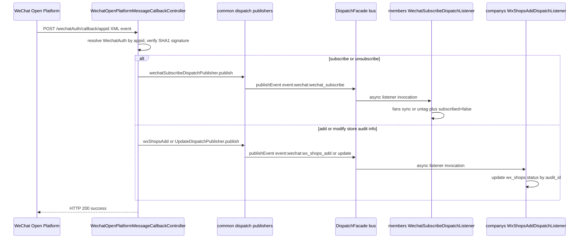
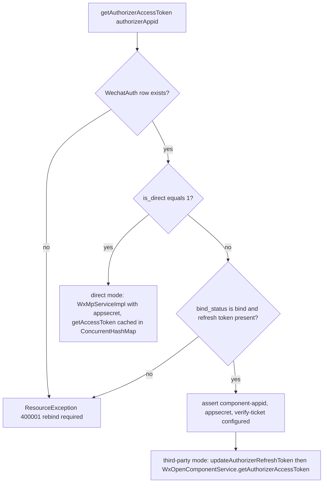

# WeChat Ecosystem (ecshopx-wechat, ecshopx-work-wechat)

Two Bundles carry all WeChat surface area. **`ecshopx-wechat`** (微信与小程序对接域, see `ecshopx-wechat/src/main/java/cn/shopex/ecshopx/wechat/package-info.java`) is the consumer WeChat bundle: the WeChat Open Platform third-party component (callback, auth-code binding, authorizer access tokens), mini-program publish/audit/release, official-account (mp) fans/tag/menus/materials, Mendian (门店/wx-shops) API client, and the WxJava thin HTTP clients that every other bundle reaches through ports. **`ecshopx-work-wechat`** (企业微信对接域, see `ecshopx-work-wechat/src/main/java/cn/shopex/ecshopx/workwechat/package-info.java`) is the WeCom (企业微信) bundle: encrypted callbacks for customer-contact and address-book events, work-wechat config storage in Redis, and the order/aftersale/salesperson notice senders that push textcard and miniprogram_notice messages to corp users.

Maven boundaries are narrow and deliberate: `ecshopx-wechat` declares `ecshopx-common`, `ecshopx-super-admin` (the `wxapp_template` mapper), `ecshopx-merchant`, `ecshopx-third-party` plus the WxJava SDKs `weixin-java-miniapp`, `weixin-java-open`, `weixin-java-mp` (`ecshopx-wechat/pom.xml`); `ecshopx-work-wechat` declares only `ecshopx-common`, `ecshopx-third-party` and `weixin-java-cp` (`ecshopx-work-wechat/pom.xml`). Everything downstream consumes them through ports in `ecshopx-common` — see [Cross-Bundle Communication](../architecture/cross-bundle-communication.md).

## The `/wechatAuth/*` external path space

`/wechatAuth/**` is the PHP-era URL space for anonymous, WeChat-server-driven traffic. `OperatorJwtAuthenticationFilter` explicitly skips it (`espier/security/OperatorJwtAuthenticationFilter.java` — "微信 legacy 开放路径... 不携带运营 JWT"), so these controllers must do their own signature verification. Three controllers own it:

| sub-path | owner bundle | controller | purpose |
| --- | --- | --- | --- |
| `/wechatAuth/wxpay/notify` | ecshopx-payment | `payment/api/open/WxpayNotifyController` | WeChat Pay v2 unified-order async notify (XML), delegated to `WxpayNotifyFacade` — see [Payments Domain](payments.md) |
| `/wechatAuth/callback/{authorizerAppId}` | ecshopx-wechat | `WechatOpenPlatformMessageCallbackController` | WeChat Open Platform message/event callback (this page) |
| `/wechatAuth/wxapp/qrcode.png` | ecshopx-wechat | `WxappLegacyQrcodeController` | PHP-parity `GET` mini-program code PNG (below) |

## Open Platform message callback → dispatch bus → members/companys

`WechatOpenPlatformMessageCallbackController` (`@RestController("/wechatAuth/callback")`, unauthenticated `api/open` package) is the entry point for WeChat Open Platform pushes to an authorizer (official account or mini program bound to a tenant):

* **GET** `/{authorizerAppId}` echoes `echostr` back when URL verification succeeds: if the configured token is non-empty, it checks `signature = SHA1(sort(token, timestamp, nonce, echostr))` and returns 403 otherwise.
* **POST** `/{authorizerAppId}` (XML/text body): resolves `WechatAuth` by `authorizer_appid` (404 `"fail"` if the row or its `company_id` is missing), optionally verifies the signature — 3-part SHA1 over `(token, timestamp, nonce)` for plaintext pushes, 4-part SHA1 including the `<Encrypt>` payload for encrypted ones — then parses **plaintext** event XML via `WechatOpenPlatformCallbackXmlSupport.tryParsePlaintextEventXml` (encrypted or non-event payloads return `"success"` without side effects).

The three event families fan out through three publishers declared in `ecshopx-common` (functional interfaces) and implemented in `ecshopx-bootstrap` over `DispatchFacade`:

| event | publisher | dispatch message | listener (bundle) | effect |
| --- | --- | --- | --- | --- |
| `subscribe` / `unsubscribe` | `WechatSubscribeDispatchPublisher` | `event:wechat:wechat_subscribe` | `WechatSubscribeDispatchListener` (members) | fans sync / tag cleanup (below) |
| `add_store_audit_info` | `WxShopsAddDispatchPublisher` | `event:wechat:wx_shops_add` | `WxShopsAddDispatchListener` (companys) | `WxShopsWechatAuditCallbackService.applyWxShopsAddEvent` — updates the `wx_shops` row's `status`/`errmsg` by `audit_id` |
| `modify_store_audit_info` | `WxShopsUpdateDispatchPublisher` | `event:wechat:wx_shops_update` | `WxShopsUpdateDispatchListener` (companys) | same service, `applyWxShopsUpdateEvent` |

The subscribe payload carries `openId` (FromUserName), `authorizerAppId`, `company_id` (from the `WechatAuth` row), and `event` (lowercased); the store-audit payloads carry `audit_id`, `status`, `reason`, plus `is_upgrade`/`poiid` for add. Listener registration is explicit, in bootstrap `@PostConstruct` configs registering members' listener under `listener:members.wechat_subscribe` and companys' under `listener:companys.wx_shops_add` / `wx_shops_update`, all `asyncDefaults()` — so `wechat` never depends on `members`/`companys` (the publishers are the only coupling, inverted through `ecshopx-common`).

The sequence diagram above shows the full callback-to-listener flow across the bundle boundary; every arrow is grounded in the components described in this section.

### Fans sync and tag cleanup in members

`WechatSubscribeDispatchListener` (members) is where the event lands:

* **subscribe** → `WechatOpenPlatformAuthorizerTokenService.getAuthorizerAccessToken(authorizerAppId)` → `OfficialAccountUserInfoBatchService.batchGetUserInfo` (MP `user/info/batchget`, executed through `WxJavaMpRuntime.mpBearer(token)`) → if the unionid is non-empty, `WechatFansSyncPersistService.saveUser` persists/updates the `wechat_users` fan row for that company + authorizer.
* **unsubscribe** → loads `WechatFansBindWechatTag` bindings for (openId, companyId, authorizerAppid), untags the user from each tag via `OfficialAccountUserTagMemberService.untagUsers` (MP `tags/members/batchuntagging`, chunked at 50 openIds per call), then in one transaction deletes the bindings and flips the fan row's `subscribed` to false.

The mp-side services (`wechat/mp/OfficialAccount*`: user get/remark, tag create/update/delete/list, tag member batching, batch user info) are thin WxJava wrappers; they exist here so members can call them without owning WeChat credentials. `OfficialAccountUserTagMemberService.tagUsers` is the write counterpart used by admin-side tag operations. Behavior is pinned by `WechatOpenPlatformMessageCallbackController{Subscribe,WxShopsAdd,WxShopsUpdate}DispatchTest` (controller payload shape), bootstrap's `WechatSubscribeEventDispatchFlowTest` (publish → listener inline under sync driver) and members' `WechatSubscribeDispatchListenerUnsubscribeBranchTest` (untag + fan flip).

## Token resolution: `WechatOpenPlatformAuthorizerTokenService`

Every WeChat API call funnels through access tokens, and this service is the single resolution point. It reads the `wechat_authorization` row by appid and branches on `is_direct`:

The flowchart above shows the dual-mode token resolution: direct mode uses the stored appsecret, third-party mode requires the Open Platform component config and the authorizer refresh token; both failure paths surface as the 400001 "rebind required" business code. Direct-mode `WxMpServiceImpl` instances are cached per appid and their secret is refreshed on each call; third-party mode pushes the latest refresh token into `WxOpenConfigStorage` before asking the component service for the token. The component gate (`assertOpenPlatformComponentReady`) throws when any of `ecshopx.wechat.open.component-appid` / `component-appsecret` / `component-verify-ticket` is blank — the ticket is supplied by deployment config, synced from the WeChat authorization callback (the `component_verify_ticket` push), not persisted by the Java side.

On top of this sit two per-SKD-kind runtimes in `wechat/wxjava/`:

* `WxJavaMaRuntime.ma(appId)` — returns a cached `WxMaService` (weixin-java-miniapp); for `is_direct=1` rows it builds the service from the stored secret, otherwise it injects the authorizer token with a 7200-second TTL. `maDirect(appId, secret)` builds an ad-hoc service from caller-supplied credentials (used by jscode2session-lenient and direct binds).
* `WxJavaMpRuntime.mp(appId)` — cached `WxMpService` (weixin-java-mp) with the authorizer token injected (7200s); `mpBearer(token)` wraps a caller-supplied token without refresh; `mpDirect(appId, secret)` for secrets.

The `WxOpenService`/`WxOpenConfigStorage` beans themselves come from `WxJavaWechatConfiguration`, which seeds `WxOpenInMemoryConfigStorage` from the same three `ecshopx.wechat.open.*` properties.

## Binding: authorized (open platform) vs direct

`WechatAuthBindService` (behind admin `AuthorizedController`, `/api/v1/wechat`) implements the two binding modes the token service later branches on:

* **`authorizedBind`** (route `POST /api/v1/wechat/bind`, alias `wechat.bind`) — the open-platform flow. It exchanges the `auth_code` via `WechatOpenPlatformQueryAuthClient.queryAuthByAuthorizationCode`, pulls authorizer info, refreshes the stored `authorizer_refresh_token` when the appid already exists, unbinds the company's previous service account (`service_type_info=2`) when a different one is being bound, and enforces the account policy: only 服务号 (`service_type_info=2`) or 小程序 (`service_type_info=3`/miniprograminfo present) authorizations are accepted (`只支持服务号或小程序授权`), `auth_type` must match what was authorized (woa vs wxa), personal principal names (`个人`) and unverified accounts (`verify_type_info.id=-1`) are rejected, and an appid already bound to another company cannot be re-bound. The row is inserted/updated with `bind_status=bind`. The pre-auth entry point `GET /api/v1/wechat/pre_auth_url` (alias `wechat.pre_auth_url`) builds the `componentloginpage` URL from a fresh `pre_auth_code` (`WechatPreAuthUrlService`).
* **`directBind`** (`bind_type` = `offiaccount` or `miniprogram`) — the tenant supplies `authorizer_appid` + `authorizer_appsecret` directly; the row is written with `is_direct=1` and no refresh token. Mini-program direct bind additionally requires `template_name` and runs in its own transaction, with member-conflict checks delegated through `WechatDirectBindMemberConflictPort` (implemented in members).

The `wechat_authorization` table is keyed by `authorizer_appid`; `service_type_info` encodes 0/1 订阅号, 2 服务号, 3 小程序; `bind_status` is `bind`/`unbind`; `auto_publish` and `is_direct` control the third-party-vs-direct behavior. `WxaOpenPlatformBindingInspectService.checkWxaBind` guards open-platform consistency when `wxa-need-open-platform=true`: it resolves both the official-account and mini-program tokens, calls `open/get` on each via `WechatOpenPlatformAccountClient`, and requires the two `open_appid` values to match (mismatch or error → bind check fails).

## Mini-program publish/audit orchestration

The heart of `ecshopx-wechat` is `WxaWeappPublishOrchestrationService`, driven by `WxaController`'s routes (`POST /api/v1/wxa` route alias `wechat.wxa.create` full upload, `POST /wxa/onlycode` commit-only, `POST /wxa/submitreview` review-without-upload) through `WxaUploadWxaService`, which chooses the mode:

| entry | when | orchestration method | weapp row outcome |
| --- | --- | --- | --- |
| `uploadWxa` with `is-automatic-submit-review=true` (default) | normal upload | `submitAudit` | `audit_status=2` (审核中) after commit + audit submit |
| `uploadWxa` with automatic review off | commit-only mode | `onlyCommitTempCode` | `audit_status=3` (待提交审核) |
| `submitReview` | review without code upload | `submitReviewWithoutCodeUpload` | `audit_status=2` |
| `commitTempCode` with no wxaAppId and `open-third=false` | rejected | — | `BadRequestException` |

`submitAudit` runs the full pipeline; `onlyCommitTempCode` stops after commit; `submitReviewWithoutCodeUpload` skips the commit but still submits audit (existing code):

1. **Pre-checks** — binding validation (`WxaSubmitAuditCheckService`, `isMiniProgramWxaBoundToCompany`), a `getAuthorizerAccessToken` probe to fail fast on bad credentials, and `SuperadminWxappTemplateMetadataService.resolveTemplateRow(templateName)` (below).
2. **Domain modify** — `WxaOpenPlatformCodeApiClient.modifyDomain(wxaAppId, domainMap)` posts the template's domain whitelist (requestdomain/wsrequestdomain/uploaddomain/downloaddomain/udpdomain/tcpdomain) with `action=set`. In `submitAudit` a failure is logged and the flow continues; in the other two modes it fails the request.
3. **Code commit** (audit paths only) — `commitTemplate` builds `ext_json`: the caller's template options under `ext`, `extAppid`/`extEnable=true`/`directCommit=false`, the Youshu token (`youshutoken` from `YoushuSettingInfoPort`, app_id or sandbox_app_id), `requiredPrivateInfos` = `[getLocation, chooseAddress, chooseInvoiceTitle, getPhoneNumber]`, and — when `CompanyLiveRoomEnabledPort.isLiveRoomEnabled(companyId)` — `plugins["live-player-plugin"]` with the configured `version`/`provider` (`ecshopx.wechat.live-player-plugin.*`). `commit` posts `wxa code/commit` with template_id, ext_json, user_version, user_desc. `yykweishop` templates get a default `window` block merged in (`mergeYykWindowIfNeeded`).
4. **Category-based audit submit** — `getCategory` reads the wxa service categories; an empty list fails with `请在微信小程序中设置服务类目`; the first category's classes/ids plus the template `tag` and title are submitted through `submitAudit` (item_list with `address=pages/index`, `order_path=/subpage/pages/trade/list`). In `submitAudit` mode the weapp row save and the WeChat submit run in one transaction and a positive `errcode` (other than 85009, "already in audit") rolls back both with the WeChat errmsg.

`wechat_weapp` tracks the state machine: `audit_status` 0 success / 1 fail / 2 in-review / 3 pending-submit, `release_status` 0/1, plus `reason`, `audit_time`, `template_id`, `template_ver`, `release_ver`. `WxaTryReleaseService.tryRelease` (route `POST /wxa/tryrelease`) polls `getLatestAuditstatus`: status 1 → `WeappProcessAuditForTryReleaseService.applyAuditRejected` records the reason; status 2 → still in review; otherwise it calls `releaseMiniProgramIgnoring85052` and `applyReleased` marks `audit_status=0`, `release_status=1`, `release_ver=template_ver`. The admin surface also exposes `undocodeaudit` and `revertcoderelease` with their own state transitions in `WeappProcessAuditForTryReleaseService`.

### Template metadata: DB first, properties fallback, Redis domain merge

`SuperadminWxappTemplateMetadataService.resolveTemplateRow` resolves a template key to the `{template_id, version, desc, tag, domain, ...}` row used by commit and audit:

1. **DB** — `superadmin_wxapp_template` (`WxappTemplateMapper`, from `ecshopx-super-admin`) queried by `key_name`.
2. **Properties fallback** — `ecshopx.wechat.wxa-template-fallback.<key>.*` flat keys (`template-id`, `version`, `desc`, `tag`, `name`, `domain` as JSON); a fallback row requires template-id/version/desc/tag/domain all set.
3. **Neither** → `BadRequestException("选择的小程序模板不存在")`.

Domain whitelists are merged at read time by `WxaTemplateDomainInfoService`: whatever the DB row or fallback properties say for the five columns (`requestdomain`, `wsrequestdomain`, `uploaddomain`, `downloaddomain`, `webviewdomain`) is union-merged with the global tokens stored in Redis under the fixed keys `wxappTemplateRequestdomain`, `wxappTemplateWsrequestdomain`, `wxappTemplateUploaddomain`, `wxappTemplateDownloaddomain`, `wxappTemplateWebViewdomain` (set by `setDomain`, super-admin only — SaaS deployments get `当前系统无权限`). So adding a domain to every template commit is an ops action: write the Redis keys, no template edit needed. `WxaGetTemplateListService.getTemplateList` lists templates from the DB, falling back to the `ecshopx.wechat.wxa-template-list-fallback-keys` comma-separated key list when the table is empty or `ecshopx.wechat.template-list-use-fallback-only=true`.

## Subscribe-message templates

The admin "select from WeChat template library" surface (`addtemplate`/`deltemplate`) is port-scoped (`WxaSubscribeMessageTemplateAdminPort` in common, consumed by promotions' `WxaTemplateOpenService`) with two gated implementations: `WxaSubscribeMessageTemplateAdminHttpService` (`@ConditionalOnProperty ecshopx.wechat.wxa.subscribe-template.http-enabled=true`, calls the real MP API through `WxJavaMaRuntime`) and the default `WxaSubscribeMessageTemplateAdminNoOp` (`matchIfMissing=true`), which throws the i18n message `common.wxa.subscribe_template.http_disabled` on add and returns false on delete — deployments must opt in to real WeChat calls.

## WxJava HTTP clients (`wxa/`, consumed cross-bundle)

These clients are the reason other bundles can talk to WeChat without their own credentials; all of them resolve the token through `WechatOpenPlatformAuthorizerTokenService` (via the runtimes) and map `WxErrorException` to `ResourceException` through `WxJavaExceptions`:

| client | WeChat API | notable callers |
| --- | --- | --- |
| `WxaUnlimitedQrcodeClient` | `wxa/getwxacodeunlimit` (release env, auto_color, 430px default) | legacy qrcode route, admin `codeunlimit`, upload services; errcode 41030 is translated to `小程序页面尚未发布或未通过审核`; JSON error bodies inside PNG responses are detected and re-thrown |
| `WxaGenerateUrlLinkClient` / `WxaGenerateUrlSchemeClient` | `wxa/generate_urllink` / `urlscheme` | front `POST /api/v1/h5app/wxapp/urllink` and `/urlschema` (H5 → mini-program jump) |
| `WxappJscode2SessionLenientClient` | `jscode2session` (direct appid+secret) | login flows; "lenient" = a `WxErrorException` becomes a distinguishable `wechatBusinessError` while empty inputs/other failures return empty openid/unionid rather than throwing |
| `WxaLiveBroadcastHttpClient` | `wxa/business/getliveinfo` (rooms + replays) | promotions' live-room list |
| `WxMendianApiClient` | Poi `get_merchant_audit_info` / `getstorelist` / `delstore` | companys' `WxShopsSyncService`/`WxShopsDeleteService` (wx-shops store sync) |
| `WxaOrderShippingApiClient` | `wxa/sec/order/get_order` + `upload_shipping_info` | orders' shipping-info push (via `WxaOrderShippingPort` implemented in bootstrap); non-retryable failures use the `errcode=-999` sentinel, retryable WeChat errors are returned as maps, not thrown |

The port pattern keeps the dependency direction one-way: orders, promotions, and companys declare only `ecshopx-common`; the port impls (`WxaOrderShippingPortImpl`, etc.) live in `ecshopx-bootstrap`, and the concrete client stays in `ecshopx-wechat` ([Bundle Layering](../architecture/bundle-layering.md)).

### The legacy `GET /wechatAuth/wxapp/qrcode.png` route

`WxappLegacyQrcodeController` (Javadoc: 对齐 PHP `WechatBundle\Http\Controllers\Qrcode@getQrcode`) serves the PHP-compatible QR endpoint. `WxappLegacyQrcodePngService.generateQrcodePng`: resolve the wxa appid (from `appid` param, or `company_id` + `temp_name` — default `yykweishop` — through `WeappAuthorizerAppidRepository.findAuthorizerAppid` on `wechat_weapp`); copy all query params except the excluded set (`appname`, `appsecret`, `appid`, `company_id`, `temp_name`, `page`) into a scene map (renaming `distributor_id` → `dtid`); store the JSON scene under a fresh PHP-style `share_id` in Redis (`<companyId>_<shareId>`, 30-day TTL, `OpenapiWxappShareIdRedisService`); then generate the unlimited code with `scene` carrying only the share_id. The page defaults to `pages/index`, or `pages/goodsdetail` when an `id` param is present and `page` is absent. The companion read side is front `GET /api/v1/h5app/wxapp/getbyshareid` (`WxappGetByShareIdService`), which decodes the same Redis key and enriches a `gu` (salesperson) marker with distributor/salesperson data via `WxappShareByShareIdSalespersonPort` (implemented by distribution/salesperson side). `WxappLegacyQrcodePngServiceTest` and `WxaUploadWxaCodeUnlimitServiceTest` pin both ends.

## Admin and front surfaces

The bundle's controllers follow the standard split ([Bundle Layering](../architecture/bundle-layering.md)): `api/front/v1`, `api/admin/v1` and the unauthenticated `api/open` package, under `@DingoResponse` envelopes ([Request Lifecycle](../architecture/request-lifecycle.md)).

**Front** (`WxappController`, base `/api/v1/h5app`, all routes `@FrontNoAuth` + Dingo envelopes): `POST /wxapp/oauthlogin` (oauth login check), `POST /wxapp/getopenid` (openid+unionid), `GET /wxapp/oauth/getredirecturl` and the `oauth/getopenid`/`login/authorize`/`login/valid` OAuth trio, `POST /wxapp/urllink` / `urlschema`, `GET /wxapp/pageparams/setting`, `GET /wxapp/share/setting`, `GET /wxapp/newtemplate` (subscribe-message templates, promotions port), `GET /wxapp/membercenter/setting`, `GET /wxapp/common/setting` (aggregated storefront config — implemented for wechat by bootstrap's `WxappCommonSettingFacadeImpl` to avoid the wechat↔companys/im Maven cycle, see [Cross-Bundle Communication](../architecture/cross-bundle-communication.md)), `GET /wxapp/cartremind/setting`, `GET /wxapp/getbyshareid`, and the `pagestemplate/*` template-info routes.

**Admin** (`@AdminAuth`): `AuthorizedController` (`/api/v1/wechat`: `pre_auth_url`, `bind`, unbind/query), `WxaController` (`/api/v1`: the `/wxa/*` publish surface listed above plus `/wechat/offiaccountcodeforever` permanent official-account QR), `WxappTemplateController` (`/api/v1/wxappTemplate`), `WxappStatsController` (`/api/v1/wxa/stats`, datacube visit/summary/retain/portrait), `StatsController` (`/api/v1/wechat/stats`), `OpenController` (`/api/v1/wechat` open-platform account bind/unbind via `WechatOpenPlatformAccountClient`), `MenuController`/`MaterialController`/`KfController`/`MessageReplyController` (`/api/v1/wechat` official-account menus, materials, customer-service, auto-reply), `CustomizePageController` (`/api/v1/wxa`).

## ecshopx-work-wechat: WeCom callbacks, config, and notices

### Callback controller and decryption

`WorkWechatCallbackController` (`/api/v1/workwechat`, admin-v1 namespace but unauthenticated callback endpoints) exposes three per-corpid routes:

| route | service | config agent section | downstream |
| --- | --- | --- | --- |
| `/notify/{corpid}` (企业微信回调) | `WorkWechatAppNotifyService` | `agents.app` | XML parsed and logged only (no port call) |
| `/customer/notify/{corpid}` (客户联系回调) | `WorkWechatCustomerNotifyService` | `agents.customer` | `WorkWechatCustomerContactRelationshipPort` → salesperson's `WorkWechatCustomerContactRelationshipService` |
| `/report/notify/{corpid}` (通讯录回调) | `WorkWechatReportNotifyService` | `agents.report` | `WorkWechatAddressBookCallbackPort` → salesperson's `WorkWechatAddressBookCallbackService` |

All three share the same shape: load config by corpid, build `WXBizMsgCrypt(token, aes_key, corpid)` (from `ecshopx-third-party`, the official WeCom sample crypto), then either `verifyUrl` (echostr handshake, returns the decrypted echo on success) or `decryptMsg` + `WorkWechatCustomerEventXmlParser.toMap` + port dispatch. Missing config throws `您还没有配置企业微信信息！`; the app notify path additionally requires token/aes_key non-empty. `WorkWechatCustomerContactRelationshipService` reacts to `ChangeType` — `add_external_contact` / `add_half_external_contact` write friend relations (fetching the external contact's unionid through `WorkWechatCorpUserApiService.getExternalContact`), `del_external_contact` / `del_follow_user` are logged — maintaining the salesperson↔member WeCom graph that distribution flows consume.

### Config in Redis (three lookup keys)

`WorkWechatConfigService` stores each tenant's WeCom config as JSON under three keys, all written together by `saveWorkWechatConfig`: `workwechat:config:<sha1(companyId)>` (company-keyed), `workwechat:configcropid:<corpid>` (corpid-keyed, how callbacks resolve a company from the URL), and `workwechat:configappid:<appid>` (appid → companyId). The JSON carries `corpid`, `show` (whether work-wechat login is offered; `assertShowAllowsOrdinaryLogin` gates the ordinary login route), `company_id`, and `agents.{app,customer,report,dianwu}` (each with token/aes_key/secret/agent_id/appid as applicable). Reads are lenient for display (`getViewConfig` returns an empty default structure) but strict for callbacks (`loadParsedWorkWechatConfigByCorpid` throws on missing). On every read, `complementDianwuH5IfPresent` injects the 店务/dianwu agent's `h5_url` (`baseUri + ?company_id=<id>`) and `h5_host` from `WorkWechatModuleProperties.getDisWorkwechatH5BaseUri` — the `ecshopx.work-wechat.dis-workwechat-h5-base-uri` property (env `DIS_WORKWECHAT_H5_BASEURI`), with `dis-workwechat-h5-auth-uri` (`DIS_WORKWECHAT_H5_AUTHURI`) as its OAuth-callback counterpart. These URIs are what distribution/salesperson H5 pages link back to, so they are the operational surface for the DIS work-wechat H5 deployment.

### Notice senders (dispatch jobs → WeCom messages)

Six notice services in `service/` implement per-job `Worker` interfaces wired to `dispatch/` handlers, all registered in bootstrap against the legacy PHP job names:

| dispatch job name | worker service | template_id | message shape |
| --- | --- | --- | --- |
| `job:17:WorkWechatBundle\Jobs\sendAfterSaleWaitDealNoticeJob` | `WorkWechatAftersaleWaitDealNoticeService` | `afterSaleWaitDealNotice` | textcard |
| `job:24:WorkWechatBundle\Jobs\sendAfterSaleWaitConfirmNoticeJob` | `WorkWechatAftersaleWaitConfirmNoticeService` | `afterSaleWaitConfirm` | textcard |
| `job:26:WorkWechatBundle\Jobs\sendAfterSaleCancelNoticeJob` | `WorkWechatAftersaleCancelNoticeService` | `afterSaleCancel` | textcard |
| `job:112:WorkWechatBundle\Jobs\sendDeliveryWaitDeliveryNoticeJob` | `WorkWechatDeliveryWaitDeliveryNoticeService` | `deliveryWaitDeliveryNotice` | textcard |
| `job:113:WorkWechatBundle\Jobs\sendDeliveryWaitZiTiNoticeJob` | `WorkWechatDeliveryWaitZiTiNoticeService` | `deliveryWaitZiTiNotice` | textcard |
| `job:114:WorkWechatBundle\Jobs\sendWaitingDeliveryNoticeJob` | `WorkWechatWaitingDeliveryNoticeService` | `waitingDeliveryNotice` | textcard |
| `job:38:WorkWechatBundle\Jobs\sendTaskProgressNoticeJob` | (handler in salesperson) `SalespersonTaskWorkWechatNoticeService` | — | `miniprogram_notice` |

Each sender (using `WorkWechatWaitingDeliveryNoticeService` as the reference shape) runs the same gates: tenant template row (`work_wechat_message_template` by company + template_id, disabled → skip), global manager template (`work_wechat_message_manager_template` disabled → skip), recipient resolution (e.g. all corp users bound to the distributor's salespersons via `work_wechat_rel`), `WorkWechatAccessTokenProvider.getAccessToken(companyId)`, agentid from `agents.app.agent_id`, `{placeholder}` expansion from the order/aftersale row, a `textcard` payload (`touser`, `msgtype=textcard`, `agentid`, title/description/btntxt=详情), and a record insert into `work_wechat_message`. Bootstrap's `SendWaitingDeliveryNoticeJobDispatchPublisherImpl` is the publisher side — orders' `TradeFinishWxaTemplateWaitingDeliveryDispatchService` publishes it on wxpay/deposit payment success (skipping membercard trades).

`salespersonTaskNotice` / `completeTaskNotice` / `waitingDeliveryNotice` are the three tenant-configurable template ids accepted by `WorkWechatMessageTemplateService.saveTemplate` (whitelist; title present → full save, otherwise disabled-flag partial update).

The HTTP send itself is port-gated in `ecshopx-third-party`: `WorkWechatCorpMessageSendHttpService` (`@ConditionalOnProperty ecshopx.thirdparty.work-wechat.corp-app.http-enabled=true`) posts `message/send` through `WxCpServiceImpl` with the caller-supplied token; the default `WorkWechatCorpMessageSendNoOp` swallows sends. The same gate covers `WorkWechatAccessTokenHttpService` (fetches corp access_token from the Redis config's corpid + app secret via WxCp) vs its NoOp — meaning a fresh deployment sends nothing to WeCom until `ecshopx.thirdparty.work-wechat.corp-app.http-enabled` is flipped on. `SalespersonTaskWorkWechatNoticeService` (salesperson) builds the `miniprogram_notice` variant: task name/progress/customer/completion-time content items plus the 导购 mini-program appid read directly from the Redis config (`agents.app.appid`).

### WeCom auth surfaces

Work-wechat also feeds login flows: `assertShowAllowsOrdinaryLogin` (called by the operator-login path to decide whether code login is permitted), and the `QywxSalespersonAuthInterceptor`'s session service lives in salesperson but reads the wechat Redis template — see [Request Lifecycle](../architecture/request-lifecycle.md) and [Members Domain](members.md) for those consumer flows.

## Configuration reference

All keys are documented in `ecshopx-bootstrap/src/main/resources/application.properties` ([Operations Configuration](../operations/configuration.md)):

| key | default | meaning |
| --- | --- | --- |
| `ecshopx.wechat.open.component-appid` / `component-appsecret` | empty | Open Platform third-party component identity; required for any `is_direct=0` token call or pre-auth URL |
| `ecshopx.wechat.open.component-verify-ticket` | empty | the component_verify_ticket synced from WeChat's authorization push; blank → third-party token calls fail with `component_verify_ticket 未配置或未同步` |
| `ecshopx.wechat.open-platform-message.callback-token` | empty (no verification) | SHA1 verify token for `/wechatAuth/callback/{appid}`; empty disables both GET echo verification and POST signature checks (plaintext and encrypted) |
| `ecshopx.wechat.wxa.subscribe-template.http-enabled` | `false` | switch subscribe-template add/delete between the NoOp (default, throws i18n `http_disabled`) and the real MP HTTP service |
| `ecshopx.wechat.wxa-publish.is-automatic-submit-review` | `true` | upload → full audit submit vs commit-only |
| `ecshopx.wechat.wxa-publish.open-third` | `true` | when false, commitTempCode without a wxaAppId is rejected |
| `ecshopx.wechat.wxa-publish.wxa-need-open-platform` | `true` | enables `WxaOpenPlatformBindingInspectService` official-account ↔ mini-program open_appid consistency check |
| `ecshopx.wechat.wxa-template-list-fallback-keys` | `yykweishop` | comma-separated template keys used when `wxapp_template` has no rows |
| `ecshopx.wechat.wxa-template-fallback.<key>.{template-id,version,desc,tag,name,domain}` | per-key | flat template metadata fallback (domain is JSON) |
| `ecshopx.wechat.template-list-use-fallback-only` | `false` | bypass the DB entirely for template listing |
| `ecshopx.wechat.live-player-plugin.version` / `provider` | `1.3.5` / `wxlive` | ext_json live-player plugin block when the company has live rooms enabled |
| `ecshopx.work-wechat.dis-workwechat-h5-base-uri` | `${DIS_WORKWECHAT_H5_BASEURI:}` | DIS work-wechat H5 base URI, injected into dianwu agent `h5_url`/`h5_host` on config reads |
| `ecshopx.work-wechat.dis-workwechat-h5-auth-uri` | `${DIS_WORKWECHAT_H5_AUTHURI:}` | H5 OAuth callback base URI |
| `ecshopx.thirdparty.work-wechat.corp-app.http-enabled` | unset → NoOp | master switch for real WeCom message/send and access_token HTTP; default NoOp sends nothing |

Redis layout ([Redis Databases](../concepts/redis-databases.md)): work-wechat config and the wxa template domain keys live on the shared template; the wechat-named logical DB (`ecshopx.redis.wechat.database`) backs the wechat `StringRedisTemplate` (menu tree, timescard codes). Legacy QR `share_id` scenes use `<companyId>_<shareId>` with a 2,592,000-second (30-day) TTL on the shared template.

## Where the responsibility ends

Consumer bundles own their own interpretation of the WeChat data: members owns fans/tag persistence and login unionid semantics ([Members Domain](members.md)), companys owns wx-shops store sync ([Stores and Merchants](stores-and-merchants.md)), orders owns the shipping-info upload orchestration ([Orders Domain](orders.md)), promotions owns live rooms and subscribe-template sends. `ecshopx-wechat`/`ecshopx-work-wechat` own the credentials, the token lifecycle, the raw HTTP, and the callback → dispatch wiring — changing a port signature here ripples through all of those.
