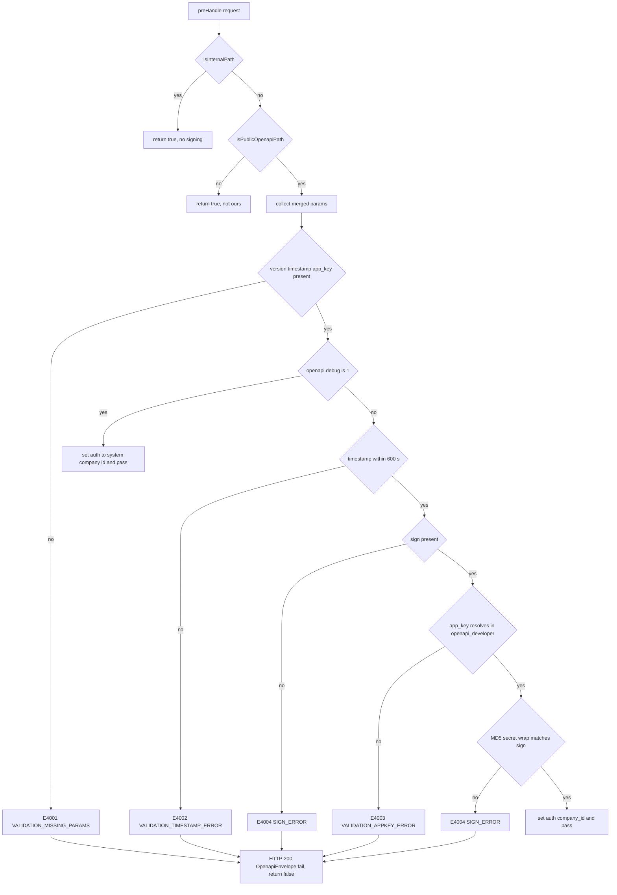
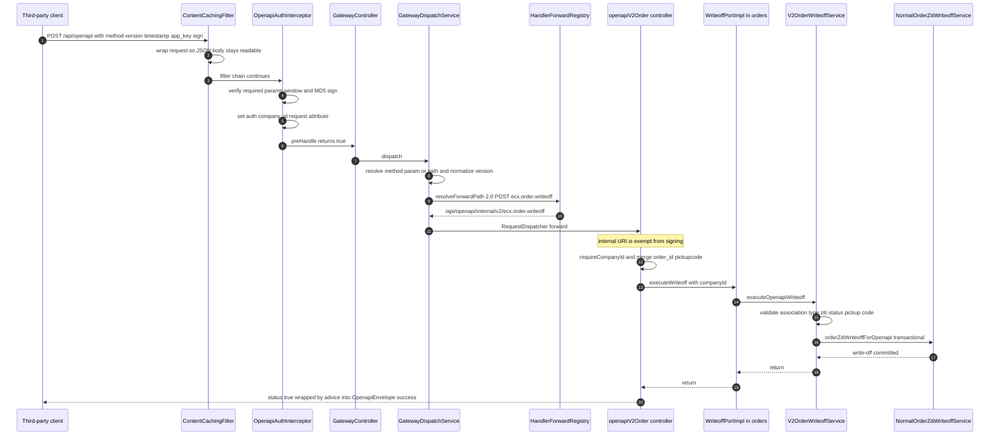

# OpenAPI Gateway (ecshopx-openapi)

`ecshopx-openapi` is the migration of the legacy PHP `OpenapiBundle` — the HTTP API that *external* third-party systems (ERPs, CRMs, marketing centers, mini-program tooling) call to read and mutate shop data. It is deliberately **not** one of the business-Bundle `api/` surfaces ([Bundle Layering](../architecture/bundle-layering.md)): it is a standalone Maven module whose only Shopex dependency is `ecshopx-common`, so it can never reach a business Bundle directly. All domain behaviour is injected through the 145 `Openapi*Port` interfaces declared in `ecshopx-common/openapi/` and implemented in the owning Bundles' own `openapi/` packages — `orders`, `goods`, `members`, `aftersales`, `kaquan`, `point`, `deposit`, `distribution`, `salesperson`, `companys`, `espier`, `wechat` — the same dependency inversion documented in [Cross-Bundle Communication](../architecture/cross-bundle-communication.md). (The one exception is `OpenapiDeveloperLookupPort`, implemented inside `ecshopx-openapi` itself against the module's own table.)

The module owns four things:

1. **The path model** — `/api/openapi/**` (public, signed) versus `/api/openapi/internal/**` (forwarded handler surface).
2. **The auth gate** — `OpenapiAuthInterceptor`, an MD5 signature scheme replicated from PHP `OpenapiCheck::gen_sign`.
3. **The dispatcher** — `OpenapiGatewayController` + `OpenapiGatewayDispatchService` + `OpenapiHandlerForwardRegistry`, a `RequestDispatcher.forward()` from the public endpoint to the per-domain internal controller.
4. **The envelope** — `OpenapiEnvelope` `{status, code, message, data}`, applied by `OpenapiResponseBodyAdvice` and `OpenapiExceptionHandler`.

It also owns the `openapi_developer` table and the services that materialize `app_key` / `app_secret` per company — the same table that the *outbound* signed clients (e.g. `MarketingCenterOpenApiSignedFormClient` in `ecshopx-third-party`) read their `external_*` credentials from.

## The path split: public vs internal

`OpenapiPathPatterns` (`openapi/web/`) is the single source of truth for the two prefixes:

| Constant | Value | Meaning |
|---|---|---|
| `PUBLIC_PREFIX` | `/api/openapi` | what third parties call |
| `INTERNAL_PREFIX` | `/api/openapi/internal` | what the gateway forwards to |
| `PUBLIC_PATTERN` | `/api/openapi/**` | interceptor path pattern |
| `INTERNAL_PATTERN` | `/api/openapi/internal/**` | interceptor path pattern |

`isInternalPath(uri)` is a plain `startsWith` on the internal prefix; `isPublicOpenapiPath(uri)` is `startsWith("/api/openapi") && !isInternalPath(uri)`. Two consequences follow from these simple predicates:

* **The internal surface is exempt from signing.** `OpenapiAuthInterceptor.preHandle` returns `true` immediately for internal URIs, so the `RequestDispatcher.forward()` from the gateway re-enters the interceptor chain without re-verifying the signature (and without needing to — the auth attribute set on the first pass survives the forward).
* **A direct external call to `/api/openapi/internal/...` also skips signing.** Nothing in the code blocks that prefix at the network or filter level. The actual guard is `OpenapiBaseController.requireCompanyId(request)` → `OpenapiAuthAttributes.requireCompanyId`, which throws `UnauthorizedException("未授权")` when the `OPENAPI_AUTH` request attribute is absent, and `OpenapiExceptionHandler` renders that as an `E4004` envelope. Internal handlers therefore fail closed on a missing tenant context rather than on a bad signature.

The rest of the security stack carves this surface out explicitly. `OperatorJwtAuthenticationFilter` (`ecshopx-espier`) short-circuits every path starting with `/api/openapi` ("走 sign 鉴权，不使用运营 JWT"), and the admin/front interceptors are annotation-routed (`@AdminAuth`, `@FrontAuth`, …) which no openapi controller carries. See [Request Lifecycle](../architecture/request-lifecycle.md) for the full chain.

## The auth gate: `OpenapiAuthInterceptor`

`OpenapiWebMvcConfigurer` registers the interceptor on **both** patterns — `PUBLIC_PATTERN` and `INTERNAL_PATTERN` — and the interceptor itself decides per request which of the three cases applies (internal → pass, non-openapi → pass, public → verify).



*The auth decision tree in `OpenapiAuthInterceptor.preHandle`; every failure path writes the PHP-style envelope with HTTP 200 and stops the chain.*

### Parameter collection

`OpenapiRequestParamCollector.collect(request)` builds the single parameter map the gate and the dispatcher share: `FlexibleHttpServletParameterMap.toObjectMap(request)` (query string + form fields, PHP bracket-array folding) as the base, then the JSON body merged on top (`mergeJsonBody` reads the cached bytes when the content type contains `json`), then `method` back-filled from the URI path if absent. The body is only readable because `OpenapiContentCachingFilter` (order `HIGHEST_PRECEDENCE + 20`) wraps *public* openapi requests in a `ContentCachingRequestWrapper` before anything consumes the stream — without it, a JSON POST could not be both signature-verified and handler-bound.

`resolveMethod(request, params)` prefers the `method` parameter and falls back to the path suffix after `/api/openapi/`, so both of these reach the same handler:

```
POST /api/openapi            body/form: method=ecx.order.writeoff&version=2.0&...
POST /api/openapi/ecx.order.writeoff   form: version=2.0&...
```

`normalizeVersion` maps `v2` / `2` / `2.0` → `2.0`, and anything missing or blank → `1.0`. The gateway controller only maps `/api/openapi` and `/api/openapi/{method}` (one segment), which is why the multi-segment internal paths never collide with the catch-all.

### The signature algorithm

`OpenapiSignSupport` (`ecshopx-common/openapi/`) is a byte-for-byte reimplementation of PHP `OpenapiCheck::gen_sign` / `assemble`:

* `assemble(params)` — keys sorted lexicographically (`TreeMap`), `null` values skipped, booleans rendered as `1`/`0`, nested `Map`s assembled recursively (key then value, no separators), `Iterable`s assembled element-by-element, scalars appended via `toString`.
* `genSign(params, token)` — `MD5(token + assemble(params) + token)`, hex **uppercase** (32 chars).
* `signMatches(params, token, providedSign)` — recomputes over `paramsForSign(params)` (the same map with the `sign` key removed) and compares against the provided sign trimmed and uppercased; a blank provided sign always fails.

Verification order in the interceptor: required `version` / `timestamp` / `app_key` (`E4001`) → debug bypass → `timestampWithinTolerance(timestamp, 600)` (`E4002`) → `sign` present (`E4004`) → `developerLookupPort.findByAppKey(appKey)` (`E4003`) → `signMatches` (`E4004`) → `OpenapiAuthAttributes.setAuth(request, credentials.companyId())`.

Two operational quirks worth knowing:

* **`timestamp` accepts three formats** — 10-digit epoch seconds, ISO-8601 (with a space→`T` repair), or `yyyy-MM-dd HH:mm:ss` in the server zone. An *unparseable* timestamp throws `IllegalArgumentException` out of `parseTimestampSeconds`, which is **not** an `OpenapiAuthException`, so it escapes the interceptor's catch block instead of producing the `E4002` envelope — only a parseable but stale/future timestamp yields the clean `E4002`.
* **`version` is presence-checked, not validated** — any non-blank value passes the gate; an unregistered version fails later at dispatch with `E4005`.

### `openapi.debug=1` — dev-only bypass

```properties
# 第三方 OpenAPI 鉴权（debug=1 跳过签名校验）
openapi.debug=0
openapi.common-token=
openapi.system-company-id=${common.system-companys-id:1}
```

When `openapi.debug=1`, the interceptor skips **both** the timestamp window and the signature check entirely, and stamps the auth context with the fixed company id from `openapi.system-company-id` (default `${common.system-companys-id:1}`, i.e. `1`). Every `/api/openapi/**` call then executes as the system company with no credentials. **This is a development convenience only — shipping with `openapi.debug=1` makes the whole public Open API unauthenticated.** The default in `application.properties` is `0`; keep it that way outside local/dev profiles. (`openapi.common-token` is declared but currently read by no code.)

## Dispatch: gateway controller, dispatch service, forward registry

`OpenapiGatewayController` (`openapi/thirdapi/gateway/`) is the single public entry point — `@RequestMapping` on `/api/openapi` and `/api/openapi/{method}` for GET/POST/PUT/PATCH/DELETE/HEAD/OPTIONS. It delegates to `OpenapiGatewayDispatchService.dispatch`, whose Javadoc states the design constraint plainly: routing relies **only** on `OpenapiHandlerForwardRegistry`, not on `openapi_list.csv`.

`dispatch` does four things:

1. Collect the merged params and resolve the method name (parameter first, path suffix second). Missing → `E4005` `"method 不存在"`.
2. Normalize the version and uppercase the HTTP verb.
3. `forwardRegistry.resolveForwardPath(version, httpVerb, method)` — no entry → `E4005` `"API 方法不存在"`.
4. `request.getRequestDispatcher(forwardPath).forward(request, response)`. A `null` dispatcher (a registered path with no matching `@RequestMapping`) throws `OpenapiNotImplementedException("接口尚未迁移")`, which the controller renders as `E0001` with `{method, version}` in `data` — the explicit "not yet migrated from PHP" signal.

### `OpenapiHandlerForwardRegistry` — the authoritative routing table

The registry is a `LinkedHashMap<String, String>` populated by **145 hard-coded `register(...)` calls in the constructor** — 44 `1.0` routes and 101 `2.0` routes (80 POST, 45 GET, 9 DELETE, 8 PATCH, 3 PUT). The key is `normalizeVersion(version) + " " + verb + " " + method.trim()`; the value is always `/api/openapi/internal/v{n}/{method}`:

```java
register("2.0", "POST", "ecx.order.writeoff", "/api/openapi/internal/v2/ecx.order.writeoff");
register("1.0", "POST", "ecx.order.list",     "/api/openapi/internal/v1/ecx.order.list");
register("2.0", "GET",  "ecx.member.list",   "/api/openapi/internal/v2/ecx.member.list");
```

Because the key normalizes the version, a caller sending `version=2`, `v2` or `2.0` hits the same entry. Method names mirror the PHP vocabulary verbatim — including legacy oddities like `ecx.member.basicInfo` (camelCase) and `exc.operator.resetpwd` (the `exc.` prefix typo is preserved so existing PHP clients keep working). Version is part of the key, so the same method name can exist in both versions with different handlers (`ecx.order.list` is registered for both `1.0` and `2.0`, pointing at different controllers).

### `OpenapiMethodRegistry` — the vestigial CSV loader

`OpenapiMethodRegistry` is the *older* half of the routing story. It parses a classpath resource `openapi/openapi_list.csv` (one row per PHP method, columns including a `"POST /api/openapi/ecx.salesperson.updateStores"`-style fullname, the PHP class, and the Java class/method targets) into `OpenapiMethodDescriptor` records, sanitizing the dirty quoted CSV fragments the PHP export produced. **That CSV is not present in the repository**, so at runtime `byRouteKey` is empty and `lookup(...)` always returns `Optional.empty()` — the gateway never consults it, and its own test says so ("网关路由已改为 `OpenapiHandlerForwardRegistry`，不再依赖 CSV"). What survives is the parsing utility (`parseLine`, `splitCsvLine`, `normalizeVersion`), pinned by `OpenapiMethodRegistryTest`. Practical consequence: **do not try to register a new method by editing a CSV — add a `register(...)` line to `OpenapiHandlerForwardRegistry`.**

## The handler layer: internal controllers and the envelope

### Controllers

Each domain/version pair gets a controller under `openapi/thirdapi/v1|v2/<domain>/`, all following one shape:

```java
@OpenapiResponse
@RestController("openapiV2Order")                       // explicit bean name (short names collide)
@RequestMapping("/api/openapi/internal/v2")
public class OrderController extends OpenapiBaseController { ... }
```

Handlers take `HttpServletRequest`, one `@RequestParam(name = "…", required = false) String` per documented parameter, and `@FlexibleBody(required = false) Map<String, Object> body`. They merge with the `OpenapiRequestParams` helpers (`originalString` — body wins when the key is present; `mergeString` — trimmed merge; `isParamPresent` / `isPhpTruthy` for PHP truthiness semantics), obtain the tenant with `requireCompanyId(request)`, and delegate to a port. Return values are plain `Map` / `List` (wrapped by the advice) or an explicit `OpenapiEnvelope` (passed through untouched). Param-normalization helpers live in `thirdapi/v1` and are reused by the v2 controllers (`OpenapiRequestParams`, `OpenapiMemberQueryParams`, `OpenapiOrderListParams`), so v2 code routinely imports from the v1 package.

### The envelope and advice

`OpenapiEnvelope` is the PHP OpenAPI response shape — `{status, code, message, data}` with `@JsonInclude(ALWAYS)`. `OpenapiEnvelope.success(data)` → `{"status":"success","code":"E0000","message":"成功","data":…}`; `fail(code, message, data)` → `{"status":"fail", …}`.

`OpenapiResponseBodyAdvice` is a `@ControllerAdvice` scoped by `basePackages` to exactly the six handler packages (`thirdapi.v1`, `v2.orders`, `v2.member`, `v2.items`, `v2.distributor`, `v2.kaquan`) at `HIGHEST_PRECEDENCE`. `supports()` triggers on the `@OpenapiResponse` annotation (class level or method level); `beforeBodyWrite` wraps everything into `OpenapiEnvelope.success(body)` **except** bodies that are already an `OpenapiEnvelope`, a `byte[]`, or a response whose selected content type is `image/png` (the QR-code / image endpoints stream raw bytes). This is why an openapi handler must never also carry `@DingoResponse` — see [Request Lifecycle](../architecture/request-lifecycle.md) for the envelope decision matrix.

### Error handling and the `OpenapiErrorCode` vocabulary

`OpenapiExceptionHandler` mirrors the advice's `basePackages` and precedence, and renders **every** openapi failure as HTTP 200 with a fail envelope:

| Exception | Code |
|---|---|
| `ResourceException` | `E0001` (`BUSINESS_ERROR`) |
| `UnauthorizedException` | `E4004` (`SIGN_ERROR`) — including a missing auth attribute |
| `OpenapiNotImplementedException` | `E0001` (`NOT_IMPLEMENTED`) |
| `OpenapiLegacyZeroCodeFailException` | `E0000` — a legacy PHP endpoint that reported failure with a success code |
| any `Openapi*V2FailException` | `ex.getOpenapiCode()` — the code travels *inside* the exception |
| some list-push failures (`MemberCardGrades`, `MemberTagLibraryPush`, `CustomerUnionids`) | `E9999` with `data: []` |

`OpenapiErrorCode` (`ecshopx-common/openapi/`) is the aligned copy of PHP `OpenapiBundle\Constants\ErrorCode`, with per-constant Javadoc recording the PHP twin and its exact message. The families:

* **`E0000`** success · **`E0001`** business error **and** not-implemented (the same string is deliberately reused) · **`E9999`** system error.
* **Validation/auth family**: `E4001` missing params, `E4002` timestamp, `E4003` app_key, `E4004` sign, `E4005` method not found, `E5001`/`E5002` service params.
* **Domain families**: `E51xx` goods (`E5100` goods, `E5101` not found, `E5110`/`E5113` brand, `E5120`/`E5123` category, `E5130`/`E5131` main category), `E53xx` orders (`E5300` is_dada, `E5301` order not found, `E5310` handle, `E5312` handle-exist, `E5320` aftersales handle, `E5331` member not found, `E5340` refund handle), `E54xx` distributor (`E5401`/`E5402`/`E5410`), `E55xx` members (tags `E556x`/`E557x`, recharge `E558x`, point `E5550`, grades `E553x`, vip grades `E554x`), `E5601`/`E5612` salesperson, `E5700` wechat.

When migrating a PHP endpoint, the failure code is part of the contract: pick the matching constant (or throw the domain's `Openapi*V2FailException` carrying it) rather than inventing a new one.

## Worked example: registering `ecx.order.writeoff` (v2)

This is the full path for one method — the self-pickup (ziti) order write-off — and the template for adding a new one.

**1. The routing entry** (`OpenapiHandlerForwardRegistry`, orders block):

```java
register("2.0", "POST", "ecx.order.writeoff", "/api/openapi/internal/v2/ecx.order.writeoff");
```

**2. The port interface** (`ecshopx-common/openapi/OpenapiOrderWriteoffPort.java`) — declared by the consumer, in common, so `ecshopx-openapi` can inject it without depending on `ecshopx-orders`:

```java
public interface OpenapiOrderWriteoffPort {
    void executeWriteoff(long companyId, String orderIdRaw, String pickupcodeRaw);
}
```

**3. The provider implementation** (`ecshopx-orders/openapi/OpenapiOrderWriteoffPortImpl.java`) delegates to the orders-local orchestration service. Note where that service lives: `ecshopx-orders/src/main/java/cn/shopex/ecshopx/openapi/thirdapi/v2/orders/OpenapiThirdApiV2OrderWriteoffService.java` — the provider Bundle hosts classes in the `cn.shopex.ecshopx.openapi.thirdapi.*` namespace, recreating the PHP `OpenapiBundle` class names inside the owning Bundle (aftersales does the same for its `OpenapiThirdApiV2Aftersales*` services).

**4. The internal handler** (`openapi/thirdapi/v2/orders/OrderController.java`):

```java
@Activated(routeAlias = "order.writeoff.set")
@PostMapping(value = "/ecx.order.writeoff", name = "开放接口自提订单核销")
public Map<String, Object> orderWriteoff(
        HttpServletRequest request,
        @RequestParam(name = "order_id", required = false) String orderIdParam,
        @RequestParam(name = "pickupcode", required = false) String pickupcodeParam,
        @FlexibleBody(required = false) Map<String, Object> body) {
    long companyId = requireCompanyId(request);
    orderWriteoffPort.executeWriteoff(
            companyId,
            OpenapiRequestParams.originalString(orderIdParam, body, "order_id"),
            OpenapiRequestParams.originalString(pickupcodeParam, body, "pickupcode"));
    return Map.of("status", true);
}
```

**5. The orchestration** (`OpenapiThirdApiV2OrderWriteoffService.executeOpenapiWriteoff`): blank order id → `E5001` "请填写订单编号"; unparseable/non-positive id or missing `OrderAssociations` row → `E5301`; effective order type in {`supplier_order`, `membercard`, service types} or empty → `E5310` "无此类型订单！"; the pickup-code setting (Redis, `PickupcodeSettingRedisService`) decides whether `pickupcode` is mandatory (`E5001`) and whether the SMS pickup code must be verified and consumed (`OrderPickupSmsRedisVerifyService`, mismatch → `E5310` "提货码验证错误！"); ziti preconditions (`receipt_type=ziti`, `order_status=PAYED`, `ziti_status=PENDING`, `pay_status=PAYED`, cancel status `NO_APPLY_CANCEL`/`FAILS`) → `E5301`/`E5310`. It then calls `NormalOrderZitiWriteoffService.orderZitiWriteoffForOpenapi` — `@Transactional(rollbackFor = Exception.class)` and serialized by an in-JVM `ConcurrentHashMap` mutex keyed `companyId:orderId` — which performs the write-off and logs the operation with source `"openapi"`. Every failure is an `OpenapiOrderWriteoffV2FailException` carrying its `OpenapiErrorCode`, so `OpenapiExceptionHandler` renders the exact PHP code and message. The orders-domain side of this flow is described in [Orders Domain](../domains/orders.md).



*End-to-end flow of `POST /api/openapi` with `method=ecx.order.writeoff`, `version=2.0`.*

### The dormant `@Activated` annotations

`ecx.order.writeoff` (and `ecx.aftersales.get`, and v2 `ecx.member.create`) carry `@Activated(routeAlias = "…")` — the annotation that on admin endpoints drives menu-permission checks through `ActivatedInterceptor` → `ActivatedMiddlewareService`. On the openapi surface it is **inert**: `ActivatedMiddlewareService.handle` returns immediately when the operator-JWT map is `null`, and nothing ever sets `OPERATOR_JWT_USER_DATA` for `/api/openapi` paths (`OperatorJwtAuthenticationFilter` skips the prefix; `AdminAuthInterceptor` requires `@AdminAuth`). So `order.writeoff.set` is *not* a permission gate here — the alias is PHP-parity scaffolding. Do not rely on it for authorization, and do not "fix" it by making the openapi surface require an operator JWT.

## Credentials: `openapi_developer` and the salt

### Storage and lookup

The `openapi_developer` table (DDL in `docker/ecshopx.sql`) holds one row per `company_id` (indexed): `app_key` / `app_secret` for **inbound** signing, plus `external_base_uri` / `external_app_key` / `external_app_secret` for **outbound** calls this shop makes to a remote OpenAPI gateway. `OpenapiDeveloper` (`openapi/domain/`) is the MyBatis-Plus entity; `OpenapiDeveloperMapper` is a bare `BaseMapper`.

`OpenapiDeveloperLookupPortImpl` (`openapi/integration/`) implements the common `OpenapiDeveloperLookupPort` used by the auth interceptor: `findByAppKey` selects `LIMIT 1` by trimmed `app_key` and returns `OpenapiDeveloperCredentials(companyId, appSecret)`, or empty when the row, the company id, or the secret is missing — which the interceptor turns into `E4003`.

### Generation and the salt

`DeveloperInfoService` (`openapi/service/admin/`) materializes the row on first read (`info`) and lets the admin update it (`update`, with a cross-company `app_key` conflict check). Generation when the row is absent:

```
passport_uid = company.passport_uid  (from CompanyOpenapiIdentityReadPort)  or  epochSeconds + companyId
eid         = company.eid           or  md5(passport_uid)
app_key     = md5(passport_uid).substring(8, 24)
app_secret  = md5(eid + common.openapi-rand-salt)
```

```properties
# 生成 OpenAPI app_secret 时拼接的盐（按环境固定，勿频繁变更）
common.openapi-rand-salt=ecshopx
# 外部系统回调基址（OpenAPI 开发者外部配置）
common.external-baseuri=
```

The salt is concatenated into the `app_secret` digest; the config comment warns it is fixed per environment and must not be changed casually. Changing it does **not** rewrite existing rows (their stored secret keeps working) — it only changes what a *newly generated* secret would be, which silently desynchronizes environments that regenerate. `OpenapiDeveloperBootstrapService` (in `ecshopx-companys`, used by `ShuyunOperatorsFacade.syncDeveloperConfigurationToShuyun`) performs the same derivation for outbound credentials with one difference: on an `app_key` collision it falls back to `md5(passport_uid + "_" + companyId).substring(8, 24)` instead of failing.

### The outbound client

`MarketingCenterOpenApiSignedFormClient` (`ecshopx-third-party`) is the mirror image of the gateway: it reads `external_base_uri` / `external_app_key` / `external_app_secret` from the same row, builds `{data, timestamp, app_key, version: "1.0", method}`, computes `sign = MD5_UPPER(appSecret + assemble + appSecret)` over the sorted keys (nested maps/lists JSON-encoded in its dialect), and form-POSTs to `{external_base_uri}/api/openapi`. Every marketing-center push processor (order add/delivery/finish/refund, item add/edit/delete, distribution add/edit, schedule cancel) goes through it, and failures degrade to an empty map rather than an exception. See [Third-Party Integrations](third-party.md) for the wider push topology.

## Configuration reference

| Property | Default | Used by |
|---|---|---|
| `openapi.debug` | `0` | `OpenapiAuthInterceptor` — `1` skips timestamp + sign and stamps the system company (**dev only**) |
| `openapi.system-company-id` | `${common.system-companys-id:1}` | company id used by the debug bypass |
| `openapi.common-token` | (empty) | declared in `application.properties`, currently read by no code |
| `common.openapi-rand-salt` | `ecshopx` | salt concatenated into generated `app_secret` (`DeveloperInfoService`, `OpenapiDeveloperBootstrapService`) |
| `common.external-baseuri` | (empty) | default `external_base_uri` written into `openapi_developer` rows |
| `common.system-companys-id` | `1` | upstream default for the debug company id |

Module-local `ecshopx-openapi/src/main/resources/application-openapi.yml` is an empty placeholder for an optional `spring.config.import` profile. See [Operations — Configuration](../operations/configuration.md) for the operations-level view.

## Adding a new OpenAPI method — checklist

1. **Port** — declare (or reuse) the interface in `ecshopx-common/openapi/`; keep it one cohesive operation, `companyId` first.
2. **Provider** — implement it in the owning Bundle's `openapi/` package, delegating to a bundle-local service; mirror the PHP class name under `cn.shopex.ecshopx.openapi.thirdapi.vN.<domain>` if a PHP twin exists. Throw the domain's `Openapi*V2FailException` with the PHP `OpenapiErrorCode` on failure.
3. **Handler** — add the method to the right controller in `ecshopx-openapi` `thirdapi/v1|v2/<domain>/`: `@OpenapiResponse` on the class, explicit `@RestController("openapiVn<Entity>")` bean name, `@RequestMapping("/api/openapi/internal/vN")`, `@PostMapping/@GetMapping(value = "/ecx.<method>", name = "…")`, `@RequestParam(required = false) String` + `@FlexibleBody` merged via `OpenapiRequestParams`, `requireCompanyId(request)` for tenancy. Return a `Map`/`List` (the advice wraps it) or an explicit `OpenapiEnvelope`.
4. **Route** — add `register("<version>", "<VERB>", "ecx.<method>", "/api/openapi/internal/vN/ecx.<method>")` to the `OpenapiHandlerForwardRegistry` constructor. Nothing else makes the method reachable.
5. **Tests** — a registry test pinning the forward path (`OpenapiHandlerForwardRegistryTest` pattern) and a controller test pinning the delegation (`OrderControllerWriteoffTest` pattern); for migrated flows, a fail-mapping test pinning the error codes (`OpenapiThirdApiV2OrderWriteoffServiceFailMappingTest` pattern).
6. **Do not** edit any CSV (`openapi_list.csv` is gone; `OpenapiMethodRegistry` is vestigial), do not add `@DingoResponse`, and do not expect `@Activated` to authorize anything on this surface.

## Focused tests that pin this design

* `OpenapiSignSupportTest` (common) — 32-char uppercase MD5, `assemble` key-sorted concatenation (`app_keyktimestamp1version2.0`), booleans as `1`/`0`, nulls skipped, round-trip `signMatches`.
* `OpenapiMethodRegistryTest` (openapi) — CSV line sanitization of the dirty PHP export and `normalizeVersion` (`v2`/`2`/`2.0` → `2.0`); documents that routing no longer uses the CSV.
* `OpenapiHandlerForwardRegistryTest` (openapi) — `isImplemented("2.0", "POST", "ecx.order.writeoff")` and its forward path `/api/openapi/internal/v2/ecx.order.writeoff`.
* `OrderControllerWriteoffTest` (openapi) — company id taken from the `OPENAPI_AUTH` request attribute, `order_id` merged body-wins (`501L` → `"501"`), delegation to `OpenapiOrderWriteoffPort.executeWriteoff(9L, "501", null)`, and the `{"status": true}` payload that the advice wraps.
* `OpenapiThirdApiV2OrderWriteoffServiceFailMappingTest` + `OpenapiThirdApiV2OrderWriteoffServiceThirdPartyTradeUpdatePublishProbeTest` + `OpenapiThirdApiV2OrdersOrderWriteoffDelegationTest` (orders) — the `E5001` / `E5301` / `E5310` mapping per precondition and the third-party trade-update publish on write-off.
