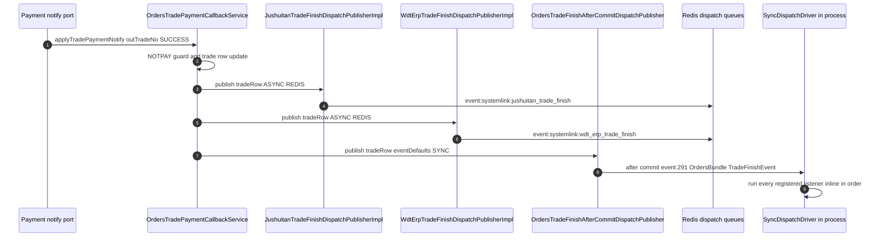
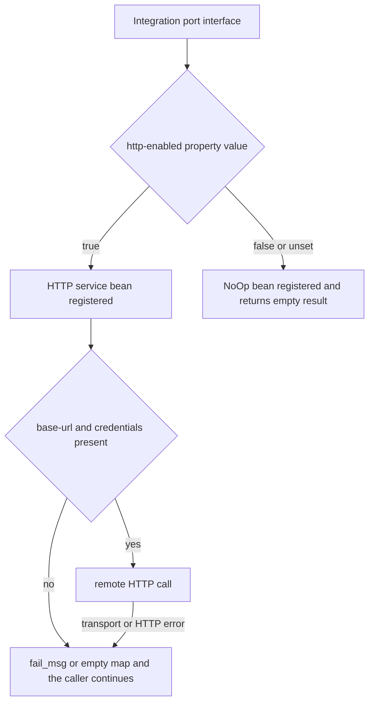

# Third-Party Integrations (ERP, CRM, Analytics, Cross-border)

ECShopX-Java talks to a wide range of external systems — ERPs (Jushuitan, WdtErp/旺店通, OME/Shopex ERP, a SaaS ERP), CRMs and marketing platforms (DmCrm/达摩 Hope, Shopex CRM, the Marketing Center OpenAPI), analytics (Tencent Youshu/有数, Shuyun/数云 for loyalty), notification channels (Aliyun SMS, Alipay mini-program template messages, AMap), and the WeChat customs-declaration endpoint for cross-border orders. All of it is **outbound push plus scheduled pull**, wired through the [Dispatch Bus](../concepts/dispatch-bus.md): business Bundles publish domain events, and `ecshopx-bootstrap`'s `*ListenerRegistrationConfig` classes register per-integration listeners that do the actual HTTP work.

The integration modules are:

| Module | Role |
|---|---|
| `ecshopx-system-link` | ERP connectivity: Jushuitan (OAuth + trade/item/inventory/aftersales), WdtErp (trade push, inventory & logistics pull), OME (Shopex ERP order push), item/brand import from OME |
| `ecshopx-third-party` | Prism core/ishopex gateways, Marketing Center push, DmCrm, Shopex CRM, SaasErp, Shuyun legacy UAPI client, Dada/Shansong local delivery, AMap — gated by `ecshopx.thirdparty.*` |
| `ecshopx-shuyun` | Shuyun **open platform** (`open-api.shuyun.com`) gateway with per-company tokens, trade/refund/shop/product/member sync, offline-benefit push, and the daily token refresh |
| `ecshopx-youshu` | Youshu analytics event listeners (order add/cancel/pay/delivery/receipt, member, coupon, distribution, item) + XxlJob cron pushes |
| `ecshopx-ali` | Alipay mini-program template messages (EasySDK `Factory.Marketing.TemplateMessage().send`) and goods-arrival notify |
| `ecshopx-aliyunsms` | Aliyun SMS sign/template lifecycle as dispatch jobs `job:48`–`job:59`, XxlJob audit-status pollers, and the company SMS channel router |
| `ecshopx-cross-border` | Admin CRUD for cross-border settings: `crossborder_set`, `crossborder_taxstrategy`, `crossborder_origincountry` |

Two design rules run through every module and are worth stating up front:

1. **The silent-skip invariant.** Every outbound client checks whether its base-URL/credentials are configured before making a request. When they are absent — which is the default in `application.properties`, where every `base-url` ships empty — the client returns a `fail_msg` map (or an empty result) instead of throwing, the setting-gate returns `is_open=false`, and the integration quietly does nothing. This is deliberate: a fresh install must run with zero third parties configured. See [The http-enabled / NoOp pattern](#the-http-enabled--noop-pattern).
2. **Tenant settings live outside the code.** Integration toggles and credentials are read per `companyId` from Redis keys (`JushuitanSetting:`, `WdtErpSetting:`, `ShopexerpSetting:`, `DmCrmSetting:` + `sha1(companyId)`) or DB tables (`company_shuyun_open_platform_config`, `youshu_setting`, `openapi_developer`), written by admin controllers — never from static config alone. Static properties carry only *platform-level* credentials (one Jushuitan app, one OME gateway URL, one Shuyun open-platform base).

The inbound mirror of this story — external systems calling *into* the shop — is the [OpenAPI Gateway](openapi.md), whose `openapi_developer` table also supplies the outbound Marketing Center credentials.

## The trade-finish fan-out

The most heavily integrated moment in the system is a successful payment. `OrdersTradePaymentCallbackService.applyTradePaymentNotify` (called by every payment-notify port: Alipay, Chinaums, DoumenIntl, …) guards on `trade_state=NOTPAY`, updates the trade row, fulfils VIP membercard sales, and then publishes the **snake_case trade row** on three independent planes:

*Payment success fans out on two async Redis planes (per-listener queue messages) plus one sync in-process plane whose listeners run before the caller returns.*

* `event:systemlink:jushuitan_trade_finish` and `event:systemlink:wdt_erp_trade_finish` are published ASYNC + REDIS with `RetryPolicy.platformDefault()` (`JushuitanTradeFinishDispatchPublisherImpl`, `WdtErpTradeFinishDispatchPublisherImpl`), so the payment callback never blocks on a slow ERP.
* The orders plane `event:291:OrdersBundle\Events\TradeFinishEvent` is published **SYNC** via `OrdersTradeFinishAfterCommitDispatchPublisher` (the `@Primary` `OrdersTradeFinishDispatchPublisher` bean; a second bean `ordersTradeFinishDispatchPublisherOfflineCsv292` publishes `event:292` for offline bank-transfer approval in `OfflinePaymentDoCheckService`). The publisher registers a `TransactionSynchronization` and publishes after commit when inside a transaction, immediately otherwise. Because SYNC publishes run *all* registered listeners in-process via the `SyncDispatchDriver`, everything on this plane executes synchronously once the payment transaction commits — and `@Order(n)` on the registration configs controls the sequence.

The listeners on `event:291`/`event:292` (in `@Order`):

| @Order | Listener | What it does |
|---|---|---|
| 77 | `listener:orders.trade_finish_normal_order_pay_success_bridge` (sync) | marks the order paid and publishes `event:288:OrdersBundle\NormalOrderPaySuccessEvent` ASYNC+REDIS — the plane that Youshu and Shuyun trade.sync listen to |
| 82 | `listener:thirdparty.dm_crm.trade_finish` | DmCrm point-change + order sync orchestration |
| 83 | `listener:thirdparty.marketing_center.trade_finish_basics_order_pay` | `basics.order.pay` push |
| 92 | `listener:systemlink.trade_finish_send_ome` | `ome.order.add` push (single and group-team fan-out) |
| 95 | `listener:orders.listeners.TradeFinishCustomDeclareOrder` (sync) | WeChat customs declaration for cross-border orders |

The division of labor matters: **Jushuitan/WdtErp get dedicated per-ERP events** (so each ERP can evolve its payload and retry policy independently), while **OME, Marketing Center, DmCrm and customs ride the shared orders trade-finish plane**. The bridge listener at order 77 is what converts trade finish into the normal-order pay-success event that the rest of the customer-facing stack (Youshu analytics, Shuyun trade.sync, member notices) reacts to.

## Listener topology

The full set of dispatch events each integration subscribes to. "sync" = `ListenerDispatchOptions.syncDefaults()` (irrelevant on SYNC-published planes, meaningful on ASYNC planes where it would force in-process execution); "async" = queued on Redis, usually the `default` queue.

### Trade-plane events (`ecshopx-system-link` + `ecshopx-third-party`)

| Event (publisher mode) | Listeners |
|---|---|
| `event:systemlink:jushuitan_trade_finish` / `_trade_cancel` / `_trade_aftersales` (ASYNC+REDIS) | `listener:systemlink.trade_finish_send_jushuitan` / `trade_cancel_send_jushuitan` / `trade_aftersales_send_jushuitan` (async) |
| `event:systemlink:wdt_erp_trade_finish` / `_trade_cancel` / `_trade_aftersale` (ASYNC+REDIS) | `listener:systemlink.trade_finish_send_wdt_erp` / `trade_cancel_send_wdt_erp` / `trade_after_sale_send_wdt_erp` (async) |
| `event:systemlink:ome_trade_update` (ASYNC+REDIS) | `listener:systemlink.trade_update_send_ome` (async) |
| `event:systemlink:trade_refund` (ASYNC+REDIS) | OME `listener:systemlink.trade_refund_send_ome`, Marketing Center `listener:thirdparty.trade_refund_push_marketing_center`, SaasErp `listener:thirdparty.listeners.TradeRefundSendSaasErp` |
| `event:systemlink:trade_aftersales` (ASYNC+REDIS) | OME + Marketing Center |
| `event:systemlink:trade_aftersales_cancel` (ASYNC+REDIS) | OME + Marketing Center |
| `event:systemlink:trade_aftersales_logi` (ASYNC+REDIS) | OME + SaasErp |
| `event:thirdparty:trade_refund_finish` (**SYNC**) | Marketing Center, DmCrm (`trade_refund_finish_dm_crm`), Shuyun `shuyun.open_platform.refund_sync_on_trade_refund_finish`, Shuyun re-push `shuyun.open_platform.trade_sync_on_trade_refund_finish` — all sync |
| `event:thirdparty:trade_update` (ASYNC+REDIS) | SaasErp `listener:thirdparty.listeners.TradeUpdateSendSaasErp` (@Order 82) |
| `event:thirdparty:trade_aftersales_saas_erp` / `_cancel_saas_erp` / `event:thirdparty:trade_refund_cancel_saas_erp` (ASYNC+REDIS) | one SaasErp logging-adapter listener each |

The refund/aftersales "fan-out" publishers in bootstrap (`TradeRefundAsyncFanOutDispatchPublisher`, `TradeAftersalesAsyncFanOutDispatchPublisher`, `TradeAftersalesCancelAsyncFanOutDispatchPublisher`, `TradeAftersalesLogiAsyncDispatchPublisher`) are ASYNC+REDIS wrappers over the shared `event:systemlink:*` names, so one aftersales state change becomes one queued message per downstream (OME, Marketing Center, SaasErp) rather than one serially-blocking call chain.

### Normal-order lifecycle events (`ecshopx-orders` names, published ASYNC+REDIS except cancel)

| Event | Listeners |
|---|---|
| `event:orders:normal_order_add` | Youshu `listener:youshu.orders_normal_order_add`, Marketing Center order-add push |
| `event:288:OrdersBundle\NormalOrderPaySuccessEvent` | Youshu, Shuyun `trade_sync_on_normal_order_pay_success`, Shuyun offline-benefit consume (`USED`) |
| `event:orders:normal_order_delivery` | Youshu, Marketing Center, DmCrm order-delivery sync, Shuyun trade.sync |
| `event:orders:normal_order_confirm_receipt` | Youshu, Marketing Center, Shopex CRM sync (sync), Shuyun trade.sync |
| `event:orders:normal_order_cancel` (published SYNC) | Youshu, Marketing Center schedule-cancel push, Shuyun trade.sync, Shuyun offline-benefit release (`NOT_USED`) |
| `event:members:create_member_success` | Youshu (`@Order 10`), Shuyun `member_register_on_create_member_success` (`@Order 11`), Shopex CRM `sync_add_member` (`@Order 15`) |
| `event:members:update_member_success` | Shopex CRM `sync_update_member` |

### Goods and marketing events

| Event | Listeners |
|---|---|
| `event:271:GoodsBundle\ItemAddEvent` | Marketing Center item push (`@Order 74`), Youshu `listener:youshu.items_item_add` (`@Order 75`) |
| `event:247:GoodsBundle\ItemDeleteEvent` | Marketing Center (sync), Youshu |
| `event:248:GoodsBundle\ItemBatchEditStatusEvent` | Marketing Center, goods approve-status sync |
| `event:258:GoodsBundle\ItemStoreUpdateEvent` | Shuyun `product_sync_on_item_store_update` (sync), Ali template `listener:goods.listeners.SendTemplateMsgListener` (sync), members goods-arrival `listener:members.listeners.ItemStoreUpdatedGoodsArrival` (sync) |
| Kaquan coupons `event:283`/`284`/`285`/`286`/`287` | Youshu `listener:YoushuBundle\Listeners\Coupon` (add/edit/delete, both new-gift and standard variants) |
| Distribution `event:281`/`289` add, `event:282`/`290` edit | Youshu `listener:YoushuBundle\Listeners\Distribution` (`@Order 76`), Marketing Center distribution push (`@Order 75`) |
| Distributor `event:263` create / `event:264` update | OME `listener:SystemLinkBundle\Listeners\ShopCreateSendOme` / `ShopUpdateSendOme` (sync, `@Order 75`), Shuyun `shop_sync_on_distributor_create` / `_update` (async, `@Order 77`) |

Several configs also use `@DependsOn` between registration configs (e.g. `YoushuNormalOrderCancelDispatchListenerRegistrationConfig` depends on the Marketing Center cancel config) to pin registration *order within a plane* even where `@Order` is absent — the registry preserves registration sequence for in-process iteration.

## ecshopx-system-link: the ERP connectors

### Jushuitan (聚水潭)

`JushuitanOpenApiClient` form-POSTs to `{ecshopx.jushuitan.api-base-url}` with a fixed parameter set — `biz` (JSON of the payload, null/empty-collections stripped by `filterDeep`), `app_key`, `access_token`, `timestamp` (epoch seconds), `charset=utf-8`, `version=2`, and `sign = md5(appSecret + assemble(sortedParams))` in lowercase hex. The method-to-path table:

| Method | Path |
|---|---|
| `item_add` | `/open/jushuitan/itemsku/upload` |
| `shop_item_add` | `/open/jushuitan/skumap/upload` |
| `item_store_query` | `/open/jushuitan/inventory/query` |
| `order_upload` | `/open/jushuitan/orders/upload` |
| `order_cancel` | `/open/jushuitan/orders/cancel` |
| `aftersale_add` | `/open/jushuitan/aftersales/upload` |

Missing base-url/app-key/app-secret → `Map.of("fail_msg", "jushuitan client not configured")`; unknown method → `fail_msg: unknown method`; transport errors are caught and returned as `fail_msg` too. The Jushuitan *processors* (`JushuitanTradeFinishNotificationProcessor` etc.) treat `fail_msg` as "skip", so an unconfigured tenant or platform simply produces no ERP traffic.

Per-tenant state lives in Redis under `JushuitanSetting:{sha1(companyId)}` on the `companysRedisTemplate`: `is_open`, `shop_id`, `access_token` (from OAuth) and any stored extras. The admin surface is `GET/POST /api/v1/third/jushuitan/setting` (`JushuitanController`, `@AdminAuth` + `@Activated` route aliases `third.jushuitan.setting.get/set`). `getSetting` also builds the OAuth bootstrap data:

* `oauth_url` — an MD5-signed query (`app_key`, `timestamp`, `state=companyId`, `charset`, `sign`) appended to `ecshopx.jushuitan.oauth-base-url`. **The base must be a lowercase `https://` absolute URL or the controller throws `BadRequestException("聚水潭 OAuth 地址必须为 https 绝对 URL")`**; an empty base yields just the bare query string.
* `shop_callback_url` — `${APP_URL}/api/systemlink/jushuitan/{companyId}`, the endpoint Jushuitan calls back with the access token.

The division of labor for trade finish: the systemlink processor reads the setting, resolves the Jushuitan shop id (per-distributor `jst_shop_id` from the distributor row, falling back to the setting's `shop_id` for the platform's own shop), then delegates payload assembly to `JushuitanTradeFinishOrderUploadAssemblePort` — an interface declared in `ecshopx-common/port/systemlink/` and implemented in **`ecshopx-orders`** (`JushuitanTradeFinishOrderUploadAssemblePortImpl`), the same dependency inversion the OpenAPI gateway uses. systemlink never reads order tables directly.

Batch item jobs `job:82:SystemLinkBundle\Jobs\UploadItemsToJushuitanJob` and `job:84:SystemLinkBundle\Jobs\InventoryQueryFromJushuitanJob` push items and pull inventory back into `item_store`, both implemented as `BatchHandler`s in systemlink reading the same Redis setting per company.

### WdtErp (旺店通)

`WdtErpOpenApiClient` is a JSON-body + query-param client with two quirks:

* **Timestamp offset** — `epochSeconds - 1325347200` (2012-01-01), the legacy Wdt clock.
* **Split secret** — the configured `app-secret` may be `secretPart:saltPart`; the sign is `md5(secretPart + sortedParamsKV + secretPart)` and the `salt` part travels as a plain query param.

Query params carry `sid`, `key`, `salt`, `method`, `timestamp`, `v=1.0`, `sign`, plus `page_size`/`page_no`/`calc_total` for `pageCall`; the body is the JSON-encoded argument list; the header `X-Version-SDK: java-ecshopx` identifies the client. A response with numeric `status > 0` degrades to `fail_msg: message`.

Platform credentials come from `@Value("${ecshopx.wdterp.*}")` (`api-base-url`, `sid`, `app-key`, `app-secret`) — note these are **absent from `application.properties`**, so WdtErp stays off unless the environment provides them; per-tenant credentials in `WdtErpSetting:{sha1(companyId)}` win over the platform defaults when present. Every API method name is individually overridable:

| Config key | Default method |
|---|---|
| `ecshopx.wdterp.methods.trade-finish-push-self` | `sales.RawTrade.pushSelf` |
| `ecshopx.wdterp.methods.order-add` | `sales.Trade.orderAdd` |
| `ecshopx.wdterp.methods.aftersale-sync` | `sales.Trade.aftersaleSync` |
| `ecshopx.wdterp.methods.shop-query` | `setting.Shop.queryShop` |
| `ecshopx.wdterp.methods.stock-get-wait-sync` | `sales.StockSync.getSelfWaitSyncIdListOpen` |
| `ecshopx.wdterp.methods.store-query` | `sales.StockSync.calcStock` |
| `ecshopx.wdterp.methods.store-sync-success` / `store-sync-fail` | `sales.StockSync.syncSuccess` / `syncFail` |
| `ecshopx.wdterp.methods.logistics-get-wait-sync` | `sales.LogisticsSync.getSyncListExt` |
| `ecshopx.wdterp.methods.logistics-sync-success` | `sales.LogisticsSync.update` |

Trade finish assembles the `sales.RawTrade.pushSelf` body triples `[shop_no, raw_trade_list, raw_trade_order_list]` via `WdtErpTradeFinishPushSelfAssemblePort` (common interface, orders implementation); aftersales sync bodies via `WdtErpTradeAfterSaleAssemblePort` (implemented in **bootstrap** against the aftersales mapper, mapping aftersales type/status into Wdt's numeric vocabulary and fen→yuan amounts); order cancel via `WdtErpTradeCancelOrderAddAssemblePort`.

The **pull** side is `WdtErpSyncService`, driven by two XxlJob handlers in systemlink: `sync-wdt-inventory` and `sync-wdt-logistics`. Both iterate `companysRedisTemplate.keys("WdtErpSetting:*")`, skip tenants whose setting lacks `is_open=true`, then page through Wdt's wait-sync lists (`getSelfWaitSyncIdListOpen` + `calcStock` for stock, `getSyncListExt` + `update` for logistics) and write results back into item stores and order shipment records. The inventory loop is promotion-aware: it excludes items currently on active promotion (`WdtErpSyncInventoryPromotionSupport`) before overwriting stock.

### OME (Shopex ERP)

The OME client, `ShopexErpOpenApiClient`, lives in **`ecshopx-goods`** (`service/ome`) because goods import was its first consumer — but it is injected into systemlink's OME notification processors as well. It is configured by a single `ecshopx.ome.openapi-url` (empty ⇒ `fail_msg: ome openapi url not configured`), signs per tenant with the double-MD5 scheme `MD5_UPPER(MD5_UPPER(assemble(sortedParams)) + openapi_token)` where `openapi_flag`/`openapi_token` come from `ShopexerpSetting:{sha1(companyId)}` on the companys Redis template, and form-POSTs with `flag`, `method`, `type=json`, `charset=utf-8`, `ver=1`, `timestamp`. Response `response` → `rsp: succ`, `error_response` → `rsp: fail`.

`TradeFinishSendOmeBusService` (systemlink) handles the trade-finish push: it checks `ThirdShopexErpSettingAdminService.getShopexErpSetting(companyId)` for `is_open`, then branches on `trade_source_type` — `normal`/`normal_normal`/`normal_seckill` push one `ome.order.add` built by `OmeOrderAddOpenApiPayloadBuilder`, while `normal_groups`/`groups` look up the order's team in `promotion_groups_team_member`, page through **all `PAYED` team-member orders**, and push each one. Other source types (point, deposit, membercard, …) are silently skipped. Distributor create/update map to `ShopCreateSendOme`/`ShopUpdateSendOme` on the OME shop APIs. The item import direction runs as jobs `job:75–78` (`GetItemsFromOme`, `GetItemsCategoryFromOme`, `GetItemsSpecFromOme`, `GetBrandFromOme`), and `job:79` uploads items to WdtErp.

## ecshopx-third-party

### The http-enabled / NoOp pattern

Every optional outbound HTTP capability is a **port interface with two implementations**: the HTTP one registered by `@ConditionalOnProperty(..., name = "http-enabled", havingValue = "true")` and a NoOp registered by `havingValue = "false", matchIfMissing = true`. Unset therefore means NoOp, and the NoOp returns an empty result rather than throwing. The gates currently in `application.properties`:

| Property | Default | What it gates |
|---|---|---|
| `ecshopx.thirdparty.dm-crm.point-detail-list.http-enabled` | `false` | DmCrm point-detail / current-integral / point-overlay HTTP services (one key gates the three point-facing Hope calls) |
| `ecshopx.thirdparty.dm-crm.update-member-info-by-mobile.http-enabled` | `false` | DmCrm member-update-by-mobile |
| `ecshopx.thirdparty.dm-crm.setting-read.redis-enabled` | `true` | `DmCrmSettingReadRedisService` (@Primary); when false the `DmCrmSettingReadNoOp` applies and point integration is treated as permanently off |
| `ecshopx.thirdparty.shuyun.member-modify.http-enabled` | `false` | Shuyun legacy-UAPI member profile modify (`/lpee-member-interfaces/v1/spi/spmall/member/modify`) |
| `ecshopx.thirdparty.shuyun.member-unbind.http-enabled` | `false` | Shuyun legacy-UAPI member unbind |
| `ecshopx.thirdparty.shopex-crm.sync-single-member.http-enabled` | `false` | Shopex CRM single-member HTTP push to `ecshopx.thirdparty.shopex-crm.sync-single-member.endpoint` (body `{"companyId","userId"}`); the same pattern exists for `sync-single-order` on confirm-receipt |

The same pattern also gates Dada and Shansong local-delivery clients (`ecshopx.thirdparty.dada.http-enabled`, `ecshopx.thirdparty.shansong.http-enabled` — both HTTP impl vs NoOp pairs). **Operational invariant: flipping one of these keys to `true` without also providing the base-URL/credentials simply moves the skip from bean-wiring time to request time — the HTTP impl then fails softly (empty map / `null` / log-and-continue), never throwing into the caller's transaction.**

*The two-stage skip: bean selection by the http-enabled flag, then a per-call configuration check inside the HTTP implementation.*

### DmCrm (达摩 Hope)

The DmCrm family talks to the fixed base `https://hope.demogic.com` with `/cgi-api/...` workers. All HTTP services share a token cache: `damo_token:{companyId}` in Redis stores `{token, expireTime}`, and a cached token is reused only while more than one hour of validity remains, otherwise `/cgi-api/auth/get_token` is called with `appKey`/`appSecret` from `DmCrmSetting:{sha1(companyId)}`.

The trade-finish listener routes to `DmCrmTradeFinishOrchestratorService`, which runs two phases and swallows all exceptions (`log.debug` only): `handlePoint` — when `isPointIntegrationOpen(companyId)` (the Redis setting read) and the order header carries a `dm_point_preid`, it calls the manual point-change worker with a zero-value settlement referencing the pre-deduction id; and `handleSync` — assembles the full order header + items (goods overlay for names/bns/gift flags, `pointsmall` orders force `is_gift=1`, `total_fee` minus freight, shopping-guide and guide-distributor enrichment into `clerkCode/clerkName/storeCode/storeName`) and pushes it to the order-sync worker. Refund-finish and order-delivery have their own listeners and HTTP services.

### Marketing Center

`MarketingCenterOpenApiSignedFormClient` is the outbound twin of the [OpenAPI gateway](openapi.md): it reads `external_base_uri` / `external_app_key` / `external_app_secret` from the `openapi_developer` row for the company, builds `{data, timestamp ("yyyy-MM-dd HH:mm:ss"), app_key, version: "1.0", method}`, signs with `MD5_UPPER(appSecret + assemble + appSecret)` over sorted keys (nested maps JSON-encoded), and form-POSTs to `{external_base_uri}/api/openapi`. **Every failure mode returns an empty map** — missing developer row, missing external fields, non-2xx, unparseable body — so a marketing-center outage never breaks order flow. Methods: `basics.order.pay` (trade finish), `basics.order.proccess` (add/delivery/confirm/cancel), `basics.aftersales.proccess`, `basics.item.proccess` (the one caller using nested indexed form encoding `data[key][sub]=...`), `basics.distribution.proccess` / `basics.distribution.edit.proccess`, `basics.salesperson.useridtopenuserid`, `basics.user.proccess`.

### Prism core and ishopex gateways

`PrismCoreHttpClient` and `PrismIshopexHttpClient` share one sign contract (`PrismIshopexHttpClient.produceSign`): `md5Upper(secret & METHOD & rawUrlEncode(path) & rawUrlEncode(headers) & rawUrlEncode(query) & rawUrlEncode(postData) & secret)`, RFC-3986 raw-URL-encoding each component, and only `Authorization` and `X-Api-*` headers participating in the signed header string. Both add `client_id`, `sign_method=md5`, `sign_time` to the query; over **https** the signed query is replaced by `client_id`+`client_secret` (the gateway's documented https mode). Unconfigured (`isConfigured()` false on empty base/app key/secret) or failed calls return `null`, and the business services (OAuth token exchange via `PrismOAuthService` password grant, certificate issuing, lead capture, online-open callback) degrade accordingly.

### SaasErp

The SaasErp "integration" is currently **logging adapters only**: `SaasErpStoreTradeAddLoggingAdapter` implements `SaasErpStoreTradeAddPort` by writing `store.trade.add body=...` at debug level. The dedicated saas-erp event planes (`event:thirdparty:trade_aftersales_saas_erp`, `..._cancel_saas_erp`, `..._trade_refund_cancel_saas_erp`) each carry exactly one such listener, pinning the topology so a real HTTP implementation can later replace the adapter without touching bootstrap wiring. Group-team orders fan out through a paid-team query before hitting `store.trade.add`.

### Shopex CRM

Member create/update success and order confirm-receipt sync to Shopex CRM. The single-member push is the http-enabled/NoOp pair described above; it only fires when `crm.crm-sync` is non-empty (checked by the execution services, e.g. `CreateMemberSuccessShopexCrmSyncExecutionService`). The single-order push on confirm-receipt posts `{"companyId","orderId"}` to the configured endpoint.

## ecshopx-shuyun: legacy UAPI + open platform

Shuyun has **two independent stacks** — the Javadoc of `ecshopx-shuyun`'s package-info calls this out explicitly ("遗留 UAPI + 开放平台 open-api"):

* **Legacy UAPI** (`ShuyunSignedGatewayClient`, in `ecshopx-third-party`) signs with query params `u_appId`, `u_sign_method=md5`, `u_timestamp`, `u_signature = md5(appSecret + sortedKV + appSecret)` against `ecshopx.thirdparty.shuyun.base-url`. Its remaining HTTP uses (member modify/unbind) are the http-enabled/NoOp pairs; everything else fails soft and "在业务层降级" per the properties comment.
* **Open platform** (`ShuyunOpenGatewayClient`, in `ecshopx-shuyun`) — the main event sync surface.

`ShuyunOpenGatewayClient` POSTs/PUTs/GETs JSON to `{ecshopx.shuyun.open-platform.base-uri}` (default `http://open-api.shuyun.com`) with headers `Gateway-Authid` (appId), `Gateway-Sign`, `Gateway-Action-Method` (the action string), `Gateway-Request-Time`, `Gateway-Access-Token` (when present) and `platform` (lower-cased, when passed). The sign covers the query params plus `Gateway-Request-Time`, keyed by the per-company `app_secret` from `company_shuyun_open_platform_config`. Two hard failures: missing per-company config row (no appId/appSecret) → `IllegalStateException("Shuyun open platform config missing for company ...")`, and non-2xx HTTP → `IllegalStateException("Shuyun gateway HTTP ... action=...")` — unlike the ERP clients, the open platform **throws**, because these listeners run on queued messages where a retry (platform default 3 attempts) is the correct behavior. Every call is persisted to the traffic-audit table (best-effort) with a `gw_` call id.

The action vocabulary (`ShuyunOpenPlatformGatewayActions`) maps one-to-one onto business listeners: `shuyun.base.trade.sync` (order pay/delivery/confirm/cancel/refinish re-push), `shuyun.base.refund.sync`, `shuyun.base.shop.batch.register` (distributor create/update), `shuyun.base.product.sync` + `shuyun.base.product.category.sync` (item store update), the `shuyun.loyalty.member.*` family (register/modify/unbind/point.change/point.changelog.search, `shuyun.loyalty.enhance.*`), `shuyun.private.bind.push`, and the offline-benefit pushes `shuyun.offline.benefit.send.report.push.v2` / `send.result.detail.push.v2` / `result.push.v2`.

Tokens are refreshed daily by `TokenRefreshScheduler` — `@Scheduled(cron = "0 15 4 * * ?")`, aligned with the PHP `dailyAt('4:15')` — against `token-refresh-base-uri` (default `http://open-client.shuyun.com`), with Shuyun calling back to store the new token. The `fallbackGatewayAccessToken` (DELTA-001) is deliberately empty by default: with no DB token and no fallback, outbound calls are refused rather than sent unsigned. Other `ShuyunOpenPlatformProperties` defaults: `offlinePlatIdSuffix=-off` (offline shops get suffixed shop ids), `gatewayPartner=nnormal` (`bind.push` body partner), `offlineBenefitIssuer=kaquan` (offline benefits are issued as kaquan coupons), and the `orderClassTradeSourceMap` normal=11 … drug=21 mapping that translates internal order classes into Shuyun trade sources.

## ecshopx-youshu: analytics push

Youshu is pure outbound analytics. Credentials are **not** in Redis but in the `youshu_setting` DB table (one row per company: `merchant_id`, `app_id`/`app_secret`/`api_url` plus `sandbox_*` twins and weapp fields). All calls are signed by `YoushuOpenApiSignSupport.buildSignedQueryParams`: a 32-char random nonce, epoch timestamp, `sign=sha256`, and `signature = HMAC-SHA256(appSecret, "app_id=…&nonce=…&sign=sha256&timestamp=…")` in lowercase hex, appended as query params. The data-source bootstrap is get-then-add: `GET /data-api/v1/data_source/get?merchantId=…` and, if the warehouse is missing, `POST /data-api/v1/data_source/add` with `{merchantId, multi: true}`.

Event listeners (`ecshopx-youshu` `dispatch/`) cover the full order/member/coupon/distribution/item lifecycle listed in the topology table; all are queued on the `default` queue. Three XxlJob handlers push periodic aggregates: `youshu-order-sum`, `youshu-add-wxapp-visit-page`, `youshu-add-wxapp-visit-distr` (`/data-api/v1/order/add_order_sum`, `/data-api/v1/analysis/add_wxapp_visit_page`, `/data-api/v1/analysis/add_wxapp_visit_distribution`).

## ecshopx-ali: Alipay template messages

`AliTemplateMsgService.send` (in `ecshopx-ali`) sends Alipay mini-program template messages through the EasySDK: `Factory.setOptions(config)` then `Factory.Marketing.TemplateMessage().send(toUserId, "", templateId, page, dataJson)`, guarded by a static `SDK_LOCK` because the EasySDK's options are process-global. Templates are resolved per company and scene from Redis `aliopen_template_library:{companyId}:{scenesName}`; the source→scene map covers logistics/ziti orders, refunds, activities, members, coupons and goods arrival. A template whose stored `send_time_desc` resolves to a future time causes the *publisher* (`AliTemplateMsgSendDispatchPublisherImpl` in bootstrap) to enqueue the send **with a delay** on the `default` queue; the job handler `job:136:PromotionsBundle\Jobs\AliTemplateMsgSend` (in `ecshopx-promotions`) then fires it — and re-checks the delay so a premature delivery is skipped. Goods arrival is wired from `event:258` (item store update) through `ItemStoreGoodsArrivalAliTemplateOrchestrator`, which selects `subscribe_notice` rows with `source=alipay`, `sub_type=goods`, `sub_status=NO` for the item and publishes one send per subscriber with `page_query_str=id={itemId}`.

## ecshopx-aliyunsms

SMS sign/template lifecycle is modeled as twelve dispatch jobs — `job:48`–`job:59` in `AliyunsmsDispatchJobNames` (Add/Modify/Delete/QuerySmsSign, AddSmsBatchRecord, QuerySendDetail, Add/Modify/Delete/QuerySmsTemplate, SyncSmsSigns, SyncSmsTemplates) — each with its own publisher + registration config in bootstrap, so an admin action enqueues durable work rather than calling Aliyun inline. Five XxlJob handlers poll the external world: `aliyunsms-query-sign-audit-status`, `aliyunsms-query-template-audit-status`, `aliyunsms-query-sms-send-detail`, `aliyunsms-run-task`, `aliyunsms-update-task`.

`CompanySmsChannelRouter` decides *which* channel actually sends a given SMS: Aliyun when the company's aliyunsms setting is on, otherwise Shuyun when the OEM flags mark the install as a Shuyun OEM, otherwise the Shopex channel. This is the one integration that is also an inbound dependency for every other module's SMS needs.

## ecshopx-cross-border

`ecshopx-cross-border` is **settings-only**: three admin controllers over three tables, with no outbound HTTP of its own.

* `CrossBorderSetController` → `crossborder_set` (tax_rate, quota_tip, logistics, crossborder_show) via `CrossBorderSetSaveService`/`CrossBorderSetInfoQueryService`.
* `TaxstrategyController` → `crossborder_taxstrategy` (`taxstrategy_name`, `taxstrategy_content`, soft-delete `state` 1/-1); `TaxstrategyListService` pages by company with a name `LIKE` filter.
* `OriginCountryController` → `crossborder_origincountry` (name + flag image per company).

All three call `CrossBorderShopRoutePermissionService.assertRouteAllowed` first — cross-border routes are restricted to shop operators whose role-menu aliases include the `crossborder.*` aliases (with whitelists for common paths, delivery-staff paths, and a bypass for `salesperson_workwechat`-sourced operators).

The **customs declaration itself lives in orders**, not in this module: `TradeFinishCustomDeclareOrderBusService` (listener `listener:orders.listeners.TradeFinishCustomDeclareOrder`, @Order 95, sync on trade finish) submits to WeChat's `https://api.mch.weixin.qq.com/cgi-bin/mch/customs/customdeclareorder`. It guards hard before sending: `pay_type=wxpay` only (point/deposit/membercard trades skipped), `order.type != 0` (a non-zero type marks a cross-border order), trade and order rows must exist with a `transaction_id`, and the order's `third_params` JSON must carry a customs code (`customs` or `wei_customs_area`) and a merchant customs no (`mch_customs_no` or `customs_no`), plus non-empty `identity_id`/`identity_name`. The XML (built by `OrdersExternalPayParamBuildService`, action `ADD`, cert type `IDCARD`, fees derived from payFee/freightFee/itemFee/total_tax) is POSTed; on `return_code=SUCCESS` and `result_code=SUCCESS` the response (state, sub_order_no/id, modify_time, cert_check_result, verify_department, verify_department_trade_id) is persisted into `custom_declare_order_result` keyed by `order_id`. Every skip and failure path is a debug log — a cross-border order must never fail its payment flow because customs was unreachable.

## Configuration reference

| Property | Default | Used by |
|---|---|---|
| `ecshopx.jushuitan.app-key` / `app-secret` / `api-base-url` | (empty) | `JushuitanOpenApiClient` — all six call paths no-op when unset |
| `ecshopx.jushuitan.oauth-base-url` | (empty) | OAuth link in `JushuitanSettingAdminService`; must be lowercase `https://` absolute when set, else `BadRequestException` |
| `APP_URL` | (empty) | base for `shop_callback_url` = `/api/systemlink/jushuitan/{companyId}` |
| `ecshopx.wdterp.api-base-url` / `sid` / `app-key` / `app-secret` | (absent — env only) | `WdtErpOpenApiClient` platform defaults; per-tenant `WdtErpSetting` wins |
| `ecshopx.wdterp.methods.*` | see WdtErp table | per-method override of the nine Wdt API names |
| `ecshopx.ome.openapi-url` | (empty) | `ShopexErpOpenApiClient` — empty ⇒ OME calls skipped |
| `ecshopx.thirdparty.prism-core.base-url` / `app-key` / `app-secret` | (empty) | `PrismCoreHttpClient` (OAuth, license) |
| `ecshopx.thirdparty.prism-ishopex.base-url` / `app-key` / `app-secret` | (empty) | `PrismIshopexHttpClient` (lead capture, yunqi check, online-open callback) |
| `ecshopx.thirdparty.shuyun.base-url` / `app-key` / `app-secret` | (empty) | `ShuyunSignedGatewayClient` (legacy UAPI) |
| `ecshopx.thirdparty.shuyun.member-modify.http-enabled` / `member-unbind.http-enabled` | `false` | HTTP vs NoOp for the two remaining UAPI member calls |
| `ecshopx.shuyun.open-platform.base-uri` | `http://open-api.shuyun.com` | `ShuyunOpenGatewayClient` |
| `ecshopx.shuyun.open-platform.token-refresh-base-uri` | `http://open-client.shuyun.com` | daily 04:15 token refresh |
| `ecshopx.shuyun.open-platform.fallback-gateway-access-token` | (empty = DELTA-001 off) | outbound fallback when no DB token |
| `ecshopx.shuyun.open-platform.offline-plat-id-suffix` | `-off` | offline shop id suffix |
| `ecshopx.shuyun.open-platform.gateway-partner` | `nnormal` | `shuyun.private.bind.push` partner |
| `ecshopx.shuyun.open-platform.offline-benefit-issuer` | `kaquan` | offline benefit issuing implementation |
| `ecshopx.thirdparty.dm-crm.point-detail-list.http-enabled` | `false` | DmCrm point HTTP family (gates three services) |
| `ecshopx.thirdparty.dm-crm.update-member-info-by-mobile.http-enabled` | `false` | DmCrm member update |
| `ecshopx.thirdparty.dm-crm.setting-read.redis-enabled` | `true` | Redis vs NoOp setting read for DmCrm point gating |
| `ecshopx.thirdparty.shopex-crm.sync-single-member.http-enabled` / `.endpoint` | `false` / (empty) | Shopex CRM member push |
| `crm.crm-sync` | (empty, commented) | non-empty ⇒ member create/update triggers the single-member sync |
| `ecshopx.map.amap.track-base-uri` / `app-key` / `app-secret` | `https://tsapi.amap.com` / (empty) | AMap logistics tracking client |

Per-tenant state (Redis, `companysRedisTemplate` unless noted): `JushuitanSetting:{sha1(companyId)}`, `WdtErpSetting:{sha1(companyId)}`, `ShopexerpSetting:{sha1(companyId)}`, `DmCrmSetting:{sha1(companyId)}`, `damo_token:{companyId}`, `aliopen_template_library:{companyId}:{scenesName}`. DB tables: `company_shuyun_open_platform_config` (unique on `auth_value`, `company_id`, `app_id`), `youshu_setting`, `openapi_developer` (external_* fields feed Marketing Center), `custom_declare_order_result`. See [Redis Databases](../concepts/redis-databases.md) for the template split.

## Adding an integration — checklist

1. **Client in the owning module** with an `isConfigured()`/`fail_msg` guard; never throw on missing config.
2. **Per-tenant settings** in Redis (`XxxSetting:{sha1(companyId)}` on `companysRedisTemplate`) or a DB table, plus an admin controller to write them (`@AdminAuth` + `@Activated` route alias).
3. **Port interface in `ecshopx-common`** for anything the integration needs from another Bundle's data (assemble-ports pattern); implement in the data-owning Bundle.
4. **Listener + registration config in `ecshopx-bootstrap`** — `dispatchRegistry.registerEventListener(eventName, "listener:<module>.<what>", ListenerDispatchOptions.async("default", null), listener)` in a `@PostConstruct`; add `@Order(n)` when it shares a SYNC plane; use `@DependsOn` to pin registration order within a plane.
5. **Dispatch-flow test** in `ecshopx-bootstrap/src/test/java/cn/shopex/ecshopx/dispatch/` pinning event name, listener name and queue; a module test for the client/service behavior.
6. **Optional HTTP** behind an `http-enabled` key with a NoOp twin (`havingValue="false", matchIfMissing=true`).

## Focused tests that pin this design

* `JushuitanTradeFinishEventDispatchFlowTest`, `JushuitanTradeCancelEventDispatchFlowTest`, `JushuitanTradeAftersalesEventDispatchFlowTest`, `WdtErpTradeFinishEventDispatchFlowTest`, `WdtErpTradeCancelEventDispatchFlowTest`, `WdtErpTradeAfterSaleEventDispatchFlowTest` (bootstrap) — the per-ERP planes: event names, listener names, queued execution.
* `TradeFinishSendOmeEventSyncDispatchFlowTest`, `OmeTradeUpdateEventDispatchFlowTest`, `TradeRefundSendOmeEventDispatchFlowTest`, `TradeAftersalesSendOmeEventDispatchFlowTest`, `TradeAftersalesCancelSendOmeEventDispatchFlowTest`, `TradeAfterLogiSendOmeEventDispatchFlowTest`, `TradeAfterLogiSendSaasErpEventDispatchFlowTest` (bootstrap) — OME/SaasErp multi-listener planes.
* `ThirdPartyDmCrmTradeFinishEventSyncDispatchFlowTest`, `ThirdPartyMarketingCenterTradeFinishEventSyncDispatchFlowTest`, `TradeFinishCustomDeclareOrderEventSyncDispatchFlowTest` (bootstrap) — the @Order 82/83/95 in-process trade-finish listeners.
* `TradeRefundFinishThirdPartySyncBusDispatchFlowTest` (bootstrap) — the SYNC `event:thirdparty:trade_refund_finish` plane with its four sync listeners.
* `UploadItemsToJushuitanJobDispatchFlowTest`, `InventoryQueryFromJushuitanJobDispatchFlowTest`, `UploadItemsToWdtErpJobDispatchFlowTest`, `GetItemsFromOmeJobDispatchFlowTest` (+Category/Spec/Brand variants) (bootstrap) — the batch item jobs `job:75–84`.
* `ScheduleSyncInventoryHandlerTest`, `ScheduleSyncLogisticsHandlerTest`, `WdtErpSyncServiceTest`, `WdtErpSyncServiceScheduleSyncInventoryTest` (systemlink) — the `WdtErpSetting:*` iteration and `sync-wdt-*` handlers.
* `DmCrmTradeFinishOrchestratorServiceTest`, `TradeRefundFinishDmCrmProcessorTest`, `OrderDeliveryDmCrmOnNormalOrderDeliveryProcessorTest` (third-party) — point + sync orchestration and its swallow-everything semantics.
* The `*PushMarketingCenterProcessorTest` family (third-party) — per-event marketing-center pushes; `PrismOAuthServicePasswordGrantTest` — the Prism password grant.
* `TokenCallbackServiceTest`, `CallbackSignatureVerifierTest`, `TradeSyncServiceMappingTest`, `TradeSyncDispatchServiceTest`, `OpenPlatformConfigServiceTest`, `OfflineBenefitKaquanIssuerTest`, `MemberRegisterServiceTest`, `ProductSyncServiceValidationTest`, `RefundPayloadHelpersTest`, `PointChangePayloadBuilderTest` (shuyun) — the open-platform stack including the order-class→trade-source map.
* Youshu listener tests and their `*DispatchConsumerRuntimeTest` variants, plus `YoushuTaskServiceTest`, `YoushuMemberCreateSuccessSyncServiceTest`, `YoushuNormalOrderAddSrDataSyncServiceTest`, `YoushuNormalOrderCancelSrDataSyncServiceTest`, and the three cron handler tests — the analytics push surface.
* `ItemStoreUpdatedAliTemplateBusDispatchFlowTest`, `AliTemplateMsgSendJobDispatchFlowTest` (bootstrap) — `event:258` fan-out and the delayed template send.
* `OfflinePaymentDoCheckTradeFinishCustomDeclareOrderPublishTest` (orders) — the CSV-292 offline plane carrying the customs listener; `OrdersTradePaymentCallbackServiceNormalOrderPaySuccessPublishProbeTest` — the bridge publish after payment success.
