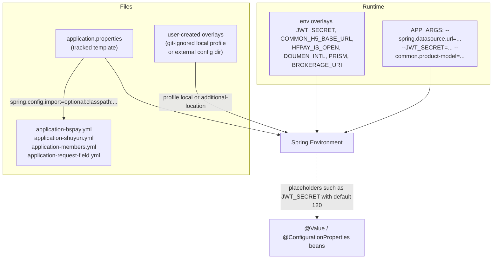

# Configuration and Secrets Reference

ECShopX-Java is configured almost entirely from **one properties file**: `ecshopx-bootstrap/src/main/resources/application.properties`. It is the only file the Spring Boot entrypoint (`cn.shopex.ecshopx.EcshopxApplication`) loads as its own `application.properties`; every business Bundle — which ships as a *library jar* with its own `application.properties` (e.g. `ecshopx-espier/src/main/resources/application.properties`) — relies on the bootstrap file to define keys the library jar's own file cannot contribute, because a jar's internal `application.properties` is not merged into the outer application's `Environment` automatically. This is why `application.properties` repeats the entire `espier.shopex-usercenter.*` block verbatim with the comment `must be defined for bootstrap Environment (library jar application.properties is not auto-merged)`.

Three deployment shapes consume this file differently:

| Shape | How config reaches the app |
|---|---|
| **Self-hosted / IDE** | no shipped overlay — `application-local.properties` is git-ignored (`.gitignore` line 7) and absent from fresh checkouts, so overrides arrive via env vars, `--key=value` program arguments (`APP_ARGS`), or `--spring.config.additional-location=file:./config/`; a developer may create their own `application-local.properties` and activate it with `--spring.profiles.active=local`, but nothing in the repo guarantees one exists (the readme's "already includes" wording is drift) |
| **Docker (full dev, lite)** | profile is *not* activated; overrides arrive as `APP_ARGS` (Spring Boot CLI `--key=value` args) plus env vars, both templated in `docker-compose.dev.yml` / `docker-lite/docker-compose.yml` |
| **Plain `java -jar`** | `--key=value` args, `--spring.profiles.active=local` (if you authored such a file), or `--spring.config.additional-location=file:./config/` |

Everything the Docker stacks need therefore has to be either a tracked default in `application.properties` or an `APP_ARGS`/env override: the Redis DB selectors, the JWT placeholders and the Flyway defaults all ship in the central file precisely because there is no shipped local overlay to lean on.



*How the tracked template, optional overlays, imported ymls and runtime injections converge on one Spring `Environment`.*

## How keys are consumed

Three mechanisms read these keys, and knowing which one a key uses tells you its failure mode:

1. **`@Value("${key:default}")`** — the dominant pattern for scalar keys (`ADMIN_LOGIN_CHECK_LEVEL`, `common.product-model`, `ecshopx.payment.wechat.notify-url`, `ecshopx.jushuitan.app-key`). `@Value` requires the key to exist when there is no default; that is why `application.properties` must list `espier.shopex-usercenter.*` even though the espier jar has defaults.
2. **`@ConfigurationProperties(prefix = "...")`** — typed binding for grouped keys, 35 classes across the Bundles. Representative: `StorageProperties` (`ecshopx.storage`), `H5JwtProperties` (`ecshopx.h5.jwt`), `AliyunsmsSmsSceneWhitelistProperties` (`ecshopx.sms`), `PrismCoreProperties` (`ecshopx.thirdparty.prism-core`), `DoumenIntlProperties` (`ecshopx.payment.doumen-intl`), `RequestFieldProperties` (`ecshopx.request-field`), `ShuyunOpenPlatformProperties` (`ecshopx.shuyun.open-platform`).
3. **`Environment.getProperty(...)` / `System.getenv(...)`** — used where the key name itself is dynamic. `SuperadminWxappTemplateMetadataService` builds `ecshopx.wechat.wxa-template-fallback.<key>.*` property names at runtime from the DB key; `SocialTrustLoginService.resolveAppleCallbackH5Host` falls back through `System.getenv("H5_BASE_URL")` then `System.getenv("COMMON_H5_BASE_URL")` for the Apple OAuth redirect host.

The file is deliberately a superset: many keys are read by Bundles far from bootstrap, and the file documents — in comments, mostly Chinese — the PHP-era environment variable each group replaces (`OSS_*`, `QINIU_*`, `AWS_*`, `COS_*`, `DIS_WORKWECHAT_H5_BASEURI`, `DOUMEN_INTL_*`, `BROKERAGE_URI`).

## The env-var overlay keys

A handful of keys are defined as placeholders that pull from environment variables with repo defaults:

| Key | Placeholder | Meaning |
|---|---|---|
| `ecshopx.h5.jwt.secret-base64` | `${JWT_SECRET}` | H5 member JWT signing key (Base64 of 32 bytes) |
| `ecshopx.merchant.wxapp.jwt.secret-base64` | `${JWT_SECRET}` | merchant wxapp onboarding JWT — shares the H5 secret unless overridden |
| `ecshopx.h5.jwt.ttl-minutes` | `${JWT_TTL:120}` | operator/H5 JWT lifetime |
| `ecshopx.h5.jwt.refresh-ttl-minutes` | `${JWT_REFRESH_TTL:20160}` | refresh window, measured from `iat` |
| `ecshopx.h5.jwt.blacklist-grace-period-seconds` | `${JWT_BLACKLIST_GRACE_PERIOD:0}` | seconds between invalidation and blacklist enforcement |
| `common.h5-base-url` | `${COMMON_H5_BASE_URL:}` | H5 base for activation links (`h5_url`) |
| `common.api-base-url` | `${COMMON_API_BASE_URL:${API_BASE_URL:}}` | API base for the Apple OAuth `redirect_uri` |
| `common.local-delivery-dirver` | `${LOCAL_DELIVERY_DIRVER:dada}` | same-city carrier: `dada` \| `shansong` |
| `ecshopx.payment.hfpay-is-open` | `${HFPAY_IS_OPEN:false}` | Huifu version switch surfaced to the admin UI |
| `ecshopx.payment.doumen-intl.*` | `${DOUMEN_INTL_BASE_URL/NOTIFY_URL/SANDBOX/TOKEN_REFRESH_INTERVAL_MINUTES:...}` | Doumen international cashier base/notify/token cadence |
| `ecshopx.work-wechat.dis-workwechat-h5-*` | `${DIS_WORKWECHAT_H5_BASEURI/AUTHURI:}` | WeCom store-staff H5 bases |
| `ecshopx.popularize.brokerage-qrcode.uri` / `.uri-item` | `${BROKERAGE_URI:}` / `${BROKERAGE_URI_ITEM:}` | distribution QR-code URIs |
| `ecshopx.shuyun.open-platform.callback-identity-secret` / `.auth-value` | `${SHUYUN_OPEN_PLATFORM_CALLBACK_IDENTITY_SECRET/AUTH_VALUE:}` | Shuyun open-platform inbound signing (via `application-shuyun.yml`) |

Note that Spring's relaxed binding treats `--JWT_SECRET=x` in `APP_ARGS` as the property `JWT_SECRET`, which is exactly how the Docker compose files inject it.

## `spring.config.import`: the per-domain ymls

```properties
spring.config.import=optional:classpath:application-request-field.yml,optional:classpath:application-bspay.yml,optional:classpath:application-shuyun.yml,optional:classpath:application-members.yml
```

Each of these is an opt-in, module-local override file that a Bundle ships on its own classpath:

| File | Prefix | Purpose |
|---|---|---|
| `application-request-field.yml` | `ecshopx.request-field` | Registration-form default fields and `must-start-required` lists, split by `standard` (per-language, per-module-type) vs `shuyun` (OEM) branches; consumed by `RequestFieldDefaultConfigProvider` |
| `application-bspay.yml` | `ecshopx.bspay.callback` | Huifu BSPay/斗拱 async-notify RSA public key (`rsa-public-key`); the callback orchestrator refuses the request when blank |
| `application-shuyun.yml` | `ecshopx.shuyun.open-platform` | Shuyun open-platform bases, timeouts, callback secret, `merge-dispatch-ttl-seconds` |
| `application-members.yml` | `ecshopx.trustlogin.default` | Trust-login (social sign-in) provider defaults: `standard.weixin`, `touch.weixin/apple/google/facebook/line` |

All are declared `optional:` so a missing file never fails startup. The `spring.config.import` list is also where a new domain-local yml joins — for instance the commented-out `# spring.config.import=optional:classpath:application-aftersales.yml`.

There is a second family of module-local files that are **not** imported here — Bundles that own a `<module>/src/main/resources/application.properties` (companys: `license.gateway.*` + `ecshopx.companys.item-start-num.weak-string-equals-mode`; kujiale: `ecshopx.kujiale.cities-json.insecure-tls`; espier: `espier.upgrade.storage-root`) or a module-local `application-local.properties` (hfpay: `ecshopx.hfpay.storage-root`, `bg-ret-url`, `ecshopx.filesystem.import-image-public-base` — that file **is** tracked, unlike bootstrap's). Those are *jar-internal defaults*: because the bootstrap `application.properties` is what actually lands in the `Environment`, the jar-internal copies act as documentation of each module's keys unless an operator re-declares them in the central file or via `APP_ARGS`.

## Reference table, grouped by subsystem

"Owning page" links to the wiki page where the subsystem's behaviour is documented in full.

### Server / web

| Key | Default | Env override | Owning page |
|---|---|---|---|
| `server.port` | `18080` | — | [Deployment](deployment.md) |
| `server.undertow.options.server.allow-unescaped-characters-in-url` | `true` (legacy PHP URL compatibility) | — | [Request Lifecycle](../architecture/request-lifecycle.md) |
| `server.undertow.max-http-post-size` | `64MB` (Boot reads this directly; `UndertowMultipartMaxEntityCustomizer` separately pins Undertow's own multipart entity cap to 64 MB in code and enables `ALLOW_ENCODED_SLASH`) | — | — |
| `spring.servlet.multipart.max-file-size` / `.max-request-size` | `50MB` / `55MB` | — | — |
| `spring.mvc.servlet.pathmatch.use-trailing-slash-match` | `true` | — | — |
| `langue.list[...]` / `langue.default-lang` | `zh-CN, en-CN, ar-SA, zh-TW, ja-JP, ru-RU` / `zh-CN` | — | — |
| `xxl.job.admin.addresses` / `.accessToken` / `.executor.port` | `http://127.0.0.1:9080/xxl-job-admin` / `ecshopx-cron-dev` / `19999` | `APP_ARGS` (compose points at `http://xxl-job-admin:8080/xxl-job-admin`) | — |

### DataSource / Flyway / MyBatis-Plus

| Key | Default | Env override | Owning page |
|---|---|---|---|
| `spring.datasource.url` | `jdbc:mysql://127.0.0.1:3306/ecshopx?...serverTimezone=Asia/Shanghai` | `APP_ARGS --spring.datasource.url=` | [Persistence](../concepts/persistence-mybatis.md) |
| `spring.datasource.username` / `.password` | `ecshopx` / `ecshopx` | `APP_ARGS` | — |
| `spring.flyway.enabled` | `true` (both compose stacks re-assert `--spring.flyway.enabled=true`) | `APP_ARGS` | [Persistence](../concepts/persistence-mybatis.md) |
| `spring.flyway.locations` | `classpath:db/migration` | — | — |
| `spring.flyway.baseline-on-migrate` / `.baseline-version` | `true` / `0` | — | — |
| `mybatis-plus.mapper-locations` | `classpath*:mapper/**/*.xml` | — | [Persistence](../concepts/persistence-mybatis.md) |
| `mybatis-plus.configuration.log-impl` | `org.apache.ibatis.logging.stdout.StdOutImpl` | `APP_ARGS` / env (an operator must override to `NoLoggingImpl` for production; nothing in the repo disables it) | — |

### Redis logical DBs

| Key | Default | Env override | Owning page |
|---|---|---|---|
| `spring.data.redis.host` / `.port` / `.password` / `.database` | `127.0.0.1` / `6379` / `redispassword` / `0` | `APP_ARGS` | [Redis Databases](../concepts/redis-databases.md) |
| `ecshopx.redis.lettuce.command-timeout` / `.connect-timeout` / `.validate-connection` | `5s` / `10s` / `true` | — | — |
| `ecshopx.redis.companys.database` | `0` | `APP_ARGS` / env | — |
| `ecshopx.redis.prism.database` | `2` | — | — |
| `ecshopx.redis.datacube.database` | `0` | — | — |
| `ecshopx.redis.deposit.database` | `1` | `APP_ARGS` / env (`ECSHOPX_REDIS_DEPOSIT_DATABASE`) | — |
| `ecshopx.redis.wechat.database` | *(commented out; falls back to `spring.data.redis.database`)* | — | — |

The `deposit` selector is the classic trap: with the shipped defaults (`shared` DB 0, `deposit` DB 1) the operator dashboard `real_deposit` reads a *different* logical DB than the recharge writers — the properties comment (`# Deposit Redis logical database; day recharge totals e.g. dayRechargeTotal{yyyy-MM-dd}`) is the only in-repo hint of this coupling. See [Redis Databases](../concepts/redis-databases.md) for the full analysis.

### JWT / auth / login

| Key | Default | Env override | Owning page |
|---|---|---|---|
| `ADMIN_LOGIN_CHECK_LEVEL` | *(empty)* | — | [Platform Services](../domains/platform-services.md) |
| `JWT_SECRET` | *(empty in repo; generated at install)* | `JWT_SECRET` env / `APP_ARGS` | this page |
| `JWT_TTL` / `JWT_REFRESH_TTL` | `120` / `20160` minutes | `JWT_TTL` / `JWT_REFRESH_TTL` | — |
| `ecshopx.h5.jwt.*` | `${JWT_SECRET}` etc. | — | — |
| `ecshopx.merchant.wxapp.jwt.issuer/.secret-base64/.ttl-minutes` | `ecshopx` / `${JWT_SECRET}` / `60` | — | [Stores & Merchants](../domains/stores-and-merchants.md) |
| `common.encrypt-sensitive-data` | `false` | — | — |
| `ecshopx.mail.password.app-key` / `.cipher` | *(empty)* / `AES-256-CBC` | — | — |
| `ecshopx.common.api-token` | *(empty)* | — | [Platform Services](../domains/platform-services.md) |
| `openapi.debug` / `openapi.common-token` / `openapi.system-company-id` | `0` / *(empty)* / `${common.system-companys-id:1}` | — | [OpenAPI](../integrations/openapi.md) |

Behaviour notes:

* `ADMIN_LOGIN_CHECK_LEVEL=img_code` makes `RequiresImgCodeWhenLevelValidator` require a captcha token/`yzm` pair on admin login; any other value (including empty) skips the check.
* `common.encrypt-sensitive-data=true` is a **hard startup failure** (`OperatorsQueryService.assertEncryptMode` throws `IllegalStateException`) — the mode is not implemented in this migration iteration.
* `ecshopx.common.api-token` gates `GET /api/v1/operator/credential`; when the key is blank the endpoint always answers `无权访问该API,签名错误` — i.e. **empty means closed**, the safe direction.
* `openapi.debug=1` skips signature verification on public OpenAPI paths entirely (sets auth and returns) — a debug-only bypass that must never ship as `1`.
* `ecshopx.mail.password.app-key` implements the PHP Laravel `APP_KEY` + AES-256-CBC codec for mail-setting passwords; when the key is missing, `MailSettingPasswordCodec` degrades to passing plaintext through.

### Tenant / product-model switches

| Key | Default | Env override | Owning page |
|---|---|---|---|
| `common.product-model` | `platform` | `APP_ARGS --common.product-model=` (from `PRODUCT_MODEL`, set by the install scripts as b2c→`standard`, bbc→`platform`) | [Platform Services](../domains/platform-services.md) |
| `common.system-is-saas` | `false` | — | — |
| `common.system-companys-id` | `1` | — | — |
| `common.system-main-companys-id` | *(empty)* | — | — |
| `ecshopx.common.demo-company-ids` | *(empty)* | — | — |
| `common.system-open-online` | `false` | — | — |
| `common.use-system-menu` | `true` | — | — |
| `ecshopx.is-dev-mode` | `false` | — | — |
| `ecshopx.companys.pharma-industry-setting-ttl-seconds` | `0` | — | — |
| `common.sms-send-limit` | `5` | — | [Members](../domains/members.md) |
| `ecshopx.h5.local.system-is-saas` / `.system-companys-id` / `.system-main-companys-id` | `${common.system-is-saas:false}` / `${common.system-companys-id:1}` / `${common.system-main-companys-id:}` | — | — |

`common.product-model` is read by `@Value` in at least six services (operator auth, shop menus, Shuyun operator facade, goods distributor resolution, espier member-token enrichment, operator-cart product-model reader) and also syncs to `companys.menu_type` by `install_apply_company_menu_type` at install time (b2c→`4`, bbc→`3`), so it is both a runtime switch and a database seed.

`common.use-system-menu` gates the **startup seed runner** rather than a request path: `MigrationSeedRunner` (an `ApplicationRunner` in bootstrap) re-imports the `seed/menu/*.json` system menus for `company_id=0` after Flyway, deleting all existing `company_id=0` menus first — `false` skips that re-import. The logistics seed (`seed/logistics/kuaidi.json`) runs regardless, but only when the `logistics` table is empty.

### Storage

| Key | Default | Env override | Owning page |
|---|---|---|---|
| `ecshopx.storage.driver` | `local` (`local`/`oss`/`qiniu`/`aws`/`cosv5`) | — | — |
| `ecshopx.storage.project-name` | `demo-ecshopx` | — | — |
| `ecshopx.storage.local.root` / `.url` | `storage/app/public` / `http://localhost:18080/storage` | — | — |
| `ecshopx.storage.oss.access-key` / `.secret-key` | *(empty in repo)* | — | — |
| `ecshopx.storage.oss.file|image|video.endpoint/.bucket/.cname/.domain` | *(empty)* | — | — |
| `ecshopx.storage.qiniu.*` | *(empty)* | — | — |
| `ecshopx.storage.aws.*` | *(empty)* | — | — |
| `ecshopx.storage.cos.*` | *(empty)* | — | — |
| `ecshopx.storage.import-file.endpoint/bucket/access-key/secret-key/private-download-base-url` | *(empty)*; `region=us-east-1`, `path-style-access=true` | — | — |

`StorageFactory.disk(fileType)` switches on `ecshopx.storage.driver`; an unknown value throws `请选择正确的存储系统！` at first use. The per-disk (`file`/`image`/`videos`) split only exists for `oss`, `qiniu` and `cosv5`. The comments tie each group to the legacy `DISK_DRIVER` / `OSS_PROJECT_NAME` / `OSS_*` / `QINIU_*` / `AWS_*` / `COS_*` environment variables, but the Java code binds from the properties themselves. `ecshopx.storage.import-file.*` is a separate S3-style client used by the import/CSV-export job pipeline and is deliberately blank in the repo ("values injected by ops").

### WeChat (Open Platform / wxa / wxapp templates)

| Key | Default | Env override | Owning page |
|---|---|---|---|
| `ecshopx.wechat.open.component-appid` / `.component-appsecret` / `.component-verify-ticket` | *(empty)* | — | [WeChat](../domains/wechat.md) |
| `ecshopx.wechat.wxa.subscribe-template.http-enabled` | `false` | — | [WeChat](../domains/wechat.md) |
| `ecshopx.wechat.wxa-publish.is-automatic-submit-review` / `.open-third` / `.wxa-need-open-platform` | `true` / `true` / `true` | — | — |
| `ecshopx.wechat.wxa-template-list-fallback-keys` | `yykweishop` | — | — |
| `ecshopx.wechat.wxa-template-fallback.yykweishop.template-id/version/desc/tag/domain` | `1` / `1` / `默认模板` (`\u9ed8\u8ba4\u6a21\u677f`) / `电商` (`\u7535\u5546`) / servicewechat.com domain JSON | — | — |
| `ecshopx.wechat.live-player-plugin.version` / `.provider` | `1.3.5` / `wxlive` | — | — |

Two behaviour notes:

* `component-appid`/`component-appsecret`/`component-verify-ticket` must **all three** be non-blank before `WechatOpenPlatformAuthorizerTokenService.assertOpenPlatformComponentReady()` will issue third-party authorizer tokens; missing any yields `微信开放平台组件配置不完整` / `component_verify_ticket 未配置或未同步`. `is_direct=1` authorizations bypass the check.
* The wxa template resolution is DB-first: `SuperadminWxappTemplateMetadataService.tryResolveTemplateRowForAuthorizerList` queries `superadmin_wxapp_template` by `key_name`, and only when no row matches does it read `ecshopx.wechat.wxa-template-fallback.<key>.*` from the `Environment`. `wxa-template-list-fallback-keys` is the comma-separated list that `WxaGetTemplateListService.loadTemplateMapFromConfiguredFallbackKeys` iterates when building the template list with no enabled DB row.

### Payments

| Key | Default | Env override | Owning page |
|---|---|---|---|
| `ecshopx.payment.wechat.notify-url` | `http://127.0.0.1/wechatAuth/wxpay/notify` (local placeholder; needs a public URL in production) | — | [Payments](../domains/payments.md) |
| `ecshopx.payment.alipay.notify-url` | `http://localhost:8080/api/v1/alipay/notify` | — | [Payments](../domains/payments.md) |
| `ecshopx.payment.hfpay-is-open` | `${HFPAY_IS_OPEN:false}` | `HFPAY_IS_OPEN` | — |
| `ecshopx.payment.doumen-intl.base-url` / `.notify-url` | `${DOUMEN_INTL_BASE_URL:}` / `${DOUMEN_INTL_NOTIFY_URL:}` | `DOUMEN_INTL_*` | — |
| `ecshopx.payment.doumen-intl.sandbox` / `.token-refresh-interval-minutes` | `true` / `115` | — | — |
| `ecshopx.ums.notify-md5-key` | *(commented out)* | — | — |
| `ecshopx.bspay.callback.rsa-public-key` | `""` (via `application-bspay.yml`) | — | — |
| `ecshopx.hfpay.order-status.hfpay-order-status[...]` | `退款中` / `支付成功` / `退款成功` / `退款失败` | — | — |
| `ecshopx.hfpay.bg-ret-url` / `.storage-root` / `.cfcalog-config` | only in the hfpay jar's `application-local.properties` (tracked) | — | — |
| `ecshopx.filesystem.import-image-public-base` | only in the hfpay jar's `application-local.properties` (tracked) | — | — |
| `ecshopx.orders.app-pay-type-desc-json` | *(empty = no mapping)* | — | — |

Per-channel payment credentials are **not** here — they live per tenant in Redis (`wxPaymentSetting:<sha1(companyId)>` etc.). This file only carries the *platform-level* notify URLs and channel toggles.

### Third-party gateways

| Key | Default | Env override | Owning page |
|---|---|---|---|
| `ecshopx.thirdparty.prism-core.base-url` / `.app-key` / `.app-secret` | *(empty in repo)* | — | [Third-Party](../integrations/third-party.md) |
| `ecshopx.thirdparty.prism-ishopex.base-url` / `.app-key` / `.app-secret` | *(empty)* | — | [Third-Party](../integrations/third-party.md) |
| `ecshopx.thirdparty.shuyun.base-url` / `.app-key` / `.app-secret` | *(empty)* | — | [Third-Party](../integrations/third-party.md) |
| `ecshopx.thirdparty.shuyun.member-modify.http-enabled` / `.member-unbind.http-enabled` | `false` / `false` | — | — |
| `ecshopx.thirdparty.dm-crm.point-detail-list.http-enabled` | `false` | — | — |
| `ecshopx.thirdparty.dm-crm.update-member-info-by-mobile.http-enabled` | `false` | — | — |
| `ecshopx.thirdparty.dm-crm.setting-read.redis-enabled` | `true` | — | — |
| `ecshopx.thirdparty.shopex-crm.sync-single-member.http-enabled` / `.endpoint` | `false` / *(empty)* | — | — |
| `ecshopx.shuyun.open-platform.base-uri` / `.token-refresh-base-uri` | `http://open-api.shuyun.com` / `http://open-client.shuyun.com` | — | — |
| `ecshopx.shuyun.open-platform.fallback-gateway-access-token` / `.callback-identity-secret` / `.auth-value` / `.offline-plat-id-suffix` | *(empty)* / *(empty)* / *(empty)* / `-off` | `SHUYUN_OPEN_PLATFORM_*` | — |
| `ecshopx.ome.openapi-url` | *(empty)* | — | [Third-Party](../integrations/third-party.md) |
| `ecshopx.map.amap.track-base-uri` / `.app-key` / `.app-secret` | `https://tsapi.amap.com` / *(empty)* / *(empty)* | — | — |
| `ecshopx.operator.sms.shopex.api-url` / `.ent-id` / `.ent-pwd` / `.license` / `.source` / `.secret` | `http://api.sms.shopex.cn` / *(empty)* | — | — |
| `APP_URL` + `ecshopx.jushuitan.app-key` / `.app-secret` / `.api-base-url` / `.oauth-base-url` | *(empty)* | — | [Third-Party](../integrations/third-party.md) |
| `espier.shopex-usercenter.*` | `https://www.shopex.cn` + `/api/usercenter/open/ecx/...` paths + empty `secret` | — | — |
| `common.external-baseuri` / `common.openapi-shopex-url` / `common.openapi-rand-salt` | *(empty)* / *(empty)* / `ecshopx` | — | [OpenAPI](../integrations/openapi.md) |
| `common.certi-base-url` / `common.store-key` / `common.matrix-relation-url` / `common.shop-admin-url` | *(empty)* / *(empty)* / `https://iframe.shopex.cn/?` / *(empty)* | — | — |
| `license.gateway.*` (companys jar) | all empty; `independent-shop-url=http://localhost` | — | — |
| `ecshopx.work-wechat.dis-workwechat-h5-base-uri` / `.dis-workwechat-h5-auth-uri` | `${DIS_WORKWECHAT_H5_BASEURI:}` / `${DIS_WORKWECHAT_H5_AUTHURI:}` | — | — |
| `ecshopx.api.public-base-url` | *(empty)* — external API root for the kuaizhen-580 medicine sync callback URL | — | — |

### SMS scene whitelists

| Key | Default | Owning page |
|---|---|---|
| `ecshopx.sms.b2c` / `.platform` / `.standard` | *(empty)* | [Third-Party](../integrations/third-party.md) |
| `ecshopx.sms.in-purchase[0..4]` | `注册验证码`, `找回密码验证码`, `手机号登录验证码`, `手机号修改验证码`, `微信支付成功通知` | — |

`AliyunsmsSmsSceneWhitelistProperties.resolveSceneNames(productModel)` maps a product-model slug to the corresponding list; `AliyunsmsSceneSimpleListService` then filters the company's scene list against it and — notably — **throws `场景数据不完整`** when some DB scenes fall outside the whitelist, so the whitelist is a consistency contract, not a silent filter. The product-model key comes from `ShopMenuService.resolveProductModelKeyForCompany` (i.e. from `companys.menu_type`), not from the property.

### Popularize defaults

| Key | Default | Owning page |
|---|---|---|
| `ecshopx.popularize.common-defaults.distribution-default-banner` / `.distribution-default-weapp` / `.distribution-default-poster` / `.qrcode-bg-img` / `.promoter-qrcode-bg-img` | yuanyuanke CDN image URLs | [Marketing](../domains/marketing.md) |
| `ecshopx.popularize.brokerage-qrcode.uri` / `.uri-item` | `${BROKERAGE_URI:}` / `${BROKERAGE_URI_ITEM:}` | [Marketing](../domains/marketing.md) |

`PopularizeSettingSaveService.applyCommonImageDefaults` coalesces these over the saved config (missing/null, and for banner/applets also empty-string, fall back to the property).

## Operational hazards: keys whose empty value changes behaviour

These are the keys where "blank" is not a no-op but a distinct — and sometimes surprising — mode:

| Key | Empty ⇒ |
|---|---|
| `ecshopx.ome.openapi-url` | `ShopexErpOpenApiClient.call` short-circuits and returns `{"fail_msg":"ome openapi url not configured"}` — every OME push is silently skipped |
| `ecshopx.thirdparty.prism-core.base-url` (+ key/secret) | `PrismCoreHttpClient.isConfigured()` is false → `postSignedForm` returns `null` before any HTTP; callers degrade (OAuth token exchange, cert issuance skip) |
| `ecshopx.thirdparty.prism-ishopex.base-url` | same pattern in `PrismIshopexHttpClient`: 留资, yunqi account checks, online-open callbacks skip the remote call |
| `ecshopx.thirdparty.shuyun.base-url` (+ key/secret) | `ShuyunSignedGatewayClient.getSignedJson/postSignedJson` return `null`; business layers treat that as failure and degrade |
| `ecshopx.jushuitan.oauth-base-url` | `JushuitanSettingAdminService.getSetting` emits `oauth_url` as a bare `?query-string` instead of an absolute URL; a non-empty value that does not start with `https://` is a hard `BadRequestException` |
| `APP_URL` | the Jushuitan `shop_callback_url` is emitted as a relative `/api/systemlink/jushuitan/{companyId}` path |
| `common.h5-base-url` | activation messages lose their `h5_url`; Apple OAuth callback host resolution in `SocialTrustLoginService` falls all the way back to the query/state and finally empty string |
| `common.certi-base-url` / `common.store-key` (with `prism-core.base-url`) | `ShopexOauthCertSyncService.syncAfterOauthLogin` returns early — the SaaS certificate centre is not called after OAuth login |
| `ecshopx.thirdparty.dm-crm.setting-read.redis-enabled=false` | `DmCrmSettingReadRedisService` is not registered at all; `DmCrmSettingReadNoOp` makes every company look unintegrated with Hope |
| `ecshopx.bspay.callback.rsa-public-key` | BSPay callbacks fail with `支付回调公钥未配置` — the channel is dead until configured |
| `ecshopx.wechat.wxa.subscribe-template.http-enabled=false` | `WxaSubscribeMessageTemplateAdminNoOp` throws `common.wxa.subscribe_template.http_disabled` on `addTemplate` |

The same family covers the `http-enabled` / NoOp pattern generally: for DmCrm, Marketing Center, Shansong, Shopex CRM, Shuyun member-modify/unbind and WorkWechat, `false` (or missing) selects the `*NoOp` bean via `@ConditionalOnProperty(matchIfMissing = true)` while `true` selects the HTTP implementation. This is what lets a fresh install boot with zero third parties configured — see [Third-Party Integrations](../integrations/third-party.md) for the full inventory.

Conversely, some empties are *safe*: `ecshopx.common.api-token` (endpoint closed), `ecshopx.storage.import-file.*` (import/CSV features degrade), `ecshopx.common.demo-company-ids` (no demo-tenant masking on the AdaPay open-account step — `AdapayOpenAccountStepService` reads it), `common.system-main-companys-id` (unused in single-tenant), `espier.shopex-usercenter.secret` (agreement/docs requests are sent unsigned, but still sent).

## Secrets handling

The repo deliberately ships **no usable production secrets**:

* `JWT_SECRET=` is empty in `application.properties`.
* `spring.datasource.password=ecshopx` and `spring.data.redis.password=redispassword` match the compose stacks' demo containers (`MYSQL_PASSWORD: ecshopx`, `redis-server --requirepass redispassword`), and MySQL root is `rootpassword`.
* Every `ecshopx.thirdparty.*`, `ecshopx.wechat.open.*`, `ecshopx.storage.*` credential field ships blank.

Production values are injected by the install scripts via `docker/install-secrets.sh`, a shared helper library sourced by `dev-setup.sh` and `docker-lite/deploy.sh` (it is not executable on its own). Its responsibilities:

1. **`install_ensure_jwt_secret(props_file, compose_env)`** — the JWT key lifecycle. Resolution order: an already-exported `JWT_SECRET` env var → a `JWT_SECRET=` line in the compose `.env` → a `JWT_SECRET=` line in `application.properties` (read-only check; the lite pack may not ship that file at all, so it is optional there). If none is found it runs `openssl rand -base64 32` to generate one (openssl missing = hard error). The generated value is persisted **only** to the compose `.env` via `install_upsert_env_file` — the comment is explicit: *"Do not mutate tracked application.properties"* and *"Docker does not use --spring.profiles.active=local, so application-local.properties is never written here"*. `INSTALL_JWT_GENERATED=true|false` tells the caller whether it generated.
2. **`install_prompt_admin_password`** — takes the admin password from `ADMIN_PASSWORD` (min 6 chars) or interactively from `/dev/tty`, rejecting empty/short/mismatched input.
3. **`install_hash_bcrypt`** — BCrypt-hashes the password by running Node inside the already-running app container (`ecshopx-app` / `ecshopx-dev-app`) or a local `ecshopx-java:17-node20-openresty` image with `docker/tools/bcrypt-hash.js` + `bcrypt.min.js`, so the hash is `$2y$`/`$2a$`-compatible with Spring Security `BCrypt.checkpw`.
4. **`install_apply_admin_password`** — waits for MySQL then `UPDATE operators SET password='<hash>' WHERE login_name='admin' AND operator_type='admin'`.
5. **`install_persist_product_model` / `install_apply_company_menu_type`** — maps install mode (`b2c`/`bbc`) to `PRODUCT_MODEL` (`standard`/`platform`), upserts it into the compose `.env` (so `APP_ARGS` carries `--common.product-model=...`), and syncs `companys.menu_type` (4/3) after the stack is up.

The compose files then thread `JWT_SECRET` twice — once as a container environment variable and once inside `APP_ARGS` as `--JWT_SECRET=${JWT_SECRET}` — and `.env` files are git-ignored at the root and under `docker-lite/`.

> The readme states the rule plainly: credentials in the compose files and any local overlay you author (`rootpassword` / `redispassword` / `JWT_SECRET`, …) are local-development only; **in production, inject real secrets via environment variables or an external configuration centre**, never reuse repo defaults. (The readme's suggestion to edit `application-local.properties` in place describes a user-created file — the repo ships none; see the deployment-shape table above.)

### Secret-bearing keys to never commit

`JWT_SECRET`, `ADMIN_PASSWORD`, `ecshopx.common.api-token`, `espier.shopex-usercenter.secret`, `ecshopx.storage.oss.access-key`/`.secret-key` (and the qiniu/aws/cos equivalents), `ecshopx.storage.import-file.access-key`/`.secret-key`, `ecshopx.wechat.open.component-appsecret`/`.component-verify-ticket`, `ecshopx.jushuitan.app-secret`, `ecshopx.thirdparty.prism-core.app-secret` / `prism-ishopex.app-secret` / `shuyun.app-secret`, `ecshopx.shuyun.open-platform.callback-identity-secret` / `.auth-value` / `.fallback-gateway-access-token`, `ecshopx.bspay.callback.rsa-public-key`, `ecshopx.ums.notify-md5-key`, `common.store-key`, `ecshopx.mail.password.app-key`, `ecshopx.map.amap.app-secret`, `ecshopx.operator.sms.shopex.ent-pwd`/`.secret`, `license.gateway.*` — plus `ecshopx.thirdparty.dada.*` / `.shansong.*` (Dada/Shansong delivery credentials, bound from their own properties classes).

## Related pages

- [Redis Databases](../concepts/redis-databases.md) — the logical-DB selectors in this file and the deposit-DB alignment trap
- [Third-Party Integrations](../integrations/third-party.md) — the http-enabled/NoOp pattern and per-tenant settings in Redis
- [Payments](../domains/payments.md) — channel notify endpoints and the Redis-stored credentials
- [Deployment](deployment.md) — the three install modes and compose stacks that consume these files
