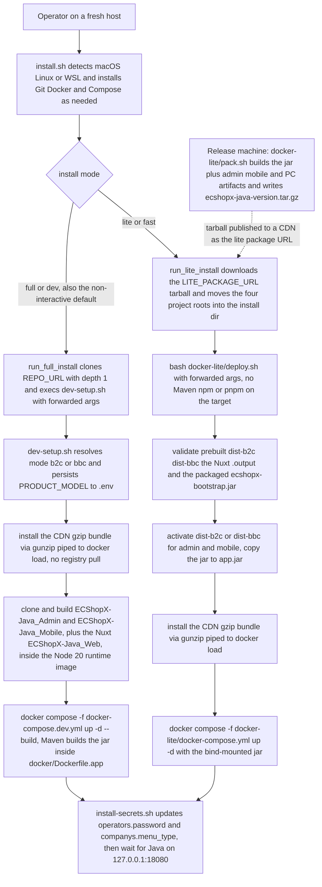
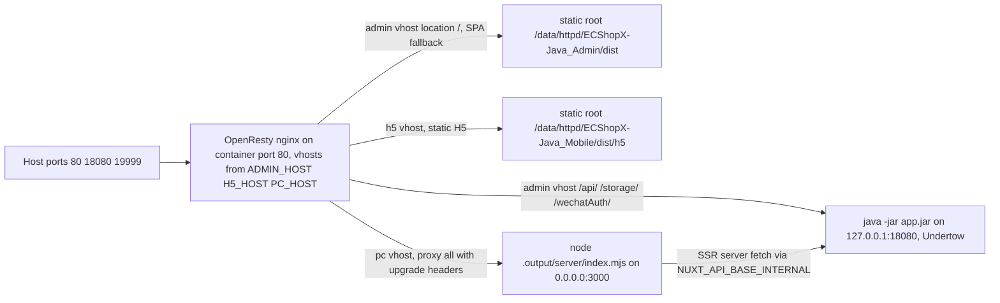

# Deployment: Compose, Full Dev, and Lite Offline

ECShopX-Java ships as **one Spring Boot jar** (`ecshopx-bootstrap`) that must be surrounded by MySQL, Redis and an XXL-JOB admin console before it does anything useful. The repository's deployment story is therefore entirely about assembling that neighbourhood reproducibly, and it does so through three operator entrypoints that all converge on the same runtime topology (see [System Overview](../architecture/overview.md)):

* **Full development** — `./dev-setup.sh` (or `bash install.sh --full`) clones and builds the three sibling frontend repositories, imports the runtime images, and starts `docker-compose.dev.yml`, whose `ecshopx-app` image is **built on the fly** by a Maven stage in `docker/Dockerfile.app`.
* **Lite offline** — `docker-lite/pack.sh` (root wrapper `./pack.sh`) produces a customer tarball containing the prebuilt jar and prebuilt frontend artifacts; `docker-lite/deploy.sh` (root wrapper `./deploy.sh`, or `bash install.sh --lite`) starts `docker-lite/docker-compose.yml` **without ever invoking Maven, npm or pnpm on the target machine**.
* **Self-hosted jar** — `./mvnw -pl ecshopx-bootstrap -am package` then `java -jar … --spring.profiles.active=local`; outside the scope of this page (covered by [Configuration](configuration.md)).

> **A documentation drift worth knowing before you read the readme.** The English readme's "Docker Deployment (Recommended)" section still describes a one-click `docker compose up -d` at the repository root with a service named `ecshopx-java` built from `docker/Dockerfile`, and lists the XXL-Job console at `http://localhost:9080/xxl-job-admin`. The current working tree contains **no root `docker-compose.yml` and no `docker/Dockerfile`** — only `docker-compose.dev.yml` and `docker-lite/docker-compose.yml`, and `docker/Dockerfile.app` / `docker/Dockerfile.runtime`. The single-app-container redesign documented in `docker-lite/README.md` explicitly records that the separate `gateway` and `ecshopx-web-frontend` services were removed. Both real compose stacks publish the XXL admin on host port **8080** (`XXL_HOST_PORT`, overridable); `9080` survives only as the `xxl.job.admin.addresses` default in `application.properties` for self-hosted runs. Trust the compose files and the scripts, not that readme section.

## The three install paths



The three routes an operator can take from an empty host to a running stack, and where they join: every path ends in the same four-service compose topology and the same post-start secrets/menu steps from `docker/install-secrets.sh`.

`install.sh` is the zero-dependency bootstrap: it detects the OS (`darwin*`, `linux-gnu`, or a `WSL_DISTRO_NAME` env — anything else aborts), installs Git via Homebrew on macOS (deliberately avoiding the Xcode command-line-tools placeholder) or via apt/dnf/yum/zypper on Linux, installs Docker (Docker Desktop cask on macOS; `docker.io`/`docker` packages or `get.docker.com` on Linux, plus `usermod -aG docker` and `systemctl start/enable docker`), installs the Compose plugin or standalone binary, and then hands off. Mode is chosen by `--full`/`--dev` vs `--lite`/`--fast`; with no flags and no tty it defaults to **full**; interactively it prompts (`1` full / `2` lite). Any argument `install.sh` does not recognise is collected into `FORWARD_ARGS` and passed verbatim to `dev-setup.sh` or `docker-lite/deploy.sh` — that is how `bash install.sh --lite --mode b2c --http-port 8081 --admin-password secret123` works.

The lite branch never touches Git: it `curl`s `LITE_PACKAGE_URL` (default is a placeholder OSS URL; `LITE_PACKAGE_URL=<real-url>` overrides it) into a temp file, extracts it, locates the directory containing `ECShopX-Java/docker-lite/deploy.sh`, asks for confirmation before overwriting any of the four project directories that already exist in the install directory (and **aborts** if there are conflicts but no tty), moves `ECShopX-Java`, `ECShopX-Java_Admin`, `ECShopX-Java_Mobile` and `ECShopX-Java_Web` into place, and finally runs `bash ./deploy.sh "$@"` from `docker-lite/`. The full branch clones `REPO_URL` (default `https://gitee.com/ShopeX/ECShopX-Java.git`, `--depth 1`; `git pull --rebase` if the clone already exists) and runs `bash dev-setup.sh "$@"`.

## The unified app container

The defining deployment decision — recorded in `docker-lite/README.md` and visible in `docker/Dockerfile.app` — is that **nginx, Java and Nuxt SSR live in one container**. There is no separate gateway or frontend service anymore:

| Process | Binds | Role |
|---|---|---|
| OpenResty (nginx) | container `:80` | Host-based vhost router; the only published web port |
| Java (`ecshopx-bootstrap`) | `127.0.0.1:18080` | Undertow API (`/api/`, `/storage/`, `/wechatAuth/`); also published directly for debugging |
| Nuxt SSR (`node .output/server/index.mjs`) | `0.0.0.0:3000` | PC storefront server-side rendering |



Request routing inside the single `ecshopx-app` container: nginx is the only externally published web listener and fans out to the local Java API, the two static frontend roots, and the Nuxt SSR process.

Key mechanics:

* **The nginx config is a template rendered at boot.** `docker/app-nginx.conf` contains `server_name ${ADMIN_HOST}` / `${H5_HOST}` / `${PC_HOST}` placeholders; `docker/app-entrypoint.sh` runs `envsubst '${ADMIN_HOST} ${H5_HOST} ${PC_HOST}' < "$NGINX_TEMPLATE" > "$NGINX_CONF"` (default output `/usr/local/openresty/nginx/conf/nginx.conf`). The runtime base image installs `gettext-base` precisely for this.
* **The three vhosts.** `${ADMIN_HOST}` serves `/api/`, `/storage/` and `/wechatAuth/` by proxy to `http://127.0.0.1:18080` (with `client_max_body_size 64m`, CORS response headers on `/api/`, and the standard `X-Real-IP` / `X-Forwarded-For` / `X-Forwarded-Proto` headers) and everything else from `/data/httpd/ECShopX-Java_Admin/dist/` with an SPA `try_files … /index.html =404` fallback. `${H5_HOST}` serves `/data/httpd/ECShopX-Java_Mobile/dist/h5` statically. `${PC_HOST}` proxies everything to `http://127.0.0.1:3000` with HTTP/1.1 upgrade headers (`proxy_set_header Upgrade $http_upgrade`, `Connection 'upgrade'`) and generous timeouts (`proxy_read_timeout 300s`, `proxy_connect_timeout 75s`). All three vhosts deny `*.ini|sql|conf|bak` files and `/.svn`/`/.git` paths. nginx resolves upstream names through Docker's embedded DNS (`resolver 127.0.0.11`).
* **The `/data/httpd` mount is the contract between host and container.** The compose stacks mount the *parent of the repository* at `/data/httpd`, so the expected host layout is the four sibling checkouts:
  ```text
  /data/httpd/ECShopX-Java        # this repository
  /data/httpd/ECShopX-Java_Admin  # admin SPA (Vue)
  /data/httpd/ECShopX-Java_Mobile # H5 (uni-app)
  /data/httpd/ECShopX-Java_Web    # PC (Nuxt)
  ```
  In the dev stack the mount is `..:/data/httpd`; in the lite stack `../../:/data/httpd` (the tarball extract root). `deploy.sh` additionally runs `chmod a+x` on the extract root and `chmod -R a+rX` on the built `dist` / `.output` trees — the script's stated purpose is 确保挂载根目录可被容器内非 root 用户遍历 ("ensure the mount root is traversable by the non-root user inside the container"), and it warns that 404s on admin/H5 are the symptom of a failed `chmod`, with the manual fix printed.
* **The entrypoint is a mini init.** `docker/app-entrypoint.sh` (POSIX sh, `set -e`): renders the nginx config, verifies `$JAR` and the Nuxt entry `$NUXT_ENTRY` (default `/data/httpd/ECShopX-Java_Web/.output/server/index.mjs`) exist, creates nginx temp dirs, then starts `java $JAVA_OPTS -jar "$JAR" $APP_ARGS &` and `node "$NUXT_ENTRY" &`. Nuxt is forced onto IPv4 — `HOST=0.0.0.0`, `PORT=3000`, `NITRO_HOST`, `NITRO_PORT` — because Nitro otherwise binds `[::]:3000` while nginx proxies `127.0.0.1:3000`. It also overrides `NUXT_API_BASE_INTERNAL` (default `http://127.0.0.1:18080/api/v1/h5app`) so SSR hits the local Java rather than a stale build-time hostname.
* **Startup ordering and supervision.** The entrypoint polls `http://127.0.0.1:18080/` (up to 90 attempts × 2 s) and only then starts `openresty -g 'daemon off;'` — it deliberately does **not** wait for Nuxt SSR HTTP, because a hung SSR used to delay the whole :80 listener by ~3 minutes. After that, the supervision loop restarts Nuxt if it exits (`[app] WARNING: Nuxt exited; restarting...`) so a PC-storefront outage never takes down admin/H5/API, and the container exits (after forwarding `TERM` to all children) **only** when Java or OpenResty dies. Nuxt is the only restartable child; Java and nginx are load-bearing.

## The four-service compose stacks

Both `docker-compose.dev.yml` (project `ecshopx-dev`) and `docker-lite/docker-compose.yml` (project `ecshopx-lite`) define the same four services on a private bridge network, with startup ordering enforced by `depends_on: condition: service_healthy` — `ecshopx-app` waits for mysql, redis *and* xxl-job-admin to be healthy:

| Service | Image | Role |
|---|---|---|
| `mysql` | `mysql:8.0` | Business schema `ecshopx` + the `xxl_job` scheduler DB, seeded from init SQL |
| `redis` | `redis:7-alpine` | Dispatch queues, multi-DB caches; password `redispassword`, AOF on |
| `xxl-job-admin` | `xuxueli/xxl-job-admin:2.5.0` (`platform: linux/amd64`) | Scheduling brain, console at `/xxl-job-admin` context path |
| `ecshopx-app` | built (`Dockerfile.app`) in dev / prebuilt runtime base in lite | nginx + Java + Nuxt, as above |

Details an operator actually needs:

* **MySQL init.** `docker/tables_xxl_job.sql` is mounted as `/docker-entrypoint-initdb.d/00-tables_xxl_job.sql` and `docker/ecshopx.sql` as `10-ecshopx.sql` — the numbering makes the XXL schema exist before the business dump. `docker-entrypoint-initdb.d` only runs on a **fresh data volume**; re-importing requires `docker compose down -v`. The server flags pin `utf8mb4` / `utf8mb4_unicode_ci`, `mysql_native_password` and `--max-allowed-packet=64M`. Root password `rootpassword`, app user `ecshopx`/`ecshopx`, TZ `Asia/Shanghai`. Healthcheck: `mysqladmin ping`.
* **Redis.** `redis-server --requirepass redispassword --appendonly yes --tcp-keepalive 60`; healthcheck `redis-cli -a redispassword PING`.
* **XXL-Job admin.** Configured through its `PARAMS` env: context path `/xxl-job-admin`, `jdbc:mysql://mysql:3306/xxl_job`, root credentials, and `--xxl.job.accessToken=ecshopx-cron-dev`. That token **must match** the executor's `xxl.job.accessToken` or triggers are rejected (see [Scheduled Jobs](../concepts/scheduling-xxljob.md)). Healthcheck is a `/dev/tcp/127.0.0.1/8080` probe with a 90 s start period.
* **Published ports.**

  | Port | Purpose | Knob |
  |---|---|---|
  | `${HTTP_HOST_PORT:-80}` → 80 | nginx (admin/h5/pc vhosts) | `--http-port` |
  | `${XXL_HOST_PORT:-8080}` → 8080 | XXL-Job admin console | `--xxl-port` |
  | `18080` (fixed) | Java API direct, debugging | — |
  | `19999` (fixed) | XXL-Job executor callbacks | — |
  | `${MYSQL_HOST_PORT:-3306}` → 3306 | MySQL | env |
  | `${REDIS_HOST_PORT:-6379}` → 6379 | Redis | env |

* **Where the app image comes from — the one real difference.** The dev stack *builds* `ecshopx-app:latest` from `docker/Dockerfile.app` with `pull: false` and build args `MAVEN_BUILD_IMAGE` (default `maven:3.9-eclipse-temurin-17`) and `RUNTIME_BASE_IMAGE` (default `ecshopx-java:17-node20-openresty`). The lite stack uses the prebuilt `${APP_IMAGE:-ecshopx-java:17-node20-openresty}` image and obtains the application **entirely from bind mounts**: `./app/app.jar:/app/app.jar:ro` plus `../../:/data/httpd`, and it overrides the entrypoint to `/bin/sh /data/httpd/ECShopX-Java/docker/app-entrypoint.sh` with `NGINX_TEMPLATE=/data/httpd/ECShopX-Java/docker/app-nginx.conf` — so on a lite install even the entrypoint script and nginx template come from the extracted tarball, not from the image. App logs go to the named volume `ecshopx-logs:/app/logs` in both stacks (dev: `ecshopx-dev-app-logs`, lite: `ecshopx-lite-app-logs`), not into the host tree.

## Property injection: `JAVA_OPTS` and `APP_ARGS`

`docker/app-entrypoint.sh` launches Java as `java $JAVA_OPTS -jar "$JAR" $APP_ARGS` — unquoted, so both variables expand word-split into the JVM command line. `Dockerfile.app` declares both as empty-by-default `ENV`s, and both compose stacks set them:

* `JAVA_OPTS` carries JVM tuning only: `-XX:+UseContainerSupport -XX:MaxRAMPercentage=75.0 -Djava.security.egd=file:/dev/./urandom` (memory follows the container limit rather than a fixed `-Xmx`).
* `APP_ARGS` carries **Spring Boot CLI-style `--key=value` overrides**, which is how Docker configuration reaches the application without a profile:

  ```yaml
  APP_ARGS: >-
    --server.port=18080
    --spring.datasource.url=jdbc:mysql://mysql:3306/ecshopx?useUnicode=true&characterEncoding=utf-8&useSSL=false&allowPublicKeyRetrieval=true&serverTimezone=Asia/Shanghai
    --spring.datasource.username=ecshopx
    --spring.datasource.password=ecshopx
    --spring.flyway.enabled=true
    --spring.data.redis.host=redis
    --spring.data.redis.port=6379
    --spring.data.redis.password=redispassword
    --JWT_SECRET=${JWT_SECRET}
    --common.product-model=${PRODUCT_MODEL:-platform}
    --xxl.job.admin.addresses=http://xxl-job-admin:8080/xxl-job-admin
    --xxl.job.accessToken=ecshopx-cron-dev
    --xxl.job.executor.appname=ecshopx-executor
    --xxl.job.executor.port=19999
  ```

  Two consequences matter. First, `--JWT_SECRET=${JWT_SECRET}` exploits Spring's relaxed binding: a CLI arg `--JWT_SECRET=x` becomes the property `JWT_SECRET`, which is exactly the placeholder `application.properties` reads (`ecshopx.h5.jwt.secret-base64=${JWT_SECRET}`) — that is why JWT_SECRET is threaded *twice* into the container (once as a plain env var, once inside `APP_ARGS`). Second, **case is preserved verbatim through `APP_ARGS`**: `--xxl.job.accessToken=ecshopx-cron-dev` stays lowercase-`c`-capital-`T` all the way into the `Environment`, matching the admin's `PARAMS`. Typos in these keys silently produce a different property and a broken integration, which is why the compose files are the canonical spelling reference. The `xxl.job.admin.addresses` override also matters: the repo default is `http://127.0.0.1:9080/xxl-job-admin` (self-hosted), while both stacks point the executor at `http://xxl-job-admin:8080/xxl-job-admin` on the shared bridge network.

`install_persist_product_model` writes `PRODUCT_MODEL` into the compose `.env` (`standard` for `b2c`, `platform` for `bbc`) before `compose up`, so `--common.product-model=` resolves consistently across re-runs.

## Full development: `dev-setup.sh`

`dev-setup.sh` is the orchestrator for the dev path. Its `main()` order is the operational contract:

1. `check_docker` — Docker present and running, `docker compose` (or legacy `docker-compose`) detected.
2. `resolve_business_mode` — `--mode b2c|bbc` or an interactive prompt (B2C = "线上商城、O2O云店等", BBC = "多商户入驻电商平台"); maps to `SELECTED_PLATFORM` (`standard`/`platform`) and the admin build script (`build:b2c`/`build:bbc`).
3. `install_persist_product_model` — upserts `PRODUCT_MODEL` into the repo-root `.env`.
4. `configure_public_urls` — HTTP port, admin/h5/pc hostnames (defaults `admin.ecshopx.test` / `h5.ecshopx.test` / `www.ecshopx.test`), or full `--admin-url`/`--h5-url`/`--pc-url` overrides (an admin URL with an explicit port also moves `HTTP_HOST_PORT`). Derives `API_BASE_URL` (`…/api/v1/`), `PC_API_URL` (`…/api/v1/h5app`), `QIANKUN_ENTRY_URL` (`${ADMIN_URL}/newpc/`) and `NUXT_PUBLIC_DECORATION_ADMIN_ORIGINS`, and prints the `/etc/hosts` line to add: `127.0.0.1  admin… h5… pc…`.
5. `configure_install_secrets` — admin password prompt + JWT secret (below).
6. `ensure_runtime_base_image` — imports the CDN image bundle and *verifies* both `RUNTIME_BASE_IMAGE` and `MAVEN_BUILD_IMAGE` are present afterwards (a missing Maven image fails with 请将其打入 CDN 包后重新发布 — the full install compiles Java, so the compile image must be in the bundle).
7. `check_and_clone_frontend` — clones `https://gitee.com/ShopeX/ECShopX-Java_{Admin,Mobile,Web}.git` as siblings of the repo (asking first; admin and mobile are **required** and abort when declined, PC is optional / `--skip-pc`).
8. Build the three frontends **inside the Node 20 runtime image** via `docker run --rm -v "$PARENT_DIR:/data/httpd" -w /data/httpd/… "$NODE_BUILD_IMAGE" sh -c "npm install --legacy-peer-deps && npm run …"` (registry defaults to `https://registry.npmmirror.com` via `NPM_REGISTRY`):
   * *Admin* — `npm run build:b2c` or `build:bbc` after `.env` is written (`VUE_APP_BASE_API`, `VUE_APP_QIANKUN_ENTRY`, `VUE_APP_WEBSITE`). Skipped when `dist/index.html` exists, `.env` is unchanged and `--rebuild` was not given.
   * *Mobile H5* — `npm run build:h5` with `APP_PLATFORM` set to the selected platform; same skip logic against `dist/h5`.
   * *PC (Nuxt)* — `build_web_if_needed` uses two named volumes (`ecshopx-web-node_modules`, `ecshopx-web-pnpm-store`) and runs `corepack enable && pnpm install --store-dir /pnpm-store && pnpm build` with `NUXT_API_BASE`/`NUXT_API_BASE_INTERNAL` pinned to `http://127.0.0.1:18080/api/v1/h5app`. Skipped when `.output/server/index.mjs` already exists. The comment is explicit: **Nuxt `.output` must exist before `ecshopx-dev-app` starts, because the entrypoint requires it.**
9. `run_docker_compose` — `DOCKER_BUILDKIT=0 COMPOSE_DOCKER_CLI_BUILD=1 docker compose -f docker-compose.dev.yml up -d --build` (a preceding `build --no-cache` when `--rebuild`).
10. Post-start: `install_apply_admin_password "ecshopx-dev-mysql"` and `install_apply_company_menu_type "ecshopx-dev-mysql" "$MODE"` (below), then `wait_for_java_ready "http://127.0.0.1:18080/"` — up to 120 attempts × 2 s of `curl -w '%{http_code}'`, because Flyway migrates during Spring Boot startup (`spring.flyway.enabled=true`); the success message is "Java 已就绪 (HTTP $code)；Flyway 已随启动执行".
11. `verify_dist_layout` (warn about missing dist trees) and `show_success_info` (URLs, elapsed time, `logs -f` / `down` / `--rebuild` cheat-sheet).

Useful flags: `--rebuild`, `--skip-admin`, `--skip-vshop`, `--skip-pc`, `--mode`, `--http-port`, `--xxl-port`, `--admin-host`, `--h5-host`, `--pc-host`, `--admin-url`, `--h5-url`, `--pc-url`, `--admin-password`.

## Lite offline: `pack.sh` then `deploy.sh`

### Dev vs lite at a glance

The comparison from `docker-lite/README.md`:

| | **Full dev** (`docker-compose.dev.yml`) | **docker-lite** |
|---|---|---|
| Purpose | Full local development | Offline / fast customer deploy |
| Builds on deploy | Yes (Maven in `ecshopx-app` image, Node 20 frontends via `dev-setup.sh`) | No — jar + prebuilt `dist-*`, `.output` ship in the tarball |
| Java runtime | Built into `ecshopx-app` image | Packaged `docker-lite/app/ecshopx-bootstrap.jar`, bind-mounted as `app.jar` |
| Compose file | `docker-compose.dev.yml` | `docker-lite/docker-compose.yml` |
| Operator entry | `dev-setup.sh` / `install.sh --full` | `docker-lite/pack.sh`, `docker-lite/deploy.sh` / `install.sh --lite` |

### `pack.sh` — on the build machine

`docker-lite/pack.sh` (root `./pack.sh` execs it) is the release pipeline. It requires `node`, `npm`, `tar` and **nvm** (it refuses to run without `$NVM_DIR/nvm.sh`), switches to Node `20.19` for all three frontends and uses pnpm `10.13.0` for the PC build. Steps:

1. **Jar.** `release_build_jar` prefers the host toolchain — `./mvnw -B -pl ecshopx-bootstrap -am package -DskipTests` when `mvnw` is executable and `java` is on PATH — and otherwise falls back to building the **builder stage** of `docker/Dockerfile.app` with `docker build --target builder --build-context maven-builder=docker-image://… --build-context runtime-base=docker-image://…`, then `docker cp`s `ecshopx-bootstrap/target/.` out of a throwaway container. Either way the jar is staged **twice**: `docker-lite/app/ecshopx-bootstrap.jar` and `docker-lite/app/app.jar` (compose mounts the latter name). There is no remote jar download anywhere in the pipeline.
2. **`.env` pinning.** `prepare_release_envs` writes fixed build-time values — admin `VUE_APP_BASE_API=/api/v1`, `VUE_APP_DEFAULT_LANG=zhcn`, `VUE_APP_PUBLIC_PATH=/`; mobile `APP_BASE_URL=/api/v1/h5app/wxapp` plus language keys and `APP_IMAGE_CDN` (default `https://ecshopx-vshop-images.oss-cn-shanghai.aliyuncs.com`); PC `NUXT_PUBLIC_DEFAULT_COUNTRY_CODE=zh-CN`, `NUXT_PUBLIC_API_BASE=/api/v1/h5app`.
3. **Admin**: `npm run build:b2c` → renamed `dist-b2c`, then `build:bbc` → `dist-bbc` (both modes ship in one tarball).
4. **Mobile**: `APP_PLATFORM=standard npm run build:h5` → `dist-b2c`, `APP_PLATFORM=platform` → `dist-bbc` (each contains `h5/`).
5. **PC**: `pnpm install --config.dangerouslyAllowAllBuilds=true && pnpm build` under `CI=true` and `NUXT_TELEMETRY_DISABLED=1` → `.output`.
6. **Validate + tar.** `release_validate_prebuilt_artifacts` checks `dist-b2c/index.html`, `dist-bbc/index.html`, `dist-{b2c,bbc}/h5`, `.output/server/index.mjs` **and** `.output/server/node_modules` (Nitro's production deps must ship or SSR fails). `release_build_tarball` reads the version from `pom.xml` with `sed` only — the comment is explicit that lite tooling must not invoke host `mvn`/`java` — resolving CI-friendly `${revision}` placeholders, and writes `ecshopx-java-<version>.tar.gz` containing the **four project roots** with excludes `/node_modules/`, `.git/`, `*.log`, `.DS_Store`, `._*`, `dist-release`, existing `ecshopx-*.tar.gz`, `.env`, and `target/`. The rooted `/node_modules/` exclude is deliberate: it strips project-root deps but keeps `ECShopX-Java_Web/.output/server/node_modules`. The transient `dist` dirs are dropped (only `dist-b2c`/`dist-bbc` ship), and packaging fails if the jar or `docker-lite/docker-compose.yml` are missing from the staging tree.
7. `--with-images` additionally prefetches the CDN image bundle into `docker-lite/images/` so the tarball can carry it.

### `deploy.sh` — on the customer machine

`docker-lite/deploy.sh` (root `./deploy.sh` execs it) opens with the comment that it **intentionally does not run Maven, npm/pnpm or frontend builds**. `--mode b2c|bbc` is required (prompted on a tty; without a tty and without the flag it exits). The sequence:

1. `install_persist_product_model "$COMPOSE_ENV_FILE" "$MODE"` — `docker-lite/.env` gets `PRODUCT_MODEL`.
2. `release_validate_prebuilt_artifacts` — refuses to continue if the prebuilt jar / dists / `.output` are missing ("预置产物不完整，请使用完整离线发行包或先执行 pack.sh").
3. `configure_public_urls` — same host/port/URL logic as dev-setup (`--http-port`, `--xxl-port`, `--admin-host`, `--h5-host`, `--pc-host`, `--admin-url`, `--h5-url`, `--pc-url`; interactive prompt otherwise).
4. `configure_install_secrets` — admin password (min 6 chars; `--admin-password` or `ADMIN_PASSWORD` env, else double tty prompt) and JWT secret. Note the lite nuance: the pack may not ship `application.properties`, so the properties file is treated as optional and the secret still persists to `docker-lite/.env`.
5. `sync_nuxt_public_env` — upserts `NUXT_PUBLIC_API_BASE=/api/v1/h5app` and `NUXT_PUBLIC_DECORATION_ADMIN_ORIGINS=$ADMIN_URL` into `docker-lite/images.env`.
6. `release_activate_frontend_dist "$MODE"` — rsync (or `cp -a`) `dist-b2c` or `dist-bbc` into `dist` for admin and mobile; verifies `dist/index.html` and `dist/h5` afterwards.
7. `release_ensure_runtime_images` — `docker-lite/images.env` (auto-created from `images.env.example`) supplies `DOCKER_IMAGES_BUNDLE_URL` and the per-service image tags; the bundle is downloaded and imported with `gunzip -c … | docker load`, never a registry pull.
8. `ensure_app_jar` — `cp -f app/ecshopx-bootstrap.jar app/app.jar`; missing/empty jar is a hard error ("缺少 docker-lite/app/ecshopx-bootstrap.jar，请使用完整发行包").
9. `deploy_ensure_bind_mount_traverse` — the `chmod a+x` / `a+rX` pass described above.
10. `compose_up` — `docker compose` (or `docker-compose`) with **two** `--env-file`s (`images.env` and, if present, `docker-lite/.env`), `-f docker-lite/docker-compose.yml`, `--project-directory docker-lite`. On failure it dumps `logs --tail=80`. After `up -d` it immediately applies the admin password and `companys.menu_type` against the `ecshopx-mysql` container.
11. `wait_for_java_ready "http://127.0.0.1:18080/"` — same Flyway-aware readiness poll as dev-setup.
12. `show_success_info` — prints the admin/H5/PC/API/XXL-Job URLs (account `admin`), where the JWT secret was persisted, and the hosts tip. `--skip-demo` exists but is reserved (the schema comes from `ecshopx.sql` regardless).

`release_init_paths` in `docker-lite/lib/common.sh` is what makes the sibling layout discoverable from any invocation point: `RELEASE_LITE_DIR` is resolved from the calling script, `RELEASE_ECSHOPX_ROOT` its parent, and the frontends are always `$RELEASE_PARENT_DIR/ECShopX-Java_{Admin,Mobile,Web}`. The root `./pack.sh` / `./deploy.sh` wrappers simply `exec` the `docker-lite/` scripts with the same arguments, so both invocation styles see identical paths.

## Secrets and post-start database steps: `docker/install-secrets.sh`

`docker/install-secrets.sh` is a shared helper library sourced by both `dev-setup.sh` and `docker-lite/deploy.sh` — it is not executable alone. Its five responsibilities:

1. **`install_ensure_jwt_secret(props_file, compose_env)`** — resolution order: exported `JWT_SECRET` env → `JWT_SECRET=` line in the compose `.env` → `JWT_SECRET=` line in `application.properties` (read-only). If none found it generates `openssl rand -base64 32` (openssl missing = hard error) and persists **only** to the compose `.env`; the tracked `application.properties` and the git-ignored `application-local.properties` are never written, because Docker runs do not activate the `local` profile. Sets `INSTALL_JWT_GENERATED` so the caller can report whether it generated.
2. **`install_prompt_admin_password`** — `ADMIN_PASSWORD` (≥ 6 chars) or a hidden double prompt on `/dev/tty`; non-tty without a preset password fails.
3. **`install_hash_bcrypt`** — hashes the password by running Node *inside the running app container* (`ecshopx-app` or `ecshopx-dev-app`, resolved by `install_resolve_app_container`; falling back to `docker run` on a local runtime image) with `docker/tools/bcrypt-hash.js` + `bcrypt.min.js` copied in via `docker cp`. The result must match `^\$2[aby]?\$` — compatible with Spring Security's `BCrypt.checkpw`.
4. **`install_apply_admin_password <mysql-container>`** — waits for `mysqladmin ping`, then `UPDATE operators SET password='<hash>' WHERE login_name='admin' AND operator_type='admin'` via `docker exec … mysql -uecshopx -pecshopx ecshopx`.
5. **`install_persist_product_model` / `install_apply_company_menu_type`** — mode → model (`b2c`→`standard`, `bbc`→`platform`) and mode → `companys.menu_type` (`b2c`→`4`, `bbc`→`3`, since the seed defaults to `3`/platform), the latter applied with `UPDATE companys SET menu_type=<n>;` after MySQL is ready.

Repo defaults are **dev-only**: `rootpassword` / `ecshopx` / `redispassword` / an empty `JWT_SECRET` in `application.properties`. `.env` files are git-ignored at the root and under `docker-lite/`. See [Configuration](configuration.md) for the full key map.

## Image distribution: one CDN bundle, `docker load`, no registry pull

`docker/install-docker-images.sh` (sourced by both `dev-setup.sh` and `docker-lite/lib/images.sh`) implements a single rule: **all runtime images arrive as one gzip'd `docker save` bundle** from `DOCKER_IMAGES_BUNDLE_URL` (default `https://shopex-onex-yundian-image.yuanyuanke.cn/ecx-java-docker-image-base/ecx-java-docker-images.zip`) and are imported with `gunzip -c FILE | docker load`. `install_download_file` is resumable-ish (skips an existing non-empty file, `.partial` temp then atomic `mv`, `curl --retry 3` or `wget`). The bundle must contain the tags listed in `docker-lite/images.env`: `ecshopx-java:17-node20-openresty` (runtime base / lite app image), `maven:3.9-eclipse-temurin-17` (compile), `mysql:8.0`, `redis:7-alpine`, `xuxueli/xxl-job-admin:2.5.0`. `pack.sh --with-images` prefetches the same bundle into `docker-lite/images/` for fully air-gapped installs; both image dirs are git-ignored for `*.tar`/`*.zip`.

## `docker/` artifacts reference

| Artifact | What it is |
|---|---|
| `docker/Dockerfile.app` | Multi-stage app image: `builder` (`${MAVEN_BUILD_IMAGE}`, Maven with `docker/maven-settings.xml` Aliyun mirrors, `mvn -pl ecshopx-bootstrap -am package -DskipTests`) → `runtime` (`${RUNTIME_BASE_IMAGE}`, copies `app-nginx.conf` as `/app/nginx.conf.template` and `app-entrypoint.sh` as `/app/entrypoint.sh`, `EXPOSE 80 18080 19999`) → final `app` stage bakes `ecshopx-bootstrap-*.jar` into `/app/app.jar`. The dev compose builds this; `pack.sh`'s docker fallback builds only the `builder` stage. |
| `docker/Dockerfile.runtime` | The runtime base: `eclipse-temurin:17-jre-jammy` + Node 20 (nodesource) + OpenResty + `gettext-base` (for `envsubst`) + curl/ca-certificates, TZ `Asia/Shanghai`. |
| `docker/build-runtime-base.sh` | Builds/optionally `--push`/`--save`s that base image (default tag `ecshopx-java:17-node20-openresty`, `RUNTIME_BASE_IMAGE` or `--tag`). |
| `docker/app-entrypoint.sh` | The container init: nginx template render, Java + Nuxt launch, readiness gate, supervision loop (above). |
| `docker/app-nginx.conf` | The vhost template with `${ADMIN_HOST}` / `${H5_HOST}` / `${PC_HOST}` placeholders. |
| `docker/install-secrets.sh` | Shared secrets/post-start helper library (above). |
| `docker/install-docker-images.sh` | CDN bundle download + `docker load`. |
| `docker/maven-settings.xml` | Aliyun Central/public mirrors for the builder stage (China/CDN-restricted hosts). |
| `docker/tools/bcrypt-hash.js` + `bcrypt.min.js` | Node BCrypt hasher used for the admin password. |
| `docker/tables_xxl_job.sql`, `docker/ecshopx.sql` | Init SQL mounted into MySQL (see [Scheduled Jobs](../concepts/scheduling-xxljob.md) for the schema/seed contract; the dumps themselves are out of scope here). |

## Failure modes and operational notes

* **Fresh-volume-only SQL import.** The `docker-entrypoint-initdb.d` mounts run once. `docker compose down` keeps the named volumes (`ecshopx-{dev,lite}-mysql-data`, `-redis-data`, `-app-logs`); `down -v` is required to re-import — which also destroys all business data.
* **Flyway-on-startup readiness gap.** Nothing is "up" until Java answers on `:18080`; both installers poll for up to ~4 minutes because migrations run inside Spring Boot startup. A timeout points at `docker compose … logs ecshopx-app`. Schema evolution during development is a separate workflow — [Schema Migration](../workflows/schema-migration.md).
* **Missing `.output` blocks container start.** `app-entrypoint.sh` exits before starting anything if `/data/httpd/ECShopX-Java_Web/.output/server/index.mjs` is absent — this is why `dev-setup.sh` builds Nuxt *before* compose up and why `pack.sh` refuses to package without `.output/server/node_modules`.
* **Bind-mount permission failures look like 404s.** A host directory without `a+x` cannot be traversed by the container's worker processes; `deploy_ensure_bind_mount_traverse` tries to fix it and tells you the manual command when it cannot.
* **XXL token mismatch is silent-ish.** `xxl.job.accessToken` must be byte-identical between the admin's `PARAMS` and the executor's `APP_ARGS`; a mismatch rejects triggers (auto-registration still works, which can mislead).
* **Hostnames must resolve.** Both installers print the `127.0.0.1 <admin> <h5> <pc>` hosts line; browsers hitting the published port by IP will land on nginx's default (first) vhost rather than the intended one.
* **Lite re-deploys are cheap but not transactional.** `deploy.sh` re-copies `app.jar`, re-activates `dist`, and re-runs the password/menu updates against the existing volume; the jar is bind-mounted read-only, so the image itself never needs rebuilding on the customer host.
* **Contract smoke checks** documented in `docker-lite/README.md` for operators/CI: `docker compose -f docker-compose.dev.yml config`, `docker compose -f docker-lite/docker-compose.yml --env-file docker-lite/images.env.example config` (validates both stacks' interpolation), plus `bash tests/install/run.sh` — note that `tests/` is not present in this working tree, so only the two `compose config` checks are currently runnable from the repository as shipped.

## Related pages

- [System Overview](../architecture/overview.md) — the runtime topology these stacks instantiate and the module reactor behind the bootstrap jar
- [Scheduled Jobs: XXL-JOB](../concepts/scheduling-xxljob.md) — the `xxl_job` schema seed, the `@XxlJob`/`xxl_job_info` binding rule, and why `19999`/`8080` must stay free
- [Configuration and Secrets Reference](configuration.md) — every `application.properties` key the compose `APP_ARGS` override, and the secrets this page's scripts inject
- [Schema Migration](../workflows/schema-migration.md) — how the schema that `spring.flyway.enabled=true` applies at every startup is evolved in development
