# Testing Conventions and Verification

ECShopX-Java verifies changes with **fast, narrow, per-Bundle unit tests**, not with a Spring integration harness. A test almost never boots a Spring context, never opens a database connection, and never talks to Redis or RabbitMQ; instead it constructs the class under test directly, injects Mockito mocks for every collaborator (mappers, Redis templates, cross-Bundle ports, dispatch publishers), and asserts on captured arguments. What makes the suite distinctive is how much of the *dispatch bus contract* is pinned this way: several hundred test classes across the reactor assert exact publish tuples, AFTER_COMMIT publication timing, listener wiring, and consume-side envelopes — see [Dispatch Bus](concepts/dispatch-bus.md) for the runtime being tested.

The repository-level operating principle (from `AGENTS.md`): **prefer the narrowest quiet validation that proves the changed behavior, and preserve complete failure output.** Everything below — the naming taxonomy and the `mvnw` recipes — exists to make that narrow validation easy to find and run.

## The stack, and what it deliberately is not

* **JUnit 5 + Mockito + AssertJ**, provided by `spring-boot-starter-test` in `test` scope in each module's POM. Some tests use plain `org.junit.jupiter.api.Assertions`, others AssertJ's `assertThat*`; both styles coexist.
* **No Spring context for the vast majority of tests.** Services are instantiated with `new` and mocks; controllers are driven through `MockMvcBuilders.standaloneSetup(...)`. The **only `@SpringBootTest` in the entire repository** is `EcshopxApplicationTests.contextLoads` in bootstrap — a full-context smoke test that expects the runtime environment from `application.properties` (MySQL on `127.0.0.1:3306`, Flyway enabled), so it is not part of the everyday unit-test loop.
* **No Testcontainers, no `@DataJpaTest` / `@JdbcTest` / `@ActiveProfiles`, no `@WebMvcTest`** anywhere. There is no Surefire/Failsafe/JaCoCo plugin configuration in any POM — the parent POM configures only `spring-boot-maven-plugin` (skipped except in bootstrap) and `flatten-maven-plugin` — so `./mvnw test` runs the default Surefire behavior over `*Test` classes.
* **H2 exists only as a `test`-scoped dependency in three modules**: `ecshopx-members`, `ecshopx-goods`, `ecshopx-third-party`. Everywhere else, MyBatis-Plus mappers are Mockito mocks.
* Redis (`StringRedisTemplate`), `RabbitTemplate`, HTTP clients, and third-party SDKs are always mocked.

## The naming taxonomy

Suffixes are load-bearing: the suffix tells you which layer a test pins and which `mvnw -Dtest=...` command re-runs it. Most families exist in two complementary halves — a **publish-side** assertion and a **consume-side** assertion — because the dispatch bus contract spans Bundles.

| Suffix | Home | What it pins |
| --- | --- | --- |
| `*DispatchFlowTest` | `ecshopx-bootstrap/src/test/java/cn/shopex/ecshopx/dispatch/` (200+ classes) plus a few in bundles | End-to-end bus wiring for one message: a real `InMemoryDispatchRegistry` holds the real handler/listener; a real `DispatchFacade` / `DispatchFanOutPlanner` / `DispatchCore` (with the REDIS driver replaced by a message-capturing list) is driven either directly with the production `DispatchOptions` tuple or through the real bootstrap `*DispatchPublisherImpl`; then a real `DispatchConsumerRuntime` consumes the captured `DispatchMessage` into the handler body. Many flow classes add a second test method pinning the real publisher impl against a mocked facade. |
| `*PublishProbeTest` | Each Bundle's `src/test/.../service/` (~100 classes, heaviest in `ecshopx-orders`) | Publish-side probe inside one Bundle: the real service runs with mocked mappers/Redis and a **mocked `DispatchFacade`** (often reached through the real `OrderProcessLogPublishPortImpl`); `verify(...)` pins the message name, payload fields, and exact `DispatchOptions`, usually across a fake transaction manager that proves AFTER_COMMIT timing. A **negative variant** exists for paths whose publish contract has moved elsewhere: `ShopadminNormalOrderCreateOrchestratorNormalOrderAddDispatchPublishProbeTest` and `NormalOrderAdminCreateUserOrderServiceNormalOrderAddDispatchPublishProbeTest` verify that the deferred shopadmin create saves the WAIT_PAY snapshot (`saveWaitPay`) and answers `NOTPAY` with **no dispatch publish at create** — the `normal_order_add` publish happens at materialization (after payment), so the probe pins absence plus the `saveWaitPay` call instead of a message name. |
| `*BusProbeTest` | Mainly `ecshopx-aftersales` | Business-layer **port-call** probe: asserts that a service chain (e.g. `AftersalesApplyService.apply → ... → OrderProcessLogPublishPort.publish`) calls the cross-Bundle port with the expected payload, using a mocked port and `ArgumentCaptor`. The Javadoc explicitly defers bus delivery to the owning module's tests. |
| `*DelegationTest` | Bundles with controllers (`ecshopx-aftersales`, `ecshopx-orders`, `ecshopx-community`, `ecshopx-reservation`, …) | Controller-to-service delegation: `MockMvc` standalone request, then `verify` exactly one service interaction plus `verifyNoMoreInteractions` over **all** injected services — guarding that a controller never grows its own dispatch-publisher path. |
| `*WebSliceTest` | `ecshopx-bootstrap/src/test/.../api/` | MVC slice for a controller: standalone `MockMvc` with `FlexibleBodyMethodArgumentResolver`, asserting the HTTP status, the Dingo JSON envelope (`$.code`, `$.data...`), and — distinct from `*DelegationTest` — ordered downstream calls (`InOrder`) and merged request attributes. Bundles without the suffix do the same thing under names like `*WebMvcTest` / `*EndpointMappingTest` / `*MvcTest`. |
| `*AfterCommitTest` | `ecshopx-bootstrap/src/test/.../config/` | The AFTER_COMMIT wrapper itself: zero facade interactions inside the transaction, exactly one publish with the exact options after commit, immediate publish with no active transaction. |
| `*EventAsyncConsumeTest` | `ecshopx-orders/src/test/.../orders/integration/` (~50 classes) | Consume-side envelope: hand-construct a `DispatchMessage` carrying the real listener name and queue, register the real listener on an `InMemoryDispatchRegistry`, and drive `DispatchConsumerRuntime.consume(msg, 1)` to prove the listener's underlying service (`OrderProcessLogBusService.persistEntitiesMap`, …) runs once with the payload. |
| `*DispatchConsumerRuntimeTest` | Consuming bundles (`ecshopx-youshu`, `ecshopx-hfpay`, `ecshopx-reservation`) | Same consume-side shape as above, named after the runtime: the listener is registered with its production `ListenerDispatchOptions` and the runtime is proven to reach the real downstream service. |
| `*EnqueueTest`, `*ChainTest`, `*ProbeTest` (bare) | Various bundles | Local variants of the publish probe for non-dispatch side effects (SMS enqueues, reservation notice chains, orchestrator fan-out). |

The split is deliberate and documented in the probe classes' own Javadoc: `AftersalesAdminApplyOrderProcessLogBusProbeTest` says it "only asserts the port call and payload produced on the admin `apply` chain", while bus delivery of that event is pinned in `ecshopx-orders` (port implementation + `*EventAsyncConsumeTest`) and in bootstrap flow tests. When you change a payload field, expect to touch **one `*PublishProbeTest` or `*BusProbeTest`** (producer side) **and one `*EventAsyncConsumeTest` or `*DispatchConsumerRuntimeTest`** (consumer side).

Two further naming conventions appear on non-dispatch tests:

* **`*AlignPhpTest` — PHP-parity alignment tests.** Where a rule exists only to mirror a behavior of the legacy PHP ECShopX implementation, the test cites the legacy code in its Javadoc and pins the Java result against it. `OrderCreatePersistencePortImplShopIdAlignPhpTest` (orders) opens with "PHP OrderService::_formatOrderData sets order/item/association shop_id from shopInfo (0 when isCheckShopValid=false for normal/shopadmin). Persist must not rewrite shop_id to distributor_id." and captures the three `insert(...)` entities to assert `shop_id` stays `0L` while `distributor_id` stays `104L`; its goods-bundle twin `OrderCreateFormatDataPortImplShopIdAlignPhpTest` pins the same rule on the format side. Read the Javadoc before "fixing" such a test — the expected value is PHP behavior, not an obvious invariant.
* **Guard-relaxation tests (e.g. `SeckillActivityCreateServiceLimitedTimeSaleShopOverlapTest`) — pinning that a relaxed rule stays relaxed.** When a business rule is deliberately loosened, the test proves the relaxation *and* that the surviving guard is still wired. `SeckillActivityCreateServiceLimitedTimeSaleShopOverlapTest` runs the real `SeckillActivityCreateService.createSeckillActivity` / `updateSeckillActivity` with `seckillActivityMapper.selectList` returning an overlapping same-shop `limited_time_sale` activity, wraps the call in `assertDoesNotThrow(...)` (a second same-shop activity must not be rejected by the shop mutex), and then `verify(guard).checkActivityValidBySecKill(anyMap())` — the per-item overlap guard is still invoked, so the relaxation cannot silently disable it. `@AfterEach` clears `TransactionSynchronizationManager` because the service registers after-commit synchronizations (`salespersonItemsShelvesJobDispatchPublisher.publish` on commit), which the plain-Mockito test must not leak into the next class.

### How a `*DispatchFlowTest` is built

`FinishOrderJobDispatchFlowTest` is the canonical shape — a job; `ItemCreateEventAsyncConsumeDispatchFlowTest` the event variant:

1. Mock the terminal service, wrap it in the real handler (`new FinishOrderJobHandler(jobService)`) or listener.
2. Build a real `InMemoryDispatchRegistry` and register the handler/listener exactly as bootstrap's `*RegistrationConfig` classes do.
3. Build `DispatchCore.asyncReady(registry, new SyncDispatchDriver(registry), Map.of(DispatchDriverType.REDIS, captured::add))` — the "Redis driver" is just a list-collector, so the test observes exactly what would be enqueued without Redis.
4. Wrap the core in a real `DispatchFacade` + `DispatchFanOutPlanner`.
5. Publish with the production `DispatchOptions` tuple (or via the real bootstrap publisher impl), assert the captured `DispatchMessage` (queue, delay, `listenerName`, payload) — and for SYNC-mode flows, the parent+child envelopes recorded on `facade.publishedMessages()`.
6. Feed the captured message into a real `DispatchConsumerRuntime` (with mocked `FailedJobRecorder` / `DispatchStructuredLogger` and an `InMemoryDispatchConsumerStateRecorder`) and `verify` the terminal service received the payload.

Because these tests live in `ecshopx-bootstrap`'s test tree, they can see both the publisher implementations (bootstrap `config/`) and the handlers (in any Bundle) — bootstrap depends on everything, which is exactly why the flow family is homed there.

### How AFTER_COMMIT timing is pinned: the fake transaction manager

Publish probes cannot use a real database transaction, so they install a hand-rolled `PlatformTransactionManager` whose `getTransaction` calls `TransactionSynchronizationManager.initSynchronization()` and whose `commit` iterates the registered synchronizations and calls each `afterCommit()` before clearing (see `syncFiringTxManager()` in `OfflinePaymentDoCheckTradeFinishCanceledRefundOplPublishProbeTest`, or the Mockito-stubbed `newCommitFiresAfterSynchronizationsTxManager()` in `AftersalesAdminApplyOrderProcessLogDispatchPublishProbeTest`). The service under test is then driven through a `TransactionTemplate` over that manager, and the test asserts `publishEvent` / `dispatchJob` fired **only** after commit — e.g. `ItemAddEventDispatchPublisherImplAfterCommitTest` proves zero facade interactions inside `tt.execute` and exactly one publish with the exact options tuple afterwards, plus the no-transaction fallback (immediate publish). An `@AfterEach` clears `TransactionSynchronizationManager` so state never leaks between tests.

### Controller slices: `*DelegationTest` and `*WebSliceTest`

Both families use the same three-line MockMvc harness:

```java
FlexibleBodyMethodArgumentResolver flexibleResolver = new FlexibleBodyMethodArgumentResolver(objectMapper, null);
MockMvc mockMvc =
        MockMvcBuilders.standaloneSetup(controller).setCustomArgumentResolvers(flexibleResolver).build();
```

`FlexibleBodyMethodArgumentResolver` (from `ecshopx-common`'s `common/web` package, the production resolver that unifies JSON / form / multipart into `@FlexibleBody` POJOs or `Map`s) must be registered manually because standalone setup has no Spring MVC infrastructure. Operator identity is injected by setting the JWT request attribute — either the `OperatorJwtRequestAttributes.OPERATOR_JWT_USER_DATA` constant or its fully-qualified attribute-name string — via `.requestAttr(...)`.

* A `*DelegationTest` (`AftersalesControllerAdminSendbackDelegationTest`) posts a JSON body, expects 200, verifies the one target service method, then calls `verifyNoMoreInteractions` across every injected service. Its Javadoc states the intent: "the controller carries no dispatch-bus publisher path".
* A `*WebSliceTest` (`OperatorsGetCredentialsWebSliceTest`, `ShopsSetWxShopsSettingWebSliceTest`) additionally asserts the response envelope (`jsonPath("$.code").value(200)`, `$.data.operator_id`, …), merged query/body parameters, and multi-step ordering with `InOrder`. Several carry `@DisplayName("entry-03-api-...")` markers that tie the slice back to a migration entry inventory.

`ReservationAdminV1ReservationControllerCreateFinishPublishWebMvcTest` shows the pattern's reach: the MVC slice drives a **real** `ReservationCreateService` (mocked mappers and dispatch publishers) and asserts the finish-dispatch publisher is invoked exactly once on insert — controller, service and publish contract in one standalone MockMvc test.

## The dispatch verification pyramid

```mermaid
flowchart TD
    subgraph bundle["Bundle-local publish probe - *PublishProbeTest / *BusProbeTest"]
        S1["Real service with mocked mappers and Redis templates"]
        T1["Fake PlatformTransactionManager fires afterCommit synchronizations on commit"]
        P1["Real port impl such as OrderProcessLogPublishPortImpl wrapping a mocked DispatchFacade"]
        S1 --> T1
        S1 --> P1
        P1 --> M1["verify on the mocked facade with exact payload and DispatchOptions"]
    end
    subgraph flow["Bootstrap end-to-end flow - *DispatchFlowTest"]
        S2["Real bootstrap publisher impl or bundle service"]
        F2["DispatchFanOutPlanner stamps listener name and queue per listener"]
        C2["DispatchCore.asyncReady maps REDIS to a capturing list"]
        R2["InMemoryDispatchRegistry holds the real handler or listener"]
        A2["Assertions on the captured DispatchMessage"]
        K2["DispatchConsumerRuntime.consume executes the handler body"]
        S2 --> F2
        F2 --> C2
        C2 --> A2
        A2 --> K2
        R2 --> K2
    end
    subgraph consume["Consume-side envelope - *EventAsyncConsumeTest"]
        G3["Hand-built DispatchMessage with real listener name and queue"]
        H3["Real listener registered on InMemoryDispatchRegistry"]
        N3["DispatchConsumerRuntime.consume with attempt 1"]
        G3 --> N3
        H3 --> N3
        N3 --> Q3["verify the listener downstream service runs once with the payload"]
    end
```



The three families are complementary probes of one publish → route → consume path; each can fail independently, which is what makes a queue, delay, or payload regression cheap to localize.

## Shared harness idioms

* **`TableInfoHelper.initTableInfo` in `@BeforeAll`.** MyBatis-Plus lambda wrappers (`new LambdaUpdateWrapper<>(Entity.class)`, `Wrappers.lambdaQuery(...)`) need registered `TableInfo`, which normally comes from a live `SqlSessionFactory`. Unit tests register it manually: `TableInfoHelper.initTableInfo(new MapperBuilderAssistant(new MybatisConfiguration(), ""), OfflinePayment.class)` for each entity the mocked mapper will be called with. Without this, the service throws when building the wrapper — a classic new-test failure.
* **`@SpringJUnitConfig` + hand-written `@Configuration` + H2.** Where a service genuinely needs Spring transaction proxies (`@Transactional` semantics, after-commit synchronizations via a real transaction manager), the members/goods/third-party families write a test configuration that `@Import`s the real service, declares every mapper/publisher/port as a Mockito `mock()` bean, and backs `@EnableTransactionManagement` with an H2 `EmbeddedDatabaseBuilder` + `DataSourceTransactionManager`. `MemberAccountServiceDispatchIntegrationTestConfiguration` is the reference; the H2 database holds no tables — it exists purely so the transaction manager is real.
* **Inline in-memory dispatch stacks.** `MemberAccountServiceCreateMemberLocalAutoRegisterShopexCrmDispatchFlowTestConfiguration` (`@TestConfiguration`) assembles `InMemoryDispatchRegistry` (with the real listener registered), `DispatchCore.asyncReady` whose REDIS driver appends to a shared `List<DispatchMessage>`, a `DispatchFanOutPlanner`, a `DispatchFacade`, and a `@Primary` publisher bean — letting a `@SpringJUnitConfig` service test assert real captured envelopes without bootstrap's ~200 registration configs (and without duplicate-listener registration errors).
* **`@TestPropertySource(properties = "ecshopx.h5.encrypt-sensitive-data=false")`.** `MemberAccountService` reads this flag to decide whether to encrypt mobile numbers; publish probes set it to `false` so the captured payload contains the plain fixture mobile and can be asserted field-by-field.
* **`ApplicationContextRunner` for `@ConfigurationProperties` validation.** `LanguePropertiesTest` boots a minimal context with `withPropertyValues(...)` to assert bean-creation failure when the default language is not in the supported list — the one place Spring's test context runner is used.
* **`@DisplayName` in Chinese for domain semantics.** Service tests like `AftersalesApplyCheckApplyServiceRefundFeePrecisionTest` describe the business rule under test in Chinese ("售后申请退款金额校验：分单位整数比较" — refund-fee validation compares fen-unit integers), which also documents the floating-point-noise rule the assertions pin. Test names otherwise encode the chain under test: `<Service><Method><Scenario>PublishProbeTest`.

## Running tests: the narrowest command that proves the change

`readme.md`'s *Common Development Commands* section is the canonical reference:

```bash
# Build a single module with its dependencies (first time, or after pulling)
./mvnw -pl ecshopx-orders -am clean install -DskipTests

# Run tests for one Bundle only
./mvnw -pl ecshopx-orders test

# Run a specific unit test class
./mvnw -pl ecshopx-orders test -Dtest=OrderXxxTest
```

Map that to the taxonomy:

| Change type | Narrowest verification |
| --- | --- |
| Service logic / payload mapping | `./mvnw -pl ecshopx-<bundle> test -Dtest=<Service><Scenario>Test` (the probe that pins that path) |
| Controller behavior | `./mvnw -pl ecshopx-<bundle> test -Dtest=<Controller><Method>WebSliceTest` — or the `*DelegationTest` / `*EndpointMappingTest` / `*WebMvcTest` name in that bundle |
| Dispatch publisher options (queue, delay, retry, fan-out) | `./mvnw -pl ecshopx-bootstrap test -Dtest=<Name>DispatchFlowTest` |
| Publish payload / AFTER_COMMIT timing of a bundle service | `./mvnw -pl ecshopx-<bundle> test -Dtest=<Service><Event>PublishProbeTest` |
| Shopadmin deferred create (no publish at create) | `./mvnw -pl ecshopx-orders test -Dtest=ShopadminNormalOrderCreateOrchestratorNormalOrderAddDispatchPublishProbeTest,NormalOrderAdminCreateUserOrderServiceNormalOrderAddDispatchPublishProbeTest` |
| Order-persist field alignment with PHP `_formatOrderData` | `./mvnw -pl ecshopx-orders test -Dtest=OrderCreatePersistencePortImplShopIdAlignPhpTest` (and `-pl ecshopx-goods ...OrderCreateFormatDataPortImplShopIdAlignPhpTest` for the format side) |
| Seckill shop-overlap relaxation / guard wiring | `./mvnw -pl ecshopx-promotions test -Dtest=SeckillActivityCreateServiceLimitedTimeSaleShopOverlapTest` |
| Consume-side envelope / listener wiring | `./mvnw -pl ecshopx-<bundle> test -Dtest=<Event>EventAsyncConsumeTest` (orders) or `...DispatchConsumerRuntimeTest` |
| Dispatch bus internals | `./mvnw -pl ecshopx-bootstrap test -Dtest=DispatchBus*Test` |
| Whole Bundle | `./mvnw -pl ecshopx-<bundle> test` |
| Pre-PR gate | `./mvnw -pl <module> -am verify` |

Two repo-level expectations frame these commands:

* `readme.md`'s contributing checklist requires `./mvnw -pl <module> -am verify` to pass before submitting Java-side changes (`-am` also-makes builds the module's dependencies first, so a stale sibling module cannot mask a compile break).
* `CONTRIBUTING.md` requires that code builds, lint passes, **all tests pass**, and new features come with test cases; PRs go through automated build/lint/test checks before maintainer review.

Production code also documents its own re-verification commands: `WxappOrderController`'s Javadoc embeds the exact `mvn -pl ecshopx-orders -Dtest=AdminOrderDeliveryOrderProcessLogDispatchPublishProbeTest,AdminApiV1OrderDeliveryOrderProcessLogEventAsyncConsumeTest test` invocations for the dispatch contracts each endpoint leans on — when you touch a shared delivery/cancel core, run the command from the controller's Javadoc, not a broad reactor build.

## What the suite does and does not cover

**Covered well:** dispatch publish tuples and AFTER_COMMIT timing; fan-out planning (per-listener queue/delay, parent-delay precedence — `DispatchFanOutPlannerTest`); consume envelopes and listener wiring; controller→service delegation and the HTTP envelope; pure business rules (fen-precision refund validation, limits, codecs, CSV export flattening); MyBatis-Plus wrapper construction (via mocked mappers + `TableInfoHelper`); the bus drivers' behaviors against mocked Redis/Rabbit templates (`RedisDispatchDriverTest`, `RedisDelayedDispatchMoverTest`, `RabbitDispatchDriverTest`, …).

**Not covered by the automated suite — verify by other means:**

* **No real database anywhere.** Mapper XML, SQL correctness, index behavior, and Flyway migrations are never executed by tests. Schema changes rely on the migration workflow (see [Workflow: Schema Migration](workflows/schema-migration.md)) and a manual/docker run — there is no test that replays `V*.sql` against MySQL.
* **No real Redis, no AMQP broker.** Queue draining, the delayed-ZSET mover loop, and the 1-second pollers are only exercised with mocked `ListOperations`/`ZSetOperations`. The at-most-once consumption semantics documented on the dispatch page are consequences of code shape, not guarded by an integration test.
* **No end-to-end HTTP + DB + dispatch run.** `EcshopxApplicationTests.contextLoads` boots the context (needing the configured MySQL/Flyway environment) but asserts nothing beyond startup; there is no request→database→queue→handler round-trip test.
* **Failure paths that need real infrastructure** — payment gateway callbacks, XXL-JOB triggers, WeChat APIs — are pinned only at the unit seam (mocked clients/ports), not against sandboxes.

Practical consequences: a green `./mvnw -pl <module> test` proves your units and bus contracts, **not** that the SQL is valid or the schema matches the entities. Budget a manual or docker-compose run (see [Deployment](operations/deployment.md)) for anything touching mappers or migrations, and add or update the probe/flow/consume trio when you change a message contract — [Workflow: Adding a Dispatch Event, Job, or Cron Handler](workflows/add-event-or-job.md) walks through exactly which test families to add.

## Focused tests

| Test | What it pins |
| --- | --- |
| `EcshopxApplicationTests` | The repository's only `@SpringBootTest` — full context smoke test (`contextLoads`) |
| `DispatchBusIntegrationTest` | SYNC job executes inline; `RedisDispatchListener.poll()` decodes a `dispatch:default` payload into `runtime.consume`; the Rabbit listener does the same for AMQP bytes — with mocked templates |
| `DispatchBusScenarioTest`, `DispatchCoreAsyncRoutingTest`, `DispatchFacadeEventTest` | Bus internals: SYNC ordering, driver routing, envelope metadata (see [Dispatch Bus](concepts/dispatch-bus.md) for the full list) |
| `FinishOrderJobDispatchFlowTest` | Canonical job flow: `FINISH_ORDER_JOB` published ASYNC/REDIS/`slow`, captured envelope asserted, `DispatchConsumerRuntime` invokes `FinishOrderJobService.execute` |
| `ItemCreateEventAsyncConsumeDispatchFlowTest` | Canonical async event flow: fan-out stamps `listenerName` + queue, consumer runs the listener body |
| `NormalOrderCancelDispatchFlowTest` | The SYNC single-listener special case: two recorded envelopes, one inline execution |
| `ItemAddEventDispatchPublisherImplAfterCommitTest` | Zero publishes inside the transaction, exactly one with the exact options after commit, immediate publish without a transaction |
| `OfflinePaymentDoCheckTradeFinishCanceledRefundOplPublishProbeTest` | Full probe harness: `@BeforeAll TableInfoHelper`, real `OrderProcessLogPublishPortImpl` over a mocked facade, `syncFiringTxManager()`, exact `DispatchOptions.oplQueuedAfterCommit()` and payload assertions |
| `ShopadminNormalOrderCreateOrchestratorNormalOrderAddDispatchPublishProbeTest` | Negative publish probe: the deferred shopadmin create calls only `preparePricingSnapshot` + `saveWaitPay` (WAIT_PAY snapshot with order id, company, pay type, total fee, TTL) and returns `NOTPAY`; no `normal_order_add` publish happens at create |
| `NormalOrderAdminCreateUserOrderServiceNormalOrderAddDispatchPublishProbeTest` | The same negative probe one layer up: admin `POST /api/v1/order/create` (`createUserOrder`) drives the real orchestrator and verifies only `saveWaitPay` on the prebuilt state and the `order_id` in the response — neither the orchestrator's nor the service's object graph holds a dispatch publisher, so nothing can publish at create |
| `OrderCreatePersistencePortImplShopIdAlignPhpTest` | PHP-parity alignment test: Javadoc cites `OrderService::_formatOrderData`; `ArgumentCaptor` over `NormalOrders`/`NormalOrdersItems`/`OrderAssociations` inserts proves `shop_id` comes from orderData (0 when shop-check is off), not `distributor_id`; also pins preassigned order-id reuse and default-currency fee fields |
| `SeckillActivityCreateServiceLimitedTimeSaleShopOverlapTest` | Guard-relaxation test: `assertDoesNotThrow` around a same-shop overlapping `limited_time_sale` create/update plus `verify(guard).checkActivityValidBySecKill` — the shop mutex stays relaxed, the item-overlap guard stays wired |
| `AftersalesAdminApplyOrderProcessLogBusProbeTest` | Port-call probe: service chain reaches `OrderProcessLogPublishPort.publish` with the expected payload; bus delivery deferred to orders/bootstrap tests |
| `AlipayNotifyOrderProcessLogEventAsyncConsumeTest` | Consume-side envelope: hand-built message with real listener name on queue `slow`, runtime drives `OrderProcessLogBusService.persistEntitiesMap` once |
| `AftersalesControllerAdminSendbackDelegationTest` | Controller delegates exclusively to one service; `verifyNoMoreInteractions` over all injected services |
| `OperatorsGetCredentialsWebSliceTest`, `ShopsSetWxShopsSettingWebSliceTest` | MVC slices: token gate, merged input, Dingo JSON envelope, `InOrder` downstream calls |
| `MemberAccountServiceCreateMemberLocalAutoRegisterDispatchTest` | `@SpringJUnitConfig` + H2-backed transaction manager + mocked beans: after-commit publish payload of `EVENT_CREATE_MEMBER_SUCCESS`, and negative assertions that the salesperson job is *not* enqueued |
| `AftersalesApplyCheckApplyServiceRefundFeePrecisionTest` | Pure unit shape: mocked read ports, AssertJ, fen-unit refund-fee precision rule |
| `LanguePropertiesTest` | `ApplicationContextRunner` proving `@ConfigurationProperties` validation fails on an unsupported default language |

## Related pages

* [Dispatch Bus](concepts/dispatch-bus.md) — the runtime these tests pin; its "Focused tests" table complements this one
* [Workflow: Adding a Dispatch Event, Job, or Cron Handler](workflows/add-event-or-job.md) — which test families to add for a new message
* [Workflow: Schema Migration](workflows/schema-migration.md) — why schema correctness is verified outside the unit suite
* [Bundle Anatomy and Layering Conventions](architecture/bundle-layering.md) — where `dispatch/`, `port/`, and `api/` packages (and thus their tests) sit
* [Cross-Bundle Ports and Wiring in Bootstrap](architecture/cross-bundle-communication.md) — the Ports and publisher interfaces the probes mock
* [Persistence — MyBatis](concepts/persistence-mybatis.md) — what `TableInfoHelper.initTableInfo` stands in for
