# Testing Conventions and Verification

ECShopX-Java verifies changes with **fast, narrow, per-Bundle unit tests**, not with a Spring integration harness. A test almost never boots a Spring context, never opens a database connection, and never talks to Redis or RabbitMQ; instead it constructs the class under test directly, injects Mockito mocks for every collaborator (mappers, Redis templates, cross-Bundle ports, dispatch publishers), and asserts on captured arguments. What makes the suite distinctive is how much of the *dispatch bus contract* and the *tenant-scoping / idempotency / replay-safety contract* is pinned this way: several hundred test classes across the reactor assert exact publish tuples, AFTER_COMMIT publication timing, listener wiring, consume-side envelopes, cross-tenant rejection, atomic callback takeover, and Redis replay-guard keys — see [Dispatch Bus](concepts/dispatch-bus.md) for the runtime being tested.

The repository-level operating principle (from `AGENTS.md`): **prefer the narrowest quiet validation that proves the changed behavior, and preserve complete failure output.** Everything below — the naming taxonomy and the `mvnw` recipes — exists to make that narrow validation easy to find and run.

## The stack, and what it deliberately is not

* **JUnit 5 + Mockito + AssertJ**, provided by `spring-boot-starter-test` in `test` scope in each module's POM. Some tests use plain `org.junit.jupiter.api.Assertions`, others AssertJ's `assertThat*`; both styles coexist.
* **No Spring context for the vast majority of tests.** Services are instantiated with `new` and mocks; controllers are driven through `MockMvcBuilders.standaloneSetup(...)`. The **only `@SpringBootTest` in the entire repository** is `EcshopxApplicationTests.contextLoads` in bootstrap — a full-context smoke test that expects the runtime environment from `application.properties` (MySQL on `127.0.0.1:3306`, Flyway enabled), so it is not part of the everyday unit-test loop.
* **No Testcontainers, no `@DataJpaTest` / `@JdbcTest` / `@ActiveProfiles`, no `@WebMvcTest`** anywhere. There is no Surefire/Failsafe/JaCoCo plugin configuration in any POM — the parent POM configures only `spring-boot-maven-plugin` (skipped except in bootstrap) and `flatten-maven-plugin` — so `./mvnw test` runs the default Surefire behavior over `*Test` classes.
* **H2 exists only as a `test`-scoped dependency in three modules**: `ecshopx-members`, `ecshopx-goods`, `ecshopx-third-party`. Everywhere else, MyBatis-Plus mappers are Mockito mocks. Even there H2 is mostly a transaction-manager prop with no tables — only third-party's marketing-center processor tests create real (cut-down) tables against it.
* Redis (`StringRedisTemplate`), `RabbitTemplate`, HTTP clients, and third-party SDKs are always mocked.

## The naming taxonomy

Suffixes are load-bearing: the suffix tells you which layer a test pins and which `mvnw -Dtest=...` command re-runs it. Most families exist in two complementary halves — a **publish-side** assertion and a **consume-side** assertion — because the dispatch bus contract spans Bundles.

| Suffix | Home | What it pins |
| --- | --- | --- |
| `*DispatchFlowTest` | `ecshopx-bootstrap/src/test/java/cn/shopex/ecshopx/dispatch/` (200+ classes) plus a few in bundles | End-to-end bus wiring for one message: a real `InMemoryDispatchRegistry` holds the real handler/listener; a real `DispatchFacade` / `DispatchFanOutPlanner` / `DispatchCore` (with the REDIS driver replaced by a message-capturing list) is driven either directly with the production `DispatchOptions` tuple or through the real bootstrap `*DispatchPublisherImpl`; then a real `DispatchConsumerRuntime` consumes the captured `DispatchMessage` into the handler body. Many flow classes add a second test method pinning the real publisher impl against a mocked facade. |
| `*PublishProbeTest` | Each Bundle's `src/test/.../service/` (~100 classes, heaviest in `ecshopx-orders`) | Publish-side probe inside one Bundle: the real service runs with mocked mappers/Redis and a **mocked `DispatchFacade`** (often reached through the real `OrderProcessLogPublishPortImpl`); `verify(...)` pins the message name, payload fields, and exact `DispatchOptions`, usually across a fake transaction manager that proves AFTER_COMMIT timing. A **negative variant** exists for paths whose publish contract has moved elsewhere: `ShopadminNormalOrderCreateOrchestratorNormalOrderAddDispatchPublishProbeTest` and `NormalOrderAdminCreateUserOrderServiceNormalOrderAddDispatchPublishProbeTest` verify that the deferred shopadmin create saves the WAIT_PAY snapshot (`saveWaitPay`) and answers `NOTPAY` with **no dispatch publish at create** — the `normal_order_add` publish happens at materialization (after payment), so the probe pins absence plus the `saveWaitPay` call instead of a message name. |
| `*BusProbeTest` | Mainly `ecshopx-aftersales` | Business-layer **port-call** probe: asserts that a service chain (e.g. `AftersalesApplyService.apply → ... → OrderProcessLogPublishPort.publish`) calls the cross-Bundle port with the expected payload, using a mocked port and `ArgumentCaptor`. The Javadoc explicitly defers bus delivery to the owning module's tests. |
| `*DelegationTest` | Bundles with controllers (`ecshopx-aftersales`, `ecshopx-orders`, `ecshopx-community`, `ecshopx-reservation`, …) | Controller-to-service delegation: `MockMvc` standalone request, then `verify` exactly one service interaction plus `verifyNoMoreInteractions` over **all** injected services — guarding that a controller never grows its own dispatch-publisher path. |
| `*WebSliceTest` | `ecshopx-bootstrap/src/test/.../api/` | MVC slice for a controller: standalone `MockMvc` with `FlexibleBodyMethodArgumentResolver`, asserting the HTTP status, the Dingo JSON envelope (`$.code`, `$.data...`), and — distinct from `*DelegationTest` — ordered downstream calls (`InOrder`) and merged request attributes. Bundles without the suffix do the same thing under names like `*WebMvcTest` / `*EndpointMappingTest` / `*MvcTest`. |
| `*AfterCommitTest` | `ecshopx-bootstrap/src/test/.../config/` | The AFTER_COMMIT wrapper itself: zero facade interactions inside the transaction, exactly one publish with the exact options after commit, immediate publish with no active transaction. |
| `*EventAsyncConsumeTest` | `ecshopx-orders/src/test/.../orders/integration/` (~50 classes) | Consume-side envelope: hand-construct a `DispatchMessage` carrying the real listener name and queue, register the real listener on an `InMemoryDispatchRegistry`, and drive `DispatchConsumerRuntime.consume(msg, 1)` to prove the listener's underlying service (`OrderProcessLogBusService.persistEntitiesMap`, …) runs once with the payload. |
| `*DispatchConsumerRuntimeTest` | Consuming bundles (`ecshopx-youshu`, `ecshopx-hfpay`, `ecshopx-reservation`) | Same consume-side shape as above, named after the runtime: the listener is registered with its production `ListenerDispatchOptions` and the runtime is proven to reach the real downstream service. |
| `*ScopeTest` / `*CompanyScopeTest` / `*DistributorScopeTest` / `*DistributorNameScopeTest` / `*ScopeGuardTest` | Service packages across nearly every bundle (see the hardening families below) | **The canonical way to test scoping** since the cross-tenant hardening wave: tenant-scoping guards pinned either at the scoped query/write (`*ScopeTest`) or at a static guard object (`*ScopeGuardTest`), including the `distributor_name` scope-override guards (`*DistributorNameScopeTest` / `*DistributorNameScopeGuardTest`) — see the dedicated section below. |
| `*OwnershipTest` / `*IdempotencyTest` / `*ReplayGuardTest` | Front-endpoint and callback packages | Self-service ownership, callback idempotency, and replay-safety guards added by the same hardening window — see the dedicated section below. |
| `*TableContractTest` | Bundle `domain` packages (currently `ecshopx-companys`: `PosStoreAccountTableContractTest`) | Entity-to-schema metadata contract: reflects on the entity's `@MpTable` annotation (ecshopx-common's MyBatis-Plus metadata extension carrying index definitions) and asserts the table name plus exact unique-index name/columns — e.g. `pos_store_account` must expose exactly `uk_employee_no(employee_no)` — and, when the local Flyway `db/migration` directory is present, that the incremental SQL keeps the same index. |
| `*EnqueueTest`, `*ChainTest`, `*ProbeTest` (bare) | Various bundles | Local variants of the publish probe for non-dispatch side effects (SMS enqueues, reservation notice chains, orchestrator fan-out). |

The split is deliberate and documented in the probe classes' own Javadoc: `AftersalesAdminApplyOrderProcessLogBusProbeTest` says it "only asserts the port call and payload produced on the admin `apply` chain", while bus delivery of that event is pinned in `ecshopx-orders` (port implementation + `*EventAsyncConsumeTest`) and in bootstrap flow tests. When you change a payload field, expect to touch **one `*PublishProbeTest` or `*BusProbeTest`** (producer side) **and one `*EventAsyncConsumeTest` or `*DispatchConsumerRuntimeTest`** (consumer side).

Two further naming conventions appear on non-dispatch tests:

* **`*AlignPhpTest` — PHP-parity alignment tests.** Where a rule exists only to mirror a behavior of the legacy PHP ECShopX implementation, the test cites the legacy code in its Javadoc and pins the Java result against it. `OrderCreatePersistencePortImplShopIdAlignPhpTest` (orders) opens with "PHP OrderService::_formatOrderData sets order/item/association shop_id from shopInfo (0 when isCheckShopValid=false for normal/shopadmin). Persist must not rewrite shop_id to distributor_id." and captures the three `insert(...)` entities to assert `shop_id` stays `0L` while `distributor_id` stays `104L`; its goods-bundle twin `OrderCreateFormatDataPortImplShopIdAlignPhpTest` pins the same rule on the format side. Read the Javadoc before "fixing" such a test — the expected value is PHP behavior, not an obvious invariant.
* **Guard-relaxation tests (e.g. `SeckillActivityCreateServiceLimitedTimeSaleShopOverlapTest`) — pinning that a relaxed rule stays relaxed.** When a business rule is deliberately loosened, the test proves the relaxation *and* that the surviving guard is still wired. `SeckillActivityCreateServiceLimitedTimeSaleShopOverlapTest` runs the real `SeckillActivityCreateService.createSeckillActivity` / `updateSeckillActivity` with `seckillActivityMapper.selectList` returning an overlapping same-shop `limited_time_sale` activity, wraps the call in `assertDoesNotThrow(...)` (a second same-shop activity must not be rejected by the shop mutex), and then `verify(guard).checkActivityValidBySecKill(anyMap())` — the per-item overlap guard is still invoked, so the relaxation cannot silently disable it. `@AfterEach` clears `TransactionSynchronizationManager` because the service registers after-commit synchronizations (`salespersonItemsShelvesJobDispatchPublisher.publish` on commit), which the plain-Mockito test must not leak into the next class.

### How a `*DispatchFlowTest` is built

`FinishOrderJobDispatchFlowTest` is the canonical shape — a job; `ItemCreateEventAsyncConsumeDispatchFlowTest` the event variant:

1. Mock the terminal service, wrap it in the real handler (`new FinishOrderJobHandler(jobService)`) or listener.
2. Build a real `InMemoryDispatchRegistry` and register the handler/listener exactly as bootstrap's `*RegistrationConfig` classes do.
3. Build `DispatchCore.asyncReady(registry, new SyncDispatchDriver(registry), Map.of(DispatchDriverType.REDIS, captured::add))` — the "Redis driver" is just a list-collector, so the test observes exactly what would be enqueued without Redis.
4. Wrap the core in a real `DispatchFacade` + `DispatchFanOutPlanner`.
5. Publish with the production `DispatchOptions` tuple (or via the real bootstrap publisher impl), assert the captured `DispatchMessage` (queue, delay, `listenerName`, payload) — and for SYNC-mode flows, the parent+child envelopes recorded on `facade.publishedMessages()`.
6. Feed the captured message into a real `DispatchConsumerRuntime` (with mocked `FailedJobRecorder` / `DispatchStructuredLogger` and an `InMemoryDispatchConsumerStateRecorder`) and `verify` the terminal service received the payload.

Because these tests live in `ecshopx-bootstrap`'s test tree, they can see both the publisher implementations (bootstrap `config/`) and the handlers (in any Bundle) — bootstrap depends on everything, which is exactly why the flow family is homed there.

### How AFTER_COMMIT timing is pinned: the fake transaction manager

Publish probes cannot use a real database transaction, so they install a hand-rolled `PlatformTransactionManager` whose `getTransaction` calls `TransactionSynchronizationManager.initSynchronization()` and whose `commit` iterates the registered synchronizations and calls each `afterCommit()` before clearing (see `syncFiringTxManager()` in `OfflinePaymentDoCheckTradeFinishCanceledRefundOplPublishProbeTest`, the Mockito-stubbed `newCommitFiresAfterSynchronizationsTxManager()` in `AftersalesAdminApplyOrderProcessLogDispatchPublishProbeTest`, or the inline `mock(PlatformTransactionManager.class)` + `doAnswer` stubs in `PlatformItemsDeleteServiceItemDeleteEventPublishProbeTest`, where `@AfterEach` clears any synchronization the fake manager left active). The service under test is then driven through a `TransactionTemplate` over that manager, and the test asserts `publishEvent` / `dispatchJob` fired **only** after commit — e.g. `ItemAddEventDispatchPublisherImplAfterCommitTest` proves zero facade interactions inside `tt.execute` and exactly one publish with the exact options tuple afterwards, plus the no-transaction fallback (immediate publish). An `@AfterEach` clears `TransactionSynchronizationManager` so state never leaks between tests.

The same fake-transaction idiom pins a **dispatch publish after commit** in a non-probe class: `AdapayDepositTradeRechargeCallbackServiceSmsDispatchTest` drives the real callback service through a `TransactionTemplate` over a Mockito-stubbed manager (`getTransaction` → `initSynchronization()`, `commit` → fire each `afterCommit()` then `clear()`), and asserts `verifyNoInteractions(publisher)` **inside** the transaction body plus exactly one `publishRechargeSendSmsNotice(10L, 20L, "13900001001", 8000L)` after commit; a second test proves a non-`SUCCESS` status never touches the publisher. This is the "dispatch probe asserting bus publish after commit" shape applied to a callback side effect rather than a named `*PublishProbeTest`.

### Scope, ownership, idempotency, and replay guards: the hardening families

The security-hardening window (ECX-108xx/109xx tickets) added a broad family of plain-Mockito tests that pin **authorization and exactly-once invariants** rather than dispatch behavior. They reuse the standard harness (real service constructed with `new`, mocked mappers/Redis/ports, `@BeforeAll TableInfoHelper.initTableInfo` when lambda wrappers are built) but the assertion target is a guard, not a publish tuple. Class Javadoc cites the ticket — e.g. `/** ECX-10886：退款列表未授权 distributor_id 须收束到 JWT 门店，不得去掉门店条件。 */`.

**`*ScopeTest` / `*CompanyScopeTest` / `*DistributorScopeTest` / `*DistributorNameScopeTest` / `*ScopeGuardTest` — tenant scoping, the canonical pattern.** The cross-tenant hardening wave standardized on this naming family: `*ScopeTest` (plus the `*CompanyScopeTest` / `*DistributorScopeTest` / `*DistributorNameScopeTest` variants that name the scoped dimension) pins a guard where a scoped query or write happens, and `*ScopeGuardTest` pins a pure static guard object. These now span `ecshopx-adapay`, `ecshopx-aftersales`, `ecshopx-ali`, `ecshopx-bspay`, `ecshopx-comments`, `ecshopx-companys`, `ecshopx-data-cube`, `ecshopx-distribution`, `ecshopx-employee-purchase`, `ecshopx-espier`, `ecshopx-form`, `ecshopx-goods`, `ecshopx-kujiale`, `ecshopx-members`, `ecshopx-orders`, `ecshopx-promotions`, `ecshopx-salesperson`, `ecshopx-selfservice`, `ecshopx-work-wechat`, `ecshopx-wsugc`, and more. Three assertion shapes recur:

* **SQL-segment scoping** — capture the MyBatis-Plus wrapper and assert the query carries the tenant predicate. `EmployeePurchaseActivityItemWriteServiceCompanyScopeTest` captures the `selectOne` wrapper and asserts `getSqlSegment()` contains `company_id`, then uses a `thenAnswer` that returns a foreign-company row **only when the wrapper lacks the `company_id` clause** to prove a correctly-scoped query never sees it — followed by `never()` verifications on every write path (`insertIgnoreActivityItems`, `insertIgnoreActivityGoods`, the Redis `store`).
* **JWT/activated-shop clamping** — a caller-supplied `distributor_id` outside the operator's JWT scope is narrowed, never dropped. `AftersalesRefundListDistributorScopeTest` builds a JWT with `distributor_ids` `[10, 20]`, feeds an unauthorized `distributorIdRaw="99"` (or an empty activated-shop intersection), and captures the `selectCount` wrapper to assert its params contain `10L, 20L`; the authorized `"10"` case pins that exactly `10L` (not `20L`) is bound. `AftersalesRefundLogExportDistributorScopeTest` pins the same clamp on the export-filter map (`filter.get("distributor_id")` is `[10, 20]` for an unauthorized input, `10L` for an authorized one).
* **Cross-tenant write rejection** — `WorkWechatVerifyDomainFileServiceCompanyScopeTest` proves a same-name row owned by another company makes `saveVerifyInfo` throw `ResourceException("验证文件名已被占用")` with `never()` on `updateById`/`insert`, and that the own-company update carries the unchanged `company_id` (100L) in the captured entity.

The form bundle shows a **pure-function scope** variant: `UserTranscriptListCompanyScopeTest` calls the static `UserTranscriptListCompanyScope.apply(filters, 100L)` directly and asserts client-supplied `company_id` keys (including `company_id|neq`, `company_id|in`) are stripped and the JWT company is forced — no mocks at all.

**`*ScopeGuardTest` — pure static guard objects.** Where the hardened rule lives in a static guard class, the test calls it directly with hand-built JWT maps and plain JUnit assertions — no Mockito, no Spring. `AftersalesDistributorScopeGuardTest` and its twin `AdapayWithdrawSetDistributorScopeGuardTest` pin the whole matrix: a `distributor`-operator JWT targeting another shop throws `ForbiddenException`, its own shop passes, a `staff` JWT's allow-set is the union of the scalar `distributor_id` and every entry of the `distributor_ids` list (accepting both `distributor_id` and `shop_id` keys, string or long values), `admin` passes any shop, and an empty allow-set passes any shop. `BspayTradeDistributorNameScopeGuardTest` (with its adapay twin) pins the operator-type gate of the `distributor_name` filter: a `" Distributor "` operator type is rejected case- and whitespace-insensitively, while `admin`/`merchant`/`staff`/`dealer`, a missing type, and a `null` JWT map are all allowed.

**`*DistributorScopeTest` — row-level distributor authorization.** `AftersalesAdminDetailDistributorScopeTest` (ECX-10936) drives the real `AftersalesAdminDetailService` (constructed with a dozen mocked ports/mappers, `@BeforeAll TableInfoHelper` for the `Aftersales`/`AftersalesDetail` entities) against a mocked `HttpServletRequest` whose `OperatorJwtRequestAttributes.OPERATOR_JWT_USER_DATA` attribute carries the JWT: a store operator opening a foreign-store aftersales row gets `ForbiddenException("店铺权限不足")` with `never()` on the detail mapper (the row's `distributor_id` is checked against the JWT shop set *before* loading details), while the own store, any shop in a multi-shop `distributor_ids` list, and an `admin` JWT all pass. `AftersalesControllerDetailDistributorScopeTest` pins the controller half — it must hand the raw `HttpServletRequest` to the scoped service (`verify(detailService).getAftersalesDetail(same(100L), same("555001"), same(request))`).

**`*DistributorNameScopeTest` — `distributor_name` filter may not widen store scope.** A store operator must not turn a shop-name filter into a cross-shop query or export. `BspayTradeListQueryServiceDistributorNameScopeTest` (ECX-10941, with the `AdapayTradeListQueryServiceDistributorNameScopeTest` twin under ECX-10908) drives the real query service against a `MockHttpServletRequest` with `distributor_name` set: a `distributor`-type JWT is rejected with `ForbiddenException("无权筛选其他店铺")` and `never()` on both the distributor-name lookup and the trade mappers; without the filter the captured query filter carries exactly the JWT `distributor_id`; an `admin` may use the name lookup. The export twins (`BspayTradeExportDataServiceDistributorNameScopeTest`, `AdapayTradeExportDataServiceDistributorNameScopeTest`) pin the same rejection **before the export job dispatch publisher is touched** (`never()` on `exportPublisher`), closing the async-export side channel — the pure `*DistributorNameScopeGuardTest` classes pin the guard's operator-type matrix in isolation.

**Silent-intersection batch delete.** `TopicDeleteServiceScopeTest` (ECX-10943) pins the non-throwing variant of cross-tenant scoping: a mixed `topic_id` batch `[10, 99]` selects only owned rows through a captured `LambdaQueryWrapper` whose `getSqlSegment()` contains `company_id`, deletes only those ids (`deleteMultiLangForTopics(eq(100L), eq(List.of(10L)))`, `deleteBatchIds(eq(List.of(10L)))`), and still returns the PHP-parity response `message="删除成功"` echoing the requested ids; a foreign-only batch returns success with `never()` on both delete paths. The controller-side companion `TopicDeleteControllerScopeTest` pins that the `company_id` comes from the trusted JWT attribute — a missing or unparsable one is rejected with `UnauthorizedException("未登录")` before the service runs.

**`*OwnershipTest` — front-endpoint self-service ownership.** Front (C-end) endpoints must prove the requested resource belongs to the authenticated member, with **no side effects on rejection**.

* `RightsFrontWxappGetRightsCodeOwnershipTest` — a foreign-user or foreign-company `Rights` row (or a missing one) makes `getRightsCode` throw `ResourceException("无权访问该权益")`, and the test verifies `never()` on **both** downstream effectors (`wechatStringRedisTemplate.opsForValue()` and `memberBarcodeGenerateService.generateBarcodeAndQrcodeDataUrlsForPlainContent`) — so a rejected request can neither write the Redis code nor generate a barcode. Invalid ids throw `BadRequestException("获取核销码出错")`; the own-rights positive case asserts a 16-char code and the Redis `set`.
* `WxappOfflinePaymentGetVoucherOwnerScopeTest` — an order owned by someone else returns `Collections.emptyList()` and `never()` touches `offlinePaymentMapper`, so the voucher row is never read for a non-owner.
* `MembersControllerAddressBuyUserScopeTest` — the static `MembersController.resolveEffectiveUserIdForCreate` pins that a `buy_user_id` of another user is rejected (`ResourceException("无权访问该数据")`) while a missing or self `buy_user_id` resolves to the auth user — guarding that address creation stays self-service.

**`*IdempotencyTest` — atomic callback takeover.** `AdapayDepositTradeRechargeCallbackServiceIdempotencyTest` pins the deposit-recharge callback's optimistic state transition: (1) the `update` wrapper's SQL segment carries a `trade_status` guard (`containsIgnoringCase("trade_status")`) so the transition is `WHERE trade_status <> 'SUCCESS'`; (2) when `update` returns `0` (a concurrent caller already won the takeover), the service throws `ResourceException("更新已处理，不需要更新")` and the test verifies `never()` on the balance mutation plus `verifyNoInteractions(redis)` and `verifyNoInteractions(publisher)` — **zero side effects on a lost race**; (3) the first-callback success path verifies the balance mutation runs exactly once with the right amounts.

**`*ReplayGuardTest` — Redis `SET NX` replay guards.** Two guards share one shape: a `StringRedisTemplate` mock whose `opsForValue().setIfAbsent(key, "1", ttl)` result decides admission.

* `OpenapiSignedRequestReplayGuardTest` (openapi) — `assertOnce(appKey, sign, timestamp, ttl)`: first acquire returns `true` and the captured key starts with `openapi:auth:replay:`; an already-seen key returns `false`; a missing `app_key`/`sign`/`timestamp` returns `false`; and a Redis exception is **fail-closed** (`false`).
* `InboundSignedCallbackReplayGuardTest` (shuyun) — `assertFreshAndOnce(sign, time, skewSeconds, ttlSeconds, nowMsSupplier)`: an injectable clock pins the freshness window (a timestamp >300 s old is rejected), the first-acquire key starts with `shuyun:cb:replay:`, an already-seen key is rejected, and a missing timestamp is rejected. The production guard scales 10-digit seconds-epoch to milliseconds and keys on `sha256(sign|time)`.

**CSV formula injection and Excel row caps — the espier export/upload guards.** The hardening wave also pinned two file-format defenses in `ecshopx-espier`:

* `ExportCsvFileServiceTest` (ECX-10937) mocks `FileStorageService`, captures the `put(...)` byte payload, and asserts the CSV text: cells starting with `=`, `+`, `-`, or `@` are written with a leading apostrophe (`'=1+1,'-12.50,"'=a,b",'+86,'@shop`) so spreadsheet applications treat them as text — including negative amounts like `-12.50` — while cells containing commas or quotes are quoted with `"` doubled. The tests mirror the production `writeCsvField` rule exactly, so a regression that exports formula cells unescaped fails byte-for-byte.
* `EspierUploadExcelSheetReaderLimitTest` (ECX-10949) builds a real workbook in memory with POI's `XSSFWorkbook`, then drives `EspierUploadExcelSheetReader.readFirstSheet(bytes, maxDataRows)`: 5001 data rows against a 5000 cap throws the reader's own `SheetRowLimitException` (message contains the cap; the header row is not counted), and exactly-at-cap returns header + values. Both tests snapshot `ZipSecureFile.getMaxEntrySize()` before and after, pinning that the reader restores the JVM-global entry-size limit it temporarily tightens to `MAX_DECOMPRESSED_ENTRY_BYTES` (50 MB) during the read — the anti-zip-bomb clamp must not leak across calls. The companion `EspierGoodsMarketingStyleSyncSupportRowLimitTest` pins the caller-facing message: >500 data rows surface as `BadRequestException("每次最多上传500个商品...请减少后再提交")`.

### Scope probes: the original `*ScopeTest` shapes

Two earlier shapes dominate the scoping family and are still the reference for the write-side / read-side split:

* **Write-side rejection.** `ItemsProfitSaveServiceScopeTest` stubs `itemsRepository.getByItemIdAndCompany(42L, 100L)` to return `null` (item owned by another company) and asserts the save throws `ResourceException("商品不存在")` — then `verify(..., never())` on **every** write path (`deleteByCompanyAndItemIds`, `insertRow`, `updateProfitFeeByItemId`, `updateProfitByItemId`) proves a rejected entry aborts the entire batch with zero partial writes. The positive case verifies the update is issued with the company id in scope (`updateProfitFeeByItemId(eq(100L), ...)`).
* **Read-side filter forcing.** `OrderExportFilterAssemblerDistributorScopeTest` drives the real assembler with a `MockHttpServletRequest` carrying the activated `DISTRIBUTOR_ID` request attribute (or the JWT `distributor_ids` attribute) and asserts the resulting export filter forces `distributor_id` to the scoped shop — including that an attacker-supplied `distributor_id` request parameter is overridden — while an `admin` account's filter gains no distributor key at all.

### Table contract tests

`PosStoreAccountTableContractTest` is the first of a family that reflects over entity metadata instead of mocking behavior: it asserts `PosStoreAccount`'s `@MpTable` annotation names the table `pos_store_account` and declares exactly one unique index `uk_employee_no` on `employee_no`. A second test walks the Flyway `db/migration` directory (resolved relative to the module so the test works both from the module and the reactor root) and — only when local incremental `pos_store_account` scripts exist — asserts they keep the same `uk_employee_no` index; it returns early when the directory or scripts are absent, because local incremental scripts are not committed by default and the annotation-level contract is the load-bearing assertion. The pattern exists because entities carry their index definitions in `@MpTable`/`@MpIndex` (ecshopx-common's `common/mybatis/metadata` annotations, adapted onto MyBatis-Plus's `@TableName` by `MpMetadataAnnotationHandler`), so the annotation *is* the schema contract a test can pin without a database.

### Controller slices: `*DelegationTest` and `*WebSliceTest`

Both families use the same three-line MockMvc harness:

```java
FlexibleBodyMethodArgumentResolver flexibleResolver = new FlexibleBodyMethodArgumentResolver(objectMapper, null);
MockMvc mockMvc =
        MockMvcBuilders.standaloneSetup(controller).setCustomArgumentResolvers(flexibleResolver).build();
```

`FlexibleBodyMethodArgumentResolver` (from `ecshopx-common`'s `common/web` package, the production resolver that unifies JSON / form / multipart into `@FlexibleBody` POJOs or `Map`s) must be registered manually because standalone setup has no Spring MVC infrastructure. Operator identity is injected by setting the JWT request attribute — either the `OperatorJwtRequestAttributes.OPERATOR_JWT_USER_DATA` constant or its fully-qualified attribute-name string — via `.requestAttr(...)`.

* A `*DelegationTest` (`AftersalesControllerAdminSendbackDelegationTest`) posts a JSON body, expects 200, verifies the one target service method, then calls `verifyNoMoreInteractions` across every injected service. Its Javadoc states the intent: "the controller carries no dispatch-bus publisher path".
* A `*WebSliceTest` (`OperatorsGetCredentialsWebSliceTest`, `ShopsSetWxShopsSettingWebSliceTest`) additionally asserts the response envelope (`jsonPath("$.code").value(200)`, `$.data.operator_id`, …), merged query/body parameters, and multi-step ordering with `InOrder`. Several carry `@DisplayName("entry-03-api-...")` markers that tie the slice back to a migration entry inventory.

`ReservationAdminV1ReservationControllerCreateFinishPublishWebMvcTest` shows the pattern's reach: the MVC slice drives a **real** `ReservationCreateService` (mocked mappers and dispatch publishers) and asserts the finish-dispatch publisher is invoked exactly once on insert — controller, service and publish contract in one standalone MockMvc test.

## The dispatch verification pyramid

```mermaid
flowchart TD
    subgraph bundle["Bundle-local publish probe - *PublishProbeTest / *BusProbeTest"]
        S1["Real service with mocked mappers and Redis templates"]
        T1["Fake PlatformTransactionManager fires afterCommit synchronizations on commit"]
        P1["Real port impl such as OrderProcessLogPublishPortImpl wrapping a mocked DispatchFacade"]
        S1 --> T1
        S1 --> P1
        P1 --> M1["verify on the mocked facade with exact payload and DispatchOptions"]
    end
    subgraph flow["Bootstrap end-to-end flow - *DispatchFlowTest"]
        S2["Real bootstrap publisher impl or bundle service"]
        F2["DispatchFanOutPlanner stamps listener name and queue per listener"]
        C2["DispatchCore.asyncReady maps REDIS to a capturing list"]
        R2["InMemoryDispatchRegistry holds the real handler or listener"]
        A2["Assertions on the captured DispatchMessage"]
        K2["DispatchConsumerRuntime.consume executes the handler body"]
        S2 --> F2
        F2 --> C2
        C2 --> A2
        A2 --> K2
        R2 --> K2
    end
    subgraph consume["Consume-side envelope - *EventAsyncConsumeTest"]
        G3["Hand-built DispatchMessage with real listener name and queue"]
        H3["Real listener registered on InMemoryDispatchRegistry"]
        N3["DispatchConsumerRuntime.consume with attempt 1"]
        G3 --> N3
        H3 --> N3
        N3 --> Q3["verify the listener downstream service runs once with the payload"]
    end
```



The three families are complementary probes of one publish → route → consume path; each can fail independently, which is what makes a queue, delay, or payload regression cheap to localize.

## Shared harness idioms

* **`TableInfoHelper.initTableInfo` in `@BeforeAll`.** MyBatis-Plus lambda wrappers (`new LambdaUpdateWrapper<>(Entity.class)`, `Wrappers.lambdaQuery(...)`) need registered `TableInfo`, which normally comes from a live `SqlSessionFactory`. Unit tests register it manually: `TableInfoHelper.initTableInfo(new MapperBuilderAssistant(new MybatisConfiguration(), ""), OfflinePayment.class)` for each entity the mocked mapper will be called with. Without this, the service throws when building the wrapper — a classic new-test failure.
* **`@SpringJUnitConfig` + hand-written `@Configuration` + H2.** Where a service genuinely needs Spring transaction proxies (`@Transactional` semantics, after-commit synchronizations via a real transaction manager), the members/goods/third-party families write a test configuration that `@Import`s the real service, declares every mapper/publisher/port as a Mockito `mock()` bean, and backs `@EnableTransactionManagement` with an H2 `EmbeddedDatabaseBuilder` + `DataSourceTransactionManager`. `MemberAccountServiceDispatchIntegrationTestConfiguration` is the reference; its H2 database holds no tables — it exists purely so the transaction manager is real. Two related H2 idioms skip the Spring container entirely: goods' `ItemsCategorySaveServiceApiConvergenceDispatchTest` builds a bare `DataSourceTransactionManager` over a schema-less embedded H2 in `@BeforeEach` (again only to get a real transaction manager), while third-party's marketing-center processor tests (e.g. `OrderAddPushMarketingCenterOnNormalOrderAddProcessorTest`) are the **only** tests that actually create tables — they `CREATE TABLE` a cut-down `orders_normal_orders` shape and exercise the processor's `JdbcTemplate` reads for real.
* **Inline in-memory dispatch stacks.** `MemberAccountServiceCreateMemberLocalAutoRegisterShopexCrmDispatchFlowTestConfiguration` (`@TestConfiguration`) assembles `InMemoryDispatchRegistry` (with the real listener registered), `DispatchCore.asyncReady` whose REDIS driver appends to a shared `List<DispatchMessage>`, a `DispatchFanOutPlanner`, a `DispatchFacade`, and a `@Primary` publisher bean — letting a `@SpringJUnitConfig` service test assert real captured envelopes without bootstrap's ~200 registration configs (and without duplicate-listener registration errors).
* **`@TestPropertySource(properties = "ecshopx.h5.encrypt-sensitive-data=false")`.** `MemberAccountService` reads this flag to decide whether to encrypt mobile numbers; publish probes set it to `false` so the captured payload contains the plain fixture mobile and can be asserted field-by-field.
* **`AftersalesTestMessageSource.FALLBACK` — the shared MessageSource test double.** Aftersales validation tests (`AftersalesApplyCheckApplyServiceFreightTest`, `...TopLevelRefundTest`, the bus probes) construct services with this package-private holder's `FALLBACK` constant — an empty `StaticMessageSource` — so message codes fall through to the exception's default text. A test that needs a real translation instead builds its own `StaticMessageSource`, adds the code under a locale, and pins the thread locale with `LocaleContextHolder.setLocale(...)` (reset in `@AfterEach`) — e.g. `pointFreightNotPaid_usesEnglishMessage` resolves `aftersales.apply.freight_point_not_paid` to its English copy.
* **`ApplicationContextRunner` for `@ConfigurationProperties` validation.** `LanguePropertiesTest` boots a minimal context with `withPropertyValues(...)` to assert bean-creation failure when the default language is not in the supported list — the one place Spring's test context runner is used.
* **`@DisplayName` in Chinese for domain semantics.** Service tests like `AftersalesApplyCheckApplyServiceFreightTest` ("售后申请运费校验：对齐 PHP" — freight validation aligned with PHP) describe the business rule under test in Chinese. Test names otherwise encode the chain under test: `<Service><Method><Scenario>PublishProbeTest`.

## Running tests: the narrowest command that proves the change

`readme.md`'s *Common Development Commands* section is the canonical reference:

```bash
# Build a single module with its dependencies (first time, or after pulling)
./mvnw -pl ecshopx-orders -am clean install -DskipTests

# Run tests for one Bundle only
./mvnw -pl ecshopx-orders test

# Run a specific unit test class
./mvnw -pl ecshopx-orders test -Dtest=OrderXxxTest
```

Map that to the taxonomy:

| Change type | Narrowest verification |
| --- | --- |
| Service logic / payload mapping | `./mvnw -pl ecshopx-<bundle> test -Dtest=<Service><Scenario>Test` (the probe that pins that path) |
| Controller behavior | `./mvnw -pl ecshopx-<bundle> test -Dtest=<Controller><Method>WebSliceTest` — or the `*DelegationTest` / `*EndpointMappingTest` / `*WebMvcTest` name in that bundle |
| Dispatch publisher options (queue, delay, retry, fan-out) | `./mvnw -pl ecshopx-bootstrap test -Dtest=<Name>DispatchFlowTest` |
| Publish payload / AFTER_COMMIT timing of a bundle service | `./mvnw -pl ecshopx-<bundle> test -Dtest=<Service><Event>PublishProbeTest` |
| Shopadmin deferred create (no publish at create) | `./mvnw -pl ecshopx-orders test -Dtest=ShopadminNormalOrderCreateOrchestratorNormalOrderAddDispatchPublishProbeTest,NormalOrderAdminCreateUserOrderServiceNormalOrderAddDispatchPublishProbeTest` |
| Order-persist field alignment with PHP `_formatOrderData` | `./mvnw -pl ecshopx-orders test -Dtest=OrderCreatePersistencePortImplShopIdAlignPhpTest` (and `-pl ecshopx-goods ...OrderCreateFormatDataPortImplShopIdAlignPhpTest` for the format side) |
| Seckill shop-overlap relaxation / guard wiring | `./mvnw -pl ecshopx-promotions test -Dtest=SeckillActivityCreateServiceLimitedTimeSaleShopOverlapTest` |
| Distributor/company scoping of a service | `./mvnw -pl ecshopx-<bundle> test -Dtest=<Service>ScopeTest` / `<Service>CompanyScopeTest` / `<Service>DistributorScopeTest` (e.g. `ItemsProfitSaveServiceScopeTest`, `OrderExportFilterAssemblerDistributorScopeTest`, `AftersalesRefundListDistributorScopeTest`, `AftersalesAdminDetailDistributorScopeTest`, `PostVerifyServiceCompanyScopeTest`, `TopicDeleteServiceScopeTest`) |
| Static scoping guard object | `./mvnw -pl ecshopx-<bundle> test -Dtest=<Guard>ScopeGuardTest` (e.g. `AftersalesDistributorScopeGuardTest`, `AdapayWithdrawSetDistributorScopeGuardTest`) |
| `distributor_name` filter scope override | `./mvnw -pl ecshopx-bspay test -Dtest=BspayTrade*DistributorNameScope*Test` (and `-pl ecshopx-adapay ...AdapayTrade*DistributorNameScope*Test`) |
| CSV export formula escaping | `./mvnw -pl ecshopx-espier test -Dtest=ExportCsvFileServiceTest` |
| Excel upload row caps / entry-size restore | `./mvnw -pl ecshopx-espier test -Dtest=EspierUploadExcelSheetReaderLimitTest,EspierGoodsMarketingStyleSyncSupportRowLimitTest` |
| Front-endpoint ownership of a resource | `./mvnw -pl ecshopx-<bundle> test -Dtest=<Endpoint>OwnershipTest` (e.g. `RightsFrontWxappGetRightsCodeOwnershipTest`) |
| Callback idempotency / atomic takeover | `./mvnw -pl ecshopx-bootstrap test -Dtest=AdapayDepositTradeRechargeCallbackServiceIdempotencyTest` |
| Signed-request / signed-callback replay guard | `./mvnw -pl ecshopx-openapi test -Dtest=OpenapiSignedRequestReplayGuardTest` / `./mvnw -pl ecshopx-shuyun test -Dtest=InboundSignedCallbackReplayGuardTest` |
| Entity table/unique-index metadata | `./mvnw -pl ecshopx-<bundle> test -Dtest=<Entity>TableContractTest` (e.g. `PosStoreAccountTableContractTest`) |
| Aftersales apply-check rules (freight, top-level refund) | `./mvnw -pl ecshopx-aftersales test -Dtest=AftersalesApplyCheckApplyService*Test` |
| Consume-side envelope / listener wiring | `./mvnw -pl ecshopx-<bundle> test -Dtest=<Event>EventAsyncConsumeTest` (orders) or `...DispatchConsumerRuntimeTest` |
| Dispatch bus internals | `./mvnw -pl ecshopx-bootstrap test -Dtest=DispatchBus*Test` |
| Wxapp pre-login auto-register dispatch + side effects | `./mvnw -pl ecshopx-members test -Dtest=MemberAccountServiceCreateMemberLocalAutoRegisterDispatchTest` |
| Item delete after-commit event + operator-cart purge | `./mvnw -pl ecshopx-goods test -Dtest=PlatformItemsDeleteServiceItemDeleteEventPublishProbeTest` |
| Whole Bundle | `./mvnw -pl ecshopx-<bundle> test` |
| Pre-PR gate | `./mvnw -pl <module> -am verify` |

Two repo-level expectations frame these commands:

* `readme.md`'s contributing checklist requires `./mvnw -pl <module> -am verify` to pass before submitting Java-side changes (`-am` also-makes builds the module's dependencies first, so a stale sibling module cannot mask a compile break).
* `CONTRIBUTING.md` requires that code builds, lint passes, **all tests pass**, and new features come with test cases; PRs go through automated build/lint/test checks before maintainer review.

Production code also documents its own re-verification commands: `WxappOrderController`'s Javadoc embeds the exact `mvn -pl ecshopx-orders -Dtest=AdminOrderDeliveryOrderProcessLogDispatchPublishProbeTest,AdminApiV1OrderDeliveryOrderProcessLogEventAsyncConsumeTest test` invocations for the dispatch contracts each endpoint leans on — when you touch a shared delivery/cancel core, run the command from the controller's Javadoc, not a broad reactor build.

## What the suite does and does not cover

**Covered well:** dispatch publish tuples and AFTER_COMMIT timing; fan-out planning (per-listener queue/delay, parent-delay precedence — `DispatchFanOutPlannerTest`); consume envelopes and listener wiring; controller→service delegation and the HTTP envelope; tenant scoping of writes, reads, exports, cross-tenant batch rejects, `distributor_name` filter overrides, and row-level distributor authorization (`*ScopeTest` / `*CompanyScopeTest` / `*DistributorScopeTest` / `*DistributorNameScopeTest` / `*ScopeGuardTest`); front-endpoint self-service ownership (`*OwnershipTest`); callback idempotency / atomic takeover (`*IdempotencyTest`); signed-request and signed-callback replay guards (`*ReplayGuardTest`); CSV formula-injection escaping and Excel upload row caps (`ExportCsvFileServiceTest`, `EspierUploadExcelSheetReaderLimitTest`); pure business rules (aftersales freight/refund validation, limits, codecs, CSV export flattening); entity table/unique-index metadata (`*TableContractTest`); MyBatis-Plus wrapper construction (via mocked mappers + `TableInfoHelper`); the bus drivers' behaviors against mocked Redis/Rabbit templates (`RedisDispatchDriverTest`, `RedisDelayedDispatchMoverTest`, `RabbitDispatchDriverTest`, …).

**Not covered by the automated suite — verify by other means:**

* **No real database anywhere.** Mapper XML, SQL correctness, index behavior, and Flyway migrations are never executed by tests. `*TableContractTest` classes pin the entity-side annotation contract and any present local SQL text, but schema changes rely on the migration workflow (see [Workflow: Schema Migration](workflows/schema-migration.md)) and a manual/docker run — there is no test that replays `V*.sql` against MySQL. The idempotency tests assert the `trade_status` guard is present in the update wrapper's SQL text, but the actual atomic `UPDATE ... WHERE trade_status <> 'SUCCESS'` semantics depend on the real database.
* **No real Redis, no AMQP broker.** Queue draining, the delayed-ZSET mover loop, and the 1-second pollers are only exercised with mocked `ListOperations`/`ZSetOperations`. The at-most-once consumption semantics documented on the dispatch page are consequences of code shape, not guarded by an integration test. The replay guards are proven against a mocked `setIfAbsent`, so the real Redis `SET NX EX` atomicity is assumed, not exercised.
* **No end-to-end HTTP + DB + dispatch run.** `EcshopxApplicationTests.contextLoads` boots the context (needing the configured MySQL/Flyway environment) but asserts nothing beyond startup; there is no request→database→queue→handler round-trip test.
* **Failure paths that need real infrastructure** — payment gateway callbacks, XXL-JOB triggers, WeChat APIs — are pinned only at the unit seam (mocked clients/ports), not against sandboxes.

Practical consequences: a green `./mvnw -pl <module> test` proves your units, bus contracts, and guard logic, **not** that the SQL is valid, the schema matches the entities, or Redis/DB atomicity holds under real concurrency. Budget a manual or docker-compose run (see [Deployment](operations/deployment.md)) for anything touching mappers, migrations, or takeover-critical updates, and add or update the probe/flow/consume trio when you change a message contract — [Workflow: Adding a Dispatch Event, Job, or Cron Handler](workflows/add-event-or-job.md) walks through exactly which test families to add.

## Focused tests

| Test | What it pins |
| --- | --- |
| `EcshopxApplicationTests` | The repository's only `@SpringBootTest` — full context smoke test (`contextLoads`) |
| `DispatchBusIntegrationTest` | SYNC job executes inline; `RedisDispatchListener.poll()` decodes a `dispatch:default` payload into `runtime.consume`; the Rabbit listener does the same for AMQP bytes — with mocked templates |
| `DispatchBusScenarioTest`, `DispatchCoreAsyncRoutingTest`, `DispatchFacadeEventTest` | Bus internals: SYNC ordering, driver routing, envelope metadata (see [Dispatch Bus](concepts/dispatch-bus.md) for the full list) |
| `FinishOrderJobDispatchFlowTest` | Canonical job flow: `FINISH_ORDER_JOB` published ASYNC/REDIS/`slow`, captured envelope asserted, `DispatchConsumerRuntime` invokes `FinishOrderJobService.execute` |
| `ItemCreateEventAsyncConsumeDispatchFlowTest` | Canonical async event flow: fan-out stamps `listenerName` + queue, consumer runs the listener body |
| `NormalOrderCancelDispatchFlowTest` | The SYNC single-listener special case: two recorded envelopes, one inline execution |
| `ItemAddEventDispatchPublisherImplAfterCommitTest` | Zero publishes inside the transaction, exactly one with the exact options after commit, immediate publish without a transaction |
| `OfflinePaymentDoCheckTradeFinishCanceledRefundOplPublishProbeTest` | Full probe harness: `@BeforeAll TableInfoHelper`, real `OrderProcessLogPublishPortImpl` over a mocked facade, `syncFiringTxManager()`, exact `DispatchOptions.oplQueuedAfterCommit()` and payload assertions |
| `ShopadminNormalOrderCreateOrchestratorNormalOrderAddDispatchPublishProbeTest` | Negative publish probe: the deferred shopadmin create calls only `preparePricingSnapshot` + `saveWaitPay` (WAIT_PAY snapshot with order id, company, pay type, total fee, TTL) and returns `NOTPAY`; no `normal_order_add` publish happens at create |
| `NormalOrderAdminCreateUserOrderServiceNormalOrderAddDispatchPublishProbeTest` | The same negative probe one layer up: admin `POST /api/v1/order/create` (`createUserOrder`) drives the real orchestrator and verifies only `saveWaitPay` on the prebuilt state and the `order_id` in the response — neither the orchestrator's nor the service's object graph holds a dispatch publisher, so nothing can publish at create |
| `OrderCreatePersistencePortImplShopIdAlignPhpTest` | PHP-parity alignment test: Javadoc cites `OrderService::_formatOrderData`; `ArgumentCaptor` over `NormalOrders`/`NormalOrdersItems`/`OrderAssociations` inserts proves `shop_id` comes from orderData (0 when shop-check is off), not `distributor_id`; also pins preassigned order-id reuse and default-currency fee fields |
| `SeckillActivityCreateServiceLimitedTimeSaleShopOverlapTest` | Guard-relaxation test: `assertDoesNotThrow` around a same-shop overlapping `limited_time_sale` create/update plus `verify(guard).checkActivityValidBySecKill` — the shop mutex stays relaxed, the item-overlap guard stays wired |
| `ItemsProfitSaveServiceScopeTest` | Write-side scope probe: a foreign `item_id` makes the whole save throw with `never()` on every repository write; the owned-item update carries the company id in scope |
| `OrderExportFilterAssemblerDistributorScopeTest` | Read-side scope probe: distributor accounts get `distributor_id` forced from the activated shop or JWT `distributor_ids` (request parameters cannot override); admin accounts get no forced scope |
| `AftersalesRefundListDistributorScopeTest` | JWT/activated-shop clamping: an unauthorized `distributorIdRaw` or an empty activated-shop intersection is narrowed to the JWT `distributor_ids` (`10, 20`) in the captured `selectCount` wrapper; an authorized id keeps exactly that shop |
| `AftersalesAdminDetailDistributorScopeTest` | Row-level distributor authorization: a foreign-store aftersales row throws `ForbiddenException("店铺权限不足")` before the detail mapper runs; own store, any shop in the JWT `distributor_ids` list, and `admin` pass |
| `AftersalesDistributorScopeGuardTest`, `AdapayWithdrawSetDistributorScopeGuardTest` | Static scope-guard matrix: `distributor` operator is confined to its JWT shop, `staff` allow-set is the union of scalar `distributor_id` and `distributor_ids` entries (`distributor_id` or `shop_id` keys), `admin` and empty allow-set pass |
| `BspayTradeDistributorNameScopeGuardTest`, `AdapayTradeDistributorNameScopeGuardTest` | `distributor_name` filter gate: `distributor`-type operators rejected case/whitespace-insensitively; other types, missing type, and `null` JWT allowed |
| `BspayTradeListQueryServiceDistributorNameScopeTest`, `AdapayTradeListQueryServiceDistributorNameScopeTest` | `distributor_name` scope override: a store operator using the filter is rejected before the name lookup or trade query runs; without the filter the query carries exactly the JWT `distributor_id` |
| `BspayTradeExportDataServiceDistributorNameScopeTest`, `AdapayTradeExportDataServiceDistributorNameScopeTest` | The same guard on exports: rejection happens before the export-job dispatch publisher is touched |
| `TopicDeleteServiceScopeTest` | Silent-intersection batch delete: a mixed `topic_id` batch deletes only own-company rows (wrapper carries `company_id`) and still reports `删除成功`; a foreign-only batch reports success with zero deletes |
| `ExportCsvFileServiceTest` | CSV formula-injection defense: cells starting with `=`, `+`, `-`, `@` are apostrophe-prefixed (including negative amounts); comma/quote cells are quoted with `"` doubled — pinned against the captured storage `put(...)` bytes |
| `EspierUploadExcelSheetReaderLimitTest` | Excel row caps: over-cap data rows throw `SheetRowLimitException` (header not counted); at-cap succeeds; the JVM-global `ZipSecureFile` max-entry-size is restored after both paths |
| `EspierGoodsMarketingStyleSyncSupportRowLimitTest` | Caller-facing row-cap message: >500 data rows → `BadRequestException("每次最多上传500个商品...请减少后再提交")` |
| `AftersalesRefundLogExportDistributorScopeTest` | The same clamp on the export-filter map: unauthorized input → `distributor_id=[10, 20]`, authorized input → `distributor_id=10` |
| `EmployeePurchaseActivityItemWriteServiceCompanyScopeTest` | SQL-segment scoping: the activity `selectOne` wrapper carries `company_id`; a foreign-company activity is rejected with `never()` on every insert and the Redis `store` |
| `WorkWechatVerifyDomainFileServiceCompanyScopeTest` | Cross-tenant name guard: a same-name row owned by another company throws with zero writes; the own-company update keeps the original `company_id` |
| `PostVerifyServiceCompanyScopeTest` | B-end batch scope guard: a mixed batch containing a foreign-company post is rejected whole with `never()` on the update, point, and message writes; own-company posts verify normally |
| `KujialeDesignerWorksBindItemServiceCompanyScopeTest` | Foreign-item bind is recorded as missing and never inserted; the own-company insert carries the caller's item/design/goodsBn |
| `UserTranscriptListCompanyScopeTest` | Pure-function scope: client `company_id` keys (incl. `|neq` / `|in`) are stripped and the JWT company is forced |
| `RightsFrontWxappGetRightsCodeOwnershipTest` | Front ownership: a foreign-user / foreign-company / missing rights row is rejected with `never()` on Redis and barcode generation; the own-rights path emits a 16-char code and Redis `set` |
| `WxappOfflinePaymentGetVoucherOwnerScopeTest` | Voucher read ownership: another user's order returns an empty list and never touches the voucher mapper |
| `WxappOfflinePaymentUpdateVoucherOrderOwnershipTest` | Voucher update ownership: the order/tenant must match before any write |
| `MembersControllerAddressBuyUserScopeTest` | Address-create self-service: a foreign `buy_user_id` is rejected; self/missing resolves to the auth user |
| `AdapayDepositTradeRechargeCallbackServiceIdempotencyTest` | Callback idempotency: the update wrapper carries a `trade_status` guard; a lost takeover (`update==0`) throws with zero side effects (`never()` on mutation, `verifyNoInteractions` on Redis and publisher); the first callback applies the deposit once |
| `AdapayDepositTradeRechargeCallbackServiceSmsDispatchTest` | Dispatch probe asserting bus publish after commit: `verifyNoInteractions(publisher)` inside the fake transaction, exactly one `publishRechargeSendSmsNotice` after commit; non-`SUCCESS` status never publishes |
| `OpenapiSignedRequestReplayGuardTest` | Signed-request replay guard: first `SET NX` acquire accepts with an `openapi:auth:replay:`-prefixed key; already-seen, missing params, and Redis exceptions all reject (fail-closed) |
| `InboundSignedCallbackReplayGuardTest` | Signed-callback replay guard: freshness window via an injectable clock, `shuyun:cb:replay:`-prefixed first-acquire key, already-seen and missing-timestamp rejects |
| `PosStoreAccountTableContractTest` | Table contract: `@MpTable` on `PosStoreAccount` pins table `pos_store_account` and unique index `uk_employee_no(employee_no)`; local Flyway scripts, when present, must keep the same index |
| `AftersalesAdminApplyOrderProcessLogBusProbeTest` | Port-call probe: service chain reaches `OrderProcessLogPublishPort.publish` with the expected payload; bus delivery deferred to orders/bootstrap tests |
| `AlipayNotifyOrderProcessLogEventAsyncConsumeTest` | Consume-side envelope: hand-built message with real listener name on queue `slow`, runtime drives `OrderProcessLogBusService.persistEntitiesMap` once |
| `AftersalesControllerAdminSendbackDelegationTest` | Controller delegates exclusively to one service; `verifyNoMoreInteractions` over all injected services |
| `OperatorsGetCredentialsWebSliceTest`, `ShopsSetWxShopsSettingWebSliceTest` | MVC slices: token gate, merged input, Dingo JSON envelope, `InOrder` downstream calls |
| `MemberAccountServiceCreateMemberLocalAutoRegisterDispatchTest` | `@SpringJUnitConfig` + schema-less H2-backed `DataSourceTransactionManager` + mocked beans: after-commit publish payload of `EVENT_CREATE_MEMBER_SUCCESS` (plain mobile, openid/appid/source/monitor/inviter fields), the new-member promoter/distribution side effects (`AdminMemberCreatePromoterSideEffectPort.createForNewMember(38L, 901L, mobile, 1L)` + `AdminMemberCreateDistributorUserSideEffectPort.createData(38L, 901L, 310L, 0L, 88L)` with the `shop_rel_member` insert), salesperson-job enqueue gating (channel 1 + non-blank `work_userid`, DM-CRM-open picks the post-DM-create variant), and `never()` on publisher and job on rollback |
| `PlatformItemsDeleteServiceItemDeleteEventPublishProbeTest` | Item-delete after-commit probe over a Mockito-stubbed fake `PlatformTransactionManager`: the operator-cart purge `OperatorCartCleanupService.deleteByCompanyIdAndItemIds` runs inside the delete flow, and `ItemDeleteEventDispatchPublisher.publishAfterCommit` fires once with the `item_id`/`company_id`/`del_ids`/`item_info` payload — for both the default-distributor and shop-scoped (`distributor_id` query parsed by `LeadingNumberParser`) deletes |
| `OperatorCartCleanupServiceTest` | Pure `@ExtendWith(MockitoExtension.class)` cleanup-service unit: both delete methods issue one mapper `delete` with a `LambdaQueryWrapper` — the plain-test baseline that the goods delete probe mocks against |
| `AftersalesApplyCheckApplyServiceFreightTest` | Pure unit shape with mocked read ports and AssertJ: freight validation skips ONLY_REFUND, validates point freight against `freight_fee` (not `freight_point`), and resolves its error messages through a `StaticMessageSource` double (`AftersalesTestMessageSource.FALLBACK` / `LocaleContextHolder`) |
| `AftersalesApplyCheckApplyServiceTopLevelRefundTest` | Top-level refund fee/point is ignored by apply-check (recomputed per line at the handle layer): raw values above the order line total still pass |
| `LanguePropertiesTest` | `ApplicationContextRunner` proving `@ConfigurationProperties` validation fails on an unsupported default language |

## Related pages

* [Dispatch Bus](concepts/dispatch-bus.md) — the runtime these tests pin; its "Focused tests" table complements this one
* [Workflow: Adding a Dispatch Event, Job, or Cron Handler](workflows/add-event-or-job.md) — which test families to add for a new message
* [Workflow: Schema Migration](workflows/schema-migration.md) — why schema correctness is verified outside the unit suite
* [Bundle Anatomy and Layering Conventions](architecture/bundle-layering.md) — where `dispatch/`, `port/`, and `api/` packages (and thus their tests) sit
* [Cross-Bundle Ports and Wiring in Bootstrap](architecture/cross-bundle-communication.md) — the Ports and publisher interfaces the probes mock
* [Persistence — MyBatis](concepts/persistence-mybatis.md) — what `TableInfoHelper.initTableInfo` stands in for
