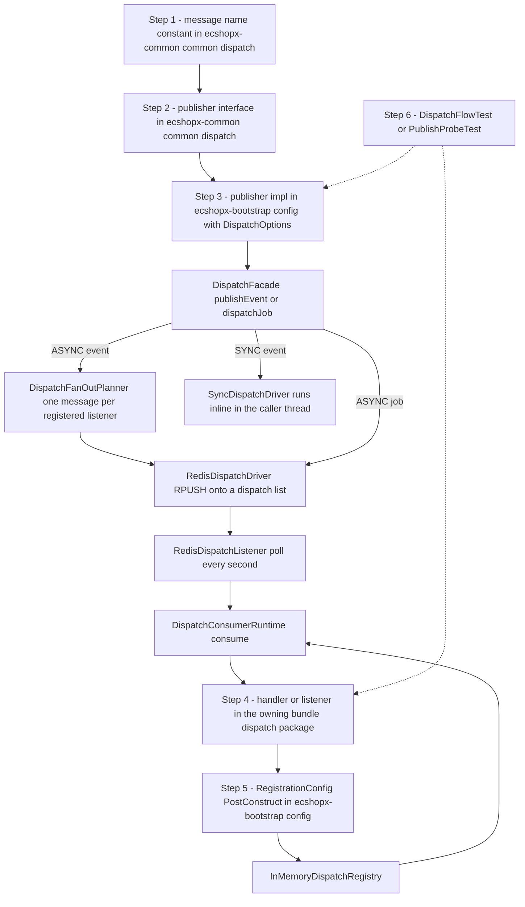

# Workflow: Adding a Dispatch Event, Job, or Cron Handler

Almost every feature that crosses a Bundle boundary — "order paid, notify four other domains", "admin requested an export", "time to finish shipped orders" — lands on the same six-file change. This page is the checklist for it, worked twice end to end: once for an **event** (`EVENT_NORMAL_ORDER_PAY_SUCCESS`, published by orders, consumed by youshu/shuyun/wsugc/employee-purchase) and once for a **job** (`FINISH_ORDER_JOB`, published by a cron tick, consumed by orders itself). A third variant — the XXL-JOB cron handler that often *triggers* such a job — is covered at the end.

For the *why* behind the layering (why the interface lives in `ecshopx-common` and the implementation in `ecshopx-bootstrap`), read [Cross-Bundle Ports and Wiring in Bootstrap](../architecture/cross-bundle-communication.md). For the runtime being wired, read [Dispatch Bus](../concepts/dispatch-bus.md).

## The wiring path



The six steps and the runtime they feed. Steps 1–3 are the *producer* side, step 4–5 the *consumer* side, step 6 the proof that both halves agree on the message name, queue, delay and payload.

## Step 0: decide what you are adding

| You need… | Add | Worked example |
| --- | --- | --- |
| "Something happened, 0..N Bundles may react, queueing and retry wanted" | **Dispatch event** — `publishEvent` + `*DispatchListener` registered per event name | `EVENT_NORMAL_ORDER_PAY_SUCCESS` |
| "A named unit of background work with exactly one executor" | **Dispatch job** — `dispatchJob` + `*JobHandler` registered by message name | `FINISH_ORDER_JOB` |
| "Run it on a wall-clock schedule" | **XXL-JOB cron handler** — `cron/Schedule*Handler` with `@XxlJob` short name | `ScheduleFinishOrdersHandler` (`finish-orders`) |
| Side effect that must run in the current call stack / transaction | SYNC dispatch event, listener registered with `ListenerDispatchOptions.syncDefaults()` | the trade-finish → pay-success bridge |
| Intra-Bundle after-commit side effect, no fan-out | Spring `ApplicationEvent` + `@TransactionalEventListener(AFTER_COMMIT)` — **not** the bus | `OrderProcessLogSpringEvent` |

The bus is for cross-Bundle, retryable, queueable work. A plain Spring event is invisible to other Bundles' tests and cannot be queued, delayed or retried — do not use it as a substitute for a dispatch event.

A cron handler and a dispatch job are **not** interchangeable: the cron handler is the *time-driven entry point* (one cheap tick), the job is the *queue-driven execution engine* (the batch itself). See [Scheduled Jobs: XXL-JOB Executor and Cron Handlers](../concepts/scheduling-xxljob.md).

---

## Step 1 — add the message-name constant

**File template**

```
ecshopx-common/src/main/java/cn/shopex/ecshopx/common/dispatch/<Domain>DispatchEventNames.java   (events)
ecshopx-common/src/main/java/cn/shopex/ecshopx/common/dispatch/<Domain>DispatchJobNames.java     (jobs)
```

These are `final` classes with a private constructor, one family per owning Bundle — `OrdersDispatchEventNames` / `OrdersDispatchJobNames`, `GoodsDispatchEventNames` / `GoodsBundleDispatchJobNames`, `MembersDispatchEventNames` / `MembersBundleDispatchJobNames`, and so on. The constant is the single source of truth shared by the publisher impl (step 3) and the registration config (step 5); never inline the string in either.

**Naming scheme** (keep the CSV id so PHP→Java migration parity stays auditable at a glance):

| Prefix | Form | Examples |
| --- | --- | --- |
| `event:` | `event:<csvId>:<PhpBundle>\Events\<EventClass>` when a legacy PHP event exists, else `event:<bundle>:<snake_case>` | `event:288:OrdersBundle\Events\NormalOrderPaySuccessEvent`, `event:orders:normal_order_add` |
| `job:` | `job:<csvId>:<PhpBundle>\Jobs\<JobClass>` | `job:128:OrdersBundle\Jobs\FinishOrderJob` |
| `listener:` | legacy PHP listener FQN (optionally `@method`), or a dotted descriptive name for Java-first listeners | `listener:WsugcBundle\Listeners\Order`, `listener:youshu.orders_normal_order_pay_success` |

**Worked examples**

```java
// ecshopx-common/.../dispatch/OrdersDispatchEventNames.java
public static final String EVENT_NORMAL_ORDER_PAY_SUCCESS =
        "event:288:OrdersBundle\\Events\\NormalOrderPaySuccessEvent";
```

```java
// ecshopx-common/.../dispatch/OrdersDispatchJobNames.java
public static final String FINISH_ORDER_JOB = "job:128:OrdersBundle\\Jobs\\FinishOrderJob";
```

Two devices you may need:

* **Distinct bus planes for one PHP event.** If two entry surfaces must fan out to the same listeners but need distinguishable bus names, add a second constant (e.g. `EVENT_TRADE_FINISH` = `event:291:…` and `EVENT_TRADE_FINISH_CSV292` = `event:292:…`, both consumed by the same listener registrations).
* **Alias constants folding several CSV ids onto one handler.** `MembersBundleDispatchJobNames` defines `BIND_SALSEPERSON_JOB` (job:185), `BIND_SALSEPERSON_JOB_DM_MEMBER_REGISTER` (job:186) and `BIND_SALSEPERSON_JOB_WXAPP_BIND_SALESPERSON` (job:194) — three PHP trigger rows that collapse onto one Java handler, registered three times by `BindSalsepersonJobRegistrationConfig`.

---

## Step 2 — declare the publisher interface

**File template**

```
ecshopx-common/src/main/java/cn/shopex/ecshopx/common/dispatch/<Thing>DispatchPublisher.java
```

One method, payload as a plain `Map<String, Object>`, no bus types in the signature:

```java
// ecshopx-common/.../dispatch/NormalOrderPaySuccessDispatchPublisher.java
public interface NormalOrderPaySuccessDispatchPublisher {
    void publish(Map<String, Object> payload);
}

// ecshopx-common/.../dispatch/FinishOrderJobDispatchPublisher.java
public interface FinishOrderJobDispatchPublisher {
    void publish(Map<String, Object> jobData);
}
```

`ecshopx-common` is the only module every Bundle depends on, so this is the only place a producer Bundle and an arbitrary consumer Bundle can share a contract without a new Maven edge. The producer (orders, in both worked examples) injects *only this interface* and stays ignorant of who listens. Prefer a typed signature over a raw map when the payload is fixed — `ItemAddEventDispatchPublisher.schedulePublishAfterCommit(long itemId, long companyId)` and `GenerateOutfitJobDispatchPublisher.enqueueGenerateOutfit(...)` show the typed variant, with the map built by the impl.

A minority of Bundles that already declare `ecshopx-dispatch` at compile scope (orders, members, companys, reservation, popularize, wsugc) may put the interface in their own `dispatch/` package instead (`members/dispatch/BindSalsepersonJobDispatchPublisher`, `shopexai` — which depends only on common — does the same). The implementation still lives in bootstrap. Use the common package unless the interface is genuinely single-consumer.

---

## Step 3 — implement the publisher in bootstrap with `DispatchOptions`

**File template**

```
ecshopx-bootstrap/src/main/java/cn/shopex/ecshopx/config/<Thing>DispatchPublisherImpl.java
```

`@Component`, implements the common interface, injects `DispatchFacade`, and holds the `DispatchOptions` tuple as a constant:

```java
// Event: ecshopx-bootstrap/.../config/NormalOrderPaySuccessDispatchPublisherImpl.java
@Component
public class NormalOrderPaySuccessDispatchPublisherImpl implements NormalOrderPaySuccessDispatchPublisher {

    private static final DispatchOptions NORMAL_ORDER_PAY_SUCCESS_PARENT_PUBLISH_OPTIONS =
            new DispatchOptions(
                    DispatchMode.ASYNC,
                    DispatchDriverType.REDIS,
                    null,   // queue: listener-owned on the async fan-out path
                    null,   // delay
                    RetryPolicy.platformDefault());

    @Override
    public void publish(Map<String, Object> payload) {
        dispatchFacade.publishEvent(
                OrdersDispatchEventNames.EVENT_NORMAL_ORDER_PAY_SUCCESS,
                payload,
                NORMAL_ORDER_PAY_SUCCESS_PARENT_PUBLISH_OPTIONS);
    }
}
```

```java
// Job: ecshopx-bootstrap/.../config/FinishOrderJobDispatchPublisherImpl.java
@Component
@Profile("!test-cron")
public class FinishOrderJobDispatchPublisherImpl implements FinishOrderJobDispatchPublisher {

    @Override
    public void publish(Map<String, Object> jobData) {
        if (jobData == null) {
            throw new IllegalArgumentException("jobData must not be null");
        }
        dispatchFacade.dispatchJob(
                OrdersDispatchJobNames.FINISH_ORDER_JOB,
                jobData,
                new DispatchOptions(DispatchMode.ASYNC, DispatchDriverType.REDIS, "slow", null,
                        RetryPolicy.platformDefault()));
    }
}
```

`DispatchOptions` is a record with five components — `mode`, `driverOverride`, `queue`, `delay`, `retryPolicy` — plus three factories (`jobDefaults()` = ASYNC/null/null/null/platformDefault, `eventDefaults()` = SYNC/null/null/null/platformDefault, `oplQueuedAfterCommit()` = ASYNC/REDIS/null/null/platformDefault).

### Choosing the tuple

**`mode` — `DispatchMode.SYNC` vs `ASYNC`.**

* `SYNC` → `SyncDispatchDriver` executes **inline, in the caller's thread and transaction**. For a job it calls the handler directly; for an event it runs the matching listener(s) in registration order. Use it when the side effect must be visible inside the same transaction boundary (the trade-finish → pay-success bridge relies on this) or when the work is trivial and local.
* `ASYNC` → the message is serialized as JSON and enqueued, then drained by the `RedisDispatchListener` poller roughly a second later, outside the producer's transaction. This is the default choice for anything slow, external or fan-out.

Note the asymmetry: `mode == SYNC` forces `driverType` to `SYNC` regardless of `driverOverride`.

**`driverOverride` — always pass `DispatchDriverType.REDIS` for ASYNC.** `DispatchBusConfig` builds `DispatchCore.asyncReady(registry, syncDriver, Map.of(DispatchDriverType.REDIS, redisDispatchDriver))` — Redis is the only async transport wired. `buildMessage` computes `driverType` as `SYNC` when the mode is SYNC, otherwise `options.driverOverride()`; publish ASYNC with a null override (which is what `jobDefaults()` gives you) and `DispatchCore` throws `IllegalStateException("missing async driver: null")`. `jobDefaults()` is effectively a test-only preset — every production `*DispatchPublisherImpl` passes `DispatchDriverType.REDIS` explicitly. `RABBITMQ` exists in `ecshopx-dispatch/rabbit/` but is not wired; choosing it today fails at dispatch time.

**`queue` — a load-class signal, not a routing key.**

| Queue | Drained per poll | Intended load | Worked examples |
| --- | --- | --- | --- |
| `default` (also the fallback for null/blank) | 1 message | Interactive, low-latency work | youshu/shuyun/wsugc/employee-purchase pay-success listeners, `ReservationExpireCancelDispatchPublisherImpl` |
| `slow` | up to `dispatch.redis.slow.batch-size` (default 20) | Heavy batch work | `FinishOrderJobDispatchPublisherImpl`, `ConsumptionOrderJobDispatchPublisherImpl`, file exports, `OrderProcessLogDispatchListenerRegistrationConfig` |
| `sms` | up to the same batch size | Notification traffic | `MerchantResetPasswordNoticeDispatchPublisherImpl`, aliyunsms jobs |

One knob (`dispatch.redis.slow.batch-size`) governs both the `slow` and `sms` drain loops. Splitting SMS onto its own list keeps a notification burst from starving the slow lane and vice versa, but the throughput ceiling is shared.

**Critical rule for jobs vs events.** For a **job**, the publisher's queue is what lands in Redis — `FinishOrderJobDispatchPublisherImpl` sets `"slow"` and the message goes to `dispatch:slow`. For an **ASYNC event**, the fan-out planner takes the queue (and the retry policy) from each *listener's* `ListenerDispatchOptions` and defaults to `"default"` when the listener registered none — the publisher's queue is ignored on that path. That is why `NormalOrderPaySuccessDispatchPublisherImpl` passes `null`: each pay-success listener decides its own lane in step 5.

**`delay` — `Duration`, optional.** A non-null, non-zero delay sends the message to the `dispatch:delayed` ZSET scored by ready-epoch-millis instead of a ready list; `RedisDispatchDelayedPollScheduler` runs every second and moves due entries back onto their ready queue with the delay cleared. `ReservationExpireCancelDispatchPublisherImpl` is the reference use (it computes `to_shop_time + 7200s − now` and publishes on `default` with that delay); `AftersalesRefundService.scheduleRefund()` staggers refund jobs by `60*n+1` seconds to spread a spike. Leave it `null` for immediate enqueue. Note the mover is at-least-once, not exactly-once.

**`retryPolicy` — `RetryPolicy.platformDefault()` is 3 attempts / 3-second `nextDelay`.** `GenerateOutfitJobDispatchPublisherImpl` narrows it to `new RetryPolicy(2, Duration.ofSeconds(3))` for a costly third-party AI call. Be aware that on the Redis path the attempt counter never advances past 1 and a popped failing message is not re-enqueued — consumption is effectively at-most-once, and `RetryPolicy.nextDelay` is carried as metadata rather than applied. The practical consequence for this workflow: **write the handler idempotently and self-healing; do not rely on the queue to redeliver.**

### When AFTER_COMMIT publishing is required

If the payload describes rows written inside a transaction and you publish ASYNC, a consumer can read a Redis message describing a database row that a rollback then removes. Publish **after commit** whenever the producer runs inside `@Transactional`:

```java
// ecshopx-bootstrap/.../config/ItemAddEventDispatchPublisherImpl.java
public void schedulePublishAfterCommit(long itemId, long companyId) {
    Map<String, Object> payload = buildPayload(itemId, companyId);
    if (TransactionSynchronizationManager.isSynchronizationActive()) {
        TransactionSynchronizationManager.registerSynchronization(new TransactionSynchronization() {
            @Override
            public void afterCommit() {
                publish(payload);
            }
        });
    } else {
        publish(payload);
    }
}
```

Three places implement the wrapper, pick the one that fits:

* **Inside the bootstrap publisher impl** (`ItemAddEventDispatchPublisherImpl.schedulePublishAfterCommit`) — when the interface is typed and the whole publish is deferred.
* **A dedicated wrapper class** (`orders/dispatch/OrdersTradeFinishAfterCommitDispatchPublisher`, exposed twice by `OrdersTradeFinishDispatchPublisherBeansConfig` so the `event:291` and `event:292` planes share one contract) — when the same deferral must serve several message names.
* **Inside the producer service** (`MemberAccountService.createMemberForWxappBind` registers a `TransactionSynchronization` and calls `membersCreateMemberSuccessDispatchPublisher.publish(eventData)` in `afterCommit`) — when the service already owns the transaction and several side effects must be ordered.

SYNC-mode events already run inside the transaction by construction, so the wrapper matters specifically on the ASYNC path. `ecshopx-dispatch`'s own `OrderProcessLogPublishPortImpl` does the same with the `DispatchOptions.oplQueuedAfterCommit()` preset.

### The `test-cron` profile guard

Queue-feeder publishers that a cron tick drives are annotated `@Profile("!test-cron")` (`FinishOrderJobDispatchPublisherImpl`, `ConsumptionOrderJobDispatchPublisherImpl`). Under the `test-cron` profile — activated at runtime by the PHP→Java migration diff orchestrator, not by unit tests — each cron-owning Bundle's `cron/testcfg/CronTestMockConfig` (which lives in **`src/main`**) installs `@Bean @Primary` No-op replacements so cron runs during schema-diff comparison do not write Redis, call third parties or enqueue real bus jobs. If your new publisher is cron-fed, add the `@Profile("!test-cron")` guard and a matching No-op.

---

## Step 4 — write the handler or listener in the owning Bundle

**File templates**

```
<bundle>/src/main/java/cn/shopex/ecshopx/<bundle>/dispatch/<Thing>JobHandler.java        (jobs)
<bundle>/src/main/java/cn/shopex/ecshopx/<bundle>/dispatch/<Thing>DispatchListener.java  (event listeners)
```

Both functional interfaces live in `ecshopx-common`, so the consuming Bundle needs no `ecshopx-dispatch` edge:

```java
// ecshopx-orders/.../dispatch/FinishOrderJobHandler.java
@Component
public class FinishOrderJobHandler implements DispatchHandler {

    @Override
    public void handle(Map<String, Object> payload) {
        Map<String, Object> effective = payload == null ? Map.of() : payload;   // null → empty map
        finishOrderJobService.execute(effective);
    }
}
```

```java
// ecshopx-youshu/.../dispatch/NormalOrderPaySuccessYoushuDispatchListener.java
@Component
public class NormalOrderPaySuccessYoushuDispatchListener implements DispatchListener {

    @Override
    public void onEvent(Map<String, Object> payload) {
        Object rawCompany = payload.get("company_id");
        Object rawOrder = payload.get("order_id");
        if (rawCompany == null || rawOrder == null) {
            throw new BadRequestException("company_id and order_id are required");   // fail loudly
        }
        ...
    }
}
```

Conventions:

* **No business logic.** The handler parses and validates the payload (with lenient `Number`/`String` coercion, as `NormalOrderPaySuccessYoushuDispatchListener.requireLong` does) and delegates to a `@Service` (`FinishOrderJobService`, `YoushuNormalOrderPaySuccessSrDataSyncService`). One handler per job; one listener per (event, consumer-Bundle) pair.
* **Normalize `payload == null` to `Map.of()`** in the handler, not the caller.
* **Guard, do not skip silently** when required fields are missing — `BindSalsepersonJobHandler` returns early only for genuinely optional records; `NormalOrderPaySuccessYoushuDispatchListener` throws.
* A listener may itself be a publisher: `OrdersTradeFinishNormalOrderPaySuccessBridgeDispatchListener` is a **sync** trade-finish listener that marks mall normal orders paid and then calls `NormalOrderPaySuccessDispatchPublisher.publish`, chaining one event into another inside the same call stack.
* **Idempotence is mandatory.** Redis-path consumption is at-most-once and the attempt counter does not advance, so a handler must tolerate re-delivery in the delayed-mover worst case and must leave a durable trace of terminal failure (`failed_jobs`, whose mapper is currently stubbed in `DispatchBusConfig`).

---

## Step 5 — register it from a bootstrap `*RegistrationConfig`

**File template**

```
ecshopx-bootstrap/src/main/java/cn/shopex/ecshopx/config/<Thing>RegistrationConfig.java
```

Registration is **explicit, not annotation-scanned** — a `@Configuration` class whose `@PostConstruct` injects the `DispatchRegistry` plus the Bundle's handler bean and calls `registerJob` / `registerEventListener`. The producer side never registers handlers itself:

```java
// Job: ecshopx-bootstrap/.../config/FinishOrderJobRegistrationConfig.java
@Configuration
public class FinishOrderJobRegistrationConfig {

    @PostConstruct
    public void registerFinishOrderJob() {
        dispatchRegistry.registerJob(OrdersDispatchJobNames.FINISH_ORDER_JOB, finishOrderJobHandler);
    }
}
```

```java
// Event listener: ecshopx-bootstrap/.../config/YoushuNormalOrderPaySuccessDispatchListenerRegistrationConfig.java
@Configuration
public class YoushuNormalOrderPaySuccessDispatchListenerRegistrationConfig {

    @PostConstruct
    public void registerYoushuNormalOrderPaySuccessListener() {
        dispatchRegistry.registerEventListener(
                OrdersDispatchEventNames.EVENT_NORMAL_ORDER_PAY_SUCCESS,
                OrdersDispatchEventNames.LISTENER_YOUSHU_ORDERS_NORMAL_ORDER_PAY_SUCCESS,
                ListenerDispatchOptions.async("default", null),
                normalOrderPaySuccessYoushuDispatchListener);
    }
}
```

`ListenerDispatchOptions` carries the per-listener `queue`, `delay` and `retryPolicy`: `asyncDefaults()` / `syncDefaults()` are `(null, null, platformDefault)`, `async(queue, delay)` sets the lane explicitly. Because bootstrap depends on every Bundle, the config can see both the registry and the handler — that is exactly why this file lives here and not in the owning Bundle.

Invariants and ordering:

* **Uniqueness is enforced at startup.** `InMemoryDispatchRegistry.registerJob` throws `IllegalStateException("duplicate job handler: …")` for a second job with the same message name; `registerEventListener` throws for a duplicate `(messageName, listenerName)` pair. Fail-fast wiring, no silent override.
* **A missing registration is silent, not an error.** An event with no listeners simply has no consumers; a job published without a handler fails only when consumed (NPE inside the runtime). Step 6 is what catches this.
* **Ordering matters when a listener must register after another.** Add `@Order(n)` on the config class (`@Order(77)` on the trade-finish bridge, `@Order(97)` on the order-process-log listener) or `@DependsOn("youshuNormalOrderPaySuccessDispatchListenerRegistrationConfig")` (`WsugcNormalOrderPaySuccessDispatchListenerRegistrationConfig`). Registration order is the fan-out order for SYNC events.
* **Several bus names, one handler** is legal and used: `BindSalsepersonJobRegistrationConfig` registers the same handler against job:185, job:186 and job:194; the bridge config registers the same listener on both trade-finish planes.
* **One event, many listener configs.** `EVENT_NORMAL_ORDER_PAY_SUCCESS` currently has four (youshu, shuyun, wsugc, employee-purchase), each `async("default", null)`, each in its own config class.

---

## Step 6 — pin the wiring with a test

**File templates**

```
ecshopx-bootstrap/src/test/java/cn/shopex/ecshopx/dispatch/<Thing>DispatchFlowTest.java        (end-to-end bus wiring)
<bundle>/src/test/java/cn/shopex/ecshopx/<bundle>/service/<Service><Thing>PublishProbeTest.java  (producer-side payload + AFTER_COMMIT timing)
<bundle>/src/test/java/cn/shopex/ecshopx/<bundle>/dispatch/<Listener>DispatchConsumerRuntimeTest.java  (consumer-side envelope)
```

A `*DispatchFlowTest` lives in bootstrap (which sees both publisher impls and handlers) and assembles the pieces by hand — no Spring context, no Redis:

1. Mock the terminal service, wrap it in the real handler (`new FinishOrderJobHandler(jobService)`) or listener.
2. Build a real `InMemoryDispatchRegistry` and register exactly as step 5 does.
3. Build `DispatchCore.asyncReady(registry, new SyncDispatchDriver(registry), Map.of(DispatchDriverType.REDIS, captured::add))` — the "Redis driver" is a list-collector.
4. Wrap in a real `DispatchFacade` + `DispatchFanOutPlanner`.
5. Publish with the production `DispatchOptions` tuple (or through the real bootstrap publisher impl), then assert the captured `DispatchMessage` — `messageName`, `queue`, `delay`, `listenerName`, payload fields, retry policy.
6. Feed the captured message into a real `DispatchConsumerRuntime` and `verify` the terminal service received the payload.

`FinishOrderJobDispatchFlowTest` (job) and `NormalOrderPaySuccessYoushuEventAsyncBusDispatchFlowTest` (event) are the two shapes to copy. A `*PublishProbeTest` lives in the producer Bundle and runs the real service with mocked mappers plus a mocked `DispatchFacade`, pinning the message name, payload fields and exact `DispatchOptions` — usually across a fake `PlatformTransactionManager` that fires `afterCommit` synchronizations on commit. `OfflinePaymentDoCheckServiceNormalOrderPaySuccessPublishProbeTest` (orders) and `ItemAddEventDispatchPublisherImplAfterCommitTest` (bootstrap) are the references. Expect to touch **one publish-side probe and one consume-side test** when you change a payload field.

**Run them with the narrowest command** (see [Testing Conventions and Verification](../testing.md)):

```bash
# the end-to-end flow test for your new message
./mvnw -pl ecshopx-bootstrap test -Dtest=FinishOrderJobDispatchFlowTest
./mvnw -pl ecshopx-bootstrap test -Dtest=NormalOrderPaySuccessYoushuEventAsyncBusDispatchFlowTest

# the producer-side probe (lives in the owning bundle)
./mvnw -pl ecshopx-orders test -Dtest=OfflinePaymentDoCheckServiceNormalOrderPaySuccessPublishProbeTest

# the AFTER_COMMIT wrapper test
./mvnw -pl ecshopx-bootstrap test -Dtest=ItemAddEventDispatchPublisherImplAfterCommitTest

# pre-PR gate for every module you touched
./mvnw -pl <module> -am verify
```

A green flow test proves the contract, not the infrastructure: queue draining, the delayed-ZSET mover and the poller are only exercised against mocked Redis templates. Budget a docker-compose run for anything that also touches mappers.

---

## The cron-handler variant (XXL-JOB)

**File template**

```
<bundle>/src/main/java/cn/shopex/ecshopx/<bundle>/cron/Schedule<Thing>Handler.java
```

```java
// ecshopx-orders/.../cron/ScheduleFinishOrdersHandler.java
@Slf4j
@Component
@RequiredArgsConstructor
public class ScheduleFinishOrdersHandler {

    private static final String HANDLER_SHORT = "finish-orders";

    private final NormalOrderCronService normalOrderCronService;
    private final ApplicationEventPublisher eventPublisher;

    @XxlJob(HANDLER_SHORT)
    public void execute() {
        long start = System.currentTimeMillis();
        try {
            int ret = normalOrderCronService.scheduleFinishOrders();
            log.info("[cron][{}] done, scheduleFinishOrdersReturn={}, cost={}ms", HANDLER_SHORT, ret,
                    System.currentTimeMillis() - start);
        } catch (Exception e) {
            log.error("[cron][{}] failed, cost={}ms", HANDLER_SHORT, System.currentTimeMillis() - start, e);
            eventPublisher.publishEvent(new CronAlertEvent(HANDLER_SHORT, e));
            throw e;
        }
    }
}
```

The fixed elements:

1. **A kebab-case short-name constant** used for the `@XxlJob` value, the log tags *and* the `CronAlertEvent` payload — one string, three uses.
2. **Parameterless `execute()`** — the only input is that it is time to run.
3. **Cost logging** — INFO `done` with the short name, a result count and the elapsed ms on success; ERROR `failed` with the cost and the exception.
4. **`CronAlertEvent` then rethrow.** The rethrow is what makes the admin mark the run failed; swallowing it after publishing the event would show a successful run. `CronAlertEvent` is a plain Spring `ApplicationEvent` — synchronous, in-process, currently with no listener (an alerting seam, not active alerting).
5. **No business logic and no XXL-JOB API surface** — no `XxlJobHelper`, no sharding, no parameters. All real work lives in a service.

Checklist for a new cron handler:

1. Ensure the Bundle's POM has `com.xuxueli:xxl-job-core` `2.5.0` on the compile classpath (orders, payment, aftersales, adapay, aliyunsms, community, companys, data-cube, espier, hfpay, kaquan, point, popularize, selfservice, system-link, theme and bootstrap declare it directly; `promotions` and `youshu` currently get it transitively).
2. Create `cron/Schedule<Thing>Handler.java` following the template, delegating to a service method.
3. **Register the job in the XXL-JOB admin console** — executor group `ecshopx-executor`, `BEAN` mode, JobHandler = the short name, a CRON expression, and the usual `FIRST` / `SERIAL_EXECUTION` / `DO_NOTHING` settings. There is **no code-side registration**: the `@XxlJob` short name must equal the `executor_handler` of an `xxl_job_info` row or the handler never fires. The seed SQL (`docker/tables_xxl_job.sql`, 69 job definitions including `finish-orders` at `0 0 3 * * ? *`) runs only on first database initialisation; new jobs added later are created through the console.
4. If the work should run on the bus, follow steps 1–6 above for the dispatch job this handler publishes.
5. Add the per-handler Mockito test pinning the alert-and-rethrow contract — `ScheduleFinishOrdersHandlerTest` asserts: success → service called once, no `CronAlertEvent`, an INFO log containing the short name, the count and the cost; failure → `execute()` rethrows, exactly one `CronAlertEvent` with `handlerShortName` equal to the short name, an ERROR log containing the short name and `failed`.

```bash
./mvnw -pl ecshopx-orders test -Dtest=ScheduleFinishOrdersHandlerTest
```

6. If the run has side effects the `test-cron` diff harness must not perform, add a `@Bean @Primary` No-op to the Bundle's `cron/testcfg/CronTestMockConfig`.

### Cron-triggered dispatch job vs direct service call

Handlers come in two shapes and the split is a load-shaping decision:

**Queue-feeders** — the handler's service publishes one dispatch job per tick and returns a fixed `1` ("dispatch initiated"), so the batch runs on a Redis queue with its own retry policy. `finish-orders` is the canonical example:

```
xxl-job-admin (CRON 0 0 3 * * ? *)
  → ScheduleFinishOrdersHandler.execute()          [cron, cheap tick]
  → NormalOrderCronService.scheduleFinishOrders()  [publishes, returns 1]
  → FinishOrderJobDispatchPublisherImpl.publish()  [ASYNC / REDIS / queue slow]
  → dispatch:slow
  → RedisDispatchListener.poll()
  → DispatchConsumerRuntime.consume()
  → FinishOrderJobHandler.handle()
  → FinishOrderJobService.execute() → FinishOrderBatchService
```

Other examples: `consumption-orders` (payload `orderType=normal, pageSize=100`, skipped under the OEM flag `ecshopx.request-field.oem-shuyun=true`), `send-member-point`, and `schedule-refund` (the only cron handler that uses dispatch *delays*, staggering one job per refund by `60*n+1` seconds).

**Direct workers** — the handler's service does the batch inline, synchronously, inside the trigger call and returns the processed count. `cancel-orders` → `NormalOrderCronService.scheduleCancelOrders()` is the reference: it counts expired `NOTPAY` orders, pages through them 20 at a time, batch-updates status and runs the restore fan-out per order, returning the cancelled count that ends up in the INFO log.

Choose a **queue-feeder** when the batch is heavy, unbounded or would hold a long transaction; choose a **direct worker** when the work is cheap, self-contained and idempotent. Never let one cron tick become a long unbounded transaction. Note also that dispatch-queue draining depends on `@EnableScheduling` supplied by bundle configs (`OrdersSchedulingConfig`, `DoumenIntlPaymentSchedulingConfig`, `SelfserviceSchedulingConfig`, `ShuyunOpenPlatformConfiguration`) — the bus does not enable scheduling itself, so a deployment without those bundles silently stops draining queues while XXL-JOB handlers keep firing.

---

## Checklist

| # | Step | File | Worked example (event) | Worked example (job) |
| --- | --- | --- | --- | --- |
| 1 | Message-name constant | `ecshopx-common/.../common/dispatch/<Domain>Dispatch(Event\|Job)Names.java` | `EVENT_NORMAL_ORDER_PAY_SUCCESS` = `event:288:OrdersBundle\Events\NormalOrderPaySuccessEvent` | `FINISH_ORDER_JOB` = `job:128:OrdersBundle\Jobs\FinishOrderJob` |
| 2 | Publisher interface | `ecshopx-common/.../common/dispatch/<Thing>DispatchPublisher.java` | `NormalOrderPaySuccessDispatchPublisher.publish(Map)` | `FinishOrderJobDispatchPublisher.publish(Map)` |
| 3 | Publisher impl + options | `ecshopx-bootstrap/.../config/<Thing>DispatchPublisherImpl.java` | ASYNC / REDIS / null queue / null delay / platformDefault, `publishEvent` | ASYNC / REDIS / `"slow"` / null delay / platformDefault, `dispatchJob`, `@Profile("!test-cron")` |
| 4 | Handler / listener | `<bundle>/.../dispatch/<Thing>JobHandler.java` or `<Thing>DispatchListener.java` | `NormalOrderPaySuccessYoushuDispatchListener.onEvent` | `FinishOrderJobHandler.handle` → `FinishOrderJobService` |
| 5 | Registration config | `ecshopx-bootstrap/.../config/<Thing>RegistrationConfig.java` | `registerEventListener(EVENT_…, LISTENER_…, async("default", null), listener)` | `registerJob(FINISH_ORDER_JOB, handler)` |
| 6 | Tests | `ecshopx-bootstrap/.../dispatch/<Thing>DispatchFlowTest.java` + producer `<Service><Thing>PublishProbeTest` | `NormalOrderPaySuccessYoushuEventAsyncBusDispatchFlowTest` + `OfflinePaymentDoCheckServiceNormalOrderPaySuccessPublishProbeTest` | `FinishOrderJobDispatchFlowTest` |
| 7 (cron only) | Cron handler + admin job row + No-op | `<bundle>/.../cron/Schedule<Thing>Handler.java`, `xxl_job_info` row, `cron/testcfg/CronTestMockConfig` | — | `ScheduleFinishOrdersHandler` (`finish-orders`), seeded row, `NoopFinishOrderJobDispatchPublisher` |

## Failure modes to check before you push

* **ASYNC without `DispatchDriverType.REDIS`** → `IllegalStateException("missing async driver: null")` at publish time.
* **Forgot step 5** → the event has no listener (silent) or the job has no handler (NPE inside `DispatchConsumerRuntime`, retried then recorded as failed). Only the flow test catches this cheaply.
* **Duplicate message name or duplicate `(event, listener)` pair** → `IllegalStateException` during Spring context startup.
* **Publisher queue on an async event** → ignored; the listener's `ListenerDispatchOptions` decides. Change the lane in step 5, not step 3.
* **Publishing ASYNC inside a transaction without the AFTER_COMMIT wrapper** → a consumer can read a message describing rows a rollback then removes.
* **Cron short name that does not match an `xxl_job_info.executor_handler`** → the handler simply never fires.
* **A non-idempotent handler** → at-most-once Redis consumption means a failure loses the message; only the terminal `failed_jobs` record survives.
* **Wrong lane** → heavy work on `default` starves interactive messages (one per poll); notifications on `slow` compete with exports for the same 20-per-poll budget.

## Related pages

* [Dispatch Bus](../concepts/dispatch-bus.md) — the runtime being wired: facade, fan-out planner, registry, Redis transport, retry semantics
* [Cross-Bundle Ports and Wiring in Bootstrap](../architecture/cross-bundle-communication.md) — why the contract lives in `ecshopx-common` and the implementation in bootstrap, plus the full mechanism decision table
* [Scheduled Jobs: XXL-JOB Executor and Cron Handlers](../concepts/scheduling-xxljob.md) — the executor bean, the admin deployment, the seeded job rows, and the `test-cron` profile
* [Testing Conventions and Verification](../testing.md) — the full naming taxonomy and the narrowest `mvnw` command per change type
* [Bundle Anatomy and Layering Conventions](../architecture/bundle-layering.md) — where `dispatch/`, `cron/`, `listener/` and `event/` sit inside a Bundle
