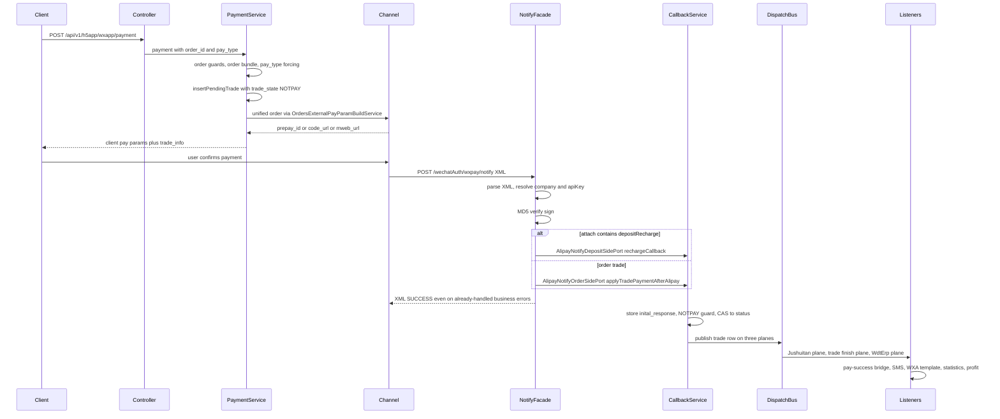
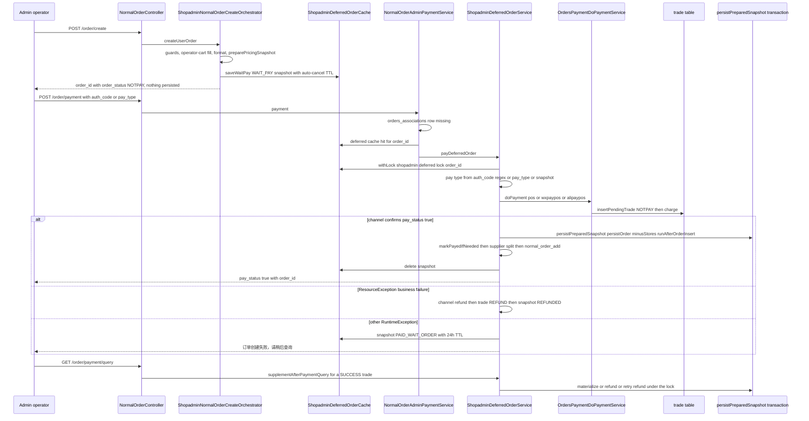

# Workflow: Checkout, Payment, Notify, and Trade-Finish Fan-out

This page traces one payment from end to end: the customer's cart is emptied
into a new order, the order is paid through `POST /api/v1/h5app/wxapp/payment`,
the channel calls back asynchronously onto `POST /wechatAuth/wxpay/notify`, the
trade row is flipped from `NOTPAY` to `SUCCESS`, and the resulting trade-finish
event fans out to a dozen listeners (order pay-success, supplier promotion,
notifications, statistics, ERP pushes, profit sharing). The deposit-recharge
variant routes through a different port and ends in the deposit balance
instead.

There is a second entry to the same money path: the **admin 代客下单 deferred
flow** (staff creating an order for a walk-in customer), where `POST /api/v1/order/create`
writes only a Redis `WAIT_PAY` snapshot and the order is materialized in the
same call as the charge (`POST /api/v1/order/payment`). It is documented in its
own section below — the trade CAS, the notify surface and the trade-finish
fan-out it lands on are the ones already described here.

The bundles involved are **ecshopx-orders** (order + trade state), **ecshopx-payment** (channel config + notify facades), **ecshopx-deposit** (recharge), **ecshopx-dispatch** (the bus), and **ecshopx-bootstrap** (all the wiring: publisher beans and listener registrations). See [Orders Domain](../domains/orders.md) for the state model, [Payments Domain](../domains/payments.md) for the channel surfaces, and [Dispatch Bus](../concepts/dispatch-bus.md) for the transport.

*The wxapp money path: initiation → channel → verified notify → guarded state CAS → three-plane fan-out. Every step is grounded in the classes named in the sections below.*

## Step 1 — cart → order creation

Payment presupposes an order. `POST /order` (`WxappOrderController`) runs the
wxapp create pipeline (type registry → orchestrator → transactional runner),
and inside the same transaction `OrderCreatePostCommitPortImpl.runAfterOrderInsert`
empties the cart after persisting the order: `orders_cart` rows are deleted by
`(company_id, user_id, shop_id, item_id)` for the purchased items,
`fastbuy` carts are cleared through a short-lived Redis key, employee-purchase
and shopadmin use their own cart ports, and community/excard orders skip
cart clearing entirely. The new `NormalOrders` row starts
`order_status=NOTPAY`, and a `supplier_order` child is split per supplier in
`SupplierOrderSplitOnNormalOrderAddService.split` right after the transaction.
The full pipeline is documented on [Orders Domain](../domains/orders.md); the
cart-emptying behaviour is what makes this page's entrypoint reachable.

## Step 2 — `POST /api/v1/h5app/wxapp/payment`

`WxappPaymentController` (in `ecshopx-orders/api/front/v1`, mapped to
`/api/v1/h5app/wxapp`, `@FrontNoAuth` at the class level — only
`/payment/config` and `/payment_deposit` carry a per-method `@FrontAuth`)
exposes three surfaces:

| endpoint | method | purpose |
| --- | --- | --- |
| `/payment` | POST | pay an existing order (the main money path) |
| `/payment/config` | GET | QR-scan surface; with `order_id` pays an order, without one builds a store-consumption trade (`trade_source_type=order_pay`) |
| `/payment/query` | POST | poll the trade; falls back to an active channel query |
| `/payment_deposit` | POST | legacy stub returning an empty 200 |

The controller merges query-string params with the (optional) flexible body,
resolves the wxapp/H5 auth attribute map from the request, and logs the merged
params and the pay result as JSON. `company_id` is mandatory — it is taken from
the auth claims, the H5 company id attribute, or the merged params, in that
order, and `UnauthorizedException` ("无权访问该API,非法访问！") is thrown when
none is present. A falsy `trade_id` (null/0/blank/`"0"`/empty collection) on
`/payment/query` is rejected as "支付单号不存在" before the service is called.
`splitLogisticsItems` post-processes the pay result: items with
`is_logistics = true/1` are moved out of `order_info.items` into
`order_info.logistics_items`.

`WxappPaymentService.payment` is the guard layer:

* `order_id` is mandatory ("订单号不存在"); an `order_id` whose first two
  code points are `CZ` (case-insensitive) is a **deposit recharge**, and the
  whole call is handed to `DepositTradeWxappPaymentService.depositPayment`
  instead — see the deposit variant below.
* `pay_type` is mandatory unless an `auth_code` (scan-to-pay barcode) is
  present; `auth_code` prefixes decide the derived pay type (`1x…17 digits` →
  `wxpaypos`, `25…30` prefix → `alipaypos`), otherwise it defaults to
  `wxpayh5`. `adapay` additionally requires `pay_channel`.
* The order must exist in `orders_associations` for the company
  ("当前订单不需要支付"), must not be `order_type=supplier_order`
  ("暂不支持该订单类型的支付"), and its `order_status` must be `NOTPAY` or
  `PART_PAYMENT`.
* The effective order type (from `OrderAssociationEffectiveTypeService`) must
  be payment-bundle supported: `normal`, `normal_shopadmin`, `service`,
  `service_*`, `bargain`, `normal_bargain` or any `normal_*` except
  `membercard` and `supplier_order`.
* `updatePayTypeIfApplicable` writes the chosen `pay_type` (and non-empty
  `pay_channel`) onto `orders_normal_orders` before the trade is created.
* A zero cash total with `point > 0` forces `pay_type=point`; prescription
  orders must pass `OrderPrescriptionPaymentGuardService`; `deposit` pay
  requires a logged-in member card, `alipaymini` requires the alipay user id.

With the guards passed, `buildPaymentData` assembles the trade payload
(`company_id`, `order_id`, `pay_type`, `trade_source_type` derived as
`order_type + '_' + order_class` for PHP parity, user/shop/distributor ids,
`pay_fee` = `cny_fee` falling back to `total_fee` or the point amount for
pure-point payments, currency metadata, `auto_cancel_time`, `client_ip`), and
`OrdersPaymentDoPaymentService.doPayment` is invoked.

## Step 3 — trade creation and channel unify

`OrdersPaymentDoPaymentService.doPayment` is the shared core:

1. **Config gate** — `assertPayConfigReady` validates the channel config
   before anything is persisted (wxpay/alipay validation services, hfpay port,
   bspay `bspaySetting:{sha1(companyId)}`, adapay `adaPaySetting:`); an
   unconfigured channel fails with "不支持支付服务，请联系商家" rather than
   creating an orphan trade.
2. **Trade reuse or insert** — `findOpenTradeWithoutParams` reuses an open
   `NOTPAY` trade matching `(company, order, pay_type, pay_fee,
   trade_source_type[, pay_channel])`; otherwise `insertPendingTrade` inserts
   one with `trade_state=NOTPAY`, an encrypted mobile
   (`SensitiveFieldEncryptor`), dealer/merchant ids resolved from the
   distributor, `trade_id` built from `NormalOrderNumericIdService.generate`
   prefixed by the distributor shop code, and currency conversion for
   wxpay/alipay/hfpay (converted `pay_fee`/`total_fee`, originals preserved in
   the `cur_*` columns).
3. **Synchronous-finalize branches** — zero-fee non-prescription orders
   finalize as `localPay`; `point` deducts member points *unless*
   `trade_source_type=normal_pointsmall` (pointsmall already deducted at
   create, pinned against double-deduction); `prepaid_point`, `pos` and
   `deposit` (through `DepositTradeConsumeService.consume`) all finalize in
   the same call. Each of these ends in `finalizeTradeSuccess`, which is the
   internal twin of the notify path below.
4. **Channel branches** — `bspay`/`adapay` call the membercard SDK services
   and persist `bspay_req_date`/`inital_request`/`transaction_id` plus the
   client params (adapay/bspay also reuse a previously stored
   `payment_params` JSON instead of re-unifying); `wxpay*`/`alipay*`/`hfpay`/
   `offline_pay`/`paypal`/`doumen_intl` go to
   `OrdersExternalPayParamBuildService.buildPayParamsOrInvoke`.

For the wxpay family, `wxPayClientParams` loads the per-distributor config
from Redis, builds the outer `attach`
`company_id=<enc>&pay_type=<enc>` (URL-encoded), maps the pay type to a
`trade_type` (`wxpayh5`→MWEB, `wxpayapp`→APP, `wxpaypc`→NATIVE, default JSAPI),
and calls the WeChat unified-order endpoint (servicer mode uses
`servicer_app_id`/`sub_mch_id`, plain mode `appid`/`mch_id`/`openid`). The
response is shaped per trade type:
`mweb_url`, `code_url`, APP sign bundle, or the JSAPI
`appId/timeStamp/nonceStr/package/signType/paySign` set. `wxpaypos`
(micropay) is synchronous and returns `pay_status=true` plus
`transaction_id`, which makes the caller finalize the trade immediately.

The `notify_url` is the deployment property
`ecshopx.payment.wechat.notify-url`, whose **shipped default is the local
placeholder `http://127.0.0.1/wechatAuth/wxpay/notify`** in
`application.properties` (the comment above it in that file reads
微信支付 v2 统一下单异步通知完整 URL（需公网可达；默认仅本地占位）— the WeChat v2
unified-order async-notify URL must be publicly reachable; the default is a
local placeholder only). A blank value fails the unify call outright with
"不支持支付服务，请联系商家" (the guard sits before the request is built), so a
real deployment always overrides it — per environment, via env vars or
`--key=value` program arguments, because the only in-repo value is the
placeholder. `application-local.properties` is **git-ignored** (`.gitignore`
line 7) and not shipped, so it is not a configuration source the repo provides
(see [Configuration](../operations/configuration.md) for the override
mechanics; the alipay channel reads
`ecshopx.payment.alipay.notify-url`, default
`http://localhost:8080/api/v1/alipay/notify`, the same way). The gateway will
POST back to whatever base URL the deployment declares.

## Step 4 — the channel async notify

`POST /wechatAuth/wxpay/notify` (`WxpayNotifyController`, `ecshopx-payment`,
`@DingoResponse(PLAIN)`, consumes XML/text/all, produces XML) is exempt from
operator JWT auth by the `/wechatAuth/` prefix exemption, so every request
must prove itself cryptographically. `WxpayNotifyFacade.handle`:

1. **Load and resolve** — `WxpayNotifyPaymentContextLoader.load` reads the
   raw body, parses it as XML with `WxpayNotifyXmlSupport.tryParseNotifyXml`
   (secure processing, DOCTYPE disallowed; an unparseable body yields
   `Optional.empty()` → immediate `FAIL`/`invalid notify`), then resolves
   `companyId`: first `WxpayNotifyCompanyIdPort.resolveCompanyIdByAuthorizerAppId`
   on the notify's `appid`, falling back to the Redis appId→companyId maps
   (`wechatAppPayment:companyId:{appId}` for `trade_type=APP`, then
   `wechatPayment:`, then `wechatServicerPayment:`). Zero company →
   "微信支付信息未配置，请联系商家".
2. **Distributor for settings** — `AlipayNotifyOrderSidePort.resolveDistributorIdForAlipayRedis`
   (orders' `AlipayNotifyOrderSidePortImpl`) loads the trade, and returns its
   distributor id only when the distributor's `payment_subject = 1`; the
   notify then reads
   `(distributorId?)wxPaymentSetting:sha1(companyId)` from the companys Redis
   template and takes the `key` as the API key. Despite the "Alipay" name this
   is the shared entry the wxpay facade reuses — the port inversion keeps
   `ecshopx-payment` free of an orders dependency.
3. **Verify** — `WxpayAsyncNotifyVerificationService.verifySignedNotify`
   recomputes MD5 over the sorted non-empty params (skipping `sign`)
   concatenated with `&key=<apiKey>` and compares case-insensitively.
   A missing sign, missing key, or mismatch throws
   `BadRequestException` ("无效的微信支付通知" / "微信支付验签失败").
4. **Classify** — `result_code=SUCCESS` maps to status `SUCCESS`; otherwise
   the notify's `trade_state` is used (defaulting to `PAYERROR`). The
   URL-decoded `attach` (via `WxpayNotifyAttachParser.parseAttach`) is the
   router: a `depositRecharge` value sends the call to the deposit side,
   everything else to the order side. The `pay_type` is re-read from the
   attach, not the notify body, because the trade was created with the
   request-time pay type (e.g. `wxpayh5`) while the gateway only knows its own
   trade type.
5. **Dispatch** — the order side is
   `AlipayNotifyOrderSidePort.applyTradePaymentAfterAlipay(outTradeNo, status, options)`
   (a one-line delegate to
   `OrdersTradePaymentCallbackService.applyTradePaymentNotify`); the deposit
   side is `AlipayNotifyDepositSidePort.rechargeCallback`.

### Failure handling: swallow-and-ack

The facade wraps the port call in `catch (BadRequestException |
ResourceException)`, logs at debug ("wxpay notify business already handled
out_trade_no=…"), and **still returns XML `SUCCESS`**. The already-processed
guard ("更新已处理，不需要更新"), the unknown-trade error ("未查询到更新数据")
and every other business exception therefore ack the gateway so it stops
retrying — a replayed notify is harmless. Only an *unexpected* exception
(signature failure, unreadable body, missing config, serialization failure)
falls into the outer `catch (Exception e)`, which logs at error and returns
`<xml><return_code>FAIL</return_code><return_msg><![CDATA[…]]></return_msg></xml>`
(HTTP 200 with a FAIL body — the code never returns a non-200 status, the
return code is the signal). `cdataSafe` neutralizes `]]>` inside the message.

## Step 5 — `OrdersTradePaymentCallbackService.applyTradePaymentNotify`

This is the single mutation point for a channel-confirmed trade:

1. A blank `out_trade_no` throws `BadRequestException` ("回调数据无效").
2. The trade is loaded by `trade_id`; missing → `ResourceException`
   ("未查询到更新数据").
3. The **entire notify map is persisted** into `trade.inital_response` as
   JSON (a serialization failure throws "回调数据无法序列化") — this happens
   *before* the state guard, so even a replayed notify refreshes the audit
   trail.
4. The trade is re-read and the **NOTPAY idempotency guard** applies: any
   `trade_state` other than `NOTPAY` throws
   `ResourceException`("更新已处理，不需要更新"). This is what the facade
   swallows on a replay.
5. The guarded UPDATE sets `trade_state = status`, `pay_type`,
   `pay_channel`, `bank_type`, `coupon_fee`, `coupon_info`, and
   `transaction_id` when present. On `SUCCESS` it also stamps `time_expire`
   (unix seconds) and assigns `trade_no` from the Redis daily sequence
   (`h_trade_no_{company}_{distributor}_{MMdd}` hash keyed by order id,
   `c_trade_no_*` counter, 86400s TTL — `MMdd-seq`, e.g. `0507-12`).
   Zero affected rows throws "交易单状态更新失败".
6. Only `SUCCESS` continues to `publishSystemLinkTradeFinishAfterSuccess`:
   `maybeFulfillVipGradeMembercardSale` (the membercard VIP port, PHP-parity
   with `UpdateOrderStatusListener`), then the trade row is converted to a
   snake_case map and published on **three planes**: `jushuitanTradeFinishDispatchPublisher`,
   `ordersTradeFinishDispatchPublisher`, `wdtErpTradeFinishDispatchPublisher`.

Note that non-`SUCCESS` statuses (`REFUND`, `CLOSED`, `REVOKED`, `PAYERROR`)
*are written* to `trade_state` but publish nothing — the fan-out is a
pay-success-only affair on this path.

The sibling internal path `OrdersPaymentDoPaymentService.finalizeTradeSuccess`
(point/prepaid_point/deposit/pos/localPay and `/payment/query`'s
`finalizeTradeSuccessAfterChannelQuery`) performs the same CAS
(`WHERE trade_state='NOTPAY'`), the same `trade_no` assignment, the same
membercard fulfilment, and the same trade-finish publish; when the trade is
already `SUCCESS` it *re-publishes* idempotently rather than failing. This is
how a zero-fee or point-only order reaches the same listener fan-out without
ever touching the gateway.

## Step 6 — trade-finish publication and the three planes

`OrdersTradeFinishDispatchPublisherBeansConfig` (bootstrap) exposes two beans
of the same `OrdersTradeFinishDispatchPublisher` interface, both implemented
by `OrdersTradeFinishAfterCommitDispatchPublisher`, which registers a
`TransactionSynchronization` and publishes **after commit** when a
transaction is active (immediately otherwise):

* `@Primary ordersTradeFinishDispatchPublisher` → `EVENT_TRADE_FINISH`
  (`event:291:OrdersBundle\Events\TradeFinishEvent`) — the gateway-notify
  plane.
* `ordersTradeFinishDispatchPublisherOfflineCsv292` (qualified) →
  `EVENT_TRADE_FINISH_CSV292` (`event:292:…`) — the admin offline
  bank-transfer approval plane (`OfflinePaymentDoCheckService`).

Both planes use `DispatchOptions.eventDefaults()` = **SYNC**, so on the
notify path every registered listener runs in-process, in the
`@Order(n)` sequence of its registration config, once the notify transaction
commits. The other two planes are ASYNC+REDIS:

* `JushuitanTradeFinishDispatchPublisherImpl` →
  `event:systemlink:jushuitan_trade_finish` →
  `listener:systemlink.trade_finish_send_jushuitan` (asyncDefaults).
* `WdtErpTradeFinishDispatchPublisherImpl` →
  `event:systemlink:wdt_erp_trade_finish` →
  `listener:systemlink.trade_finish_send_wdt_erp` (asyncDefaults).

Both use `RetryPolicy.platformDefault()` (3 attempts / 3s) so the payment
callback never blocks on a slow ERP. The dedicated per-ERP events exist so
each ERP can evolve its payload and retry policy independently; OME, the
marketing centre and DmCrm ride the shared `event:291` plane instead.
Saas-ERP is *not* directly fed from this notify path — its
`event:thirdparty:trade_update` event is published by the delivery, cancel,
write-off and groups-team-success services (see the groups listener in step
7), not by `OrdersTradePaymentCallbackService`.

## Step 7 — the listener fan-out on `event:291`/`event:292`

Every registration config in `ecshopx-bootstrap/config` registers its
listener on **both** planes with the same name and options. In `@Order`
sequence:

| @Order | listener name | mode | what it does |
| --- | --- | --- | --- |
| 76 | `listener:HfPayBundle\Listeners\HfpayTradeRecordListener@paySuccess` | sync | hfpay ledger `paySuccess` |
| 77 | `listener:orders.trade_finish_normal_order_pay_success_bridge` | sync | **the pay-success bridge** (below) |
| 78 | `listener:orders.listeners.TradeFinishSmsNotify` | async `sms` | pay-success SMS |
| 79 | `listener:orders.listeners.TradeFinishNotifyPush` | async | payment websocket push |
| 81 | `listener:orders.listeners.TradeFinishWxaTemplateMsg` | async `default` | WXA subscribe template message |
| 82 | `listener:thirdparty.dm_crm.trade_finish` | async | DmCrm point change + order sync |
| 83 | `listener:thirdparty.marketing_center.trade_finish_basics_order_pay` | async | marketing centre `basics.order.pay` |
| 84 | `listener:orders.trade_finish_help_pay_bargain_plus_one` | async | bargain help-pay plus one |
| 85 | `listener:kaquan.trade_finish_consume_card_pay_bill` | async | coupon card consumption |
| 86 | `listener:orders.listeners.UpdateItemSalesListener` | async `default` | item sales count increment |
| 87 | `listener:orders.listeners.UpdateGroupsActivityOrder` | sync | groups activity order update (`normal_groups` only) |
| 88 | `listener:orders.listeners.TradeFinishCountBrokerage` | async `default` | brokerage counting (skips `point`) |
| 89 | `listener:orders.listeners.TradeFinishLinkMember` | async `default` | member link |
| 90 | `listener:orders.listeners.TradePayFinishStatistics` | async `slow` | pay-finish statistics |
| 91 | `listener:orders.listeners.TradeFinishProfit` | sync | profit sharing |
| 92 | `listener:systemlink.trade_finish_send_ome` | async `default` | OME `ome.order.add` push |
| 93 | `listener:orders.listeners.PrinterOrder` | sync | printer order |
| 94 | `listener:orders.listeners.TradeFinishFapiao` | async `slow` | fapiao create |
| 95 | `listener:orders.listeners.TradeFinishCustomDeclareOrder` | sync | WeChat customs declaration |
| 96 | `listener:orders.listeners.TradeFinishWorkWechatNotify` | sync | work-wechat notify |
| 97 | `listener:orders.listeners.TradeFinishPaymentSuccessOrderProcessLog` | sync | the "订单支付" OPL |
| 98 | `listener:orders.trade_finish_offline_pay_canceled_normal_refund` | sync | offline-pay cancel refund |

Although the parent publish is SYNC, listeners registered with
`ListenerDispatchOptions.async(...)` still run inline on this plane — the
options only matter on ASYNC-published planes (where the fan-out planner
expands one event into one queued message per listener); the queue names
(`default`, `slow`, `sms`) in the table document the queue each listener
*would* use on an async plane.

### The pay-success bridge (order 77)

`OrdersTradeFinishNormalOrderPaySuccessBridgeDispatchListener.onEvent` →
`OrdersTradeFinishNormalOrderPaySuccessApplyService.markPayedIfNeeded` (one
transaction, `@Transactional(rollbackFor = Exception.class)`):

* Only `trade_state=SUCCESS` payloads with a positive `company_id`/`order_id`
  whose `trade_source_type` is in `NORMAL_TRADE_SOURCE_TYPES` (`normal`,
  `normal_normal`, `normal_groups`, `normal_seckill`, `normal_community`,
  `bargain`, `normal_shopguide`, `normal_pointsmall`,
  `normal_employee_purchase`) are considered.
* Target status: `WAIT_GROUPS_SUCCESS` for `normal_groups`; `DONE` for
  `shopadmin`-class orders; otherwise `PAYED`. The header update is guarded by
  `order_status = 'NOTPAY'` and sets `pay_status = PAYED` — zero affected rows
  means someone else already paid or cancelled, and the method returns
  `Optional.empty()` so **no pay-success event is published** (the bridge is
  itself idempotent).
* The same status is mirrored onto `orders_associations`, and for
  `PAYED`/`DONE` the `supplier_order` children are promoted from
  `NOTPAY`/`PART_PAYMENT` with `pay_status=PAYED` — this is the
  **supplier split promotion** that makes the split created at order time
  payable downstream.
* Shopadmin/shopscreen self-pickup (`ziti`) orders auto-complete: non-logistics
  item lines are marked delivered with an auto-close-aftersales time derived
  from the platform `latest_aftersale_time` setting, `ziti_status=DONE`, and
  pure non-logistics orders jump straight to `DONE` with
  `delivery_status=DONE`.
* On success the bridge publishes
  `NormalOrderPaySuccessDispatchPublisher` →
  `event:288:OrdersBundle\Events\NormalOrderPaySuccessEvent`
  (ASYNC+REDIS, `RetryPolicy.platformDefault()`), whose own listeners are
  youshu (`listener:youshu.orders_normal_order_pay_success`),
  wsugc (`listener:WsugcBundle\Listeners\Order`),
  shuyun open-platform trade-sync and offline-benefit-consume, and
  employee-purchase behaviour-log — all async `default`.

### The notification listeners and their gates

* **SMS (order 78)** — `TradeFinishSmsNotifyBusService.handleTradeFinishRow`
  skips `point`/`deposit` pay types, requires a resolvable company, a
  non-blank passport uid (`CompanyPassportUidByCompanyIdPort`) and a
  non-blank mobile, formats `pay_money` as yuan (`pay_fee/100`) and
  `pay_time` from `time_start`, and calls
  `TradePaySuccessTemplatedSmsPort.sendTradePaySuccess`. Send failures are
  caught and logged at debug. Operational caveat: the mobile arrives
  straight off the trade row, which `insertPendingTrade` stores through
  `SensitiveFieldEncryptor.encrypt` (AES-CBC when
  `common.encrypt-sensitive-data=true`, otherwise plaintext), and neither
  the bus service nor the bootstrap adapter (`TradePaySuccessTemplatedSmsPortAdapter`
  → `SmsSendTestService.sendTemplatedNoticeSms`) decrypts it — with
  encryption enabled the SMS is therefore sent to the ciphertext, not a
  phone number.
* **WebSocket push (order 79)** —
  `TradeFinishNotifyPushBusService.handlePaymentNotifyTradeFinishRow` skips
  `point`/`deposit` and any `pay_fee <= 0`, then sends a camelCase envelope
  (`payFee` as a BigDecimal in yuan, `payType`, `shopId`, `payDate`) through
  `PaymentMsgNotifyWebSocketSendPort.sendPaymentNotify`; port failures are
  caught and logged.
* **WXA template (order 81)** —
  `TradeFinishWxaTemplateWaitingDeliveryDispatchService.dispatchIfApplicable`
  skips `membercard` trades, only proceeds for `wxpay`/`deposit` pay types
  (returning early before the subscribe message for `deposit`), and for a
  found normal order publishes the waiting-delivery notice job (non-`ziti`
  receipt with a distributor) plus the WXA subscribe template through
  `TradeFinishPaymentSuccWxaSubscribeSendPort` with shop name resolution from
  `TradeFinishPaymentSuccShopNamePort`.
* **Statistics (order 90)** — `TradePayFinishStatisticsDispatchListener`
  requires `trade_state=SUCCESS` and an eligible `trade_source_type` before
  calling `TradePayFinishStatisticsBusService.recordPayFinishStatistics`
  (queue `slow`).
* **Brokerage (order 88)** — `TradeFinishCountBrokerageDispatchListener`
  skips blank/non-positive `order_id` and `point` pay type.
* **Item sales (order 86)** — `UpdateItemSalesBusService` keys only on
  `company_id`/`order_id`; it does **not** skip `point` — the contrast with
  the SMS/brokerage listeners is deliberate and pinned by the
  `WxappPayment*` tests.
* **Groups (order 87)** —
  `UpdateGroupsActivityOrderBusService.handleTradeFinishRow` runs only for
  `trade_source_type=normal_groups` with `trade_state=SUCCESS`. It first
  tries `NormalGroupsTradeFinishRefundOrchestrator` (refund a disabled
  member in an already-formed team and publish the trade-update event); only
  when that branch returns neither `REFUND_PUBLISHED` nor `REFUND_SKIPPED`
  does it call `NormalGroupsTradeFinishOnPayPort.onTradePaySuccess`, whose
  promotions implementation enables the team member, increments the join
  count, and — when the team reaches success — marks every member's
  `normal_groups` order `PAYED` and publishes the Saas-ERP trade-update and
  OME trade-update events per order
  (`GroupPromotionOrderPayedService.markNormalGroupOrderPayedAndPublishErpSync`).
  This is the path that actually feeds Saas-ERP from a payment.
* **OPL (order 97)** —
  `OrdersTradeFinishPaymentSuccessOrderProcessLogDispatchListener` writes
  the "订单支付" order process log (operator_type=system, is_show=true,
  detail `订单号：<order_id>，订单支付成功`) only for `trade_state=SUCCESS`.
* **Profit sharing (order 91)** — `TradeFinishProfitDispatchListener`
  requires positive `order_id`, `company_id` and `user_id` before delegating
  to `TradeFinishProfitBusService.handleTradeFinishRow`.

## The deposit recharge variant

When the wxapp `order_id` starts with `CZ`,
`WxappPaymentService.payment` short-circuits to
`DepositTradeWxappPaymentService.depositPayment`, which validates the
`deposit_trade` row (company match, `trade_status=NOTPAY`, positive money)
and, for a wxpay channel, calls
`DepositWxpayRechargeUnifyService.unifyAndBuildClientPayParams` — its own
unified-order client with a **different attach**:
`company_id=<enc>&pay_type=<enc>&attach=depositRecharge`.

On the notify side the same `WxpayNotifyFacade` runs, but the decoded
`attach` contains `depositRecharge`, so the call is routed to
`AlipayNotifyDepositSidePort.rechargeCallback` → deposit's
`AlipayNotifyDepositSidePortImpl` → `AdapayDepositTradeRechargeCallbackService.rechargeCallback`:

* Only `status=SUCCESS` proceeds (any other status returns without touching
  the row — there is no failure state for a deposit trade).
* An already-`SUCCESS` deposit trade throws
  `ResourceException`("更新已处理，不需要更新") — the same already-handled
  exception the wxpay facade swallows, so a replayed recharge notify also acks.
* The UPDATE sets `trade_status`, `bank_type`, `transaction_id`, `pay_type`
  and `time_expire`; zero rows throws "储值单状态更新失败".
* The balance is added **synchronously in Redis** (not via a trade-finish
  listener): `shopDepositTotal` company hash, the user's deposit total via
  `UserDepositBalanceMutationService.addUserDepositTotal`, and the daily
  `dayRechargeTotal{yyyy-MM-dd}` hash.
* When the deposit trade has a mobile, a
  `RechargeSendSmsNoticeJobDispatchPublisher.publishRechargeSendSmsNotice`
  is scheduled **after commit** (the same `TransactionSynchronization`
  pattern as the orders plane).

So the deposit variant reuses the notify endpoint, the signature
verification and the company resolution, but replaces the trade CAS + fan-out
with a deposit balance mutation and an SMS job — there is no `event:291`
publication for a recharge.

## The admin 代客下单 deferred variant

The shop-admin POS surface (`NormalOrderController`, `@AdminAuth`,
`/api/v1/*` with route aliases `order.checkout` / `order.create` /
`order.payment` / `order.payment.query`) is the **create-and-pay** flow for
staff ordering on behalf of a walk-in customer. Its defining property:
**creating the order does not persist it**. The order exists only as a Redis
snapshot until the money lands, so an abandoned checkout leaves no
`orders_normal_orders` row, no `orders_associations` row, no charge, no
inventory deduction and no `normal_order_add` fan-out to clean up. This is the
mirror image of the wxapp flow above, where the order exists (and is
cancellable) before payment.

*The admin deferred create-and-pay pipeline: create only caches a `WAIT_PAY` snapshot, payment charges and materializes the order in the same locked call, and every failure path either refunds the customer or parks the snapshot for query-time recovery.*

### Create — only the Redis snapshot

`POST /order/create` → `NormalOrderAdminCreateUserOrderService.createUserOrder`
→ `ShopadminNormalOrderCreateOrchestrator.create`. The orchestrator runs the
same staged pipeline as the wxapp one (only `order_type=normal_shopadmin`
passes `assertKnownOrderType` — otherwise "无此类型订单！" — then need-params,
operator-cart fill via the goods-implemented `OrderCheckoutCartPort`, item
check, distributor check, format, `assertDepositBalance`) but stops after the
**non-transactional pricing half**
`ShopadminNormalOrderCreateTransactionalRunner.preparePricingSnapshot`
(cross-border identity, point-deduct formatting, markdown, pre-persist
enrichment). It then pre-assigns the `order_id`
(`NormalOrderNumericIdService.generate(userId)`, `pay_type` defaulting to
`pos` when neither orderData nor params carry one) and writes a
`ShopadminDeferredOrderSnapshot` through `ShopadminDeferredOrderCache.saveWaitPay`
into **shared Redis** under `shopadmin:deferred:{companyId}:{orderId}`: status
`WAIT_PAY`, `expireAt = now + ttl`, TTL = the `auto_cancel_time − now` delta
falling back to 15 × 60 s, carrying the JSON-serialized `params` and
`orderData` maps (so the whole create state round-trips), the pay type and the
`total_fee`. The create response returns the preassigned `order_id` with
`order_status=NOTPAY`. **No DB rows and no `normal_order_add` publish** —
pinned by `ShopadminNormalOrderCreateOrchestratorNormalOrderAddDispatchPublishProbeTest`
and `NormalOrderAdminCreateUserOrderServiceNormalOrderAddDispatchPublishProbeTest`,
which verify only `preparePricingSnapshot` + `saveWaitPay` are invoked.
Because the TTL is exactly the auto-cancel window, an unpaid snapshot expires
out of Redis instead of needing the cancel cron.

### Pay — the deferred route and its guards

`POST /order/payment` → `NormalOrderAdminPaymentService.payment`. It reads the
operator JWT (`company_id` and auth map come from
`OPERATOR_JWT_USER_DATA`, "未登录" otherwise), requires `order_id` and — unlike
the wxapp surface — requires `pay_type` **or** `auth_code` ("支付方式必填");
`pay_type` defaults to `wxpayh5` only when an `auth_code` is present, and an
`auth_code` is classified by the same regexes as the wxapp flow
(`^1[0-5][0-9]{16}$` → `wxpaypos`, `^(25|26|27|28|29|30)[0-9]{14,22}$` →
`alipaypos`).

The routing test is the heart of the variant: it looks the order up in
`orders_associations` and, **when that row is missing but the deferred cache
has the snapshot, delegates to
`ShopadminDeferredOrderService.payDeferredOrder`** — the missing-association
test is exactly what distinguishes a deferred order from a persisted one.
With an association row present the ordinary admin path runs instead
(supplier_order rejection, NOTPAY/PART_PAYMENT guard, effective-type check,
order bundle, point-forcing, `updatePayTypeIfApplicable`, prescription /
deposit / alipaymini guards) and calls `doPayment` directly.

`payDeferredOrder` re-derives the pay type — `auth_code` regex first, else the
request `pay_type`, else the snapshot's — and only
`DEFERRED_PAY_TYPES` (`pos`, `wxpaypos`, `alipaypos`) are accepted
("暂不支持该支付方式"); a `REFUNDED` snapshot answers "订单已退款". Execution
runs under the `shopadmin:deferred:lock:{orderId}` Redis lock
(`setIfAbsent` with a UUID token, 120 s TTL, token-checked unlock; contention
→ "订单处理中，请稍后查询", Redis failure → "订单缓存不可用" /
"订单处理繁忙，请稍后查询"). Inside the lock, in order:

1. **Already materialized** (`orders_normal_orders` has the id) →
   `recoverExistingOrder`: if the order is still `NOTPAY` apply
   `markPayedIfNeeded`, then re-run the supplier split; return a paid
   response.
2. **Already-paid trade exists** (`trade_state` in SUCCESS/REFUND for the
   order, newest first) → REFUND answers "订单已退款", SUCCESS materializes
   from the snapshot and returns the paid result.
3. **Otherwise `OrdersPaymentDoPaymentService.doPayment`** with the payment
   data rebuilt from the snapshot (`trade_source_type=normal`,
   `pay_fee = snapshot.totalFee`, `auth_code` forwarded, user/shop/
   distributor/mobile/title from the cached `orderData`,
   `authorizer_appid`/`wxa_appid` from the operator auth). This is the same
   `doPayment` as the wxapp flow — same config gate, same `insertPendingTrade`
   NOTPAY insert, same channel branches — reached from the admin surface.
   `pos` finalizes synchronously (cash — the `pos` branch in `doPayment`
   simply calls `finalizeTradeSuccess`); `wxpaypos` invokes the WeChat
   micropay `WxPayMicropayRequest` and `alipaypos` the Alipay
   `alipay.trade.pay` barcode call inside
   `OrdersExternalPayParamBuildService`, both returning `pay_status=true`
   plus `transaction_id` when the channel confirms synchronously (Alipay
   `10003` USERPAYING returns `pay_status=false` and the snapshot stays
   `WAIT_PAY`). A non-true `pay_status` returns the channel result
   unchanged.
4. **On `pay_status=true`** → `persistAndFinishAfterPay`: the trade is
   re-read by `trade_info.trade_id` (falling back to the newest paid trade),
   and in one sequence `ShopadminNormalOrderCreateTransactionalRunner.persistPreparedSnapshot`
   runs one `@Transactional` (`OrderCreatePersistencePortImpl.persistOrder` →
   `OrderCreateInventoryPort.minusStores` →
   `OrderCreatePostCommitPortImpl.runAfterOrderInsert` — the same
   cart-emptying, points-deduction and OPL writes as the wxapp create, with
   the preassigned `order_id` reused), then
   `OrdersTradeFinishNormalOrderPaySuccessApplyService.markPayedIfNeeded` is
   invoked **directly** with the snake_case trade row (the same method the
   pay-success bridge listener calls — shopadmin-class orders jump straight
   to `DONE`, then the ziti auto-complete marks non-logistics items delivered
   and closes the order), then `splitAndPublishOnce` runs the supplier split
   (`SupplierOrderSplitOnNormalOrderAddService.split`, which itself skips
   already-split suppliers) and publishes the **single**
   `normal_order_add` event (`NormalOrderAddDispatchPublisher` →
   `event:orders:normal_order_add`, ASYNC+REDIS, payload
   `{company_id, order_id, pay_type}` — the same event and payload shape the
   wxapp orchestrator publishes after its create). The cache entry is then
   deleted, so `ORDERED` is observable only as the key's absence. Split and
   publish are exactly-once because they run only on this path and under the
   lock.

Note the ordering subtlety: the charge itself (`doPayment` →
`finalizeTradeSuccess`) publishes the trade-finish event on `event:291` when
its own `transactionTemplate` transaction commits — i.e. **before**
`persistPreparedSnapshot` has created any order row. The pay-success bridge
(order 77) therefore finds no `NormalOrders` row and returns empty, so **no
`event:288` pay-success event is published for a deferred order on this
path**; the **direct** `markPayedIfNeeded` call after materialization is what
actually flips the shopadmin order to `DONE` (its return payload is ignored
by the deferred service — it does not forward it to the pay-success
publisher). The same applies to the order-row-dependent listeners on the
trade-finish plane: item sales and profit sharing read
`orders_normal_orders_items`/`order_profit`, both written inside
`persistOrder`, so on the happy path they find nothing and no-op; the
trade-field-only listeners (statistics, the pay-success SMS, websocket push,
the "订单支付" OPL) are unaffected by the missing order row and run on their
own gates. The recovery leg does not re-publish either —
`supplementAfterPaymentQuery` re-applies `markPayedIfNeeded` (idempotently,
for an order that materialized but stayed `NOTPAY`) and re-runs the supplier
split, but the only trade-finish publish it can trigger is
`finalizeTradeSuccessAfterChannelQuery` inside the query resolve, which again
fires before materialization. Consumers that must react to a shopadmin order
becoming paid should therefore key off the `normal_order_add` plane (or the
order row itself), not `event:288`.

### Failure semantics after a successful charge

* **`ResourceException`** (business rejection — invalid snapshot data,
  shop/distributor state) → `refundAfterBusinessFailure`: a channel refund
  through the payment bundle's runners — `wxpay*` through
  `WxpaySecapiAftersalesRefundRunner` (the `secapi/pay/refund` call,
  merchant API cert, `out_refund_no = orderId`), `alipay*` through
  `AlipayTradeAftersalesRefundRunner` (`alipay.trade.refund`, SUCCESS or
  PROCESSING both count as ok), and `pos` is treated as refunded
  (cash, nothing to reverse). On success the trade is CAS-flipped
  `SUCCESS → REFUND` (`WHERE trade_state='SUCCESS'`) and the snapshot becomes
  `REFUNDED`; on channel failure it becomes `REFUND_FAILED`. Both use the
  24 h `COMPENSATION_TTL_SECONDS` window so operators can still see and
  retry them. The original `ResourceException` is then re-thrown to the
  caller.
* **Any other `RuntimeException`** → `markPaidWaitOrder`: the snapshot
  becomes `PAID_WAIT_ORDER` (with the trade id) on the 24 h compensation TTL
  and the caller sees "订单创建失败，请稍后查询" — **the money is held, not
  refunded**, waiting for the query leg.

### `GET /order/payment/query` — the compensation driver

`NormalOrderAdminPaymentQueryService.queryPayment` first resolves the trade
through the same `OrdersPaymentTradeQueryService.resolve` as the wxapp poll
(already-`SUCCESS` answers directly; otherwise the active channel is queried
and a confirmed `SUCCESS` is finalized through
`finalizeTradeSuccessAfterChannelQuery`, which itself re-publishes the
trade-finish event). Then, for a paid trade with a positive `company_id`, it
calls `ShopadminDeferredOrderService.supplementAfterPaymentQuery` — the
recovery leg:

* **Order already materialized** → `recoverExistingOrder` (markPayedIfNeeded
  when still `NOTPAY`, then re-split) — the idempotent landing for a payment
  that succeeded after a crash between charge and materialize.
* **Snapshot gone entirely** → `refundWithoutSnapshot`: refund the orphaned
  charge through the channel runners and CAS-flip the trade to `REFUND`.
* **Snapshot `REFUND_FAILED`** → retry the refund under the lock
  (`retryRefundLocked`, which first recovers an already-materialized order);
  on success the trade flips and the snapshot becomes `REFUNDED`.
* **Snapshot `REFUNDED`** → nothing to do.
* **Any other snapshot (incl. `WAIT_PAY`/`PAID_WAIT_ORDER`)** → materialize
  the order from the snapshot under the lock, with the same failure semantics
  as the payment call.

So the admin deferred variant shares `doPayment`, the trade CAS, the notify
surface and the trade-finish fan-out with the wxapp flow, and adds: a Redis
snapshot instead of an order row, a per-order Redis lock around
charge+materialize, a direct (non-bus) `markPayedIfNeeded`, exactly-once
supplier split + `normal_order_add`, and a query-driven refund/retry
compensation that the wxapp flow does not need (its order row already exists
when the charge happens). The state machine of the snapshot itself
(`WAIT_PAY`/`PAID_WAIT_ORDER`/`ORDERED`/`REFUNDED`/`REFUND_FAILED` and the
TTL windows) is documented in the [Orders Domain deferred
section](../domains/orders.md#admin-代客下单-the-deferred-create-and-pay-pipeline).

## `/payment/query` — the polling fallback

`WxappPaymentService.query(tradeId)` delegates to
`OrdersPaymentTradeQueryService.resolve`: an already-`SUCCESS` trade returns
`{status: SUCCESS, msg: 支付成功}` immediately; otherwise the channel is
queried through `OrdersPaymentChannelQueryService`, and when the channel
reports `SUCCESS`, `finalizeTradeSuccessAfterChannelQuery` performs the CAS
flip (persisting `transaction_id`) and publishes the trade-finish event —
the same fan-out as the notify, reached from the client's poll instead. This
is the recovery path when a notify is lost or delayed.

## Invariants and failure semantics

* **Only `NOTPAY` trades transition.** Both the notify path (explicit
  re-read + throw) and the internal paths (CAS `WHERE trade_state='NOTPAY'`)
  enforce it. The notify path throws and the facade swallows; the internal
  path re-publishes idempotently for an already-`SUCCESS` trade.
* **The ack is decoupled from the outcome.** Business exceptions (already
  handled, unknown trade) still produce XML `SUCCESS`; only unexpected
  exceptions produce `FAIL`. This is what makes replayed notifies harmless —
  but it also means an operator cannot distinguish "processed" from
  "ignored" by reading the gateway's retry log.
* **Signature verification is a precondition.** No state is written before
  the MD5 check passes; a failed check is an unexpected exception → `FAIL`.
* **The fan-out is transactionally ordered.** The orders plane publishes
  after commit, so listeners never see a trade that is not actually
  `SUCCESS`. The pay-success bridge additionally guards on the order row's
  `order_status='NOTPAY'`, so a trade can succeed without the order flipping
  (e.g. a second concurrent trade) and then no `event:288` is published.
* **`pay_type` semantics differ by listener.** `point`/`deposit` skip SMS,
  websocket push, brokerage and coupon consumption but **not** item sales,
  statistics or profit sharing; `membercard` trades skip the WXA template and
  instead fulfil the VIP port inside the callback service. Anyone adding a
  listener must decide explicitly which pay types it serves.
* **`trade_no` is assigned exactly once**, on the first SUCCESS, from the
  Redis daily sequence; the hash is keyed by order id so a repeated trade for
  the same order reuses its sequence number.
* **A deferred order exists only after the money lands.** The 代客下单 create
  writes no DB row; the charge, the `persistPreparedSnapshot` transaction and
  the direct `markPayedIfNeeded` all run under the same per-order Redis lock,
  so a concurrent retry of `POST /order/payment` for the same order either
  finds the materialized order (step 1) or contends on the lock. Business
  failure after a charge refunds through the channel; a non-business crash
  parks `PAID_WAIT_ORDER` with the money held, and only
  `GET /order/payment/query` resolves either state — the operator-side
  contract is "keep querying until it answers".

## Configuration and operations

| setting | where | effect |
| --- | --- | --- |
| `ecshopx.payment.wechat.notify-url` | `application.properties` (default `http://127.0.0.1/wechatAuth/wxpay/notify`, a local placeholder) | the absolute URL handed to WeChat as `notify_url`; must be publicly reachable — override per deployment via env/args, and blank fails unify with "不支持支付服务，请联系商家" |
| `ecshopx.payment.alipay.notify-url` | `application.properties` (default `http://localhost:8080/api/v1/alipay/notify`) | same for the alipay channel |
| `(d?)wxPaymentSetting:{sha1(companyId)}` | companys Redis | the wxpay channel config incl. the `key` used for both request signing and notify verification; the `d` prefix selects a per-distributor override |
| `wechatPayment:companyId:{appId}` (+`wechatAppPayment:`/`wechatServicerPayment:`) | companys Redis | appId→companyId fallback resolution when the authorizer-appid port cannot resolve |
| `bspaySetting:{sha1(companyId)}`, `adaPaySetting:{sha1(companyId)}` | companys/shared Redis | the bspay/adapay config gates used by `assertPayConfigReady` |
| `h_trade_no_{company}_{distributor}_{MMdd}` / `c_trade_no_*` | shared Redis, 86400s TTL | the daily `trade_no` sequence |
| `shopadmin:deferred:{companyId}:{orderId}` | shared Redis, TTL = auto-cancel window (default 15 × 60 s), compensation states 24 h | the 代客下单 deferred snapshot |
| `shopadmin:deferred:lock:{orderId}` | shared Redis, 120 s TTL | the per-order lock serializing charge + materialize |

Operations notes: because the wxpay facade resolves the company from the
notify's `appid` (with Redis fallbacks), a merchant console whose appid
mapping is missing fails with "微信支付信息未配置，请联系商家" and a `FAIL` —
the fix is the Redis mapping, not the code. The `inital_response` column is
the audit trail for every raw notify; replayed notifies overwrite it with the
latest body.

## Extension points

* **A new trade-finish listener** — implement `DispatchListener` in your
  bundle's `dispatch/` package, add a `*RegistrationConfig` in bootstrap
  registering on **both** `EVENT_TRADE_FINISH` and `EVENT_TRADE_FINISH_CSV292`
  (the twin planes share the listener set by design), and pick an `@Order`
  outside the occupied band. Follow [Add Event or Job](add-event-or-job.md).
* **A new channel** — add the branch in
  `OrdersExternalPayParamBuildService.buildPayParamsOrInvoke`, the config
  gate in `assertPayConfigReady`, and a notify controller + facade that
  verifies before writing and reaches the trade through
  `AlipayNotifyOrderSidePort` (or your own port, as bspay/adapay do).
* **A new pay-success consumer** — listen on
  `event:288:OrdersBundle\Events\NormalOrderPaySuccessEvent` rather than the
  trade-finish plane; the bridge only publishes it when the order actually
  flipped, which is the stronger guarantee most consumers want. Caveat for the
  deferred flow: a 代客下单 order never produces `event:288` (see the ordering
  note above), so a consumer that must cover shopadmin orders needs the
  `event:orders:normal_order_add` plane or the order row instead.
* **A new deferred pay type** — extend `DEFERRED_PAY_TYPES` in
  `ShopadminDeferredOrderService` (and the corresponding branch in
  `OrdersPaymentDoPaymentService`/`OrdersExternalPayParamBuildService`) plus a
  refund route in `executeChannelRefund`; remember `pos` needs no refund
  runner, and every new type must also decide what
  `supplementAfterPaymentQuery` does with an orphaned charge of that type.

## Focused tests

The bootstrap `WxappPaymentTradeFinish*SyncDispatchFlowTest` family is the
 behavioural pin for this flow. Each test builds an
`InMemoryDispatchRegistry` + `DispatchCore.asyncReady` + `SyncDispatchDriver`
facade with the production listener and listener name, publishes an
`EVENT_TRADE_FINISH` payload shaped like a real trade row (`pay_type`,
`pay_fee`, `company_id`, `order_id`, `time_start`), and verifies the
downstream port:

* `WxappPaymentTradeFinishSmsNotifySyncDispatchFlowTest` — wxpay zero-fee
  with an eligible mobile sends the templated SMS with `pay_money=0.00` and
  the formatted `pay_time`; `point` pay sends nothing at all
  (`verifyNoInteractions`).
* `WxappPaymentTradeFinishNotifyPushSyncDispatchFlowTest` — `point` and
  `deposit` pay types and zero/absent `pay_fee` skip the websocket port; a
  wxpay payload with `pay_fee=150` sends exactly one camelCase envelope with
  `payFee=1.50`.
* `WxappPaymentTradeFinishWxaTemplateMsgSyncDispatchFlowTest` — both wxpay
  zero-fee and `point` payloads reach
  `TradeFinishWxaTemplateWaitingDeliveryDispatchService.dispatchIfApplicable`
  (the listener delegates; the pay-type gate lives in the service, which is
  why the test still verifies the delegation).
* `UpdateItemSalesWxappPaymentSyncDispatchFlowTest` and
  `TradeFinishCountBrokerageWxappPaymentSyncDispatchFlowTest` — the
  deliberate contrast: item sales increments for **both** wxpay and `point`
  (keys only on company/order), brokerage runs for wxpay but skips `point`.
* `TradePayFinishStatisticsEventSyncDispatchFlowTest` — `trade_state=NOTPAY`
  and unknown `trade_source_type` skip statistics; a normal SUCCESS payload
  records once.
* `TradeFinishProfitEventSyncDispatchFlowTest` — missing
  `order_id`/`company_id` skip the profit bus; present keys invoke it once.
* `JushuitanTradeFinishEventDispatchFlowTest` /
  `WdtErpTradeFinishEventDispatchFlowTest` — the ASYNC Redis planes: the
  fanned-out message carries the listener name and `default` queue, and
  `DispatchConsumerRuntime.consume` runs the listener.
* `TradeFinishWxaTemplateMsgEventSyncDispatchFlowTest` and
  `TradeFinishWorkWechatNotifyEventSyncDispatchFlowTest` cover the same
  listeners from non-wxapp entry shapes.

The deferred variant is pinned in `ecshopx-orders`:

* `ShopadminNormalOrderCreateOrchestratorNormalOrderAddDispatchPublishProbeTest`
  ("POST /api/v1/order/create shopadmin — deferred cache only, no
  NORMAL_ORDER_ADD on create") — a `normal_shopadmin` state with
  `pay_type=wxpaypos` invokes exactly `preparePricingSnapshot` +
  `saveWaitPay(state, orderId, companyId, wxpaypos, 100, ttl)` and returns
  the preassigned `order_id` with `order_status=NOTPAY`; no persistence port,
  no publisher.
* `NormalOrderAdminCreateUserOrderServiceNormalOrderAddDispatchPublishProbeTest`
  ("admin POST /api/v1/order/create — createUserOrder writes deferred cache,
  no dispatch on create") — the same pin one level up, through the param
  builder into the orchestrator.

## Related pages

- [Dispatch Bus](../concepts/dispatch-bus.md) — the SYNC/ASYNC routing, fan-out planner and Redis driver this flow rides on.
- [Orders Domain](../domains/orders.md) — the `Trade`/`NormalOrders` state model, the create pipeline that precedes payment, the trade-finish bridge, and the [deferred-snapshot state machine](../domains/orders.md#admin-代客下单-the-deferred-create-and-pay-pipeline).
- [Payments Domain](../domains/payments.md) — all channel notify surfaces, the port inversion, and the channel settings layout.
- [Aftersales Domain](../domains/aftersales.md) — what happens to a paid order when it is refunded.
- [Configuration](../operations/configuration.md) — how per-deployment overrides (incl. `ecshopx.payment.wechat.notify-url`) reach the runtime.
- [Add Event or Job](add-event-or-job.md) — how to add a listener to these planes.
