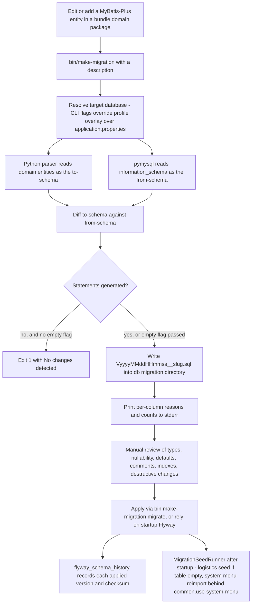

# Workflow: Schema Changes with bin/make-migration and Flyway

Schema evolution in ECShopX-Java is **domain-first**: the MyBatis-Plus entity in the owning Bundle's `domain/` package is the source of truth, and SQL is *generated from it*, never hand-written into a Bundle. The single tool for this is `bin/make-migration`, a Bash + embedded-Python script at the repository root that produces Flyway SQL migrations under `ecshopx-bootstrap/src/main/resources/db/migration`. Flyway then applies them — either manually through the same script, or automatically at application startup.

This page walks the whole loop: change the entity → generate → review → apply → post-startup seed. For the entity/annotation side of the contract (what `@MpTable`/`@MpId`/`@MpField` mean to the ORM), read [Persistence: MyBatis-Plus](../concepts/persistence-mybatis.md); for where startup migration fits in Docker/lite installs, read [Deployment](../operations/deployment.md).

## The mental model: a Doctrine `migrations:diff` for MyBatis-Plus

The script deliberately mirrors the core flow of the legacy PHP project's `php artisan doctrine:migrations:diff`. Contributors coming from `ecshopx-api` should map the concepts like this:

| Legacy PHP (`doctrine:migrations:diff`) | Java (`bin/make-migration <description>`) |
| --- | --- |
| "from" schema = the currently connected database | `information_schema` of the MySQL database resolved from `spring.datasource.*` |
| "to" schema = Doctrine ORM entity metadata | MyBatis-Plus domain annotations: `@MpTable`/`@MpId`/`@MpField`, falling back to stock `@TableName`/`@TableId`/`@TableField` |
| Output = a Doctrine migration class | A Flyway `VyyyyMMddHHmmss__<description>.sql` file |
| `doctrine:migrations:migrate` | `bin/make-migration migrate` (Flyway Maven plugin) or startup migration |
| Migration versions table | `flyway_schema_history` |

The one semantic downgrade the script's own help text is blunt about: *"MyBatis-Plus annotations are less expressive than Doctrine ORM metadata, so generated SQL is best-effort."* Doctrine entities carry complete column metadata; MyBatis-Plus annotations carry a subset, and the generator infers the rest. That is why the review step below is not optional.

## The workflow at a glance



The end-to-end loop, from entity edit to applied migration and post-startup seeding. The only step the tool cannot do for you is the review.

## Step 1 — change the entity, not the SQL

Add or edit the entity in `<bundle>/src/main/java/cn/shopex/ecshopx/<bundle>/domain/`. New tables get `@MpTable(value = "...", comment = "...")` plus `@MpId`/`@MpField` per column; existing tables just gain an `@MpField`. The extended annotations carry the metadata the generator needs:

```java
// ecshopx-super-admin/.../domain/Logistics.java
@MpTable(value = "logistics", comment = "物流公司表")
public class Logistics {

    @MpId(value = "corp_id", type = IdType.AUTO, columnType = "smallint", comment = "物流公司ID")
    private Integer corpId;

    @MpField(value = "corp_code", columnType = "string", comment = "快递鸟代码")
    private String corpCode;

    @MpField(value = "phone", columnType = "string", length = 20, nullable = true, comment = "物流公司电话")
    private String phone;
}
```

`@MpField`'s `columnType`/`length`/`precision`/`scale` drive the SQL type, `nullable`/`defaultValue` drive nullability and defaults, `comment` becomes the column COMMENT, and `unique = true` generates a `uniq_<table>_<column>` unique key. Indexes live on the table: `@MpTable(indexes = {@MpIndex(name = "ix_company_id", columns = {"company_id"})}, uniqueIndexes = {...})`. `IdType.AUTO` in an `@MpId`/`@TableId` is what makes the column `AUTO_INCREMENT`.

Note the annotation defaults, because they shape the generated DDL: `@MpField.nullable()` defaults to `false`, so a column is `NOT NULL` unless you explicitly set `nullable = true`.

At runtime the same annotations are what MyBatis-Plus reads: `MpMetadataAnnotationHandler` (registered by `MybatisPlusCommonConfig` via `GlobalConfig.setAnnotationHandler`) answers MyBatis-Plus' `getAnnotation(TableName.class)` / `getAnnotation(TableField.class)` / `getAnnotation(TableId.class)` questions by synthesizing dynamic `Proxy` instances of the stock annotations from the `@Mp*` values. The `@Mp*` annotations are also meta-annotated with the stock ones. So one set of entity annotations drives both the ORM mapping and the migration diff — even though `make-migration` never loads a Java class; it re-parses the same source files with Python regular expressions (no compilation, no classpath, no running application needed).

## Step 2 — generate the migration

```bash
# from the repository root
bin/make-migration add_order_extra_index
```

What happens:

1. **Naming.** The description is lowercased and every non-alphanumeric run becomes `_`; the version is the current `date +%Y%m%d%H%M%S`. The file is `ecshopx-bootstrap/src/main/resources/db/migration/V<version>__<slug>.sql`. If a file with that exact name already exists (two runs within the same second), the script fails with `Migration already exists`. A description with no letters or digits is rejected.
2. **Connection resolution.** `--db-url`/`--db-user`/`--db-password` win; otherwise the environment (`SPRING_DATASOURCE_URL`/`_USERNAME`/`_PASSWORD`, `SPRING_PROFILES_ACTIVE`); otherwise `application.properties`, overlaid by `application-<profile>.properties` when `--profile` is given. `${ENV:default}` placeholders in property values are resolved against the environment. Only `jdbc:mysql://` URLs are supported; the `characterEncoding=utf8` query parameter is normalized to `utf8mb4` for the connection.
3. **The diff.** An embedded Python program (requires Python 3 + `pymysql`) connects read-only (only `information_schema` SELECTs, `autocommit=True`) and compares:
   * **to-schema** — every `ecshopx-*/src/main/java/**/domain/**/*.java` parsed with regexes;
   * **from-schema** — base tables, columns, primary keys, and secondary indexes of the connected database.
4. **Output.** `CREATE TABLE` statements for mapped tables missing from the database, and one `ALTER TABLE` per table collecting `ADD COLUMN` / `CHANGE` / primary-key / index clauses. Per-column reasons (`type db=... mapping=...`, `comment differs`, …) and a summary count go to **stderr** as warnings — read them; they are the generator telling you what it decided for you.
5. **Empty diff.** With no statements, the script prints `No changes detected in your mapping information.` and exits 1 — no file is written — unless `--allow-empty-diff` (write the file anyway) or `--empty` (skip the diff entirely) is passed.

Every `CREATE TABLE` the generator emits ends with `ENGINE = InnoDB DEFAULT CHARACTER SET utf8mb4 COLLATE 'utf8mb4_unicode_ci'` plus the table comment, matching the Docker MySQL server defaults.

### Reference: every flag, and when to use it

| Flag / form | Effect | Use when |
| --- | --- | --- |
| `bin/make-migration <description>` | Generate `V<timestamp>__<slug>.sql` from the domain↔DB diff | The normal case: you just annotated a new field/table |
| `bin/make-migration migrate` | Run the Flyway Maven plugin `migrate` goal against the resolved database | You reviewed the file and want to apply it now, without rebuilding/starting the app |
| `bin/make-migration repair` | Run the Flyway `repair` goal (cleans up failed rows and realigns checksums in `flyway_schema_history`) | A migration failed halfway and left the history table in a bad state |
| `--empty` | Skip the diff; write a blank `-- TODO: Write migration SQL here.` template | You are writing the SQL by hand (data fixes, backfills, things annotations can't express). Needs no database and no `pymysql` |
| `--profile <name>` | Overlay `application-<name>.properties` when resolving the datasource (and Spring profile defaults from `SPRING_PROFILES_ACTIVE`) | You maintain your own `application-<name>.properties` next to the base file — note the repo ships none (`ecshopx-bootstrap/src/main/resources/application-local.properties` is listed in `.gitignore`), so if you want that convenience you must create the overlay yourself, or instead pass `--db-url`/`--db-user`/`--db-password` or the `SPRING_DATASOURCE_*` environment variables |
| `--db-url <jdbc-url>` | Override `spring.datasource.url` outright | Point the diff at a different database than the configured one — e.g. compare against a fresh `ecshopx.sql` import |
| `--db-user <username>` | Override `spring.datasource.username` | Same, for the user |
| `--db-password <password>` | Override `spring.datasource.password` | Same, for the password |
| `--filter-expression <re>` | Restrict the comparison to tables whose name matches the regular expression — applies to both domain tables and the database side | You changed one table but the full diff would sweep in every bundle's drift; e.g. `--filter-expression '^items$' sync_items` |
| `--changed-only` | Parse only domain files that appear in the git diff (unstaged + staged) under a `/domain/` path, instead of all domain files in all bundles | Same idea, scoped by your working tree instead of a table regex |
| `--allow-drop` | Also emit `DROP COLUMN` for database columns absent from the mapping and `DROP TABLE` for unmapped tables | You deliberately removed a field/table from the domain layer and want the destructive SQL generated — review it twice |
| `--allow-empty-diff` | Write the migration file even when the diff is empty | You want a timestamped placeholder that you will fill with manual SQL |
| `-h` / `--help` | Print usage, the examples, and the doctrine-mapping note | — |

`migrate` and `repair` accept **no** description or extra positional arguments — the script errors out if you pass any. Generated versions are 14-digit timestamps, so they always sort after the two shipped base migrations (`V00000000000001.sql`, `V00000000000002.sql`), which use zero-padded version numbers and therefore always apply first.

### What the diff can and cannot see

* **`@Mp*` annotations are first-class.** `columnType`, `length`, `precision`, `scale`, `nullable`, `defaultValue`, `comment`, `columnDefinition` (verbatim SQL fragment), `unique` are all honored.
* **Stock `@TableName`/`@TableId`/`@TableField` still work**, but with inference: the SQL type comes from a Java-type map (`String` → `varchar(255)`, `Integer` → `int(11)`, `BigDecimal` → `decimal(20,2)`, `LocalDateTime` → `datetime`, unknown → `varchar(255)`), and nullability/default are inferred from the Java field *initializer* — `private Boolean flag = false;` becomes `NOT NULL DEFAULT 0`, no initializer means nullability is simply not compared. This is the "best-effort" the help text warns about.
* **Indexes only come from explicit metadata** — `@MpTable(indexes/uniqueIndexes)` with `@MpIndex(name, columns, unique, lengths)` and `@MpField(unique = true)`. Stock MyBatis-Plus annotations have no index metadata, so the generator never invents secondary indexes; it can only rename/replace an existing DB index whose column signature matches a declared one.
* **Duplicate domain mappings** (two entities claiming the same table) are resolved *richer wins*: more columns, then more indexes, then more PK columns, then the shorter source path — with a warning naming which file was ignored.
* **Comparison semantics**: types are canonicalized before comparing (`int(11)` ≡ `int` ≡ `integer`, `tinyint(1) unsigned` ≡ `tinyint unsigned`); defaults are compared only when the mapping declares one and the type supports defaults (text/blob types never do); comments only when the mapping has one; `auto_increment` presence is compared; **column ordinal position is not compared** — a `CHANGE` never reorders columns.
* `@TableField(exist = false)` / `@MpField(exist = false)` fields are skipped, as they should be.

## Step 3 — review (the non-negotiable step)

The script's parting line is `Generated DDL by comparing connected database schema with MyBatis-Plus domain mapping. Please review before applying.` The generated file opens with `-- Flyway migration: <description>` and `-- Created at: <timestamp>` headers, then the DDL. Check, in this order:

1. **Types** — is `varchar(255)`/`int(11)` really what the column should be? Prefer explicit `columnType` + `length` on the `@MpField` so the generator doesn't guess.
2. **Nullability** — remember `@MpField` defaults to `NOT NULL`. A `CHANGE` that silently tightens a legacy nullable column to `NOT NULL` will fail (or worse, succeed) on production data.
3. **Defaults** — booleans map `TRUE`/`FALSE` → `1`/`0`, numerics are extracted from the string, `CURRENT_TIMESTAMP` passes through; text/blob defaults are dropped by MySQL anyway.
4. **Comments** — generated from `comment` attributes or the JavaDoc; only compared when the mapping declares one, so an empty mapping comment never *removes* a DB comment.
5. **Indexes** — `ADD KEY`/`ADD UNIQUE KEY` only appear from `@MpIndex` metadata; verify names and column order by hand.
6. **Destructive changes** — see the invariant below: `DROP` never appears unless you asked, but `DROP PRIMARY KEY` + `ADD PRIMARY KEY` and index drop/add pairs *are* emitted unconditionally when they differ, so a mismatched PK declaration will rewrite the real primary key.

**Safety invariants** (the reason this workflow is safe to run against a shared database):

* **Review before apply.** Generated SQL is best-effort; nothing validates it against MySQL until Flyway executes it, and no unit test replays `V*.sql` (see [Testing](../testing.md)).
* **No implicit DROPs.** Columns and tables that exist in the database but not in the domain mapping only produce a stderr warning — `DROP COLUMN`/`DROP TABLE` are generated *only* with `--allow-drop`, and `flyway_schema_history` is always excluded from `DROP TABLE` even then.
* **Baseline 0 for pre-Flyway databases.** `baselineOnMigrate=true` with `baselineVersion=0` means an existing database (e.g. one imported from `docker/ecshopx.sql`) is marked as already being at version 0 instead of replaying history.
* **`flyway_schema_history` is the record.** Applied versions, checksums, and success state live there; `repair` exists precisely to fix that table after a failed run.

## Step 4 — apply

Two equivalent paths to the same `flyway_schema_history`:

**Manual — `bin/make-migration migrate`**

```bash
bin/make-migration migrate
bin/make-migration migrate --profile local
bin/make-migration migrate --db-url "jdbc:mysql://127.0.0.1:3306/ecshopx" --db-user ecshopx --db-password ecshopx
```

This invokes `./mvnw -pl ecshopx-bootstrap org.flywaydb:flyway-maven-plugin:migrate` with the resolved URL/user/password, `flyway.locations=filesystem:ecshopx-bootstrap/src/main/resources/db/migration`, `baselineOnMigrate=true`, `baselineVersion=0`, and UTF-8 encoding. Because the location is the *filesystem* directory (not the classpath), a freshly generated file applies immediately — no rebuild, no running application. `repair` is the same invocation with the `repair` goal.

**Automatic — startup migration**

`spring.flyway.enabled=true` in the base `application.properties` (with `locations=classpath:db/migration`, `baseline-on-migrate=true`, `baseline-version=0`, `spring.flyway.encoding=UTF-8`), so a normally started application migrates on boot before serving traffic — startup migration is the norm, not the exception. This is what the Docker and lite install paths rely on: compose imports `docker/ecshopx.sql` first, then the Java container starts, Flyway baselines the legacy schema at 0 and applies `V00000000000001.sql` (the bundle bootstrap changes) and `V00000000000002.sql` (member-signin tables) on top. The base file sets this for *every* profile: the repository ships no `application-local.properties` to switch it off (that path is `.gitignore`d, despite the readme's "already includes" claim), so a local developer who wants manual control either runs `bin/make-migration migrate` themselves or overrides the flag through the usual Spring mechanisms (`--spring.flyway.enabled=false` on the command line, or the `SPRING_FLYWAY_ENABLED` environment variable).

The Flyway runtime itself is a `ecshopx-bootstrap` dependency (`flyway-core` + `flyway-mysql`), which is also why the migration directory lives in that module and nowhere else.

## Step 5 — post-startup seeding (`MigrationSeedRunner`)

Schema migration is only half of "database ready". `MigrationSeedRunner` (an `ApplicationRunner` `@Component` in `ecshopx-bootstrap/src/main/java/cn/shopex/ecshopx/config/`) runs once after the Spring context is up — i.e. after Flyway has finished — and aligns the data side with the legacy PHP `EspierBundle\Listeners\UpdateMenuListener`:

* **Logistics companies, idempotent and non-blocking.** `initLogistics()` counts the `logistics` table; if it is non-empty it does nothing. Otherwise it imports `classpath:seed/logistics/kuaidi.json`, skipping rows with a blank `corp_code` or `corp_name`, and inserts one `Logistics` per valid row (`custom=false`, `created` = epoch seconds). Any failure is caught, logged at WARN (`init logistics failed, skip`), and **does not block startup** — a half-seeded logistics table can be fixed later.
* **System menus, toggleable and transactional.** `updateSystemMenus()` is gated by `common.use-system-menu` (default `true`). When enabled it deletes **all** `company_id=0` rows from `shop_menu` and `shop_menu_rel_type`, then re-imports six seed files in a fixed order — `platform_menu.json`, `it_menu.json`, `shop_menu.json`, `dealer_menu.json`, `merchant_menu.json`, `supplier_menu.json` from `classpath:seed/menu/` — through `ShopMenuUploadService.uploadMenus`. The delete-and-reimport is wrapped in a programmatic `TransactionTemplate.executeWithoutResult`: the deletion and all six file imports are atomic, so a failing file rolls the platform menus back to their previous state instead of leaving them half-populated. Programmatic transaction is deliberate — `run()` calls `updateSystemMenus()` on `this`, which bypasses any proxy-based `@Transactional`. Unlike logistics, failures here **propagate and fail startup**.

The asymmetry is intentional: a missing courier list degrades gracefully; a broken platform menu tree breaks every admin console, so it must be all-or-nothing.

## Failure modes

| Symptom | Cause | Remedy |
| --- | --- | --- |
| `pymysql is required to compare domain schema with MySQL` | Diff mode needs the Python package | `pip install pymysql`, or use `--empty` (no diff, no DB) |
| `No database URL found` | No `spring.datasource.url` in the resolved properties and no `--db-url` | Pass `--db-url`/`--db-user`/`--db-password` or `--profile` |
| `Only jdbc:mysql URLs are supported` | Non-MySQL JDBC URL | The generator is MySQL-only |
| `Migration already exists: ...` | Two generations in the same second | Wait a second and rerun, or rename |
| `No changes detected in your mapping information.` (exit 1) | Domain and database agree | Pass `--allow-empty-diff` if you really wanted a file |
| Flyway fails mid-migration (`flyway_schema_history` row marked failed) | Invalid SQL that survived review | Fix the SQL, then `bin/make-migration repair` before re-running `migrate` |
| Generated `CHANGE` unexpectedly rewrites a legacy column | Inferred type/nullability/default from a stock `@TableField` or the initializer | Pin the metadata with `@MpField(columnType=…, length=…, nullable=…, defaultValue=…)`, or edit the SQL |
| Huge diff full of unrelated tables | Full-tree comparison is the default | `--filter-expression` or `--changed-only` |

## Testing

`MigrationSeedRunnerTest` (`ecshopx-bootstrap/src/test/java/cn/shopex/ecshopx/config/MigrationSeedRunnerTest.java`) pins the seeding semantics with mocked mappers and a synchronous inline `TransactionTemplate`: logistics inserts only when the table is empty and skips blank `corp_code`/`corp_name` rows; a non-empty logistics table never inserts; the menu toggle off does nothing; the toggle on deletes both tables then uploads exactly the six files, in order.

There is deliberately **no** test that executes Flyway `V*.sql` against a real MySQL — the unit suite never touches a database, so schema correctness is verified by this workflow's review step plus a manual or docker run (see [Testing](../testing.md) for what that means for your confidence budget).

## Checklist

1. Edit/add the entity under `<bundle>/domain/` with `@Mp*` metadata — include `company_id` (and `distributor_id` when shop-scoped) plus the `ix_company_id` index.
2. `bin/make-migration <snake_case_description>` — scope with `--filter-expression`/`--changed-only` if you only touched one table; `--allow-drop` only if you removed something on purpose.
3. Read the stderr warnings, then review the SQL in the generated `V*.sql` (types, nullability, defaults, comments, indexes, destructive clauses).
4. Apply: `bin/make-migration migrate` for local control, or let startup Flyway do it (`spring.flyway.enabled=true`).
5. Remember data seeding: logistics is empty-table-gated; system menus are wiped and re-imported on **every** startup while `common.use-system-menu=true` — do not park manual `company_id=0` menu edits in that path.
6. Commit the entity and the migration together; `flyway_schema_history` is the runtime record, the SQL file is the source-of-truth history.

## Related pages

* [Persistence: MyBatis-Plus](../concepts/persistence-mybatis.md) — the entity layer this workflow generates from, `@Mp*` annotation reference, tenancy conventions.
* [Deployment](../operations/deployment.md) — where startup migration sits in the Docker/lite install flows and how `docker/ecshopx.sql` interacts with `baselineVersion=0`.
* [Testing](../testing.md) — why schema correctness lives outside the unit suite.
